<!-- PDF_PAGE: 1 -->

# Model-Based Semi-Physical Simulation Platform Architecting for Satellite Communication System

Su Gao Institute of Telecommunication Satellite China Academy of Space Technology (CAST) Beijing, P. R. China 15712889970@163.com

Yusheng Liu State Key Lab of CAD&CG Zhejiang University Hangzhou, P. R. China ysliu@cad.zju.edu.cn

Yue Cao State Key Lab of CAD&CG Zhejiang University Hangzhou, P. R. China 329368945@qq.com

Luhai Fan Institute of Telecommunication Satellite China Academy of Space Technology (CAST) Beijing, P. R. China

Guangyu Long International Cooperation Department Pera Corporation Ltd. Beijing, P. R. China

Abstract—Comprehensive simulation should be carried out before satellite communication system is physically deployed. Its complexity and rapid technical development require careful design to make it robust for integration and scalable to future changes. In this paper, we design an architecting procedure for satellite communication simulation platform with top-level decision optimization following object-oriented system engineering methodology (OOSEM) with SysML language. Decision tradeoff analysis is presented at various levels. Architecture selection conclusion is drawn for satellite communication system architects assisting their decision-making.

Keywords—satellite communication system; simulation platform; architecture; OOSEM; SysML; decision-making

## I. INTRODUCTION

Semi-physical simulation platform architecture for satellite communication system are mostly designed based on established mature platform. It is not well adaptable to emerging new technologies. In addition, when complex system is required to optimize in system level or even in system of system (SoS) [1] level, multiple stakeholder needs and robust interface design should be considered with prudence to make less system breakdown at integration stage.

Architecting for information-centric systems using SysML has been widely researched in recent years. Related works in literature include SoS applications from aerospace to ground vehicle, ranging from preliminary design, product line to reliability analysis. A series of Cubesat MBSE reference models are developed in [2][3][4]. Other works related to Cubesat MBSE design includes SysML modeling of Cubesat for the Radio Aurora Explorer (RAX) mission [5], SysML-aided behavior definition based on requirement [6], etc. Inter-

satellite communication link design for small satellite is presented in [7] where SysML is used for the framework design. Onboard electronic system of spacecraft based on MBSE is first investigated in [8]. MBSE methodology is also applied in hardware-in-loop simulation for a vehicle system [9] and other simulation-based development such as the experimental digital twin using a virtual testbed in [10], and configuration development for collaborative simulation with product data management in [11]. MBSE has been widely applied in product line engineering (PLE), such as agile architecture design of lifecycle modeling of [12] and product similarities and differences management using ISO reference models together with MBSE using SysML [13]. For system reliability and safety, model-based failure mode and effects analysis (FMEA) is presented in [14] with future directions given. Fault tree is generated in [15] using MBSE in system safety analysis.

This paper investigates the first several top-level decisions for designing a simulation platform. From top down, we design a decision support procedure described using object-oriented system engineering methodology (OOSEM) [16] with SysML language [17]. Then simulation is carried out and results are evaluated. Finally, architecture selection decision is concluded. Requirement traceability is also analyzed to close the loop for OOSEM modeling.

Our innovation in this paper is three-fold. First, satellite communication system and its pre-deployment simulation platform are modeled with OOSEM modeling using SysML. Second, tradeoff analysis is presented for semi-physical simulation platform at various levels and implementation stages. Third, solution is drawn for top-level satellite

<!-- PDF_PAGE: 2 -->

communication system and simulation platform design for the assistance of decision-making.

## II. PROBLEM STATEMENT

## A. Main Aim and MoEs

The main aim of this design is to establish a semi-physical platform, to verify a satellite communication system can transmit user service with acceptable performance. Elements within this platform should be implemented in required time period with mature technology. Meanwhile, the platform should consider scalability, which means it should be expandable with future technical evolution.

Measurements of effectiveness (MoEs) are targeted goal of the platform designed to satisfy stakeholder needs and mission requirements. The choice of the MoEs should follow some criteria. First, the measurements should be assessed with quantifiable properties rather than those not easily quantified ones such as stakeholder satisfaction degree. Second, the measurements should reflect those features which top-level designer is concerned with. Typical ones for the communication system are time delay and capacity. Management may additionally care about cost, production duration and risk. Those only related to fundamental implementation details, as bit error rate (BER) or signal-to-noise-ratio (SNR), are not directly concerned by the top-level decisions. Third, selected measurements at SoS level should be dividable into system and lower levels to maintain design connections from top to bottom. For example, time delay can be divided into component processing time and communication channel transmission delay; capacity can be divided into transmission rates for various services and number of users, and also derive requirements to satellite mass and power limits.

## B. Analysis Method for Decision Simulation Results

Architecture optimization should obtain tradeoffs among certain MoEs. With results at hand, the following analysis methods are used to bridge the gap between initial raw simulation data and final architecture decisions. First, with obtained scatter plot with points representing design choices, Utopia point and Pareto front [18] should be found out. More non-dominated architecture should be included to obtain fuzzy Pareto front [19]. The architecture choices within it are analyzed to find similarities to make fist-step decision of which types of choices give better MoE values.

Second, more data mining effort should be made to find properties for architecture choices in the same cluster [20]. This is usually done within the whole tradespace, to find whether these architecture with similar MoEs has similar decision choices. Also, edge points of stratificated cluster [21] should be paid close attention to, as sub-optimal decision with various assumptions are usually made from these points.

## III. OOSEM MODELING USING SYSML

We model the problem with OOSEM methodology using SysML modeling language. The architecture decision procedure described above is central within our OOSEM model. It solves key problems while OOSEM goes from top-level

stakeholder needs to detailed implementation, especially from logical to physical architecture, where many decision choices, tradeoff and parametric analysis happens, as described in this section.

## A. Stakeholder Needs Analysis

## 1) Mission Requirements

The satellite communication system characteristics drives the mission requirement decomposition to the next level. Link establishment between users and management and control center is an essential prerequisite. Real-time and non-real-time communication services have different performance requirements for the system. System manager has production cost and scalability concerns, somehow independent of technical solution.

The next level mission requirement thus has the following parts: reliable service requests management and link establishment; real-time communication service transmission, e.g. voice and video; non-real-time communication service transmission, e.g. data and file-based transmission; implementation in required time period with mature technology, making the platform robust, fast and easy to implement; expandable or can be easily partially replaced when future technology is available.

## 2) Measurements of Effectiveness (MoEs).

a) Time Delay (TD): time spent during transmission from start user (transmitter) to end user (receiver). Time delay has unit "second" and with type "double".

Considering satellite communication feature, user terminal (UE) planning to make connection with another one should register with ground management and control center (GMCC) through link establishment operation. Information stream should go from UE to access satellite (AS), then through satellite network (SN) to reach the GMCC. Permission for communication is then sent from the GMCC back to the UE in the same route. This is known as transparent forwarding in satellite communication terminology. This process is shared by the non-real-time communication.

For real-time communication, signal going back to the GMCC results in doubled transmission delay. Thus, it is necessary to accomplish processing and forwarding within the SN, requiring onboard processing capability in satellites.

The three communication scenarios are shown in Fig.1. Please note that in our work, access satellite represent the access point in the SN for UE requiring satellite services. It is separated from SN for the ease of modeling and analysis.

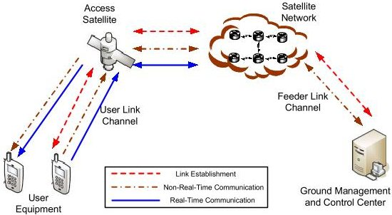

Fig.1. Satellite Communication Scenarios

<!-- PDF_PAGE: 3 -->

Time delay of link establishment equals to the sum of time for UE and access satellite processing, user and feeder link channel transmission, satellite network routing and ground management and control center processing time. Time delay of non-real-time communication is similar as that of link establishment. Time delay of real-time communication is similar but without those of GMCC processing and feeder link transmission.

b) System Capacity (SC): total transmission rate the system can provide for users. System capacity has unit "bits per second (bps)" and with type "double". System capacity (SC) is defined as

$$
\mathrm {S C} = \mathrm {R} _ {\mathrm {p e r - l i n k}} \times \mathrm {N} _ {\mathrm {u s e r - p e r - s a t}} \times \mathrm {N} _ {\mathrm {s a t}} + \mathrm {S C} _ {\mathrm {t e r}}
$$

where $ R_{\mathrm{per-link}} $ is transmission rate per user link, $ N_{\mathrm{user-per-sat}} $ is user number per satellite simultaneously, $ N_{\mathrm{sat}} $ is satellite number and $ \mathrm{SC}_{\mathrm{ter}} $ is terrestrial capacity GMCC can support.

c) Cost (C): money spent during system manufacturing. Cost has unit "RMB" and with type "double". Total manufacturing cost includes the costs of UE, AS, SN and GMCC.

d) Risk (R): measured using success rate, while system with low realization risk brings high success rate. Risk has no unit and expressed as a percentage number. Risk is defined as combined success rate of UE, AS, SN and GMCC.

## 3) Domain Model Definition and Use Cases

Defining domain model sets the scope of model elements with which all activities, parameters and interface are operated in this specific domain. Operation and elements outside this domain scope should be classified as external activities and should interact with the domain using external interface.

Use case definition is essential in OOSEM modeling. It is derived from the mission requirements and directly related to stakeholder needs; it also serves as a guideline when determining how activity diagrams [17] are drawn at SoS, system and subsystem levels.

In our use case design, stakeholders are classified into three categories: communication system user, platform builder and system manager and operator. The communication system user is the main application drive of building this platform. It cares about whether the platform provides satisfactory service with required MoE performance. Thus, use cases for this stakeholder type form the core activities of the platform including link establishment, real-time and non-real-time communication services. The platform builder builds the platform according to the communication system user's requirements. There are also issues cared by enterprise management and operator of the platform, as implementing the platform in required time period and making the platform expandable with replacement of future technology. Their demand is reflected as the two additional use cases.

For each enterprise use case, define one or more mission scenarios giving system elements (as defined in the domain model) interaction and information streams to fulfill mission requirements. Scenario selection should contain core system

## B. System Requirement (Black-Box) Analysis

functionality with frequently happened procedures. Exceptions and failure mode should also be considered if there exists.

System context definition uses internal block diagram (IBD) in SysML. Based on the domain model definition, it further defines block interaction at black-box level. Blocks in this IBD are identical to the ones in the domain block definition diagram (BDD) model. Data streams between models are the same as the ones in the activity model for the scenario definition.

System context definition is followed by black-box system requirements, using the SysML BDD as shown in Fig. 2. The bottom box presents interface IBD as part of the black-box requirements. Others include the four MoE values as we already defined, and operations which are consistent with those activities in the mission scenarios. In this way, we go from the stakeholder needs to the system black-box requirements, which forms foundation and gives input for white-box logical analysis as discussed next.

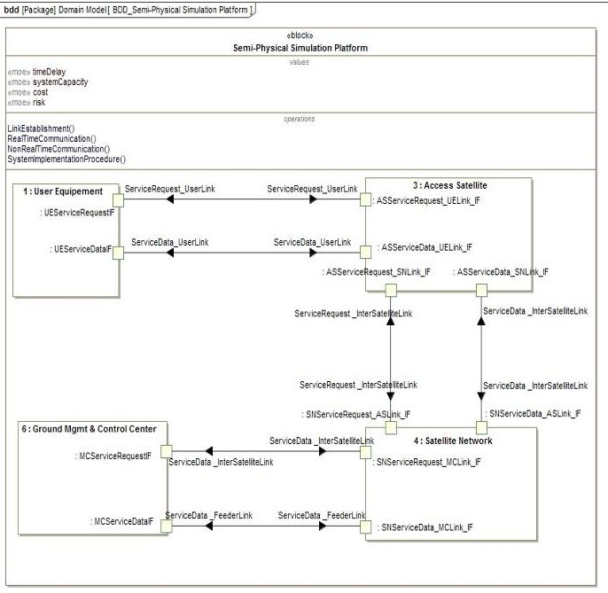

Fig.2. Black-Box Specification

## C. Logical Architecture (White-Box) Definition

Logical decomposition defines sub-level blocks for the domain model using SysML BDD. In general, model granularity varies depending on the architecture problems under consideration. In our case, stakeholder requirements for reliable link establishment and communication trades off with equipment realization complexity. Here we use open system interconnection (OSI) model [22] to classify functionality to layers through which equipment can realize.

Based on the above, the satellite is logically decomposed into payload and bus then the payload is decomposed into network routing, data link access and physical layer transmission, which are consistent with OSI's lower three layers. The UE and GMCC do similar decomposition. Besides transmission, the GMCC has management and control functionality. We take the fourth-generation long term evolution (4G-LTE) eNodeB and EPC architecture [23] and employ a modified version of them to our GMCC.

<!-- PDF_PAGE: 4 -->

Detailed description can be given for all the black-box level elements, including logical component interaction using activity diagrams, system logical interaction using IBD and logical component parameters (values, operations and ports) using BDD.

## D. Logical Partitioning and Physical Alternatives

## 1) Partitioning Criteria for Node Logical Architecture

Here node represents partition of the logical architecture based on their physical location and organizational responsibility [17]. Similar as in most cases, our platform is divided and accomplished by several subcontractors. Then they are assembled and tested by the integrator. Thus, logical decomposition to nodes takes into account ease of implementation and integration; and should make best use of each subcontractor's technical advantages. Based on the logical architecture above, we divide our platform into the following three main node logical architectures:

- Network control and management: includes functionality above OSI network layer with the focus on ground segment design. Network layer is reflected by an abstraction of satellite network routing. User access to the satellite is abstracted as data streams without details in the data link and physical layers implemented.

- Communication access: focuses on physical and data link layers. This node implements communication access procedure and link transmission in both access satellite and user equipment. In this case network routing and ground segment control and management are abstracted.

- Network routing: is mainly focused on satellite network routing layer performance. Routing is simulated for the whole satellite network as well as detailed routing implementation in a single satellite. The layers below the network layer is abstracted, but layers above should be implemented to give emphasis to the interaction between routing and network control and management process.

Partitioning from logical to node logical architecture addresses key MoEs, such as delay and capacity, to be allocated to sub-level systems, so that the implementation, test and verification are more physically achievable. Partitioning also reduces the impact of technology changes, with certain modules replaced with better performance in the future. Tradeoff relating to this is discussed next.

## 2) Physical Implementation Problems Encountered

Architecture decisions should be made at various levels when the designer goes from the node logical architecture to physical. Examples include evaluating and choosing among solution options, modeling and predicting system performance for alternative solutions, analyzing cost and risk due to technical evolution, etc. For our platform, we identify four key decisions need to be made before physical implementation.

The first decision is about satellite service management and data transmission interaction. Consider a sub-scenario of

the mission scenario defined above, where UE transmits uplink signal to access satellite. Link establishment and data service modules at UE are essential and must connect to resource allocation module in satellite. But retransmission scheme, such as hybrid automatic repeat request (HARQ) in LTE, should be simplified due to large transmission delay of UE-satellite link. Similar reasoning happens for channel quality information (CQI) transmission. However, without retransmission or CQI the received signal may suffer low quality. This is a tradeoff between link delay and capacity, as the link resources used for retransmission and CQI improves transmission quality, thus increasing transmission rate. This problem is represented in Fig. 3(a). Solid lines are needed for any decision choices. Dotted lines are optional. In our simulation, the dotted lines may represent HARQ or CQI transmission several times where the transmission time is also a decision to be made.

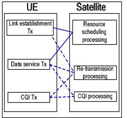

(a)

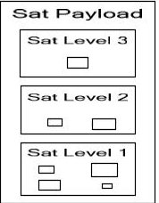

(b)

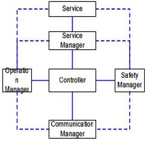

(c)

Fig. 3. Physical Implementation Decisions (Decisions 1-3)

The second decision considers satellite payload functional complexity. This is a frequently discussed problem in satellite design community with tradeoff between stakeholder performance requirement and satellite resource limit. Here we use level 1, 2, 3 to represent OSI physical, data link and network layer for short. If satellite contains level 2 or even level 3 processing, part of the communication process is dealt with onboard rather than going back to the GMCC. This reduces the transmission delay especially when the satellites are located in a very high orbit. However, this burdens satellite with more processing tasks. With fixed satellite capability, e.g. mass and power restrictions, these additional tasks may eat satellite capacity that is originally to be used for transmission data in higher rate. This problem is shown in Fig. 3(b). We assume resource used for satellite payload processing is a number of resource blocks (such as FPGA implementation). Different blocks may vary in size due to various functional or parameter sets. Satellite payload architect should choose from all candidate resource elements according to performance measures, and decide for level 1, 2 and 3 the number of resource blocks chosen.

The third decision considers network connectivity of the GMCC, which is the center for satellite resource management, communication connection control and satellite-terrestrial network interaction. As shown in Fig. 3(c), it gives an GMCC instance abstracted from 4G-LTE eNodeB and EPC functionalities and modified according to satellite ground segment characteristics. When designing the architecture above, it is important to decide whether the network is "star-like" as the solid lines, or "mesh-like" as the solid plus dotted lines, or something between. For the star-like architecture, all management tasks should go to central controller, making the

<!-- PDF_PAGE: 5 -->

whole network with high processing delay and vulnerable to single point failure. For the mesh-like ones, control functionality is distributed in each node, bringing faster processing speed but may require more complicated scheduling design.

The last decision is architecture scalability. The simulation platform is built with currently realizable technologies. Manager and operator may consider its scalability when novel technology comes out. Thus, a possible design choice is to make those fast-evolving components, such as physical layer modulation part, easily replaceable. This requires frequently changed components implemented as separate hardware, which increases cost but reduces architecture scalability risk. This problem is divided into five sub-decisions each with two choices as shown in TABLE I.

The MoEs for this analysis, risk and cost are also shown in the table. Risk levels are defined from low to high: low with success rate 0.98, low-medium with success rate 0.96, medium with success rate 0.94, high-medium with success rate 0.92 and high with success rate 0.9. Cost is estimated based on market price in China with unit RMB.

TABLE I. ARCHITECTURE SCALABILITY OPTIONS (DECISION 4)

<table border="1"><tr><td rowspan="2" colspan="2">Sub-decisions</td><td colspan="4">Choices and MoEs</td></tr><tr><td colspan="2">Choices</td><td>MoE</td><td>Value</td></tr><tr><td rowspan="4">a</td><td rowspan="4">UE integration</td><td rowspan="2">1</td><td rowspan="2">Integrated</td><td>Risk</td><td>0.9</td></tr><tr><td>Cost</td><td>90</td></tr><tr><td rowspan="2">2</td><td rowspan="2">Distributed</td><td>Risk</td><td>0.96</td></tr><tr><td>Cost</td><td>150</td></tr><tr><td rowspan="4">b</td><td rowspan="4">Satellite payload integration</td><td rowspan="2">1</td><td rowspan="2">Integrated</td><td>Risk</td><td>0.9</td></tr><tr><td>Cost</td><td>120</td></tr><tr><td rowspan="2">2</td><td rowspan="2">Distributed</td><td>Risk</td><td>0.94</td></tr><tr><td>Cost</td><td>200</td></tr><tr><td rowspan="4">c</td><td rowspan="4">Satellite network simulation content</td><td rowspan="2">1</td><td rowspan="2">Signal connection</td><td>Risk</td><td>0.96</td></tr><tr><td>Cost</td><td>40</td></tr><tr><td rowspan="2">2</td><td rowspan="2">Signal connection and service transmission</td><td>Risk</td><td>0.92</td></tr><tr><td>Cost</td><td>70</td></tr><tr><td rowspan="4">d</td><td rowspan="4">Requirement input and MoE output integrated to GMCC</td><td rowspan="2">1</td><td rowspan="2">Yes</td><td>Risk</td><td>0.96</td></tr><tr><td>Cost</td><td>15</td></tr><tr><td rowspan="2">2</td><td rowspan="2">No</td><td>Risk</td><td>0.98</td></tr><tr><td>Cost</td><td>30</td></tr><tr><td rowspan="4">e</td><td rowspan="4">View implementation</td><td rowspan="2">1</td><td rowspan="2">Network surveillance</td><td>Risk</td><td>0.94</td></tr><tr><td>Cost</td><td>20</td></tr><tr><td rowspan="2">2</td><td rowspan="2">Network surveillance plus satellite operation</td><td>Risk</td><td>0.96</td></tr><tr><td>Cost</td><td>45</td></tr></table>

## E. Evaluation and Optimization

Technical scheme evaluation of the four decision problems are discussed with the decision tradespace given.

In the satellite service management and data transmission interaction analysis, two representing UE uplink service management signals in LTE MAC layer are service request (SR) and buffer status report (BSR) [23]. Their successful transmission guarantees link establishment for the service information (SI) transmission. Rather than in the 4G-LTE and current satellite communication scheme where management and service signals share one frame [24], the satellite transmission in our scheme assumes separate transmission to some extent reflected in retransmission and CQI feedback

schemes. Set six options for the SR, BSR and SI retransmission times and seven for CQI transmission times, architecture choices, i.e. the tradespace size for this analysis is $ \mathrm{N}_{1}=6^{3}\times 7=1512. $

The satellite payload functional complexity analysis divides satellite payload to a number of layers according to the OSI model. Assume the resource block number of layer 1, 2, 3 are 10, 5, 2, respectively. In addition, the white-box logical model decomposes activities related to this analysis into three service types. The access and routing schemes vary for different service type and data volume, resulting in a number of intersatellite-link routing hop options. Assume hop numbers for the above three services are drawn from 25, 20, 12 and 8 options (20 and 12 are for service type two management and service transmission, respectively). Hop delay determination are based on comprehensive air interface simulation. Thus, the tradespace size for this analysis is $ \mathrm{N}_{2}=1 0 \times 2 5+(1 0 \times 5) $ $ \times 2 0 \times 1 2+(1 0 \times 5 \times 2) \times 8=1 3 0 5 0. $

The ground management network connectivity analysis assumes UE and terrestrial access to the network, each of which has four service types defined in the logical model decomposition, including user registration to the GMCC, UE service request, terrestrial service request, service connection and mobility management. Executing the above services has 3, 4, 3, 4, 4 options, respectively. Each of the options has two choices inclined to either centralized or distributed design. Thus, the tradespace size for this analysis is $ \mathrm{N}_{3}=2^{3}\times(2^{4}+2^{3}) $ $ \times2^{4}\times2^{4}=49152. $

The architecture scalability analysis has five sub-decisions each with two choices, so its tradespace size is simply $ \mathrm{N}_{4}=2^{5}=32. $

## F. Requirement Traceability

Results should be connected with the mission and system requirements. At each level, design should be traced back to make sure requirements at this level are satisfied. Test cases should be sufficient to verify the design is consistent with the requirements.

## IV. ARCHITECTURE SELECTION ANALYSIS

## A. Simulation Results

Simulation results for the four decision problems are shown and analyzed in this subsection. For each decision, the tradespace is first shown with architecture points calculated according to certain MoE tradeoffs. Then the fuzzy Pareto front is defined to select non-dominated architectures for further analysis. Data mining is carried out on the selected points with emphasis on their physical meaning in the satellite communication system implying architecture decision suggestions. In all the following tradespace plots, the fuzzy Pareto front is shown with solid line and upper-left points of this lines have optimal performance among all the architectures.

1) Decision 1 Results and Analysis: Satellite Service Management and Data Transmission Interaction

Fig. 4 gives the tradespace for the decision problem 1, satellite service management and data transmission interaction

<!-- PDF_PAGE: 6 -->

analysis. It shows that, architecture points in terms of capacity and delay MoE gather into clusters forming an exponential curve. Pareto front is easily obtained as the dash-dotted line in the figure. We choose the fuzzy Pareto front as the solid line with expression $ \mathrm{SC=0.573\times T D}^{3.737} $ . Architectures on the uppter-left side of this line, 105 points, is chosen as nondominated ones, which take up 105/1512=6.9% of the tradespace.

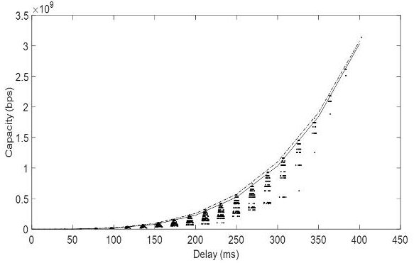

Fig. 4. Decision Problem 1 Tradespace with Pareto Front (Dash-Dotted Line) and Fuzzy Pareto Front (Solid Line)

Analysis is first done for the whole tradespace. An obvious trend is that cluster with better capacity and delay performance tends to have more "averaged" retransmission time. Inside one cluster, the architecture with similar retransmission values and in the middle range times tend to have outperforming capacity values. For stratifications with sub-optimal capacities in this cluster, the architectures with higher retransmission time for SR and BSR tend to have better delay performance. This indicates that designing architecture with more retransmission times at service request stage gives better delay performance.

Furthermore, non-dominated architecture subset statistics is shown in Fig. 5. Proportion of architectures with various transmission times among this subset is displayed for BSR, SR, SI and CQI, in Fig. 5(a), (b), (c) and (d), respectively. Those architectures with transmission times 2 and 3 dominates the subset. For SI and CQI transmission times, the architectures with numbers greater than 4 are not included in this subset and thus are not recommended in practical design.

## 2) Decision 2 Results and Analysis: Satellite Payload Functional Complexity

Fig. 6 gives the tradespace for decision problem 2, satellite payload functional complexity analysis. We set its fuzzy Pareto front to includes the "upper-left corner points" within each of the three clusters. It is shown as the solid line in the following figure with expression $ \mathrm{SC=35.17\times T D^{3.063}} $ . The architectues above this line, 153 points, is chosen as non-dominated ones, which take up 153/13050=1.2% of the whole tradespace.

When choice is made among clusters, i.e. among onboard processing and transparent forwarding, 30ms decrease of time delay results in capacity reduced in half. It gives architects clue when balancing delay and capacity with satellite onboard complexity constraint. There are three overlapping clusters representing those drawn from the mentioned three service types. If balanced results with similar capacity-delay pair are needed for various service types, architects may draw points from the overlapped area.

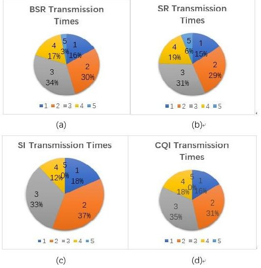

Fig. 5. Decision Problem 1 Non-Dominated Architecture Analysis

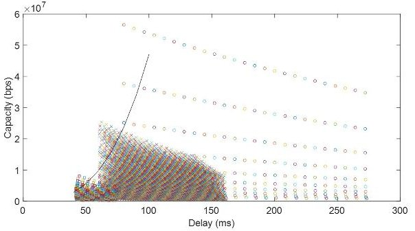

Fig. 6. Decision Problem 2 Tradespace with Fuzzy Pareto Front (Solid Line)

Detailed analysis of the non-dominated architectures is shown in Fig. 7. The three clusters in the whole tradespace represents, from top to bottom, satellite payload design choices with layer 1 only, layer 1 plus 2, and layer 1, 2 plus 3. The non-dominated ones are just subsets of these three clusters. Fig. 7(a) shows distribution among these three choices, where the numbers 1, 2, 3 in the figure represents the above three design choices. This suggests architects the best choice is to design physical and data link layers together onboard. Design with physical layer only take merely 4% of the non-dominated ones. Fig. 7(b) calculates the average of the three sub-clusters in the non-dominated architectures. Architects may refer to this for delay and capacity change when changing from one design choice to another. For example, when design change from layer 1, 2 plus 3 to layer 1 plus 2, average time delay increases from 44.96ms to 67.48ms, whereas average system capacity increases to more than 3 times.

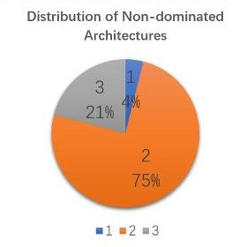

(a)

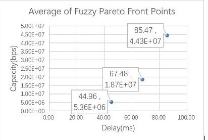

(b)

Fig. 7. Decision Problem 2 Non-Dominated Architecture Analysis

<!-- PDF_PAGE: 7 -->

3) Decision 3 Results and Analysis: Ground Management Network Connectivity

Fig. 8 shows the tradespace for decision problem 3, ground management network connectivity with separated results for satellite UE access in (a) and terrestrial access in (b). Fuzzy Pareto front is shown as the solid line in both. For UE access, it has linear expression $ \mathrm{S C_{U E}=0. 0 6 7 \times T D_{U E}+0. 3 4}. $ The architectures on the uppter-left side of this line, 521 points, is chosen as non-dominated ones. For the terrestrial access, it has linear expression $ \mathrm{S C_{T e}=0. 0 2 8 \times T D_{T e}+0. 7 8} $ with number of non-dominated architectures 375. Altogether the non-dominated architectures take up (521+375)/49152=1.8% of the whole tradespace.

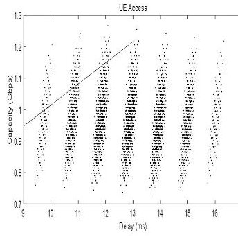

(a)

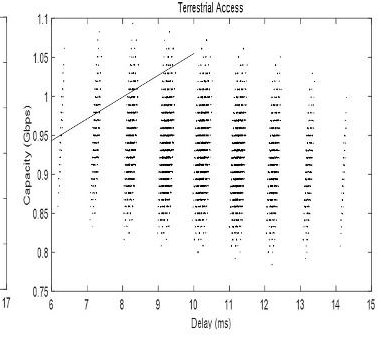

(b)

Fig. 8. Decision Problem 3 Tradespace with Fuzzy Pareto Front (Solid Line) for Satellite UE Access (a) and Terrestrial Access (b) Scenarios.

This analysis differs from the above two in that several architecture clusters (on the bottom right of the plot) can be eliminated entirely due to disadvantage in both capacity and delay values. This phenomenon is more obvious in the terrestrial access than in the UE access, as in the terrestrial access figure, clusters on the left have better capacity, making its advantage more obvious than those clusters on the right.

Analysis of the non-dominated architectures is shown in Fig. 9. This figure shows choice proportion made for 15 options of UE access in (a) and 14 options of terrestrial access in (b). As mentioned earlier, each option is a binary decision with two choices representing integrated or distributed architecture design. As predicted, the distributed architecture with less access to controller have lower delay and higher capacity, even for those with much processing relating to controller, for which case these functionalities should be more suited within operation and communication manager as in Fig. 3(c).

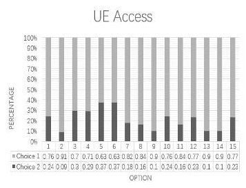

(a)

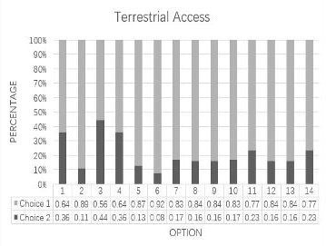

(b)

Fig. 9. Decision Problem 3 Non-Dominated Architecture Analysis for Satellite UE Access (a) and Terrestrial Access (b) Scenarios.

4) Decision 4 Results and Analysis: Architecture Scalability

Fig. 10 shows the tradespace for decision problem 4, architecture scalability analysis. Fuzzy Pareto front is shown as the solid line with linear expression R=0.000786 $ \times $ C+0.4677, where R is risk expressed as a percentage number and C is cost with unit RMB. 32 points above this line make up the nondominated subset which takes up 25% of the tradespace.

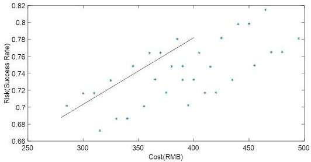

Fig. 10. Decision Problem 4 Tradespace with Fuzzy Pareto Front (Solid Line)

Data and choices of the non-dominated architectures are shown in TABLE II. Optimal points near the fuzzy Pareto front are common in that the choices for both the satellite payload integration and the satellite network simulation content (subdecisions b and c) are their first choice, i.e. "integrated" and "signal connection only". Cost-sensitive decision maker should choose each sub-decision their first choices. The results tend to prefer integrated and easier implementation rather than those distributed approaches. For other three sub-decisions, architects may choose among the eight architectures according to various cost-risk tradeoff preference.

TABLE II.

DECISION PROBLEM 4 NON-DOMINATED ARCHITECTURE DATA AND CHOICES

<table border="1"><tr><td rowspan="2">No.</td><td rowspan="2">Cost</td><td rowspan="2">Risk</td><td colspan="5">Sub-Decisions</td></tr><tr><td>a</td><td>b</td><td>c</td><td>d</td><td>e</td></tr><tr><td>1</td><td>285</td><td>70.17%</td><td>1</td><td>1</td><td>1</td><td>1</td><td>1</td></tr><tr><td>2</td><td>310</td><td>71.66%</td><td>1</td><td>1</td><td>1</td><td>1</td><td>2</td></tr><tr><td>3</td><td>300</td><td>71.63%</td><td>1</td><td>1</td><td>1</td><td>2</td><td>1</td></tr><tr><td>4</td><td>325</td><td>73.16%</td><td>1</td><td>1</td><td>1</td><td>2</td><td>2</td></tr><tr><td>5</td><td>345</td><td>74.85%</td><td>2</td><td>1</td><td>1</td><td>1</td><td>1</td></tr><tr><td>6</td><td>370</td><td>76.44%</td><td>2</td><td>1</td><td>1</td><td>1</td><td>2</td></tr><tr><td>7</td><td>360</td><td>76.41%</td><td>2</td><td>1</td><td>1</td><td>2</td><td>1</td></tr><tr><td>8</td><td>385</td><td>78.03%</td><td>2</td><td>1</td><td>1</td><td>2</td><td>2</td></tr></table>

## B. Requirement Traceability Revisited

Satisfy dependency matrix is drawn to show requirement traceability as presented in Fig.11. Here only the top-level requirements and black-box design are shown. It can be seen the equipments and analysis context are satisfied via model design. The requirements are reflected in most element design. Some analysis is relevant only to certain modules, e.g. the GMCC connectivity only considers analysis in GMCC. The model design tradeoffs are traced back to analysis context to make sure requirement is satisfied in such a model-based way.

<!-- PDF_PAGE: 8 -->

<table border="1"><tr><td></td><td></td><td colspan="4">1. UE-------2. AS-------3. SN-------4. GMCC-------</td></tr><tr><td>Requirements and analysis</td><td></td><td>7</td><td>8</td><td>7</td><td>6</td></tr><tr><td>1. Establish simulation platform</td><td></td><td></td><td></td><td></td><td></td></tr><tr><td>1.1 Link establishment</td><td>4</td><td>✓</td><td>✓</td><td>✓</td><td>✓</td></tr><tr><td>1.2 Non-real-time communication</td><td>4</td><td>✓</td><td>✓</td><td>✓</td><td>✓</td></tr><tr><td>1.3 Real-time communication</td><td>3</td><td>✓</td><td>✓</td><td>✓</td><td></td></tr><tr><td>1.4 Time-limited implementation</td><td>4</td><td>✓</td><td>✓</td><td>✓</td><td>✓</td></tr><tr><td>1.5 Scalability</td><td>4</td><td>✓</td><td>✓</td><td>✓</td><td>✓</td></tr><tr><td>2. Perform analysis</td><td></td><td></td><td></td><td></td><td></td></tr><tr><td>2.1 Management and data interaction</td><td>2</td><td>✓</td><td>✓</td><td></td><td></td></tr><tr><td>2.2 Payload functional complexity</td><td>2</td><td></td><td>✓</td><td>✓</td><td></td></tr><tr><td>2.3 GMCC connectivity</td><td>1</td><td></td><td></td><td></td><td>✓</td></tr><tr><td>2.4 Scalability</td><td>4</td><td>✓</td><td>✓</td><td>✓</td><td>✓</td></tr></table>

Fig. 11. Satisfy Dependency Matrix

## V. CONCLUSIONS

Here we give some practical conclusions for architecting practitioners/implementers by summarizing the main results in the above section. For decision 1, one may choose those decision combinations with "averaged" retransmission time; it is also desired to allocate more retransmission times at the communication link establishment stage, i.e. BSR and SR transmission. Decision 2 gives practical advice for balancing satellite implementation complexity and performance where the lower two layers, physical and data link, are suggested to be implemented onboard with practical delay and capacity parameters given. Decision 3 results suggest that distributed architecture lowers the burden of the controller with lower delay and higher total capacity where the 14 or 15 binary choices should be made for various data flows. For decision 4, architects may refer to the results for cost and risk estimates, from which decisions are made different for cost-sensitive and risk-sensitive architects.

In conclusion, we present top-down OOSEM modeling of satellite communication semi-physical simulation platform with SysML language. Architecting decision problems are identified from logical to physical implementation. Solutions are drawn by plotting architecture performance scatter plot with data-mining efforts. Architecture decision choices are presented to architects for the assistance of their decision-making.

## REFERENCES

[1] M. Jamshidi, Systems of Systems Engineering: Principles and Applications. CRC Press, 2009.

[2] D. Kaslow, L. Anderson, S. Asundi, B. Ayres, C. Iwata, et al., Developing a Cubesat model-based system engineering (MBSE) reference model - interim status, IEEE Aerospace Conference, Big Sky, MT, 2015

[3] D. Kaslow, L. Hart, B. Ayres, C. Massa, M. J. Chonoles, et al., Developing a Cubesat model-based system engineering (MBSE) reference model - interim status #2, IEEE Aerospace Conference, Big Sky, MT, 2016

[4] D. Kaslow, B. Ayres, P. T. Cahill, L. Hart and R. Yntema, Developing a Cubesat model-based system engineering (MBSE) reference model interim status #3, IEEE Aerospace Conference, Big Sky, MT, 2017

[5] S. C. Spangelo, D. Kaslow, C. Delp, B. Cole, L. Anderson et al, Applying model based system engineering (MBSE) to a standard Cubesat, IEEE Aerospace Conference, Big Sky, MT, 2012

[6] D. Kaslow, B. Ayres, P. T. Cahill, L. Hart and R. Yntema, A modelbased systems engineering (MBSE) approach for defining the behaviors of Cubesats, IEEE Aerospace Conference, Big Sky, MT, 2017

[7] A. I. Anyanhun and W. W. Edmonson, Inter-satellite communication MBSE design framework for small satellites, Annual IEEE International Systems Conference (SysCon), Montreal, QC, Canada, 2017

[8] J. Marshall, R. Ferguson, D. Matthes and L. Assadzadeh, Transitioning model based systems engineering to onboard spacecraft electronics, IEEE Aerospace Conference, Big Sky, MT, 2017

[9] R. S. Kalawsky, J. O'Brien, S. Chong, C. Wong, H. Jia et al, Bridging the gaps in a model-based system engineering workflow by encompassing hardware-in-the-loop simulation, IEEE Systems Journal, vol. 7, no. 4, pp. 593-605, 2013

[10] M. Schluse, L. Atorf and J. Rossmann, Experimentable digital twins for model-based systems engineering and simulation-based development, Annual IEEE International Systems Conference (SysCon), Montreal, QC, Canada

[11] H. Andersson, M. Carlsson and J. Olvander, Towards configuration support for collaborative simulator development - a product line approach in model based systems engineering, $ 20^{\mathrm{th}} $ IEEE International Workshops on Enabling Technologies: Infrastructure for Collaborative Enterprises (WETICE), Paris, France, 2011

[12] R. Dove, W. Schindel and R. W. Hartney, Case study: agile haradware/firmware/software product line engineering at Rockwell Collins, Annal IEEE International Systems Conference (SysCon), Montreal, QC, Canada, 2017

[13] J. Hummell and M. Hause, Model-based product line engineering enabling product families with variants, IEEE Aerospace Conference, Big Sky, MT, 2015

[14] Z. Huang, S. Swalgen, H. Davidz and J. Murray, MBSE-assisted FMEA approachh - challenges and opportunities, Annual Reliability and Maintainability Symposium (RAMS), Orlando, FL, 2017

[15] Q. Wei, J. Jiao, J. Fan and T. Zhao, An optimized method for generating fault tree from a counter-example, Annual Reliability and Maintainability Symposium (RAMS), Tucson, AZ, 2016

[16] D. Walden, G. Roedler, K. Forsberg, R. Hamelin and T. Shortell, System Engineering Handbook: A Guide for System Life Cycle Processes and Activities, 4th ed., INCOSE-TP-2003-002-04, John Wiley & Sons, Inc., 2015, pp.193-197.

[17] S. Friedenthal, A. Moore and R. Steiner, A Practical Guide to SysML: the Systems Modeling Language, $ 2^{\mathrm{nd}} $ ed., Elsevier Inc., 2012.

[18] W. Pareto, Cours d'economie politique, Geneva: Librairie Droz, 1896.

[19] R. Smaling and O. Weck, Fuzzy Pareto frontiers in multidisciplinary system architecture analysis, AIAA paper, 2004, pp. 1-18.

[20] C. Mattson and A. Messac, Concept selection using s-Pareto frontiers, AIAA Journal, vol. 41, no. 6, pp.1190-1198.

[21] E. Crawley, B. Cameron and D. Selva, System Architecture: Strategy and Product Development for Complex Systems, Global Ed., Pearson Education Limited, UK, 2016, pp. 357-358.

[22] The OSI model's seven layers defined and functions explained, Microsoft Support, 2015.

[23] S. Sesia, I. Toufik and M. Baker, LTE - the UMTS Long Term Evolution: from Theory to Practice, Wiley, 2011.

[24] L. Zhen, H. Qin, B. Song, R. Ding, X. Du and M. Guizani, "Random access preamble design and detection for mobile satellite communication systems", IEEE Journal on Selected Areas in Communications, 2018, in press.