<!-- PDF_PAGE: 1 -->

# Optimized model-based design space exploration of distributed multi-orbit multi-platform Earth observation spacecraft architectures

Carles Araguz, David Llaveria, Estefany Lancheros, Elisenda Bou-Balust, Adriano Camps and Eduard Alarcón Nano-Satellite and Payload Laboratory Technical University of Catalonia-UPC BarcelonaTech Jordi Girona 1-3, Campus Nord, 08034 Barcelona, Spain firstname.lastname@upc.edu

Stefania Tonetti and Stefania Cornara Deimos Space Ronda de Poniente 19, Ed. Fiteni VI 28760 Tres Cantos, Madrid, Spain firstname.lastname@deimos-space.com

Pedro Rodríguez and Angel Alvaro Thales Alenia Space España Einstein 7

28760, Tres Cantos, Madrid, Spain

firstname.lastname@thalesaleniaspace.com

Ignasi Lluch, Hripsime Matevosyan and Alessandro Golkar Skolkovo Institute of Science and Technology 100 Novaya str., Skolkovo, Moscow Region. Russia 143025. {firstname.lastname.golkar}@skolkovotech.ru

Judith Cote and Stephane Pierotti Thales Alenia Space France 26 Av. J.-F. Champollion, 31037 Toulouse Cedex, France. firstname.lastname@thalesaleniaspace.com

Mateusz Sochacki and Janusz Narkiewicz Warsaw University of Technology ul. Nowowiejska 24,00-665, Warsaw, Poland. {msochacki, jnark}@meil.pw.edu.pl

Abstract—Satellite architectures where networked, heterogeneous observation nodes capture data in a distributed manner are seen as feasible solutions to address the needs of next-generation Earth observation services (i.e. higher spatial, spectral and temporal resolutions at viable costs). Nevertheless, the problems that designers face when approaching these systems-of-systems are still eclipsed by the heterogeneity, dimensionality and multi-level complexity of those. In spite of the many underlying technological challenges, how to optimally architect distributed satellite systems, remains an open source of debate. In this context, this paper presents a design-oriented methodology that is aimed at providing high-level design solutions for this type of architectures in generic EO use-cases. In order to find optimal solutions, the methodology detailed in this paper is grounded on an aggregated architectural figure-of-merit that compresses: (a) system-level performance metrics; (b) use-case requirements; (c) development and launch costs; and (d) a set of architectural quality attributes. The latter contributing term models, assesses and weights several of the so-called "ilities" of an architecture and allows to select designs that exhibit some desired qualities. With a dimensionality of more than five thousand architectural alternatives, the study has been illustrated with a marine weather forecast use-case. Both the exploration of design alternatives and the analysis of the results have shown the benefits of medium and small satellite platforms and have stressed their potential in the design of distributed satellite systems. Finally, this paper concludes by suggesting that this very optimization framework and methodology could also be used for a quantitative gap analysis aiming at deriving the technological road map for future engineering teams.

## TABLE OF CONTENTS

1. INTRODUCTION...1

2. FRAMEWORK OVERVIEW ...2

3. METHODOLOGY: ARCHITECTURE FIGURES-OF-MERIT...3

4. MODEL-BASED QUALITATIVE MODIFIERS ...4

5. TRADESPACE EXPLORATION ...4

978-1-5386-2014-4/18/$31.00 ©2018 IEEE

6. COST MODEL ...6

7. CASE STUDY ...7

8. RESULTS ...10

9. FUTURE WORK ...12

10. CONCLUSIONS ...13

APPENDICES ...13

A. LAUNCHER FAIRING CONFIGURATIONS ...13

B. PLATFORM DISTRIBUTION COLOR CODES ...14

ACKNOWLEDGMENTS ...14

BIOGRAPHY ...15

## 1. INTRODUCTION

Our society assimilates daily an enormous amount of data that facilitates the study of our world in its complexity. Either for commercial purposes or from purely anthropological, geological or biological standpoints, technology brings us the necessary tools to capture and understand the processes to which we succumb our planet. Some of these tools were brought above the stratosphere decades ago, in order to observe the world from a higher, yet equally introspective, perspective. In parallel to that, the escalation of our environmental criticality has pushed the industry and scientific community to gaze the world more often and with better accuracies. Socioeconomic needs and geopolitic interests have also spurred the observing of our planet in a more comprehensive and versatile manner. We urge to predict natural disasters, understand the status of our ecosystem, monitor the growth rate of our crops and dynamically determine the most efficient route for our maritime transportation systems.

In this context, multiple advances in spacecraft design are necessary to be able to capture, process and analyze such amount of information. Despite this being a strong thrust for the development of new observation technologies (i.e. new instruments, better models, data-processing algorithms, etc.) the constant eagerness to reduce costs and development

<!-- PDF_PAGE: 2 -->

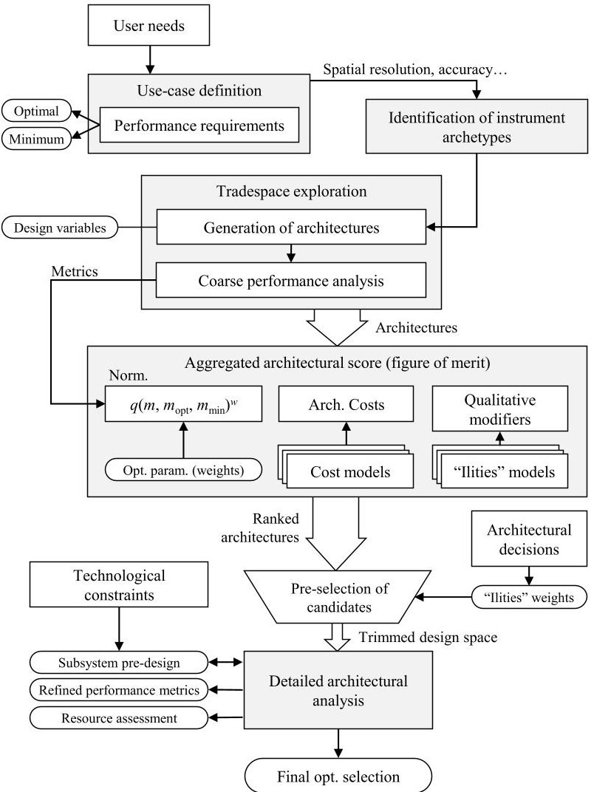

Figure 1. Processes, parameters and data-flow of the design-oriented optimization framework

times and the need to find technologically feasible designs has forced the exploration of many structural and integral approaches. Only through new and innovative architectural paradigms can the demanding revisit times, high resolutions and near-real-time access times be satisfied. Thus, tomorrow's Earth observation systems are envisioned as a set of multiple observation nodes; partly based upon miniaturization of both platforms and remote sensing techniques; and aimed at covering the requirements that traditional, monolithic architectures fail to deliver in a risk- and cost-effective manner. In this scenario, this paper is focused in the exploration of next-generation distributed satellite architectures which include multiple, heterogeneous, and potentially networked observation nodes.

Inspired by multi-core computing and grounded on similar foundations than the Internet of Things paradigm, distributed satellite architectures in which multiple nodes engage in collaborative Earth observation endeavors are expected to become either feasible alternatives to traditional space programs or complementary assets to those. Very often, these alternative architectures are considered to enhance traditional designs not only by providing better performances but also by enabling other systemic qualities such as adaptability to changing Earth observation contexts, structural flexibility (i.e. adding and replacing nodes), resiliency or graceful degradation. Regardless of the many efforts devoted to asses and bring fully-distributed architectures to reality, there are still multiple fundamental challenges to overcome: formation flying, on-board data processing and fusion, inter-satellite

networking, autonomous mission planning and operations, etc. Besides the particularities and technological barriers posed for each type of distributed architecture (e.g. satellite constellations, swarms, federated systems, fractionated spacecraft) how these system-of-systems are optimally architected remains an open discussion. It is not clear how these systems need be designed to enhance their utility and deliver the promised qualities.

In this regards, this paper presents an optimization framework the purpose of which is twofold. On the one hand, it aims at finding the most optimal design solution for distributed architectures. Solutions to these architecting problems are produced in a high-level manner and could be ingested and detailed further by engineering teams. Their selection is based both upon a mission performance assessment and an evaluation of the qualities of the system (i.e. their "ilities".) Secondly, given that the framework presented in this paper integrates some technological constraints during the process, it could also be used to identify and quantify the impact of key enabling technologies for future designs. Either by studying the effect of a given constraint or assuming technological pushes (i.e. relaxing those constraints) and related technology gap analyses, this framework could also devise essential characteristics and contribute, thus, to the development roadmap of distributed satellite applications.

This paper is organized as follows: Section 2 presents all the parts of the framework and summarizes its inputs and main outcomes. Section 3 formally introduces the optimization methodology, and defines how architecture scores are computed. Sections 5 and 6 address the generation of architectures and give details about their cost model and an initial performance analysis. Sections 7 and 8 then illustrate the application of this framework in a specific use-case, first by introducing the user requirements and potential remote sensing technologies, and then by exploring the results of the optimization. Sections 9 and 10 finally conclude the paper by discussing open strands of work and presenting the conclusions.

## 2. FRAMEWORK OVERVIEW

This design-oriented optimization framework is split into the set of processes depicted in Figure 1. Although each part will be expanded in the sections that follow, this diagram illustrates the inputs and inter-relations between processes. The ultimate functionality of this framework is to select architectures, explore the design space and compare architectures that present different design characteristics. In order to do so, the proposed methodology relatively ranks solutions with a single aggregated figure-of-merit. This figure compresses mission performance metrics, user needs, costs and a numerical assessment of qualitative attributes of the systems.

As shown in the diagram, the final outcome is given in the form of a single optimal architecture. For that, its highlevel design not only determines its orbital configuration, payloads and number of spacecraft, but it also comprehends a preliminary design of its internal components. Those components and their design are constrained by specific technological limitations (e.g. inter-satellite datarates for RF links, instrument power consumption and data volume, capacity of on-board batteries, etc.) These fine-grained subsystem and instrument models allow to accurately assess architectural performances, which are computed by a custom mission analysis tool through simulation. An automated process

<!-- PDF_PAGE: 3 -->

simulates the architectures with static configurations and nominal system states and yields their performance metrics and the minimum resources needed for them to operate (i.e. power and data-flow profiles.) Given that the computational complexity of the models employed in this detailed analysis is moderately high, running it for a large set of architectures is unpractical. Therefore, such a detailed analysis is carried out for a narrowed design space, i.e. a small group of pre-selected candidate architectures. This pre-selection process is driven both by a model-based quantification of system qualities, and by asserting what the relative impact of those qualities should be. At the same time, each potential solution is relatively ranked with their figures-of-merit.

The following sections will describe how these figures-ofmerit are computed and how they aggregate user requirements and performance metrics from a preliminary coarse analysis. In fact, one of the outcomes of this optimization tool is precisely to explore the impact that some design variables have upon these architectural scores. It is important to note, however, that the design space is not directly assumed as a user input, but is internally generated by the framework. Because of these two characteristics: the urge to analyze the complete design space and the fact that architectures are generated during the process, an heuristic approach like that of other works [1-4] has not been considered. Relevant performance metrics are analyzed for all the architectures in the generated set.

The architecture generation process is logically segmented in two parts: on the one hand, a pre-defined set of design variables are combined to obtain constellation configurations. These define most of the architectural parameters and leave the set of embarked instruments and platform sizes unbound. Regardless of their values being selected with an a priori knowledge of the target application and its requirements, the set of design variables is fixed. Instrument options, on the other hand, are specifically selected to be able to satisfy user needs and the measurements defined by a particular use-case. Combining constellation configurations with the list of instruments, produces the complete set of traded architectures. Instruments and their combination in a single satellite node, actually set the required payload capacity for each node. Because this study is aimed at stressing the potential benefits of fully-distributed architectures (i.e. those in which different instruments are hosted by different spacecraft platforms), homogeneity is not imposed during the architecture generation process. In the presented approach, constellations are composed of a number of heavy, medium and small satellite platforms, which exhibit different remote sensing capabilities.

## Contributions

The work described in this paper addresses the design of distributed satellite systems by applying tradespace exploration and simulation methodology [4, 5]. Previous works have addressed the same problem with this or similar approaches [2, 3]. The authors of [1, 6] have proposed a tool where small satellite platforms are considered in the design of Earthobserving satellite systems. The trade-offs and comparison of distributed architectures with respect to their monoliths has been studied in the past [7] and is not addressed here. To that extent, this paper leverages on previous works and proposes a design-oriented framework aiming at distributed and heterogeneous systems in static contexts (i.e. changes in user needs and costs are not considered.) The incorporation of "ilities" in system architecting and tradespace exploration studies has been proposed in [8]. Following previous works

in this field, this paper presents a similar framework wherein "ilities" are weighted based on subjective and strategic criteria and discusses the changes in design values when these weights are modified.

## 3. METHODOLOGY: ARCHITECTURE FIGURES-OF-MERIT

The methodology presented in this paper is grounded on the assessment of architecture scores. This section presents the notation and formal definition of scores and details the selection and optimization process. Architecture designs (or "design solution") constitute the main inputs of this process and are generated in the tradespace exploration summarized in Section 5. The present methodology defines architectures as the combination of a given constellation configuration and its embarked payloads. While constellation configurations only define orbital parameters for a number of nodes, architectures complete the definition by setting platform sizes and adding on-board instruments. We call $ \Gamma_{ij} $ the overall figure of merit of the architecture j, which has been designed from constellation configuration i.

Each architecture is capable of producing data for a number of measurements (i.e. it has instruments the data of which can be used to determine a given Earth observation parameter.) Depending on the final application for which architectures are designed, a different number of parameters will have to be measured. We call $ N_{K} $ the total number of parameters and denote each of those with the subscript k.

## Measurement-specific figure-of-merit

The base of architectural scores encompasses the performance of the architecture for each of its measurement capabilities. For each $ k $ parameter that an architecture is capable of measuring, a measurement-specific figure-of-merit $ (\Gamma_{k}) $ is formally defined as:

$$
\Gamma_ {k} = \prod_ {m} q \left(p _ {k m}\right) ^ {\gamma_ {m}}
$$

where $ p_{m} $ is the performance of the architecture for the metric m (e.g. spatial resolution). Each performance metric $ p_{m} $ is normalized with function $ q(x)\in[0,1] $ and is weighted with its corresponding $ \gamma_{m} $ value. The metrics normalization function, which combines exponential score formulation with a Wymore's score function [9], normalizes metrics that are within upper and lower bounds. The function q as defined in (2), assigns the lowest score Q to metrics that hardly satisfy what is defined as the minimum requirement $ (p_{a}) $ , while higher scores are assigned to metrics that reach the optimal requirement $ (p_{b}) $ . These optimal and minimum requirements are actually thresholds defined by the user needs.

$$
q (p) = \left\{ \begin{array}{l l} Q + \frac {1 - \exp \left(- \frac {p _ {a} - p}{\rho}\right)}{1 - \exp \left(- \frac {p _ {a} - p _ {b}}{\rho}\right)} (1 - Q) & \text {w h e n} p _ {b} \leqslant p \leqslant p _ {a} \\ Q & \text {w h e n} p > p _ {a} \\ 1 & \text {o t h e r w i s e} \end{array} \right.
$$

The parameter $ \rho $ allows to adjust the exponential curve (Figure 2) by assigning different values of P in (3). The constant Q, set to 0.1, is introduced in order to provide non-zero scores to those architectures that, regardless of not meeting the minimum requirement in a single metric, are capable of producing data for a given measurement. Note that only when

<!-- PDF_PAGE: 4 -->

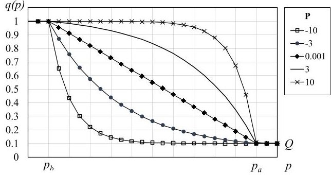

Figure 2. Metric normalization curves for different values of the constant P.

an architecture embarks instruments that do not produce data for a certain remotely-sensed parameter, its $ \Gamma_{ijk} $ will be 0.

$$
\rho = \frac {p _ {a} - p _ {b}}{P}
$$

Noteworthy, the normalization function is provided for decreasing metrics (i.e. those in which $ p_{b}<p_{a} $ ). This owes to the fact that the mission performance metrics used to validate the framework and presented in the results, satisfy this criterion (e.g. the lower the spatial resolution, the better.) Nonetheless, a complementary q function should be used when metrics are increasing.

## Unmodified figure-of-merit

The aggregation of performance metrics is achieved by computing the root mean square of all $ \Gamma_{ijk} $ . The use of RMS aggregation is justified as a means to effectively remove alternatives that perform poorly in one of their metrics. This aggregation method should be valid provided that $ Q > 0 $ (2). With this, the so-called unmodified figure-of-merit is ultimately calculated by adding the cost $ (C_{ij}) $ to the expression, as shown in (4). The normalization function $ q_{0} $ approximates to a first order linear function by setting $ Q=0 $ $ P=10^{-3} $ in (2) and by defining $ p_{b}=C_{\min} $ and $ p_{a}=C_{\max} $ . Multiplying this factor by aggregated architectural performance figures, allows to maximize their performance while minimizing their cost.

$$
\Gamma^ {\prime} = q _ {0} (C) \sqrt {\frac {1}{N _ {K}} \sum_ {k} \left(\prod_ {m} q \left(p _ {k m}\right) ^ {\gamma_ {m}}\right) ^ {2}}
$$

Similar works in tradespace exploration also proposed to aggregate several figures-of-merit in a single value [2]. Despite acknowledging the possible issues of the aggregation method (e.g. rank-reversals [10]) and the lack of transparency, having a single, all-encompassing architectural score allowed for the analysis and visualization of results presented in (8).

## 4. MODEL-BASED QUALITATIVE MODIFIERS

Optimizing the architecture design could be possible with unmodified figures-of-merit $ \left( \Gamma^{\prime} \right) $ alone. However, this framework is also aimed at selecting architectures that excel in some of the architectural attributes or qualities of a system. Modeling and quantifying quality attributes may be deemed essential to assess the value of a given design beyond its functional characteristics. Nevertheless, system qualities are

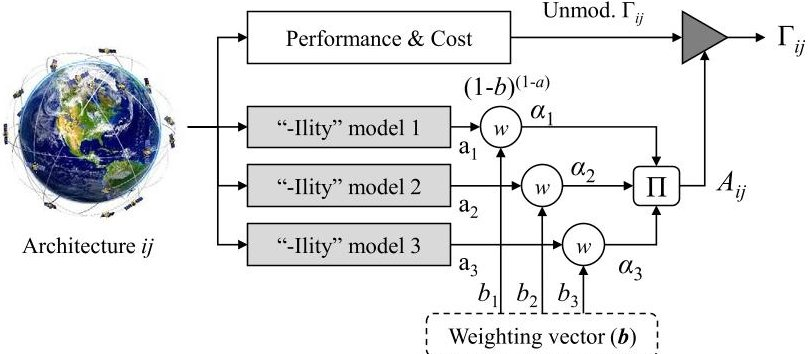

Figure 3. The quantification of "ilities" modifies the figure-of-merit.

used in this work to induce design decisions from highlevel requirements, as a means to enhance many of the pursued characteristics of distributed satellite systems. Being able to select the most performing architecture while also maximizing the so-called "ilities" of the system, is done in this optimization methodology by modulating figures-of-merit with what is referred to in this work as a qualitative modifier. Other relevant works have also modeled quality attributes and have incorporated them in some stages of the design process of complex space systems [11] or tradespace exploration [8]. In the approach presented in this paper, an arbitrary set of quality attributes are also modeled and quantified for each solution in the design space. These quality attributes are then aggregated to form the term $ A_{ij} $ , which will modify the performance figure of architecture ij.

While a single quality might suffice in driving the design decisions for some complex space systems, this framework proposes to assimilate the complexity of distributed satellite systems and to model and assess, simultaneously, multiple of their qualities and sought characteristics. Their importance and impact over the architecture design process is balanced though a weighting vector, as illustrated in Figure 3. Each "ility" model is assumed to yield a normalized figure a that is weighted with the function in (5). The vector $ \mathbf{b}=\{b_{1}, b_{2}, \dots, b_{n}\} $ encompasses high-level design decisions in the form of values in the range [0,1). Weighting coefficients $ b_{n}\approx 1 $ pose a very strong influence of attribute n over the architectural score, while $ b_{n}=0 $ would ignore this attribute and have no effect on $ \Gamma_{ij}. $

$$
\alpha = f (a, b) = (1 - b) ^ {(1 - a)}
$$

$$
A = \prod_ {i} \alpha_ {i}
$$

## 5. TRADESPACE EXPLORATION

The inputs to this optimization framework, are given as a set of user needs which translate to specific performance requirements (i.e. optimal and minimum performances, $ p_{a} $ and $ p_{b} $ as seen in Section 3). With these requirements, a list of instrument archetypes can be conceived to provide all the necessary sensing characteristics to the constellation. Instrument archetypes represent a given sensing technology for which one can find practical implementations or estimate design specifications (i.e. their mass, generated datarate, power consumption, etc.) The choice of a specific instrument is not fixed a priori (i.e. it's not pre-designed) and is also one of the objects of this optimization process. The trading of instruments does influence architectures by providing different measuring capabilities and affecting their performances.

<!-- PDF_PAGE: 5 -->

Table 1. Decision variables for the architecture generation process

<table border="1"><tr><td>Variable</td><td>Possible values</td></tr><tr><td>Altitude</td><td>510km，657km，807km</td></tr><tr><td>Walker patt.</td><td>Delta，star</td></tr><tr><td># of planes</td><td>2，3，4，6，8</td></tr><tr><td># of nodes</td><td>4，6，8，10，12，16，20，24，32，40，48</td></tr><tr><td>Node platform sizes</td><td>Heavy(600kg.dry mass；200kg.payload)，Medium(166kg.dry mass；50kg.payload)，Small(3U-6UCubeSat)</td></tr><tr><td>Node instruments</td><td>Instrument archetypes generated from user needs and their feasible combinations.</td></tr></table>

Instruments that have narrower swaths will, for instance, induce large constellations of spacecraft in order to achieve the minimum revisit times; similarly, embarking instruments of wider swath could achieve the required revisit times with less spacecraft but may simultaneously constrain the spatial resolution of a constellation.

At the same time, the orbital parameters of each spacecraft in the constellation as well as the number of nodes, are key parameters which also affect constellation performances. Flying at higher altitudes increases instrument swaths but also compromises spatial resolutions. Similarly, the number of planes in which a constellation is distributed, also affects launch costs, revisit times or even the type of inter-satellite networks that can originate within the constellation. Therefore, the design space in this study is constructed from a generation routine that yields constellation configurations and a purely combinatorial process that allocates instruments and forces the payload capacity of each node.

## Generation of architectures

Constellation configurations are generated with the decision variables listed in Table 1. Based on the Walker pattern, number of nodes and orbital planes, the routine computes RAAN and mean anomalies for a number of spacecraft flying at LEO sun-synchronous orbits. In addition, this study intends to address distributed spacecraft systems in which some satellite platforms encompass more than one instrument. Therefore, the instrument archetypes forged from user requirements are combined to a number of feasible combinations. These are highly constrained by the payload capacities provided by the available platform alternatives and also consider technologically feasible power and datarate limitations. In addition to that, the tradespace approach allows nodes in an architecture to have heterogeneous sensing capabilities and sizes. Thus, for a given constellation configuration, the generation routine can generate options which combine a number of heavy, medium and small platforms, simultaneously. While previous works traded similar decision variables to optimize satellite constellation designs [1, 12], the ability to combine different instruments in a constellation and to hybridize small spacecraft technologies with traditional buses, has usually been addressed in studies related to Federated Satellite Systems [13, 14] and other works oriented to Earth-observing satellite systems [1, 3]. Nonetheless, the full-factorial size for this set of decision variables, specially when heterogeneity comes into play, can become immense and make the problem intractable. In order to reduce the dimensionality of the trade space and be able to compute performances with moderate computational resources, platforms of the same size, within an architecture, are forced to embark the same instruments.

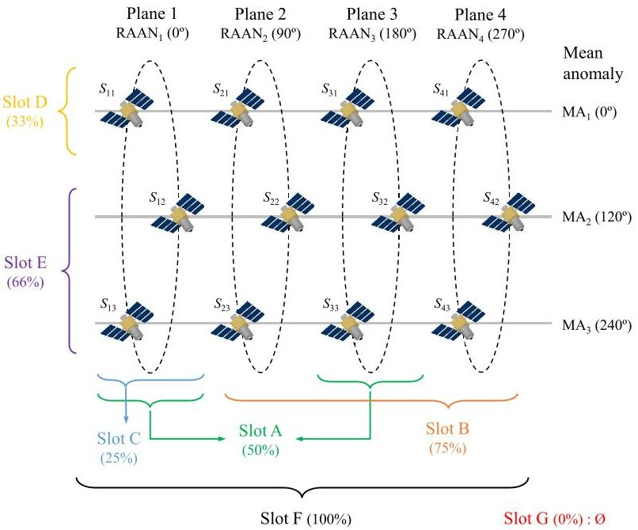

Figure 4. Example of the constellation slots generated for an architecture of 12 nodes and 4 planes, in Walker delta.

This constraint would also be aligned with the idea that producing several identical spacecraft may minimize some of their development costs.

Additionally, in an effort to reduce the number of possible platform combinations (i.e. the number of heavy, medium and small spacecraft and their distribution across orbital planes), the design of a constellation is also constrained by a number of slots. A slot identifies a set of identical spacecraft within the constellation. Slots are defined by selecting spacecraft groups with either the same right ascension of the ascending node (i.e. RAAN) or mean anomaly (MA). Figure 4 shows the slots of a constellation of 12 nodes in 4 planes configured in Walker delta. For this illustrative case, up to 7 different slots, A to G, are provided. Constellations are therefore designed by assigning instrument combinations (i.e. platform sizes) to a slot. Given that all platforms of the same size are forced to embark the same instruments, one could say that the architecture generation actually allocates each platform type in a constellation slot. With this generation scheme, a constellation configuration with the slots defined in Figure 4, could, for instance, allocate heavy platforms in $ S_{11}, $ $ S_{21}, $ $ S_{31} $ and $ S_{41} $ (Slot D), medium spacecraft in the rest of the nodes (Slot E) and no small satellites altogether (Slot G). A different option could also be to allocate one platform type in planes 1 and 3 (Slot A), and a different type in planes 2 and 4 (Slot A). Note that, in the previous case, slot A is used to allocate platforms in both odd and even plane numbers. This owes to the fact that slots are not fixed, but can select different groups of spacecraft as long as they maintain the same separation in MA or RAAN. It would not be possible, thus, to allocate the same instruments in plane 1 and 2 at the same time, since Slot A forces the selection of planes to be separated $ 180^{\circ} $ in RAAN.

## Coarse performance analysis

In order to analyze the design space and start the optimization process, the performance of each architecture needs to be assessed. Performances are tied to specific instruments and should mostly be computed for each of the measurable parameters of the final use-case. While some metrics are static and can be computed from design parameters, others require the simulation of the constellation to compute their

<!-- PDF_PAGE: 6 -->

Table 2. Examples of an allocation of arbitrary instrument archetypes to a 12/4 constellation.

<table border="1"><tr><td>Case A</td><td>S1m</td><td>S2m</td><td>S3m</td><td>S4m</td></tr><tr><td>Sn1</td><td>I1，I2</td><td>I1，I3</td><td>I1，I2</td><td>I1，I3</td></tr><tr><td>Sn2</td><td>I1，I2</td><td>I1，I3</td><td>I1，I2</td><td>I1，I3</td></tr><tr><td>Sn3</td><td>I1，I2</td><td>I1，I3</td><td>I1，I2</td><td>I1，I3</td></tr><tr><td></td><td></td><td></td><td></td><td></td></tr><tr><td>Case B</td><td>S1m</td><td>S2m</td><td>S3m</td><td>S4m</td></tr><tr><td>Sn1</td><td>I1，I3</td><td>I1，I4</td><td>I1，I3</td><td>I1，I4</td></tr><tr><td>Sn2</td><td>I1，I3</td><td>I1，I4</td><td>I1，I3</td><td>I1，I4</td></tr><tr><td>Sn3</td><td>I1，I3</td><td>I1，I4</td><td>I1，I3</td><td>I1，I4</td></tr></table>

values (e.g. revisit times.) Constraining the designs with a fixed number of slots also allows reducing simulation times by limiting the number of analyses for constellation configuration. Before combining instruments and allocating payload capacities to each node, performance metrics are computed independently for each slot. This essentially means that each slot will provide, along with its set of selected nodes $ S_{nm} $ a value of its performances. Because all possible platform combinations are considered, all instrument archetypes will be allocated to each slot and will trigger an individual performance analysis driven by their characteristics.

This performance analysis differs from precedent approaches (e.g. [12]) by allowing the re-use of pre-computed metrics and the generation of several valid architectures without the need to simulate them individually. In order to illustrate this approach, assume that four arbitrary instrument archetypes $ I_{1} $ to $ I_{4} $ could be allocated to the constellation configuration depicted in Figure 4. Suppose that instrument $ I_{1} $ has a very reduced mass and will always be combined with either of the other three archetypes. If revisit times would be meaningful performance metrics for the actual use-case, the analysis would provide their values for each slot and instrument archetype. After that, the combinatorial process would produce many architecture designs by allocating instruments to this single constellation configuration. Two possible architectures would be the ones illustrated in Table 2. In both cases, instrument $ I_{1} $ is always present, and always corresponds to Slot F (i.e. all satellites embark this instrument). Similarly, instrument $ I_{3} $ is always allocated to Slot A, and the only difference between the two architectures lays in the choice of $ I_{2} $ or $ I_{4} $ . In a traditional approach, both architectures would be simulated independently and the revisit times for these two instruments would be computed repeatedly. Conversely, with the approach presented in this paper, the revisit times for instruments $ I_{1} $ and $ I_{3} $ can be re-used, given that they are allocated to the same slots in both cases (slots F and A, respectively). Despite the plane allocation for instrument $ I_{3} $ changes, its revisit time needs not be computed again, since this difference does not affect the metric.

## 6. COST MODEL

## Development costs

The cost of each architecture is computed by the framework in two parts. On the one hand, a cost model is used to estimate development expenses from spacecraft sizes. The model, which estimates development costs from spacecraft dry mass, is taken from [15] and is provided in two segments, as shown in Table 3. Dry masses in Table 1 are adjusted to account for

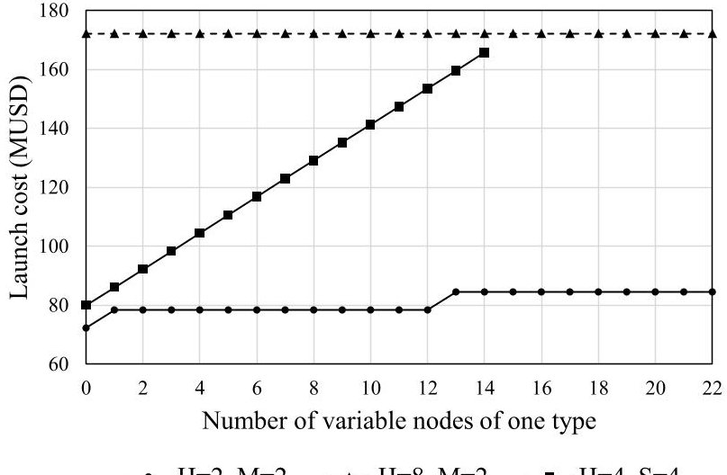

Figure 5. Launch cost for one plane, varying the number of satellite platforms of one type.

the actual mass of spacecraft once the set of instruments is allocated. A learning curve (7) with coefficient $ S_{p}=0. 8 $ is considered to calculate the cost of identical nodes.

Table 3. Development cost models.

<table border="1"><tr><td>S/c mass range</td><td>Model(MUSD),from[15]</td></tr><tr><td>10-100</td><td>C=0.0008x2.2459</td></tr><tr><td>100-500</td><td>C=1.2899x0.6395</td></tr></table>

$$
C _ {\mathrm {T o t a l}} = C _ {\mathrm {u n i t}} N ^ {1 - L _ {c}} \quad \mathrm {w i t h} \quad L _ {c} = \frac {\ln \left(\frac {1}{S _ {p}}\right)}{\ln (2)}
$$

## Launch cost

On the other hand, launch costs are estimated based on the output of an optimization procedure. Deriving launch cost models for satellite constellations without a predefined launch and deployment strategy is complex and has not been addressed in this work. That notwithstanding, a general estimation of this cost can be calculated by selecting appropriate launcher vehicles while trying to minimize cost. Based on the data published in [16], a list of feasible alternatives has been compiled and is shown in Table 4. This list encompasses possible vehicles with enough capacity to launch more than one spacecraft at the same time. With these launchers and the architecture design, the cost of launching the nodes of each plane is computed by the optimization routine. Computing launch costs on a plane-by-plane basis allows to force an effect of this decision variable (i.e. number of planes) on the figures-of-merit. The optimization algorithm, implemented as an iterative greedy search, computes the cost per kilogram of each launch and tries to minimize it. During the minimization routine, a fixed number of fairing configurations is considered which defines the number of heavy, medium and small spacecraft that can be mounted in the launchers (see Appendix A.)

<!-- PDF_PAGE: 7 -->

## 7. CASE STUDY

## Description and user needs

In the sections that follow, this paper presents the application of this optimization framework in the context of a specific Earth observation use-case. Marine weather forecast has been identified as a particularly critical use-case as a result of an in-depth analysis that assessed European Earth observation needs beyond the existing Copernicus infrastructure [17]. Future marine weather services and applications are seen to present unsatisfied requirements in terms of revisit time, data access latency and resolutions and seem to be addressable by new and novel satellite architectures. The unceasing decline of sea-ice in Polar Regions is suggesting that northern routes could be viable alternatives to the Suez canal while, for the same reason, the number of offshore operations and fishing activities in subarctic regions is also likely to increase. In this context, providing near-real-time, high-quality marine weather indicators is becoming increasingly important to facilitate such activities and improve the knowledge of the marine environment in these regions.

Applying this use-case to the design-oriented framework presented herein has allowed to explore feasible solutions and select the most optimal architecture design. Up to seven marine parameters have been identified as critical indicators to improve weather forecast and route planning endeavors. The list that follows, details these parameters and provides a unique identifier $ ( K_{i} ) $ that, for the sake of brevity, will be used throughout the rest of the paper:

- Ocean surface currents $ ( K_{1} ) $: water flow on ocean surface (in cm/s.)

- Wind-speed and vector over sea surface, horizontal $ K_{2} $ 2D wind vector conventionally measured at 10 m height.

- Significant wave height $ ( K_{3} ) $ : average amplitude (in meters) of the highest 30 of 100 waves.

- Dominant wave direction $ ( K_{4} ) $ : the direction of the most energetic wave in the ocean wave spectrum (in degrees.)

- Sea surface temperature $ ( K_{5} ) $ : measured in Kelvin, for surface of up to 2 meter depth.

- Atmospheric pressure $ ( K_{6} ) $ : air pressure at the sea level (in hPa.)

- Sea ice cover $ ( K_{7} ) $ : fraction of a given area (in %) that is covered by ice.

The performance of a system providing continuous data for these measurements was defined in terms of its horizontal spatial resolution, revisit time and data access latency (i.e. time between data is captured and it arrives at the ground segment.) Their optimal and minimum requirements are summarized in Table 6. Besides these requirements, the coverage for these measurements was targeted at Arctic and subarctic regions (i.e. over latitude $ 6 0^{\circ} \mathrm{N} $.)

Table 4. Selected launcher vehicles.

<table border="1"><tr><td>Launcher</td><td>Max. Capacity(kg)</td><td>Cost(MUSD)</td></tr><tr><td>Ariane 5</td><td>10000</td><td>178</td></tr><tr><td>Soyuz</td><td>4650</td><td>50-80</td></tr><tr><td>Vega</td><td>1450</td><td>55-60</td></tr><tr><td>Rokot</td><td>1600</td><td>41.8</td></tr><tr><td>Black Arrow 2</td><td>200</td><td>6.12</td></tr></table>

## Identification of instrument archetypes

With the list of measurements of the use-case and their required spatial resolutions, a potential set of instrument archetypes has been produced and is shown in Table 5. The rightmost column of this table defines the measurements that these instruments are capable to provide data for. While not all of them can measure all the parameters of the use-case, these archetypes have been selected because each presented some interesting specifications (e.g. high-resolution, low mass, low power consumption, wide swath). Values for their mass, power and generated data volumes have been taken from the Observing Systems Capability Analysis and Review Tool (OSCAR) on-line database [18] or from the literature. Swaths and spatial resolutions have been computed by either assuming the same antenna apertures reported in literature or by adjusting them to adapt the instrument to the requirements of this use-case.

This non-exhaustive list has been minimized to only 9 alternatives by removing alternatives that presented similar characteristics with others. If two instruments were capable of measuring the same parameters, only that with better spatial resolution and wider swath has been kept. Conversely, if two instruments presented favorable exclusive characteristics, both of them have been preserved. This is the case, for instance, of the SAR Altimeter and SAR-X instrument; both provide data for the same marine weather parameters with very high spatial resolutions. However, while the power consumption of the SAR Altimeter is rated at 149 watts, the SAR-X requires 1 kilowatt of power to operate. Noteworthy, some parameters for instrument 7 are not included in the table. This owes to the fact that this instrument was an indirect requirement of the abovementioned altimeter, which requires additional data to perform water vapor corrections. Although adding this instrument does not provide meaningful characteristics or data to constellations, its mass, power and data volume needed to be taken into account in the architecture generation. In addition, this list has tried to provide valid instrument alternatives for all platform sizes. While a variety of high-performance instruments are available for heavy platforms, recent advances in miniaturization techniques and the extensive exploration of micro- and nano-satellite capabilities are bringing smaller alternatives into play. The science return capabilities of small spacecraft claimed by the aerospace community ([19,20]) are not underestimated in this study but are rather the contrary, they are considered key elements in the design of new architectures. As such, two instruments for small platforms have been included in the selection: a GNSS-R receiver similar to the one embarked in NASA's CYGNSS small-satellite constellation and a novel millimeter-wave radiometer with similar characteristics to the one presented in [21].

Ultimately, the instruments archetypes have been combined into 12 possible platform designs (Table 7). These instrument combinations will be used in the architecture generation process and will determine the size of spacecraft nodes by selecting the platform with the necessary payload capacity. Up to 7 instrument combinations were considered for heavy platforms (up to 200 kg. payload capacity), 3 for medium ones (50 kg. payload capacity) and 2 for small satellites (3U- 6U CubeSat capacity). Note that regardless of the capacity constraint being slightly exceeded in some cases, these were illustrative figures rather than hard limitations. Nevertheless, the actual payload mass is accounted for in the calculation of spacecraft costs. Table 7 also shows the aggregated datarate (in kbps) that the combination of instruments produces if all sensors are enabled simultaneously.

<!-- PDF_PAGE: 8 -->

Table 5. Instrument archetypes for the use-case.

<table border="1"><tr><td>#</td><td>Name</td><td>Reference mission</td><td>Mass(kg)</td><td>Power(W)</td><td>Datarate(kbps)</td><td>Swaths(km)</td><td>Horiz. spatial resolutions(km)</td><td>Remarks</td><td>Satisfies</td></tr><tr><td>1</td><td>GNSS-R</td><td>CYGNSS,DDMI</td><td>2</td><td>12</td><td>200</td><td>7309461170</td><td>25/1.6(a)32/2(a)39.5/2.5(a)</td><td>—</td><td>K2,K3,K7</td></tr><tr><td>2</td><td>Optical Imager</td><td>MetopC,AVHRR/3</td><td>31</td><td>27</td><td>515</td><td>163621862812</td><td>0.640.821.01</td><td>VIS/NIR/TIR.</td><td>K5,K6,K7</td></tr><tr><td>3</td><td>Radar Altimeter</td><td>AltiKa,SARAL</td><td>40</td><td>85</td><td>43</td><td>6.58.210.1</td><td>6.388.1710.08</td><td>Ka band,with built-in microwave radiometer for water vapour correction.</td><td>K1,K2,K3,K4</td></tr><tr><td>4</td><td>Millimeter-wave radiometer(small)</td><td>TEMPEST-D</td><td>3</td><td>8</td><td>20</td><td>106613921739</td><td>7.659.7912.09</td><td>W,Y bands.</td><td>K6</td></tr><tr><td>5</td><td>Microwave radiometer(medium)</td><td>SSM/I</td><td>48.5</td><td>45</td><td>5</td><td>92511591367</td><td>91214.2</td><td>K,Ka,W bands.</td><td>K2,K7</td></tr><tr><td>6</td><td>Microwave radiometer(heavy)</td><td>TRMM,TMI</td><td>65</td><td>50</td><td>8.8</td><td>106513251576</td><td>9/15.6(b)12/20.1(b)14.2/25(b)</td><td>X,K,Ka,W bands.</td><td>K2,K5,K7</td></tr><tr><td>7</td><td>Microwave radiometer(nadir-looking)</td><td>Sentinel-3,MWR</td><td>26.5</td><td>34</td><td>5</td><td>——</td><td>——</td><td>K,Ka bands.Added to provide water vapour correction for SAR-Alt.</td><td>—</td></tr><tr><td>8</td><td>SAR Altimeter</td><td>Sentinel-3,SRAL</td><td>70</td><td>149</td><td>12k</td><td>12.5316.1319.6</td><td>0.30.30.3</td><td>Ku,C bands.</td><td>K1,K2,K3,K4,K7</td></tr><tr><td>9</td><td>SAR-X</td><td>Severjanin-M</td><td>150</td><td>1k</td><td>1k</td><td>289358425</td><td>1.01.01.0</td><td>—</td><td>K1,K2,K3,K4,K7</td></tr></table>

$ ^{(\mathrm{a})} $ The second value corresponds only to the sea-ice cover parameter $ ( K_{7} ) $ .

(b) The second value corresponds only to the sea surface temperature parameter $ ( K_{5} ) $

Table 6. Performance requirements for each use-case parameter

<table border="1"><tr><td></td><td colspan="2">Spatial resolution(km)</td><td colspan="2">Revisit time(h)</td><td colspan="2">Latency(min)</td></tr><tr><td></td><td>OPT.</td><td>MIN.</td><td>OPT.</td><td>MIN.</td><td>OPT.</td><td>MIN.</td></tr><tr><td>$K_{1}$</td><td>1</td><td>25</td><td>6</td><td>24</td><td>6</td><td>60</td></tr><tr><td>$K_{2}$</td><td>1</td><td>10</td><td>3</td><td>24</td><td>6</td><td>60</td></tr><tr><td>$K_{3}$</td><td>1</td><td>25</td><td>3</td><td>12</td><td>10</td><td>60</td></tr><tr><td>$K_{4}$</td><td>1</td><td>15</td><td>3</td><td>12</td><td>6</td><td>60</td></tr><tr><td>$K_{5}$</td><td>1</td><td>20</td><td>3</td><td>24</td><td>5</td><td>60</td></tr><tr><td>$K_{6}$</td><td>1</td><td>25</td><td>3</td><td>24</td><td>5</td><td>60</td></tr><tr><td>$K_{7}$</td><td>0.01</td><td>12</td><td>3</td><td>24</td><td>10</td><td>60</td></tr></table>

Completing the description of this case study, this section summarizes the architectural attributes considered in the architecture scores (i.e. the "ilities") and their models, following the approach presented in Section 4. Each model will assign a normalized value $ a_{i} $ that, once weighted (5) will give the figure-of-merit modifier $ \alpha_{i} $ (Figure 3). Although other works have addressed the definition of "ilities" for distributed architectures in a comprehensive manner [22], the proposed attributes and their modeling differ from those works, since in this work they also try to encode strategic design decisions that are directly related to the specific services and final applications.

## Models of qualitative attributes

Measurement criticality $ (\alpha_{c}) $ The definition of the marine weather forecast use-case, identified four critical parameters $ (K_{1} $ to $ K_{4} $ ) that needed to be considered with higher priorities

during the optimization process. Thus the definition of this attribute will assess whether an architecture provides data for these high-priority measurements. In order to do so, $ a_{c} $ is computed as the number of critical measurements that an architecture is capable to address $ ( N_{c \ ( i j)} $ ) normalized to the total $ N_{c \ ( \mathrm{t o t a l} )}=4 $ , as shown in (8).

$$
a _ {c} = \frac {N _ {c (i j)}}{N _ {c (\mathrm {t o t a l})}}
$$

Practicality $ (\alpha_{p}) $ Architectures with high-resolution capabilities are interesting in for this use-case because the optimal spatial resolution requirement for all the marine weather parameters is equal to, or below 1 kilometer. Nonetheless, architectures with a huge number of nodes generating high-resolution data could have severe implications on their InterSatellite Links and data access latency. Moreover, processing large volumes of SAR imagery can be deemed unfeasible in reasonable times, thus delaying access to the final data product and actually worsening the mission performance. Because of that, practicality has been modeled as a measure of this characteristic, and aims at decreasing figures-of-merit of constellations that generate very large amounts of raw data.

$$
a _ {p} = q (D) \quad \mathrm {w i t h} D = \sum_ {n \in \mathrm {N o d e s}} d _ {n}
$$

The value of $ a_{p} $ is computed with the aggregated datarate $ \left( \sum d_{n} \right) $ of an architecture, as shown in (9). The value, in kbps, is then normalized with the same q function (2), parametrized with $ Q=0 $ and $ P=-3 $ . The lower threshold for q (i.e.

<!-- PDF_PAGE: 9 -->

Table 7. Instrument combinations.

<table border="1"><tr><td>Name</td><td>1</td><td>2</td><td>3</td><td>4</td><td>5</td><td>6</td><td>7</td><td>8</td><td>9</td><td>10</td><td>11</td><td>12</td></tr><tr><td>GNSS-R</td><td>●</td><td>·</td><td>●</td><td>●</td><td>●</td><td>·</td><td>·</td><td>·</td><td>·</td><td>●</td><td>●</td><td>·</td></tr><tr><td>Optical Imager</td><td>·</td><td>·</td><td>●</td><td>·</td><td>·</td><td>●</td><td>●</td><td>·</td><td>●</td><td>●</td><td>●</td><td>·</td></tr><tr><td>Radar Altimeter</td><td>·</td><td>·</td><td>·</td><td>●</td><td>·</td><td>●</td><td>·</td><td>·</td><td>·</td><td>●</td><td>·</td><td>·</td></tr><tr><td>MWR(small)</td><td>·</td><td>●</td><td>·</td><td>●</td><td>·</td><td>·</td><td>·</td><td>·</td><td>·</td><td>·</td><td>·</td><td>●</td></tr><tr><td>MWR(medium)</td><td>·</td><td>·</td><td>·</td><td>·</td><td>●</td><td>·</td><td>·</td><td>·</td><td>·</td><td>·</td><td>·</td><td>·</td></tr><tr><td>MWR(heavy)</td><td>·</td><td>·</td><td>·</td><td>·</td><td>·</td><td>·</td><td>·</td><td>·</td><td>·</td><td>●</td><td>●</td><td>●</td></tr><tr><td>MWR(nadir)</td><td>·</td><td>·</td><td>·</td><td>·</td><td>·</td><td>·</td><td>●</td><td>·</td><td>·</td><td>·</td><td>·</td><td>·</td></tr><tr><td>SAR Altimeter</td><td>·</td><td>·</td><td>·</td><td>·</td><td>·</td><td>·</td><td>●</td><td>·</td><td>·</td><td>·</td><td>●</td><td>·</td></tr><tr><td>SAR-X</td><td>·</td><td>·</td><td>·</td><td>·</td><td>·</td><td>·</td><td>·</td><td>●</td><td>●</td><td>·</td><td>·</td><td>●</td></tr><tr><td>Mass(kg)</td><td>2</td><td>3</td><td>33</td><td>45</td><td>51</td><td>71</td><td>128</td><td>150</td><td>181</td><td>138</td><td>168</td><td>218</td></tr><tr><td>Datarate(kbps)</td><td>200</td><td>20</td><td>715</td><td>263</td><td>205</td><td>558</td><td>12.5k</td><td>1k</td><td>1.5k</td><td>767</td><td>12.7k</td><td>1k</td></tr><tr><td>Platform size</td><td>S</td><td>S</td><td>M</td><td>M</td><td>M</td><td>H</td><td>H</td><td>H</td><td>H</td><td>H</td><td>H</td><td>H</td></tr></table>

worst value) is fixed with the maximum aggregated datarate $ D_{\mathrm{m a x}} $ , and is set at $ p_{a}=0. 9 D_{\mathrm{m a x}} $ . The upper threshold (i.e. best value) is set at $ p_{b}=0. 2 5 D_{\mathrm{m a x}} $ .

Data relevance $ (\alpha_{r}) $ -While more than one sensing technology can provide data to derive marine weather characteristics, not all of them offer the same reliability. While some instruments may provide high quality data that can directly translate to the physical variable, others may require the use of models to transform the measured signal into the required information. A data relevance index (R) is used to distinguish this characteristic and to be able to modify architectural scores accordingly. Similarly, regardless of the inherent capability of a sensor to provide relevant data, operational constraints such as the presence of clouds or illumination conditions for optical imagers may decrease the performance of an architecture. Table 8 provides the relevance indices that correspond to each sensor and measurement. These indices, the meaning of which is shown in Table 9, are assigned from the OSCAR database [18] and are modified to take into account the performance degradation of the instrument for this specific use-case.

The value of this modifier $ ( a_{r} ) $ is then computed by averaging the normalized data relevance indices of an architecture (11). If an architecture can provide data for one parameter from two different instruments, its data relevance is computed for

Table 8. Indices of data relevance and maturity parameter for each instrument archetype.

<table border="1"><tr><td></td><td colspan="7">Data relevance index</td></tr><tr><td>$I_{i}$</td><td>$K_{1}$</td><td>$K_{2}$</td><td>$K_{3}$</td><td>$K_{4}$</td><td>$K_{5}$</td><td>$K_{6}$</td><td>$K_{7}$</td><td>Mature</td></tr><tr><td>1</td><td>-</td><td>2</td><td>2</td><td>-</td><td>-</td><td>-</td><td>3</td><td>-</td></tr><tr><td>2</td><td>-</td><td>-</td><td>-</td><td>-</td><td>5</td><td>4</td><td>5</td><td>✓</td></tr><tr><td>3</td><td>3</td><td>5</td><td>4</td><td>4</td><td>-</td><td>-</td><td>-</td><td>✓</td></tr><tr><td>4</td><td>-</td><td>-</td><td>-</td><td>-</td><td>-</td><td>5</td><td>-</td><td>-</td></tr><tr><td>5</td><td>-</td><td>4</td><td>-</td><td>-</td><td>-</td><td>-</td><td>3</td><td>✓</td></tr><tr><td>6</td><td>-</td><td>3</td><td>-</td><td>-</td><td>5</td><td>-</td><td>2</td><td>✓</td></tr><tr><td>7</td><td>-</td><td>-</td><td>-</td><td>-</td><td>-</td><td>-</td><td>-</td><td>✓</td></tr><tr><td>8</td><td>3</td><td>3</td><td>3</td><td>4</td><td>-</td><td>-</td><td>-</td><td>✓</td></tr><tr><td>9</td><td>3</td><td>5</td><td>4</td><td>5</td><td>-</td><td>-</td><td>1</td><td>✓</td></tr></table>

Table 9. Meaning of the data relevance index $ R $

<table border="1"><tr><td>R</td><td>Relevance for the given variable</td><td>Performance degradation</td></tr><tr><td>5</td><td>Primary</td><td>Not influenced.</td></tr><tr><td>4</td><td>Very high</td><td>Negligible change.</td></tr><tr><td>3</td><td>High</td><td>Slightly worsened.</td></tr><tr><td>2</td><td>Fair</td><td>Heavily worsened.</td></tr><tr><td>1</td><td>Marginal</td><td>Almost non-operative.</td></tr></table>

the instrument providing higher performance.

$$
R _ {k (\mathrm {n o r m})} = \frac {R}{5}
$$

$$
a _ {r} = \frac {1}{N _ {k} ^ {\prime}} \sum_ {k \in K _ {i j}} R _ {k (\mathrm {n o r m})}
$$

Versatility $ (\alpha_{v}) $ Architectures are considered versatile if, replacing their instruments and changing their platform sizes, they are still performing properly. Thus, computing versatility $ a_{v} $ is achieved by computing instrument- and platformagnostic figures-of-merit. This is done by computing the root mean square of architecture scores $ (\Gamma_{ij}) $ that share the same constellation configuration i (12).

$$
a _ {v} = \sqrt {\frac {1}{N _ {i}} \sum_ {i = 1} ^ {N _ {i}} \Gamma_ {i j} ^ {2}}
$$

Maturity $ (\alpha_{m}) $ —Finally, this last qualitative modifier intends to determine how much an architecture relies on emerging technologies. Given that all the instrument archetypes considered in this study present very high TRL, and given that small spacecraft have already been consolidated as feasible alternatives to implement Earth observation and science programs in space [20], this modifier is assessed with a binary parameter that identifies instruments as either mature (1) or immature (0). For this study, only GNSS-R and the small millimeter-wave radiometer are considered immature instrument archetypes (Table 8). The value of $ a_{m} $ is then computed by averaging the maturity of satellite platforms (heavy, medium or small) present in the given architecture.

<!-- PDF_PAGE: 10 -->

## 8. RESULTS

Concluding the case study, this section presents the results of the architectural optimization framework and shows the selected architecture design for the marine weather forecast use-case, presented above. These results have been obtained from a set of 204 unique constellation configurations the design of which has been completed with the combinatorial of instruments and platform sizes. Noteworthy, the data presented in this section does not comprehend the complete set of instrument archetypes. Indeed, all the instrument combinations were considered for this study at the beginning. However, this exercise has also served as a validation case for the optimization framework, the development of which has undergone several iterations. Throughout the development of both the optimization framework and its underlying simulation tools, most of the results seemed to indicate that the most optimal architectures could be implemented only with three instrument archetypes, namely: GNSS-R, optical imager, SAR-X. In the intermediate results, optimal architectures were always embarking this set of instruments. As a result, the set of final inputs for the simulation tools and optimization framework was reduced to these alternatives. With this final set of instrument archetypes, the framework generated a set of 5586 unique architecture designs. Their scores and characteristics are described in the remaining of this section.

## Data representation

Visually representing a multi-dimensional design space like the one generated by this framework, and doing it correctly in a plot, is in this case a complex endeavor. The number of design variables and parameters that one may want to represent is large and relying upon a single aggregated score does not provide all the necessary insight. Despite figures-of-merit already encompassing performance metrics and quality attributes, appreciating the effects of most of the design variables upon architectural scores is essential to understand and justify the solutions of this framework. Because of that, most of the plots presented in this section use color to encode a variable that is considered crucial: the number of platforms of a given type that a satellite constellation is composed of (i.e. the number of heavy, medium or small satellite nodes.) In order to do so, the ratio of heavy, medium and small nodes is used as the red, green and blue components of a color, respectively. Thus, data points in red represent architectures that mostly include heavy platforms, while green and blue points represent architectures with mostly medium or small nodes. Heterogeneous architectures will therefore be represented with an additive color that has a combination of the red, green and blue components.

## Pareto optimal architectures

The Pareto front for the complete design space is shown in Figures 6 and 7. Figure 6 displays the aggregated architectural scores $ \left( \Gamma_{ij} \right) $ without the application of qualitative modifiers (i.e. without taking into account the "ilities".) These values have solely been computed from equally weighted (4) performance metrics (i.e. $ \gamma_{m}=0.33\ \forall m. $ ) The values for these performance metrics were either taken from instrument specifications (i.e. spatial resolutions at different altitudes, as shown in Table 5), or computed from coarse models and mission analysis tools (i.e. revisit times and latencies.) Regardless of most of the design variables not being represented, color information already provides relevant information about the designs. On the one hand, one can see that there's a small cluster of architectures represented in blue that present the lower performance. Their cost is very

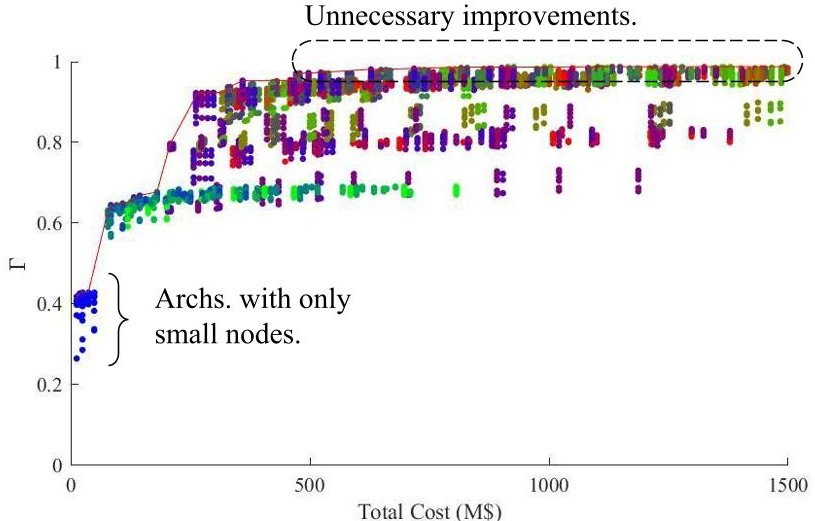

Figure 6. Pareto-optimal architectures for unmodified figures-of-merit.

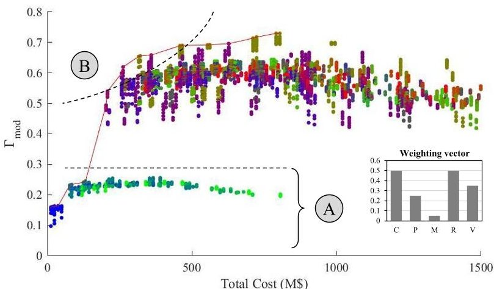

Figure 7. Pareto-optimal architectures for figures-of-merit that include qualitative modifiers.

low because they correspond to architectures that only have small nodes, as indicated by the color code. Because GNSS-R is the only instrument alternative for small spacecraft, these architectures are only capable of providing data for parameters $ K_{2}, $ $ K_{3} $ and $ K_{7} $ . Given that the performance for these instruments is in some cases below the minimum requirement (i.e. spatial resolutions for GNSS-R are just below the minimum threshold for most of the parameters), their aggregated score is unsurprisingly low. On the other hand, it is also interesting to observe that a few architectures with a cost of 500 MUSD are already capable of satisfying the optimal requirements, since their $ \Gamma $ is almost maximum. This suggests that increasing the financial outlay beyond 500 MUSD would not be necessary if the system would have been optimized with its performance metrics alone.

## Applying the modifier weighting vector

Architectural scores change drastically in scale and relative ranking when the assessment of "ilities" is applied, showing data points clustered in two clear regions in Figure 7. This situation owes to the high-level and strategic decisions encoded as modifier weights. Section 4 formally introduced the weighting vector for quality attributes in equation (5) as a way to force certain qualitative features in the optimization process. Consequently, for each qualitative modifier $ \left(a_{i}\right) $ described above, the framework requires a corresponding $ b_{i} $ weight to derive the final modifier value $ \alpha_{i} $ . The values of the weighting vector, as shown and applied in Figure 7 are $ \mathbf{b}=\left\{b_{c}, b_{p}, b_{m}, b_{r}, b_{v}\right\}=\left\{0.5, 0.25, 0.05, 0.5, 0.35\right\} $

<!-- PDF_PAGE: 11 -->

For these values, the selected architecture will be forced to provide high-quality data for all the critical measurements $ ( b_{c}=b_{r}=0.5 $ ; both have strong weights). Simultaneously, architectures with high scores will be considerably versatile and moderately practical, since the weights for these two modifiers are also notable. Maturity, on the other hand, is not considered a critical factor and is given a very low weight $ ( b_{m}=0.05). $

Given that criticality is given a strong influence in the ranking of architectures, those designs that are not capable of delivering data for some of the critical parameters will have their figures-of-merit reduced. This is what can be observed for the group of architectures labeled "A" in Figure 7. Inspecting their design parameters one can see that what these architectures have in common is the lack of a SARX instrument (and hence also a lack of heavy platforms). Given that their available instruments (i.e. GNSS-R and optical imager) do not provide data for $ K_{1} $ (ocean surface currents) and $ K_{4} $ (dominant wave direction), their criticality $ a_{c} $ is very low and influences a lot their scores. In addition, both the spatial resolutions of GNSS-R are coarse and the data relevance for optical imagers are low. The latter owes mostly to their operational constraints being heavily affected by illumination conditions and the presence of clouds, very likely in Polar Regions. As a result, the framework yields a very low score and effectively discards them as plausible solutions.

With the above-mentioned weighting vector, the most optimal architectures would be the ones identified with the label "B" in the figure. Observing their relative ranking in Figure 8, one can see that these architectures have very similar design values. On the one hand, it is interesting to note that only three different platform distributions appear as solution in the first 100 optimal architectures. Identified by three different color codes, all these optimal architectures have 2 heavy spacecraft (with either a SAR-X instrument alone or combined with an optical imager) and are complemented by a small number of medium and small platforms (from 2 to 8 in all cases.) This

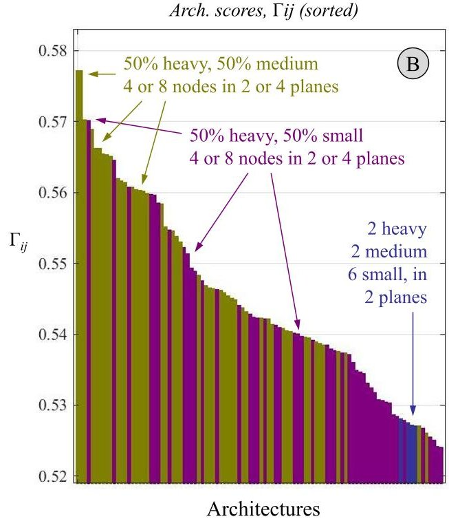

Figure 8. Ranking of best 100 architectures with the weighting vector and modifiers applied.

characteristic can also be regarded in Figure 9, which shows the performance architecture figures-of-merit with both the cost and qualitative modifiers applied $ \left( \Gamma_{\mathrm{C o s t}} \right) $ Figures 9c, 9d and 9e continue to encode the distribution of platform sizes as a color. Representing scores in the three-dimensional space nodes-planes (Figure 9e) allows to identify design trends that were hidden in the previous plots. Figure 9a, on the other hand, shows simplified design information as a hyper-surface of maximum scores for each design point Planes-Nodes. It is in this figure where the results of the design commented above can be observed more clearly: three peaks at specific design locations identify the same architectures ranked in Figure 8.

This information allowed to trim the design space to a small set of 28 designs with similar characteristics. This set of 28 architectures was analyzed in detail with accurate spacecraft models that did ingest technological parameters for each of their subsystems. Battery capacities and solar panel areas were pre-designed to allow all architectures to satisfy their power requirements. Similarly, RF transceivers and antennas for Inter-Satellite Links (ISL) and ground downlinks were constrained in accordance to the mass and power capacities of each platform type. While payloads in the architecture exploration and initial analysis were essentially modeled with their effective swaths and did not considered their power consumption, this later refined performance analysis of 28 candidates produced accurate revisit time and latency metrics that did consider power and bandwidth limitations and illumination constraints. The analysis also returned a quantitative assessment of the use of on-board resources, namely: energy and storage. The reports detailed, for each architecture, the maximum amount of storage required in the nodes, as well as the worst Depth-of-Discharge (DoD) registered during simulations. With this new information, the optimization process concluded by selecting the most optimal architecture for this use-case: a constellation of 16 satellite nodes, orbiting at 807 km of altitude in Walker delta configuration [23]. Distributed in 8 planes, each of them is composed of either two heavy platforms with SAR-X and optical imager, or two small CubeSat-like satellites embarking GNSS-R receivers.

## Alternative design solutions

Encoding strategic decisions as a weighing vector for the architectural attributes, allowed to find the most suitable architecture for this use-case under specific high-level conditions. The effect of the weighting vector b is emphasized here by showing the results of two alternative cases. On the one hand, the first alternative design, shown in Figures 10a 10b, was obtained by forcing the architectures to be highly practical $ ( b_{p}=0.6) $ ,very mature $ ( b_{m}=0.5) $ and relevant $ ( b_{r}=0.5) $ and to provide measurements for all the critical parameters $ ( b_{c}=0.6) $ . This "conservative design", which did not request versatile architectures $ ( b_{v}=0.05) $ , resulted in a design space largely dominated by architectures embarking SAR-X and optical imager instruments. Given the practicality requirement and the fact that SAR-X instruments have high data relevance indices (Table 8) and provide very high spatial resolutions (Table 5), architectures with more than 16 nodes were effectively discarded by the extremely large amount of data they generated. The highest score in this case is given to architectures that have 4 to 8 nodes and are distributed in 2 to 4 planes, since these configurations for the selected instruments already provide the optimal revisit time. Although the number of planes and nodes is similar to the previously presented case, optimal solutions differ in their internal designs. Interestingly, among the first one hundred optimal designs, the solutions always include architectures

<!-- PDF_PAGE: 12 -->

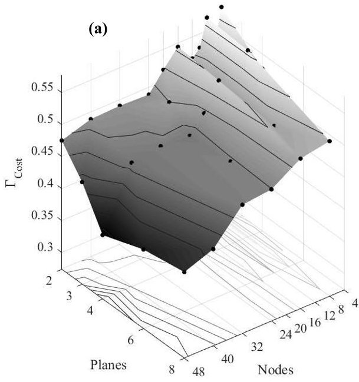

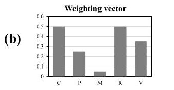

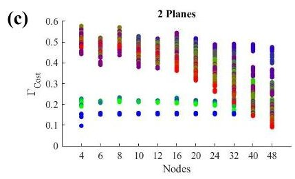

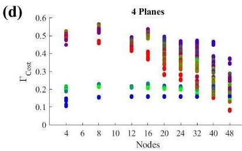

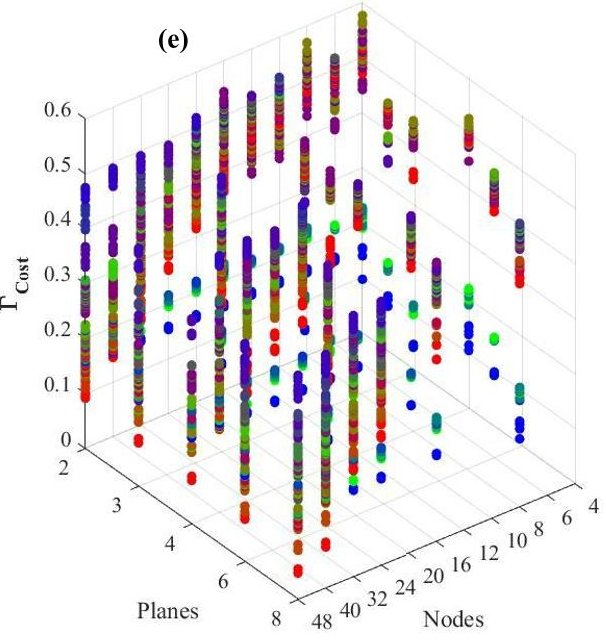

Figure 9. Performance trends for the design space.

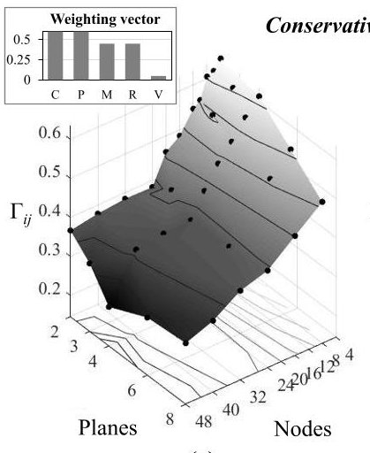

(a)

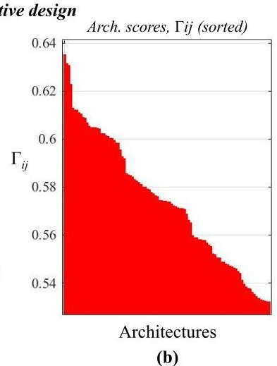

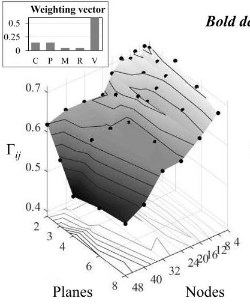

(c)

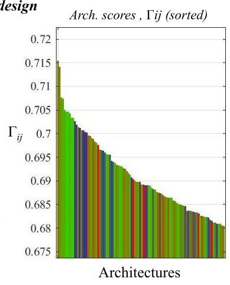

(d)

Figure 10. Performance trends for two alternative weighting vectors.

with all their nodes implemented with heavy platforms (i.e. in Figure 10b, the red color code corresponds to 100% heavy spacecraft.)

On the other hand, a second illustrative case would be the one shown in Figures 10c and 10d. The "ilities" weighting vector is in this final example, set to maximize the versatility of architectures. The weights for the rest of attributes are set to have low influence on the architecture scores $ ( b_{c}=b_{p}=0.15 $ and $ b_{m}=b_{r}=0.05. $ ) Applying them yielded constellations of 4 to 10 nodes, distributed in 4 to 8 planes. However, their internal design differed from the previous cases, and is composed, for this weighting vector, of architectures with all platform types. Most of the optimal architectures orbit at 807 km and are not distinguish by a particular Walker pattern. In the list of one hundred optimal architectures, however, one can hardly see any architecture without heavy and medium nodes, hence the dominance of the green color in Figure 10d.

## 9. FUTURE WORK

The results for this framework have illustrated the modeling of system quality attributes (or "ilities") with a set of five models that assessed interesting attributes for this use-case. Nonetheless, future strands of work could focus on the modeling of attributes already discussed in other academic works (e.g. [8, 11, 14, 24]). Including robustness as a measure of architectural performance degradation in the presence of failures, or assessing the evolvability of an architecture as their forward-looking incremental improvement when the architecture is deployed in stages, are on-going activities of the authors. Similarly, the modeling of some of the presented "ilities" could be improved with the application of new use-cases. Maturity, for instance, could be modeled with instrument and platform Technology Readiness Levels (TRL) in cases where these indices would be considered within the framework.

Finally, it is important to note that the initial, coarse performance analysis, carried out for each and every architecture could produce results in reasonable times by means of grouping the spacecraft of a constellation in a finite number of

<!-- PDF_PAGE: 13 -->

slots, as detailed in Section 5. This simplification allowed to re-use performance values that were computed for platformagnostic constellation configurations. However, given time and memory constraints, the set of slots was never exhaustive and did not allow to generate any arbitrary heterogeneous architecture. In most cases, the number of nodes per plane fixed the minim number of platforms of a given type, effectively ruling out heavily unbalanced or asymmetric architectures (in terms of platforms). Future improvements of the architecture generation scheme, should study and potentially address this limitation in order to allow the generation of large constellations (i.e. 24-48 nodes) with only one or two heavy platforms.

## 10. CONCLUSIONS

This paper has presented a methodology to explore and optimize the design of distributed satellite systems for Earth observation applications. The methodology is grounded on the generation and assessment of heterogeneous satellite constellations where their nodes are characterized by different remote sensing capabilities. The generation process encompasses six decision variables which define constellation configurations (i.e. altitude, Walker pattern, number of planes and nodes) and the internal design of each nodes. Three platform sizes are considered to implement satellite nodes. Heavy platforms with up to 200 kg of payload mass allowed constellations to include heavy instruments, such as SAR imagers or microwave radiometers; medium-class satellite buses with a payload capacity of 50 kg allowed to embark reduced instrument sets of lower mass such as radar altimeters, optical imagers or smaller microwave radiometers. In addition, constellations where also designed with nano-satellite platforms that were assumed to have capacities of a 3U-6U CubeSat and could embark emerging instrument technologies like GNSS-R receivers or state-of-the-art millimeter-wave radiometers.

The purpose of the presented design-oriented optimization tool is two-fold. On the one hand, the framework aims at finding the most suitable distributed architecture for a given Earth observation use-case. In order to do so, the framework unfolds the optimization process into a number of steps which include: (1) the identification of instrument archetypes that can satisfy the measurement requirements of the use-case; (2) the generation of potential architectures; (3) the evaluation of their performance and cost by computing an aggregated figure-of-merit; (4) the quantification of architectural qualities (i.e. their "ilities") based on an arbitrary set of models; and (5) the application of highlevel strategic design requirements, encoded as weights for the above-mentioned qualitative attributes. This framework, implemented in Matlab and aided by specific mission analysis tools and optimization libraries, allows to select the most optimal architecture that satisfies both user-needs and high-level architectural requirements (e.g. versatility, practicality, relevance.) The exploration of the design space and optimization process of this framework has been illustrated in this paper by presenting the results for the marine weather forecast use-case defined in [17], where the effect of quantitative attributes has been particularly emphasized.

On the other hand, this framework can be used as a comparison framework that can drive technology pushes and identify critical components for distributed missions. The case study presented in the last section only considered available platforms and sensing technologies with high TRL. Nonetheless, the same methodology can be applied to cases which include either novel remote sensing capabilities or improved subsystem technologies. Given that the framework ingests technological parameters and compresses mission performances in a single architecture score, relatively-comparing architectures that have or lack a certain emerging technology or that improve a certain design parameter (e.g. range or bandwidth of ISL) allows to identify technological gaps and derive a potential roadmap for the aerospace community.

Table 10. Launcher fairing configurations.

<table border="1"><tr><td>Launcher</td><td>Remaining capacity</td><td>Remaining capacity(%)</td><td>H</td><td>M</td><td>S</td></tr><tr><td rowspan="2">Ariane 5</td><td>2800</td><td>28</td><td>10</td><td>0</td><td>0</td></tr><tr><td>5363</td><td>54</td><td>3</td><td>12</td><td>24</td></tr><tr><td rowspan="3">Soyuz</td><td>1684</td><td>36</td><td>4</td><td>0</td><td>24</td></tr><tr><td>1928</td><td>41</td><td>2</td><td>6</td><td>24</td></tr><tr><td>2572</td><td>55</td><td>0</td><td>10</td><td>24</td></tr><tr><td rowspan="5">Vega</td><td>10</td><td>1</td><td>2</td><td>0</td><td>0</td></tr><tr><td>1052</td><td>73</td><td>0</td><td>2</td><td>0</td></tr><tr><td>531</td><td>37</td><td>1</td><td>1</td><td>0</td></tr><tr><td>644</td><td>44</td><td>1</td><td>0</td><td>24</td></tr><tr><td>1164</td><td>80</td><td>0</td><td>1</td><td>24</td></tr><tr><td rowspan="5">Rokot</td><td>880</td><td>55</td><td>1</td><td>0</td><td>0</td></tr><tr><td>1202</td><td>75</td><td>0</td><td>2</td><td>0</td></tr><tr><td>681</td><td>43</td><td>1</td><td>1</td><td>0</td></tr><tr><td>794</td><td>50</td><td>1</td><td>0</td><td>24</td></tr><tr><td>1314</td><td>82</td><td>0</td><td>1</td><td>24</td></tr><tr><td rowspan="2">Black Arrow 2</td><td>1</td><td>0</td><td>0</td><td>1</td><td>0</td></tr><tr><td>114</td><td>57</td><td>0</td><td>0</td><td>12</td></tr></table>

Table 11. Color codes for platform size distribution in an architecture.

<table border="1"><tr><td>Color</td><td>%H</td><td>%M</td><td>%S</td><td>Color</td><td>%H</td><td>%M</td><td>%S</td></tr><tr><td>红</td><td>100</td><td>0</td><td>0</td><td>橙</td><td>75</td><td>25</td><td>0</td></tr><tr><td>黄</td><td>67</td><td>33</td><td>0</td><td>绿</td><td>50</td><td>50</td><td>0</td></tr><tr><td>绿</td><td>33</td><td>67</td><td>0</td><td>绿</td><td>25</td><td>75</td><td>0</td></tr><tr><td>绿</td><td>0</td><td>100</td><td>0</td><td>粉</td><td>75</td><td>0</td><td>25</td></tr><tr><td>棕</td><td>50</td><td>25</td><td>25</td><td>绿</td><td>25</td><td>50</td><td>25</td></tr><tr><td>绿</td><td>00</td><td>75</td><td>25</td><td>粉</td><td>67</td><td>0</td><td>33</td></tr><tr><td>绿</td><td>33</td><td>33</td><td>33</td><td>绿</td><td>0</td><td>67</td><td>33</td></tr><tr><td>紫</td><td>50</td><td>0</td><td>50</td><td>蓝</td><td>25</td><td>25</td><td>50</td></tr><tr><td>蓝</td><td>0</td><td>50</td><td>50</td><td>紫</td><td>33</td><td>0</td><td>67</td></tr><tr><td>蓝</td><td>0</td><td>33</td><td>67</td><td>蓝</td><td>25</td><td>0</td><td>75</td></tr><tr><td>蓝</td><td>0</td><td>25</td><td>75</td><td>蓝</td><td>0</td><td>0</td><td>100</td></tr></table>

## APPENDICES

## A. LAUNCHER FAIRING CONFIGURATIONS

The fairing configurations considered by the launch cost optimization algorithm is listed in Table 10. Columns 2 and 3 assume that at least 20% of the launcher capacity (Table 4) is used by the dispensers or cannot be efficiently used.

<!-- PDF_PAGE: 14 -->

## B. PLATFORM DISTRIBUTION COLOR CODES

Table 11 shows a simplified legend for the color codes used throughout the paper.

## ACKNOWLEDGMENTS

The framework and study presented in this paper was carried out in the frame of the Operational Network of Individual Observation Nodes (ONION) project, and it has received funding from the European Union's Horizon 2020 research and innovation program under grant agreement 687490, coordinated by Thales Alenia Space France.

## REFERENCES

[1] J. Le Moigne, P. Dabney, O. de Weck, V. Foreman, P. Gorgan, M. Holland, S. Hughes, and S. Nag. "Tradespace Analysis Tool for designing Constellations (TAT-C)." In: 2017 IEEE International Geoscience and Remote Sensing Symposium. Fort Worth, TX, US, 2017.

[2] M. Sanchez-Net, I. del Portillo, B. Cameron, E. F. Crawley, and D. Selva. "Integrated Tradespace Analysis of Space Network Architectures." In: Journal of Aerospace Information Systems 8 (12 2015).

[3] D. Selva, B. Cameron, and E. F. Crawley. "Rule-based system architecting of Earth observing systems: Earth science decadal survey." In: Journal of Spacecraft and Rockets 5 (51 2014).

[4] A. M. Ross, D. E. Hastings, J. M. Warmkessel, and N. P. Diller. "Multi-Attribute Tradespace Exploration as Front End for Effective Space System Design." In: Journal of Spacecraft and Rockets 1 (41 2004).

[5] A. M. Ross and D. E. Hastings. "The Tradespace Exploration Paradigm." In: INCOSE International Symposium 15.1 (2005), pp. 1706-1718. ISSN: 2334-5837.

[6] S. Nag, S. P. Hughes, and J. Le Moigne. "Streamlining the Design Tradespace for Earth Imaging Constellations." In: AIAA SPACE Conferences and Exposition. Long Beach, CA, US, 2016.

[7] S. Nag. "Design and evaluation of distributed spacecraft missions for multi-angular earth observation." PhD thesis. Massachusetts Institute of Technology, 2015.

[8] H. McManus, M. Richards, A. Ross, and D. Hastings. "A Framework for Incorporating "ilities" in Tradespace Studies." In: AIAA SPACE 2007 Conference & Exposition. 2007, pp. 941-954.

[9] J. Daniels, P. W. Werner, and A. T. Bahill. "Quantitative methods for tradeoff analyses." In: Systems Engineering 4.3 (2001), pp. 190-212. ISSN: 1520-6858.

[10] E. Triantaphyllou. Multi-Criteria Decision Making Methods. A Comparative Study. Boston, MA: Springer US, 2000. ISBN: 978-1-4757-3157-6.

[11] A. A. Rader, A. Ross, and M. E. Fitzgerald. "Multi-Epoch Analysis of a Satellite Constellation to Identify Value Robust Deployment across Uncertain Futures." In: AIAA SPACE 2014 Conference & Exposition. San Diego, CA, US, 2014, pp. 941-954.

[12] S. Nag, J. Le Moigne, D. W. Miller, and O. de Weck. "A Framework for Orbital Performance Evaluation in Distributed Space Missions for Earth Observation." In: 2015 IEEE Aerospace Conference. Big Sky, MT, US, 2015.

[13] A. Golkar and I. Lluch. "The Federated Satellite Systems paradigm: Concept and business case evaluation." In: Acta Astronautica 111 (2015), pp. 230-248.

[14] I. Lluch and A. Golkar. "Design Implications for Missions Participating in Federated Satellite Systems." In: Journal of Spacecraft and Rockets 52 (5 2015), pp. 1361-1374.

[15] M Mirshams, M Samani, and A Darabi. "Cost and mass estimation model of small satellites at system design level." In: $ 5^{th} $ IAA Symposium on Small Satellites for Earth Observation. 2005.

[16] FAA's Office of Commercial Space Transportation. Annual Compendium of Commercial Space Transportation: 2017. Tech. rep. Federal Aviation Administration, 2017.

[17] H. Matevosyan, I. Lluch, A. Poghosyan, and A. Golkar. "A Value-Chain Analysis for the Copernicus Earth Observation Infrastructure Evolution: A Knowledgebase of Users, Needs, Services, and Products." In: IEEE Geoscience and Remote Sensing Magazine 5.3 (2017), pp. 19-35. ISSN: 2473-2397.

[18] World Meteorological Organization. Observing Systems Capability Analysis and Review Tool. 2017. URL: https: // www . wmo - sat . info / oscar/ (visited on 10/18/2017).

[19] D. Selva and D. Krejci. "A survey and assessment of the capabilities of Cubesats for Earth observation." In: Acta Astronautica 74 (2012), pp. 50-68.

[20] A. Poghosyan and A. Golkar. "CubeSat evolution: Analyzing CubeSat capabilities for conducting science missions." In: Progress in Aerospace Sciences 88 (2017), pp. 59-83.

[21] S. C. Reising, T. C. Gaier, C. D. Kummerow, V. Chandrasekar, S. T. Brown, S. Padmanabhan, B. H. Lim, S. C. van den Heever, T. S. L'Ecuyer, C. S. Ruf, Z. S. Haddad, Z. J. Luo, S. J. Munchak, T. C. Koch, and S. A. Boukabara. "Overview of Temporal Experiment for Storms and Tropical Systems (TEMPEST) CubeSat constellation mission." In: 2015 IEEE MTT-S International Microwave Symposium. 2015, pp. 1-4.

[22] I. Lluch and A. Golkar. "The Value Proposition of Novel Distributed Space Systems: A Literature Survey on Ilities." In: $ 3^{rd} $ Federated Satellite Systems Workshop. Ithaca, NY, 2015, pp. 1-8.

[23] C. Araguz, D. Llaveria, E. Lancheros, E. Bou-Balust, A. Camps, E. Alarcón, I. Lluch, H. Matevosyan, A. Golkar, S. Tonetti, S. Cornara, J. Cote, S. Pierotti, P. Rodríguez, A. Alvaro, M. Sochacki, and J. Narkiewicz. "Architectural optimization results for a network of Earth-observing satellite nodes." In: $ ^{5^{th}} $ Federated and Fractionated Satellite Systems Workshop. Toulouse, France, 2017.

[24] A. M. Ross, D. H. Rhodes, and D. E. Hastings. "Defining Changeability: Reconciling Flexibility, Adaptability, Scalability, Modifiability, and Robustness for Maintaining System Lifecycle Value." In: Systems Engineering 11 (3 2008), pp. 246-262.

<!-- PDF_PAGE: 15 -->

## BIOGRAPHY

Carles Araguz received his BSc. and MSc. degrees in electronics engineering in 2014 from Technical University of Barcelona, where he is currently pursuing his PhD. In 2012 he joined the Nano-Satellite and Payload Laboratory as a graduate researcher. His research interests include autonomous distributed satellite systems, mission planning and scheduling algorithms and the developed simulators

ment of model-based simulators.

David Llaveria received his BSc degree in telecommunications engineering in 2017 by the Technical University of Catalonia-UPC BarcelonaTech, where he is currently pursuing his MSc degree. He is currently an undergraduate researcher at the Nano-Satellite and Payload Laboratory. His present research activities include distributed satellite systems architecting and the de

velopment of model-based simulators.

Estefany M. Lancheros received her B.Sc. degree in electronic and telecommunications engineering from the Universidad Autonoma del Caribe, in Colombia (2009), and her M.Sc degree in electrical engineering from the University of Puerto Rico (2012). In 2016, she joined the Passive Remote Sensing Group at UPC, where he is pursuing a Ph.D. degree focused on complementary

EO concepts for Copernicus and GNSS-R applications from small satellites.

Elisenda Bou-Balust M.Sc. Telecom Engineering UPC'2011, M.Sc. Electronic Engineering ULPGC'2011, PhD UPC'2017. Adjunct professor at UPC and CTO at Vilynx. Since 2007 she has specialized in large-scale AI systems, coauthoring more than 40 articles and 5 patents and participated in national and international R&D projects.

Adriano Camps is Full Professor at the Technical University of Catalonia UPC Barcelona Tech, IEEE Fellow and President of the IEEE Geoscience and Remote Sensing Society. His research interest include aperture synthesis microwave radiometers (ESA SMOS mission), GNSS Reflectometry, and the use of nanosatellites (cubesats) to test new remote sensors.

Eduard Alarcón is a faculty member of the EE School at UPC BarcelonaTech, where he endeavors as educator and mentor of researchers. He is currently Vice President of Technical Activities for the IEEE Circuits and Systems Society and Editor-in-Chief of the IEEE Journal of Emergent Topics in Circuits and Systems. His research interests include the areas of small satellites,

nanotechnology-enabled wireless communications and onchip energy management and harvesting.

Ignasi Lluch received his B.S. and M.S. degrees in aerospace engineering from the Technical University of Catalonia in Barcelona, Spain and his Ph.D. from the Skolkovo Institute of Science and Technology. His research interests include advanced satellite navigation systems, intersatellite link technologies, constellation design, and federated and fractionated systems.

Hripsime Matevosyan received her M.S. degree in control and applied mathematics from the Moscow Institute of Physics and Technology, Russia, and her B.S. degree in informatics and applied mathematics from the Yerevan State University, Armenia. She is a Student Member of the IEEE.

Alessandro Golkar is Associate Professor at the Skolkovo Institute of Science and Technology. Alessandro served as a consultant for the European Space Agency and was a Research Fellow and Visiting Independent Advisor at the NASA Jet Propulsion Laboratory. He holds a Ph.D. degree in Aeronautics and Astronautics from the Massachusetts Institute of Technology, and Bachelor's

and Master's degrees in aerospace engineering from the university of Rome La Sapienza". His previous work includes collaboration with NASA HQ, NASA JPL, ESA (ESTEC and ESRIN), and BP plc. He is a Senior Member of the American Institute of Aeronautics and Astronautics, and an FAA licensed private pilot.

<!-- PDF_PAGE: 16 -->

Stefania Tonetti has a PhD in Aerospace Engineering from Politecnico di Milano. She is currently Project Manager and Senior Mission Analyst in the System Engineering and Earth Observation Mission Analysis Division in the Flight Systems Business Unit at DEIMOS Space. She has a wide experience in the Mission Analysis of Earth Observation missions.

Stefania Cornara received a M.Sc. in Aerospace Engineering from the Politecnico of Milan. She is currently the Head of the System Engineering and Earth Observation Mission Analysis Division at DEIMOS Space, in Madrid. She is involved in mission analysis activities and in system-level engineering studies for Earth Observation and Science missions.

Judith Cote is a system and mission engineer in the Earth Observation Advanced studies directorate. She graduated from Ecole Nationale Supérieure de l'Aeronautique et de l'Espace in 2000 with a major in Space systems. She joined TASF in 2000, and has been involved since, in several European and national projects as mission analysis or system engineer.

Stephane Pierotti received diploma in environmental engineering. After 20 years in computing industry, he joined Thales Alenia Space as project manager for the development of space applications in Earth Observation. In the last 10 years he coordinated EC and ESA projects, and currently the H2020 ONION project.

Pedro Rodriguez received his BSc. and MSc. degrees in Industrial Engineering specialized in Electronics in 1998 from the Politechnical University of Madrid (UPM). In 1999 he joined the space sector company Alcatel Space España, which later became Thales Alenia Space España, where he is currently developing his work as Technical Responsible in the Digital equipment department.

Angel Alvaro, Telecommunication Engineer (ETSIT-UPM), is Digital Chief Engineer and R&D Manager in Thales Alenia Space Spain and Associated professor in URJC. With a 21-year career in the space sector, Angel has been technical responsible for Digital units in the Rosetta mission, has managed the company operations and has led European FP7 projects among other tasks.

Mateusz Sochacki received his MSc. degree in aerospace engineering from Warsaw University of Technology in 2016. He immediately joined the University staff as a research technician and is currently pursuing his PhD. His research activities focuses over orbital mechanics, satellite systems, spacecraft modelling, navigation and control.

Janusz Narkiewicz is a full professor (since 2007), Head of the Department of Automation and Aeronautical Systems at the Faculty of Power and Aeronautical Engineering, Warsaw University of Technology. His current research activities and interest cover: computer modeling and simulation, avionics, control and navigation systems, rotary wing aeromechanics, space vehicles.