<!-- PDF_PAGE: 1 -->

# Probabilistic Methods for Systems Engineering with Application to Nanosatellite Laser Communications

by Emily B. Clements

Submitted to the Department of Aeronautics and Astronautics in partial fulfillment of the requirements for the degree of

Doctor of Philosophy

at the MASSACHUSETTS INSTITUTE OF TECHNOLOGY

June 2018 $ \textcircled{c} $ Massachusetts Institute of Technology 2018. All rights reserved.

Author. Signature redacted

Department of Aeronautics and Astronautics May 24,2018

Certified by . Signature redacted

Kerri L. Cahoy

Associate Professor of Aeronautics and Astronautics

Thesis Supervisor

Certified by ... Signature redacted Thesis Supervisor

David O. Caplan Senior Staff, MIT Lincoln Laboratory

Certified by Signature redacted

Signature redacted

Jeffrey A. Mendenhall

Senior Staff, MIT Lincoln Laboratory

Certified by ..

David W. Miller Jerome Hunsaker Professor of Aeronautics and Astronautics Signature redacted

Hamsa Balakrishnan Associate Professor of Aeronautics and Astronautics Chair, Graduate Program Committee

<!-- PDF_PAGE: 2 -->

<!-- PDF_PAGE: 3 -->

# Probabilistic Methods for Systems Engineering with Application to Nanosatellite Laser Communications

by

Emily B. Clements

Submitted to the Department of Aeronautics and Astronautics on May 24,2018, in partial fulfillment of the requirements for the degree of Doctor of Philosophy

## Abstract

Risk-tolerant platforms such as nanosatellites may be able to accept moderate performance uncertainty if it enables the reduction of cost or improves manufacturability, in contrast to large-budget space missions. New uncertainty-based systems engineering approaches such as uncertainty-based multidisciplinary optimization require the use of integrated performance models with input distributions, which do not yet exist for complex systems, e.g. laser communications (lasercom) payloads. In this thesis, we present our development of a statistical, risk-tolerant systems engineering approach and apply it to nanosatellite-based design and architecture problems to investigate whether adding a statistical element to systems engineering enables improvements in performance, manufacturability, and cost. The scope of this work is restricted to a subset of nanosatellite-based lasercom systems, which are particularly useful given current momentum to field Earth observing nanosatellite constellations and challenges for data retrieval. We build uncertainty-based lasercom performance models for a low Earth orbiting (LEO) system being developed at MIT called the Nanosatellite Optical Downlink Experiment (NODE) as a reference architecture.

Compared with a more traditional, deterministic systems engineering approach, we find our probabilistic approach leads to a lasercom downlink design with a 59% reduction in ground station diameter and a 46% reduction in space terminal power for equivalent probabilities of a LEO-ground system delivering 500 Gb/day. We compare the data volume and latency performance of five communication architectures for nanosatellite constellations with and without lasercom crosslinks: two ground stations vs. nine ground stations with (i and ii) lasercom and (iii and iv) X-band, and (v) UHF with one ground station. For example, we find that a 30-satellite Walker delta constellation of 6U satellites with an optical downlink to nine ground stations and optical crosslinks can achieve a similar data volume and latency to the large X-band network with no crosslinks, with a higher than 90% chance of achieving 7.5 Tb/day and less than 2 hour latency for high-priority data, at two-thirds the cost. While we focus on a nanosatellite lasercom application, the process for characterizing the input

<!-- PDF_PAGE: 4 -->

distributions and modeling performance is generalizable to other lasercom systems or space systems.

Thesis Supervisor: Kerri L. Cahoy

Title: Associate Professor of Aeronautics and Astronautics

Thesis Committee Member: David O. Caplan

Title: Senior Staff, MIT Lincoln Laboratory

Thesis Committee Member: Jeffrey A. Mendenhall

Title: Senior Staff, MIT Lincoln Laboratory

Thesis Committee Member: David W. Miller

Title: Jerome Hunsaker Professor of Aeronautics and Astronautics

<!-- PDF_PAGE: 5 -->

## Acknowledgments

I would like to thank the MIT Lincoln Laboratory Lincoln Scholars Program for funding my doctoral work.

I would like to thank the many people at Lincoln Laboratory with whom I have had useful conversations about my research: Bryan Robinson, Farzana Khatri, Curt Schieler, and Don Boroson from the Communications division, and Andrew Stimac and Jonathan Twichell from the Engineering division.

I would also like to thank my fellow STARLab students for their advice and feedback, including Whitney Lohmeyer for discussions of small satellite communications feedback, Kat Riesing for ground station and attitude control feedback, and Ryan Kingsbury, who developed the NODE system concept for his dissertation, and who spearheaded the prototyping and testing of the transmitter module.

The LUMOS model would not have been possible without collaboration with several other students: Andrew Kennedy, Inigo del Portillo Barrios, and Hyosang Yoon.

I would like to thank my group leader and mentor Michael Shatz, who has provided invaluable insights into the practical applications of my research to Systems Engineering of space systems.

I am immensely grateful to my thesis committee members, all of whom have been incredible mentors and advisors: Kerri Cahoy, David Caplan, Jeffrey Mendenhall, and David Miller.

Finally, I would like to thank my family Mom, Dad, and Roger for their encouragement over the years, and my husband, Austin, for his love and support.

<!-- PDF_PAGE: 6 -->

<!-- PDF_PAGE: 7 -->

## Contents

# 1 Introduction 19

1.1 Problem Statement 20

1.2 Motivation and Background 20

    1.2.1 The Rise of Nanosatellites 20

    1.2.2 Motivation for Nanosatellite Lasercom 21

    1.2.3 Background on Satellite Laser Communication 23

1.3 Systems Engineering Under Uncertainty for Risk-tolerant Space Platforms 28

    1.3.1 Gap in Systems Engineering Methodologies for Balancing Uncertainty with Manufacturability 28

    1.3.2 Need for in Uncertainty Quantification for Multidisciplinary Nanosatellite Models 29

1.4 Laser Communications Modeling 29

    1.4.1 Motivation for Statistical Lasercom Link Models 29

    1.4.2 State of the Art in Probabilistic Lasercom Modeling 31

1.5 Summary of Gaps and Expected Contributions 33

    1.5.1 LUMOS Overview 34

1.6 Thesis Outline 35

# 2 Approach 37

2.1 Reference Architecture Overview 38

2.2 Model Setup 38

2.3 Day in the Life Modeling 40

    2.3.1 Ground Station Assumptions 40

    2.3.2 Spacecraft Assumptions 42

    2.3.3 Other Operational Considerations 42

    2.3.4 Data Routing for Crosslink Systems 43

2.4 Link Modeling 44

    2.4.1 Seeing Loss 46

    2.4.2 Receiver Noise Modeling 49

<!-- PDF_PAGE: 8 -->

2.4.3 Representative Deterministic Link Budgets 52

3 Input Distributions 53

3.1 Types of Uncertainty 53

3.2 Inputs to Both Downlinks and Crosslinks 53

3.3 Downlink-Specific Input Distributions 55

    3.3.1 Ground Station Losses 56

    3.3.2 Channel Losses 56

3.4 Crosslink-specific Input Distributions 58

    3.4.1 APD Performance and Radiation Damage 58

    3.4.2 Low Tangent Height Atmospheric Absorption and Refraction 60

3.5 Summary 61

4 Model Comparison with Measurements from the Lunar Laser Communication Demonstration 63

4.1 LLCD Model Setup 63

4.2 Results 65

    4.2.1 Comparison of Received Power CDFs with Aggregated Received Power Measurements 66

    4.2.2 Comparison of Results by Pass 66

4.3 Conclusion 67

5 Nanosatellite Downlink Case Study 69

5.1 Nanosatellite Lasercom Design Case Study Overview 69

    5.1.1 Probabilistic Metrics 70

5.2 Model Setup 71

    5.2.1 Link budget and Input Distributions 74

5.3 Results 75

    5.3.1 Optimization under Worst-Case Assumptions vs. Optimization under Uncertainty 75

    5.3.2 Optimizing Data Volume vs. Optimizing for Manufacturability Under Uncertainty 76

    5.3.3 Discussion 77

5.4 Conclusion 82

6 Nanosatellite Constellations with Downlinks and Crosslinks 83

6.1 Introduction 83

6.2 Simple Link Budget Comparison 84

<!-- PDF_PAGE: 9 -->

6. 3 Communications Comparison for CubeSat Walker Constellation . . . . .

<!-- PDF_PAGE: 10 -->

<!-- PDF_PAGE: 11 -->

## List of Figures

1-1 Energy Constraints on CubeSat Communication Systems 22

1-2 Contribution to Thesis Mapping 34

2-1 NODE design 38

2-2 NODE in 3-U Spacecraft 39

2-3 Case Study Overview 39

2-4 LUMOS Block Diagram 41

2-5 Link Model Setup 45

2-6 Seeing Loss and Receiver Gain 49

3-1 Global Cloud Fraction 57

3-2 Transmission at Zenith 57

3-3 APD Radiation Analysis Process 59

3-4 APD Dark Current vs. Deposited Energy 59

3-5 CDF of Radiation Energy Deposited for 500 km orbit 60

3-6 Transmission at Low Tangent Height 61

4-1 LLCD Input Distributions 64

4-2 LLCD Input Distributions 65

4-3 LLCD Received Power Distributions 65

4-4 LLCD-OCTL Downlink 68

5-1 Selected Ground Network 70

5-2 Block Diagram for Downlink Case Study 73

5-3 Monte Carlo Convergence Illustration 75

5-4 Optimization under Worst-Case vs. Input Distributions 76

5-5 Metric Comparison 77

5-6 Parametric Study 78

5-7 Parametric Study 79

5-8 Amateur Telescope Cost vs. Diameter 80

5-9 Seeing Loss for Downlink Case Study 81

<!-- PDF_PAGE: 12 -->

6-1 Ground Network Map . . . . .

<!-- PDF_PAGE: 13 -->

## List of Tables

1.1 Demonstrated CubeSat Pointing Capabilities 26

1.2 Comparison of lasercom transmitter parameters 27

1.3 Background on Laser Communication Subsystems 32

2.1 Power Budget 42

2.2 Data Rate Scaling Factors 44

2.3 Receiver Noise Modeling 50

2.4 NODE Link Budget 52

3.1 Input Distribution Categorization 54

3.2 Downlink and Crosslink Input Distributions 54

3.3 Downlink-only Input Distributions 55

4.1 LLCD Model Inputs 64

4.2 LLCD-OCTL Received Power by Pass 66

5.1 Optimization Bounds 72

5.2 Input Distributions 74

5.3 Optimization Results for each Approach 79

6.1 CubeSat Communication Systems 84

6.2 RF and Optical Link Budget Comparison 85

6.3 CubeSat Communication Systems Results Comparison 92

7.1 Modeling of Additional Architectures 99

A.1 Input distributions for Monte Carlo analysis 103

<!-- PDF_PAGE: 14 -->

<!-- PDF_PAGE: 15 -->

## Nomenclature

$ \lambda $ wavelength

APD Avalanche Photodiode

AO Adaptive Optics

BER Bit Error Rate

CDF Cumulative Distribution Function

COTS Commercial Off-the-Shelf

dB Decibel

$ E_{\lambda} $ Energy of a photon

EDFA Erbium Doped Fiber Amplifier

f focal length

FCC Federal Communications Commission

FSM Fast Steering Mirror

$ G_{R} $ or $ G_{Rx} $ Receiver Gain

GS Ground Station

$ G_{T} $ or $ G_{Tx} $ Transmitter Gain

Gbps Gigabits per second

HPBW Half-Power Beamwidth (defined as full-width)

I&T Integration and Test

ISS International Space Station

<!-- PDF_PAGE: 16 -->

$ L_{imp} $ Receiver implementation loss

$ L_{R} $ or $ L_{Rx} $ Receiver optical loss

$ L_{T} $ or $ L_{Tx} $ Transmitter optical loss

LEO Low Earth Orbit

LIDAR Light Detection and Ranging

LLCD Lunar Laser Communication Demonstration

LUMOS Lasercom Uncertainty Modeling and Optimization Simulation

Mbps Megabits per second

MicroMAS Micro-sized Microwave Atmospheric Satellite

MODTRAN MODerate resolution atmospheric TRANsmission

MOPA Master Oscillator Power Amplifier

NEB Noise Equivalent Bandwidth

NEP Noise Equivalent Power

NODE Nanosatellite Optical Downlink Experiment

NIEL Non-Ionizing Energy Loss

OCTL Optical Communications Telescope Laboratory

00K On-Off Keying

$ P_{Req} $ Required Power

$ P_{Rx} $ Received Power

PPB Photons per Bit

PPM Pulse Position Modulation

$ r_{0} $ Fried Parameter

RF Radio Frequency

RS Reed-Solomon

<!-- PDF_PAGE: 17 -->

STK Satellite ToolKit

SNR Signal to Noise Ratio

SnSPD Superconducting Nanowire Single-Photon Detector

SWAP Size, Weight, and Power

$ T_{S} $ slot width

TIA Trans-impedance Amplifier

UHF Ultra High Frequency

<!-- PDF_PAGE: 18 -->

<!-- PDF_PAGE: 19 -->

## Chapter 1

## Introduction

Nanosatellite systems engineering can benefit from using an uncertainty-based design methodology, which has been shown to improve decision making for complex systems [1]. Systems engineering for nanosatellites can be challenging because time and resource constraints require design decisions to be made before all risk can be mitigated. While spacecraft programs with larger budgets could design to accommodate worstcase conditions, the on-board size, weight, and power constraints of nanosatellites often do not allow for adding design margin to compensate for uncertainty.

A probabilistic design approach can be particularly useful for complex systems such as laser communications (lasercom) payloads, but implementation is challenging because accurate modeling or test data are required for every input. Input distribution databases are not currently available, making the use of a probabilistic systems engineering approach more time-consuming. Without these databases, the application of a probabilistic approach for these systems has been limited.

We seek to address this gap by adding a statistical component to systems engineering of nanosatellite lasercom systems. We describe the implementation of the new Lasercom Uncertainty Modeling and Optimization Simulation (LUMOS) for the design of a lasercom system for a nanosatellite hyperspectral imaging mission, present architecture-specific input distributions for the link model, and compare the lasercom performance (as measured by downlink data volume) using LUMOS with the expected performance of traditional, deterministic design methodologies. We also present an assessment of the downlink data volume and latency of nanosatellite constellations with optical downlink and crosslink communication systems. The results highlight the potential for achieving better performance using an uncertainty-based approach to risk-tolerant design.

While the probabilistic approach described in this thesis could be applied to many nanosatellite design problems, such as optical payload design, adaptive optics systems,

<!-- PDF_PAGE: 20 -->

or the design of LIDAR systems, we focus this thesis on lasercom systems. Lasercom is attractive for nanosatellites for several reasons, including power efficiency, spectrum availability, increased capacity, and reduced ground station cost. For long-distance free-space links, lasercom is often more power-efficient than radio frequency (RF) communication because the shorter optical wavelengths result in a lower beam divergence $ ^{1} $ for a given aperture diameter [2].

## 1.1 Problem Statement

In this thesis we address the need for a systems engineering method for risk-tolerant platforms that balances performance with manufacturability. We address the gap in statistical performance modeling for laser communications by building a library of input statistics for nanosatellite lasercom systems as well as the related tools and models to use and interpret the inputs. We evaluate the improvement over the state of the art by applying them to application examples.

## 1.2 Motivation and Background

In this section we describe the rise of nanosatellites, the importance of lasercom to unlocking the potential of nanosatellites with advanced payloads, and the need for improvements in nanosatellite systems engineering methodologies.

## 1.2.1 The Rise of Nanosatellites

The availability of low-cost launches has led to exponential growth in nanosatellite programs over the last 15 years [3,4]. Nanosatellites typically have a total mass of less than 10 to 15 kg, and include standard CubeSat form factors (multiples of a 10 cm $ \times $ 10 cm $ \times $ 10 cm, 1.33 kg cube, or 1U) up to about 6U in size $ ^{2} $ . These standardized satellites are launched in deployers such as those used by NanoRacks CubeSat Deployer Services [6]. While early nanosatellites were limited in performance, carrying only very low Size, Weight, and Power (SWaP) payloads such as magnetometers, the miniaturization of consumer electronics and research sensors has enabled more advanced payloads to fit on nanosatellites [3]. These satellites have been used for technology demonstrations such as MicroMAS [7], IceCube [8], and ASTERIA [9], commercial imaging ventures such

<!-- PDF_PAGE: 21 -->

as Planet Labs (name recently shortened to "Planet"), and scientific endeavors [10]. While we note that lasercom systems designed for nanosatellites may also have utility for microsatellites (mass of less than 50 kg [11]), in this work, we focus on CubeSats due to their dominance of the small satellite market [11].

## 1.2.2 Motivation for Nanosatellite Lasercom

Now that advanced payloads such as radiometers [12], CMOS cameras for advanced photometry [9], and hyperspectral imagers [13] can fit the SWaP constraints of CubeSats, constellations of these satellites have benefits for remote sensing missions in comparison with larger, monolithic spacecraft. With per-satellite parts costs typically under $200k for 3Us [14] and per-kg launch costs under $50k [15], CubeSats are cheaper to field than their monolithic counterparts, enabling a distributed approach to remote sensing to improve revisit time. Such missions are limited by their ability to downlink data using traditional, radio frequency (RF) communication systems at UHF frequencies with low-gain CubeSat antennas (the classic CubeSat example uses a tape-spring antenna) [16,14]. For example, Tsitas and Kingston proposed a multispectral imager on a 6U CubeSat, but it was limited to 63 seconds of imaging because the S-band downlink at 14 Mbps consumes enough power that it can only be run for 10 minutes each orbit [17]. RF downlink on CubeSats is limited by transmit power and the cost and availability of high-gain ground stations [18].

Because of these data rate demands, the maximum data rate of CubeSat RF communications has greatly increased in recent years, partly through switching to higher frequency bands and partly through using higher gain ground stations. According to Klofas et al. [19], the highest RF CubeSat data rate as of 2013 was 2.6 Mbps using the L3 Cadet UHF radio; since then, the maximum data rate achieved is 220 Mbps using an X band system developed by Planet [20]. Other high-data-rate demonstrations are in preparation such as the Astro Digital (formerly Aquila Space) Ka-band system with expected performance of 200 Mbps [21] up to 320 Mbps [22], and X band systems such as those from Tethers Unlimited with over 100 Mbps [23]. However, to achieve these data rates, higher power transmitters or higher gain ground stations are required, and in these bands, depending on the type of use, the RF licensing process is lengthy [16,19], and about to become more expensive with the FCC rules proposed in March of 2018 [24].

A related challenge to licensing effects on schedules and planning for CubeSat RF systems is frequency allocation [16]. While some CubeSats qualify to use Amateur Radio frequency bands, the bandwidth that is allocated for CubeSats is limited, and the

<!-- PDF_PAGE: 22 -->

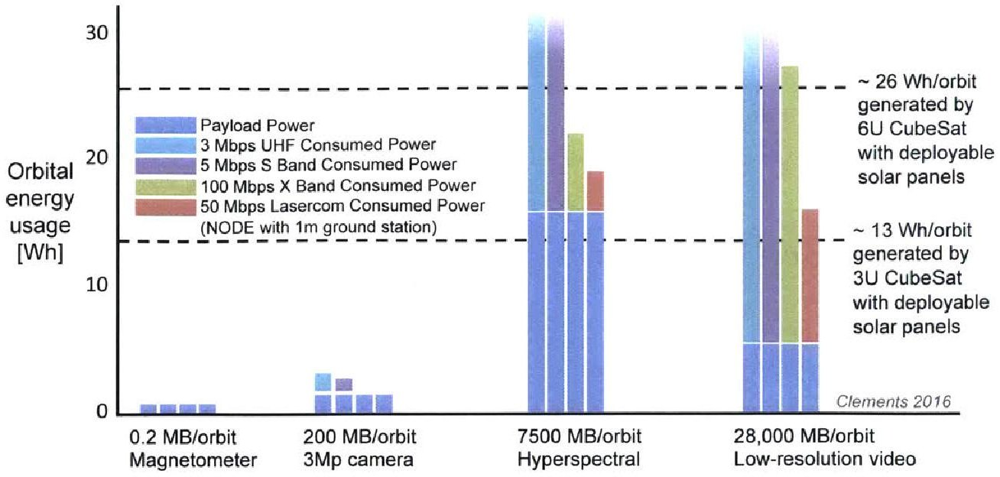

Figure 1-1: Power consumption of possible payloads for LEO CubeSats compared with power consumed for downlinking the payload data with different CubeSat communication systems. RF power consumption and data rates are based on commercial products [26, 27, 23, 28] and power generation is based on an example CubeSat mission [7]. The payload data is based on scaling the duty cycle of recent or proposed missions and payloads [29, 30, 13, 31, 14]. The magnetometer is based on the QuakeSat mission [29], the low-resolution camera is based on advertised data collection rates of a commercial off the shelf (COTS) CubeSat imager [30], the hyperspectral data collection is based on the system proposed by Mandl et al. [13], and the low resolution video is based on existing compact COTS cameras [31] and studies of possible CubeSat payloads [14].

alternative to Amateur bands requires teams to follow a lengthy licensing process [16, 19].

Lasercom offers an attractive alternative to RF communications for nanosatellites because of the power efficiency of high data rate transmissions. If transmit aperture size, transmit power, and receive aperture size are equivalent, the received power $ P_{Rx} $ scales with the square of the wavelength $ \lambda $ , as shown in Equation 1.1. For a given amount of power, lasercom systems which are at shorter wavelengths can transmit greater amounts of data, allowing the payload to run at a higher duty cycle. Lasercom frequencies are not governed by the FCC [25], so CubeSats that wish to use these frequencies do not have to go through a lengthy licensing process, although laser safety regulations apply.

$$
\frac {P _ {R x , o p t i c a l}}{P _ {R x , R F}} = \left(\frac {\lambda_ {R F}}{\lambda_ {o p t i c a l}}\right) ^ {2}
$$

Figure 1-1 illustrates the utility of lasercom systems for two example advanced payloads (a hyperspectral imager and a video camera) and the lack of need for lasercom for two more traditional CubeSat payloads (a magnetometer and a low-resolution

<!-- PDF_PAGE: 23 -->

camera). The magnetometer and the low-resolution camera, even when operating at 100% duty cycle, do not produce enough data to challenge UHF communication systems. However, for more advanced payloads, the energy efficiency of lasercom can help to address on-board power challenges. A hyperspectral imager as in Mandl et al. produces over 10 Mbps of data [13], and the energy required to run the payload and downlink the associated data with RF would require more energy than a 3U CubeSat can produce. A 3U CubeSat may generate 13 W-hr of power per orbit [7], while a hyperspectral imager may consume 10 W-hr per orbit [13]. Power-efficient lasercom systems would address these power budget concerns.

## 1.2.3 Background on Satellite Laser Communication

There are unique challenges in developing a laser communications system for the limited SWaP available for CubeSats that can compete with and outperform existing RF solutions while also keeping costs low. This is necessary to be consistent with the CubeSat philosophy: rapid fielding of satellites and scaling to many (even hundreds) of nanosatellites in constellations and swarms, which is enabled by low-cost COTS hardware. In the following subsections, we describe key developments in lasercom for microsatellites and CubeSats. We also include some components that are relevant to lasercom and have been flown for other mission applications (e.g., laser altimetry, laser ranging, and lidar). We attempt to briefly capture the basic relevant information here, along with recent mission concepts and status updates since Kingsbury [32], and refer the reader to that thesis for more detail.

## Previous Space-based Lasercom Demonstrations

Laser communications from space has been demonstrated by several missions with larger satellites. For example, in 2005, OICETS, a 570 kg satellite, demonstrated intersatellite lasercom links using the Laser Utilizing Communications Equipment (LUCE) in cooperation with the ARTEMIS satellite. LUCE was a 140 kg, 220 W payload, operated at 847 nm, and used On-Off Keying (OOK) to crosslink at nearly 50 Mbps [33]. More recently, in 2013, the Lunar Laser Communication Demonstration (LLCD) on the Lunar Atmosphere and Dust Environment Explorer (LADEE) demonstrated up to 622 Mbps from lunar orbit using a 0.5 W 15 $ \mu $ rad beam at 1550 nm [34]. Lasercom technology continues to be integrated with space platforms, such as the Optical Payload for Lasercomm Science (OPALS), a payload on board the International Space Station (ISS), which demonstrated up to 50 Mbps downlink using a 1550 nm 1 W beam and a 976 nm uplink beacon for pointing knowledge to the Optical Communications Telescope Laboratory

<!-- PDF_PAGE: 24 -->

(OCTL) 1 m telescope. The Lunar Communication Relay Demonstration (LCRD) extends the work of LLCD to geostationary applications [35]. Technology readiness level development is underway at NASA on the Deep Space Optical Terminal program [36]. The German aerospace organization DLR is also developing lasercom for inter-satellite links (crosslinks) and downlinks [37]. Finally, 10 Mbps lasercom was recently demonstrated from a LEO microsatellite in the SOTA experiment [38]. The SWaP of these missions has exceeded the size of CubeSat communications systems, so miniaturization and/or redesign would be necessary for nanosatellite applications. Hemmati [39] gives a list of representative space-based lasercom systems and relevant link parameters.

## Programs in Development

In this section we summarize ongoing efforts to develop CubeSat lasercom systems, related technologies, and lasercom ground support systems. There are three types of missions in development that are relevant to CubeSat lasercom demonstrations: CubeSat demonstrations of components or technologies, such as lasers and detectors, demonstrations of lasercom on platforms that require similar SWaP such as UAVs, and other demonstrations of full CubeSat lasercom terminals.

Several CubeSats are in development that will use lasers for applications other than lasercom. The Georgia Tech Ranging And Nanosatellite Guidance Experiment (RANGE) program will demonstrate inter-satellite ranging using two 1.5U CubeSats [40]. The goal of the CubeSat Handling of Multisystem Precision Time Transfer (CHOMPTT) mission is to use laser crosslinks to synchronize satellite clocks [41]; the initial demonstration will use a ground-based beacon and CubeSat retroreflector. The Lunar Flashlight mission will use lasers to perform reflectance spectroscopy from lunar orbit to identify and map the locations of ice on the lunar surface [42].

While the focus of this thesis is on satellite lasercom, Unmanned Aerial Vehicle (UAV) lasercom projects present similar challenges because they are SWaP constrained and have a challenging pointing environment. While the downlink range is significantly smaller, atmospheric losses can be more challenging. Several mainstream media articles have documented the growing interest in lasercom for UAVs for remote internet access, and demonstrations are under way [43, 44, 45]. For example, the Google Loon program has demonstrated 155 Mbps over a 100 km range between two balloons under diverse atmospheric conditions [46].

Several organizations are working on lasercom for nanosatellites. A comparison of a subset of these is given in Table 1.2. CubeSat demonstration systems include the Optical Communication Sensor Demonstration (OCSD) from the Aerospace Cor-

<!-- PDF_PAGE: 25 -->

poration [47, 48], $ ^{3} $ the Nanosatellite Optical Downlink Experiment (NODE) from the Massachusetts Institute of Technology (MIT) [49], $ ^{4} $ and the TeraByte InfraRed Downlink (TBIRD) from NASA and MIT Lincoln Laboratory [50]. Commercial systems are being developed by Sinclair Interplanetary [51]. The University of Florida is developing compact modulators [52], and the NASA Jet Propulsion Laboratory is developing lasercom for interplanetary missions [53]. We expect this list is not complete, and that other organizations have designs in progress. In summary, nanosatellite lasercom is an active area of research and development, offering many possible applications for a probabilistic systems engineering approach.

## Recent Developments in Industry

Ground support systems for lasercom are an active area of work. Tesat has demonstrated 2.8 Gbps downlink from a LEO satellite to its Transportable Adaptive Optical Ground Station (TAOGS) [54]. Analytical Space is expected to launch a CubeSat lasercom downlink system in May 2018 [55]. Fibertek is developing modular ground stations for space-based lasercom systems that are scalable to hundreds of Gbps [56]. Bridgesat, a new communications company, has partnered with Surrey to develop small satellites and a network of lasercom ground stations for satellite downlink use [57, 58]. Additionally, the technology readiness level of advanced compact lasercom systems continues to improve in research laboratories [59].

Optical crosslinks are planned for upcoming constellations. SpaceX is planning to use optical crosslinks in their StarLink constellation, according to their FCC filings [60]. Atlas is planning optical crosslinks for relays to a plane of equatorial satellites called "HALO" [61].

Technologies related to CubeSat lasercom, such as CubeSat-based lasers for other applications [40, 41, 42] and detectors that could be used for lasercom crosslinks [62] are in development. Several mainstream media articles have documented the growing interest in lasercom for UAVs at companies like Google and Facebook for remote internet access, which would feature similar SWaP constraints to CubeSats, and demonstrations are under way [43, 44, 45]. For example, the Google Loon program has demonstrated 155 Mbps over a 100 km range between two balloons under diverse conditions [46].

<!-- PDF_PAGE: 26 -->

<table border="1"><tr><td>Mission</td><td>Year</td><td>Org.</td><td>Pointing</td><td>Notes</td></tr><tr><td>Recent:</td><td></td><td></td><td></td><td></td></tr><tr><td>CANX-2</td><td>2008</td><td>U.of Toronto</td><td>2deg,1σ</td><td>Not during slew maneuvers[65]</td></tr><tr><td>PSSCT-2</td><td>2011</td><td>Aerospace</td><td>15deg,3σ</td><td>Not during slew maneuvers[66,67]</td></tr><tr><td>Aerocube</td><td>2012</td><td>Aerospace</td><td>3deg,3σ</td><td>Not during slew maneuvers[48]</td></tr><tr><td>BRITE</td><td>2014</td><td></td><td>0.0115deg</td><td>Star tracker, astronomical observations[68]</td></tr><tr><td>MinXSS</td><td>2016</td><td>UC Boulder</td><td>0.0042to.0117deg,3σ</td><td>Not during slew maneuvers.UsingBCTXACT[71,72,73]</td></tr><tr><td>ASTERIAUpcoming:</td><td>2018</td><td>JPL/MIT SSL</td><td>$1.4\times10^{-4}$deg,RMS</td><td>Not during slew maneuvers[9,74]</td></tr><tr><td>OCSD</td><td>2018</td><td>Aerospace</td><td>0.1deg</td><td>Pointing while ground tracking[75].In the commissioning phase as ofSpring2018,with no reported down-links to date.</td></tr></table>

Table 1.1: List of recent and upcoming missions and their pointing control capabilities.

## Key Enabling Technologies

The key enabling technologies for CubeSat lasercom are improved pointing control for both the CubeSat and ground terminal, power efficiency, and compact electronics and packaging.

Pointing Control: In order for lasercom on CubeSats to be competitive with RF solutions, the spacecraft terminal needs to be able to point a less than 5 milliradian beam $ ^{5} $ with a high slew rate $ (1^{\circ} / \mathrm{s}) $ despite uncertain spacecraft moments of inertia. Most CubeSats use attitude determination systems that cannot achieve this level of knowledge, although significant efforts are underway to incorporate low-cost star trackers onto CubeSats [63, 64]. CubeSat laser communication systems must therefore be able to accommodate coarse bus attitude control. The demonstrated state of the art in CubeSat control, as shown in Table 1.1, includes degree-level pointing control on several missions [65, 66, 67, 48] and 45 arcsecond (0.2 milliradian) pointing in the BRITE constellation [68], but the arcsecond pointing application was for staring at fixed distant objects (stars). While propulsive maneuvers requiring precise pointing have been demonstrated [69, 70] arcsecond-level attitude control has not been reported during slew maneuvers similar to what would be required for LEO lasercom downlinks.

Power Efficiency: Another challenge for CubeSat lasercom is power efficiency, given the limited power available to the host spacecraft. Per the design trades discussed in Kingsbury, space-rated Erbium Doped Fiber Amplifiers (EDFAs) are available, but do not fit the SWaP constraints of CubeSats. Commercially available EDFAs used in the

<!-- PDF_PAGE: 27 -->

Table 1.2: Comparison of lasercom transmitter parameters for several current missions: OCSD [79], NODE [49], CLICK, and the downlink system from Sinclair Interplanetary [51]. These missions highlight the broad tradespace for nanosatellite laser communication, including different wavelengths, transmit powers, and beamwidths. Note that CLICK is a crosslink system, while the other missions listed are downlink systems.

<table border="1"><tr><td>Parameter</td><td>OCSD</td><td>NODE</td><td>CLICK</td><td>Sinclair</td></tr><tr><td>Wavelength</td><td>1064nm</td><td>1550nm</td><td>1550nm</td><td>785nm</td></tr><tr><td>Transmit power</td><td>2.5W</td><td>0.2W</td><td>0.2W</td><td>1W</td></tr><tr><td>Beamwidth</td><td>3.5mrad</td><td>1.3mrad</td><td>0.70mrad(TBR)</td><td>1.0mrad×0.2mrad</td></tr><tr><td>Data Rate</td><td>50-622Mbps</td><td>50-100Mbps</td><td>25Mbps</td><td>250Mbps-1Gbps</td></tr></table>

telecommunications (telecom) industry, however, are available that meet the SWaP constraints [32]. The use of COTS parts, if they can meet the power requirements of the space terminal and survive in the space environment for the CubeSat mission lifetime (typically less than 5 years), helps keep costs low and enables rapid development.

Cost Constraints: One factor that complicates the requirements for tight pointing control and highly power efficient systems is the goal of maintaining low costs for CubeSat systems. Individual nanosatellites are typically launched as secondary payloads, at greatly reduced cost, and this accessibility to space is one of their key benefits over large missions. Using complex, highly-customized and space-rated parts is not always consistent with scaling to large CubeSat constellations. Occasionally components undergo the equivalent of full space qualification, but typically a less intensive screening process is used for sample parts.

Ground Terminal Complexity: Another enabling factor for space-based lasercom systems is the development of a geographically diverse ground station network to ensure reliability of access, because weather can temporarily block transmission of optical signals. Previous laser communication demonstrations have used large ground receive telescopes, such as OCTL [76] or several smaller apertures, such as Lunar Lasercom Ground Terminal (LLGT) [34, 77]. Such terminals also tend to use very sensitive detectors, such as superconducting nanowire single-photon detectors (SNSPDs). These terminals are expensive to build and maintain, and fielding enough ground stations to support a mission's desired availability may prove prohibitively expensive. To enable near-real-time access to downlinked data, the NODE program developed a 30 cm portable ground station [78].

<!-- PDF_PAGE: 28 -->

## 1.3 Systems Engineering Under Uncertainty for Risktolerant Space Platforms

Systems engineering for nanosatellites would benefit from design practices that are tailored to risk-tolerant platforms. While some tailoring policies exist for systems engineering management practices [80], there is no equivalent for technical processes. Integrated models that account for uncertainty would allow designers to more easily perform design trades and optimization.

## 1.3.1 Gap in Systems Engineering Methodologies for Balancing Uncertainty with Manufacturability

Systems engineering methodologies for designing under uncertainty have focused on characterizing and reducing uncertainty for low-risk systems, and there is a need to adapt these methods for risk-tolerant settings. Current uncertainty-based approaches include:

- Uncertainty-based multidisciplinary design optimization has been used to maximize performance under uncertainty; see Yao et al. [81] for a review paper.

- Assessing performance under uncertainty using large, integrated models of space systems, e.g., the Generalized Information Network Analysis (GINA) methodology developed by Shaw et al. [82, 83] or performance characterization of the JPL Skycrane for landing the Curiosity rover on Mars by White et al. [84].

- Reducing the variance of a performance estimate for an existing design as in Sondecker IV [85], Stout [86], or Sankaramaraman [87].

- Designing systems that are robust to uncertainty. Masterson and Miller [88] developed an approach for tailoring the design of space systems prior to launch to be robust to uncertainty, and to be able to tune out the remaining uncertainty on orbit.

The common theme in these methods is that uncertainty is not desirable, and therefore it must be characterized and reduced, which is appropriate for high-budget, low-risk systems. However, risk-tolerant platforms such as nanosatellites may be able to tolerate some performance variation if it enables the reduction of cost or improves manufacturability.

<!-- PDF_PAGE: 29 -->

## 1.3.2 Need for in Uncertainty Quantification for Multidisciplinary Nanosatellite Models

Multidisciplinary nanosatellite system modeling has been used to integrate systems engineering and subsystems such as structures, thermal, optical, controls, and others, but it has not been combined with direct quantification of hardware-specific input uncertainties. The approach in this thesis complements recent nanosatellite modeling efforts such as Model-Based Systems Engineering (MBSE) for test and verification activities [89], MBSE for CubeSat operations simulations [90, 91, 92, 93], and the TeamXc software tool [94] by providing input distributions and a methodology for using them to design under uncertainty. Performance uncertainty quantification has been limited to indirect methods, specifically, the use of expert elicitation [95], and there remains a need to comprehensively estimate model input distributions based on first principles and experimental data. A direct input distribution characterization approach has been used for deep-space RF communications for interplanetary spacecraft [96] but not for nanosatellites or lasercom. Using these distributions also requires a statistical modeling approach for simulating nanosatellite performance, which we address in this thesis.

## 1.4 Laser Communications Modeling

This section describes the state of the art in lasercom subsystem and end-to-end system modeling, and defines key terms. The literature has generally focused on subsystem modeling (e.g., theoretical analysis of spatial tracking performance to predict pointing losses [97, 98]) or on large, deterministic models. Statistical link estimation has been used to assess the probability of closing a link under various atmospheric conditions for deep-space optical communication [99]. We are building on this work by investigating how lasercom system design can be improved with a probabilistic approach, by developing a comprehensive, hardware-specific library of input distributions for the NODE space terminal [49] that can be generalized to other lasercom systems, and incorporating these distributions in an integrated, probabilistic system performance model.

## 1.4.1 Motivation for Statistical Lasercom Link Models

As described in Section 1.2.2 and 1.2.3, lasercom is vital for enabling the use of data intensive nanosatellite missions, so maximizing the performance of these systems is

<!-- PDF_PAGE: 30 -->

valuable.

Statistical models can be used to characterize the probability distribution of system performance, such as the possible data volume transmitted by a lasercom system per day given variable cloud cover and other uncertainties. In contrast, deterministic models are used to assess performance for a specific set of inputs, such as the worst-case conditions expected during operation. For a lasercom system, a deterministic model could mean assessment under the maximum range, with hazy conditions causing higher than normal atmospheric loss, wind causing higher than normal turbulence, temperature extremes on-board causing high static pointing errors, etc. While deterministic models are suitable for evaluating whether a system is expected to meet critical performance criteria (such as data rate) under stressing conditions, statistical models can give a better estimate of typical performance over time.

We use statistical link models to enable more accurate assessments of link budgets and allow programs to use new systems engineering methods to perform design trades and guide system testing. This is motivated by several factors:

- Atmospheric attenuation losses are more variable for lasercom than for RF communications, making the traditional "3 dB" rule of thumb inappropriate for guaranteeing link closure. This problem may be exacerbated when there are higher platform-specific losses such as pointing error. According to Cheung, the 3dB rule of thumb is insufficient for links with variable link losses, which applies to both lasercom and other higher frequency RF links [100]. He investigated the link margin required for various coding schemes, and found SNRs as high as 8 dB would be required to guarantee BER below $ 1 0^{-7} $ for SNR variations as small as $ \sigma=1.5 $ for some codes. Statistical link analyses are uncommon because of a lack of quantified input distributions [96].

- A deterministic approach, which ensures that the system will meet performance expectations under worst-case, highly unlikely conditions, can limit the performance of a system when high reliability links are not required. According to Tolker, "The worst case philosophy is justified by the operational nature of the SILEX $ ^{6} $ mission, but it is very penalizing, e.g., Pastel is designed to be within its performance specification in the practically impossible case that all three reaction wheels on SPOT4 turns at speeds coinciding with a structural resonance within the terminal" [101]. In resource-constrained systems, such over-design can limit the system performance in more typical conditions.

<!-- PDF_PAGE: 31 -->

## 1.4.2 State of the Art in Probabilistic Lasercom Modeling

## End to End Lasercom Link Modeling

Probabilistic lasercom models have been used for free space optical (FSO) ground network optimization to mitigate the effects of cloud cover. Alliss and Felton [102] developed the Lasercom Network Optimization Tool (LNOT), which uses fractional cloud cover based on Geostationary Operational Environmental Satellite (GOES) data to estimate the cumulative probability distribution for the daily percent data transferred of a hypothetical mission that generates 12 Tb per day, with 2.3 Tb of on-board data storage, corresponding to 4.5 hours of acquisition time. The work of del Portillo et al. [103] optimizes optical ground site selection for the metrics of availability, latency, and cost with variable cloud cover. The general approach in this thesis aids in the design of space and ground terminals rather than selecting ground stations as in Alliss and Felton and del Portillo et al.'s work. It extends their probabilistic metrics to both space and ground terminal design and combines this with the cloud availability modeling approach of del Portillo et al. $ ^{7} $

Probabilistic models are also used to assess lasercom designs. For example, Biswas et al. [99] evaluated best, worst, and nominal data rates for the Mars Laser Communication Demonstration (MLCD) using input probability distributions including pointing error, atmospheric effects, and background radiance. In the LUMOS model, we extend this approach to estimate a probability distribution of a key performance metric such as data volume delivered during a given time interval, instead of assessing best, worst, and nominal cases.

## Lasercom Subsystem Modeling

Lasercom systems engineering focuses on decomposing the system into subsystems and modeling at lower levels rather than building an end-to-end integrated system model. A summary of literature on lasercom subsystem modeling is shown in Table 1.3. We build on this existing work for the LUMOS input distribution library, as will be described further in Chapter 3.

<!-- PDF_PAGE: 32 -->

Table 1.3: Summary of key components, design parameters, and subsystem characerization. Further information on the key components can be found in Hemmati [104].

<table border="1"><tr><td>Link Block</td><td>Key Components</td><td>Design Parameters</td><td>Previous Characterization</td></tr><tr><td>Space Terminal</td><td>Transmitter electronics, optics, a pointing control system, and mechanical support</td><td>Aperture diameter, which controls the width of the transmit beam, and pointing control</td><td>Pointing control variations have been demonstrated to create received power fluctuations, as in Kolev and Toyoshima[105]</td></tr><tr><td>Channel</td><td>Clouds and atmospheric turbulence</td><td>Fried parameter ($r_0$), which measures atmospheric coherence length, and $C_n$ the atmospheric structure parameter[106]</td><td>Atmospheric attenuation and turbulence conditions have been characterized at a limited number of candidate ground station locations[107,108]. Wilson et al.[109] compares MODTRAN(a software tool that simulates optical transmission at a range of wavelengths) data with statistics of measurements at the Optical Communications Telescope Laboratory(OCTL) from2006-2011.Alliss and Felton[102] have extensively characterized cloud-related availability of different ground sites includingOCTL.</td></tr><tr><td>Ground Terminal</td><td>Telescope,a detector to translate received photons into an electrical signal,and receiver electronics to process the signal</td><td>Ground station aperture and detector selection</td><td>Implementation losses,which capture difference in performance between theory and practice,of about3dB have been observed in the laboratory[32,p.89],but these may be higher when transitioning from a prototype to a field unit.</td></tr></table>

<!-- PDF_PAGE: 33 -->

## 1.5 Summary of Gaps and Expected Contributions

To address gaps in lasercom statistical link models and input uncertainties, we build and validate an integrated performance model of nanosatellite laser communications including a hardware-specific library of input distributions. To address the gap in applying uncertainty-based systems engineering techniques to lasercom, we use the model to execute multidisciplinary design optimization and design of experiments for specific nanosatellite laser communications systems and quantify performance improvement.

## Literature Gaps:

- Gap 1: Lack of an Uncertainty-based Systems Engineering Methodology for Risk-tolerant Platforms Current methods focus on reducing uncertainty and therefore risk for high-value missions, which is not applicable to risk-tolerant platforms such as nanosatellites

- Gap 2: Lack of Statistical Lasercom Link Models While statistical link models have been used to assess radio frequency (RF) communications links, these models have not been extended to laser communications system-level models [100].

- Gap 3: Characterization of Statistical Input Distributions for Lasercom A critical component of statistical link analyses is a validated set of input distributions. As described in Subsection 1.4.2, uncertainty characterization has previously been limited to a few subsystems. While such a dataset exists for deep-space RF links, no such library exists for nanosatellite laser communications links [100].

- Gap 4: Measurement of Design Improvement Gaps 1 through 3 have prevented an assessment of whether system manufacturability or cost can be improved without sacrificing performance.

## Contributions:

- Contribution 1: Generalized Probabilistic Modeling Method Extend and modify existing approaches for quantifying input distributions and performing multidisciplinary performance analysis for use with lasercom systems

- Contribution 2: Architecture-specific Statistical Modeling Build a statistical laser communications model of lasercom architectures of interest such as direct detect Master Oscillator Power Amplifier (MOPA) architectures to estimate the probability densities of key performance metrics using the new input distributions and analyses.

<!-- PDF_PAGE: 34 -->

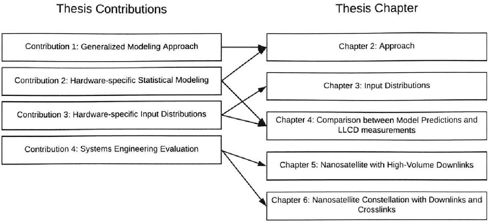

Figure 1-2: Mapping of thesis contributions to chapters.

- Contribution 3: Input Distributions Generate library of input distribution for lasercom architectures of interest, such as direct detect MOPA

- Contribution 4: Improvement over State of the Art Use the new input distribution approach and model, and demonstrate improvement over traditional approaches for two cases: single payload testing and constellation optimization.

We map these contributions to thesis chapters in Figure 1-2. Contributions 1 and 2 are described in Chapters 2 and Contribution 3 is described in Chapter 3, with additional details in presented alongside Contribution 4 with the case studies in Chapters 5 and 6.

## 1.5.1 LUMOS Overview

LUMOS aids decision making under uncertainty by estimating the probability of achieving a design goal, rather than estimating a lower bound on system performance (in this case measured by data volume). The LUMOS approach is to develop a database of input distributions for all factors that influence a lasercom link budget, and propagate these uncertainties using Monte Carlo analysis. These Monte Carlo analyses are run for each design vector in a formal design optimization process, and can be used to assess the probability of success and dependence on particular design parameters. Performance metrics are re-framed as probabilistic metrics, e.g., the probability of achieving a desired data volume downlinked per day. The implementation of LUMOS is described in detail in Chapters 2 and 3.

<!-- PDF_PAGE: 35 -->

To ensure the LUMOS implementation is relevant and realistic, we apply the model to a reference design called the Nanosatellite Optical Downlink Experiment (NODE), described in detail in Clements [49]. NODE is an ongoing program for demonstrating moderate rate (10-100 Mbps) optical communications downlink from a CubeSat using a 0.2 W, 1550 nm, 1.3 mrad laser beam. While this work is directly relevant to future generations of NODE, the framework can be updated for other laser communication systems or payloads that are sensitive to similar variations in input conditions.

## 1.6 Thesis Outline

In Chapter 1, we identify the key research questions and thesis goals, describe a detailed literature review and include a detailed discussion of research gaps and planned contributions in Section 1.5. In Chapter 2, we describe our research approach and give an overview of the modeling approach. Chapter 3 describes the input distribution library. Chapter 4 compares the measurements from the LLCD-OCTL experiments with predictions from the LUMOS model. Chapter 5 and 6 assess the performance improvement for using LUMOS for downlink and crosslink designs, respectively, and highlight the utility of the LUMOS approach for improving manufacturability and cost while meeting performance needs with probabilistic metrics. Chapter 7 summarizes the results and present directions for future research. Appendix A presents an additional application of LUMOS for on-orbit system characterization using Bayesian techniques and Appendix B summarizes lessons learned on applying various optimization algorithms to lasercom problems.

<!-- PDF_PAGE: 36 -->

<!-- PDF_PAGE: 37 -->

## Chapter 2

## Approach

Our approach is to build and validate an integrated lasercom performance model with a library of input distributions and to investigate how these tools can be used to improve systems engineering. To ensure the model and library are relevant to real hardware, we will focus on two LEO CubeSat application examples:

- Case 1: Optimization of a direct detect system with a MOPA and FSM, such as the Nanosatellite Optical Downlink Experiment (NODE): Described further in Section 2.1, NODE is an ongoing program at MIT for demonstrating moderate rate (10-100 Mbps to 30-100 cm aperture ground stations) optical communications downlink from a CubeSat using a 0.2 W, 1550 nm, 1.33 mrad laser beam [49]. This case study identifies a design that maximizes the probability of achieving realistic data volume requirements while accounting for manufacturability.

- Case 2: Nanosatellite Constellations with Lasercom Downlinks and Crosslinks: The lasercom system design from Case 1 is applied to a system capable of both downlinks and crosslinks, and the performance is compared with traditional, radio frequency systems.

This chapter is organized as follows: In Section 2.1, we describe the NODE system, which is used a reference architecture for both case studies. In Section 2.2, we describe the setup of the Day in the Life model $ ^{1} $ for the CubeSat or CubeSat constellation. Finally, in Section 2.4, we describe the link budget simulation.

<!-- PDF_PAGE: 38 -->

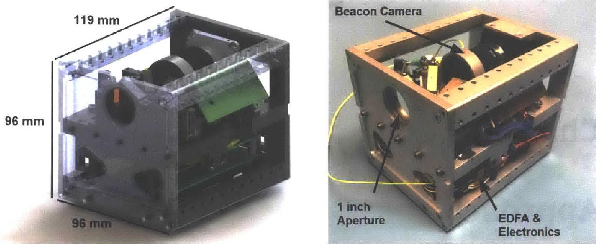

Figure 2-1: NODE CAD overview (left) and prototype (right). A central plate supports optics on top, including a collimator, Fast Steering Mirror (FSM), beacon detector, and 1 in. aperture. Circuit boards and a fiber amplifier are mounted to the bottom of this plate, and fiber is wrapped around posts that extend down from the plate. Figure credit: Derek Barnes.

## 2.1 Reference Architecture Overview

We based the lasercom system architectures for this study on variants of the Nanosatellite Optical Downlink Experiment (NODE) [49, 32, 110, 111, 112, 113, 114], as shown in Figure 2-1 and 2-2. NODE is a direct detect system and uses a Master Oscillator Power Amplifier (MOPA) transmitter to allow multi-rate communications with a fixed slot width by changing Pulse Position Modulation (PPM) order. A Fast Steering Mirror (FSM) system provides fine pointing to augment coarse body pointing. NODE is an approximately 1.2U $ \times $ 1U $ \times $ 1U, 15 W (consumed power) payload that will demonstrate up to 100 Mbps downlink from a CubeSat. The current architecture is designed to scale to about 500 Mbps with additional link margin, i.e., using a narrower beam. The system operates at 1550 nm and is designed to downlink to a 30 cm amateur telescope equipped with a COTS APD (the Portable Telescope for Lasercom, or PorTeL architecture [78]), but it is also compatible with existing LEO-tracking telescopes such as the Optical Communications Telescope Laboratory (OCTL). An illustration of a LEO downlink using NODE is shown in Figure 2-3.

## 2.2 Model Setup

LUMOS is a multidisciplinary model of satellite operations, incorporating the disciplines of physics, optics, orbital dynamics, link analysis, and atmospheric state. We model the required power for a given data rate using Gaussian statistics. We the LUMOS model to characterize performance uncertainty with Monte Carlo analysis. A block diagram of

<!-- PDF_PAGE: 39 -->

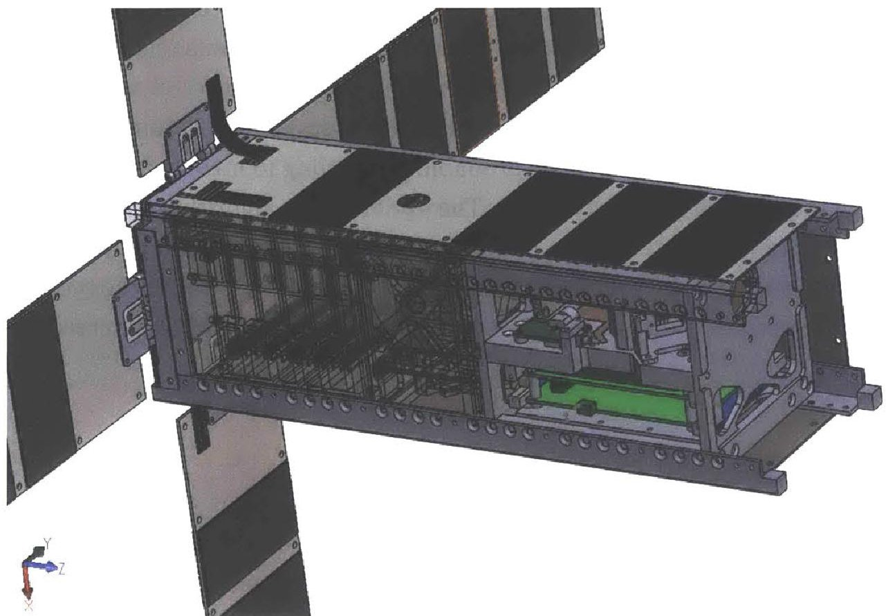

Figure 2-2: NODE placed in a generic 3U CubeSat. Figure credit: Derek Barnes.

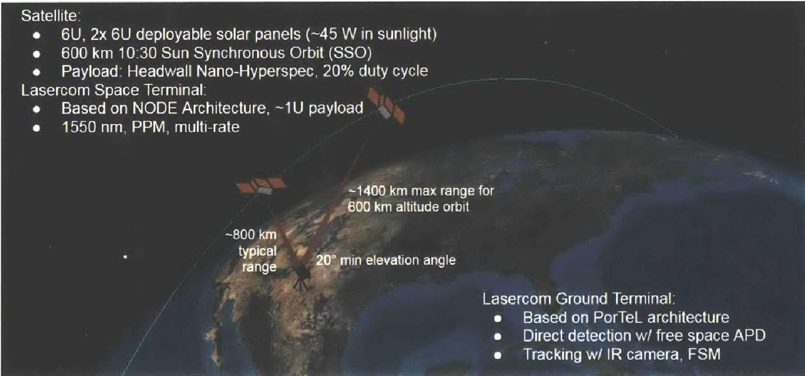

Figure 2-3: Overview of the mission and lasercom link for the LUMOS case study. A 6U CubeSat with two 6U deployable panels carries a hyperspectral imager in a 600 km Sun Synchronous Orbit (SSO). The NODE architecture is used for the lasercom downlink to a ground station with the PorTeL [78] architecture. PorTeL has an Avalanche Photodiode (APD) receiver and a FSM for tracking.

<!-- PDF_PAGE: 40 -->

LUMOS is given in Figure 2-4.

When used for design optimization, the LUMOS model accepts bounds for each input variable and randomly generates a set of vectors of design inputs (called design vectors) to form the first population of the optimization. Each design vector is assessed through Monte Carlo analysis to determine either the average data volume per day in the deterministic metric cases and the probability of failing to meet a data volume requirement in the probabilistic metric case. The optimization algorithm then selects the highest-performing members of the population of design vectors and generates a new population. Then these are assessed through Monte Carlo analysis, and the cycle is repeated until the optimization has completed twenty generations without increasing the data volume.

## 2.3 Day in the Life Modeling

The satellite day-in-the-life simulation estimates the data volume transferred by a nanosatellite lasercom system over a given time period. The model calculates the data rate for a given set of inputs and access conditions (time and range). The model takes in access times and corresponding ranges from an open-source orbit simulation developed by A. Kennedy [115]. $ ^{2} $ An achievable data rate is determined based on the range and other conditions for each timestep such as atmospheric loss. We note that while the model was built for the NODE terminal, it can be easily adapted to other architectures.

## 2.3.1 Ground Station Assumptions

Telescope mounts often have an exclusion angle, usually a zenith exclusion angle, through which they cannot slew fast enough to track low earth orbit (LEO) objects. The PorTeL system has a 20 degree zenith exclusion angle constraint. To estimate the impact of this, an STK [117] simulation of downlink time from a satellite in a 600 km sun-synchronous orbit to a ground station at the Optical Communication Telescope Laboratory shows a 2.7% reduction in link time because of this constraint. We use a 20 degree zenith angle constraint in the LUMOS model.

We assume a fixed ground station telescope focal ratio of 8 to be consistent with common amateur telescopes, which have focal ratios between 6 and 10. PlaneWave

<!-- PDF_PAGE: 41 -->

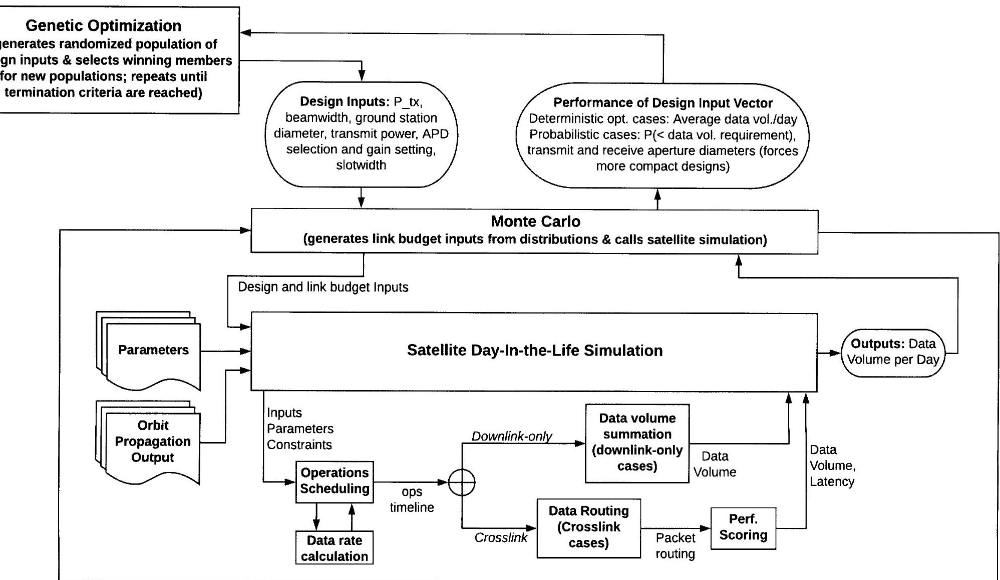

Figure 2-4: Analysis steps of the genetic optimization, Monte Carlo, and day-in-the-life simulations. The simulation handles both downlink and crosslink constellations. The day-in-the-life wrapper and operations scheduling module were developed in collaboration with A. Kennedy.

<!-- PDF_PAGE: 42 -->

Table 2.1: Power budget for notional multispectral imager CubeSat with lasercom downlink. The 13 W imaging payload is run at a 20% duty cycle, i.e., 2.6 W orbit average power. The powers listed in the table are the powers used during that mode, and not orbit average.

<table border="1"><tr><td>Component</td><td>Imaging[W]</td><td>Eclipse[W]</td><td>Down-link[W]</td><td>Nominal Sunlight[W]</td><td>Notes</td></tr><tr><td>Always-on components</td><td>6.3</td><td>6.3</td><td>6.3</td><td>6.3</td><td>Star Tracker,RWA,Processor,IMU,and RF Receiver,adapted from Tsitas and Kingston[17]to allow3Wfor reaction wheels and a lower power(0.1Wvs.12W)IMU</td></tr><tr><td>Payload</td><td>13</td><td>0</td><td>0</td><td>0</td><td>Headwall Nano-hyperspec[121]</td></tr><tr><td>Heater</td><td>0</td><td>4.8</td><td>0</td><td>0</td><td>Tsitas and Kingston[17].Note that if lasercomis operating in eclipse,the heater may not be required,but this is not considered here.</td></tr><tr><td>Lasercom Transmitter</td><td>0</td><td>0</td><td>10</td><td>0</td><td>Varies with transmit power.We assume2Wfor theFSM and10% efficiency for the transmitter.</td></tr><tr><td>Total</td><td>19</td><td>11</td><td>16</td><td>6.3</td><td></td></tr></table>

telescopes have focal ratios of 6 to 6.8 [118], Celestron has 10 to 11 [119], and Mead has a focal ratio of 8 [120].

## 2.3.2 Spacecraft Assumptions

In this section we summarize the assumptions about spacecraft power capabilities. We use a 6U satellite to be consistent with Mandl et al. [13], and we placed it in a 600 km sun-synchronous orbit to achieve constant illumination during Earth-imaging operations.

Power Consumption: The spacecraft consumes approximately 6.3 W during sunlight nominal operations and an additional 5 W during eclipse for heaters. In addition to the 6.3 W, a 13 W payload is operated at a 20% duty cycle (2.6 W orbit average power), equal to the maximum power of the Nano-Hyperspec [121]. We assume the transmitter consumes 2 W for electronics and that the EDFA is 5% efficient, such that the total consumed power of the transmitter is $ 2+2 0 \times P_{t x}. $

Power Generation and Storage: We assume the spacecraft is equipped with state of the art solar panels and batteries. State of the art small satellite solar panels commonly achieve 30% efficiency, and batteries achieve about 150 W-hr/kg energy density [122]. We assume the cells have a 60% packing efficiency, and that two 20 cm by 30 cm panels can deploy, generating 45 W of power in sunlight. We assume a battery of 0.33 kg, giving 50 W-hrs of storage.

## 2.3.3 Other Operational Considerations

Lasercom operations can be limited by additional operational considerations, such as FAA aviation safety constraints, Laser Clearinghouse constraints, solar exclusion angle

<!-- PDF_PAGE: 43 -->

of the ground telescope, and max zenith angle of the telescope mount.

Laser operations that might affect aircraft are regulated, either by the FAA in laserfree flight zones around airports or by the laser safety office of the sponsoring agency. This is especially relevant for laser communication systems that have an uplink laser beacon or transmission, which could be non-eye-safe at low altitudes, although this could be mitigated by eye-safe LED beacons [123]. The LLCD program estimated that for most passes, airplanes only restricted operations up to 10% of the time, but on rare occasions up to 70% of the pass could be affected [124].

Similar to the aviation safety regulations, satellite safety also constrains laser operations. The eye safe LED beacon would be too dim to affect satellites, but the downlink could affect satellites in the path of the beam. While the downlink schedule should be coordinated with Laser Clearinghouse for links conducted in the United States, in practice only links that would be within $ 2.5^{\circ} $ are restricted [125], and CubeSat orbits are so low (usually below 600 km) that such passes are infrequent.

Ground telescopes may be unable to tolerate the sun in or close to the field of view of the telescope due to background light, thermal constraints, detector damage concerns, or optics damage concerns, and this can limit the downlink opportunities. However, the fraction of the time that a satellite would pass between the ground station and the sun is small. The exact solar exclusion angle has not been assessed for the PorTeL system, but typical angles are about 8 degrees for other optical ground stations [76]. Incorporating this constraint into the zenith exclusion angle model in STK gives a total of 3% reduction in access time with the combined zenith and solar constraints.

## 2.3.4 Data Routing for Crosslink Systems

We use a simple data routing algorithm that assumes all satellites have global knowledge of constellation operations. Most of the improvement in latency from crosslinking for constellations with few ground stations is from routing the data to a more favorably placed plane. The algorithm calculates the latency if a given satellite did one crosslink to another plane vs. the latency if a given satellite waited to downlink directly do a ground station. The algorithm is as follows:

1. Given a starting timestep, estimate the wait time for a given satellite, "Satellite A" to downlink directly to a ground station.

2. For all of the satellites that Satellite A can crosslink with that are not nearest neighbors, estimate the wait time to start the crosslink, the amount of time it would take to crosslink, and the wait time from that point until the crosslinking satellite can downlink.

<!-- PDF_PAGE: 44 -->

Table 2.2: List of scaling factors used to estimate the data bit rate from the channel bit rate.

<table border="1"><tr><td>Parameter</td><td>Data Rate Scaling factor</td><td>Rationale</td></tr><tr><td>RS error correction</td><td>$\frac{239}{255}$</td><td>Using a(239,256)RS code</td></tr><tr><td>Acquisition header</td><td>$\frac{995}{1000}$</td><td>5ms per s for modulation framing</td></tr><tr><td>Intersymbol guard time</td><td>$\frac{PPM}{PPM+1}$</td><td>One guard slot per symbol</td></tr><tr><td>Dataframe</td><td>0.98</td><td>2percent overhead</td></tr><tr><td>Combined scaling</td><td>0.81 to 0.91</td><td>Product of above for various PPM</td></tr></table>

3. This is repeated for each satellite in the constellation, and run for ten timesteps evenly spaced over the time period of the simulation.

## 2.4 Link Modeling

From Moison et al. [126], the equation for approximating channel capacity for a PPM system is

$$
C = \frac {1}{\log (2) E _ {\lambda}} * \left(\frac {P _ {r e q} ^ {2}}{\frac {P _ {r e q}}{\log (P P M)} + \frac {2 P _ {n}}{P P M - 1} + \frac {P _ {r e q} ^ {2} * P P M * T _ {s}}{\log (P P M) * E _ {\lambda}}}\right)
$$

Where C is the channel capacity in bits per second, $ P_{req} $ is the power required for a particular data rate in Watts, PPM is the order of the pulse position modulation (a power of two between 4 and 512), $ T_{s} $ is the slot width of the PPM in seconds, and $ E_{\lambda} $ is the energy of a photon in Joules. The NODE system operates at $ \lambda=1 5 5 0 $ nm so the energy per photon is $ 1. 2 8 \times1 0^{-1 9} $ J. The third term in the denominator dominates for NODE.

Equation 2.1 describes the data rate in bits per second. The information rate relates to the data rate combined with "taxes" for error-correcting bits, acquisition headers, intersymbol guard time, and data framing. It is more common for this overhead to be accounted for in the received or required power calculations, and one would maintain a constant data rate and average power but increase the slot width / decrease the power per slot to compensate for the added bits. However, because NODE uses a constant slot width, the link budget scales the data rate instead of the power and slot width to account for error correcting bits and other factors. $ ^{3} $ Therefore the power per slot remains the same, but the data rate is decreased as the miscellaneous coding bits are added, as shown in Table 2.2.

<!-- PDF_PAGE: 45 -->

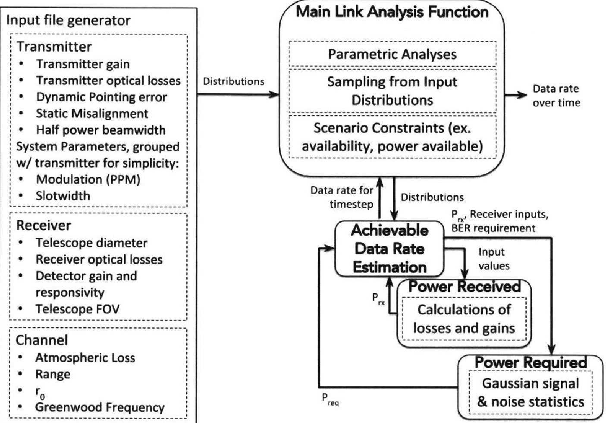

Figure 2-5: Model Setup of the detailed link model.

<!-- PDF_PAGE: 46 -->

The margin of the link for each data rate is defined as the difference between power received and power required in decibels (dB). The received power (in dB) is the transmitted power plus gains from transmit and receive telescopes minus losses from various sources (such as transmitter and receiver optics, free space loss, atmospheric loss, and pointing loss).

$$
P _ {r e c} = P _ {T} + G _ {T} + G _ {R} - L _ {T} - L _ {R} - L _ {F S} - L _ {a t m} - L _ {p o i n t i n g} - L _ {s e e i n g}
$$

$ P_{T} $ is the transmit power, $ G_{T} $ is the transmitter gain, $ G_{R} $ is the receiver gain, $ L_{T} $ is the transmitter optical loss, $ L_{R} $ is the receiver optical loss, $ L_{FS} $ is the free space loss, $ L_{atm} $ is the atmospheric loss, and $ L_{pointing} $ is the pointing loss. Atmospheric loss is a function of loss from absorption by water vapor or other particulates. On a cloudy day, atmospheric loss will be too high to permit an optical link. On a perfectly clear day when the satellite is directly overhead, this loss can be as low as 0.5 dB.

The required power (in dB) is:

$$
P _ {r e q, d B} = 1 0 * \log_ {1 0} \left(P _ {s i n g l a, W}\right) - L _ {i m p}
$$

Where $ P_{signal,W} $ is the required average signal power in Watts to differentiate from noise at a given bit error rate (BER), and $ L_{imp} $ is an implementation loss. This loss was measured to be up to approximately 3 dB based on benchtop measurements described in Kingsbury [32, p. 89], which we treat as a lower bound on implementation loss in case moving from a benchtop setting to a packaged flight setting causes additional implementation losses. This loss measurement will be updated upon completion of the integrated system.

## 2.4.1 Seeing Loss

Turbulence in the path of the laser beam can cause the apparent spot to change in size and shape. As the spot grows, some of the received power may spill outside of the active area of the APD.

To first order we can approximate the seeing loss by assuming an effective telescope diameter of the coherence length of the atmosphere (also known as the Fried parameter, $ r_{0} $ ; see Andrews for background [106]), $ r_{spot} $ as:

$$
r _ {s p o t} = f \times 1. 2 2 \frac {\lambda}{r _ {0}}
$$

<!-- PDF_PAGE: 47 -->

However, this implies that the deformed spot is a single Bessel function. In reality there are two overlayed distributions: (i) a "core" caused by telescope diffraction and (ii) a "halo" caused by the atmospheric coherence length. We will approximate both as Gaussian. The steps for calculating the encircled power with seeing are:

1. Calculate the peak intensity with no turbulence

2. Calculate the peak intensity for the core and halo from calculating the Strehl ratio of each distribution

3. Characterize the shape parameters of the core and halo

4. Calculate the encircled power, now that the intensities and shapes of each distribution are calculated.

We approximate peak intensity, $ I_{0,max} $ , with no turbulence as:

$$
I _ {0, m a x} = \frac {P _ {r x} A}{\lambda^ {2} f ^ {2}}
$$

where $ P_{r x} $ is the received power, A is the area of the telescope aperture, $ \lambda $ is the wavelength, and f is the focal length of the telescope. This is derived from Hardy [127] equation 4.22:

$$
I _ {0, m a x} = \frac {2 P _ {r x}}{\pi w ^ {2}}
$$

and $ w=\frac{0.88\lambda f}{D} $ in meters.

Next we calculate the Strehl ratio and peak intensity for the core and halo. First we calculate the variance over the pupil, $ \sigma_{p}^{2} $ , from Racine [128]:

$$
\sigma_ {p} ^ {2} = 0. 1 3 2 \left(\frac {D}{r _ {0}}\right) ^ {\frac {5}{3}}
$$

The Strehl ratios, from Hardy and Racine are:

$$
S _ {c o r e} = e ^ {- \sigma_ {p} ^ {2}}
$$

$$
S _ {h a l o} = \frac {1 - e ^ {- \frac {1}{6} \sigma \frac {1 0}{3}}}{1 + \left(\frac {D}{r _ {0}}\right) ^ {2}}
$$

<!-- PDF_PAGE: 48 -->

Thus the peak intensities for the core and halo are:

$$
I _ {0, c o r e} = I _ {0, m a x} \times S _ {c o r e}
$$

$$
I _ {0, h a l o} = I _ {0, m a x} \times S _ {h a l o}
$$

We approximate the power in each distribution by:

$$
P _ {R x, c o r e} = \frac {I _ {0 , c o r e} \lambda^ {2} f ^ {2}}{A}
$$

$$
P _ {R x, h a l o} = P _ {R x} - P _ {R x, c o r e}
$$

Next we calculate the standard deviation of each distribution. We can calculate the diameter of each distribution, and then use the fact that the standard deviation of a Gaussian fitting to an Airy disk is $ 0. 4 4 \frac {\lambda}{D} $ . The equations for the diameter are from equations 4.54 and 4.56 Hardy [127], multiplied by the focal length of the telescope to get diameter in distance instead of angle:

$$
D _ {c o r e} = f \times 1. 2 2 \frac {\lambda}{D}
$$

$$
\sigma_ {c o r e} = D _ {c o r e} \times \frac {0 . 4 4}{1 . 2 2}
$$

$$
D _ {h a l o} = f \times 1. 2 2 \frac {\lambda}{D} \sqrt {1 + \left(\frac {D}{r _ {0}}\right) ^ {2}}
$$

$$
\sigma_ {h a l o} = D _ {h a l o} \times \frac {0 . 4 4}{1 . 2 2}
$$

Finally, we can calculate the proportion of the power that is encircled within the radius of the APD for each distribution and sum these to get the total encircled power.

$$
P _ {c o r e} = P _ {r x, c o r e} \times \left(1 - e ^ {\frac {- r _ {A P D} ^ {2}}{2 \sigma_ {c o r e} ^ {2}}}\right)
$$

$$
P _ {h a l o} = P _ {r x, h a l o} \times \left(1 - e ^ {\frac {- r _ {A P D} ^ {2}}{2 \sigma_ {h a l o} ^ {2}}}\right)
$$

$$
P _ {e n c i r c l e d} = P _ {c o r e} + P _ {h a l o}
$$

We can divide this by the received power to get the fraction of the received power that makes it to the APD. Since $ P_{encircled} $ is linearly related to $ P_{Rx} $ , we can set $ P_{Rx} $ to unity and then calculate the seeing loss in dB as:

<!-- PDF_PAGE: 49 -->

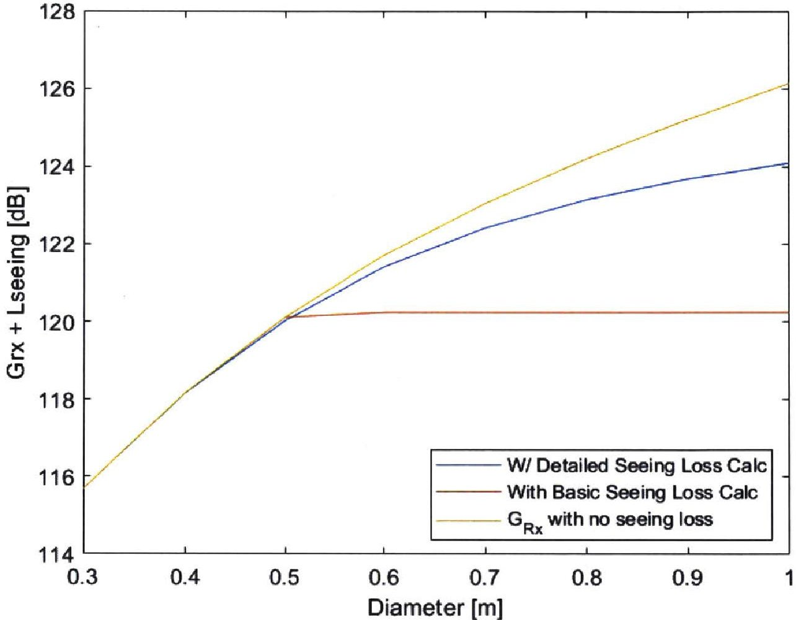

Figure 2-6: Combined effects of receiver gain and seeing loss by telescope diameter. The basic calculation overestimates the effects of seeing loss in proportion to the square of the diameter because the f-number is fixed, canceling out the higher receiver gain for larger apertures. This figure assumes an $ r_{0} $ of 10 cm at zenith and an elevation angle of 40 degrees.

$$
L _ {s e e i n g} = 1 0 \log_ {1 0} \left(\frac {P _ {e n c i r c l e d}}{P _ {r x}}\right)
$$

The difference between the first-order approximation of Equation 2.4 and the more complicated Equation 2.21 is illustrated in Figure 2-6. As aperture increases and seeing loss gets worse, the approximation becomes increasingly conservative while the true seeing loss is expected to be lower by several dB for large (e.g., 1 m) apertures.

## 2.4.2 Receiver Noise Modeling

Many sources contribute to noise in the receiver. For a detailed explanation for each source we refer the reader to Alexander [2], but we summarize them here for context:

- Quantum shot noise: caused by random timing of the arrival of individual photons

- Optical noise: Includes background light and imperfect extinction ratio

<!-- PDF_PAGE: 50 -->

Table 2.3: Receiver noise modeling for several brands of APDs and photodiodes, which provide different descriptions of noise. The brands were selected to capture commonly-used InGaAs linear-mode APD photoreceivers. With NEP, the responsivity, and the gain, we can calculate amplifier noise from Equation 2.4.2.

<table border="1"><tr><td rowspan="2">Device</td><td colspan="2">Photodetector Dark-Current Noise</td><td colspan="2">Photodetector Excess Noise</td></tr><tr><td>Captured By:</td><td>Value:</td><td>Captured By:</td><td>Value:</td></tr><tr><td>Voxtel APD Photoreceivers,e.g.,RIP1-NJAF</td><td>Photoreceiver NEP,APD Dark Current(I)</td><td>NEP=12.1nWatM=40;I=165nAatM=1</td><td>Excess noise factor</td><td>2.9atM=50</td></tr><tr><td>Hamamatsu APDs,e.g.,G8931-04</td><td>Dark Current(I)</td><td>40nA</td><td>Excess noise figure</td><td>0.7atM=10to20</td></tr><tr><td>Princeton Lightwave APD,e.g.,PAR-150M-1550TO/TOC</td><td>Photoreceiver NEP,Total Dark Current</td><td>90$\frac{fW}{\sqrt{Hz}}$,3to10nA</td><td>Calculated fromEq.2.4.2</td><td>k=0.02</td></tr></table>

## Photodetector Excess Noise: noise associated with the amplification process

- Photodetector dark current, Electronics noise and Noise Equivalent Power (NEP): Dark current is present even when the detector is not illuminated. Electronics can create noise such as amplifier noise. These are combined with excess noise into the Noise Equivalent power.

The derivation of the required power can be found in Kingsbury [32, p. 106]. In this section we describe the inputs for everything that contributes to required power, which includes background noise, NEP, noise equivalent bandwidth (NEB), and excess noise (F).

## Quantum, Optical Background, and Optical Excess Noise

Quantum shot noise, optical background light, and optical excess noise are present regardless of the selected detector. Optical excess noise is expressed as the extinction ratio of the laser, measured by Kingsbury to be between -38 and -42 dB. Optical background light is characterized by the sky spectral radiance from Hemmati [104].

## Photodetector and Electronics Noise

Different brands capture receiver noise with different variables. Here we map several brands, Voxtel, Hamamatsu, and Princeton Lightwave $ ^{4} $ , and types of photoreceivers to the receiver noise terms identified in Alexander [2]. Table 2.3 breaks down how the different terms provided by each brand are converted into the values used in the LUMOS model.

<!-- PDF_PAGE: 51 -->

Photodetector Dark-Current Noise and Noise Equivalent Power: The required power uses NEP for the photoreceiver, so we must convert from NEP for the detector to the photoreceiver. From the Voxtel technical note [129], for an APD, the Noise Equivalent Power (NEP) is:

$$
N E P _ {A P D} = \frac {\sqrt {2 q M ^ {2} F (M , k) I _ {d p}}}{R (\lambda) \times M} \left[ \frac {W}{\sqrt {H z}} \right]
$$

Where q is the charge of an electron, M is the APD gain, F is the excess noise, I is the dark current, and R is the responsivity. To turn this into the NEP for the whole photoreceiver, we need the noise and bandwidth of the amplifier. The Voxtel APDs use the Maxim MAX3277 APD, so we will assume that for this case. These have 300nA input-referred noise at 2.1GHz. $ \Delta f_{RTIA} $ is the bandwidth of the RTIA. Then we can calculate the photoreceiver NEP, also from the Voxtel technical note [129]:

$$
N E P _ {R T I A r e c e i v e r} = \frac {\sqrt {2 q M ^ {2} F (M , k) I _ {d p} + \sigma_ {a m p} ^ {2} / \Delta f _ {R T I A}}}{R (\lambda) \times M} \left[ \frac {W}{\sqrt {H z}} \right]
$$

Where $ \sigma_{amp}^{2} $ is the amplifier noise. By multiplying by the square root of the TIA bandwidth, we get:

$$
N E P _ {R T I A r e c e i v e r} = \frac {\sqrt {\Delta f _ {R T I A} \times 2 q M ^ {2} F (M , k) I _ {d p} + \sigma_ {a m p} ^ {2}}}{R (\lambda) \times M} [ W ]
$$

As the Hamamatsu devices are APD detectors and not integrated photoreceivers, calculating the NEP requires assumptions about the TIA performance. We will assume the same TIA as the Voxtel to get an apples-to-apples comparison. For the Maxim TIA, $ \sigma_{amp}=300 $ nA and $ \Delta f_{RTIA}=2.1 $ GHz. The excess noise figure provided by Hamamatsu is the exponential in the calculation for the excess noise figure described by McIntyre, so the k factor is about 0.38.

Photodetector Excess Noise: Excess noise, F, is modeled by Mclntyre's equation [129]:

$$
F (M, k) = k \times M + (1 - k) \times \left(2 - M ^ {- 1}\right)
$$

$ k_{effective} $ depends on the APD. For the Voxtel APDs it ranges from 0.02 to 0.2.

Amplifier Noise: For the Maxim TIA, $ \sigma_{amp}=3 0 0 $ nA and $ \Delta f_{RTIA}=2. 1 $ GHz. We calculate amplifier noise when photoreceiver NEP is provided using:

$$
\sigma_ {a m p} ^ {2} = \left(N E P \times R _ {A P D} \times M _ {A P D}\right) ^ {2}
$$

<!-- PDF_PAGE: 52 -->

Table 2.4: Representative link budgets for several nanosatellite downlink cases. Links A and B have 0.2 W transmit power and 1.33 mrad half power beamwidth $ ( 2. 2 6 \frac{1} {e^{2}} $ mrad beamwidth), while Links C and D have 0.5 W transmit power and 500 and 200 $ \mu $ rad half power beamwidth, respectively.

<table border="1"><tr><td>Key Input Parameters</td><td>Link A</td><td>Link B</td><td>Link C</td><td>Link D</td><td>Units</td><td>Notes</td></tr><tr><td>Channel data rate</td><td>11</td><td>50</td><td>300</td><td>400</td><td>Mbps</td><td></td></tr><tr><td>Information data rate</td><td>9.9</td><td>43</td><td>244</td><td>292</td><td>Mbps</td><td>Rates include scaling factors for error correction bits, header bits, etc.</td></tr><tr><td>Slot width</td><td>5</td><td>5</td><td>1.25</td><td>1.25</td><td>ns</td><td></td></tr><tr><td>PPM order</td><td>128</td><td>16</td><td>8</td><td>4</td><td></td><td></td></tr><tr><td>Laser Transmitter</td><td></td><td></td><td></td><td></td><td></td><td></td></tr><tr><td>Average optical output power</td><td>0.20</td><td>0.20</td><td>0.5</td><td>0.5</td><td>W</td><td></td></tr><tr><td>Laser Wavelength</td><td>1550</td><td>1550</td><td>1550</td><td>1550</td><td>nm</td><td></td></tr><tr><td>Extinction ratio</td><td>42</td><td>42</td><td>42</td><td>42</td><td>dB</td><td>Kingsbury measurements [32, p.85].</td></tr><tr><td>Half-power beamwidth</td><td>1.33</td><td>1.33</td><td>0.50</td><td>0.20</td><td>mrad</td><td></td></tr><tr><td>Transmit optical losses</td><td>-1.5</td><td>-1.5</td><td>-1.5</td><td>-1.5</td><td>dB</td><td>Accounting for 0.3 dB per planned splice.</td></tr><tr><td>Channel</td><td></td><td></td><td></td><td></td><td></td><td></td></tr><tr><td>Atmospheric loss</td><td>-1.00</td><td>-1.00</td><td>-1.00</td><td>-1.00</td><td>dB</td><td>Varies depending on desired link reliability [76].</td></tr><tr><td>Pointing loss</td><td>3.00</td><td>3.00</td><td>3.00</td><td>3.00</td><td>dB</td><td>Assumes pointing error of half-power beamwidth.</td></tr><tr><td>Receive Telescope &amp; Optics</td><td></td><td></td><td></td><td></td><td>m</td><td>AT datasheet [130], OCTL paper [131]</td></tr><tr><td>Focal length</td><td>2.8</td><td>75.8</td><td></td><td></td><td>cm</td><td>Bounds from Table 5.1</td></tr><tr><td>Receive Aperture diameter</td><td>30</td><td>100</td><td>30</td><td>100</td><td>dB</td><td>Assumes -1 dB for beamsplitter plus miscellaneous placeholder losses for AT; assumes OCTL has higher losses due to more complicated optics.</td></tr><tr><td>Receive optics losses</td><td>-2.00</td><td>-2.0</td><td>-2.00</td><td>-2.0</td><td>dB</td><td></td></tr><tr><td>Background Noise</td><td></td><td></td><td></td><td></td><td></td><td></td></tr><tr><td>Sky Spectral Radiance</td><td>6.00E-04</td><td>6.00E-04</td><td>6.00E-04</td><td>6.00E-04</td><td>W/cm2*SR*μm</td><td>Originally from Hemmati [104].</td></tr><tr><td>Optical filter bandwidth</td><td>1</td><td>1</td><td>1</td><td>1</td><td>nm</td><td></td></tr><tr><td>Receiver Electronics</td><td></td><td></td><td></td><td></td><td></td><td></td></tr><tr><td>APD Gain</td><td>20</td><td>20</td><td>20</td><td>20</td><td>-</td><td></td></tr><tr><td>Responsivity</td><td>1.0</td><td>1.0</td><td>1.0</td><td>1.0</td><td>A/W</td><td>Measured value from Kingsbury [32, p.58].</td></tr><tr><td>Excess Noise Factor</td><td>4.3</td><td>4.3</td><td>4.3</td><td>4.3</td><td></td><td>From device sales sheet via Kingsbury [32, p.58].</td></tr><tr><td>Noise equivalent power</td><td>2.80E-09</td><td>2.80E-09</td><td>2.80E-09</td><td>2.80E-09</td><td>W</td><td>From device sales sheet via Kingsbury [32, p.58].</td></tr><tr><td>Noise equivalent bandwidth</td><td>3.00E+08</td><td>3.00E+08</td><td>3.00E+08</td><td>3.00E+08</td><td>Hz</td><td>Larger than signal bandwidth per Kingsbury [32, p.58].</td></tr><tr><td>Link Budget Summary</td><td></td><td></td><td></td><td></td><td></td><td></td></tr><tr><td>Laser avg. optical power</td><td>-7.0</td><td>-7.0</td><td>-3.0</td><td>-3.0</td><td>dBW</td><td></td></tr><tr><td>Transmit optical losses</td><td>-1.5</td><td>-1.5</td><td>-1.5</td><td>-1.5</td><td>dB</td><td></td></tr><tr><td>Transmit antenna gain</td><td>69.6</td><td>69.6</td><td>78.1</td><td>86.0</td><td>dBi</td><td></td></tr><tr><td>Pointing loss</td><td>-3.0</td><td>-3.0</td><td>-3.0</td><td>-3.0</td><td>dB</td><td>Fixed for this representative link; in reality pointing error is independent of beamwidth so it would not always be 3 dB loss.</td></tr><tr><td>Path loss at 1000 km</td><td>-258.2</td><td>-258.2</td><td>-258.2</td><td>-258.2</td><td>dB</td><td></td></tr><tr><td>Atmospheric loss</td><td>-1.0</td><td>-1.0</td><td>-1.0</td><td>-1.0</td><td>dB</td><td>Representative value; would use MODTRAN to estimate</td></tr><tr><td>Receive antenna gain</td><td>115.7</td><td>126.1</td><td>115.7</td><td>126.1</td><td>dB</td><td></td></tr><tr><td>Receive optics losses</td><td>-2.0</td><td>-2.0</td><td>-2.0</td><td>-2.0</td><td>dB</td><td>-1 dB for beamsplitter plus miscellaneous losses</td></tr><tr><td>Receiver Implementation loss</td><td>-3.0</td><td>-3.0</td><td>-3.0</td><td>-3.0</td><td>dB</td><td>Measured value from Kingsbury [32, p.89].</td></tr><tr><td>Signal power at detector</td><td>-87.3</td><td>-77.0</td><td>-75</td><td>-67</td><td>dBW</td><td></td></tr><tr><td>Signal power req’d, BER=1e-4</td><td>-93.2</td><td>-84.2</td><td>-78.2</td><td>-73</td><td>dBW</td><td>includes implementation loss</td></tr><tr><td>Receiver Sensitivity</td><td>339</td><td>593</td><td>394</td><td>978</td><td>Photons per bit</td><td>Calculated based on required power &amp; data rate</td></tr><tr><td>Margin at 1000 km</td><td>5.8</td><td>7.2</td><td>3.2</td><td>6</td><td>dB</td><td>Maximum range</td></tr></table>

## 2.4.3 Representative Deterministic Link Budgets

Representative links are shown in Table 2.4. Most of the inputs in this link budget are updated as input distributions or are used as design variables. Note that the architecture is multi-rate using M-PPM; with fixed receiver sensitivity (fixed number of photons/bit or PPB required), the required receive power is reduced with the data rate for a fixed slot width. With an M-ary multi-rate system the receiver sensitivity improves (i.e., fewer PPB are required) as M is increased and the rate is decreased, as shown in the Receiver Sensitivity row of Table 2.4.

<!-- PDF_PAGE: 53 -->

## Chapter 3

## Input Distributions

In this chapter we discuss the characterization of inputs to laser communications models. In Section 3.1, we describe key terms in uncertainty characterization and give an overview of how the uncertainties in laser communications would be categorized to provide context for the detailed characterization discussion. In Section 3.2, we describe space terminal and transmitter input distributions that affect both downlinks and crosslinks. In Section 3.3, we discuss ground terminal and channel losses, which are specific to downlinks. Finally, in Section 3.4 we consider losses that are specific to crosslinks.

## 3.1 Types of Uncertainty

Uncertainties in laser communications models have a wide range of characteristics and complex inter-relationships. Some causes of uncertainty are exogenous (external to the system), while others are endogenous. Some uncertainties are aleatory and cannot be reduced with measurement, while others are epistemic and can be reduced through further testing. In Table 3.1 we categorize the uncertainties used in this work.

## 3.2 Inputs to Both Downlinks and Crosslinks

Space terminal gains and losses are relevant to both downlinks and crosslinks. Table 3.2 summarizes the distributions that are common to both downlinks and crosslinks. These are epistemic with the exception of pointing control error, so these uncertainties could be further reduced prior to launch for a specific hardware build.

<!-- PDF_PAGE: 54 -->

Table 3.1: Input distributions for the LUMOS model, categorized into aleatory, epistemic, endogenous and exogenous uncertainties, with downlink-specific inputs in blue, crosslink-specific inputs in red, and inputs for both downlinks and crosslinks in green.

<table border="1"><tr><td></td><td>Aleatory</td><td>Epistemic</td></tr><tr><td>Endogenous</td><td>APD radiation sensitivity</td><td>Pointing errorHalf power beamwidthTransmitter optics lossesExtinction ratioImplementation lossReceiver optics loss</td></tr><tr><td>Exogenous</td><td>Ground station availabilityAtmospheric loss for downlinksFried parameterAtmospheric loss for low tangent height crosslinksIn-space radiation environment</td><td></td></tr></table>

Table 3.2: Input distributions for Monte Carlo analysis that are common to both downlinks and crosslinks. Note that some uniform distributions in scalar units do not equate to uniform distributions in decibels; we use scalar uniform distributions. We use the notation of U(lower bound, upper bound) for uniform distributions and N(mean, standard deviation) for normal distributions.

<table border="1"><tr><td>Variable</td><td>Distribution</td><td>Rationale</td></tr><tr><td>Pointing error</td><td>N(0,0.025)+U(-0.092,0.092)mrad</td><td>Sum of various errors from preliminary pointing budget for pre-calibration case,so Normal distribution is assumed(post calibration has negligible uncertainty).</td></tr><tr><td>HPBW</td><td>Uniform distribution,±1% of beamwidth</td><td>Per collimator datasheet[132],collimation at room temp.is accurate to1%</td></tr><tr><td>Tx optical losses</td><td>N(-1.5,.5)dB</td><td>Assumes0.1dB per splice[133]with0.5dB standard deviation from uncertain number of splices.</td></tr><tr><td>Extinction Ratio(ER)</td><td>U(6.31×10-5,1.58×10-4)(-42dB to-38dB)</td><td>Reported in Kingsbury that ER varied between-38and-42dB(see Kingsbury[32,pp.82-87])</td></tr><tr><td>Implementation Loss</td><td>U(6.30957×10-5,0.000158)(-3.5to-2.5dB)</td><td>Measured by Kingsbury[32,p.89]as-2.4to3.0dB;added half a dB for further implementation loss at system integration level.</td></tr></table>

## Space Terminal Gains and Losses

Here we provide additional detail on the space terminal losses and gains identified in Table 3.2.

- The pointing error combines three sources of error: control error, bias from point-ahead error (error induced by the movement of the satellite during the time it takes light to travel between the space terminal and the ground station; see Winick [134] for an illustration), and thermo-elastic-induced error. The

<!-- PDF_PAGE: 55 -->

Table 3.3: Input distributions for Monte Carlo analysis that are specific to downlinks. The distributions are uniform in scalar units rather than decibel units.

<table border="1"><tr><td>Variable</td><td>Distribution</td><td>Rationale</td></tr><tr><td>Receiver Optical Loss</td><td>U(0.35,0.5)(transmission)(-4.55dB to-3.0dB)</td><td>Optical losses typically a few dB</td></tr><tr><td>Ground Station Availability</td><td>20% to 84%</td><td>Analysis performed by another MIT graduate student,I. del Portillo Barrios using data fromMODIS.[137]</td></tr><tr><td>Atmospheric Loss at zenith</td><td>U(0.82,0.99)(transmission)(-0.86dB to-0.044dB)</td><td>MODTRAN simulation</td></tr><tr><td>Fried Parameter</td><td>U(0.06,0.43)cm</td><td>Alliss and Felton[107]</td></tr></table>

control error is estimated to be 75 $ \mu $ rad, 3- $ \sigma $ [135]. $ ^{1} $ The point-ahead error is calculated at each timestep based on the elevation angle, and the maximum point-ahead angle for a 600 km satellite is 50 $ \mu $ rad. The maximum thermoelastic misalignment is 92 $ \mu $ rad based on a thermal simulation of NODE and the coefficient of thermal expansion of the aluminum frame and lens assembly. The control error has a Gaussian distribution, but the point-ahead angle and thermoelastic misalignments do not, so these are added instead of Root-Sum-Squared (RSS).

- We assume a uniform distribution of $ \pm1\% $ on the beamwidth of a given design because the data sheet for the NODE collimator lists a 1% tolerance.

- Transmitter optical losses are assumed to be Gaussian (in dB) because the total optical loss is the sum of smaller losses. Optical communication systems are connected internally with fiber optics. Splices are typically less than 0.1 dB of loss for multimode fiber [136], but the total number of splices is uncertain. NODE has at least two splices, but typically additional splices are included from rework and fiber service loops, so the expected number of splices is 5 to 10.

## 3.3 Downlink-Specific Input Distributions

Because downlinks link through the atmosphere to the ground, there are channelrelated input distributions and ground station distributions that are specific to downlinks. Table 3.3 summarizes the distributions specific to downlinks.

<!-- PDF_PAGE: 56 -->

## 3.3.1 Ground Station Losses

Receiver optical loss is modeled as a uniform distribution of optical transmission from 0.35 to 0.5 (in scalar units). While the transmitter loss is a sum of an uncertain number several smaller losses, with several of the losses varying independently (different manufacturers for several of the free-space optics), the primary uncertainty in the ground telescope optical loss is the coating used on the large optical surfaces. For example, Celestron uses the Starbrite optical coating on the window and mirrors, and this coating is not characterized out to 1.5 micron wavelengths. Because there is one uncertainty factor dominating the loss, and because the factor does not vary independently with the losses on each surface, we treat this as a uniform distribution. A beamsplitter diverts half the light for pointing control, so the total optical throughput is half at best.

We note that other lasercom ground station architectures may have additional types of losses that are not yet accounted for in our model: pointing error, additional variable losses for an adaptive optics system, and variable detector noise due to temperature, to name a few. The NODE architecture uses relatively large receivers, with APDs up to 200 microns in diameter, combined with a robust tip/tilt control system, reducing the need for more extensive adaptive optics. The APDs used by NODE do not have to be cooled, so detector temperature does not have to be modeled the way it would be for more sensitive, cooled detectors.

## 3.3.2 Channel Losses

We bound channel-related losses using MODTRAN analysis and published test data, and assume uniform distributions between these bounds because we do not have additional information on the shape of the distribution within the bounds. This provides a conservative estimate for each channel-related loss. Note that these effects are aleatory, so even with improved atmospheric characterization, these inputs would still vary.

The biggest channel effect for laser communications is cloud cover-induced outages. We used MODIS data from the Terra and Aqua instruments [138] as illustrated in Figure 3-1 to determine the average fraction of the time each ground station was cloudy. We then used these cloud fractions as an input to a Markov Chain model written by Inigo del Portillo Barrios to simulate the variation in cloud cover over time. The model is described in del Portillo et al. [103], and uses a Gilbert Elliot model as proposed by Clare and Miles [139].

Atmospheric loss is affected by the local visibility of the ground station. We use MODTRAN to estimate the transmission under various conditions, and the input distri-

<!-- PDF_PAGE: 57 -->

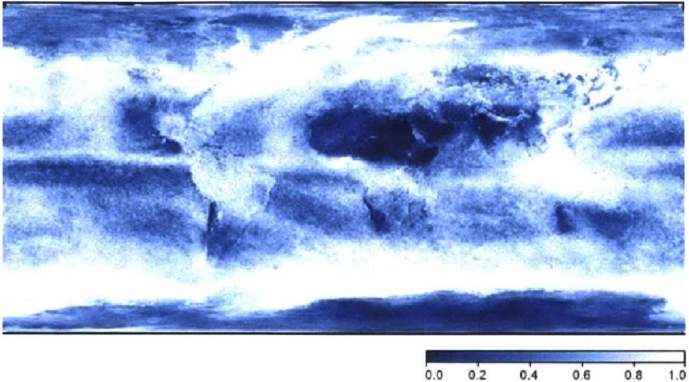

Figure 3-1: Example global cloud fraction for the month of January 2018 from the Aqua satellite [140]. The color tone of each pixel indicates the cloud fraction, with white pixels as very cloudy and dark blue as cloud-free.

bution is based on the bounding cases (Urban with 5 km visibility and Desert Extinction conditions), as shown in Figure 3-2. Note that cloud cover is treated as a separate access window constraint; the atmospheric loss applies for clear skies.

MODTRAN Transmission Under Various Conditions

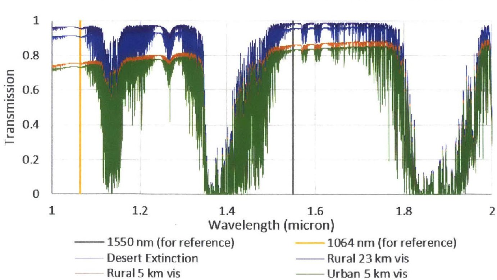

Figure 3-2: Optical transmission for 1 to 2 micron wavelengths under several environmentals (desert, rural with 5 and 23 km visibility, and urban with 5 km visibility). 1550 nm and 1064 nm are labeled for reference.

We estimate a range of values for the Fried parameter based on measurements of

<!-- PDF_PAGE: 58 -->

diurnal Fried parameter variations for four sites in Alliss [107]. In this work we use the $ r_{0} $ values from Alliss and Felton for the site that had the lowest seeing out of the four sites characterized in that paper to be conservative. (While nanosatellites could tolerate a reduced level of conservatism relative to large spacecraft programs, it is unlikely that all nine ground station sites would have exceptionally good seeing conditions.) We assume a 20 degree minimum elevation angle; below this, weak fluctuation theory does not hold [106] and seeing calculations may be inaccurate. Note that the lower bound on the Fried parameter distribution is smaller than the value canonically used for the deterministic case. A conservative but not an absolute worst-case of 12 cm is used based on the value used for MLCD analysis [99].

## 3.4 Crosslink-specific Input Distributions

Crosslinks have two sources of uncertainty that are not experienced by downlink systems: receiver radiation-induced degradation and unpredictable atmospheric attenuation and refraction. Crosslink receivers with APDs may be especially vulnerable on nanosatellites because of the sensitivity of the detectors. Clements et al. [141] contains additional background on the radiation sensitivity of APDs and as a counter-example, an assessment of the degradation of devices in the Lunar Orbiter Laser Altimeter (LOLA) on the Lunar Reconnaissance Orbiter (LRO), which did not experience increased noise in correlation with radiation events. Both the LOLA APDs and the APDs used in this work are linear mode, but the LOLA APDs are silicon while the APDs for systems at 1550 nm are InGaAs.

## 3.4.1 APD Performance and Radiation Damage

In addition to the space terminal losses described in Section 3.2, crosslinks are also susceptible to radiation damage of detectors. Systems that have Avalanche Photodiodes are especially susceptible because of the sensitivity of the devices.

The process for estimating radiation-induced degradation of APDs is shown in Figure 3-3. First, test data is interpreted to estimate the change in dark current based on the amount of energy deposited, as shown in Figure 3-4. In parallel, SPENVIS analysis is used to estimate the expected on-orbit dose and spectra of protons. These are combined with the Non-Ionizing Energy Loss (NIEL) of each proton energy to estimate a CDF of deposited energy, as shown in Figure 3-5.

Test data from Becker and Johnston [142] gives the change in dark current of several types of APDs, including Perkin Elmer and Hamamatsu InGaAs APDs, with six fluences

<!-- PDF_PAGE: 59 -->

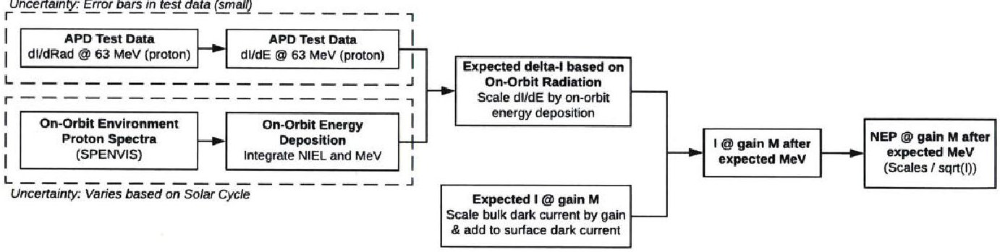

Figure 3-3: The process for determining the change in Noise Equivalent Power uses a combination of test data and simulation of the on-orbit environment to determine the likely change in dark current, and then updates the Noise Equivalent Power.

of 63 MeV protons. Becker and Johnston found increases in dark current of two orders of magnitude with 63 MeV proton fluences of $ 1 0^{1 0} $ and $ 1 0^{1 2} $ protons per $ \mathrm{c m^{2}}. $

Because the test data was at one proton energy, we must convert this into a relationship between dark current and the total amount of energy deposited in the devices, which can then be compared with the dose that is expected on orbit. We determined the Non-Ionizing Energy Loss (NIEL) of 63 MeV protons to be 0.38 eV/ $ \mathring{\mathrm{A}} $ using TRIM, which when multiplied with the fluence, gives the deposited energy of each fluence of 63 MeV protons, as shown in Figure 3-4.

Change in Dark Current vs. deposited energy

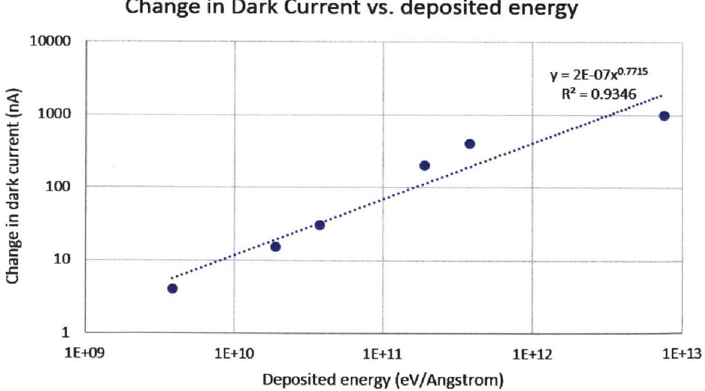

Figure 3-4: Test data from Becker [142] plotted against the deposited energy.

<!-- PDF_PAGE: 60 -->

Next, we need to estimate the probability of experiencing different amounts of radiation during a mission. We used SPENVIS to estimate the proton spectra and fluence for a range of percentiles and start dates of 1-year missions. We then discretized the results and used NIEL from TRIM for each of several of the proton energy spectra points to convert this to CDFs of deposited energy in eV/ $ \mathring{\mathrm{A}} $ , as shown in Figure 3-5.

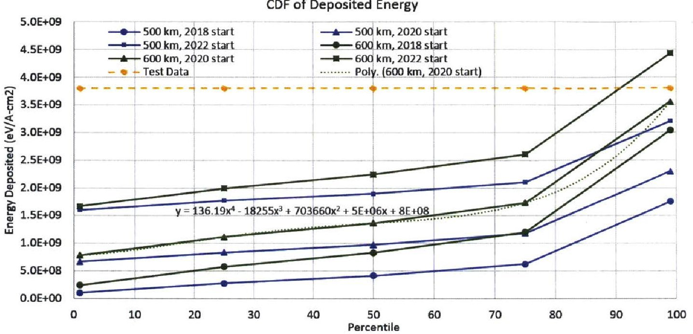

Figure 3-5: SPENVIS radiation dose data for several start dates combined with proton Non-Ionizing Energy Loss data gives deposited energy levels. The polynomial fit for the curve used in Chapter 6 is indicated.

By combining the SPENVIS results with the test data, we calculate a probability distribution of change in dark current for a given mission start date. This is then used to update the NEP, which is described in Section 2.4.2.

## 3.4.2 Low Tangent Height Atmospheric Absorption and Refraction

Crosslinks that pass through the atmosphere can experience both attenuation and refraction.

We model the attenuation in MODTRAN by simulating half of the path, with an observer placed at the tangent height of the link and a zenith angle of 90 degrees. We simulated heights between 10 and 30 km with a range of visibilities. Example results for 23 km rural visibility are given in Figure 3-6.

The refraction is less than 1 mrad [143], which is significantly less than the $ 5. 5^{\circ} $ field of view of the beacon camera on NODE, so it is not a problem for initial acquisition. Because it can be compensated for by the pointing control system during a link it is not

<!-- PDF_PAGE: 61 -->

MODTRAN Results for Low Tangent Height Crosslinks (1/2 path)

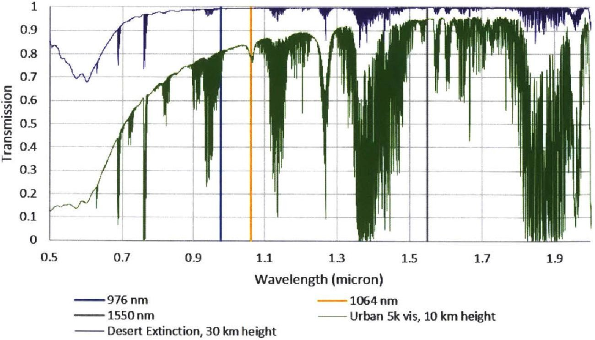

Figure 3-6: MODTRAN transmission for half of the path for a low tangent height crosslink with 10 km and 30 km tangent heights Desert Extinction and Urban 5km visibility are used as bounding cases, but the results depend primarily on the tangent height.

included in LUMOS, although refraction effects are relevant for extending the model to atmospheric sounding as described in Chapter 7.

## 3.5 Summary

Uncertainty characterization for lasercom touches on every part of the link, from the space terminal (e.g., pointing error or radiation sensitivity) to the channel (e.g., atmospheric loss) to the ground terminal (e.g., receiver loss). Next, in Chapter 4, we will evaluate the performance of the model compared with measured downlink received power from LLCD to OCTL, before moving on to use the model to perform trade studies.

<!-- PDF_PAGE: 62 -->

<!-- PDF_PAGE: 63 -->

# Model Comparison with Measurements from the Lunar Laser Communication Demonstration

To verify that the LUMOS model predictions are consistent with data from flight experiments, we compare output of the model with published data from the Lunar Laser Communication Demonstration presented in Biswas et al. [76]. We generate a Monte Carlo simulation for each pass to generate a distribution of possible received powers and then compare these to the histogram presented in Figure 6 of Biswas et al. We find that the received power measurements fall within the CDFs predicted by the LUMOS model.

## 4.1 LLCD Model Setup

Inputs to LUMOS are gathered from Biswas et al., with estimates for parameters that are not explicitly provided in the paper. We compile the inputs into Table 4.1. Table 2 of Biswas et al. provides path length, which we use to estimate free space loss for each pass, and elevation angle measurements, which we use to correct the atmospheric loss and Fried parameter.

For channel characteristics, we use the Rural 23 km Visibility case as a lower bound on atmospheric loss, and use 90% transmission as an upper bound on loss $ ^{1} $ . The distributions of atmospheric loss for all passes described in the paper are shown in

<!-- PDF_PAGE: 64 -->

Table 4.1: Typical, worst, and best case inputs from Biswas et al. [76] compared with input distributions for Monte Carlo analysis of the LLCD-OCTL downlink. The distributions are uniform in scalar units rather than decibel units. Half power beamwidth is 15 $ \mu $ rad [34].

<table border="1"><tr><td>Variable</td><td>Nominal</td><td>Worst</td><td>Best</td><td>Distribution</td><td>Rationale</td></tr><tr><td>LLST EIRP transmitting 0.5 W</td><td>99.1 dBW</td><td>99.1 dBW</td><td>99.1 dBW</td><td>99.1 dBW</td><td>Used the same value as Biswas as this is reported as a constant.</td></tr><tr><td>LLST Pointing Loss/Error</td><td>-0.6 dB</td><td>-1.5 dB</td><td>-0.4 dB</td><td>N($\theta$/5.5,$\theta$/7.6)/3)</td><td>Dividing the half power beamwidth by 5.5 corresponds to -0.6 dB,and 7.6 to -1.5 dB,which we assume is based on 3-$\sigma$ error.(We divide by 3 in the N() to give the 1-$\sigma$ value per standard notation.)</td></tr><tr><td>Space Loss</td><td>-310.7 dB</td><td>-310.9 dB</td><td>-310.0 dB</td><td>N/A</td><td>Calculated for range of each pass(deterministic)</td></tr><tr><td>Atmospheric Loss</td><td>-0.5 dB</td><td>-3.1 dB</td><td>-0.3 dB</td><td>10log(U(0.9,0.99))</td><td>Distribution is calculated for zenith and then updated for elevation angle specific to each pass.</td></tr><tr><td>Fried parameter</td><td>-</td><td>-</td><td>-</td><td>U(0.07,0.45)[m]</td><td>Bounds based on Alliss[107]</td></tr><tr><td>Ground Net Gain</td><td>114.4 dB</td><td>113.4 dB</td><td>115.4 dB</td><td>115.4-10log(U(0.63,1))</td><td>Assumes0to2dB misc.loss for an initial receiver gain of115.4dB.</td></tr></table>

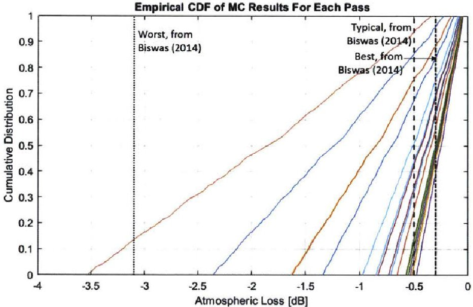

Figure 4-1: Atmospheric Loss distribution for LLCD simulation using the distribution from Table 4.1 accounting for the zenith angle of each pass. The predicted worst, typical, and best from Biswas et al. [76] are labeled. The CDF shows the probability that the loss will be less than a given value; for example, there is an 80% probability that the pass with the orange curve will have an atmospheric loss worse than -1 dB.

Figure 4-1. For the Fried parameter, we use data from Alliss et al. in which the Fried parameter was measured for several sites including OCTL.

Expected Isotropic Radiated Power (EIRP), ground net gain (receiver gain plus receiver losses), and pointing error are derived from the values provided in Table 4 of Biswas et al. We assume a normal distribution with a 3- $ \sigma $ value to match the worst

<!-- PDF_PAGE: 65 -->

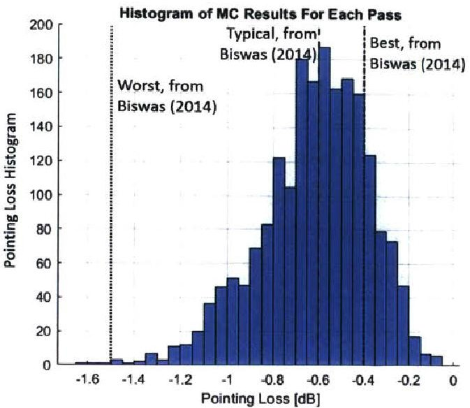

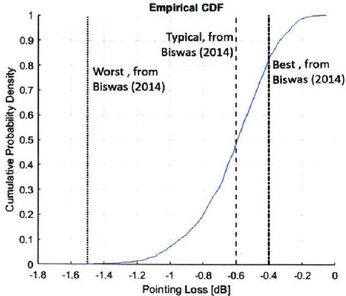

Figure 4-2: Pointing Loss histogram for LLCD simulation using the pointing error distribution from Table 4.1. The predicted worst, typical, and best from Biswas et al. [76] are labeled.

pointing loss, as illustrated in Figure 4-2.

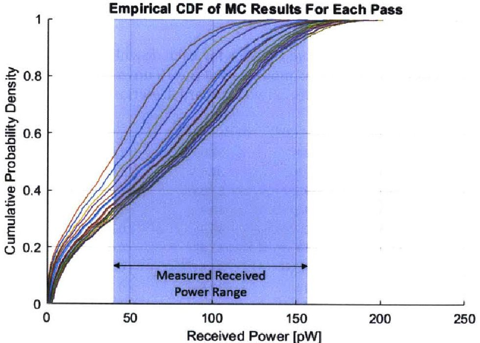

Figure 4-3: Cumulative Distribution Functions for each of the passes. The range of measured received power is highlighted in blue.

## 4.2 Results

First we compare the aggregated received power measurements from Biswas et al. against the CDFs of predicted received power using the LUMOS model. Then we compare the received power for each downlink against the expected CDF, mean, and standard deviation.

<!-- PDF_PAGE: 66 -->

## 4.2.1 Comparison of Received Power CDFs with Aggregated Received Power Measurements

CDFs of the received power for each pass are shown in Figure 4-3. The majority of the cases result in a received power between 50 and 200 pW, which is consistent with the results in Biswas et al., in which all of the received power fell between 40 and 160 pW. The SnSPDs can saturate at 160 pW, so the measured power did not exceed that value, but our model does not predict many of the passes would have received higher power than 160 pW even if saturation were not possible.

## 4.2.2 Comparison of Results by Pass

A comparison of the predicted received power for each downlink between LLCD and OCTL shows that 13 out of 19 of the passes were within 1 standard deviation of the predicted mean, and all of the passes were within 2 standard deviations. The measured received powers, the expected values, and the standard deviations from the Monte Carlo results are given in Table 4.2.

Table 4.2: Comparison of measured received power for each downlink vs. the mean and standard deviation of the prediction with the LUMOS model. 13 of the 19 downlinks were within one standard deviation of the prediction, and all were within two standard deviations.

<table border="1"><tr><td>$P_{rx}[\mathrm{pW}]$</td><td>$E[P_{rx}][\mathrm{pW}]$</td><td>$\sigma(P_{rx})[\mathrm{pW}]$</td><td>$\frac{P_{rx}-E[P_{rx}]}{\sigma(P_{rx})}$</td></tr><tr><td>132.6</td><td>78.7</td><td>52.0</td><td>1.0</td></tr><tr><td>98.6</td><td>39.9</td><td>31.5</td><td>1.9</td></tr><tr><td>160.4</td><td>79.1</td><td>51.8</td><td>1.6</td></tr><tr><td>108.4</td><td>53.1</td><td>38.9</td><td>1.4</td></tr><tr><td>108.0</td><td>70.7</td><td>46.9</td><td>0.8</td></tr><tr><td>80.2</td><td>61.6</td><td>43.3</td><td>0.4</td></tr><tr><td>59.7</td><td>66.6</td><td>45.5</td><td>0.2</td></tr><tr><td>67.5</td><td>44.5</td><td>33.6</td><td>0.7</td></tr><tr><td>64.0</td><td>67.2</td><td>45.4</td><td>0.1</td></tr><tr><td>35.4</td><td>49.4</td><td>36.2</td><td>0.4</td></tr><tr><td>42.7</td><td>75.1</td><td>49.4</td><td>0.7</td></tr><tr><td>141.9</td><td>73.2</td><td>48.6</td><td>1.4</td></tr><tr><td>33.4</td><td>75.6</td><td>51.5</td><td>0.8</td></tr><tr><td>33.5</td><td>74.3</td><td>51.5</td><td>0.8</td></tr><tr><td>43.4</td><td>63.4</td><td>45.8</td><td>0.4</td></tr><tr><td>95.0</td><td>74.4</td><td>48.7</td><td>0.4</td></tr><tr><td>172.4</td><td>76.8</td><td>49.7</td><td>1.9</td></tr><tr><td>97.7</td><td>72.6</td><td>48.0</td><td>0.5</td></tr><tr><td>84.5</td><td>62.1</td><td>43.2</td><td>0.5</td></tr></table>

To illustrate how the received powers compare with each respective CDF, we show the received powers and CDFs for each downlink in Figure 4-4. Most of the measured received power fall in the middle two-thirds of the distribution, while a few fall at the

<!-- PDF_PAGE: 67 -->

upper end. Interestingly, none of the passes fell below the 25th percentile, indicating that the model is either slightly conservative, or possibly includes seasonal variations or other factors that were not exhibited during these passes.

## 4.3 Conclusion

With the statistical model discussed in Chapter 2 and the input distributions characterized in Chapter 3, combined with the confirmation the model is consistent with received power measurements as described in this chapter, we can now assess lasercom designs accounting for uncertainty and use probabilistic metrics.

<!-- PDF_PAGE: 68 -->

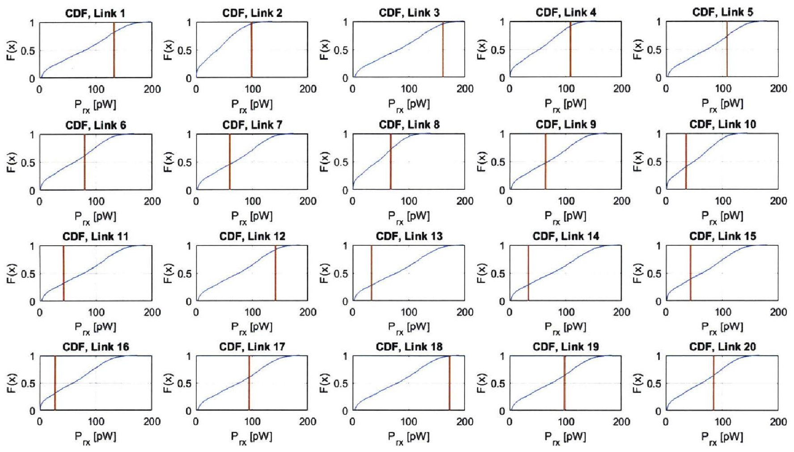

Figure 4-4: CDFs of received power predictions (blue) and measured received power (red) for each pass. Pass 16 was in a half-power mode so it is not included in the statistics of Table 4.2, but is included here for reference.

<!-- PDF_PAGE: 69 -->

## Chapter 5

## Nanosatellite Downlink Case Study

The objective of the case study is to assess the performance and manufacturability improvements with a probabilistic approach using the LUMOS model (described in Chapter 2), comparing both deterministic and probabilistic performance metrics of a nanosatellite laser communications downlink capability. We will assess the design performance using three approaches:

i. Optimization with Worst-Case Inputs: This optimizes for a deterministic performance metric: the average data volume per day under worst-case conditions. This reflects a traditional systems engineering approach.

ii. Optimization with Input Distributions: This replaces the inputs from Approach 1 with input distributions, but maximizes the same performance metric. This reflects a hybrid probabilistic-traditional approach.

iii. Optimization for a Probabilistic Metric: This replaces the metric of maximizing data volume with minimizing the probability of failing a daily data volume requirement, and explores how much manufacturability can be improved with this approach. This reflects the new probabilistic approach.

## 5.1 Nanosatellite Lasercom Design Case Study Overview

We use the design of a communication system with the NODE lasercom architecture for a CubeSat generating large data volumes of up to 500 Gb/day, e.g., a hyperspectral imager, as illustrated in Figure 2-3. Hyperspectral imagers are of interest for CubeSat missions because of their use for missions such as hydrology, minerology, and agriculture monitoring [144]. These payloads can produce large volumes of data, and even after compression, common CubeSat communication systems such as UHF or S-band

<!-- PDF_PAGE: 70 -->

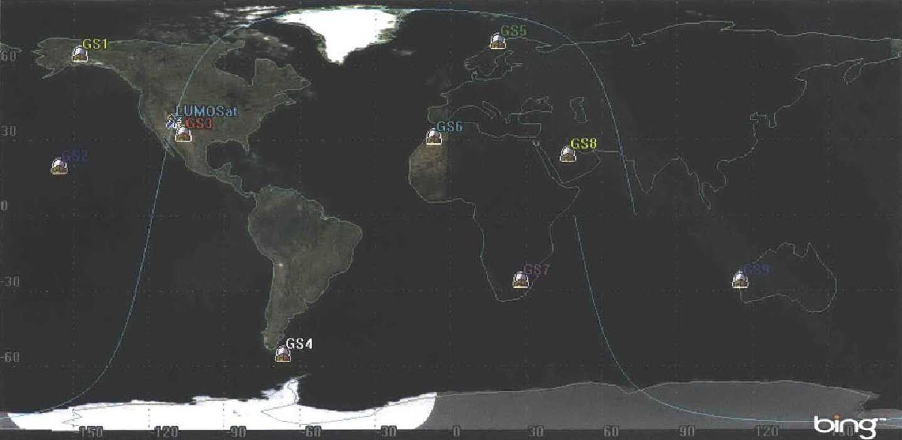

Figure 5-1: Locations of the 9 ground stations assumed for the BridgeSat network based on the information on the BridgeSat website [145].

limit the useful duty cycle of these instruments. Here we assume a 6-U CubeSat based on the one proposed by Mandl, which uses the Headwall Nano-hyperspec hyperspectral imager.

We considered several ground networks (those of the Lunar Laser Communication Demonstration, Lunar Communication Relay Demonstration, networks in Germany and Japan, and the proposed BridgeSat network), and we selected the BridgeSat network as a representative geographically diverse ground network. The Lunar Laser Communication Demonstration used the Table Mountain OCTL facility in California, White Sands in New Mexico, and Tenerife in the Canary Islands. Ground stations for the Lunar Communication Relay Demonstration have been planned at OCTL and Haleakala, HI. Several ground stations are in Germany and Japan, but these are not networked with the LLCD and LCRD ground stations. We use the BridgeSat network in this chapter because of the relatively large number (9) of geographically diverse ground stations as shown on the BridgeSat website [145] in comparison with the other available networks, but the LUMOS model can be easily updated to incorporate other ground networks or terminals.

## 5.1.1 Probabilistic Metrics

The use of statistical models enables the use of probabilistic metrics. As an alternative to the objective function of maximizing data volume, we assess the probability of reliably communicating a critical data volume, here 500 Gb of data per day. Once designs that

<!-- PDF_PAGE: 71 -->

achieve this data volume requirement are identified, then the "acceptable" designs can be down-selected based on secondary metrics.

To estimate a critical data volume, we assume the imager operates at a 20% duty cycle. Because Earth-observing missions often observe land mass, which makes up about 30% of the Earth's surface, and only 30% of land mass is cloud-free at any given moment [146], we use 20% duty cycle here as a conservative estimate (roughly double the average duty cycle per day). Operating the Headwall Nano-hyperspec [121], which was proposed by Mandl et al. [13] for a CubeSat hyperspectral imaging mission, at 10 frames per second for one day at 40% compression would produce 500 Gb of data per day.

We use as secondary metrics the aperture of the ground station receiver and beamwidth of the space terminal transmitter as proxies for cost and manufacturability. Systems that are more difficult to manufacture or assemble (less "manufacturable") can be more expensive than easily-built systems. Telescope cost scales with the diameter of the telescope [147], and it is cheaper to set up a smaller diameter ground station because of the smaller footprint. On the space terminal, smaller apertures mean larger beams, which means larger misalignments can be tolerated, translating to shorter integration time, improved manufacturability, and therefore lower cost.

## 5.2 Model Setup

The LUMOS model, illustrated in Figure 5-2, takes in bounds for each input listed in Table 5.1 and randomly generates a set of vectors of design inputs (called design vectors) to form the first population of the optimization. Each design vector is assessed through Monte Carlo analysis. For the deterministic cases, it then calculates the average data volume per day. For the probabilistic cases, it calculates the probability of failing to meet a data volume requirement in the probabilistic metric case. The optimization algorithm then selects the highest-performing members of the population of design vectors and generates a new population of diverse design vectors with improved performance. Then these are assessed through Monte Carlo analysis, and the cycle is repeated until the optimization has completed twenty generations without further improvement.

The design optimization leverages the particle swarm and genetic algorithms from the MATLAB optimization toolbox [148]. Heuristic algorithms were selected because they handle the discontinuities in performance that result from the constant slot width of the NODE architecture better than a gradient-based algorithm. $ ^{1} $ The input variables

<!-- PDF_PAGE: 72 -->

Table 5.1: Bounds for the input variables for optimization studies.

<table border="1"><tr><td>Variable</td><td>Bounds</td><td>Rationale</td></tr><tr><td>Ground station diameter</td><td>0.3 to 1m</td><td>1m is the common upper bound for lasercom ground stations. Below30cm, aperture averaging assumptions in the model are no longer valid. We assume a focal length of8times the diameter based onf-numbers for amateur telescopes.</td></tr><tr><td>Slot width</td><td>0.48 to 5ns</td><td>The minimum slot width is based on the maximum APD bandwidth of all theAPDs considered,2.1GHz,which works out to0.476ns.If a slot width is selected that is slower than the selectedAPD can achieve it is adjusted to be the minimum slot width for thatAPD.From these slot widths we can estimate the minimum and maximum data rate;PPM-4with0.48ns slot width corresponds to760Mbps,and PPM-512with5ns slot width corresponds to3.2Mbps,accounting for header bits,inter-symbol guard time,and coding.The maximum is an order of magnitude larger than the minimum,and equal to that used by theNODEprogram.</td></tr><tr><td>Transmit Power</td><td>0.1to0.5W</td><td>Up to about0.5W is reasonable for anEDFA that would fit in a1-U lasercom transmitter.</td></tr><tr><td>Detector</td><td>1to12</td><td>List of7APD Photoreceivers from theVoxtel catalog[149],three HamamatsuAPDs[150],and two Princeton Lightwave Photorecievers[151].If more transmit power is available,the selection ofAPDs could be re-examined,as additional margin could enable higher data rates if the receiver and system electronics could support it.</td></tr><tr><td>Half Power Beamwidth</td><td>0.1to2mrad</td><td>2mrad is relatively easy to achieve,as planned withNODE.The model is considered valid down to0.1mrad;beams smaller than this may have pointing losses not accounted for in this model.</td></tr></table>

and bounds are given in Table 5.1. Particle Swarm was used for the single objective optimization cases (i) and (ii), and the multiobjective genetic algorithm was used for (iii). A population of 100 was used for each generation of the genetic algorithm, and a Monte Carlo analysis with 1000 runs $ ^{2} $ of the constellation simulation was performed for each population member to estimate the expected performance of each design point.

The satellite day-in-the-life simulation estimates the data volume transferred by a nanosatellite lasercom system over three days. Three days at 500 Gb per day would be equivalent to a maximum on-board storage of 1.5 Tb (less than 200 GB) which is consistent with the data storage capability of CubeSats. It then estimates an average daily data volume. The model calculates the data rate for a given set of inputs and access conditions (time and range), and takes in access times and corresponding ranges from an open-source orbit simulation developed by A. Kennedy [115]. An achievable data rate is determined based on the range and other conditions for each timestep such as atmospheric loss. We note that while the model was built for the NODE program, it is modular, enabling easy adaptation to other architectures.

<!-- PDF_PAGE: 73 -->

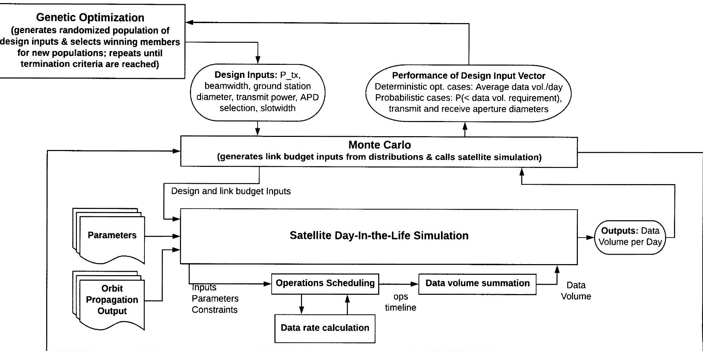

Figure 5-2: Analysis steps of the optimization, Monte Carlo, and day-in-the-life simulations.

<!-- PDF_PAGE: 74 -->

Table 5.2: Input distributions for Monte Carlo analysis. The distributions are uniform in scalar units rather than decibel units. Further discussion of each input distribution is in Chapter 3.

<table border="1"><tr><td>Variable</td><td>Distribution</td><td>Val. for Worst-case Opt.</td><td>Rationale</td></tr><tr><td>Pointing error</td><td>N(0,0.025)+U(-0.092,0.092)mrad</td><td>0.117mrad</td><td>Sum of errors from pointing budget and thermoelastic misalignments</td></tr><tr><td>HPBW</td><td>Uniform distribution,±1% of beamwidth</td><td>beamwidth</td><td>Per collimator datasheet[132], collimation at room temp. is accurate to1%</td></tr><tr><td>Tx optical losses</td><td>N(-1.5,.5)dB</td><td>-3dB</td><td>Assumes0.1dB per splice with0.5dB standard deviation from thermal-induced output variations of electro-optical components.</td></tr><tr><td>Extinction Ratio(ER)</td><td>U(6.31×10-5,1.58×10-4)(-42dB to-38dB)</td><td>-38dB</td><td>Reported in Kingsbury[32,pp.82-87]thatER varied between-38and-42dB</td></tr><tr><td>Implementation Loss</td><td>U(-3.5,-2.5)dB</td><td>-3.5dB</td><td>Measured by Kingsbury[32,p.89]as-2.4to3.0dB;added half a dB for further implementation loss at system integration level.</td></tr><tr><td>Receiver Optical Loss</td><td>U(0.35,0.5)(transmission)(-4.55dB to-3.0dB)</td><td>-4.55dB</td><td>Optical losses typically a fewdB</td></tr><tr><td>Ground Station Availability</td><td>20% to84%</td><td>20% to84%</td><td>Analysis performed by anotherMIT graduate student,I. delPortillo Barrios using data fromMODIS.[137]</td></tr><tr><td>Atmospheric Loss at zenith</td><td>U(0.82,0.99)(transmission)(-0.86dB to-0.044dB)</td><td>-.86dB</td><td>MODTRAN simulation</td></tr><tr><td>Fried Parameter at zenith,r0</td><td>U(0.06,0.43)cm</td><td>12cm</td><td>Alliss and Felton[107]</td></tr></table>

## 5.2.1 Link budget and Input Distributions

Most of the inputs in the link budget are updated as input distributions, as shown in Table 5.2, or are used as design variables as described in Table 5.1. Each run of the Monte Carlo analysis calculates transmitter optical loss, pointing loss, free space loss, atmospheric loss, receiver optical losses, etc. and calculates received power. The ratio of the resulting received power at the ground-based detector to the required power for a given data rate gives the margin, and the data rate is adjusted until the received power is greater than the required power by 3 dB. To illustrate the convergence of the Monte Carlo simulation, Figure 5-3 shows the mean data volume per day for the Case ii design vector, estimated from 1 to 2000 Monte Carlo runs.

<!-- PDF_PAGE: 75 -->

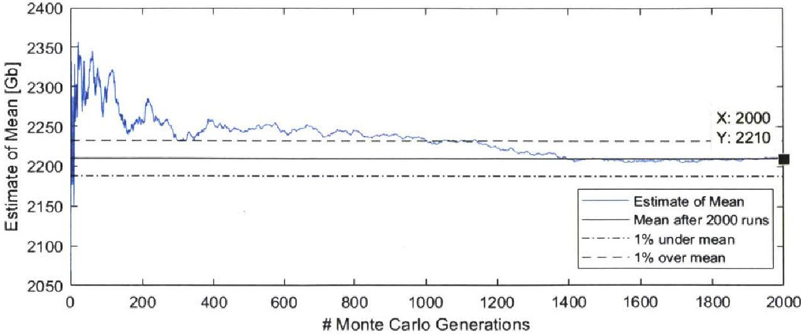

Figure 5-3: Illustration of convergence for Case ii (Optimization for maximizing data volume under uncertainty). 1000 runs is sufficient to estimate the mean to within about 1% for this design.

## 5.3 Results

In this section, we compare the results from the LUMOS modeling approach with those obtained through more traditional satellite systems engineering approaches. First, (i) the traditional conservative approach of designing for worst-case inputs is compared with (ii) the approach of designing with input distributions. Then we compare the designs resulting from (ii) traditional metrics of maximizing a function (in this case data volume) versus (iii) a probabilistic metric (in this case the probability of achieving 500 Gb per day).

## 5.3.1 Optimization under Worst-Case Assumptions vs. Optimization under Uncertainty

We first compare the results of (i) optimization under worst-case assumptions for the performance metric of average data volume downlinked per day with the results of (ii) optimization under uncertainty. Because formal cost-estimating relationships have not been defined for nanosatellite lasercom systems, we use ground station diameter and half-power beamwidth as proxies for cost. As will be discussed further in Section 5.3.3, ground station cost scales polynomially with ground station diameter, and larger transmit beams reduce the on-board alignment requirements.

As shown in Figure 5-4, optimization under worst-case inputs drives selection of designs with larger beamwidths (0.23 mrad vs. 0.19 mrad), while both have large receiver apertures (93 cm and 91 cm). While the two designs have similar apertures, the optimization under worst-case inputs uses a larger APD with lower bandwidth resulting in a longer slot width and lower data rate (see Table 5.3 for the full design

<!-- PDF_PAGE: 76 -->

vectors). These conservative design decisions limit data volumes to about 1.7 Tb per day for a satellite in a LEO sun-synchronous orbit, while optimization under uncertainty leads to designs with expected data volumes of about 2.2 Tb per day.

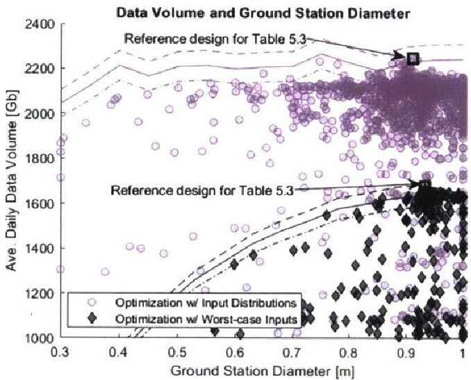

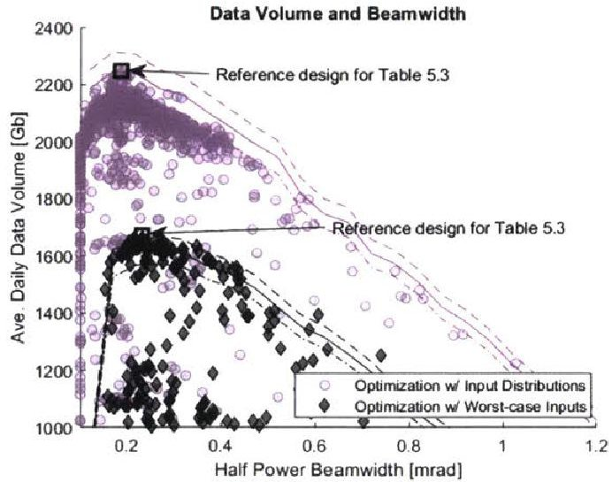

Figure 5-4: A comparison of (i) optimization under worst-case assumptions (black) and (ii) optimization under uncertainty (purple) shows that worst-case optimization leads to more conservative systems with lower data volume. Each point represents the mean of a 1000-run Monte Carlo with a individual design vector. To show the dependence of each design vector on ground station diameter and beamwidth as well as the number of runs, we show curves for the mean and +/- 3% of the mean for each of the reference design vectors with 1000 Monte Carlo runs. 1000 runs was selected to achieve results within 3% of the mean with 95% confidence.

## 5.3.2 Optimizing Data Volume vs. Optimizing for Manufacturability Under Uncertainty

While optimization under uncertainty can outperform optimization with worst-case assumptions for deterministic metrics, here we investigate whether a probabilistic metric, i.e., the probability of achieving a mission-specific data volume requirement (discussed in Section 5.1.1), can lead to more practical systems for mission-specific needs. Maximizing average data volume per day may lead to average data volumes that are much higher than required for a given mission.

In case (iii), we minimize the probability of failing to meet a requirement while maximizing manufacturability. In Figure 5-5, we show the results for case (iii) with both the probability of downlinking less than 500 Gb per day and the mean daily data volume of each design to show how the new, probabilistic metric relates to the deterministic metric. The probabilistic metric trends with average daily data volume, but with diminishing returns on increasing data volumes. We identified the designs that have less than a 10% probability of failure and then selected the design with the

<!-- PDF_PAGE: 77 -->

smallest ground station (0.37 m) paired with a relatively large beam (0.22 mrad) and low transmit power (0.27 W), as indicated with the red box.

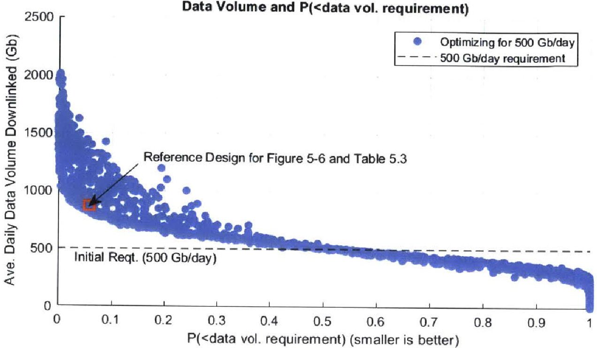

Figure 5-5: Comparison of the metrics of maximizing data volume and minimizing the probability of failing to achieve a required data volume, with optimization results for the probabilistic metric. Higher average data volumes indicate lower probabilities of failures, but with diminishing returns for the highest data volumes.

For a resource-constrained program, it may be desirable to explore de-scoping a requirement to improve manufacturability even further than the design result of (iii). To illustrate the impact of changing design inputs around the values at the point of diminishing returns, in Figure 5-6 we show performance results with varied ground station diameter and beamwidth using the design vector identified in Figure 5-5. As shown in Figure 5-6, the probability of failing to achieve each performance metric goes up with larger beamwidths and smaller ground stations, but the 250 Gb case has a lower probability of failing its requirement with larger beams and smaller ground stations compared with the 500 Gb case. The implications of this difference on cost and manufacturability are discussed in Section 5.3.3.

## 5.3.3 Discussion

By comparing the optimal designs from each approach, we can understand the impacts of the different designs on the practicality of each system. The input vector and performance of each design is listed in Table 5.3. We first discuss the implications of the different ground station diameter, beamwidth, and transmit power of the results

<!-- PDF_PAGE: 78 -->

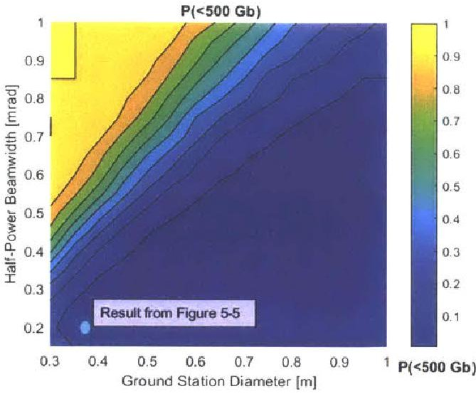

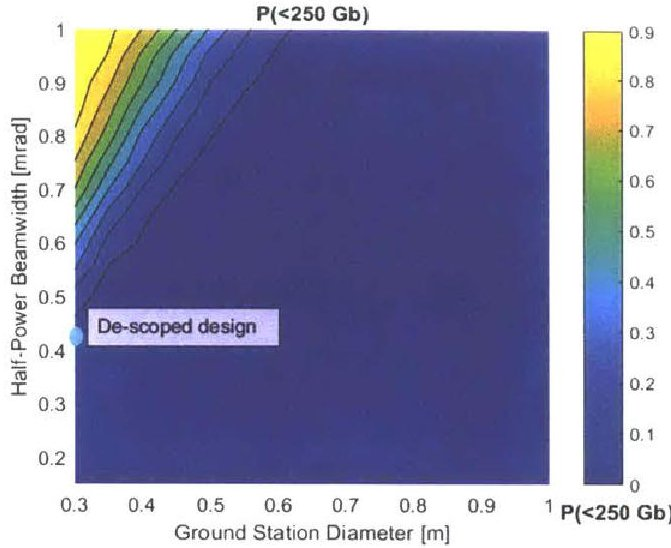

Figure 5-6: Parametric study of the changes in the probability of failing to achieve a daily data volume requirement based on changes in ground station diameter and half-power beamwidth. The left figure gives the probability of achieving less than 500 Gb per day (indicated by the colormap), and the right figure gives the probability of achieving less than 250 Gb per day. The design vector from the reference design from Figure 5-5 is used for the APD, power, and slot width. The design point with the ground station and beamwidth of the reference design from Figure 5-5 is circled in cyan, with a 37 cm ground station diameter, a 0.22 mrad beamwidth, and a probability of failing the 500 Gb/day requirement (left figure) of 6%. By reducing the requirement to 250 Gb/day (right figure), the ground station diameter is reduced to 30 cm, and the beamwidth can be expanded to 0.42 mrad.

from the optimization under (i) worst-case assumptions, (ii) optimization under uncertainty, and (iii) optimization for P(<500 Gb) cases. We then discuss the implications of relaxing the probabilistic metric to P(<250 Gb) per day.

## Cumulative Distribution Function of Each Design

To understand how much each design varies, it is helpful to understand the distribution of Monte Carlo results. Figure 5-7 gives an empirical cumulative distribution function of the daily data volume for each design. The optimization with distributions case produces the most data volume per day, while the traditional/worst-case produces the second-most data volume, with a slightly steeper slope, indicating lower variance. The designs that target the 500 Gb and 250 Gb probabilistic metrics have lower mean data volumes, but have low probabilities of failing to meet the 500 Gb and 250 Gb requirements, respectively.

## Receiver Aperture

The receiver apertures for (i) worst-case assumptions and (ii) optimization under uncertainty are relatively large, at 93 cm and 90 cm respectively. In contrast, the

<!-- PDF_PAGE: 79 -->

Table 5.3: List of the winning design vectors for each design approach. The probability estimate is based on the fraction of the 1000 Monte Carlo data volume results that are less than the requirement. APD 5 has a diameter of 75 microns, while APD 7 has a diameter of 300 microns so seeing loss is larger for APD 5 and would require more received power to achieve the same data rate, but APD 5 is capable of higher bandwidth. Note that loosening P(<500 Gb/day) from 0% in the Optimization with distributions case to 6% in the Optimization for the Probabilistic Metric allows over a factor of 2 decrease in ground station diameter.

<table border="1"><tr><td>Approach</td><td>Metric</td><td>Detector</td><td>Slot Width[ns]</td><td>Rx Diam.[cm]</td><td>Tx Power[W]</td><td>HPBW[mrad]</td><td>Data Vol/day[Gb/day]</td><td>P(&lt;500Gb/day)</td><td>P(&lt;250Gb/day)</td></tr><tr><td>Traditional(worst-case)</td><td>Max(Data Vol/Day)</td><td>7</td><td>0.67</td><td>93</td><td>0.5</td><td>0.23</td><td>1650</td><td>0%</td><td>0%</td></tr><tr><td>Optimization w/distributions</td><td>Max(Data Vol/Day)</td><td>5</td><td>0.48</td><td>91</td><td>0.5</td><td>0.19</td><td>2200</td><td>0%</td><td>0%</td></tr><tr><td>Opt.for Prob.Metric</td><td>Min(P(&lt;500Gb/day))</td><td>7</td><td>1.06</td><td>37</td><td>0.27</td><td>0.22</td><td>900</td><td>6%</td><td>0%</td></tr><tr><td>De-scoped Prob.Metric</td><td>Min(P(&lt;250Gb/day))</td><td>7</td><td>1.06</td><td>30</td><td>0.27</td><td>0.42</td><td>450</td><td>66%</td><td>5%</td></tr></table>

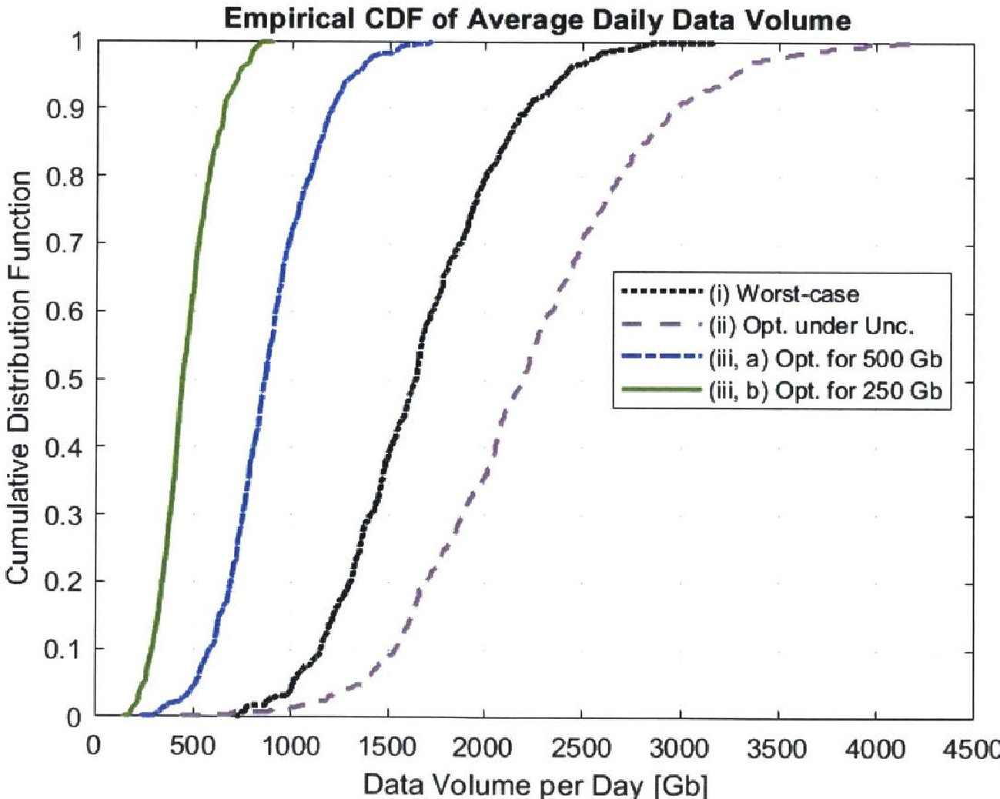

Figure 5-7: CDFs of data volume for each of the designs in Table 5.3

probabilistic approach allowed the optimization routine to back off on ground station diameter, enabling a 37 cm ground station.

The smaller ground station diameter is important for reasons of cost and practicality.

<!-- PDF_PAGE: 80 -->

Optical communication ground station cost is highly dependent on diameter of the telescope [147]. 37 cm is within the range of commercially available amateur astronomy telescopes. This costs about $5k for Meade or Celestron telescopes [119, 120], up to $38k for the smallest (a 40 cm) observatory-class telescope system [118]. $ ^{3} $ In contrast, a 1 m observatory-class telescope is $ 650k [118], and might require more highly skilled personnel to assemble.

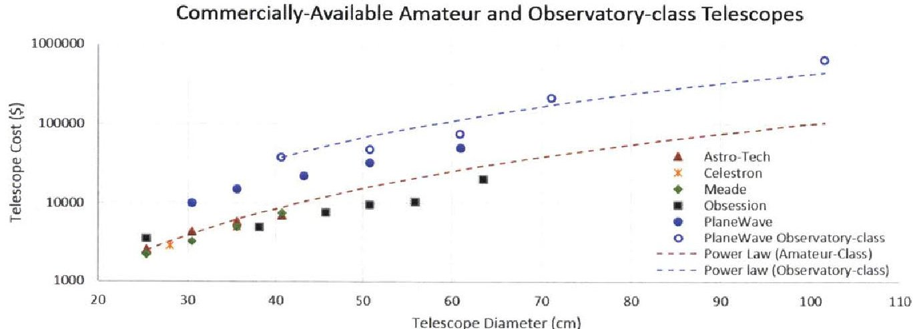

Figure 5-8: Plot of amateur telescope and commercially-available telescope diameters and cost shows the power law relationship between diameter and cost. The data for this figure is from the manufacturer websites [152,119,120,153,118]. The power law curves use the lowest-cost Astro-Tech and PlaneWave Observatory class telescopes and scale by diameter to the power of 2.7 per Stepp et al. [154].

## Detector Selection and the Effects of Seeing Loss

In addition to the noise and speed of the detector, which directly affect the maximum data rate, the photoreceiver selection is important for its size, which affects seeing loss. Figure 5-9 shows the combined receiver gain and seeing loss for APDs 5 and 7. APD 7 is the Voxtel APD with the ball-lens-coupled photoreceiver which has a 150 um radius (Siletz R2P1-JCAF), while APD 5 has a 37.5 um radius (Siletz RIP1-JJAF). While increased receiver apertures will increase the receiver gain in proportion to $ D^{2} $ , the seeing loss for APD 5 will increase with the higher $ \frac{D}{r_{0}} $ almost as much as the receiver gain improves.

## Transmitter Beamwidth and Power

Beamwidth can affect the cost of the system, as a larger beam reduces the tight alignment and pointing requirements on the space terminal. (It also reduces the size of the

<!-- PDF_PAGE: 81 -->

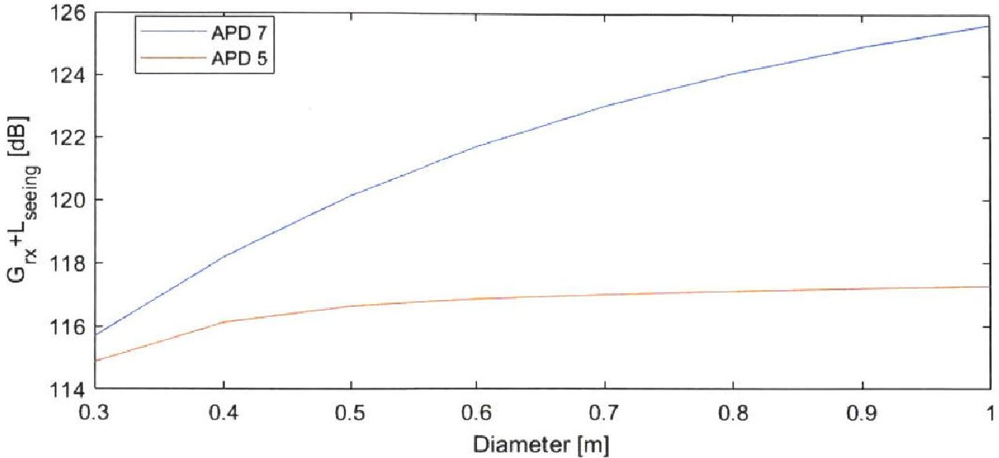

Figure 5-9: Seeing loss for the two APD photoreceivers selected in this optimization. This figure uses an $ r_{0} $ of 10 cm at zenith which is on the small end of typical values to highlight the effects of more extreme seeing, and assumes an elevation angle of 40 degrees.

aperture required, but even the aperture for 0.19 mrad about 15 mm, allowing for an aperture slightly larger than the diffraction limit is not difficult to fit on a CubeSat.) Increasing the size of the beam increases the necessary transmit power for a required received power. Higher transmit power requires a larger transmitter fiber amplifier. Note that higher transmit power and/or narrower beams would enable greater link margin, and the selection of receivers could be re-examined to see if faster ones could be used to enable a higher data rate with the extra link margin.

## Risk in System Design Decisions

While the P(<500 Gb downlink per day) metric resulted in a more manufacturable design than the cases with deterministic metrics, mission designers may still wish to explore ways to further reduce cost, improve ground station portability, or other metrics by relaxing the requirements. For this hypothetical hyperspectral imaging mission, 500 Gb was a conservative upper bound of payload data production, and acceptable science return may be reached after a lower daily downlink data volume. To investigate whether this would improve manufacturability, we examine the impact of lowering the original requirement to 250 Gb per day.

To illustrate how relaxing the requirement can allow for designs with very different inputs, we selected a design that had a high (nearly 100%) probability of meeting the de-scoped requirement and a lower SWaP for the reference design in Table 5.3, with a larger beamwidth of 0.42 mrad and a smaller receiver diameter of 30 cm compared with the selected design from Figure 5-5. Even with the relaxed requirement, the design

<!-- PDF_PAGE: 82 -->

may still achieve the original performance requirements on average; in Table 5.3 we see the design for the 250 Gb per day requirement still exceeds 500 Gb per day in 34% of cases.

## 5.4 Conclusion

This chapter describes the implementation of a statistical approach to nanosatellite systems engineering for a lasercom design case study. The approach, referred to as LUMOS, uses hardware-informed input distributions and Monte Carlo analysis to simulate the performance (in this case downlink data volume) of a CubeSat. Then this is incorporated in a design optimization.

To evaluate the improvement using the LUMOS-based design over a baseline design using traditional techniques, we ran three optimization studies: (i) the "traditional" case, with the deterministic metric of maximizing data volume and worst-case assumptions for inputs, (ii) a case using input distributions and the same deterministic metric, and (iii) a case with input distributions and the metric of the probability of hitting a data volume requirement while maximizing manufacturability. Benefits of the LUMOS approach include: 1) a 33% improvement in average downlink daily data volume over optimization with worst-case assumptions for inputs when using the traditional metric of maximizing data volume, 2) a smaller, more manufacturable system (37 cm instead of 91 cm diameter ground station) that can achieve a high (>90%) probability of meeting the design requirement when switching to applying a probabilistic metric.

<!-- PDF_PAGE: 83 -->

## Chapter 6

# Nanosatellite Constellations with Downlinks and Crosslinks

## 6.1 Introduction

In the previous chapter we used LUMOS to optimize the design of a downlink-only lasercom system. Here, we put these results into a system context by comparing the performance of lasercom downlink and crosslink systems with the performance of commercially-available RF systems. It is useful to assess the expected performance and variance of data volume and latency of new communication systems for CubeSat constellation applications such as X-band and laser communications. Examples of these systems are listed in Table 6.1. The goal is to enable mission designers to compare communications technologies with somewhat comparable technology readiness levels, performance metrics, and cost assessments, and to identify practical next steps in technology development that would affect these trades.

Previous studies of nanosatellite optical communication systems have focused on predicted maximum data rates for technology demonstrations, such as OCSD in Rose et al. [75] and Welle [79] and NODE in Kingsbury [32]. High fidelity analyses of intersatellite links (crosslinks) between CubeSats using lasercom have not been discussed in the literature at the constellation scale. Gaps include studies of the constraints of constellations of small satellites with lasercom terminals for downlink and crosslink applications, such as the limitations of orbit dynamics on the range between satellites in a constellation for performing crosslinks, the data routing in the constellation, or the effect of communications operations on system power and payload duty cycle.

To estimate the achievable data volume and latency with higher rate (>100 Mbps) nanosatellite communication, it is necessary to model the end to end system with

<!-- PDF_PAGE: 84 -->

Table 6.1: CubeSat communications systems, including both flight heritage and planned systems. Planned commercially-available options are expected to improve on existing systems. Existing proprietary X-band radios from Planet have demonstrated over 200 Mbps from CubeSats. Flight heritage space terminal data are from Klofas [19].

<table border="1"><tr><td>Band</td><td>Example Space Terminal</td><td>Example Ground Terminal(s)</td><td>Typical Data Rates</td></tr><tr><td>Flight Heritage:</td><td></td><td></td><td></td></tr><tr><td>UHF</td><td>AstroDev Li-1, ISIS TRXUV, L3 Cadet, NanoCom U482C</td><td>Wallops, custom rooftop ground stations</td><td>usually&lt;50kbps,some up to1Mbps</td></tr><tr><td>S-band</td><td>MHX-2400,MHX-2420</td><td>Wallops,Near-Earth Network</td><td>&lt;60kbps</td></tr><tr><td>X-band</td><td>Syrlinks EWC27,Custom Planet Radios</td><td>SpaceFlight Network,KSAT-Lite Network,Near-Earth Network</td><td>3+Mbps(commercial),&gt;200Mbps(Planet)</td></tr><tr><td>Upcoming:</td><td></td><td></td><td></td></tr><tr><td>X-band</td><td></td><td>Spire addition to SpaceFlight Network</td><td></td></tr><tr><td>Ka-band</td><td>AstroDigital Ka-TX</td><td></td><td>&gt;300Mbps</td></tr><tr><td>Optical</td><td>MIT NODE,Aerospace CorporationOCSD,Sinclair Interplanetary</td><td>BridgeSat Network</td><td>100s ofMbps</td></tr></table>

accurate representations of the constraints of CubeSat operations. In this study we use the LUMOS model, augmented with deterministic RF models, to simulate downlink and crosslink performance of example X-band and optical systems and compare with the performance of a UHF system with a single ground station to represent the most common current CubeSat communications architecture. We evaluate the performance of each type of communication at several scales: (i) a simple link budget comparison in Section 6.2, and (ii) a comparison of data volume, latency, and cost for a large (30 satellite) Walker constellation with UHF, X-band, and Optical communications with and without optical crosslinks in Section 6.3. Finally, (iii) we identify how future systems might change the results of this analysis in Section 6.4.

## 6.2 Simple Link Budget Comparison

Table 6.2 highlights the difference in link budgets between example RF and lasercom systems, comparing representative link budgets for a Syrlinks X band radio, an Astro Digital Ka band radio, and an optical system with optimal design vector from Chapter 5, which we refer to as the NODE 2.0 system. Because lasercom beams have a wavelength that is 1/1000 that of RF, the beams are narrower such that the effective isotropic radiated power (EIRP) of a lasercom terminal is much higher. The ground station can then be much smaller for lasercom than for X or Ka band (40 cm vs. 2.8 m) while supporting a similar data rate of about 300 Mbps.

<!-- PDF_PAGE: 85 -->

Table 6.2: Link Budget Comparison of State-of-the-Art CubeSat Communications. The X band link assumes the Syrlinks X-band radio as described in Fernandez et al. [155, 156] with the Spaceflight Network ground station. The Spaceflight Network datasheet only specifies G/T rather than receiver diameter or receiver gain, so these values are approximate. The Ka band assumes the Astro Digital Ka band radio with the KSAT-Lite ground network, and the link assumes 3 dB of channel losses.

<table border="1"><tr><td>Parameter</td><td>UHF</td><td>X-band</td><td>Ka-band</td><td>NODE 2.0</td></tr><tr><td>Data Rate</td><td>1.5Mbps</td><td>165Mbps</td><td>324Mbps</td><td>292Mbps</td></tr><tr><td>SWAP</td><td>0.2U,11W,0.2kg</td><td>10W</td><td>1U,0.8kg,15W</td><td>1U,12W</td></tr><tr><td>Bandwidth(MHz)</td><td>10</td><td>33</td><td>86.4</td><td>N/A</td></tr><tr><td>Transmit power</td><td>2W</td><td>1W</td><td>1W</td><td>0.27W</td></tr><tr><td>Beamwidth</td><td>N/A</td><td>60deg</td><td>10deg</td><td>220μrad</td></tr><tr><td>EIRP</td><td>-0.80dBW</td><td>0dBW</td><td>20.5dBW</td><td>67.5dBW</td></tr><tr><td>Range</td><td>600km</td><td>600km</td><td>600km</td><td>600km</td></tr><tr><td>Typ.Atm.losses(dB)</td><td>-1</td><td>-1</td><td>up to-10</td><td>-1</td></tr><tr><td>Receiver Diameter</td><td>18.3m</td><td>5m</td><td>2.8m</td><td>37cm</td></tr><tr><td>Receiver G/T(dB/K)</td><td>6</td><td>25</td><td>26</td><td>N/A</td></tr><tr><td>C/N</td><td>13.2</td><td>11.3</td><td>16.2</td><td>N/A</td></tr><tr><td>Required Power or C/N</td><td>5.1(C/N)</td><td>8.4(C/N)</td><td>15.3(C/N)</td><td>-72.3dBW(Req.Power)</td></tr></table>

## 6.3 Communications Comparison for CubeSat Walker Constellation

## 6.3.1 Approach

This study uses the constellation model of the LUMOS approach described in Chapter 2 and the input distributions for the lasercom systems as described in Chapter 3. In this section we describe the specific configuration and metrics we used to compare these communication systems.

## Problem Formulation and Assumptions

We narrow the design space by assuming all of the satellites are in Sun Synchronous Orbit (SSO) configuration, selecting 600 km 10:30 as our orbit because it is a common CubeSat launch opportunity. We assume that all of the spacecraft have star trackers. The three ground networks are shown in Figure 6-1.

We use the lasercom downlink system from Chapter 5 for the 500 Gb/day design, which we will refer to as NODE 2.0, and the same transmit power and beam width for laser crosslink systems with the addition of a 8.5 cm receiver and a 10 dB optical pre-amplifier. We switch to a 5 ns slot width and use such a large receiver aperture and

<!-- PDF_PAGE: 86 -->

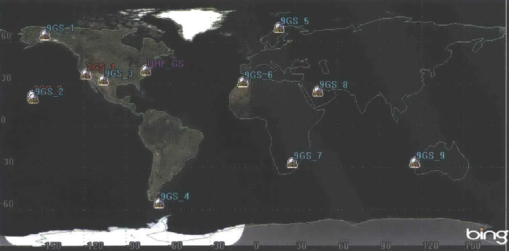

Figure 6-1: Map of ground stations used in the constellations case study. The stations with blue text are the 9-ground station communication network modeled on the advertised BridgeSat sites, red are the two-ground station network modeled on the two proposed LCRD locations. The 9-site and 2-site networks are used for X-band with an assumption of a 5-m antenna and for optical with PorTeL receivers. Purple is the UHF ground station at Wallops Flight Facility in Virginia, USA.

pre-amplifier gain due to the more challenging free space loss (about 14 dB additional loss for 5000 km crosslink vs 1000 km for downlinks) and receiver gain (about 13 dB lower receiver gain for 8.5 cm than for 37 cm).

The RF radios are described in Table 6.2. The L3 Cadet radio is used for UHF. This has been used on many CubeSat missions, including DICE, FireFly, MicroMAS, and IceCube [19] and we assumed an effective data rate of 1.5 Mbps after coding. The Syrlinks X-band radio was selected because of its flight heritage on GOMX-3 [19]. X-band radios have also been widely used by Planet [20], but these are not commercially available to other mission designers. We assumed DVB-S2 for estimating the X-band data rate in combination with the Syrlinks link budget published in Fernandez et al. [156].

## Performance Metrics

In a constellation context, data volume is still important for the reasons described in Chapter 5, but the time it takes to route data to the ground is another key metric. We use the metric of latency, as measured by the time it takes to get data from one satellite to any ground station, and focus on moderate latencies for re-tasking. Together these metrics inform both the total data gathering capability of the constellation and the timeliness of the data.

As discussed in Chapter 5, probabilistic metrics can help systems to meet require-

<!-- PDF_PAGE: 87 -->

ments while reducing cost. We use the requirement of 250 Gb/day per satellite from Chapter 5 for the data volume metric, but scale it to the 30-satellite constellation to look at the constellation-scale data volume of 7.5 Tb/day. For the latency requirement, we use critical latency values of half an hour, one hour, and two hours to highlight the difference in preferred communication systems for each. These are all common critical latencies for different types of missions; for example, 30 minutes is useful for aerosol, air temperature, and cloud cover measurements, while one and two hour latencies are useful for cloud ice, cloud liquid water, and specific humidity measurements of varying resolutions [157].

## Data Routing and Latency Sources

Latency can include many different sources, and which sources are important to include can depend on the timescale of the latency. In the case of nanosatellite constellations, SWaP limits the number of terminals and slew rate limits the transition between crosslinking with different neighbors, so latency is on the order of minutes to hours. Therefore, we neglect sources of latency that are less than one minute, such as the effects of ground network latency or interleaving.

We use the data routing algorithm described in Chapter 2, Section 2.3.4. This assesses the latency with crosslinking from one plane to another, but does not include in-plane crosslinks that could potentially reduce the latency even further due to SWaP limitations. (Multiple apertures would be required to transmit data from one of a satellite's neighbors to the other without time-consuming slews.)

## 6.3.2 Results

## Nanosatellite Communication System Downlink Performance

We evaluated the potential data volume downlink capability of the communication systems identified in Table 6.2 as shown in Figure 6-2. We find that the X-band system with a 9 ground station network and the optical system with a 9 ground station network have the highest data volumes, with both options able to downlink more than 7.5 Tb/day (250 Gb per day for each satellite, the typical data volume production from Chapter 5). Optical with two ground stations downlinks a mean data volume of 5.4 Tb/day, and only exceeds 7.5 Tb/day 8% of the time. All three of these options provide two orders of magnitude over the typical CubeSat communications configuration of one UHF ground station, which had 28 Gb/day.

<!-- PDF_PAGE: 88 -->

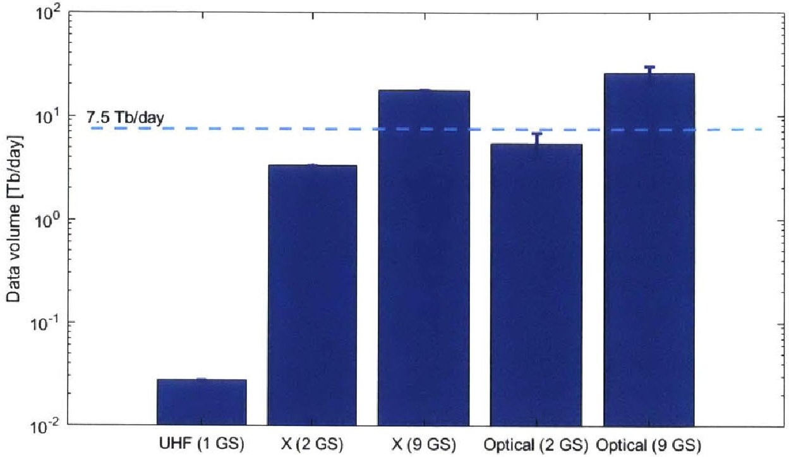

Figure 6-2: Comparison of optical and RF performance for different ground networks. The error bars indicate +/- 1 standard deviation.

## Nanosatellite Communication System Crosslink Performance

We assess the performance of each communication band and ground network with and without crosslinks. We combined the latency of each satellite over 10 timesteps, and across 1000 Monte Carlo runs for optical downlink and crosslink cases, into one results set for each communication type and network. This combined set of possible latencies was then plotted as a cumulative distribution function (CDF), as shown in Figure 6-3.

In Figure 6-3, we see that the systems with nine ground stations have the lowest latencies. Because these systems have the most ground stations, individual satellites see a ground station more frequently.

The optical system with two ground stations and the UHF system with one ground station have similar latencies. Because the optical ground stations have limited availability due to clouds, the total access time is similar for the two systems.

For all of the communication band options, crosslinks reduce the latencies for the higher percentiles in the CDF. This means it becomes less likely that data from any one satellite will wait very long to route the data to the ground.

In Figure 6-3, the X-band systems perform best for latencies under an hour, with the latency of a 9 ground station optical network starting to catch up at 1 to 2 hour latencies. In contrast, the optical system with nine ground stations and crosslinks also has a lower than 10% chance of failing to meet the 2-hour latency goal.

<!-- PDF_PAGE: 89 -->

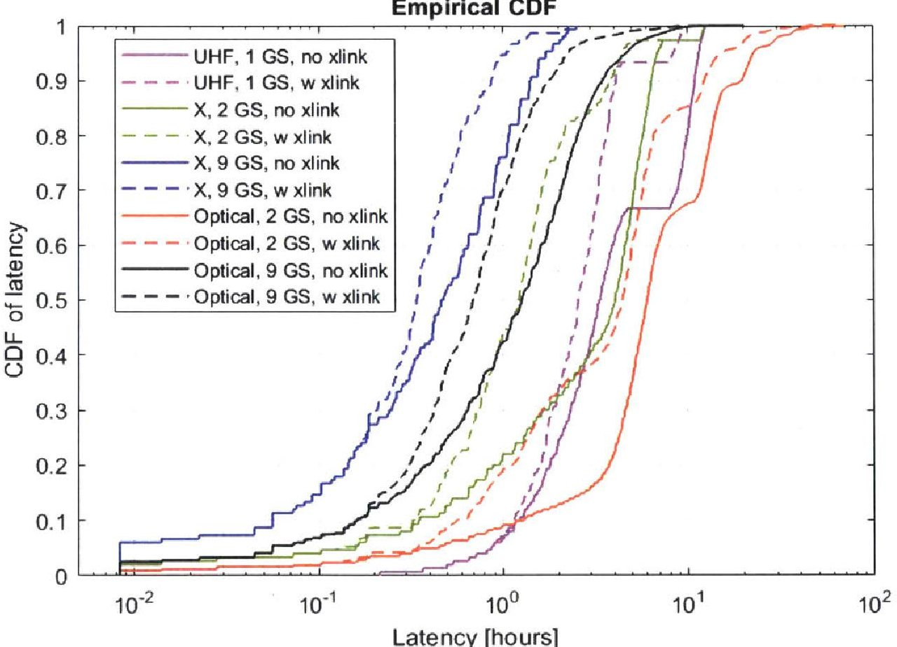

Figure 6-3: CDF of latency for each of several communication architectures for CubeSats. The X-band system with a 9-ground station network performs best with or without crosslinks, but crosslinks can help the 9-ground station optical system to reduce the median latency to under half an hour.

<!-- PDF_PAGE: 90 -->

## Cost Comparison

Cost estimation is very difficult because the exact cost will be dependent on system-specific variables like access to existing sites for purpose-built ground stations, or market fluctuations that might affect the cost of subscribing to existing networks, but we attempt a rough approximation based on advertised rates. The costs are subdivided into up-front investment and recurring operational cost. All costs are in 2018 US dollars.

Up-front investment: The up-front cost to the user of the RF systems are the cost of the space terminal (starting at about $50k for the Syrlinks radio [158]). The up-front cost of the optical communications system can be either just the space terminal, if using an existing network, or the space and ground terminals if building both. The cost of the NODE space terminal is about $15k for parts [135], and the cost of the ground receiver is under $50k for parts [78] (we use $100k per ground station to account for labor and setup costs). Assembly and space qualification testing of NODE requires several weeks, so we will use $30k as a conservative estimate of optical terminal cost. Higher rate (up to 3 Mbps) UHF radios cost $30k to $40k depending on whether the radio is part of a batch buy. The SWaP of the space terminal can also affect the cost; the added cost to switch from 3U to 6U (as would likely be required for crosslinks paired with anything larger than the UHF radio) to accommodate the crosslink system is over $7M for 30 satellites, based on Spaceflight launch services pricing [158].

Recurring Cost: The recurring cost for RF networks can be high relative to the cost of the radios (advertised cost of $50k per month per ground station for the Spaceflight Network). In contrast, the recurring cost of operating two non-commercial small optical communications ground sites (e.g., on the roof of academic buildings) is only the cost of labor $ ^{1} $ for regularly calibrating the pointing control of the ground telescopes, under the assumption that small optical communications ground sites can be placed on the roof of buildings and use existing Internet connections, power and other facilities costs paid for by overhead of existing systems. $ ^{2} $ The advertised recurring cost of using the BridgeSat optical ground network is $ 2 to $ 10 per gigabyte delivered, with higher data volumes costing less per gigabyte [162].

The costs are combined as a bar chart in Figure 6-4. We see that the cost of subscribing to communication networks is expensive compared with relying on small numbers of ground stations, by a factor of 2-4 (recall the costs are approximate). For the purpose-built low-cost PorTeL ground stations, setting up just two ground stations

<!-- PDF_PAGE: 91 -->

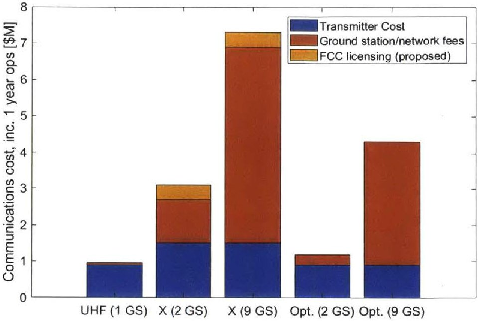

Figure 6-4: Comparison of approximate cost for a 30 satellite constellation with various RF and optical communications architectures based on advertised rates. Cost includes hardware, launch, and one year of operations. The yellow indicates the additional cost for FCC license applications that was proposed in 2018 [24].

costs less than the cost of the terminals, indicating that it might be cost-effective to set up additional sites with PorTeL if the logistics could be addressed.

## 6.3.3 Discussion

We find no communication option is the clear winner for all situations; which communication system is preferable depends on both the program budget, latency requirements, and flexibility on data volume requirements, but the 9-ground station optical system with crosslinks performs the best for systems under $5M per year. The performance of each system is summarized in Table 6.3. UHF and optical with two ground stations are appropriate for cost-constrained missions, but not for high data volume (e.g., the hyperspectral imaging application with 20% duty cycle) or latency-sensitive applications (e.g., disaster response). Optical with crosslinks and 9 ground stations has moderate cost with moderate latency performance and a high chance (>99%) of achieving 7.5 Tb/day. X-band with 9 ground stations has the best performance across all latency and data volume metrics, but may be cost-prohibitive, at roughly double the cost of the optical network with 9 ground stations.

<!-- PDF_PAGE: 92 -->

Table 6.3: Comparison of data volume and latency performance with probabilistic metrics and cost for UHF, X-band, and two optical systems. The cost does not include additional launch costs if the crosslink system forces a larger class of satellite. The cells of the table are colored to highlight the variations in the probability of success, with 0 to 25% highlighted red, 25 to 50% highlighted orange, 50 to 75% highlighted yellow, and above 75% highlighted in green. The costs are colored green for under $2M, yellow for $2 to $4M, orange for $4 to $6M, and red for over $6M.

<table border="1"><tr><td>Comm.Type</td><td>P(&lt;7.5Tb/day)</td><td>P(&lt;1/2hr)</td><td>P(&lt;1hr)</td><td>P(&lt;2hr)</td><td>Cost(fixed+1yr ops)[$M]</td></tr><tr><td>UHF(1GS)no/xlinks</td><td>1</td><td>0.02</td><td>0.07</td><td>0.24</td><td>1.3</td></tr><tr><td>UHF(1GS)w/xlinks</td><td>1</td><td>0.02</td><td>0.07</td><td>0.34</td><td>1.3</td></tr><tr><td>X(2GS),noxlinks</td><td>1</td><td>0.13</td><td>0.22</td><td>0.33</td><td>3.1</td></tr><tr><td>X(2GS),w/xlinks</td><td>1</td><td>0.19</td><td>0.45</td><td>0.77</td><td>4.0</td></tr><tr><td>X(9GS),noxlinks</td><td>0</td><td>0.52</td><td>0.76</td><td>0.96</td><td>7.3</td></tr><tr><td>X(9GS),w/xlinks</td><td>0</td><td>0.71</td><td>0.95</td><td>0.99</td><td>8.2</td></tr><tr><td>Optical(2GS)noxlinks</td><td>0.92</td><td>0.06</td><td>0.09</td><td>0.13</td><td>1.2</td></tr><tr><td>Optical(2GS)w/xlinks</td><td>0.92</td><td>0.09</td><td>0.19</td><td>0.33</td><td>1.2</td></tr><tr><td>Optical(9GS)noxlinks</td><td>0</td><td>0.25</td><td>0.42</td><td>0.68</td><td>4.3</td></tr><tr><td>Optical(9GS)w/xlinks</td><td>0</td><td>0.38</td><td>0.70</td><td>0.92</td><td>4.3</td></tr></table>

## 6.4 Future Systems

For optical communications to provide a game-changing (e.g., a factor of 10) improvement over the state of the art in RF systems, both the data rate and ground infrastructure would have to improve, and recent technology advancements are likely to make this possible.

Ground system technologies: If adaptive optics (AO) could be incorporated on the ground stations, they would enable the use of optical pre-amplifiers, enabling faster but less power-efficient modulation schemes (e.g., 2x switching from PPM-4 to OOK, or orders of magnitude if switching to a coherent system). Commercially available adaptive optics systems are available for visible wavelengths for astronomical purposes, such as the Thorlabs AO kit, and IR systems have been designed for receiving optical communications from GEO-based spacecraft according to Stewart et al. [163]. Developing an AO system for a LEO-tracking telescope is unusually challenging because the Greenwood frequency is high because of the high slew rate according to Toyoshima, Takenaka, and Takayama [164], and developing a high-performance AO system that is compact enough to fit on a small amateur telescope may not be easy. However, recent advances in high-rate AO for exoplanet detection such as the Subaru system as described in Janovic et al. [165] could potentially be combined with these low-cost kits to provide a solution.

Space terminal lasercom technologies: It is likely that lasercom transmitter data

<!-- PDF_PAGE: 93 -->

rates could improve well beyond 500 Mbps (NODE 2.0 architecture) without a proportional increase in space terminal power. Commercially available transceivers with various architectures (single wavelength or Wavelength-Division Multiplexing (WDM), direct or coherent) could be paired with COTS electronics from cellular applications. For example, Finisar produces a 10 Gbps WDM transceiver that consumes less than 3.5 W and has a sensitivity of -28 dBm [166], which would close the link when paired with the aforementioned optical pre-amplifier at the ground station. Commercially available processors and memory, such as Atom processors and solid state drives, are capable of pushing 10 Gbps to support this transceiver. Developments in compact electro-optics, such as integrated photonics or chip-scale atomic clocks, may further improve the size of the space terminal. We note these new technologies would require space-qualification, but the CubeSat platform makes technology demonstrations of these technologies practical.

We note that improvements in RF data rates are expected as well; Astro Digital is working towards 2.2 Gbps [167] and Planet has demonstrated higher data rates from 3U CubeSats [168] so commercially-available higher data rate systems are possible.

Ground network size: Current data volumes are limited by the size of the ground network; for typical CubeSat power systems, optical communications could be operated at a higher duty cycle and could take advantage of a larger ground network. Even without additional technological development, adding low-cost ground stations like PorTeL would improve both data volume and latency.

To investigate this, we simulated the performance of the same lasercom architecture used throughout this chapter with 25 ground stations placed at the NASA-affiliated observatory locations identified in del Portillo Barrios [161]. Figures 6-5 and 6-6 show the data volume and latency respectively. This ground network enables about 50 Tb of data downlink volume per day and, with crosslinks, 66%, 91%, and 96% probabilities of achieving 1/2 hour, 1 hour, and 2 hour latencies respectively, potentially enabling new, more data-intensive CubeSat missions.

With 25 PorTeLs deployed to the 25 sites, the cost would still be less than X-band, at $4.4M vs $7.3M, if the logistics could be addressed to have facilities costs covered by each of the 25 sites. In summary, a larger network could enable double the data volume of the 9-ground station X-band and optical options with latencies better than X-band (without crosslinks) or comparable to X-band (with crosslinks), at potentially comparable or lower cost.

<!-- PDF_PAGE: 94 -->

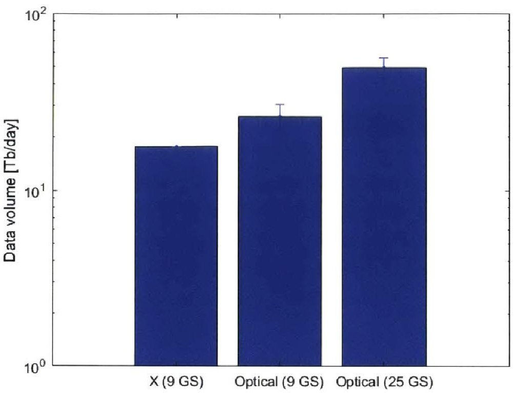

Figure 6-5: Data volume performance with 25 ground stations compared with 9-ground station optical and X-band performance

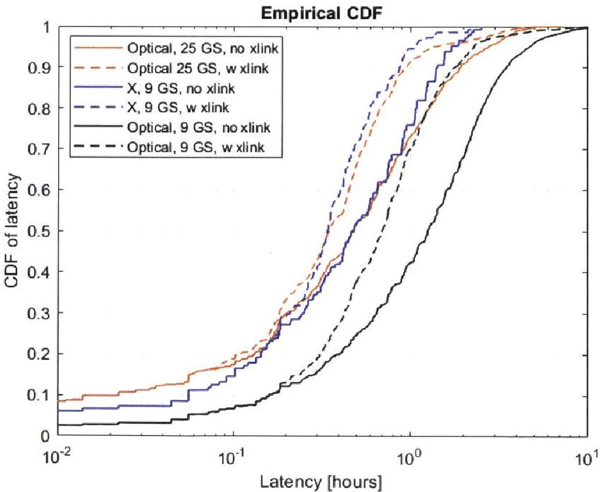

Figure 6-6: Latency performance with 25 ground stations compared with 9-ground station optical and X-band performance

<!-- PDF_PAGE: 95 -->

## Chapter 7

## Conclusion

As CubeSats move beyond technology demonstrations to science missions, a streamlined approach to systems engineering with a moderate risk tolerance is needed. Current systems engineering methods are designed for large-budget space missions, which require low risk and high reliability. Such missions can afford to add margin by overdesigning. In contrast, within the CubeSat paradigm, risk is traded for low cost access to space to augment data collections from larger, more sophisticated missions. Some of the risk introduced within this paradigm may be mitigated with large numbers of CubeSats in a constellation where occasional under-performance of an individual satellite is acceptable within the context of the greater mission.

In this thesis we describe the Lasercom Uncertainty Modeling and Optimization Simulation (LUMOS) for identifying designs and architectures that have a high probability of meeting requirements under uncertainty while also designing for reduced cost/improved manufacturability.

While the probabilistic approach developed here could be applied to many nanosatellite design problems, such as optical payload design, adaptive optics systems, or the design of LIDAR systems, we focus this thesis on lasercom systems. For long-distance free-space links, lasercom is often more power-efficient than radio frequency (RF) communication because the shorter optical wavelengths result in a lower beam divergence $ ^{1} $ for a given aperture diameter [2].

## 7.1 Summary of Results

In this thesis, we added a statistical component to systems engineering for risk-tolerant platforms such as nanosatellites. A modeling framework and implementation for

<!-- PDF_PAGE: 96 -->

nanosatellite laser communications systems is presented. We found that more manufacturable designs could be developed and lower-cost architectures selected when incorporating the statistical modeling results in decision-making, in comparison with traditional systems engineering approaches.

## 7.1.1 Modeling and Input Distributions

An optimization simulation with an integrated day-in-the-life CubeSat communications model and related input distributions, called the Lasercom Uncertainty Modeling and Optimization Simulation (LUMOS) is presented. The input distributions include hardware-specific distributions based on part tolerances, test data, and analysis, and channel-specific distributions for atmospheric loss and turbulence. The combined model produces estimates of probabilistic metrics including the probability of achieving critical data volumes and the probability of achieving critical latencies in constellations. The model is scalable from single satellite downlink modeling to constellations of 30 or more satellites.

## 7.1.2 Downlink Case Study

A lasercom design study of a downlink-only LEO-ground system using the approach based on the MIT-developed NODE terminal leads to a lasercom downlink design with a 59% reduction in ground station diameter and a 46% reduction in space terminal power for equivalent probabilities of a LEO-ground system delivering 500 Gb/day vs. a traditional design approach. The study shows that using probabilistic metrics paired with the LUMOS modeling approach can enable designs with similar performance in practice (where a few percent probability of failing to meet a requirement can be tolerated) with more manufacturable, cheaper designs.

## 7.1.3 Constellations with Lasercom Crosslinks

The LUMOS model enables a comparison of communications performance for current RF and optical technologies with consistent technology maturity, performance, and cost modeling. While existing studies typically list data rates for technology demonstrations or ground networks, such as OCSD in Rose et al. [75] and Welle [79], and NODE in Kingsbury [32], without accounting for typical access times for constellations or on-board power constraints, LUMOS can simulate realistic day-in-the-life performance. We compare the data volume and latency performance of five communication setups for nanosatellite constellations with and without lasercom crosslinks: lasercom with

<!-- PDF_PAGE: 97 -->

networks of two ground stations vs. nine ground stations, UHF with one ground station, and X-band with networks of two ground stations vs. nine ground stations. A 30-satellite Walker delta constellation of 6U satellites with an optical downlink and crosslink architecture achieves a similar data volume and latency to the 9 ground station X-band network with no crosslinks, with a higher than 90% chance of achieving 7.5 Tb/day and less than 2 hour latency for high-priority data, at two-thirds the cost.

## 7.2 Future Research Directions

There are many avenues for further research in this area. The LUMOS model could be improved and extended in several ways, including augmenting the cloud cover model to account for seasonal variation and modeling losses that are not applicable to the NODE architecture to make LUMOS more generalizable. With these improvements, the model could be extended to additional lasercom architectures, such as photon-counting detectors, other link geometries, or coherent systems. Finally, the approach also could be applied to other systems that are similarly sensitive to atmospheric and system performance variations, such as LIDAR and atmospheric sounding with lasers.

## 7.2.1 Model Improvements

The current cloud cover model uses a yearly average of cloud fraction, but cloud cover is known to vary seasonally or even monthly. The model could be improved by generating cloud cover profiles by season or month instead of by year, and adding the date of the simulation as a random variable.

There are several losses commonly found in lasercom link budgets that do not affect the current NODE system. While the NODE-specific model does not currently account for these losses, they could be added to future revisions of the model as it is expanded. The losses are:

- Detector blocking loss: this applies to Geiger Mode APDs (GM-APDs), but the NODE APD is linear mode.

- Coding gain / loss: the NODE slot width is fixed, so additional bits for coding do not affect the received power, but rather impact the overall data rate.

- Interleaver efficiency: same reason as coding gain/loss.

- Truncation loss: this refers to optical truncation. The optical truncation at the receiver is book-kept by scaling the receiver area to account for the blocking by

<!-- PDF_PAGE: 98 -->

the secondary mirror. The transmitter does not have a truncation because the transmit aperture is wider than the beamwidth.

- Scintillation loss: Because of aperture averaging, in which the aperture is large enough that the variations in power across the area of the aperture average out the effects of scintillation, NODE does not encounter significant scintillation loss. Per of Andrews [106, p.496], a 30 cm receive aperture is beyond the knee in the curve of the scintillation index, so scintillation loss is negligible.

Finally, the data routing algorithm could be improved to account for in-plane crosslinks. This would need to account for either the slew rate for switching from interfacing with one neighboring satellite to another, or it would need to account for the SWaP for a multiple-aperture system.

## Ground Station Apertures Under 30 cm

In the NODE architecture, a 30 cm receive aperture has been selected for the ground station in order to couple light onto an APD over free-space. However, systems that couple light into fiber, enabling an optical pre-amplifier on the receiver, could tolerate a lower receiver gain in exchange for improved portability. Airborne systems might also desire a smaller receiver aperture for SWaP reasons. However, modeling a ground receiver smaller than 30 cm requires an improved model of scintillation over what is currently in the LUMOS model. Sasiela provides a method to update the scintillation index to account for the changes in aperture averaging as the diameter of the receiver decreases [169].

## 7.2.2 Extending to Other Lasercom Architectures

The NODE architecture used in this thesis is just one of many possible lasercom system designs. Table 7.1 identifies several possible architectures for further study and describes the changes that would be required to adapt these input distributions to other architectures.

## 7.2.3 Extending to Other Mission Areas

Sensitivity to atmospheric and system design variation is not limited to laser communications. Here we describe how LUMOS could be extended to other mission applications using lasers such as LIDAR, laser atmospheric sounding, and adaptive optics design.

<!-- PDF_PAGE: 99 -->

Table 7.1: Model changes that would be required for extending LUMOS to additional architectures.

<table border="1"><tr><td>Architecture Variations</td><td></td><td>Required Model Changes</td></tr><tr><td>Transmitter</td><td>High power laser diode</td><td>Constraints change, e.g., slot width and transmit power (and dead time). Parameters change (consumed power as a function of transmit power)</td></tr><tr><td>Receiver</td><td>Alternate detectors</td><td>Current model uses Gaussian statistics; would need to update to Poisson for photon counting detectors. Could model photodiodes for crosslink receiver, which are less sensitive to radiation.</td></tr><tr><td></td><td>Adaptive Optics (AO) on ground station</td><td>Would require an adaptive optics model</td></tr><tr><td>Wavelength</td><td>1064 nm or 780 nm</td><td>Model structure is similar but would need to re-estimate atmospheric parameters, receiver properties for Si detectors</td></tr><tr><td>Link Geometry</td><td>GEO or deep-space</td><td>Time constants of variations, pointing error (point ahead). Consideration of more sophisticated pointing management systems (fiber nutator, feedback etc.)</td></tr><tr><td rowspan="2">Modulation scheme / detection approach (tightly coupled)</td><td>Other direct detection architectures, e.g., OOK</td><td>Minor required power calculation / BER calculation changes, data rate calculation changes</td></tr><tr><td>Coherent architectures</td><td>May require more significant required power calculation changes, combined with other architecture changes (e.g., AO). Would require Doppler shift modeling, especially for out-of-plane crosslinks.</td></tr></table>

- LIDAR systems: The LUMOS model currently models only one pass through the atmosphere, but the effects would be squared on LIDAR systems. Additionally, LIDAR systems may consume more power and therefore be more sensitive to thermoelastic misalignments.

- Laser Crosslinks for Atmospheric sounding (LCAS) measure the atmospheric absorption and refraction of light passing from one satellite to another with low tangent heights to ground. The uncertainties in pointing or on-board radiation degradation could have an effect on this link and add noise to the science measurements. LUMOS could be used to aid in disambiguating the uncertainties, or predictively to prioritize mitigation efforts.

- Adaptive optics design: As low-cost laser communications ground stations are improved for coherent communications, adaptive optics will become necessary, but the systems would still be resource-constrained. Design of these ground stations could use the LUMOS philosophy to identify more manufacturable systems with compromised performance under the most extreme conditions, balancing cost and performance.

<!-- PDF_PAGE: 100 -->

## 7.2.4 Extending to Larger Missions

The insight gained in this thesis could be extended to larger missions as well, allowing scientists, engineers, and program managers to consider the impacts of mission design optimization based on probabilistic input scenarios versus worst case scenarios during decision making.

<!-- PDF_PAGE: 101 -->

## Appendix A

## Bayesian System Characterization

While most of this thesis has focused on characterizing system performance improvements using a probabilistic design approach, the LUMOS model can also enable the use of other systems engineering techniques that require integrated models of system performance under uncertainty. In this appendix we illustrate a simple extension of Bayesian-based system characterization to a nanosatellite downlink application for estimating launch-induced misalignment. Satellite lasercom systems typically spend part of the payload commissioning phase transmitting in a spiral search pattern to locate the new peak power direction after launch causes slight shifts in alignment. LUMOS could be used to reduce this time in combination with Bayesian-based model validation (BMV) developed by Stout [86] as part of a Bayesian-based approach to on-orbit testing, as shown in Figure A-1.

## A.1 Approach

This technique uses Bayes' Theorem, which enables a refined estimate of an input (in this case launch-induced misalignment) based on a measured value and a set of probability distributions. Bayes' Theorem is:

$$
f (A | B) = \frac {f (A) f (B | A)}{f (B)}
$$

The general approach of this technique is to:

i. Characterize the probability distribution of launch-induced misalignment. We call this the "prior" distribution, $ f ( A ) $ .

ii. Estimate a distribution of expected received power for a given snapshot in time (i.e., given elevation angle, so that free-space loss is deterministic) using Monte

<!-- PDF_PAGE: 102 -->

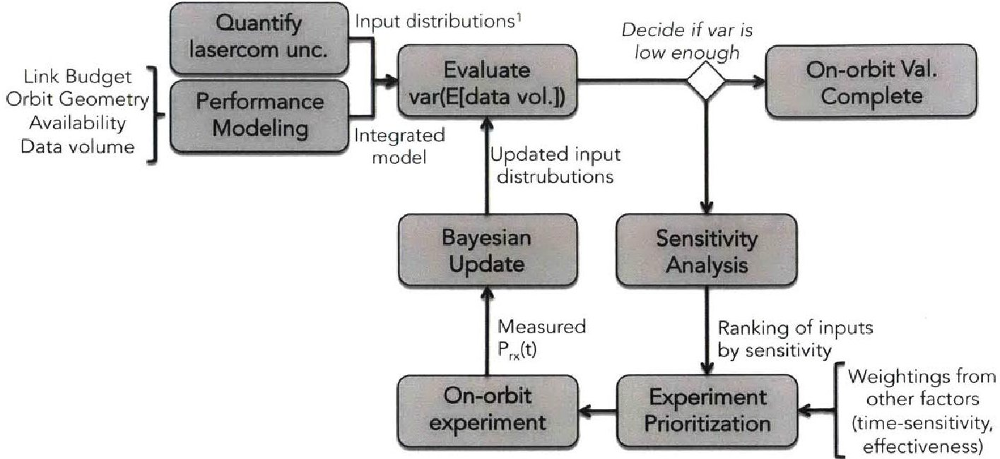

$ ^{1} $ (ex. f(atmospheric loss), f(pointing loss), etc.)

Figure A-1: Proposed systems engineering methodology for prioritizing tests.

Carlo analysis. We call this the marginal distribution, f(B).

iii. Generate a set of PDFs for the expected misalignments, referred to as the "likelihood," $ f ( B | A ). $

iv. Use Bayes' Theorem to estimate the probability distribution of the misalignment given a measured received power. This distribution is the "posterior" distribution $ f ( A | B ). $

The input distributions used in the Monte Carlo analysis are given in Table 5.2.

Each step of the Bayesian update simulation uses a "truth" input (0.0017 rad misalignment in this example, based on the misalignment experienced by NFIRE [170]) and the conditional probability of received power given that truth input to generate a received power for a particular experiment. If this were done many times, the histogram of received power generated would converge to the slice of the likelihood distribution for that truth value. Then Bayes' Theorem is used to estimate the misalignment given all of these distributions.

<!-- PDF_PAGE: 103 -->

Table A.1: Input distributions for Monte Carlo analysis. The distributions are uniform in scalar units rather than decibel units.

<table border="1"><tr><td>Variable</td><td>Value</td><td>Rationale</td></tr><tr><td>Pointing error</td><td>N(0,0.35)mrad</td><td>Sum of various errors from preliminary pointing budget for pre-calibration case,so Normal distribution is assumed.(post calibration has negligible uncertainty).</td></tr><tr><td>HPBW</td><td>1.33mrad+/-2%</td><td>Per collimator datasheet[132],collimation at room temp.is accurate to1%. Doubled for conservatism at temperature extremes.</td></tr><tr><td>Tx optical losses</td><td>N(-1.5,-0.5)dB</td><td>assumes0.3dB per splice plus or minus half a dB total</td></tr><tr><td>ER</td><td>U(6.31×10-5,1.58×10-4)</td><td>Reported in Kingsbury that ER varied between-38and-42dB[32].</td></tr><tr><td>AT Rx optics losses</td><td>U(0.35,0.5)</td><td>Measured amateur telescope system transmission at65% at1550nm.Receiver will includea90/10 collimator.Additional misc.losses.</td></tr><tr><td>Limplementation</td><td>U(0.4,0.5)</td><td>Kingsbury measured-3dB in a benchtop test[32].</td></tr></table>

## A.2 Results and Discussion

Step one of this illustrative example is shown in Figure A-2. From the lower-left figure, we can see that much of the uncertainty in received power for a given moment in time is due to the launch-induced misalignment, whereas in the rest of this thesis we have assumed that launch-induced misalignment has already been calibrated out. Given a received power estimate with uncertainty (f(B)), the distribution of likely misalignments is much narrower than the Prior distribution. In summary, with the LUMOS model it is possible to predict how the distribution of received power should depend on launch-induced misalignment and quickly narrow the estimate of misalignment, rather than waiting for the results of spiraling over several passes to find the center of the beam.

<!-- PDF_PAGE: 104 -->

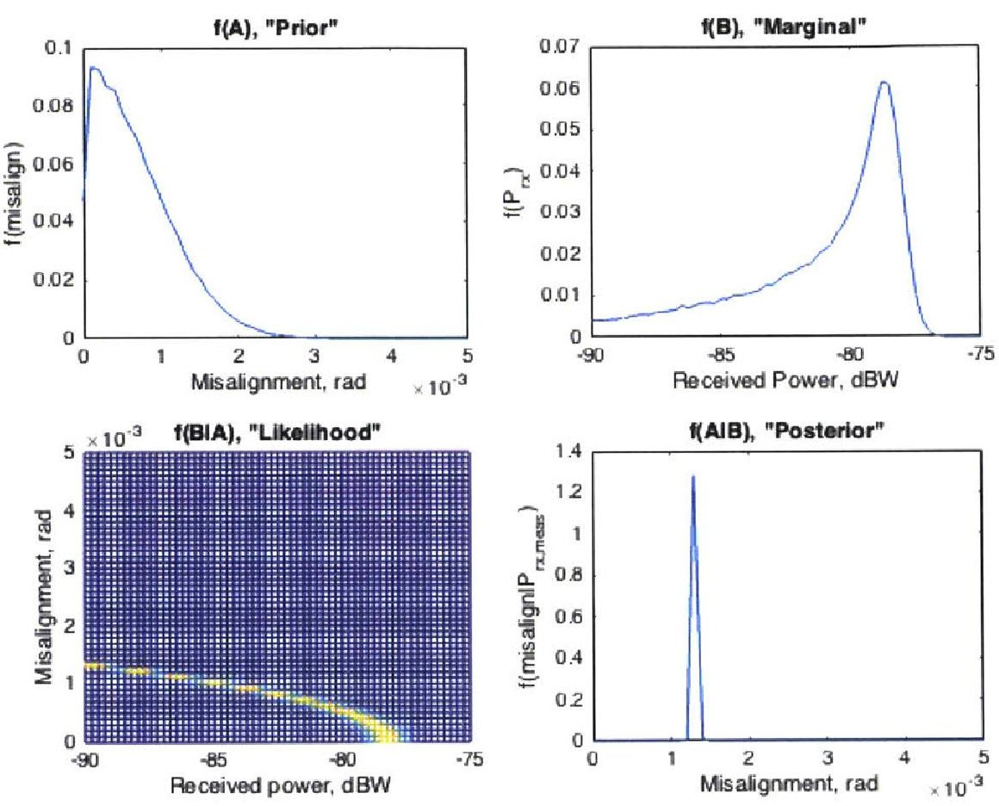

Figure A-2: Simulation of the first step of a series of on-orbit experiments to characterize misalignment. Used Bayes' Rule to estimate misalignment based on received power and estimated prior distribution of misalignment.

<!-- PDF_PAGE: 105 -->

## Appendix B

# Optimization of Laser Communication Systems

## B.1 Overview of Optimization Techniques

Optimization techniques allow a system designer to identify the design vector that has the best performance. However, not all techniques are suitable for all optimization problems. In this appendix we summarize our experience in selecting optimization techniques for laser communications problems. For a review of current research in multidisciplinary optimization techniques we refer the reader to Agte et al. [171].

First, we define common terms that have specific meanings in the context of optimization:

- Objective function(s), J: These are the performance metrics, and the goal is to minimize the function. For performance metrics which need to be maximized, e.g., data volume or data rate, we optimize for $ - 1 \times J $ in this thesis. Example objective functions used in this thesis are the probability of failing to achieve a critical data volume and latency.

- Parameters, h: These are fixed values. Examples in the LUMOS model include orbit parameters (if these are fixed by mission needs), slew rate of satellites, and bus power consumption. Some of these could be added as constraints or design variables in future optimization studies, but they are fixed in the current version.

- Constraints, g: These set bounds on inputs or intermediate results in the optimization calculation. Examples include battery depth of discharge and elevation angle.

<!-- PDF_PAGE: 106 -->

- Design vector, x: The set of design inputs for each of the designs generated by each iteration of the optimization.

- Gradient optimization: optimization that evaluates the improvement with small changes in the design vector to determine the best next design vector to test.

- Heuristic optimization: optimization that evaluates the performance of a set of design vectors and then iterates, generating a new set based on combined performance evaluation.

## B.2 Challenges with Gradient Optimization Techniques for Lasercom

We found that gradient optimization was not suitable for the laser communication architectures investigated in this thesis. This is partly because the fixed slot width in the NODE architecture causes discrete changes in data rate with smoothly varying margin, such that it is difficult to estimate a gradient for some regions of the design space. Additionally, accurate gradients cannot be calculated for the edges of the design space because the system has a data rate ceiling with the minimum PPM order and does not have a graceful degradation beyond PPM orders of about 256, with the data rate dropping from the minimum data rate to zero as margin decreases.

## B.3 Heuristic Optimization Methods

We found that heuristic optimization methods worked well for the lasercom architectures under study. Specific methods were selected based on the options available in the MATLAB Optimization Toolbox.

## B.3.1 Genetic Optimization

We found that genetic optimization worked better for multiobjective than single objective optimization. For multiobjective cases, genetic optimization worked well. MATLAB allows constraints on inputs for genetic optimization. For the single objective case, genetic optimization tended to narrow the selections of designs too quickly despite adjusting the mutation rate, and we found that particle swarm worked better for these cases.

<!-- PDF_PAGE: 107 -->

## B.3.2 Particle Swarm

For problems where there is a single objective function, e.g., maximizing the data volume, particle swarm optimization performed well. However, there is no multiobjective version of Particle Swarm available in the MATLAB Optimization Toolbox (we used MATLAB 2017b in this thesis) so this could only be used for the single objective case; if using other optimization toolboxes, particle swarm should be considered for multiobjective cases.

## B.4 Recommendations

We found that the heuristic optimization methods worked better than gradient-based approaches for the lasercom architectures under study, i.e., M-PPM with fixed slot width. For systems with smoother data rate transitions, e.g., OOK with adjusted slot rate as margin changes, gradient techniques may work better.

<!-- PDF_PAGE: 108 -->

<!-- PDF_PAGE: 109 -->

## Bibliography

[1] R. De Neufville, O. de Weck, D. Frey, D. Hastings, R. Larson, D. Simchi-Levi, K. Oye, A. Weigel, R. Welsch, et al., "Uncertainty management for engineering systems planning and design," in Engineering Systems Symposium, MIT, Cambridge, MA, 2004.

[2] S. B. Alexander, Optical communication receiver design. SPIE Optical engineering press Bellingham, Washington, USA, 1997.

[3] M. Swartwout, "The first one hundred cubesats: A statistical look," Journal of Small Satellites, vol. 2, no. 2, pp. 213-233, 2013.

[4] M. Swartwout, "Secondary spacecraft in 2015: Analyzing success and failure," in Aerospace Conference, 2015 IEEE, pp. 1-12, IEEE, 2015.

[5] E. Buchen, "Spaceworks' 2014 nano/microsatellite market assessment," 2014.

[6] R. Pournelle and M. Johnson, "Nanoracks cubesat deployment services," 2014.

[7] W. Blackwell, G. Allen, C. Galbraith, T. Hancock, R. Leslie, I. Osaretin, L. Retherford, M. Scarito, C. Semisch, M. Shields, et al., "Nanosatellites for Earth environmental monitoring: The MicroMAS project," in Geoscience and Remote Sensing Symposium (IGARSS), 2012 IEEE International, pp. 206-209, IEEE, 2012.

[8] D. Wu, J. Esper, N. Ehsan, J. Piepmeier, and P. Racette, "Icecube: Spaceflight validation of an 874-GHz submillimeter wave radiometer for ice cloud remote sensing," in AGU Fall Meeting Abstracts, vol. 1, p. 02, 2014.

[9] M. Knapp, S. Seager, M. Smith, and C. Pong, "ASTERIA: Arcsecond space telescope enabling research in astrophysics," in AGU Fall Meeting Abstracts, 2017.

[10] H. B. Smith, S. H. K. Hu, and J. J. Cockrell, "NASAs EDSN aims to overcome the operational challenges of cubesat constellations and demonstrate an economical swarm of 8 cubesats useful for space science investigations," 2013.

[11] E. Buchen and D. DePasquale, "2014 nano/microsatellite market assessment," SpaceWorks Enterprises, Inc.(SEI) Atlanta, GA. Available at: http://www.sei aero/eng/papers/uploads/archive/SpaceWorks_Nano_Microsatellite_Market_Assess ment_January_2014. pdf (last accessed August 29, 2015), 2014.

<!-- PDF_PAGE: 110 -->

[12] W. Blackwell, G. Allen, C. Galbraith, R. Leslie, I. Osaretin, M. Scarito, M. Shields, E. Thompson, D. Toher, D. Townzen, et al., "MicroMAS: A first step towards a nanosatellite constellation for global storm observation," 2013.

[13] D. Mandl, K. Huemmrich, G. Crum, V. Ly, M. Handy, and L. Ong, "Hyperspectral cubesat constellation for rapid natural hazard response," 2015.

[14] D. Selva and D. Krejci, "A survey and assessment of the capabilities of cubesats for Earth observation," Acta Astronautica, vol. 74, pp. 50-68, 2012.

[15] B. Doncaster, J. Shulman, J. Bradford, and J. Olds, "Spaceworks' 2016 nano/microsatellite market forcast," 2016.

[16] B. Klofas and K. Leveque, "The future of cubesat communications: Transitioning away from amateur radio frequencies for high-speed downlinks," in AMSAT-NA Space Symposium Orlando, Florida, 2012.

[17] S. Tsitas and J. Kingston, "6U cubesat design for earth observation with 6.5 m GSD, five spectral bands and 14Mbps downlink," 2010.

[18] J. Bouwmeester and J. Guo, "Survey of worldwide pico-and nanosatellite missions, distributions and subsystem technology," Acta Astronautica, vol. 67, no. 7, pp. 854-862, 2010.

[19] B. Klofas and K. Leveque, "A survey of cubesat communication systems: 2009-2012," 2013.

[20] K. Devaraj, R. Kingsbury, M. Ligon, J. Breu, V. Vittaldev, B. Klofas, P. Yeon, and K. Colton, "Dove high speed downlink system," 2017.

[21] J. A. King, H. Aghahassan, M. Bertino, B. Cooper, J. Kim, and K. Leveque, "Ka-band transmitter status," in 29th Annual AIAA USU Conference on Small Satellites Small Satellite Communications Workshop, 2015.

[22] B. Cooper, "Spacecraft manufacturing: Lessons learned from Corvus-BC," in 2016 CubeSat Developers Workshop, 2016. http://polyplayback ceng.calpoly.edu/Mediasite/Catalog/catalogs/cubesat-developers workshop-spring-2016.

[23] Tethers Unlimited. http://www.tethers.com/SpecSheets/Brochure_SWIFT_XTS_SFN.pdf.

[24] FCC, "FCC fact sheet: Streamlining licensing procedures for small satellites; notice of proposed rulemaking, IB docket no. 18-86," 2018. https://transition.fcc.gov/Daily_Releases/Daily_Business/2018/ db0327/D0C-349939A1.pdf.

[25] FCC. https://www.fcc.gov/engineering-technology/policy-and-rules division/general/radio-spectrum-allocation.

<!-- PDF_PAGE: 111 -->

[26] A. D. Marinan, From CubeSats to constellations: systems design and performance analysis. PhD thesis, Massachusetts Institute of Technology, 2013.

[27] Tethers Unlimited. http://www.tethers.com/SpecSheets/Brochure_SWIFT SLX.pdf.

[28] B. Klofas, "Cubesat communication systems table, version 10," 2016.

[29] M. Long, A. Lorenz, G. Rodgers, E. Tapio, G. Tran, K. Jackson, R. Twiggs, T. Bleier, and S. Solutions, "A cubesat derived design for a unique academic research mission in earthquake signature detection," in Proc. AIAA Small Satellite Conference, 2002.

[30] http://www.cubesatshop.com/index.php?page=shop.product_details& flypage=flypage.tpl&product_id=63&category_id=16&option=com_ virtuemart&Itemid=80.

[31] http://cdn2.hubspot.net/hubfs/145999/docs/VNIR.pdf?t= 1459861981807.

[32] R. W. Kingsbury, Optical communications for small satellites. PhD thesis, Massachusetts Institute of Technology, 2015.

[33] T. Jono, Y. Takayama, N. Kura, K. Ohinata, Y. Koyama, K. Shiratama, Z. Sodnik, B. Demelenne, A. Bird, and K. Arai, "OICETS on-orbit laser communication experiments," in Lasers and Applications in Science and Engineering, pp. 610503-610503, International Society for Optics and Photonics, 2006.

[34] D. M. Boroson, B. S. Robinson, D. V. Murphy, D. A. Burianek, F. Khatri, J. M. Kovalik, Z. Sodnik, and D. M. Cornwell, "Overview and results of the lunar laser communication demonstration," in SPIE LASE, pp. 89710S-89710S, International Society for Optics and Photonics, 2014.

[35] B. L. Edwards, D. Israel, K. Wilson, J. Moores, and A. Fletcher, "Overview of the laser communications relay demonstration project," in Proceedings of SpaceOps, vol. 1261897, 2012.

[36] A. Biswas, "Space technology mission directorate game changing development program deep space optical communications (DSOC)," 2016.

[37] B. Gütlich, R. Meyer, S. Philipp-May, and A. Pagels-Kerp, "German roadmap on optical communication in space," in Applications of Lasers for Sensing and Free Space Communications, pp. LM1B-2, Optical Society of America, 2013.

[38] H. Takenaka, Y. Koyama, M. Akioka, D. Kolev, N. Iwakiri, H. Kunimori, A. CarrascoCasado, Y. Munemasa, E. Okamoto, and M. Toyoshima, "In-orbit verification of small optical transponder (SOTA): evaluation of satellite-to-ground laser communication links," in SPIE LASE, pp. 973903-973903, International Society for Optics and Photonics, 2016.

<!-- PDF_PAGE: 112 -->

[39] H. Hemmati and D. Caplan, "Optical satellite communications," Optical Fiber Telecommunications, pp. 121-162, 2013.

[40] "Prof. Brian Gunter: Hitching a ride with Google, Skybox," 2015. http://www. ae.gatech.edu/node/1945.

[41] J. Conklin, N. Barnwell, L. Caro, M. Carrascilla, O. Formoso, S. Nydam, P. Serra, and N. Fitz-Coy, "Optical time transfer for future disaggregated small satellite navigation systems," 2014.

[42] B. A. Cohen, P. O. Hayne, D. Paige, and B. Greenhagen, "Lunar Flashlight: Mapping lunar surface volatiles using a cubesat," in Annual Meeting of the Lunar Exploration Analysis Group, vol. 35812, p. 3031, 2014.

[43] D. Gershgorn. http://www.popsci.com/facebook-will-use-these-lasers beam-internet-sky.

[44] "Thales Alenia Space wins initial funding for high-altitude platform, plans 2018 demo." http://spacenews.com/thales-alenia-space-high-altitude-platform-wins-initial-funding-plans-2018 demonstration/#sthash.yyiCEc6k.dpuf.

[45] M. Gidda, "Google and Facebook plan to reach remote areas of the planet." http://europe.newsweek.com/google-facebooks-plan-reach- remote-areas-planet-336160.

[46] C. Metz, "Google laser-beams the film real genius 60 miles between balloons." http://www.wired.com/2016/02/google-shot-laser-60-miles just-send-copy-real-genius/.

[47] D. Rowen, R. Dolphus, P. Doyle, and A. Faler, "OCSD-A / AeroCube 7-A status update," in Cal Poly CubeSat Developer's Workshop, 2016.

[48] D. Rowen and R. Dolphus, "3-axis attitude determination and control of the AeroCube-4 cubesats," in AIAA/USU Conference on Small Satellites, 10th Annual CubeSat Developers' Workshop, 2013.

[49] E. Clements, R. Aniceto, D. Barnes, D. Caplan, J. Clark, I. del Portillo, C. Haughwout, M. Khatsenko, R. Kingsbury, M. Lee, et al., "Nanosatellite optical downlink experiment: design, simulation, and prototyping," Optical Engineering, vol. 55, no. 11, pp. 111610-111610, 2016.

[50] B. Robinson, D. Boroson, C. Schieler, F. Khatri, O. Guldner, S. Constantine, T. Shih, J. Burnside, B. Bilyeu, F. Hakimi, et al., "TeraByte InfraRed Delivery (TBIRD): a demonstration of large-volume direct-to-earth data transfer from low-Earth orbit," in Free-Space Laser Communication and Atmospheric Propagation XXX, vol. 10524, p. 105240V, International Society for Optics and Photonics, 2018.

<!-- PDF_PAGE: 113 -->

[51] D. Sinclair and K. Riesing, "The rainbow connection-why now is the time for smallsat optical downlinks," 2017.

[52] P. Serra, N. Barnwell, and J. W. Conklin, "A novel, low power optical communication instrument for small satellites," 2015.

[53] J. Kovalik, W. Farr, and S. Piazzolla, "Laser communications subsystem for interplanetary cubesats," 2015. Poster at ISSC.

[54] K. Saucke, F. Heine, D. Trondle, P.M. Pimentel, E. Fischer, T. Berkefeld, M. Feriencik, I. Richter, M. Lutzer, and R. Meyer, "The Tesat transportable adaptive optical ground station and the operational experiences," in International Conference on Space Optics—ICSO 2016, vol. 10562, p. 105623K, International Society for Optics and Photonics, 2017.

[55] "Analytical Space and NanoRacks prepare for cubesat to downlink data using laser communication," 2018. http://www.satnews.com/story.php?number= 1695379598.

[56] M. Albert, "Long range optical telecommunications," 2016. http://sbir.gsfc. nasa.gov/SBIR/abstracts/16/sbir/phase1/SBIR-16-1-H9.01-8407.html.

[57] C. Henry. http://www.satellitetoday.com/technology/2015/10/02 bridgesat-plans-optical-network-for-smallsats-uavs/.

[58] Allied Minds. http://www.alliedminds.com/announcements/surrey satellite-and-bridgesat-to-develop-free-space-satellite-optical communications-solution.

[59] G. Yang, W. Lu, X. Sun, J. Chen, and M. Krainak, "Innovative free space optical communication and navigation system with high data rate communication, precision ranging, range rate measurements, and accurate spacecraft pointing," in SPIE LASE, pp. 97390K-97390K, International Society for Optics and Photonics, 2016.

[60] "Spacex non-geostationary satellite system attachment a technical information to supplement schedule s," 2017. http://licensing.fcc.gov/myibfs/download.do?attachment_key=1158350.

[61] "Atlas optical," 2018. http://atlasground.com/.

[62] R. Fields, X. Sun, J. B. Abshire, J. Beck, R. M. Rawlings, W. Sullivan, and D. Hinkley, "A linear mode photon-counting (LMPC) detector array in a cubesat to enable earth science lidar measurements," in Geoscience and Remote Sensing Symposium (IGARSS), 2015 IEEE International, pp. 5312-5315, IEEE, 2015.

[63] "Blue canyon technologies XACT datasheet." http://bluecanyontech.com/wp content/uploads/2016/01/XACT-Data-Sheet_2.0.pdf.

[64] J. Brown and K. Stubis, "TETRA: Star identification with hash tables," 2017.

<!-- PDF_PAGE: 114 -->

[65] K. Sarda, C. Grant, S. Eagleson, D. D. Kekez, and R. E. Zee, "Canadian advanced nanospace experiment 2 orbit operations: two years of pushing the nanosatellite performance envelope," in ESA Small Satellites, Services and Systems Symposium, 2010.

[66] S. Arnold, J. Armstrong, C. Person, and M. Tietz, "QbX-the cubesat experiment," 2012.

[67] S. Janson, B. Hardy, A. Chin, D. Rumsey, D. Ehrlich, and D. Hinkley, "Attitude control on the pico satellite solar cell testbed-2," 2012.

[68] K. Sarda, C. Grant, M. Chaumont, S. Yun Choi, B. Johnston-Lemke, and R. Zee, "Onorbit performance of the bright target explorer (BRITE) nanosatellite astronomy constellation," 2014.

[69] G. Bonin, N. Roth, S. Armitage, J. Newman, B. Risi, and R. E. Zee, "CanX-4 and CanX-5 precision formation flight: Mission accomplished!," 2015.

[70] J. Newman, "Drift recovery and station keeping results for the historic CanX- 4/CanX-5 formation flying mission," 2015.

[71] J. P. Mason, T. N. Woods, A. Caspi, P. C. Chamberlin, C. Moore, A. Jones, R. Kohnert, X. Li, S. Palo, and S. Solomon, "Miniature X-Ray Solar Spectrometer (MinXSS)-a science-oriented, university 3u cubesat," arXiv preprint arXiv:1508.05354, 2015.

[72] "Perfect precision for MinXSS cubesat supplied by blue canyon technologies-it's all about attitude." http://satnews.com/story.php?number=31922882.

[73] J. P. Mason, M. Baumgart, B. Rogler, C. Downs, M. Williams, T. N. Woods, S. Palo, P. C. Chamberlin, S. Solomon, A. Jones, et al., "MinXSS-1 cubesat on-orbit pointing and power performance: The first flight of the blue canyon technologies XACT 3-axis attitude determination and control system," arXiv preprint arXiv:1706.06967, 2017.

[74] "Astrophysics cubesat demonstrates big potential in a small package," 2018. https://www.jpl.nasa.gov/news/news.php?feature=7097.

[75] T. S. Rose, S. Janson, S. LaLumondiere, N. Werner, D. Hinkley, D. Rowen, R. Fields, and R. Welle, "LEO to ground optical communications from a small satellite platform," in SPIE LASE, pp. 93540I-93540I, International Society for Optics and Photonics, 2015.

[76] A. Biswas, J. M. Kovalik, M. W. Wright, W. T. Roberts, M. K. Cheng, K. J. Quirk, M. Srinivasan, M. D. Shaw, and K. M. Birnbaum, "LLCD operations using the optical communications telescope laboratory (OCTL)," in SPIE LASE, pp. 89710X-89710X, International Society for Optics and Photonics, 2014.

<!-- PDF_PAGE: 115 -->

[77] D. V. Murphy, J. E. Kansky, M. E. Grein, R. T. Schulein, M. M. Willis, and R. E. Lafon, "LLCD operations using the lunar lasercom ground terminal," in SPIE LASE, pp. 89710V-89710V, International Society for Optics and Photonics, 2014.

[78] K. Riesing, H. Yoon, and K. Cahoy, "A portable optical ground station for low-Earth orbit satellite communications," 2017.

[79] R. P. Welle, "Cubesat-scale laser communications," 2015.

[80] S. Horan and K. Belvin, "Tailoring systems engineering projects for small satellite missions," 2013.

[81] W. Yao, X. Chen, W. Luo, M. van Tooren, and J. Guo, "Review of uncertainty-based multidisciplinary design optimization methods for aerospace vehicles," Progress in Aerospace Sciences, vol. 47, no. 6, pp. 450-479, 2011.

[82] G. B. Shaw, D. W. Miller, and D. E. Hastings, The generalized information network analysis methodology for distributed satellite systems. PhD thesis, Citeseer, 1999.

[83] G. B. Shaw, D. W. Miller, and D. E. Hastings, "Development of the quantitative generalized information network analysis methodology for satellite systems," Journal of Spacecraft and Rockets, vol. 38, no. 2, pp. 257-269, 2001.

[84] C. White, G. Antoun, P. Brugarolas, S.-S. Lih, C.-Y. Peng, L. Phan, A. S. Martin, S. Sell, and G. Singh, "System verification of MSL Skycrane using an integrated adams simulation," in Aerospace Conference, 2012 IEEE, pp. 1-11, IEEE, 2012.

[85] G. R. Sondecker IV, Identification and evolution of quantities of interest for a stochastic process view of complex space system development. PhD thesis, Massachusetts Institute of Technology, 2011.

[86] K. D. Stout, Bayesian-based simulation model validation for spacecraft thermal systems. PhD thesis, Massachusetts Institute of Technology, 2015.

[87] S. Sankararaman, "Uncertainty reduction using bayesian inference and sensitivity analysis: A sequential approach to the NASA Langley uncertainty quantification challenge," in 18th AIAA Non-Deterministic Approaches Conference, p. 1194, 2016.

[88] R. A. Masterson and D. W. Miller, "Dynamic tailoring and tuning for precision optical space structures," in 45 th AIAA/ASME/ASCE/AHS/ASC Structures, Structural Dynamics and Materials Conference, 2004.

[89] E. A. Bjorkman, S. Sarkani, and T. A. Mazzuchi, "Using model-based systems engineering as a framework for improving test and evaluation activities," Systems Engineering, 2012.

[90] D. Kaslow, G. Soremekun, H. Kim, and S. Spangelo, "Integrated model-based systems engineering (MBSE) applied to the simulation of a cubesat mission," in Aerospace Conference, 2014 IEEE, pp. 1-14, IEEE, 2014.

<!-- PDF_PAGE: 116 -->

[91] S. C. Spangelo, J. Cutler, L. Anderson, E. Fosse, L. Cheng, R. Yntema, M. Bajaj, C. Delp, B. Cole, G. Soremekum, et al., "Model based systems engineering (MBSE) applied to radio aurora explorer (RAX) cubesat mission operational scenarios," in Aerospace Conference, 2013 IEEE, pp. 1-18, IEEE, 2013.

[92] S. Spangelo and J. Cutler, "Optimization of Single-Satellite Operational Schedules Towards Enhanced Communication Capacity," AIAA Guidance, Navigation, and Control Conference, no. August, 2012.

[93] S. C. Spangelo, D. Kaslow, C. Delp, B. Cole, L. Anderson, E. Fosse, B. S. Gilbert, L. Hartman, T. Kahn, and J. Cutler, "Applying model based systems engineering (MBSE) to a standard cubesat," in Aerospace Conference, 2012 IEEE, pp. 1-20, IEEE, 2012.

[94] P. Zarifian, T. Imken, S. E. Matousek, R. C. Moeller, M. W. Bennett, C. D. Norton, L. Rosenberg, F. Alibay, S. Spangelo, P. Banazadeh, et al., "Team Xc: JPL's collaborative design team for exploring cubesat, nanosat, and smallsat-based mission concepts," in Aerospace Conference, 2015 IEEE, pp. 1-10, IEEE, 2015.

[95] A. Babuscia and K.-M. Cheung, "Statistical risk estimation for communication system design," Systems Journal, IEEE, vol. 7, no. 1, pp. 125-136, 2013.

[96] K.-M. Cheung, "Statistical link analysis-a risk analysis perspective," Interplanetary Network Directorate Progress Report, pp. 42-183, 2010.

[97] M. Z. Win, "Estimation and tracking for deep-space optical communications," in OE/LASE'89, 15-20 Jan., Los Angeles. CA, pp. 80-87, International Society for Optics and Photonics, 1989.

[98] M. Z. Win and C.-C. Chen, "Analysis of a spatial-tracking subsystem for optical communications," in OE/LASE'92, pp. 318-325, International Society for Optics and Photonics, 1992.

[99] A. Biswas and S. Piazzolla, "Deep-space optical communications downlink budget from mars: System parameters," IPN Progress Report, vol. 42, no. 154, pp. 0-1, 2003.

[100] K. Cheung, "The role of margin in link design and optimization," in 2015 IEEE Aerospace Conference, pp. 1-11, IEEE, 2015.

[101] T. Tolker-Nielsen and G. Oppenhauser, "In-orbit test result of an operational optical intersatellite link between ARTEMIS and SPOT4, SILEX," in High-Power Lasers and Applications, pp. 1-15, International Society for Optics and Photonics, 2002.

[102] R. J. Alliss and B. Felton, "The mitigation of cloud impacts on free-space optical communications," in SPIE Defense, Security, and Sensing, pp. 83800S-83800S, International Society for Optics and Photonics, 2012.

<!-- PDF_PAGE: 117 -->

[103] I. del Portillo, M. Sanchez, B. Cameron, and E. Crawley, "Optimal location of optical ground stations to serve LEO spacecraft," in Aerospace Conference, 2017 IEEE, pp. 1-16, IEEE, 2017.

[104] H. Hemmati, Near-Earth laser communications. CRC Press, 2009.

[105] D. R. Kolev and M. Toyoshima, "Received-power fluctuation analysis for LEO satellite-to-ground laser links," Journal of Lightwave Technology, vol. 35, no. 1, pp. 103-112, 2017.

[106] L. C. Andrews and R. L. Phillips, Laser beam propagation through random media vol. 1. SPIE press Bellingham, WA, 2005.

[107] R. J. Alliss and B. D. Felton, "Improved climatological characterization of optical turbulence for space optical imaging and communications," in Advanced Maui Optical and Space Surveillance Technologies Conference, p. E25, 2010.

[108] P. W. Nugent, J. A. Shaw, and S. Piazzolla, "Infrared cloud imager development for atmospheric optical communication characterization, and measurements at the JPL table mountain facility," InterPlanetary Network Progress Report, vol. 42, no. 192, pp. 1-31, 2013.

[109] K. Wilson, D. Antsos, L. Roberts Jr, S. Piazzolla, L. Clare, and A. Croonquist, "Development of the optical communications telescope laboratory: A laser communications relay demonstration ground station," 2012.

[110] R. Kingsbury, D. Caplan, and K. Cahoy, "Compact optical transmitters for cubesat free-space optical communications," in SPIE LASE, pp. 93540S-93540S, International Society for Optics and Photonics, 2015.

[111] R. Kingsbury, D. Caplan, and K. Cahoy, "Implementation and validation of a cubesat laser transmitter," in SPIE LASE, pp. 973905-973905, International Society for Optics and Photonics, 2016.

[112] T. Nguyen, K. Riesing, R. Kingsbury, and K. Cahoy, "Development of a pointing acquisition, and tracking system for a cubesat optical communication module," in SPIE LASE, pp. 935400-935400, International Society for Optics and Photonics, 2015.

[113] R. Kingsbury, K. Riesing, and K. Cahoy, "Design of a free-space optical communication module for small satellites," 2014.

[114] R. Kingsbury, T. Nguyen, K. Riesing, and K. Cahoy, "Fast-steering solutions for cubesat-scale optical communication," in Proc. of International Conference on Space Optics, 2014.

[115] K. Cahoy and A. K. Kennedy, "Initial results from ACCESS: An Autonomous CubeSat Constellation Scheduling System for Earth Observation," 2017.

<!-- PDF_PAGE: 118 -->

[116] V. Carrara, "An Open Source Satellite Attitude and Orbit Simulator Toolbox for Matlab," in Proceedings of the XVII International Symposium on Dynamic Problems of Mechanics, (Natal, Brazil), 2015.

[117] AGI, "Engineering tools," 2018. https://www.agi.com/products/ engineering-tools.

[118] PlaneWave. http://planewave.com/products-page/.

[119] Celestron. https://www.celestron.com/collections/telescopes.

[120] Meade. https://www.meade.com/telescopes/optical-tube-assembly-ota.html.

[121] Headwall, 2018. http://www.headwallphotonics.com/spectral-imaging/ hyperspectral/nano-hyperspec.

[122] C. Frost, E. Agasid, et al., "Small spacecraft technology state of the art," NASA Technical Report TP-2015-216648/REV1, NASA Ames Research Center, 2015.

[123] J. Figura, C. Haughwout, K. Cahoy, R. Welle, B. Hardy, D. Pack, and A. Bosh, "Initial demonstration of an uplink LED beacon to a low Earth orbiting cubesat: Tracking, telemetry, and communications (TT&C)," Journal of Small Satellites, 2018.

[124] A. Biswas, W. T. Roberts, J. M. Kovalik, and M. W. Wright, "OCTL laser beam transmission interruptions due to aircraft and predictive avoidance," Inter-Planetary Network Progress Report, pp. 42-191, 2012.

[125] B. L. Edwards, R. E. Lafon, and E. Y. Luzhansky, "Operational impacts of the us federal aviation administration and the us laser clearinghouse on an optical communications Earth relay," in Aerospace Conference, 2016 IEEE, pp. 1-7, IEEE, 2016.

[126] B. Moision and H. Xie, "An approximate link equation for the direct-detected optical PPM link," Interplanetary Network Progress Report, vol. 199, no. 27, p. 1, 2014.

[127] J. W. Hardy, Adaptive optics for astronomical telescopes, vol. 16. Oxford University Press on Demand, 1998.

[128] R. Racine, "The telescope point spread function," Publications of the Astronomical Society of the Pacific, vol. 108, no. 726, p. 699, 1996.

[129] Voxtel, "Technical note V803 avalanche photodiode receiver performance metrics," 2018. http://voxtel-inc.com/files/2012/07/TECH-NOTE-V803-Avalanche-Photodiode-and-Receiver-Performance-Metrics-By-GM-Williams-VOXTEL_B.pdf.

[130] Celestron. http://www.celestron.com/browse-shop/astronomy telescopes/cpc-1100-gps-(xlt)-computerized-telescope.

<!-- PDF_PAGE: 119 -->

[131] K. Wilson, A. Vaughan, J. Wu, D. Mayes, J. Maloney, and R. Sobek, "Preliminary characterization results of the optical communications telescope laboratory telescope," The Interplanetary Network Progress Report, vol. 42, p. 161, 2005.

[132] Thorlabs Inc., 4.7 mm FOCAL LENGTH FIBER PIGTAIL COLLIMATOR, revision c ed., December 2010. Drawing 17382-E01, Part number CFS5-1550-APC.

[133] "Single fiber fusion splicing application note," 2009. https://www.corning. com/media/worldwide/coc/documents/Fiber/RC-Application%20Notes/ AN103_06-09.pdf.

[134] K. A. Winick, "Atmospheric turbulence-induced signal fades on optical heterodyne communication links," Applied optics, vol. 25, no. 11, pp. 1817-1825, 1986.

[135] E. Clements, K. Cahoy, C. Haughwout, H. Yoon, K. Riesing, M. Khatsenko, C. Ziegler, R. Aniceto, R. Morgan, C. Sackier, J. Stroming, J. Figura, D. Barnes, M. Lee, R. Diez, J. Kusters, J. Clark, M. Long, T. Nguyen, O. Peraire-Bueno, J. Heyns, M. LaRocca, E. Munden, S. Munoz, R. Silvestri, M. Subernat, A. Villapando, A. Wubshet, and A. Forsey, "Integration and testing of the nanosatellite optical downlink experiment," 2017.

[136] P. R. Optics, "OFS935C fusion splicer," 2018. http://www.fiberoptic.com/mmfiberoptic/PDFs/OFS-935C.pdf.

[137] I. del Portillo Barrios. personal communication.

[138] P. A. Hubanks, M. D. King, S. Platnick, and R. Pincus, "MODIS atmosphere L3 gridded product algorithm theoretical basis document," ATBD Reference Number: ATBD-MOD-30, vol. 30, p. 96, 2008.

[139] L. Clare and G. Miles, "Deep space optical link ARQ performance analysis," in Aerospace Conference, 2016 IEEE, pp. 1-11, IEEE, 2016.

[140] NASA, "Cloud fraction (1 month - AQUA/MODIS)," 2018. https://neo.sci. gsfc.nasa.gov/view.php?datasetId=MYDAL2_M_CLD_FR&date=2018-01-01.

[141] E. Clements, A. Carlton, C. Joyce, N. Schwadron, H. Spence, X. Sun, and K. Cahoy, "Interplanetary space weather effects on lunar reconnaissance orbiter avalanche photodiode performance," 2016 - Recently Submitted.

[142] H. N. Becker and A. H. Johnston, "Dark current degradation of near infrared avalanche photodiodes from proton irradiation," IEEE transactions on nuclear science, vol. 51, no. 6, pp. 3572-3578, 2004.

[143] U. Sterr, D. Dallmann, F. Heine, D. Trondle, R. Meyer, M. Lutzer, and E. Benzi, "Planning constraints of low grazing altitude GEO-LEO laser links based on inorbit data," Optical Engineering, vol. 55, no. 11, p. 111608, 2016.

<!-- PDF_PAGE: 120 -->

[144] "Hyperspectral imaging by cubesat on the way." http://www.esa.int/Our_ Activities/Space_Engineering_Technology/Hyperspectral_imaging_ by_CubeSat_on_the_way.

[145] "Global ground station network." http://www.bridgesatinc.com/products/ #ground.

[146] "NASA earth observatory cloudy Earth image of the day." https:// earthobservatory.nasa.gov/IOTD/view.php?id=85843.

[147] J. Lesh and D. Robinson, "A cost-performance model for ground-based optical communications receiving telescopes," 1986.

[148] Mathworks, "Global optimization toolbox users guide," 2018. https://www. mathworks.com/help/pdf_doc/gads/gads_tb.pdf.

[149] Voxtel, "Voxtel catalog: Photodiodes, APDs, photoreceivers, lrf receivers," 2015. http://voxtel-inc.com/files/Voxtel-Catalog.pdf.

[150] Hamamatsu, "G8931 series," 2017. http://www.hamamatsu.com/resources pdf/ssd/g8931_series_kapd1018e.pdf.

[151] Princeton, "PAR series high sensitivity APD front-end receiver modules," 2017. https://www.princetonlightwave.com/wp-content/uploads/2017/01/PAR.pdf.

[152] Astro-Tech. https://www.astronomics.com/astro-tech-rc-telescopes c6.aspx.

[153] Obsession. http://www.obsessiontelescopes.com/telescopes/index.php.

[154] L. M. Stepp, L. G. Daggert, and P. E. Gillett, "Estimating the cost of extremely large telescopes," in Future giant telescopes, vol. 4840, pp. 309-322, International Society for Optics and Photonics, 2003.

[155] M. Fernandez, G. Guillois, Y. Richard, J. Issler, P. Lafabrie, A. Gaboriaud, D. Evans, R. Walker, O. Koudelka, P. Romano, et al., "Game-changing radio communication architecture for cube/nano satellites," 2015.

[156] M. Fernandez, A. Latiri, T. Dehaene, G. Michaud, P. Bataille, C. Dudal, P. Lafabrie, A. Gaboriaud, J.-L. Issler, F. Rousseau, et al., "X-band transmission evolution towards DVB-S2 for small satellites," 2016.

[157] W. M. Organization, "Observing systems capability analysis and review tool (OSCAR)," 2018. https://www.wmo-sat.info/oscar/requirements.

[158] S. Industries, "Pricing information," 2018. https://spaceflight.com/wp content/uploads/2017/06/SF-Networks-Data-Sheet.pdf.

[159] "2017 engineering salary statistics."

<!-- PDF_PAGE: 121 -->

[160] C. Cook and J. Graser, Military Airframe Acquisition Costs. RAND, 2001.

[161] I. Del Portillo Barrios, Optimal locations for the ground segment of optical space communications networks. PhD thesis, Massachusetts Institute of Technology, 2016.

[162] R. Parvez. Personal Communication, April 2017.

[163] J. B. Stewart, D. V. Murphy, J. D. Moores, A. S. Fletcher, and K. M. Bonneau, "Comparing adaptive optics approaches for NASA LCRD ground station# 2," Proceedings of SPIE (S0277-786X)(S0277-786X), vol. 8610, p. 86100M, 2013.

[164] M. Toyoshima, H. Takenaka, and Y. Takayama, "Atmospheric turbulence-induced fading channel model for space-to-ground laser communications links," Optics express, vol. 19, no. 17, pp. 15965-15975, 2011.

[165] N. Jovanovic, F. Martinache, O. Guyon, C. Clergeon, G. Singh, T. Kudo, V. Garrel, K. Newman, D. Doughty, J. Lozi, et al., "The Subaru coronagraphic extreme adaptive optics system: Enabling high-contrast imaging on solar-system scales," Publications of the Astronomical Society of the Pacific, vol. 127, no. 955, p. 890, 2015.

[166] Finisar, "Product specification +1600 ps/nm (80km) gen2 tunable XFP optical transceiver FTLX6824MCC."

[167] J. King. Personal Communication, March 2017.

[168] B. Klofas, "Planet Labs ground station network," CalPoly CubeSat Developer Workshop.

[169] R. J. Sasiela, "Electromagnetic wave propagation in turbulence: evaluation and application of mellin transforms," SPIE, 2007.

[170] R. Fields, C. Lunde, R. Wong, J. Wicker, D. Kozlowski, J. Jordan, B. Hansen, G. Muehlnikel, W. Scheel, U. Sterr, et al., "NFIRE-to-TerraSAR-X laser communication results: satellite pointing, disturbances, and other attributes consistent with successful performance," in SPIE Defense, Security, and Sensing, pp. 73300Q-73300Q, International Society for Optics and Photonics, 2009.

[171] J. Agte, O. De Weck, J. Sobieszczanski-Sobieski, P. Arendsen, A. Morris, and M. Spieck, "MDO: assessment and direction for advancement—an opinion of one international group," Structural and Multidisciplinary Optimization, vol. 40, no. 1-6, pp. 17-33, 2010.