<!-- PDF_PAGE: 1 -->

IAC-18-D1.1.9.x44546

Space Factory 4.0 - New processes for the robotic assembly of modular satellites on an in-orbit platform based on ,Industrie 4.0” approach

Thiago Weber Martins $ ^{a\star} $ , Aaron Pereira $ ^{c} $ , Thomas Hulin $ ^{d} $ , Oliver Ruf $ ^{b} $ , Stefan Kugler $ ^{a} $ , Alessandro M. Giordano $ ^{c} $ , Ribin Balachandran $ ^{d} $ , Fabian Benedikt $ ^{d} $ , John Lewis $ ^{e} $ , Reiner Anderl $ ^{a} $ , Klaus Schilling $ ^{b} $ , Alin Albu-Schäffer $ ^{c,d} $

$ ^{a} $ Department of Computer Integrated Design (DiK), Technische Universität Darmstadt, Otto-Berndt-Str. 2, 64287, Darmstadt, Germany, weber@dik.tu-darmstadt.de, kugler@dik.tu-darmstadt.de, anderl@dik.tu-darmstadt.de $ ^{b} $ Zentrum für Telematik e.V., Magdalene-Schoch-Straße 5, 97074 Würzburg, Germany, oliver.ruf@telematikzentrum.de, klaus.schilling@telematik-zentrum.de

$ ^{c} $ Department of Informatics Sensor Based Robotic Systems and Intelligent Assistance Systems, Boltzmannstr.3, 85748 Garching, Germany, alessandro.giordano@tum.de, aaron.pereira@tum.de, alin.albu-schaeffer@dlr.de $ ^{d} $ Institute of Robotics and Mechatronics, German Aerospace Center (DLR), Oberpfaffenhofen, 82234 Wessling, Germany, ribin.balachandran@dlr.de, thomas.hulin@dlr.de, fabian.benedikt@dlr.de

$ ^{e} $Telespazio VEGA Deutschland GmbH, Europaplatz 5, 64283 Darmstadt, John.Lewis@telespazio-vega.de

* Corresponding Author

## Abstract

Manufacturing in Space is fast becoming a reality, with the commercialisation of space operations - the so-called NewSpace - leading to a sea-change in the space industry and the emergence of new business models. Inspired by the new opportunities related to NewSpace, the project Space Factory 4.0 has been founded with the objective of establishing new processes and technologies for rapid satellite assembly on an in-orbit platform. To make a significant step towards reaching this visionary goal, this paper discusses: (i) the establishment of new processes for manufacturing in space based on an Industrie 4.0 approach, (ii) the design of highly modular satellites, and (iii) their robotic assembly. The objectives of Industrie 4.0 are to enable flexibility, modularity, and adaptability of production systems by exploiting the capabilities of Cyber-Physical Systems.

Based on Industrie 4.0 principles, an overall process for Space Factory 4.0 is proposed. Although the specific case of robotic assembly of modular satellites is focused, this approach is applied to abstract new business models. One of the key features of the overall process is the seamless use of the Digital Twin approach which provides detailed models representing the actual state of a physical component or system. Use-cases such as automated testing and digital product documentation are described to illustrate the benefits of such technology.

Implementing fast development cycles and modern manufacturing concepts can avail of modular systems that enable automated integration and verification processes. Space Factory 4.0 aims at establishing a highly modular design for small satellites that increases efficiency and scalability during production and testing. Based on this design, automated integration and verification of small satellites will be demonstrated to prepare for a future in-orbit factory.

Although autonomous integration and assembly in space are the long-term goals, currently the technology for visual tracking and for modelling the physical interaction between the satellite components, the platform and the robotic manipulators is not always perfectly reliable. As an alternative solution, Space Factory 4.0 aims at developing a bilateral controller which allows for teleoperation of the assembly robot by a human operator using a Human-Machine Interface (HMI), providing force feedback with the support of virtual fixtures. The paper discusses a concept of such a haptic telerobotic system, which aims at combining the capabilities of robots for operating in remote environments with the human's intelligence. This paper outlines the methods and the results obtained within Space Factory 4.0 and draws conclusions to discuss its benefits and potentials for the space industry.

Keywords: Industrie 4.0, Digital Twin, CubeSats, robotic assembly, teleoperation

<table border="1"><tr><td colspan="2">Acronyms/Abbreviations</td><td>MBS</td><td>Multi-Body Simulation</td></tr><tr><td>CIB</td><td>Centralised Information Base</td><td>MCS</td><td>Mission Control System</td></tr><tr><td>CPS</td><td>Cyber Physical Systems</td><td>MIB</td><td>Mission Information Base</td></tr><tr><td>FEA</td><td>Finite Element Analysis</td><td>OEM</td><td>Original Equipment Manufacturer</td></tr><tr><td>I4.0</td><td>Industrie 4.0</td><td>PLC</td><td>Product Life Cycle</td></tr><tr><td>IoT</td><td>Internet of Things</td><td>RAMI</td><td>Reference Architecture Model Industrie 4.0</td></tr></table>

<!-- PDF_PAGE: 2 -->

TC Telecommands

TCP Tool Center Point

TM Telemetry

## 1. Introduction

## 1.1 Motivation

Manufacturing in space has advantages when 1) the raw material is in space (e.g. asteroid mining) 2) microgravity or a vacuum are essential to the production, or 3) the finished product is to be used in space (e.g. satellites). We consider the last case. The demand for small satellites in the Earth observation and communication domain is ever increasing. So-called mega constellations of small satellites have been proposed to meet the demand of connecting billions of devices in the Internet of Things (IoT). However, the cost of launching them individually is prohibitive [1]. Technology developments in recent years, e.g. 3D-printing on the ISS [2], offer the possibility to bring materials to space for on demand in-orbit integration, to shorten production cycles and increase availability of these mega constellations. A factory in space where small satellites could be assembled would therefore be useful, however, the technical and logistical challenges are not negligible. Satellites in production should be traceable, i.e. unambiguously identifiable. Furthermore, the production should be flexible, both in terms of being on-demand (i.e. a short time from placing an order to obtaining a working satellite) and individualisable, meaning that each satellite can have custom specifications and design.

Industrie 4.0 (English: Industry 4.0) is an answer to the same demands on earth. The name suggests a fourth industrial revolution, referencing prior "revolutions" in industry: mechanisation in the 19th century as the first, and mass production followed by the introduction of computers in manufacture as the second and third. Industrie 4.0 is a part of a high-tech strategy (German: Hightech-Strategie 2020 [3]) initiated by the German government aiming to enhance the competitiveness of the German industry through the integration of modern information and communication technologies with production.

Key to this revolution are Cyber-Physical Systems (CPS), i.e. systems comprising interconnected digital and physical elements. Examples are robots and networks of sensorised machines and components. Such CPS can make decisions semi-autonomously. Networked across the whole factory, and combined with novel concepts for storage and access of data and software such as the Centralised Information Base (CIB) and the cloud, CPS can enable real-time data acquisition and analysis. This allows individual components to be traced, machines pre-emptively maintained and even highly customised production to

be profitable [4]. Production is flexible not only in terms of individualised products, but also in that the setup and modification to production lines can happen fast and products delivered on demand.

Until now, Industrie 4.0 has been extensively explored within the general engineering sector (e.g. automotive and machinery industry), but not within the space industry. The aim of our Space Factory 4.0 concept is to address space manufacturing challenges with solutions from Industrie 4.0. Inspired by the opportunities held by manufacturing in space, our objective is to establish new processes and technologies for rapid satellite assembly on an in-orbit platform. This paper introduces methods covering the establishment of new processes based on an Industrie 4.0 approach, the design of highly modular satellites, and their robotic assembly. Additionally, the results obtained through manufacturing prototypes and experiments are discussed to draw conclusions in respect of its benefits and potentials for the space industry.

## 1.2 Current Challenges in Manufacturing in Space

We use the definition of "manufacturing in space" from [5] to mean at least one of fabrication, assembly and integration occur in space. Manufacturing in space brings several benefits: structures need not be designed to withstand launch loads, satellites can be repaired and repurposed in space, and they can be produced on demand [6]. However, challenges abound.

In contrast to manufacturing on earth, space manufacturing is not mature enough to have a rigorous set of standards in place. Neither the European Cooperation for Space Standardization (ECSS) nor the Consultative Committee for Space Data Systems (CCSDS) have standards pertaining specifically to manufacture in space. Testing of satellites is often tedious and redundant, and results in long product creation cycles. Each step during manufacturing and assembly must be tested to avoid inaccuracies and error sources [7]. All tests must be documented and verified by systems supplier (e.g. Original Equipment Manufacturer (OEM)), system integrator, and space agencies. Reducing redundant testing while guaranteeing quality could be a contribution of the Digital Twin (Section 4), as it stores all available information about the satellites components and allows the execution some of the tests in simulations.

Furthermore, automation is not perfect. Sometimes, unforeseen circumstances or problems require human involvement. Teleoperation with various degrees of control from the human and autonomy of the robot is crucial to successful space manufacture [8]. There are further technical challenges in the robot control. Trajectory planning must account

<!-- PDF_PAGE: 3 -->

for limited workspace inside the factory, and for the dynamical effects of the robot on the factory.

Despite these challenges, in-orbit satellite assembly has a promising business case [5]. We aim to address these challenges to effective manufacturing of customised satellites using methods and ideas from Industrie 4.0 and advances within automation and telerobotics.

## 1.3 Space Factory 4.0

Our Space Factory concept relies on Industrie 4.0 approaches to address the aforementioned challenges in manufacturing in space. As depicted in Fig.1, the concept of a Space Factory 4.0 consists of an in-orbit platform for the fast assembly of modular satellites using robots. Since such an in-orbit platform is not trivial to control and monitor, an innovative concept for support systems is necessary. Therefore, additionally to the space segment, the Space Factory 4.0 sets up support systems that features a Centralised Information Base (CIB) and the extensive use of Digital Twins. As this concept is a novelty due to the combination of the aforementioned approaches (in-orbit platform for robotic assembly with modular satellites, and support systems based on Digital Twins), it also suggests that a rethink of the product life cycle (PLC) for space missions is necessary. Thus, an overall process based on Industrie 4.0 approaches provides the necessary workflow description for a Space Factory 4.0.

a. overall process based on an Industrie 4.0 approach,

In the following sections, the main methods of the Space Factory 4.0 are discussed. These are listed below:

b. Centralised Information Bases (CIB),

c. Digital Twins for space missions,

d. design modular satellites,

e. automated satellite integration and tests, and

f. teleoperated robotic assembly.

## 2. Overall Process for Space Factory 4.0

As previously mentioned, the Space Factory concept requires a rethink of traditional production processes. For example, automation of satellite production can lower costs when producing several satellites; on the other hand, space applications require highly individualised "one of a kind" satellites, which is difficult to automate. A key approach to solve such conflicting requirements is exploiting the capabilities provided by Industrie 4.0 concepts. Therefore, we propose an overall process for Space Factory 4.0 by refining a state-of-the art Product Life Cycle (PLC) [9,

10] through the inclusion of Industrie 4.0 concepts. The overall process features three domain-specific processes: Industrie 4.0 Components, Earth Segment, and Space Segment. While the earth and space segment describe processes that take place on earth and in space respectively, the process Industrie 4.0 Components embodies the digital part of the lifecycle, like the Digital Twin, simulation, and datastorage. This process is depicted in Fig. 2. For reasons of space, these are explained briefly in the following, focusing on the most relevant steps of virtual development and manufacturing of Space Factory 4.0. A more detailed discussion of the overall process will be addressed in future works.

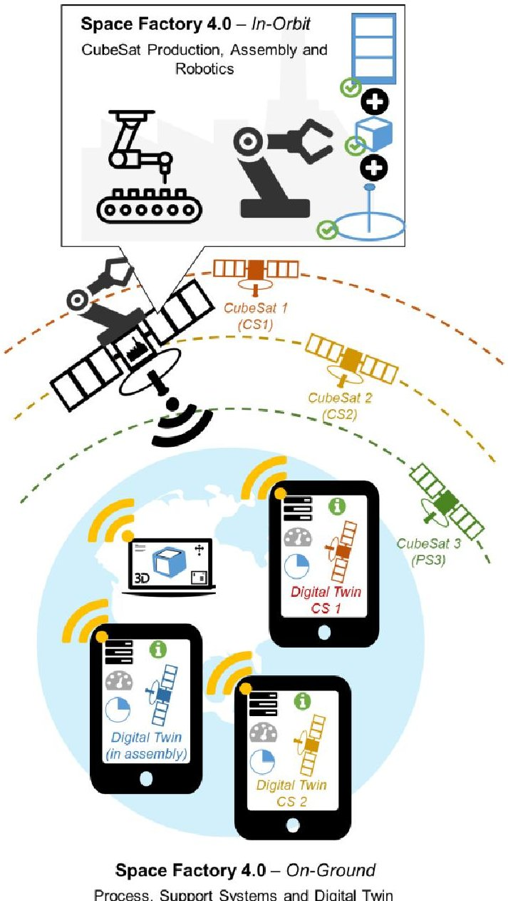

Fig. 1. Concept of a Space Factory 4.0

<!-- PDF_PAGE: 4 -->

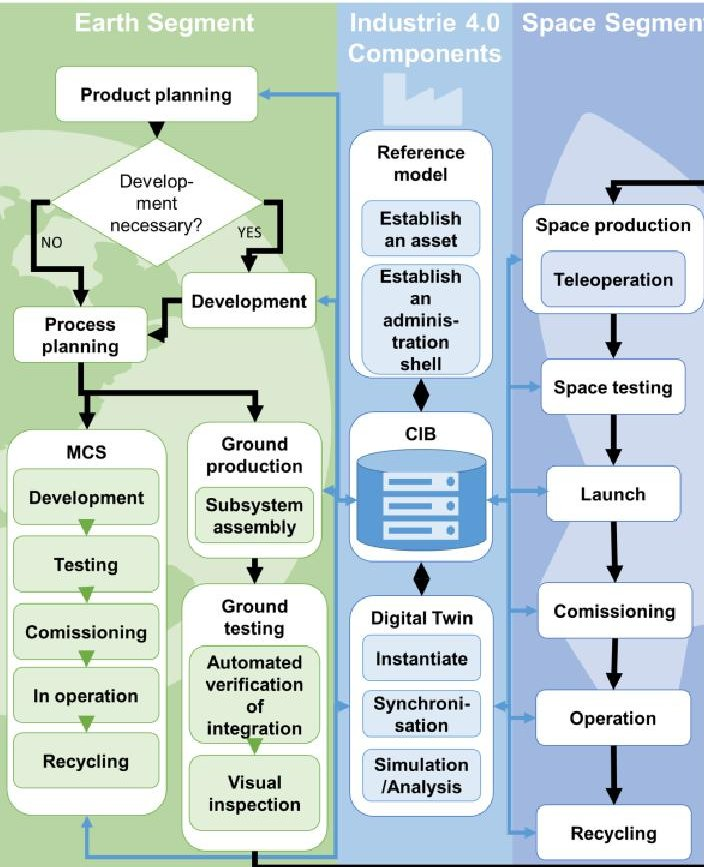

Fig. 2. Overall Process for a Space Factory 4.0

The process Industrie 4.0 Components can be regarded as the backbone of the whole process of the Space Factory 4.0 since it continuously integrates specific data from the other processes through semantics and relationships. This is realised by the introduction of the CIB that will be discussed in detail in Section 3. A feature of this process is the extensive use of Digital Twins that are described in Section 4. This process defines formally all necessary steps related to instantiation from reference models, synchronisation using real-time data and administration of Digital Twins. Subsequently, a very important task of this process is to establish a bidirectional communication path to the respective steps of the Earth Segment or Space Segment (e.g. update the Digital Twins of a subsystem during its assembly and integration using real time data to identify error sources). Another task is to integrate new knowledge in the CIB through analysis of real time data that can be gained in the development, assembly, integration or operation. This knowledge can be used to optimise future generations of products and processes. The process Industrie 4.0 Components enables unambiguous identifiability, communication capability, and asset representation through information.

The process Earth Segment consists of the following steps: product planning, development process planning, ground production, and ground testing. In Space Factory 4.0 we explore the so called CubeSats as a product featuring high modularity. The

design of CubeSats is addressed in Section 5. After the process planning and in parallel to the ground production and testing, the mission control system (MCS) is developed, tested, commissioned, operated, recycled. The ground production for the Space Factory 4.0 encloses subsystems assembly automated by robots using Industrie 4.0 standards such as unambiguous identifiability and communication capability. The latter is extensively discussed in Section 6.1.

Another very important topic to be considered is the automation of the verification of integration with functionality tests and the application of modern machine visual tools for inspection during the ground testing. These are essential to enhance the efficiency of the process, while at the same time they provide information that is synchronised with the Industrie 4.0 components. The topics of automated satellite testing and calibration are addressed in Section 6.2.

The process Space Segment represents one of the most visionary aspects of our concept. It consists of steps taking place in in-orbit platform such as: space production, space testing, launch, commissioning operation, and recycling. Special attention is given in the steps of space production that require advanced teleoperation approaches. The latter is discussed in Section 7.

These processes resemble the concurrent engineering approach [11,12] since they can take place in parallel as long the necessary information for each stage is available upon start. The difference in our approach is that the Industrie 4.0 Components allow a higher adaptability aiming to fulfil the specific requirements of each individualised product. In general, these aspects can be realised since the overall process for Space Factory 4.0 exploits the characteristics of their participants, which are specific to the Industrie 4.0. These are: unambiguously identifiability, communication capability, asset representation through information, and functionality. One of the key concepts necessary to enable them is the CIB, which is introduced and discussed in the next Section.

## 3. Centralised Information Base (CIB)

In current space missions, the Mission Information Base (MIB) is a key component used to validate monitoring and controlling software systems as well as to develop procedures [13]. Typically, the MIB contains the definition of commands, parameters, telemetry, and the allocation of telemetry data in the downlink data stream. Thus, the MIB is mainly used during the support and operation phases.

Since the overall process for Space Factory 4.0 requires a holistic approach aiming at continuous information integration of all phases, the MIB needs to be extended to a Centralised Information Base (CIB)

<!-- PDF_PAGE: 5 -->

in order to contain dynamic information about the CubeSat and its modules. The main functionalities of a CIB are:

1. Backbone of the overall process Space Factory 4.0

2. Source of information for the definition, representation of reference models, and instantiation of Digital Twins

3. Establishment of interfaces for continuous information exchange between Digital Twins, assembly, support and control systems

## 3.1 Conceptual details of a CIB

The concept of a CIB is based on integrated information models. Information models are a state-of-the-art method in software engineering to represent concepts, relationships, rules or structures and to efficiently share and exchange information [14]. Therefore, it is a suitable approach to establish a CIB that formalises and structures all relevant data of small satellites and their related modules, taking into account all phases of the overall process.

A general approach for a CIB comprising the aforementioned functions follows the objectorientated modelling approach [15, 16]. It mainly consists of a core model called Centralised Information Base and partial models such as Software System, Product, Support systems & Operations, Space Segment and Production. The overall approach is depicted in Fig. 3 and its models are described in following. For reasons of space, we focus on the general description of each model. A detailed description of the CIB and its related models will be discussed in future publications.

The core model defined as the Centralised Information Base represents the main module of the whole information model. It realises an essential framework for integrating additional partial models through interfaces as modules to represent the whole life cycle of CubeSat and information exchange. The main feature of the core model is the so-called SF40Component object. The SF40Component is a refinement of I4.0-components for space missions and will be explained in more details in Section 4. It has a unique ID and communication capability with an interface with an I4.0-system, which is a system composed by more than one I4.0-components fulfilling a specific function as well as supporting standardized services and states. It consists of an asset object and administration shell object; the functions of these are defined in the next section. One of the main features of the core model is to generate and to assign a unique ID for the instances derived from CIB in dependence of their modular construction.

The partial model Product describes satellites as a modular product. Thus, the object Satellite is at the top

level of this partial model and has a direct interface with the core model. The Satellite is the physical entity of a CubeSat with a construction (mechanical, electrical, sensors etc.), functions, location (also regarding traceability along the product life cycle), and performance. An entity of a Satellite is configurable and built up by modules that are predefined in a repository or library. Furthermore, specific boundary conditions of the modules and its components such as the necessary tolerances or insertion forces of the 50pin headers included as properties. Further information about the modular design of CubeSat is introduced in Section 5. The Satellite is bidirectionally associated with its Digital Twin instance, which digitally represents its actual state using real time data with models (this is explained in Section 4).

The partial model Software describes all software within the Space Factory 4.0 process. The object Software is at the top level of this partial model and it has direct interfaces to the core model CIB and to the Digital Twin objects of the partial model Product. Similar to Satellites and considering the main objectives of the Space Factory 4.0 project, the Software consists of one or more Software Modules that are predefined in repositories or libraries. Each Software Module can be directly associated with a Satellite Module within the partial model Product. This interface enables the most important approaches of this project - namely, the main software of the satellite is assembled according to the modular configuration of a specific CubeSat. Ideally, both mechanical and software assembly proceed in parallel.

The partial model Production describes information related to the production, manufacturing and assembly. It considers the objects necessary to represent the assembly steps that are associated to a specific CubeSat and all its related software. More specifically, this partial model contains objects describing the robots and its components such as grippers (see Fig. 8) in respect of its properties (e.g. degrees of freedom) and methods (e.g. open or close grippers).

The partial model Support Systems & Operation (Mission) represents a part of the ground sector infrastructure that is necessary during the operation of the satellite missions. It consists of the Mission Information Base (MIB), Simulation, and Testing objects. The partial model Space Segment represents all information of objects that are already in orbit. It consists of an object Satellite Constellation that represents one or more Satellite object. Each Satellite object of this partial model is bidirectional associated with its counterpart in the Product partial model. In addition, it considers the teleoperated robots for the assembly in the space segment as discussed in Section 7.

<!-- PDF_PAGE: 6 -->

In practice, the proposed concept for a CIB can be regarded as a platform providing individual tools and information for a specific step of the overall process Space Factory 4.0. It provides a reference architecture and provides the foundation of Digital Twin approach as well as its related support systems. The next section introduces the concept of Digital Twins for Space Factory 4.0 exploring the modularity provided by the CIB to support all steps of the overall process depicted in Fig. 2.

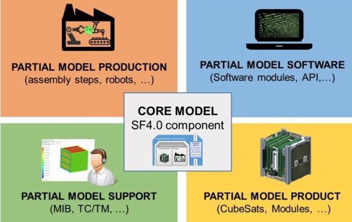

Fig. 3. An approach for Centralised Information Base (CIB)

## 4. Digital Twins

One of the key approaches of Industrie 4.0 - the Digital Twin is the digital representation of the physical product or process characterised by a seamless communication based on real-time data. The concept of the Digital Twin is particularly useful for assets with CPS, since the physical component of the CPS and its interaction with the digital component can be accurately represented and simulated. The Digital Twin represents the current state of a product or process through all phases of a PLC. In this sense, a Digital Twin differs from a simple CAD model or simulation, in that exactly one Digital Twin is unique to one instance of a physical part or process. Thus, it represents the physical part as it is built or manufactured - considering the real measured dimensions of the produced part. In last few years, much research on Digital Twins has been done [17-19]. However, most previous studies do not consider its application for space missions, especially for a Space Factory. More specifically, the traditional application of Digital Twins does not include the use of telecommands and telemetry data, which is essential for space missions. In particular, the Digital Twin as a self-contained instance needs the capability to send telecommands for executing procedures during the production or operation of its physical counterpart in the space segment as depicted in Fig. 2. Therefore, we

introduce a new concept of a Digital Twin for a Space Factory 4.0.

## 4.1 Concept of Digital Twins for Space Factory 4.0

In order to identify the requirements and functionalities for Digital Twins in this new context, we analysed the possible use cases of this concept within the aforementioned overall process. For this paper, we focus on the following three use cases:

1. Design phase - Optimisation of system behaviour by using feedback data from the operations phase;

2. Assembly phase and testing/check-out Monitoring of products current state and execution of tests during the assembly process

3. Operation - Monitoring, prediction and optimisation of product performance during the mission;

Subsequently, a Space Factory requires mainly the following functionalities for a Digital Twin:

- Unique identification for linking Digital Twin unambiguously to its physical counterpart;

- Instantiation and generation of Digital Twins by assembling hardware modules and their corresponding software modules that are predefined in libraries or repositories;

- Interface and seamless communication to smart products and processes aiming at permanent update and synchronisation of the Digital Twin;

- Conversion of data or information that are acquired, stored, and processed during the process of the Space Factory 4.0 into telecommands and telemetry.

The Reference Architecture Model Industrie 4.0 (RAMI 4.0) [20] motivates the concept of a Digital Twin for Space Factory 4.0 (see Fig. 4). It introduces the so called Industrie 4.0-component with the goal to model the capabilities of cyber-physical systems (CPS). As mentioned in the previous section, an Industrie 4.0 component consists of an asset and an administration shell.

According to RAMI 4.0 [20], the asset is any object that has an added value for an organisation which can be a single part, or a machine. For the Space Factory 4.0, the asset of the Digital Twin comprises further subcomponents such as the digital representation of the physical product (e.g. CubeSats as described in Section 5) as well as simulation models (e.g. Finite-Element-Analysis (FEA) and Multi-Body-Simulation (MBS)). The simulations models are directly coupled to the product and its related processes aiming to reproduce the interactions with the environment using real time data.

<!-- PDF_PAGE: 7 -->

The administration shell is the digital and active representation of an I4.0 component in an I4.0 system [20]. In other words, it consists of a manifest, embedded software and an interface. Hence, an existing object such as a component or a machine can be assigned to administration shell so that it is upgraded to an I4.0 component like Digital Twins with the capabilities to communicate and to connect with its environment [21]. The manifest is in a rigorous consistent format provided by the CIB that includes the unique identification of the component and shell, as well as the data, functions, and characteristics of each subcomponent. It is to be regarded as an unambiguous list of contents of information embodied in the administration shell [20]. The component manager is an embedded software that provides additional algorithms for controlling the subcomponents, health management, and data analysis. Through these interfaces and especially through the administration shells' interface, real-time data are exchanged between the product, simulation models in the asset, and the environment (e.g. assembly process, operation), keeping them constantly updated.

The data transfer between a Digital Twin instance and the environment and with its physical twin can be realised using internet protocols, assuming that an internet connection exists. This is suitable for all processes that take place on earth, but not in space. In addition to the concept of I4.0-Components of RAMI 4.0, the definition and use of telecommands and telemetry (TM/TC) are required components to be considered within the Digital Twins in the context of a Space Factory 4.0 for communication in space. Therefore, the definition of a Space Factory 4.0 Component (SF4.0-Component) is introduced aiming to extend the functionalities of an I4.0 component by the capability of interpreting TM/TC that are now defined in the CIB. More specifically, this functionality enables that the data or information acquired, stored, and processed within the process of the Space Factory 4.0 are converted into telecommands or telemetry. The latter realise the seamless connection, data or information exchange between the digital twin instances and its physical counterpart in space or on the ground. A benefit of our concept is that through this seamless communication and direct interface between both instances, there is no need of additional support systems to send telecommands and telemetry. As it will be described in Section 6 for an Earth Factory, sending telecommands and telemetry is necessary to receive real-time data measured during the automated integration and testing of the satellites in the space segment.

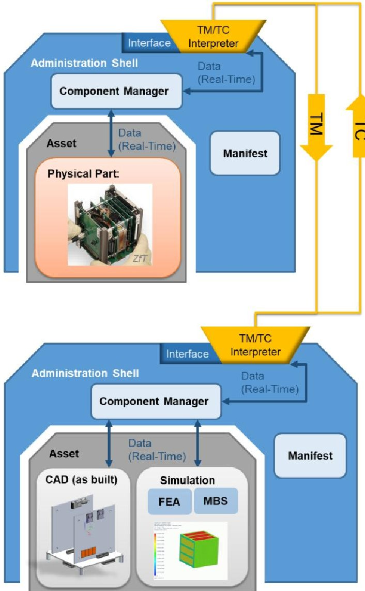

Fig. 4. Approach of Digital Twin based on RAMI 4.0. The telemetry and telecommand component is specific to the Space Factory application (top: physical twin instance; bottom: Digital Twin instance)

## 4.1 Implementation of a Digital Twin for Modular CubeSats

The prototype implementation for Digital Twins of modular satellites follows the setup shown in Fig. 4. For this paper, we focus on the demonstration of the three first functions of the Digital Twin introduced in Section 4.1. For that, the following assumptions have been made:

- Three modules for assembling the CubeSat are considered: backplane, Attitude Determination and Control System (ADCS), and On-Board Data Handling (OBDH).

- Focus on the mechanical and geometrical properties of the hardware and software of each module. Electronics are assumed to be black boxes.

<!-- PDF_PAGE: 8 -->

- The system is defined to be the Digital Twin, its physical counterpart, and their interfaces to perform communication.

One main feature of the Digital Twin based on SF4.0-components is the resemblance with the client-server-architecture. In this setup, all instances have a unique ID and are allocated to an IP-address. To realise that, the modular setup of the Digital Twin consists of:

- Asset: 3D CAD models for the product representation of the CubeSat modules backplane, ADCS, OBDH, and power. We use Siemens NX as a 3D CAD system.

- Manifest: Mainly derived from the CIB, a modular data exchange format is populated.

- Component manager: The component manager is a further development of the software system developed in [22]. It comprises of a Java program and a web app.

The web app named as Space Factory 4.0 App (SF4.0 app) fulfils various functionalities. It is an intermediary component between all components of the CIB, Digital Twin and its physical counterpart since it administrates and controls their interfaces. That means that the SF4.0 app is closely coordinated by the CIB. In addition, it is intended for further experiments, that the TM/TC interpreter is integrated on this program. The main task of the SF4.0 app is to make access to the CIB available since it provides the structure for the manifest and the reference architecture for the Digital Twin. At last, the CIB provides the SF4.0 app the fundamental structure to instantiate Digital Twins by assembling models of the hardware and its related software modules. For that, a unique ID is assigned to each Digital Twin instance and directly associated to a unique IP address. Additionally, the SF4.0 app provides a graphical user interface (GUI) for data as well as parameters input, and configuration control of the Digital Twin.

## 4.2 Preliminary results

To test our implementation, we follow some steps of the overall process Space Factory 4.0 (see Fig. 2) that are listed below:

1. Product planning step at earth segment: A costumer accesses the SF 4.0 app using a webbrowser and configures an individualised CubeSat

2. Initiation of SF4.0 components such as CIB and reference models: During the configuration, the 3D CAD model of the CubeSat is automatically generated along with their corresponding software modules

3. Instantiation of Digital Twin: as a SF4.0 component is instantiated including unique ID

4. Interface between Digital Twin Instance, Production and Testing: Update and synchronisation of the Digital Twin instance using feedback data from the assembly process.

The tests revealed that a Digital Twin is successfully generated in an automated way based on the inputs of the costumer (as shown in Fig. 5). Each configuration is assigned to a unique ID which can be accessed through the internet (e.g. web browser). Fig. 5 depicts the visualisation of instantiated Digital Twin as a 3D CAD model. Once the instance of the Digital Twin is generated, the basic information to plan and start the integration process using the setup shown in Fig. 8 is transferred to the production facility.

To test the connectivity and the synchronisation capabilities of the Digital Twin instance with its physical counterpart, we used data from functional tests of the modules during the integration steps discussed in Section 6. The functional tests inspect whether modules are working or not by powering them during their integration. For this paper, we defined Booleans (True for working or False for not working) as a data type. After the functional test is conducted, an event query is triggered and sent in real-time from the assembly process to the Digital Twin. As shown Fig. 5, this information is populated into the 3D CAD model of the CubeSat (asset). If the tests are positive, the status of the module is updated to an OK string with a green colour. If the tests are negative, it is red and additional pop-up windows notify of the failure within a module. For reasons of space, only the visualisation of the updated information is considered in this paper. A further discussion about the parameters changes within the Digital Twin will be discussed in future works. In particular, the capabilities of the Digital Twin to update CAD models and simulation models based on real-time data gathered with high frequency (>1 kHz) from the assembly and operation processes are not in the scope of this paper and will be explored in future works. Additionally, the TM/TC interpreter component of the administration shell of SF4.0-components still have to be implemented in the context of executing automated tests with Digital Twins and will be scope of future publications.

This section focused on the conceptualisation and demonstration of Digital Twin for Space Factory 4.0. As per definition, a Digital Twin is strongly associated to its physical counterpart's functionalities and properties. The following sections will introduce the design of modular satellites as well as its automated integration environment.

<!-- PDF_PAGE: 9 -->

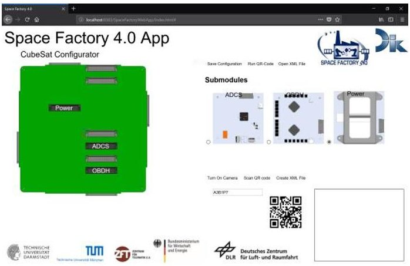

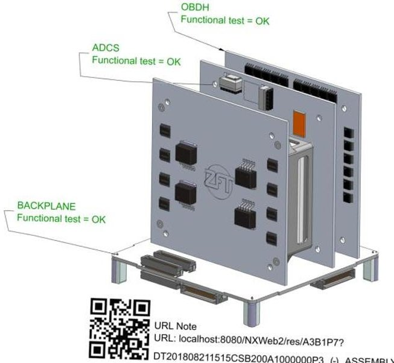

Fig. 5. App for the configuration of CubeSats and instantiations as Digital Twins (top); visualisation of the Digital Twin with updated information of the assembly station (bottom)

## 5. Design of Modular Satellites

Typically, satellites are highly complex systems, designed, built and operated as single units for one specific mission. The trend towards smaller spacecraft and the introduction of the CubeSat design specifications back in 1999 led to a paradigm shift in recent years. Intended initially to improve access to space for students and provide possibilities for fast space qualification of new products, small satellites quickly became affordable and reliable alternatives to their larger counterparts.

With more than 300 launches in 2017 [23], nanoand microsatellites (1kg-50kg) represent the major part of all operational satellites in space nowadays. Huge constellations of satellites have been announced; wellknown proposed constellations are SpaceX's 4425 satellites and OneWeb's 720 satellites for communication applications. Planet is already operating approximately 190 satellites in its Earth observation constellation [24]. Moreover, first

formations of autonomously cooperating satellites are currently being built, e.g. NetSat [25] and TOM [26]. These satellite networks significantly contribute to improve missions in the Earth observation and communication domain by their higher temporal and spatial resolution as well as their autonomous reaction capabilities. Furthermore, these missions offer a higher reliability due to their large number of satellites. If one satellite fails in such a network, the other satellites can simply take over.

While the demand for satellites is rising, automation of integration and tests can significantly shorten the overall production time and simultaneously increase the quality and reliability [27]. Especially when aiming at assembly in hazardous environments for humans - like space, remotely controlled integration or even automation is inevitable. In Space Factory 4.0 we demonstrate the automation of satellite integration and qualification testing of CubeSats to prepare for a future in-orbit factory. For this demonstration we implement technologies that are currently available on Earth along with Industrie 4.0 approaches in a so-called Earth Factory-a prototype of the future Factory in Space. Besides, this prototype also represents the ground production and testing facilities of the Earth segment of overall process Space Factory 4.0 (see Fig. 2). However, automation requires defined repeatable tasks and a modular systems design. Therefore, we evaluate CubeSat design philosophies that allow the utilisation of automation for assembly and testing.

## 5.1 Implementation details and results

Whilst CubeSats are quite popular for their affordability, they are very limited with regard to the available space for payload and subsystems. Placing parts in very narrow spaces leads to difficulties especially during integration. The frequently adopted PC/104 interface definition has several limitations. The large connector makes up 15% of the board and inter-subsystem space and the stacking principle does not offer flexibility. Due to inconsistencies in the interface implementation additional harness is often required to connect sensors to controllers and payloads to the satellite bus [28]. Knowing these limitations, we determine the demonstration of automation of assembly and test processes based on this approach to be infeasible. Therefore, we explore an alternative design approach.

The UNISEC CubeSat Interface Definition (CSID) [29] promoted by UNISEC Europe was first implemented in UWE-3, the third generation of the University of Wurzburg satellites. Launched back in 2013 and being still operational now after 5 years, this satellite bus presents clearly a robust alternative to PC/104. UNISEC is a global consortium of space

<!-- PDF_PAGE: 10 -->

engineering universities that aim on enabling students to participate in real space projects. Among others, one key issue is to establish joint standards that allow the exchange of subsystems and thus enable joint international projects. The European members of UNISEC agreed on using the CSID in their CubeSat projects and other UNISEC members already implemented the CSID e.g. the 8 satellites in the BIRDS-1 and BIRDS-2 CubeSat constellations. The CSID is based on a modular system design approach with modular subsystems connected to a backplane which offers scalability and redundancy. For example, if a satellite requires more power, it is possible to connect further electronic power systems (EPS) to the bus, without any adaptions required to the rest of the satellite. This enables the individualisation of satellites based on the customer needs. The 50-pin headers require only around 9N insertion force and allow a misalignment tolerance of 0.7mm. The standard includes all required signals for operation, testing and debugging on the satellite bus with dedicated signal lines for most crucial subsystems and therefore requires no extra harnessing. The backplane based design offers access to inserted subsystems individually and provides the ability to test these subsystems already during integration. For these benefits, we decided to utilize systems based on the UNISEC Europe CSID to demonstrate the automation of integration and testing processes.

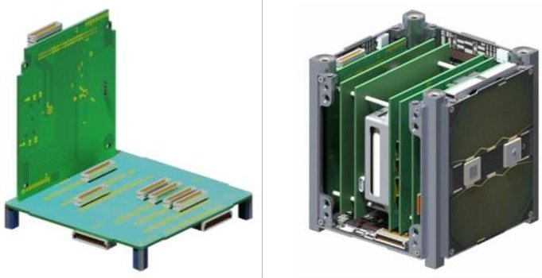

Fig. 6. Modular CubeSat Bus based on UNISEC Europe CubeSat Interface Definition with Backplane

## 6. Demonstration of automated satellite integration and tests

One objective in preparation for a future Space Factory is to demonstrate the automation of integration and testing of CubeSats based on the Industrie 4.0 processes described above. This demonstration shows what is already possible with latest technologies in an Earth Factory. The required assembly, integration and testing steps of a CubeSat implementing the described UNISEC CSID were analysed to design a demonstration concept based on available hardware

and feasibility. Regarding the integration, the most interesting and challenging task is to mount the subsystems to the backplane since it requires a very high accuracy. For this reason, the automation of such a pick and place process was selected to be demonstrated.

Several testing steps are also demonstrated. Automated general functional tests of the subsystems are performed before and during the mounting to the backplane. They show if a subsystem works as expected, both before and after integration. When the satellite is fully integrated, an automated functional test including sensor stimulation and calibration will be demonstrated using high precision motion simulators at Zentrum fur Telematik e.V.

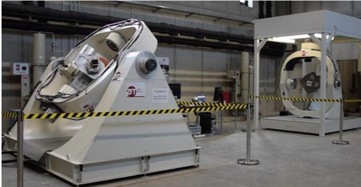

Fig. 7. High precision motion simulators at ZfT

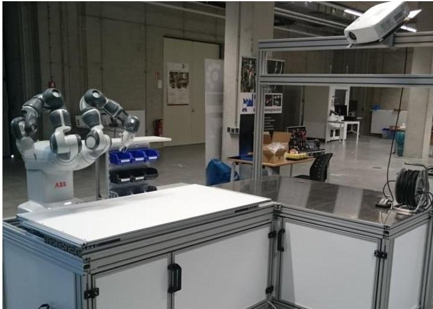

Fig. 8. Industrie 4.0 CubeSat integration environment with ABB Yumi robot and augmented reality system as human-robot-interface

During the integration and testing process the Digital Twin instance of each satellite are populated with data from the specific process, e.g. if a subsystem is working as expected or which sensor calibration parameters are measured during the automated test. The synchronisation, use, and visualisation of this data within the corresponding Digital Twin instance of a satellite is shown in Fig. 5. The representation of the whole satellite as Digital Twin as discussed in Section 4 is a huge advantage compared to the current paperbased approach in space technology. Monitoring,

<!-- PDF_PAGE: 11 -->

failure detection and identification - specifically for slowly emerging errors - and the automated creation of test reports are just some applications where the Industrie 4.0 approach will significantly improve future manufacturing.

## 6.1 Automation of satellite integration

For the satellite integration, an Earth Factory integration environment is set up. The environment consists of the collaborative ABB Yumi robot, assembly mountings, a visual inspection system and a projection-based augmented reality system as humanrobot-interface. The robot offers 7 degrees of freedom per arm and an end-effector accuracy of 0.1mm. It provides force-sensitive gripping functionality and a maximum payload capability of 0.5kg. With these specifications, the robot meets the requirements for the automated integration demonstration task.

Special attention has been directed to the gripper design. Since the UNISEC CSID is initially not developed to offer automation capabilities, there is no specific area on the surface of the subsystem PCBs where gripping is allowed. Also gripping at the edges of the subsystem is not reliable, since there is no restriction of placing parts close to the edges. However, there exist four mounting holes to connect the PCB to the structure, after the subsystems are mounted to the backplane. These holes are surrounded by a specific area, where no parts are allowed to be placed. Therefore, we developed a gripper to grip the subsystem via two of these holes, which results in precise handling of the subsystems. With this gripper, the ABB Yumi robot is able to perform the automated integration of several subsystems.

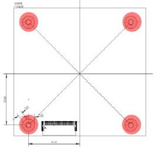

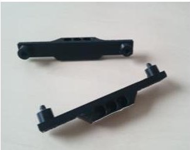

Fig. 9. Subsystem mounting holes and corresponding gripper design

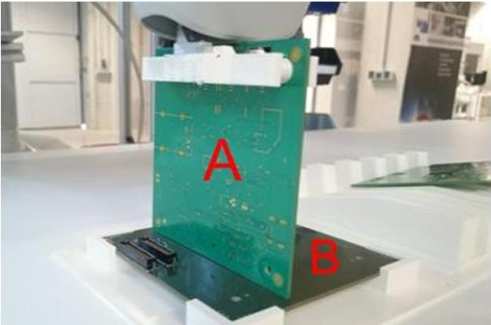

Fig. 10. Successful automated mounting of a prototype subsystem to the backplane

## 6.2 Automation of satellite testing and calibration

Several test cases are implemented before, during and after the integration of the CubeSat. The scenario for the final demonstration considering the overall process Space Factory 4.0 in Fig. 2 is the following:

After the customer decides on a specific satellite configuration that was instantiated as a Digital Twin as described in Section 4.2, the integration environment is commanded to start with the automated integration of the subsystems according to this configuration. The robot picks the first subsystem (A in Fig. 10) in the tray and moves it to the visual inspection unit. Here, the subsystem is visually analysed in order to identify the subsystem and check if human interaction is required. Then, the robot places the subsystem in a test environment, where software unit tests are performed. If these tests are successful, the subsystem is mounted to the backplane B, followed again by software unit tests. These tests ensure that the subsystem was mounted to the backplane correctly. If successful, the next subsystem is picked. Throughout all these integration and verification steps, the Digital Twin instance is constantly updated with the corresponding measurements and can command intervention from the robot in case it identifies an error in the assembly.

When the satellite is fully integrated, a mobile transportation platform is informed to pick up the satellite and move it to the motion simulators for the functional test and sensor calibration.

As soon as the satellite is mounted to the motion simulator, the motion simulator is commanded to start with the functional testing and calibration. Since the sensors of each satellite are located and aligned slightly differently due to manufacturing tolerances, each satellite is required to perform such a calibration. The motion simulator performs specific motion manoeuvres to stimulate the sensors, while the sensor output is written to the Digital Twin. The Digital Twin calculates the calibration matrix of each sensor and immediately notices misalignments or problems with functionality of the sensor. Again, the Digital Twin records all corresponding data of its physical

<!-- PDF_PAGE: 12 -->

counterpart and offers an efficient way of evaluating the measurements.

If a subsystem requires human interaction during integration, e.g. a specific part is missing and needs to be assembled, the augmented reality system informs the worker and highlights which part should be placed at which location. After the part has been assembled, the robot continues with the functional test of the subsystem. Of course, when implementing such a scenario in an orbit Space Factory, human intervention needs to be performed remotely using teleoperated robots, which is described in the next Section.

## 7. Teleoperated Robotic Assembly

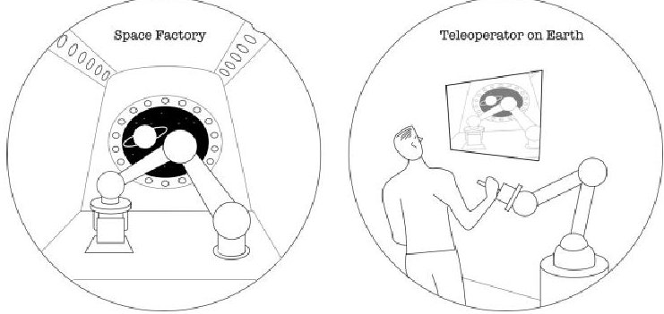

Fig. 11. Teleoperation concept. A robot in a Space Factory (left) assembles a CubeSat, guided by a human on Earth (right)

Autonomous integration and assembly are long-term goals of several planned future space missions [8]. However, two key reasons raise the need for an alternative solution to fully autonomous assembly system of a Space Factory, i.e.

1. automation cannot achieve the abstraction capabilities of humans and their level of dexterity, and

2. something may go wrong in the automation which cannot be automatically identified and rectified.

In both cases, human intervention is required to perform tasks, e.g. to realign parts, replace broken parts or unblock a jam. Instead of carrying an astronaut into space, a more pragmatic approach to this is teleoperation, in which the system in space is operated by a human from ground, see Fig. 11. Remote control or teleoperation minimally requires visual feedback for providing a good view of the operation area and the technical possibility to operate or move the (robotic) system in space. In comparison, adding haptic feedback to a teleoperation system has two benefits. First, it relieves the operator of the input (master) device from strain during challenging operation tasks since it provides remote forces and makes teleoperation more intuitive. Second, even more important, force feedback enables the operator to

control the forces that are applied on the remote (slave) site. With such feedback, even dextrous tasks with fragile parts can be accomplished.

## 7.1 Task and System Description

The assembly of a CubeSat, one of the most technically challenging tasks for teleoperation is affixing a circuit board to another by means of a 50-pin connector. The female connector is on the subsystem A, and the male connector is on backplane B in Fig. 10. As mentioned in Sec. 5.1, the allowed position tolerance for a successful mating is 0.7mm and approximately 9N of force is required to achieve the connection; the allowed angular tolerance is 2 degrees around the long axis of the connector and 4 degrees along the short axis.

To demonstrate feasibility of such teleoperation task, a telerobotic demonstrator was set-up including a DLR/KUKA lightweight robot as master and the bimanual robotic system HUG [30] as slave robot (see Fig. 13). The robot equipped with the gripper enables a stable grip which does not damage components on the circuit board while allowing sufficient force to be exerted on the connector to achieve a successful assembly. Not exceeding the maximal allowed assembly force during exerting elements is extremely important otherwise harmful strains originate on the board. We demonstrate therefore the following sequence of tasks:

1. Locating of board A

2. Gripping of board A and removal from holder

3. Locating of board B and collision-free motion of board A from holder to board B

4. Connection of board A with board B.

The teleoperation control framework was fourchannel time-domain passivity control [31], meaning that both velocity and force information was shared both from the master to the slave and vice-versa. An impedance-impedance architecture was used, meaning that forces from the master map to forces commanded at the slave Tool Center Point (TCP). In this initial implementation, time delay was not considered, however, this topic has been investigated in the framework of time-domain passivity control [32].

<!-- PDF_PAGE: 13 -->

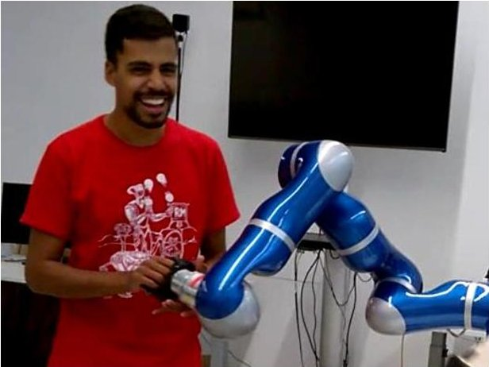

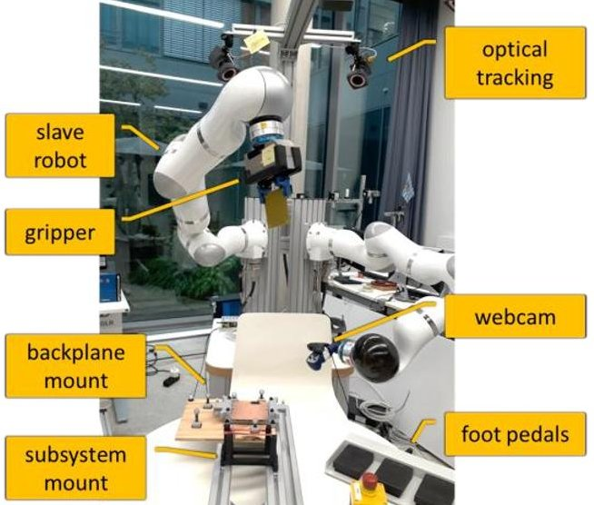

Fig. 12. Teleoperation demonstrator. A DLR/KUKA light-weight robot (top) is used as master device to teleoperate the bimanual device HUG (bottom), which is used as slave system.

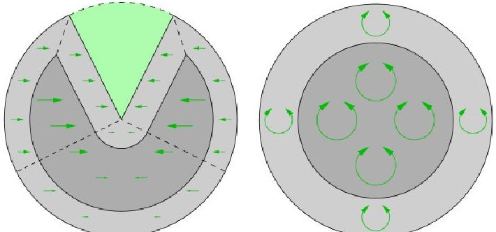

Fig. 13. Cross-sections of virtual fixtures to correct gripper position (left) and orientation (right). The green arrows indicate the strength of the forces respectively the stiffness of the rotational spring.

In order to support the human operator, virtual fixtures were implemented as shown in Fig.14 which provide guiding forces and torques to correct position and orientation of the gripper. Two fixtures were implemented: a conical virtual wall, correcting the position of the TCP and funnelling it towards the plug, and a correction for orientation, rotating the end effector of the slave robot into the orientation required

for plugging. The former gives a pure force on the TCP and the latter a pure torque.

## 7.2 Preliminary Results

In a pilot test, the usability of the virtual fixtures was investigated. To this end, a placing experiment was conducted five times for one subject with and without the support of virtual fixtures respectively. The goal was to reach a plugging position at the required accuracy just above the electric plugs. The results show the mean time without virtual fixtures was 8.0s (standard deviation 1.2s) and with virtual fixtures was 4.6s (standard deviation 0.5s). The virtual fixtures appear to improve time to reach the target position by over 40%. Further tests could reveal whether this effect is significant and what types of virtual fixtures are helpful.

## 8. Conclusion and Outlook

This paper has introduced and demonstrated key technologies necessary for building a factory in space. Our concept, Space Factory 4.0, aims at rapid, on-demand satellite assembly on an in-orbit platform. To this end, an overall process using Industrie 4.0 approaches has been established with the objective to explore the potentials of NewSpace (e.g. efficiency, on-demand production, and new business models) while taking into account the current needs of the space industry (e.g. one-of-a-kind products). A tool of growing importance in Industrie 4.0, the Digital Twin, has been discussed with respect to its application and benefits for space missions. The use case of our Space Factory concept is the production of small satellites. We therefore discussed the modular design of small satellites for automated assembly using robots, their integration in the overall process and how the Digital Twin can help with the entire product life cycle from ordering, customised production, and real-time monitoring during production and use. One application of the Digital Twin in this context is to recognise defects for pre-emptive maintenance. We demonstrated, on an Earth Factory, the technologies necessary to automate the integration and testing of CubeSat modules, which can be transferred onto an in-orbit platform. In order to provide additional support and overcome the limits of automation during assembly, we introduced and demonstrated new strategies for teleoperated robotic assembly.

Our study provides the basis for a new paradigm in the space industry. Here we list the most important findings of this work as well as topics for future research:

<!-- PDF_PAGE: 14 -->

- An overall process for a Space Factory has been established exploring the capabilities of Industrie 4.0. These enable a more agile reaction to customised configurations and requirements of satellites and their on-demand manufacturing. The approach presented in this paper can be used for the establishment of business processes. Future works will detail the current approach in respect of its subprocesses and their technical details.

- The proposed concept for a CIB provides a reference architecture and represents the foundation of the Digital Twin approach as well as its related support systems. In practice, it is a platform providing individual tools and information for every step of the overall process Space Factory 4.0. The approach of the CIB is very promising. However, due to its complexity, a full implementation of the CIB is outside the scope of our conceptual study.

- The proposed concept of a SF4.0 component to establish Digital Twins for a Space Factory 4.0 aims at accurate digital representation and simulation of a physical component of the CPS. The novelty of our concept is the consideration of TM/TC, which is fundamental to realise a seamless connection for data or information exchange between the digital twin instances and its physical counterpart in space or on the ground. We are currently in the process of demonstrating the TM/TC functionality with the Digital Twins to perform automated tests.

- The Digital Twin provides a platform for a constantly updated documentation of the whole life cycle of satellites that can be used for health monitoring, prediction, and optimisation of product performance. Lastly, Digital Twins provide a framework for simulating extreme conditions in realistic scenarios without the need for complex expensive experiments or test procedures. One challenge of implementing Digital Twins is their complexity in respect of the level of detail necessary to achieve these objectives. Future work should extend our concept to consider, for example, the electrical part of the Digital Twin.

- Automation of the satellite integration and testing significantly shortens production cycles, reduces cost and simultaneously improves quality. Furthermore, automation enables the production of satellites in hazardous environments.

- Automation requires a modular satellite design without wire harness but connectors with certain minimum misalignment tolerances. Satellites that implement the UNISEC Europe CSID enable the automation of the integration process as demonstrated in this paper. However further

research is required for a full integration of a CubeSat based on this design. Future work is also required on what will be available on such a factory in space e.g. 3D-printer filament or assembled subsystems and how these will be brought to space.

- Teleoperation is a valuable tool for the space manufacturing process. Monitoring the system via a Digital Twin could automatically identify malfunction situations where human input via teleoperation is required, and support in such situations the human e.g. by improving placement and parameterisation of virtual fixtures.

- One challenge that has been addressed but is yet to be tested is time delay - communication with space results in a considerable latency. The framework in [33] can account for this, but further tests are necessary to see how control can be shared between the virtual environment (i.e. virtual fixtures) and the force-feedback from the real environment. Depending on the available communication bandwidth and the complexity of the task, more or less autonomy may be required on the slave side.

- Our approach (telepresence) implies a low level of autonomy of the slave. Alternative teleoperation concepts give more autonomy to the slave robot, such as supervised autonomy [34], and can reduce bandwidth, cope with large delays and unreliable communication, and be used even by untrained operators due to an intuitive command framework. However, the master cannot precisely control movements of the slave. In a real space manufacturing scenario, it would be advantageous to be able to adjust the level of autonomy from full autonomy over supervised autonomy to manual control (telepresence) with the support of virtual fixtures.

The basic concepts and technologies necessary for a Space Factory introduced in this paper are only the first step towards realizing it in a near future. Various research questions must be tackled before such Space Factory can become reality. One of the most important points, however, concerns the structure and mechanical design of such a factory in orbit. A Virtual Space Factory may contribute to support the design process with regard to modelling and simulation of the production process.

## Acknowledgements

The results presented here were achieved within the framework of the Space Factory 4.0 project funded by German Aerospace Center (DLR) and the Federal Ministry for Economic Affairs and Energy (BMWi).

<!-- PDF_PAGE: 15 -->

List of references

[1] Spaceflight Industries - Launch pricing information,http://spaceflight.com/schedule- pricing/#pricing

[2] M. Napoli, J. Kugler, M. Snyder, "The Additive Manufacturing Facility: One Year on the ISS National Lab", Proceedings of the ISS Research and Development Conference, 2017

[3] The New Hightech-Strategy for Germany. http://www.hightech-strategie.de/de/The-new-High Tech-Strategy-390.php - access: August 13th, 2016

[4] W. Dorst, A. Scheibe, C. Glohr, T. Hahn, F. Knafla, and U. Loewen (n.d.). Plattform Industrie 4.0: Umsetzungsstrategie Industrie 4.0 (2015).

[5] R. Skomorohov, A. Hein, and C. Welch, In-orbit Spacecraft Manufacturing: Near-term Business Cases. 67th International Astronautical Congress (IAC), Guadalajara, Mexico, 26-30 September 2016.

[6] A. E. Trujillo, M. T. Moraguez, S. I. Wald, A. C. Owens, and O. L. de Weck, Feasibility Analysis of Commercial In-Space Manufacturing Applications, AIAA Space Forum (2017).

[7] Cubesat Electrical Interface - University Space Engineering Consortium. Unisec-europe.eu. (2018). Available at: http://unisec-europe.eu/standards/bus/ [Accessed 17 Sep. 2018].

[8] International Space Exploration Coordination Group (ISECG), The Global Exploration Roadmap, 3rd edition, (2018). [online] Available at: https://www.nasa.gov/sites/default/files/atoms/files/ger_2018_small_mobile.pdf (Accessed 17 Sep. 2018).

[9] W. Ley, K. Wittmann, and W. Hallmann, Handbook of space technology, in Aerospace Series (PEP), ed. Chichester, U.K., (2009).

[10] Eigner, M. and Stelzer, R., Product Lifecycle Management: Ein Leitfaden für Product Development und Life Cycle Management. Berlin, Heidelberg, (2009).

[11] G. Pahl, W. Beitz, J. Feldhusen, and K.-H. Grote, Engineering Design - A Systematic Approach. Springer-Verlag London (2007).

[12] W. Eversheim, Simultaneous Engineering: Erfahrungen aus der Industrie für die Industrie. Springer, Berlin (1995).

[13] T. Uhlig, F. Sellmaier, and M. Schmidhuber, Spacecraft Operations. Springer Vienna, (2014).

[14] P. P.-S. Chen, The entity-relationship model toward a unified view of data, ACM Trans. Database Syst., vol. 1, no. 1, pp. 9-36, 1976.

[15] S. R. Schach, Object-Orientated Software Engineering. MC Graw Hill, 2008.

[16] C. Rupp, S. Queins, and B. Zengler, UML 2 glasklar: Praxiswissen für die UML-Modellierung. Hanser, 2007.

[17] E. H. Glaessgen and D. S. Stargel, "The Digital Twin Paradigm for Future NASA and U.S. Air Force Vehicles," in 53rd AIAA/ASME/ASCE/AHS/ASC Structures, Structural Dynamics and Materials Conference 20th AIAA/ASME/AHS Adaptive Structures Conference 14th AIAA, 2012: American Institute of Aeronautics and Astronautics.

[18] E. Negri, L. Fumagalli, and M. Macchi, "A Review of the Roles of Digital Twin in CPS-based Production Systems," Procedia Manufacturing, vol. 11, no. Supplement C, (2017) 939-948.

[19] R. Rosen, G. von Wichert, G. Lo, and K. D. Bettenhausen, "About The Importance of Autonomy and Digital Twins for the Future of Manufacturing," IFAC-PapersOnLine, vol. 48, no. 3, (2015) 567-572.

[20] DIN Spec 913456 - Reference Architecture Model Industrie 4.0 (RAMI4.0), 2016.

[21] R. Anderl, "Industrie 4.0 - Digital Transformation in Product Engineering and Production," in Conference: 21st International Seminar on High Technology - Smart Products and Smart Production, Piracicaba (SP), Brazil, 2016.

[22] T. Weber Martins, K. Albrecht, and R. Anderl, "Web-based Application for Algorithm Based Product Development Process of Integral Bifurcated Sheet Metal Parts," in ASME 2016 International Design Engineering Technical Conferences and Computers and Information in Engineering Conference, Charlotte, NC, USA, 2016, vol. Volume 1B: 36th Computers and Information in Engineering Conference: ASME.

[23] C. Williams, B. Doncaster, J. Shulman, "Spaceworks 2018 Nano/Microsatellite Market Forecast, 8th Edition", http://www.spaceworkscommercial.com/, 2018

[24] L. Leung, V. Beukelaers, S. Chesi, H. Yoon, D. S. Walker, J. Egbert, "ADCS at Scale: Calibrating and Monitoring the Dove Constellation", 32nd Annual AIAA/USU Conference on Small Satellites, Logan, UT, USA, 2018

[25] K. Schilling et al., "NetSat: A Four Pico/NanoSatellite Mission For Demonstration Of Autonomous Formation Flying, 66th International Astronautical Congress (IAC), Jerusalem, Israel, 2015

[26] K. Schilling et al., "TOM - A Pico Satellite Formation For 3D Earth Observation", Small Satellites, System & Services Symposium (4S) Symposium, Sorrento, Italy, 2018

[27] O. Ruf, S. Busch, S. Dombrovski, K. Schilling, "Challenges and Novel Approaches for Testing Large Numbers of Small Satellites", 68th International Astronautical Congress (IAC), Adelaide, Australia, 2017

[28] S. Busch, K. Schilling, "Standardization Approaches for Efficient Electrical Interfaces of CubeSats", Small Satellites, System & Services Symposium (4S) Symposium, Valletta, Malta, 2016

<!-- PDF_PAGE: 16 -->

[29] University Space Engineering Consortium (UNISEC) Europe, "CubeSat Subsystem Interface Definition", http://www.unisec-europe.eu

[30] T. Hulin, K. Hertkorn, P. Kremer, S. Schatzle, J. Artigas, M. Sagardia, F. Zacharias, and C. Preusche, The DLR bimanual haptic device with optimized workspace, in IEEE International Conference on Robotics and Automation (ICRA), 2011, pp. 3441- 3442.

[31] J. Artigas et al., Time domain passivity controlbased telepresence with time delay, in Proc. of the 2006 IEEE/RSJ International Conference on Intelligent Robots and Systems.

[32] J. Artigas, R. Balachandran, M. De Stefano, M. Panzirsch, R. Lampariello, A. Albu-Schäffer, J. Harder, J. Letschnik, Teleoperation for on-orbit servicing missions through the ASTRA geostationary satellite. In IEEE Aerospace Conference, pp. 1-12, 2016.

[33] J. Artigas, Time Domain Passivity Control for Delayed Teleoperation, 2014 (Doctoral Thesis) [34] N. Y. Lii, D. Leidner, A. Schiele, P. Birkenkampf, B. Pleintinger, R. Bayer, Command Robots from Orbit with Supervised Autonomy: An Introduction to the Meteron Supvis-Justin Experiment. In Conference: 10th ACM/IEEE International Conference on Human-Robot Interaction (HRI 2015) At: Portland, USA (2015).