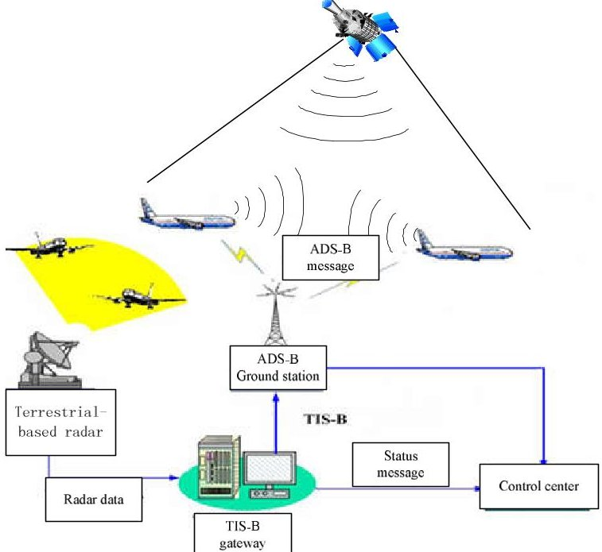
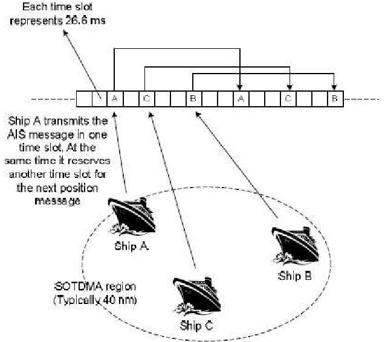
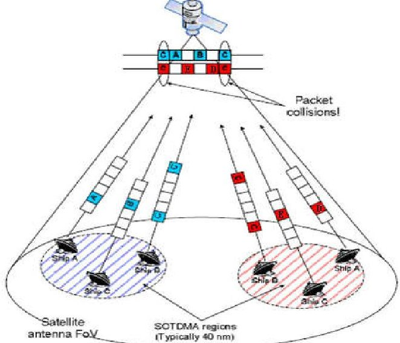
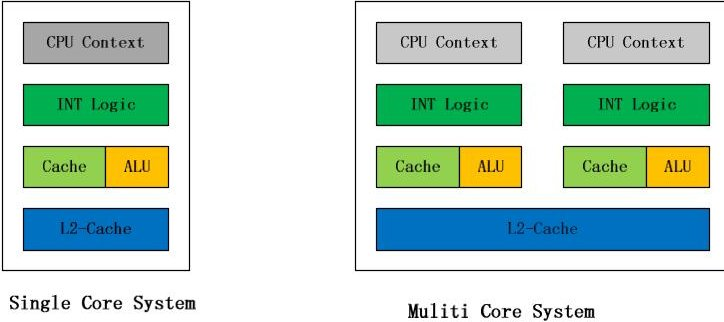
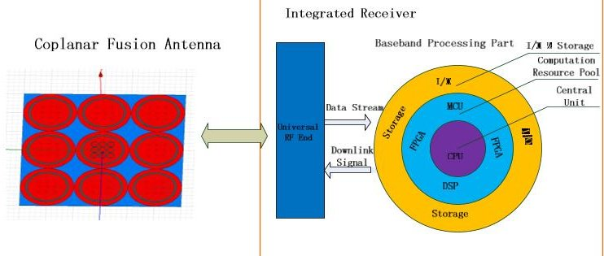
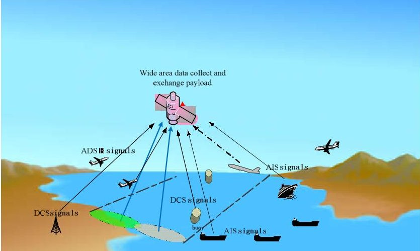
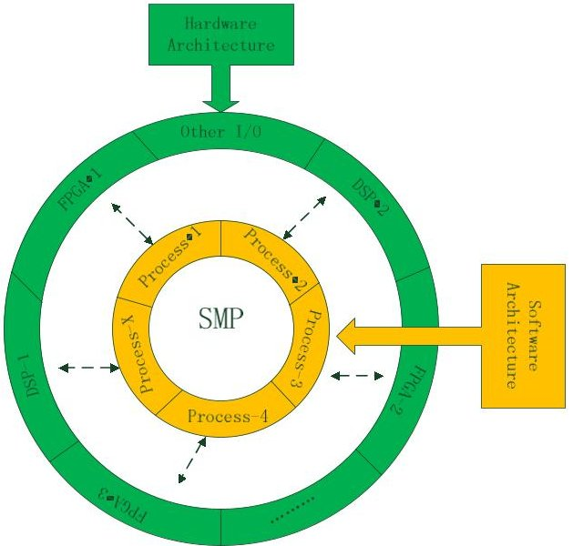
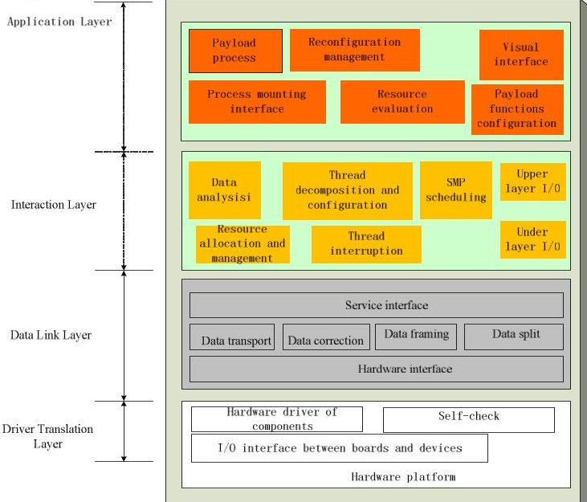
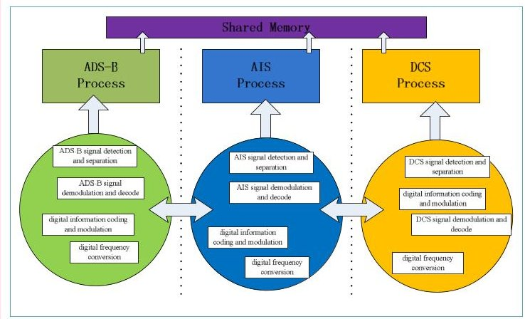
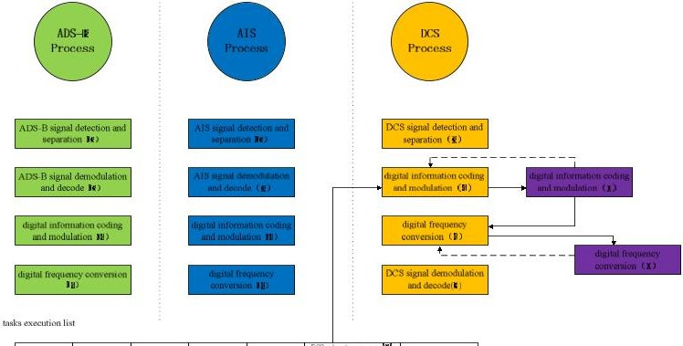

<!-- PDF_PAGE: 1 -->

IAC-18-F1.2.3

# THE RESEARCH ON SYSTEM ARCHITECTURE SUITED TO INTEGRATED PAYLOADS BASED ON OPERATION SYSTEM CONCEPT Wu Xiaodan $ ^{a} $ $ ^{*} $ , Shuang Xiaochuan $ ^{b} $ , LiuWeiliang, HuangYi, WanYin

a Shanghai Aerospace Electronic Technology Institute, 1777#, ZhongChun RD, Shanghai, China, wuxiaodan216@gmail.com

b Shanghai Aerospace Electronic Technology Institute, 1777#, ZhongChun RD, Shanghai, China, shuangxiaochuan@163.com

## Abstract

With various micro satellites and nano satellites put into the aerospace market, the functions and applications of satellite payload becomes more and more complex. Except of the traditional payloads in communication, navigation and remote sense fields, data collection and exchange payload like ADS-B, AIS, DCS, is becoming more important and showing high commercial value in the international market. According to their application fields, there are three types of data collection and exchange payloads: 1. ADS-B (Automatic Dependence Surveillance Broadcast), collect the signals transmitted from civil aircraft itself, to locate and surveillance the planes on real time; 2. AIS (Automatic Identification System), collect the signals transmitted from ships, to locate and surveillance the planes on real time; 3. DCS (Data Collection System), collect the signals transmitted from buoy and other data gather equipment, to locate them and surveillance various environment parameters. However, since the payloads above have their own working frequencies, signal systems, and processing methods, generally they need multiple and independent satellite systems to work effetely on orbit, which cost is very high. Furthermore, since the data comes from different orbits and satellite systems, the data application is fragmented. This paper dedicated to digging out the intersection and common characteristics among above data collect and exchange payloads, proposes a new all-in-one wide area data collect and exchange payload which synthesizes the functions and features of ADS-B, AIS and DCS with one uniformed, general hardware and software platform. It resolves the hardware problem of receiving the different frequencies, different signal systems by applying software define radio (SDR) technology and coplanar antenna; and introduce the operation system concept of SMP technology(symmetrical multi-processing), which can treat different subsystems as multi processes, and allow them share the common hardware resources like CPU, FPGA, DSP, by utilizing this technology, it can distributed the multiple functions of ADS-B, AIS and DCS on multi hardware cores like CPU and FPGA and make them worked as one stand-alone device. Since introduced the operation system concept, the software layer of the system regard the hardware layer as an entity, no matter receiving or transmitting, it is just one thread in the process, thus the system can scientifically and orderly distribute system slot to process the mission without damage the whole system.

Keywords: integrated payload, SMP, SDR

## 1. Introduction

With various micro satellites and nano satellites put into the aerospace filed, the functions and applications of satellite payload becomes very complex. Except of the traditional payloads in communication, navigation and remote sense fields, data collection and exchange payload like ADS-B, AIS, DCS, pushed by ICAO/IMO hardly, is becoming more important and showing high commercial value in the international market. According to its application filed, there are three types of data collection and exchange payloads:

a.ADS-B (Automatic Dependence Surveillance Broadcast), collect the signals transmitted from civil aircraft itself, to locate and surveillance the planes on real time;

b. AIS (Automatic Identification System),

collect the signals transmitted from ships, to locate and surveillance the planes on real time;

c. DCS (Data Collection System), collect the signals transmitted from buoy and other data gather equipment, to locate them and surveillance various environment parameters.

This paper dedicated to digging out the intersection and common characteristics among the data collect and exchange payloads, propose a new system model called "integrated data application payload" as an integrated payload which unifies ADS-B, AIS, DCS functions in one single receiver.

The payload resolves the signal receiving problems for different frequencies and systems by applying SDR technology and coplanar fusion antenna, and introduce the SMP concept in operation

<!-- PDF_PAGE: 2 -->

system, indicate the ADS-B, AIS and DCS functions as "process" on system level, distribute the function among hardware group, make the payload worked as one stand-alone device.

The payload with this structure can implement most types of payloads' functions simply through mounting the payload application software module on its operation system without any change of the hardware; therefore, the payload can mount and integrate multi-payload functions according to the size of its hardware resource pool, reducing the hardware cost and system weight, expanding its application platform and scene, playing vital role in the on orbit reconfiguration system.

## 2. Working principal of integrated data application payload

The payload fuses ADS-B, AIS and DCS functions in one device through SDR platform and SMP technique. This part will illuminate the signal system and working principals of these three types of payloads, and introduce what is SMP.

## 2.1 Working principal of satellite borne ADS-B payload

The working principal of terrestrial-based ADS-B payload showed in figure 1. ADS-B system is a burst communication system(usually utilizes 1090 Extended Squitter link), flight borne ADS-B device receive the GNSS signal, locate the position of itself, and then broadcast its own ID, position, altitude, speed, direction and other flight data by certain rate. All the planes around and the ground station can receive the broadcast data, and the plane transmitting data can also receive other planes' data, so planes can see each other in same airspace, this technology can obviously promote the safe and efficiency for the flight mission. $ ^{[1]} $

Satellite borne ADS-B payload has obvious differences with terrestrial-based system. It remains the equipment on the planes but utilizes LEO satellites to receive 1090ES signals. Satellite coverage area contains a large amount of planes, Collisions of signals are quite severe in this situation. $ ^{[2]} $

To maximize the efficiency of the space-borne ADS-B system, it needs multiple beams to cover its field range, isolate the collision signals from the antenna. (e.g. Iridium Next equipped with ADS-B receivers have multiple beams)

Fig. 1. Working principle of ADS-B system

## 2.2 Working principal of satellite borne AIS payload

The AIS communication system was developed to provide identification and location information to vessels and shore stations with the aim of exchanging different type of data including position, identification course, speed and others.

The AIS broadcasts information (data) in small slots of 26.67 ms (see Figure 2). In each of these slots a message of 256 bits is transmitted at a rate of 9600 b/s using a binary GMSK modulation over two VHF carriers. The AIS system has a limitation in its range of coverage. Each SOTDMA (Self Organized Time Division Multiplex Access)-region is designed to cope with path delays not longer than 12 bits, which translates into a maximum range of about 200 nautical miles, but typically the radio frequency coverage is limited to about 40 nautical miles. Within this range all the ships in visibility transmit with the SOTDMA protocol which ensures that collisions are prevented from bursts (messages) transmitted by different ships. $ ^{[3]} $

<!-- PDF_PAGE: 3 -->

## Fig. 2. Diagram of AIS system working coverage

However, the coverage of space-borne AIS payload usually covers dozens of SOTDMA regions, thus the slot collisions of signals cannot be avoided, showed in figure 3. The slot collisions mean that:1. Multiple vessels transmit signals in one slot time that cause completely or partly overlapped when these signals arrived in the satellite; 2. Multiple vessels transmit signals with different time slots, these signals might also be partly overlapped since different distance cause different time delay. $ ^{[4]} $

Fig. 3. AIS time slot conflict diagram

## 2.3 Working principal of satellite borne DCS payload

Space borne DCS system usually composed by three parts of terminals: space terminal, terrestrial terminal and user terminal. The measurement sensors distributed in ground and ocean are called DCP (data collect platform), space terminal is the transparent or delayed reaper satellite, and terrestrial terminal is a process system composed by some gateways and central station. The measurement sensors transmit the environment information of forest, weather, ocean, etc. to the space terminal via VHF and L band channels. The space borne payload collect these information on the satellite, in one hand it transponds the signals to the gateways in real time or delayed, the other hand it broadcast these data through the downlink of the satellite, provide various service as short message. $ ^{[5]} $

## 2.4 Working principal of SMP ( Symmetric Multi-processor ) technology

In one computer system with multiple CPUs, each CPU synchronous performs a copy of the operating system, and sharing the system bus, memory, I/O and etc. resources, such a system is called SMP. $ ^{[6]} $

Fig. 4. Schematic diagram of single core/multi-core SMP system

In this architecture, although it utilizes multiple CPUs, their performance is like one whole unit from the management view, system symmetrically distributes the missions among multiple CPUs, thus greatly improve the data processing ability and efficiency of the whole system.

The technology cannot only run on the computer system, can also further extend and expand to the single hardware structure including the CPU, DSP and FPGA. In this structure, operation system is loaded on CPU, treat all the arithmetic units like FPGA, DSP, MUC as a share of system resources and deploy them with some strategy.

## 3. Design and implementation of integrated data application payload

## 3.1 System composition

Integrated data application payload receives signals of airborne ADS-B, ship borne AIS, and all kinds of DCPs (data collect platform), through the SDR technology and coplanar fusion antenna, implements the integrated design of ADS-B system, AIS system, and DCS system. As a result of the adoption of large number of digital synthesis technology, the system is relative simple, which is only composed of integrated VHF/L band antenna and receiver, showed in figure 5.

Fig. 5. Schematic diagram of system composition

## 3.1.1 Coplanar fusion antenna

The antenna consists of an L-band and VHF-band coplanar antenna array, its beams are formed by DBF technology, receiving and transmitting the ADS-B, AIS and DCS signals.

3. 1.2 Integrated receiver

<!-- PDF_PAGE: 4 -->

The receiver comprises some universal digital RF ends, a central-control unit, an computation resource pool, I/O and storage module, and a power supply module.

a. Universal digital RF utilizes SDR technology, can transfer the multi-bands microwave signals received from the antenna to zero intermediate frequency baseband signals directly, and modulate the downlink signals for transmission according to the system need.

b. The structure of baseband processing part is shown in the figure above, which is concentric circular structure. The core part of the CPU is the central unit, to undertake the operation system, and distribute the arithmetic resource, response the system interrupt, allocate the time slot according to the system requirement scientifically. Arithmetic resource pool is referred to all the processor of the system, including but not limited to the FPGA, DSP, CPU, etc., they are in the operating system level is seen as a unified processor, the resource pool is the main body of system processing. The outmost is the I/O and storage ring, which is responsible for the data storage and exchange to outside equipments.

the operation system lies in the centre unit of baseband processing part has three separate processes, respectively ADS-B signal processing, AIS signal processing, and DCS signal processing, the three processes are independent and separately process the missions, but obey and respond to the operation system scheduling and disruption. Threads are set under the separated processes, which are the basic unit of signal processing in the operation system.

ADS-B process mainly complete the mission of ADS-B signal demodulation and communication task, contains the threads of ADS-B signal detection and separation, ADS-B signal demodulation and decode, digital information coding and modulation, digital frequency conversion, obtain the planes' data and communicate with them.

AIS process mainly complete the mission of AIS signal demodulation and communication task, contains the threads of AIS signal detection and separation, AIS signal demodulation and decode, digital information coding and modulation, digital frequency conversion, obtain the vessels' data and communicate with them.

> DCS process mainly complete the mission of DCS signal demodulation and communication task, contains the threads of DCS signal detection and separation, DCS signal demodulation and decode, digital information coding and modulation, digital frequency conversion, obtain the DCPs' data and communicate with them.

d. Arithmetic resource pool is an unified entity consisted by the computing units like FPGA, DSP MCU, they connected with each other and link to the

central unit, similar to the concept of "cloud". The resource pool is recognized as a whole computing unit in the operation system level, responding to the scheduling of different processes and threads. Resource pool can dynamically allocate the computing resources between different processes and threads by sharing memory to optimize system performance.

e. I/O and storage ring includes large-capacity on board storage and external data interfaces, transmitting or storing the result data from the arithmetic resource pool.

f. as shown in figure, the working diagram of the Integrated data application payload with coplanar antenna.

Fig. 6. Work diagram of integrated data application payload

## 3.2 System architecture

Different from the traditional payload system which the hardware and software are separated, the integrated data application payload utilizes SMP technology to implement the multitask scheduling in the system level, carry on high priority preemption policy to processes and threads, allocate the system computing resource dynamically. This strategy makes seamless fusion of the multi payloads functions becoming possible. Furthermore, since it is dynamic operation system, we can update the arithmetic module, load new payload function module, and upgrade the advanced algorithm in orbit to meet the needs of future missions.

The hardware and software architecture of the system can be regarded as a double ring structure, as shown in the figure 7. The software layer takes SMP scheduling as the core and builds the process according to payload functions that needs to be integrated; hardware layer is mainly composed of FPGA for large-scale parallel computation and DSP for floating-point operation, while retaining the access interface of other function chips.

<!-- PDF_PAGE: 5 -->

Fig. 7 General system architecture

Each process of the hardware is not fixed before the system is running; the operation system firstly evaluates operational resource required for each process, and then allocates the resource according to the mission needs, at last the bottom software layer transit the resources to the corresponding hardware. The structure of operation system showed below.

Fig. 8 operation layers of the payload software

Driver translation layer: this layer serves as underlying structure, including the hardware driver that loads all the components on the print plate, as well as all communication drivers of I/O ports. This layer ensures the normal operation of all hardware devices, and provides self-inspection of starting up and ability of results report;

Data link layer: the main responsibility of this layer is to ensure the correctness of all information flow and efficiency of high speed data transmission.

Interaction layer: this layer forms a connecting link between data link layer and application layer. To the data link layer, this layer receives the data stream from

hardware directly, to the application layer on the upside, it undertakes mount, split, merge the threads under process modules which is encapsulated by the application layer, allocating the system resources and responding to the system interrupt correctly through the real-time estimation of arithmetical resource pool. At the same time, this layer is also responsible to the translation and regulating the data flow of the application layer on the underlying hardware to ensure the correct and efficient implementation of system functions.

Application layer: this layer is directly oriented to the payload system and users. Its main task is mounting process modules to the system and operating the modules directly, besides, evaluation and management of required resources is also carried out on this layer.

## 3.3 Working mode

The difficulty of integrated data application payload lies in that ADS-B, AIS and DCS are all data burst information exchange system, in other word, ADS-B, AIS and DCS all have transmission and receiving function, and the event time is random. In the cause of sharing one antenna, how to guarantee the operation efficiency of system as a whole unit, and not affected frequent transmitting and receiving request?

Integrated data application payload utilizes operation system based on SMP technology, the processes are independent with each other, and the threads under the processes have ability to communicate with each other. The system applied high priority preemption scheduling strategy, the top rank of priority is granted while the transmit processes are launched, then system pauses and maintains the current operating threads, begins processing the transmitting process request, after the transmitting request is completed, then re-run the paused threads.

System contains three processes as ADS-B, AIS and DCS, according to the resource assessment module of the application layer, resource allocation and process mount are completed in the initial stage of the system, after which each process enters the "self-locking" mode. Resources are independent between processes, and different threads are set up under processes, responsible for relevant signal processing in the process. It is shown in figure 9 below.

<!-- PDF_PAGE: 6 -->

Fig. 9 working mode of the processes structure

Each thread in the process has an initial priority level, and a priority preemption system (the highest at level 0) is implemented, which gives priority to high priority tasks and deals with the same priority tasks in parallel. Meanwhile, the priority inheritance system is set to inherit the priority to the next thread through the dynamic link pointer. The initial priority of each thread is shown below.

Fig.10 working mode of threads scheduling

In order to prevent the signal conflicts caused by the simultaneous request of transmitting tasks of the three processes, the priority of 0,1,2 level is reserved for transmitting missions. When the transmitting threads are activated, they enters self-lock mode and rejects external request, the requests from external will enter task execution list. As shown in figure 10, the signal demodulation thread of AIS is the same priority as the signal demodulation thread of ADS-B and DCS, thus the demodulation tasks of AIS, ADS-B and DCS are parallel. When the DCS short message mission with priority 0 enters to the tasks execution list, the digital information coding and modulation thread is activated and inherits priority 0 from the DCS short message mission. Since the priority is higher than the demodulation threads of AIS, ADS-B and DCS, then the threads are suspended, the data processed is hanged, system processes the DCS digital information coding and demodulation thread first and enter self-lock mode, which reject other request in tasks execution list with low priority, then passes the priority level to the digital frequency conversion thread according to the link

pointer, release system resources after high priority threads are finished, then return to the suspended signal demodulation thread of ADS-B, AIS and DCS, continue processing them.

Through applying SMP technology to implement the multi-tasks scheduling, the system satisfied the requirement of real time operation, and is capable to avoid the information loss, damage of receiving data due to the signal conflict caused by simultaneous request of transmitting tasks which is randomly happened.

Since system introduces arithmetical resource pool and evaluation protocol, which is satisfied load balance and maximizes the efficiency of system resources when multiple payload missions are operated.

## 4. Discussion

This paper discussed an integrated data application payload, which utilized SDR (software defined radio) and SMP scheduling technology. Authors have conducted a multiple source information fusion research to solve data splitting situation caused by different orbit altitude and orbit positions, and also can reduce the payload cost and size. However, there are still a few difficulties in the research that restrict the development of this kind of payload integration fusion technology, which is also the future direction of our team:

a. Efficient antenna and RF ends reuse. Due to the large span signal frequency which is from VHF band to L band, it restricts the antenna aperture and RF channels physically, thus how to manage the reuse of RF parts, and ensure the isolation of each signal frequencies is key to make integrated data feasible in engineering.

b. Implementation of arithmetical resource pool. Resource pool on the definition contains FPGA, DSP, and other computing units as a whole device, but how to effectively access to the central CPU to compute co-ordinately, it is need hardware layer and software layer cooperate to achieve.

c. Operating system using SMP technology. The operation system suited to integrated data application payload is the core of the whole device, current SMP technique is mainly based on Linux version, how to transfer to SDR platform is the next step for the work.

## 5. Conclusions

In the future, payload integration and data fusion is a trend, while integrated data application payload technology is one of examples guided by this demand. Traditional integrated payload is only the stack on the hardware, or the fusion of a few common baseband. In fact, it can still be regarded as the simple stack of several independent payload modules or print boards. The integrated data application payload introduces the SDR platform and SMP scheduling concept of operation

<!-- PDF_PAGE: 7 -->

system, thus makes optimizing configuration of the hardware resources and maximizing the system working integrity possible, and without mission conflict caused by multi-payloads functions.

The integrated data application payload technology can integrate space borne ADS-B signal surveillance system, space borne AIS surveillance system, and space borne DCS system together, to solve the data fragmentation caused by different orbit altitude and different orbit position. At the same time, it also provides a solution for reducing cost and device size on the space platform. The integrated payload can complete data collection and exchange missions of ADS-B, AIS and DCS with comparable few satellite constellation resource and hardware cost, such as plane route plan and optimization, air traffic management and safe surveillance, vessels surveillance and management, environment protection and natural resource surveillance, etc.

Meanwhile, based on the characteristic of integrated data application payload that it can output the integrated data stream on the same coordinates of time and space scales, its application can be extended to the field of composite, such as ocean-air traffic surveillance and support, providing credible big data source for city plan and traffic management, furthermore, it can also provide customized "3S"(ADS-B, AIS and DCS) data stream service, to carry on global logistics tracking, monitoring and managing air-ocean traffic, marine emergency rescue, and big data analysis for area business potentiality.

## References

[1] 贺星，广播式自动相关监视（ADS-B）接收系统关键技术研究，西安电子科技大学，2014；

[2] Kai Liu, Tao Zhang and Yang Ding, Blind Signal Separation Algorithm for Space-based ADS-B", International Conference on Mechatronics Engineering and Information Technology (ICMEIT 2016)

[3] Miguel A. Cervera, Alberto Ginesi, On the Performance Analysis of a Satellite-based AIS System, 978-1-4244-2573-0/08/$25.00 $2008 IEEE

[4] 郑琦永，星载AIS接收系统关键技术研究，西安电子科技大学，2014；

[5]宗可，曹桂兴，闫忠文，数据通信微小卫星星座系统的发展及应用，航天器工程，2011年2期， 66-71；

[6] 李锋涛，郑晓曦. 基于SMP结构的linux内核进程调度的研究[J]. 数字技术与应用, 2011, (11): 89-90; [7] Nishit Gupta, Sunil Alag,, Novel Approach for Cache Memory Simulation at Approximately-Timed TLM Abstraction Level for SMP System", 978-1-5090-1489-7/16/$31.00 ©2016 IEEE