<!-- PDF_PAGE: 1 -->

# A Model-Based Systems Engineering (MBSE) Approach for Defining the Behaviors of CubeSats

David Kaslow Consultant Berwyn, PA 19312 610-405-6685 david.kaslow@gmail.com

Laura Hart The MITRE Corporation 7515 Colshire Drive McLean, VA 22102-7508 610 389-4534 lhart@mitre.org

Bradley Ayres The Aerospace Corp. 2310 E. El Segundo Blvd. El Segundo, CA 90245 937-255-3355 x3422 bradley.ayres.ctr@afit.edu

Philip T Cahill Consultant

Bryn Mawr, PA 19010

610 787-0283

navyred@msn.com

Rose Yntema InterCAX 75 5th Street NW Suite 312 Atlanta GA 30308 404-592-6897 x101 rose.yntema@intercax.com

Abstract-This paper describes an eight-step approach for defining the behaviors of CubeSats that begins with mission requirements and ends with a functional architecture modeled as an activity hierarchy using the Object Management Group's (OMG) Systems Modeling Language (SysML). This approach could be applied to other satellite development efforts but the emphasis here is on CubeSats because of their historically high mission failure rate and the rapid growth in the number of these missions over the last few years. In addition, this approach complements the International Council on Systems Engineering's (INCOSE) Space Systems Working Group's (SSWG) efforts to develop a CubeSat Reference Model. This approach provides a repeatable, generalized method for CubeSat development teams to follow that incorporates standard systems engineering practices such as: a top-down approach, requirements analysis, use case development, and functional analysis.

This effort uses a Model-Based Systems Engineering (MBSE) approach. Some of the benefits of using an MBSE approach over a traditional document-based approach are: enhanced communications, reduced development risk, improved quality, and enhanced knowledge transfer [1]. Systems engineering artifacts produced using this approach, such as definitions of the mission domain elements, requirements, use cases, and activities, are captured in a system model which serves as a single-source-of-truth for members of the CubeSat development team.

Examples are provided throughout the paper which illustrates the application of this approach to a CubeSat development effort. Since most space missions are concerned with the generation or flow of information, the examples focus on requirements to collect and distribute mission data ending with a definition of the required system functionality to satisfy those requirements.

## TABLE OF CONTENTS

1. INTRODUCTION ...1

2. MODEL-BASED SYSTEMS ENGINEERING ...2

3. CUBESATS ...2

4. DEFINING THE BEHAVIORS OF CUBESATS...2

5. CONCLUSION...9

978-1-5090-1613-6/17/$31.00 ©2017 IEEE

APPENDICES ...13

A. COLLECT MISSION DATA USE CASE

DESCRIPTION ...13

B. DISTRIBUTE MISSION DATA USE CASE

DESCRIPTION ...13

REFERENCES ...13

BIOGRAPHY ...14

## 1. INTRODUCTION

The International Council on Systems Engineering's (INCOSE) Space Systems Working Group (SSWG) began investigating the applicability of MBSE for designing CubeSats back in 2011. The SSWG's recent effort has been focused on the development of a CubeSat Reference Model to be used by university CubeSat teams, though it could be used by any CubeSat development team. Reference [2] provides a history and interim status of that effort.

The SSWG's latest work has been on developing and incorporating use cases into the model. The initial focus is on the collection and distribution of mission data. In support of that effort, an approach was developed to define the behaviors of CubeSats that begins with mission requirements and ends with a functional architecture that satisfies those requirements. This approach does not attempt to develop an entirely new methodology. Instead, it draws from existing methodologies to provide a repeatable, generalized method for university teams to follow with the focus being on the application of this method to a CubeSat development effort.

The first step of the approach is to analyze mission requirements in order to identify use cases that fully capture the behaviors required to have a successful mission. The second step links these use cases to the appropriate mission requirements in the system model. A discussion of use cases and how they are used to refine the mission requirements is provided.

<!-- PDF_PAGE: 2 -->

The third step develops use case diagrams identifying the primary actors that invoke the use case and any secondary actors that may be involved. The fourth step develops usecase descriptions for each use case. These descriptions identify such things as preconditions, triggers, postconditions, and the scope of the use case. The fifth step captures the use-case descriptions in the system model as part of the use case specification. A discussion of use-case descriptions and how to translate these descriptions into the model and make them part of the use case specification is provided.

Use cases contain scenarios, or sequences of events, that define what needs to occur in order to achieve goal of the use case. The sixth step models these scenarios using activities and activity diagrams. The seventh step links these activities to the appropriate use cases. Modeling activities and how they are used to refine use cases is discussed.

Sections 2 and 3 provide an overview of MBSE and CubeSats. Section 4 discusses the approach for defining behaviors of Cubesats. Examples are provided throughout this section which illustrates the application of this approach. These examples are taken from the CubeSat Reference Model. Finally, Section 5 concludes the paper with a discussion of the benefits of the approach and work that remains for future efforts.

## 2. MODEL-BASED SYSTEMS ENGINEERING

Finally, activities are decomposed as necessary until the appropriate level of the system hierarchy is reached. This results in a functional architecture that defines the behavior needed in order to successfully satisfy the mission requirements. Modeling the functional architecture as an activity hierarchy is discussed.

MBSE is defined as the formalized application of modeling to support system requirements, design, analysis verification, and validation activities beginning in the conceptual design phase and continuing throughout development and later life cycle phases [1]. A traditional systems engineering approach focuses on the development of textual specifications and design documentation. This is characterized as being a "document-based" approach. In contrast, MBSE focuses on the development of a coherent system model that consists of requirements, design, analysis, and verification information and is characterized as a "model-centric" approach. In MBSE, the model serves as a single-source-of-truth for the development team and is the primary artifact produced by systems engineering activities Documentation becomes secondary and is generated from the system model.

In comparison to the traditional approach, MBSE provides a more rigorous method for capturing, integrating, and maintaining outputs of systems engineering activities. The benefits of using this model-centric approach include: enhanced communications, reduced development risk improved quality, and enhanced knowledge transfer [1].

Reference [1] states that a MBSE method is a method that implements all or part of the systems engineering process and produces a system model as one of its primary artifacts. The approach here focuses on the requirements analysis and functional analysis parts of the systems engineering process. The artifacts produced are intended to be parts of a larger CubeSat model.

## The Systems Modeling Language (SysML)

SysML is commonly used in MBSE [3]. It is a graphical modeling language developed by the Object Management Group (OMG) to be used for modeling a wide range of systems engineering problems. It is not dependent on any single systems engineering method and is intended to support multiple methods. It is well-suited for specifying requirements, structure, behavior, allocations, and constraints on system properties to support engineering analyses. References to SysML are made throughout this paper. Reference [1] provides a thorough description of SysML and how it may be applied to modeling systems.

## 3. CUBESATS

The CubeSat concept goes back to 1999 with the work of Robert Twiggs at Stanford University and Jordi Puig-Suari at the California State Polytechnic University. The idea was to develop a design for an inexpensive small satellite that could be built by students in a relatively short period of time and launched at a low cost. The result was a CubeSat engineering design standard that was based on a 10 x 10 x 10 cm cube that had a volume of 1 liter and a mass of 1.33 kilograms or less. This standard CubeSat became referred to as a one unit, or 1U. CubeSats are scalable in 1U increments with 3U CubeSats becoming very common. There are deployment systems available today that can accommodate up to a 27U CubeSat.

CubeSats have effectively taken over the university-class launch space [4]. In 2013, approximately 75% of the university-class missions were CubeSats [5]. When launch failures are factored out, the failure rate of university missions approaches 50% [5]. Reference [6] states that the design effort for university CubeSats has largely been based on intuition. The rapid growth of CubeSat missions combined with historically high failure rates indicates a need for rigorous systems engineering practices to be applied to university CubeSat missions. In response to this need, the next section presents a MBSE approach to defining the behaviors of CubeSats.

## 4. DEFINING THE BEHAVIORS OF CUBESATS

## Starting Point-CubeSat Mission Requirements

Requirements are a primary focus in the systems engineering process because its primary purpose is to transform them into a design [7]. It is not surprising then that many life cycle models show the process beginning with requirements [8]. The approach presented here is no different and starts with a well-defined set of mission requirements. Emphasis here is on a "well-defined" set of requirements which is

<!-- PDF_PAGE: 3 -->

absolutely critical for the success of the mission. References [9] and [10] discuss methods for developing a well-defined set of requirements.

The fundamental concern of most space missions is the generation or flow of information [11]. Whether the mission involves taking an image of the Earth, measuring space weather phenomena, or demonstrating advances in new technologies like microthrusters, the CubeSat mission enterprise must be capable of collecting the required mission data and ensuring that data is distributed to those who need it. This leads to the development of the two example mission requirements shown in Table 1. Teams would naturally modify these generic requirements to specify the actual mission data collection and distribution requirements for their unique mission. For example, for the FireSat II mission discussed in Reference [11], the "Distribute Mission Data" generic requirement would be modified to meet the criteria defined in References [9] and [10] to be "The FireSat II system shall be capable of distributing interpreted wildfire data to up to 500 fire-monitoring offices and 2,000 fire rangers worldwide."

In SysML, requirements can be shown in different ways. One way is to use a requirements diagram to show the requirement as shown in Figure 1 and discussed in Step 2. SysML also supports the use of tables to represent requirements and their properties as shown in Table 1. A standard requirement in SysML has two properties: a unique identifier (ID) and a text requirement (Text). CubeSat mission requirements are captured in a CubeSat model using a table like the one below.

Table 1. CubeSat Mission Requirements

<table border="1"><tr><td>ID</td><td>Name</td><td>Text</td></tr><tr><td>1</td><td>Collect Mission Data</td><td>The CubeSat Mission Enterprise shall collect mission data required to satisfy the need of the mission data user.</td></tr><tr><td>2</td><td>Distribute Mission Data</td><td>The CubeSat Mission Enterprise shall distribute mission data to all mission data users that require that data.</td></tr></table>

## Step 1 - Analyze Mission Requirements to Identify Enterprise-level Use Cases

Use cases describe the functionality of a system in terms of how it is used to achieve the goals of the various users [1]. These users are described by actors that represent individuals or external systems that interact in some way with the system [12]. Identifying use cases first involves identifying actors that will use the system, and then identifying what those actors want the system to do [12, 13]. Use cases are a common way to capture system requirements and are used in many different methodologies such as the Object-Oriented Systems Engineering Method (OOSEM)

[1], the SYSMOD approach [14], and the Rational Harmony process [15].

The requirements in Table 1 are analyzed in order to identify potential actors. Both of the above mission requirements make reference to the role of a mission data user. Mission data users use the CubeSat enterprise to collect and distribute mission data so that their goal of obtaining needed data may be satisfied. This leads to the identification of two enterprise-level use cases: Collect Mission Data and Distribute Mission Data. An alternative approach would be to derive the use cases directly from the mission requirements as is done in OOSEM [1].

In SysML, use cases are represented by an oval with the name of the use case placed inside. The use cases for Collect Mission Data and Distribute Mission Data are captured as model elements as shown in Figures 1 and 2 below which are discussed in the next sections.

## Step 2 - Define the Relationship between Mission Requirements and Enterprise-level Use Cases

Up to this point, mission requirements have been defined and use cases identified but the relationship between the two has not been established. A commonly held view is that a use case is a refinement of a requirement [1,3,16]. A refine relationship in SysML is used to reduce ambiguity in a requirement by relating it to another model element that clarifies the requirement [1]. It conveys that the model element at the client end, a use case, is more definitive than the abstract element at the supplier end, a requirement. Reference [3] states that a use case provides detail and clarity that a text requirement by itself cannot express. Likewise, Reference [1] states that a text-based functional requirement may be refined with a more precise representation like a use case. That is the approach taken here. The mission requirements defined above are further refined by use cases titled "Collect Mission Data" and "Distribute Mission Data."

A requirements diagram in SysML is used to display textbased requirements, relationships between requirements, and relationships between requirements and other model elements, like use cases. Figure 1 shows the two mission requirements in Table 1 and the refine relationship between those requirements and the two use cases, Collect Mission Data and Distribute Mission Data.

## Step 3 - Capture the Use Cases Identified in Step 1

In SysML, the use case diagram concisely conveys a set of use cases, the actors that invoke and participate in those use cases, and the system that owns and performs the use cases [3]. In the diagram, the system is viewed as a black-box. The actor in a use case represents the role of an entity (human, organization, or external system) that participates in the use of the system [1]. The actor is often a stakeholder representing an entity that has an interest in the system [8, 17]. A use case may also involve supporting (or secondary) actors who are external to the system but participate in the

<!-- PDF_PAGE: 4 -->

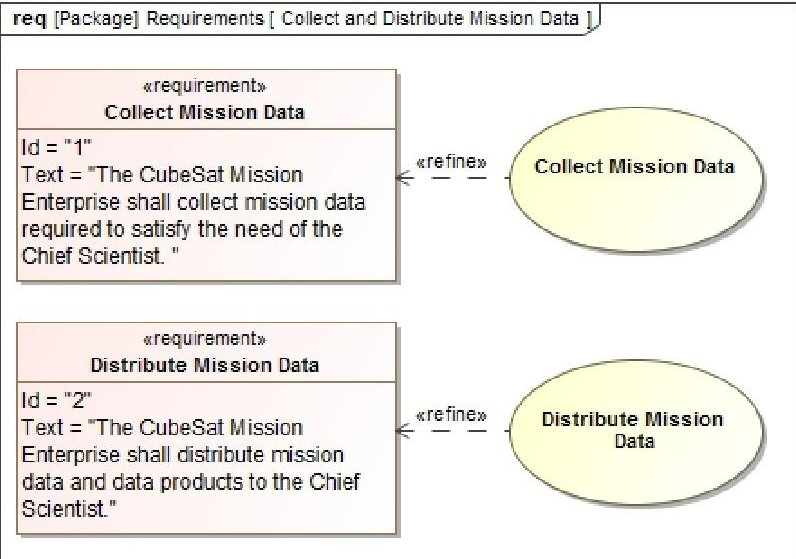

Figure 1. CubeSat Mission Requirements Refined by Collect and Distribute Mission Data Use Cases

use case by performing actions or providing a service to the system. References [1] and [3] provide a detailed discussion of use case modeling.

In this example, the mission data user is a Chief Scientist who initiates the two use cases in order to obtain mission data that is needed to support a research effort. The system is the CubeSat enterprise that has the responsibility for collecting and distributing the mission data to the Chief Scientist who needs it. Figure 2 is an example use case diagram conveying the above information.

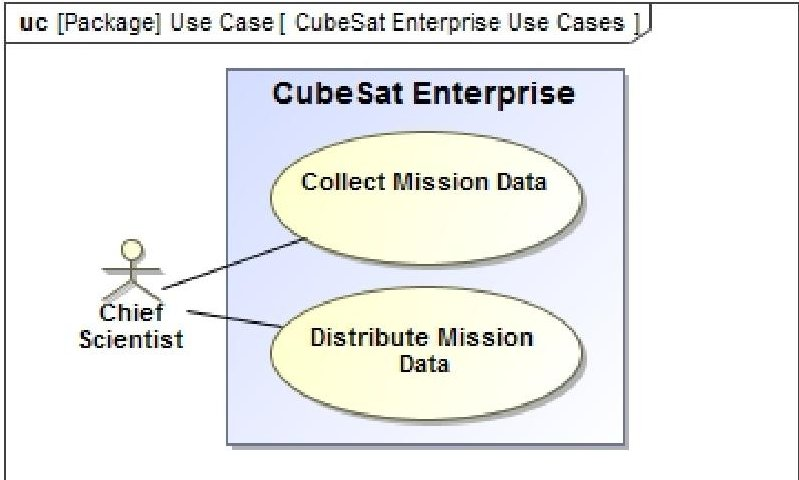

Figure 2. CubeSat Enterprise-level Use Cases

## Step 4-Develop Use Case Descriptions

Reference [12] states that each use case should have a description where the full story of the use case is told. These descriptions, or specifications, provide the substance of the use-case model. The use case description is what refines the requirement. They typically identify the goals of the use case, a main pattern of use, and a number of variant uses [1]. References [12, 13, 17] provide a detailed discussion of use case descriptions. For the purposes of this effort, the use case description consists of the following parts:

- Use Case Name

- Scope

- Supporting Actor

- Primary Actor

- Stakeholder

- Preconditions

- Trigger

- Postconditions

Scope refers to the system that performs the use case. A stakeholder is someone or something that has a vested interest in the behavior of the system. Preconditions are those conditions that must be true for the use case to begin and postconditions are the conditions that must be true at the end of the use case. The trigger refers to the event that causes the use case to begin. Typically the primary actor is the one who triggers the use case. The text-based use case description for the Collect Mission Data use case can be found in Appendix A and the one for the Distribute Mission Data use case can be found in Appendix B.

## Step 5 - Capture the Use Case Descriptions in the Model

How use case descriptions are incorporated into the CubeSat model is very dependent on the modeling tool being used. Most tools have some means of capturing the text-based use case description as part of the use case model element. In this example, the MagicDraw modeling tool developed by No Magic Inc. is used. In MagicDraw, each use case has a specification. It specifies details about the use case such as documentation or hyperlinks associated with the use case, use case scenarios, extension points, and usage in SysML diagrams. These details are represented as tabs in the use case specification window. The information contained in the text-based use case description is captured in the "Documentation/Hyperlinks" tab of the use case specification window as shown below in Figures 3 and 4. An alternative method would have been to create a hyperlink to a text file that contained the use case description.

## Step 6 - Model the Use Case Scenarios

Two key parts of the use case description that were not discussed above are the main success scenario and extensions. A use case scenario captures the functionality required in order to satisfy the actors' goals and also how the system interacts with its actors. It represents a complete path through the use case from beginning to end. The main success scenario represents a typical case in which nothing goes wrong, the primary actor's goal is delivered, and all stakeholders' interests are satisfied [17]. Extensions represent alternative sequences that branch off of the main success scenario. The use case combines all of the scenarios together. References [1], [3], and [16] state that a SysML activity diagram can be used to describe a use case scenario. The approach used here follows that of Reference [16] which states that the use case is a "wrapper" around the system's functions defining the preconditions, postconditions, trigger, and result with SysML activity diagrams describing the functions.

<!-- PDF_PAGE: 5 -->

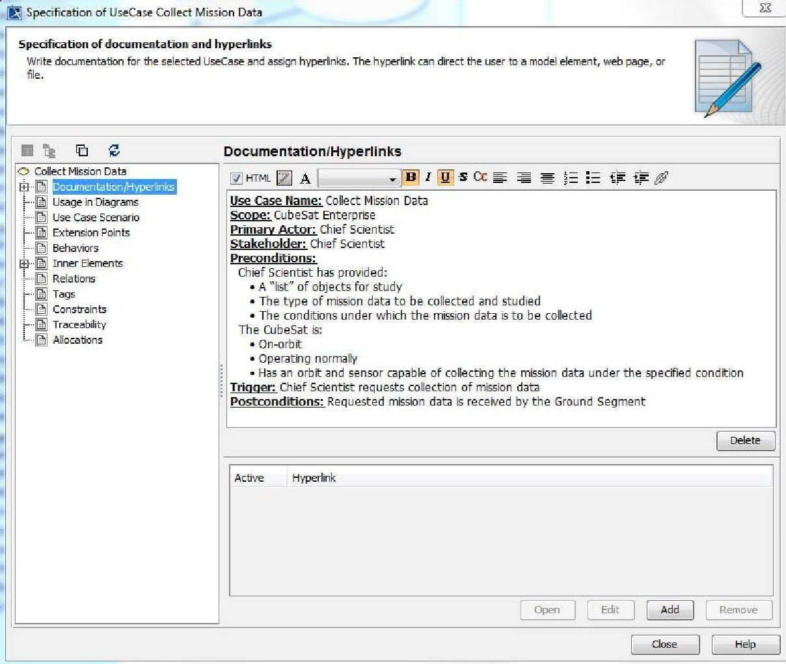

Figure 3. Use Case Description in the Collect Mission Data Use Case Specification

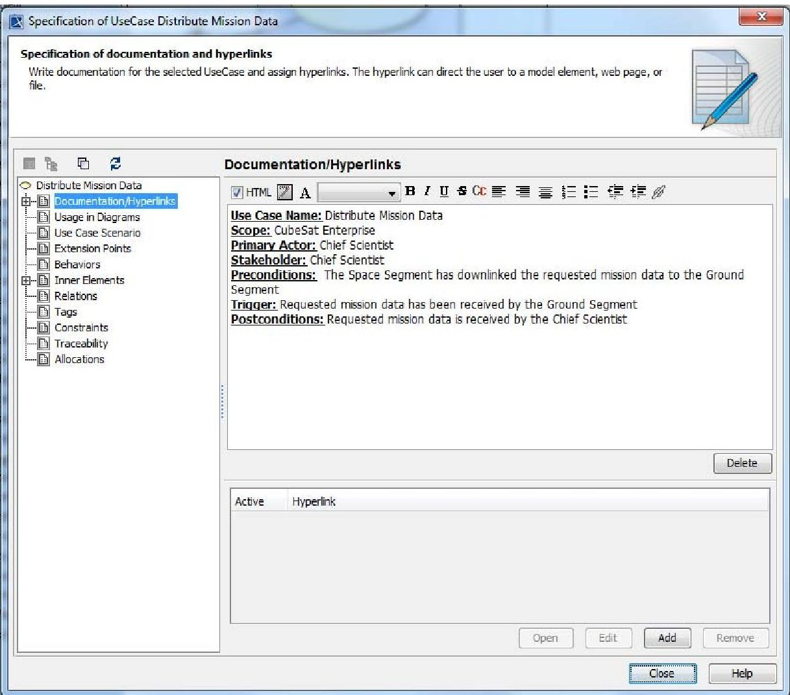

Figure 4. Use Case Description in the Distribute Mission Data Use Case Specification 5

<!-- PDF_PAGE: 6 -->

In SysML, activities are model elements that convey flowbased behavior that is focused on the transformation of inputs to outputs. An activity is composed of actions that represent steps in the transformation process. A special kind of action is a Call Behavior action that represents an activity that can be further decomposed into other actions. The result is an activity hierarchy that resembles the product obtained from a traditional functional decomposition.

This step begins with the approach described by Reference [16] where a top-level activity is defined which matches the name of the use case and represents the whole use case. Once the top-level activity is defined, it is decomposed into the actions that are necessary to satisfy the functionality required of the top-level activity. This follows a traditional functional decomposition approach. These actions are then used to develop an activity diagram capturing all of the behavior required by the top-level activity.

In the example of the Collect Mission Data use case, a toplevel activity is created that matches that use case. That activity is then decomposed into the following actions:

- A1 - Generate Mission Data Collection & Space-Ground Communication Schedules. Once a request for mission data is received, schedules for collecting the mission data and for communication opportunities between the CubeSat and the Ground Segment are generated. Based on these schedules, a spacecraft command sequence is generated that contains data collection and space-to-ground communication commands.

- A2 - Uplink Spacecraft Command Sequence. The Ground Segment and CubeSat communications equipment are configured for uplink of the spacecraft command sequence. The command sequence is uplinked to the CubeSat.

- A3 - Collect and Pre-Process Mission Data. In accordance with the uplinked spacecraft command sequence, the CubeSat collects the required mission data and does any necessary pre-processing of the data.

- A4 - Downlink Mission Data. The CubeSat and Ground Segment communications equipment are configured for downlink of the mission data. The mission data is downlinked to the Ground Segment.

Figure 5 shows the decomposition of the Collect Mission Data activity.

The actions from Figure 5 are then used to develop an activity diagram for the Collect Mission Data activity conveying the order of execution and input/output flows between actions. This is shown in Figure 6 below.

The activity diagram shows that the Collect Mission Data activity takes in the mission tasking and transforms it into mission data that flows out of the activity. The mission

tasking contains information about the types of data that need to be collected and under what conditions it should be collected. As discussed previously, the mission tasking is converted into a spacecraft command sequence that is uplinked to the CubeSat that collects and pre-processes the mission data prior to downlinking the data.

Only the main success scenario is shown in the examples. However, teams should also consider anomalous scenarios as well. For example, the inability to uplink commands or downlink mission data. These scenarios can be modeled in the same way as the success scenario. The process is repeated for the Distribute Mission Data use case as shown in Figures 7 and 8 below.

Figure 8 shows the downlinked mission data being postprocessed, the post-processed data being turned into required mission data products, and finally the original downlinked mission data and data products being distributed to the Chief Scientist who made the request that started the collect and distribute mission data process. Also shown in Figure 8 is an activity partition titled "Ground Segment" which conveys that the Ground Segment part of the CubeSat Enterprise is responsible for performing all of the actions within that partition.

References [1] and [3] provide a more detailed description of SysML activity diagrams, using activity diagrams to model scenarios, and for modeling activity hierarchies.

## Step 7 - Link the Activities to the Use Cases

At this point, activities have been defined that represent the use case functionality but no relationship between those activities and their corresponding use cases has been established. This approach uses the refine relationship discussed in Step 2 as the method for relating the activities to use cases. SysML does not limit the refine relationship to just relating model elements to requirements. The refine relationship can be used to relate any two model elements. In this case, it conveys that the activity at the client end is more definitive than the abstract use case at the supplier end. With regards to a use case scenario, the activity provides detail and clarity that the use case itself cannot express. Reference [1:301] states that, "The textual definition for a use case, together with the use case models described previously, can describe the functionality of a system. If desired, however, a more detailed definition of the use case may be modeled with interactions, activities, and/or state machines." Figure 9 below adds to Figure 2 the refine relationship between the activities and their corresponding use cases.

<!-- PDF_PAGE: 7 -->

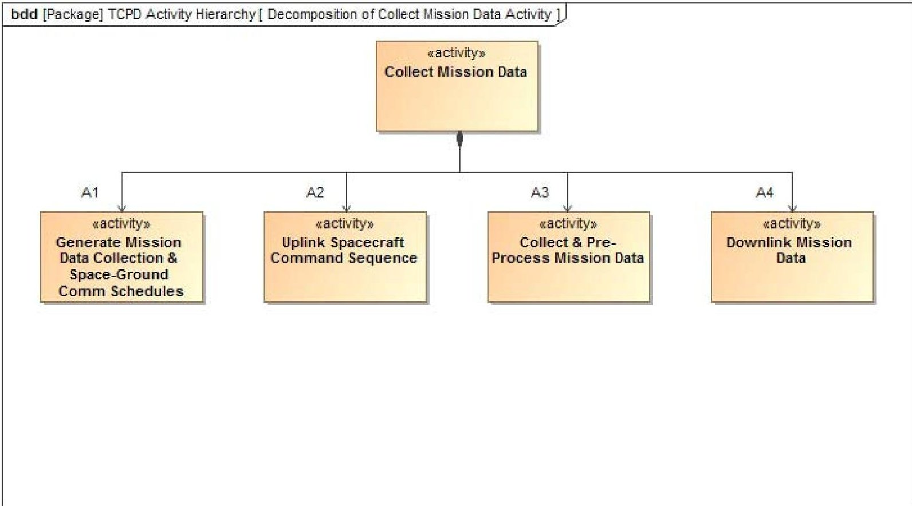

Figure 5. Decomposition of the Collect Mission Data Activity

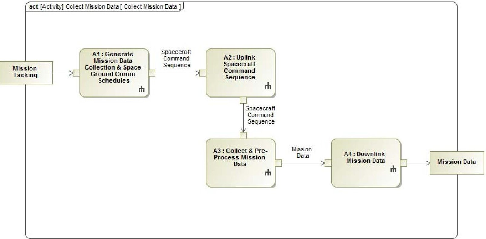

Figure 6. The Collect Mission Data Activity

<!-- PDF_PAGE: 8 -->

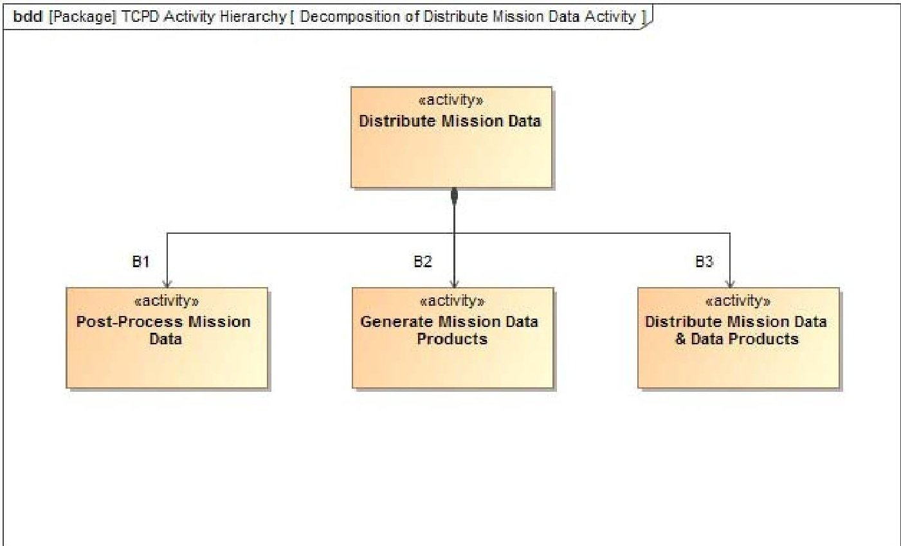

Figure 7. Decomposition of the Distribute Mission Data Activity

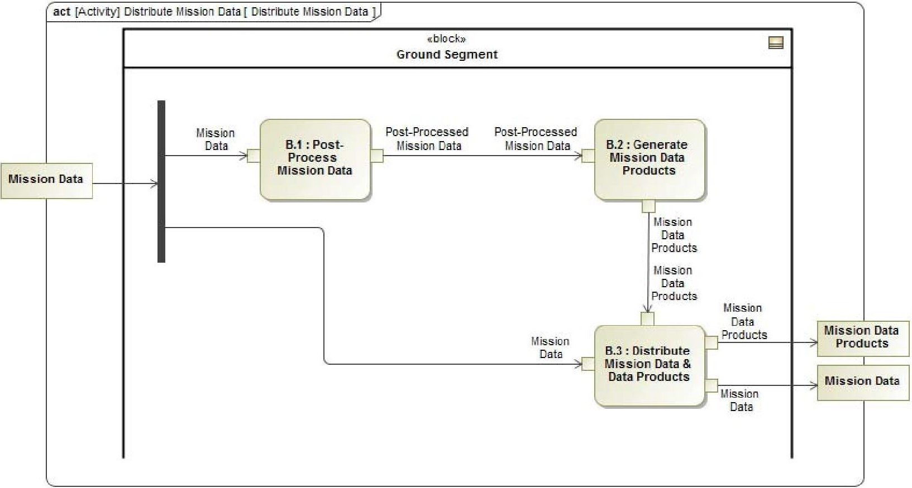

Figure 8. The Distribute Mission Data Activity

<!-- PDF_PAGE: 9 -->

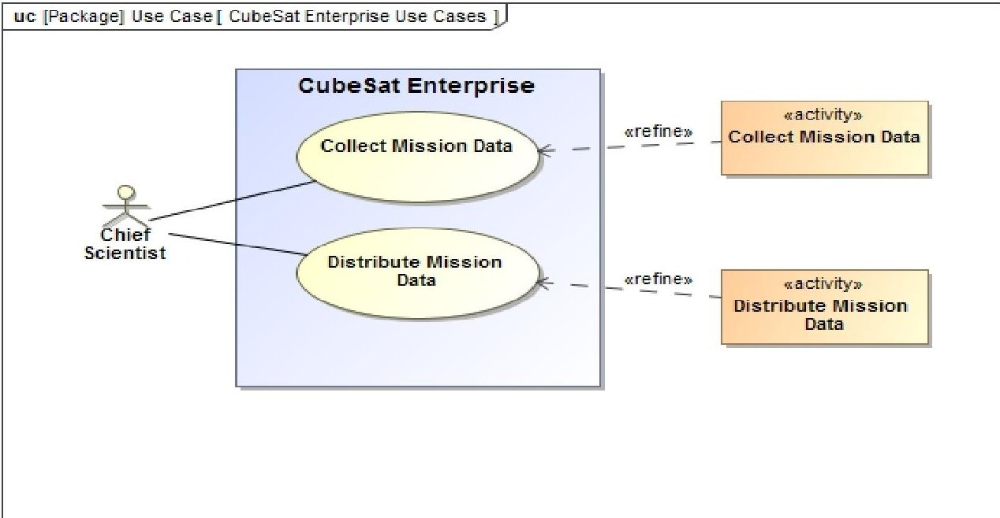

Figure 9. CubeSat Enterprise-level Use Cases Refined by Activities

## Step 8 - Continue Decomposing the Activities

The process of decomposing a higher-level activity into lower-level actions and then creating an activity diagram continues as necessary until the appropriate level of the system hierarchy is reached. In this example, the Generate Mission Data Collection and Space-Ground Communication Schedules activity and the Uplink Spacecraft Command Sequence activity are further decomposed and activity diagrams created for each activity as was done previously. Figures 10, 11, 12, and 13 show the results for these two activities.

In Figure (13), the CubeSat is responsible for the following actions:

- Determining when to begin to prepare for the uplinking of the mission data,

- Retrieving the stored space-to-ground communications command sequence (A2.2),

- Configuring the communications equipment to accept the uplink (A2.3), and

- Receiving the uplinked command sequence (A2.5).

These actions can be captured as functional requirements of the CubeSat as was done in Step 1 for the mission requirements. The approach can then be recursively applied at the CubeSat-level.

The decomposition of activities into actions can continue down to the subsystem-level of the CubeSat. The end result can be shown in an activity hierarchy representing the full functional decomposition and the resulting functional architecture. Figure 14 shows a continued decomposition for the Collect Mission Data activity.

## Summary

## 5. CONCLUSION

This paper presents an eight-step MBSE approach for defining the behaviors of the CubeSats. The approach begins with a well-defined set of mission requirements and ends with a representation of the functional architecture captured as an activity hierarchy. The order of execution and input/output flows between actions for each activity is captured in a SysML activity diagram. This approach has the following benefits:

- Traceability: There is clear traceability from the mission requirements to the functionality required to satisfy those requirements.

- Recursive: The approach can be recursively applied at all levels of the mission hierarchy with the outputs at the higher-level becoming inputs to the lower-level

- Generalizability. This approach is not dependent on any specific tool and is general enough to be easily incorporated into many systems engineering methodologies.

## Future Work

The approach presented here just focuses on functional requirements. Future work is needed to address nonfunctional and interface requirements also using a MBSE approach in order to develop a complete MBSE method for CubeSats.

Related topics are the allocation of the behaviors to the structural elements responsible for performing those behaviors and verification of the functional requirements. Though allocation was touched upon here, a more in-depth discussion is required.

<!-- PDF_PAGE: 10 -->

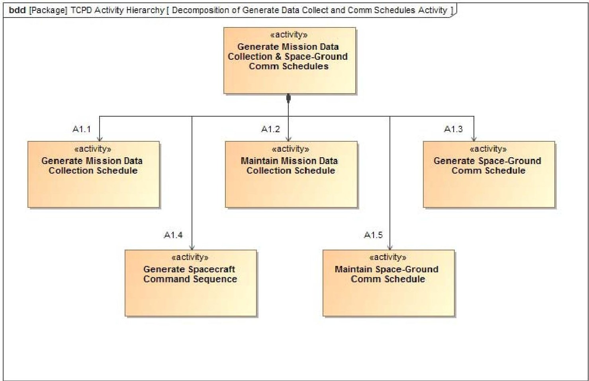

Figure 10. Decomposition of Generate Mission Data Collection and Space-Ground Communication Schedules

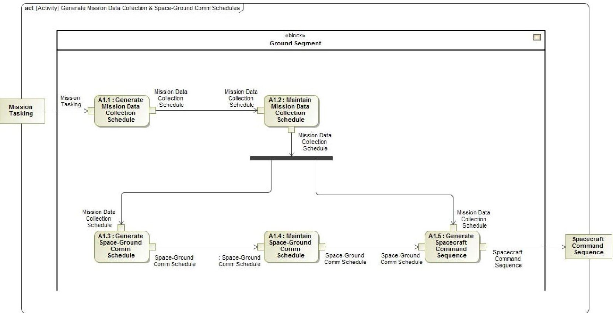

Figure 11. Generate Mission Data Collection and Space-Ground Communication Schedules Activity

<!-- PDF_PAGE: 11 -->

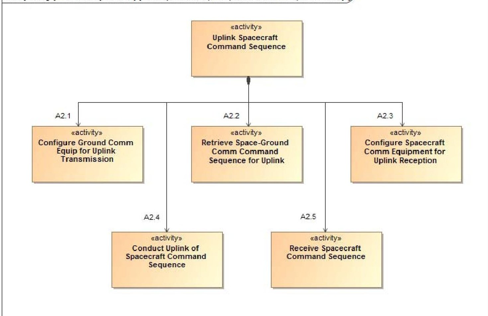

Figure 12. Decomposition of Uplink Spacecraft Command Sequence

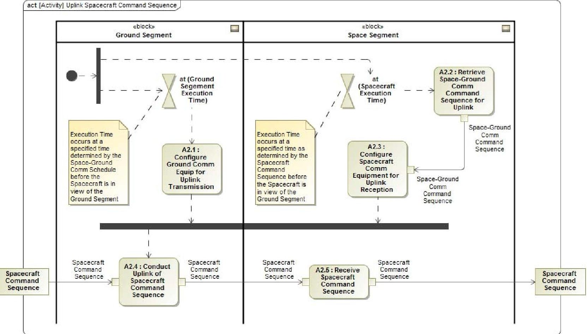

Figure 13. Uplink Spacecraft Command Sequence Activity

<!-- PDF_PAGE: 12 -->

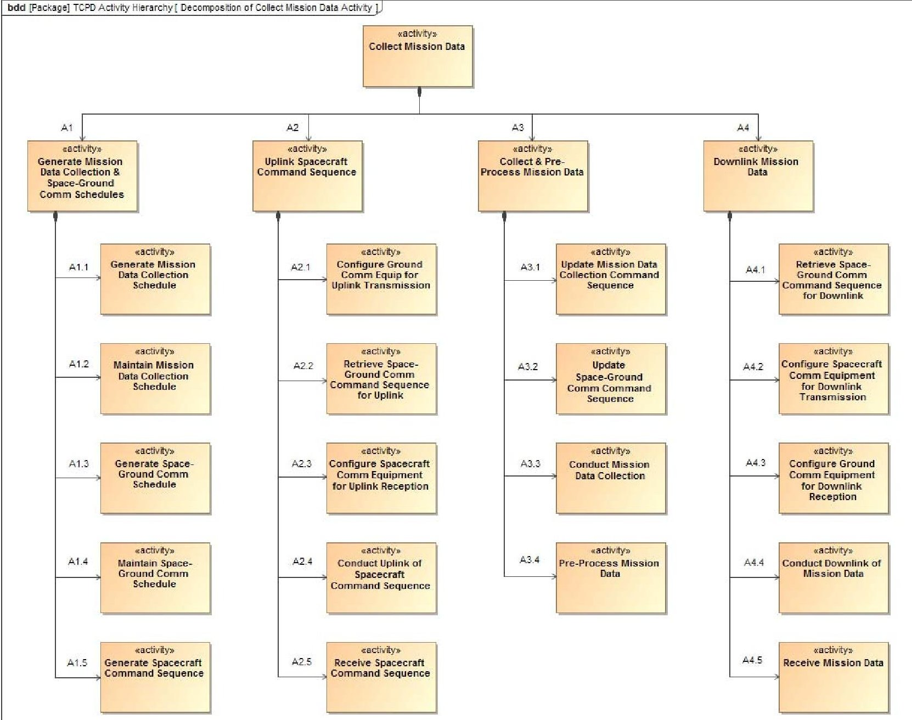

Figure 14. Activity Hierarchy for the Collect Mission Data Activity

<!-- PDF_PAGE: 13 -->

## APPENDICES A. COLLECT MISSION DATA USE CASE DESCRIPTION

Use Case Name: Collect Mission Data

Scope: CubeSat Enterprise

Primary Actor: Chief Scientist

Stakeholder: Chief Scientist

Preconditions:

Chief Scientist has provided:

- A "list" of objects for study

- The type of mission data to be collected and studied

- The conditions under which the mission data is to be collected

The CubeSat is:

- On-orbit

- Operating normally

- Has an orbit and sensor capable of collecting the mission data under the specified condition

Trigger: Chief Scientist requests collection of mission data Postconditions: Requested mission data is received by the Ground Segment

## B. DISTRIBUTE MISSION DATA USE CASE DESCRIPTION

Use Case Name: Distribute Mission Data

Scope: CubeSat Enterprise

Primary Actor: Chief Scientist

Stakeholder: Chief Scientist

## Preconditions:

The Space Segment has downlinked the requested mission data to the Ground Segment

Trigger: Requested mission data has been received by the Ground Segment

Postconditions: Requested mission data is received by the Chief Scientist

## REFERENCES

[1] S. Friedenthal, A. Moore, and R. Steiner, A Practical Guide to SysML: The Systems Modeling Language, $ 3^{\mathrm{rd}} $ ed. Morgan Kaufmann, 2015.

[2] D. Kaslow, B. Ayres, M. Chonoles, S. Gasster, L. Hart, C. Massa, R. Yntema, and B. Shiotani. "Developing a CubeSat Model-Based Systems Engineering (MBSE) Reference Model - Interim Status #2." Proceedings of IEEE Aerospace Conference. Big Sky, MT. 2014.

[3] L. Delligatti, SysML Distilled: A Brief Guide to the Systems Modeling Language. Addison-Wesley, 2014.

[4] M. Swartwout. "Attack of the CubeSats: A Statistical Look." 25th Annual AIAA/USU Conference on Small Satellites. Logan, UT. 2011.

[5] M. Swartwout. "University-Class Spacecraft by the Numbers: Success, Failure, Debris. (But Mostly Success.)." 30th Annual AIAA/USU Conference on Small Satellites. Logan, UT. 2016.

[6] S. Spangelo, J. Cutler, L. Anderson, E. Fosse, L. Cheng, R. Yntema, M. Bajaj, C. Delp, B. Cole, G. Soremekum, and D. Kaslow. "Model Based Systems Engineering (MBSE) Applied to Radio Aurora Explorer (RAX) CubeSat Mission Operational Scenarios." Proceedings of IEEE Aerospace Conference. Big Sky, MT. 2013.

[7] DoD Systems Management College, Systems Engineering Fundamentals. DAU Press, 2001.

[8] INCOSE Systems Engineering Handbook, v. 3.2.2. INCOSE-TP-2003-002-03.2.2. INCOSE, 2011.

[9] E. Hull, K. Jackson, and J. Dick. Requirements Engineering, $ 3^{\mathrm{rd}} $ ed. Springer, 2011.

[10] Guide for Writing Requirements. INCOSE-TP-2010 006-02. INCOSE, 2015.

[11] J. Wertz, D. Everett, and J. Puschell, Space Mission Engineering: The New SMAD. Microcosm Press, 2011.

[12] K. Bittner and I. Spence, Use Case Modeling. Pearson Education, Inc., 2003.

[13] G. Schneider and J. Winters, Applying Use Cases: A Practical Guide, $ 2^{\mathrm{nd}} $ ed. Addison-Wesley, 2001.

[14] T. Weilkiens, Systems Engineering with SysML/UML: Modeling, Analysis, and Design. Morgan Kaufmann, 2007.

[15] H. Hoffmann, Systems Engineering Best Practices with the Rational Solution for Systems and Software Engineering Deskbook Release 4.0. IBM Corporation, 2013.

<!-- PDF_PAGE: 14 -->

[16] T. Weilkiens, J. Lamm, S. Roth, and M. Walker, ModelBased System Architecture. John Wiley & Sons, 2016.

[17] A. Cockburn, Writing Effective Use Cases. Addison-Wesley, 2001.

## BIOGRAPHY

David Kaslow has thirty-four years of experience at Lockheed Martin in both the technical and management aspects of developing ground mission capabilities. He has five years of experience at Analytical Graphics creating their Standard Object Catalog and pursuing Model-

Based Systems Engineering. Dave is a co-author of four chapters Cost-Effective Space Mission Operations. He is also the author and co-author of papers and presentation for INCOSE Annual International Symposiums and Workshops, the IEEE Aerospace Conference, the Small Satellite Workshop and the NDIA Systems Engineering Conference. Dave is the lead for the INCOSE Space Systems Working Group. He has participated in the Space Systems MBSE Challenge Team since its founding in 2007 and is a principal contributor to the CubeSat Challenge Team.

Bradley Ayres, Ph.D., is an Adjunct Assistant Professor of Systems Engineering, Department of Aeronautics and Astronautics at the Air Force Institute of Technology. He serves as the Aerospace Corporation Chair supporting AFIT and the Center for Space Research and Assurance. He received his

Ph.D. in Business Administration specializing in MIS from Florida State University in 2003. Dr. Ayres has degrees from University of Missouri (BS, Chemical Engineering), Webster University (M.A., Procurement and Acquisition Management) and AFIT (M.S., Software Systems Management). Dr. Ayres' research interests include management of complex systems, model-based systems engineering, and space systems engineering. His is a member of the PMI, INCOSE and AIAA.

Phil Cahill has forty-five years of experience in the Information Technology industry, as consultant, customer, and contractor for government and commercial systems. He spent thirty of those years with the Lockheed Martin Corporation,

concerned primarily in the specification and development of defense and space systems, and retired as a Lockheed Martin Fellow. Phil's professional interests center on System Engineering, particularly for Systems of Systems, but he developed a passion for Data Center Operations

late in his career and maintains an active interest in that field. He received his PhD in Physics from the University of Illinois at Urbana-Champaign.

Laura Hart is a Systems Engineer at The MITRE Company in Mclean VA where her focus is on the advancement and application of model-based systems engineering. Prior to that, Ms. Hart worked for Lockheed Martin as a Sr. member of the Corporate Engineering and Technology Advanced Practices group responsible for codifying,

teaching and applying MBSE best practices across the LM Corporation. She has over twenty years of industry experience covering a wide spectrum of responsibilities from requirements, design, implementation, integration and test within the DoD industry. Laura is an active member of the OMG and supports both the SysML and UPDM/UAF specification working groups.

Rose Yntema is the Applications Engineer at Intercax (www.intercax.com) where she applies MBSE techniques to complex systems in areas such as aerospace, energy, defense, and telecommunications. She is actively involved in the development of software for integrating the total

system model (TSM) federation of models with SysML at its core, including parametric modeling and simulation, as well as quality assurance and technical support. Yntema earned her M.S. (2012) in Electrical and Computer Engineering from the Georgia Institute of Technology, and Sc.B. (2010) in Electrical Engineering from Brown University. She is a member of the INCOSE Space Systems Working Group and has co-authored papers for the IEEE Aerospace Conference in that capacity.