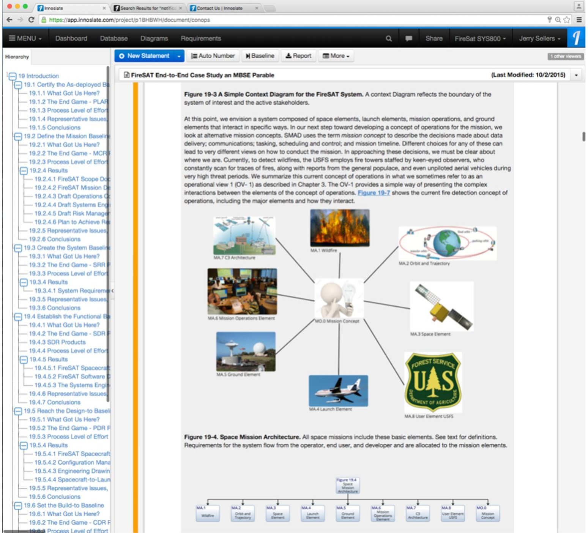
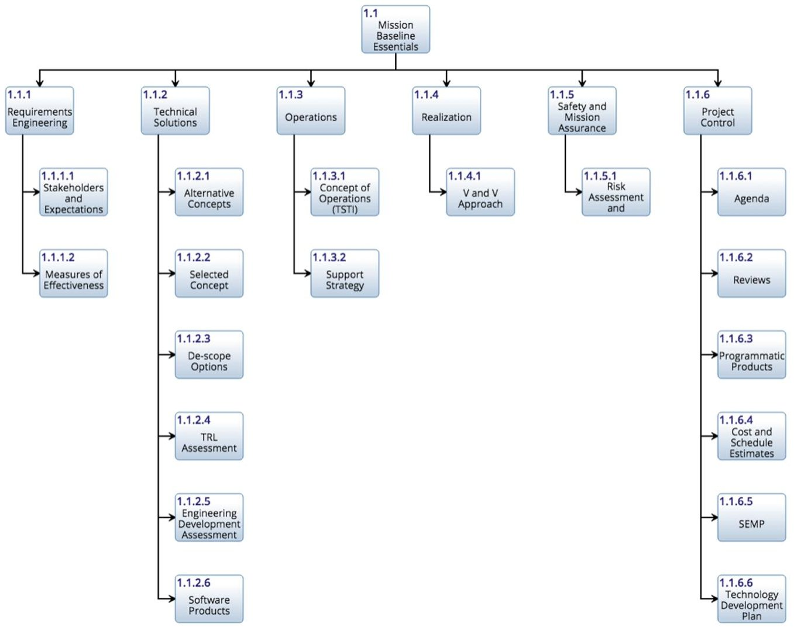
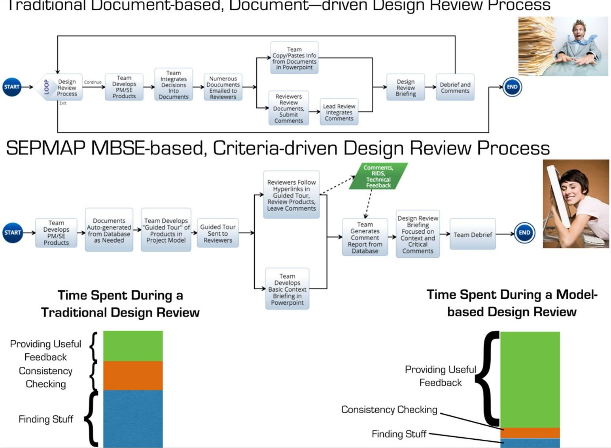
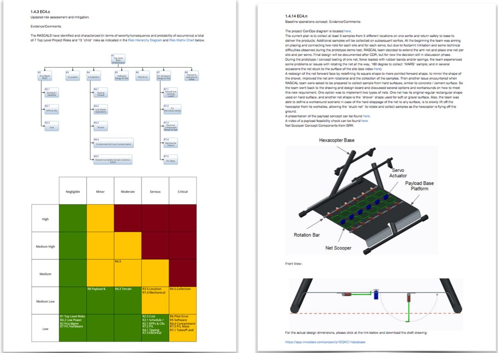
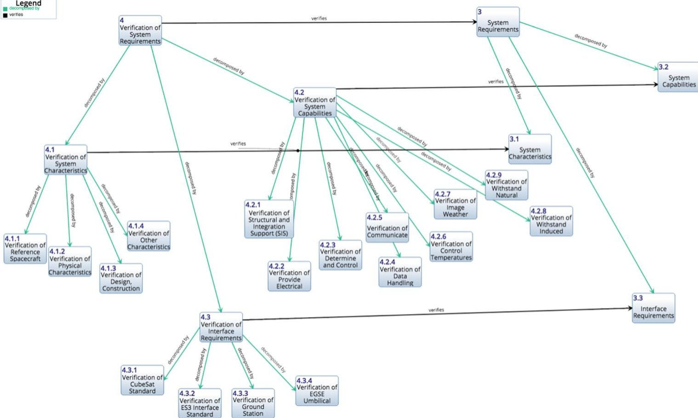
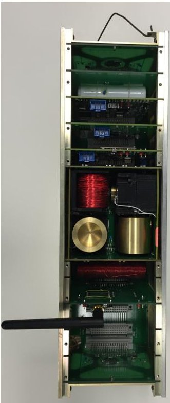
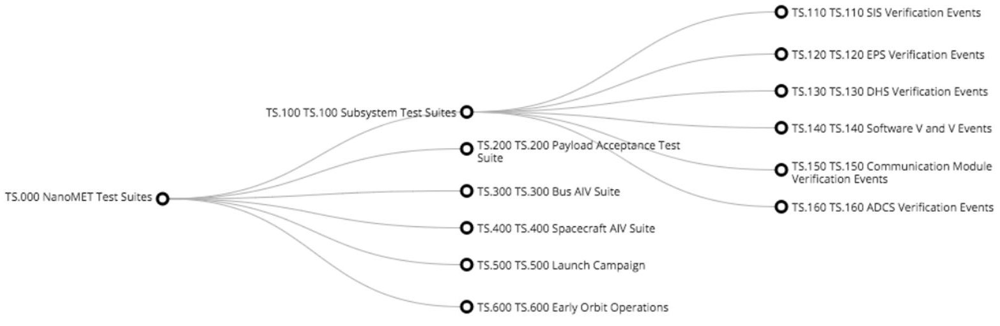
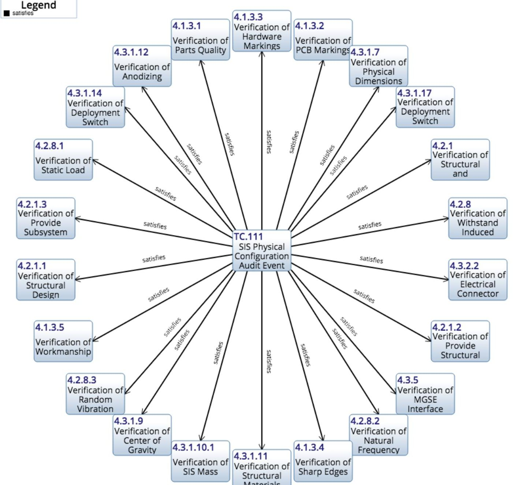

<!-- PDF_PAGE: 1 -->

IAC-17.D1.4A.7x37670

# Applied Model-based Systems Engineering to Capture, Connect and Communicate throughout the Lifecycle

Jerry Jon Sellers $ ^{a} $

a Teaching Science and Technology Inc., 14 Via Piedras, Manitou Springs, CO, 80829 USA. jsellers@tsti.net.

## Abstract

Applications of model-based systems engineering (MBSE) is at the cutting edge of systems engineering research. This paper provides an overview of recent academic research and industrial applications of MBSE primarily in the space domain. Academic research topics will include a FireSAT Case Study, Agile/Scrum applications and an innovative approach to decomposing systems engineering products optimized for MBSE. The development of a complete system model for FireSAT will be described. Research into MBSE's use in modeling Agile/Scrum processes will then be summarized.

Another result from recent academic work that will be highlighted is the development of an Essential Systems Engineering approach that condenses guidance from NASA's NPR 7123.1B to create a streamlined and tailorable approach to tackling project technical baselines by focusing on essential and assessment facets that can be summarized into lifecycle templates optimized for MBSE application. The paper then turns to some MBSE research application in government and industry beginning with a fully integrated cubesat case study based on real hardware and software being used for education and training. NanoMET is a fictitious mission that is built around the very real EyasSAT3 educational satellite system. The EyasSAT platform has served as a desktop education and training system for over a decade and has been widely used at the USAF Academy, National Security Space Institute, NASA, ESA and industry. The newer iteration of this platform, EyasSAT3 is based on a 3U cubesat platform. The NanoMET mission has been fully modeled using MBSE from start to finish. Discussion will focus on use of MBSE to develop a detailed test plan for the system.

The paper concludes with discussion of ongoing lessons learned using MBSE for a systems engineering and project management development program at NASA/JSC with focus on model-based design reviews. Model-based reviews have been used in this program since the beginning and have proven to be an immense time saver. Techniques for implementing model-based reviews will be described as well as feedback from participants in the program.

Keywords: model-based systems engineering, systems engineering, modeling, simulation, design review, cubesat

## Nomenclature

None

## Acronyms/Abbreviations

MBSE = Model-based systems engineering

SE = Systems engineering

JSC = NASA Johnson Space Center

ASSE = Applied Space Systems Engineering text book

DoD = U.S. Department of Defense

NASA = U.S. National Aeronautics and Space Administration

INCOSE = International Council on Systems Engineering

## 1. Introduction

This paper will examine model-based systems engineering (MBSE). More than just a language for building diagrams, the paper will explore MBSE as a discipline in its own right that leverages the power of purpose-built, relational data-base-driven software tools to do the following things:

- Capture

- Connect

- Control

- Communicate

- Collaborate

- Cycle

The paper begins with some background and context on MBSE to examine what it is, the context in which it used and tools. We will then discuss its primary purpose that of telling a story-the story of our system and various roles that must be considered when we implement MBSE into a project. From this background, we dive deeper into the "6-C's" listed above to understand how MBSE can do these things better than a more traditional approach.

The focus of the paper will be on results from recent application of MBSE to several projects including a FireSAT MBSE case study, Essential Systems Engineering, EyasSAT3 (a classroom cubesat) case study and lifecycle application of MBSE to develop and manage technical reviews. Finally, last two "C's," Conclusions and Challenges will discuss some the limitations and barriers to adoption commonly encountered.

<!-- PDF_PAGE: 2 -->

## 2. Background

Since the beginning of civilization, our systems have been getting more and more complex. And with the addition of software to the mix, the so-called "complexity sponge" of modern systems, this increase is becoming exponential. However, throughout all that time, human brain power has remained basically static. As we will discuss, MBSE offers the ability to "off load" some of the mental heavy lifting that we've traditionally to manage as part of the systems engineering effort, allowing us to do more with the same or less, and more confidently take on increasingly more challenging systems engineering efforts.

## 2.1 What is MBSE?

To define model-based systems engineering (MBSE) it is important to first understand what is meant by model-based engineering in general. The DoD defines a model as a "physical, mathematical, or otherwise logical representation of a system, entity, phenomenon, or process. " (DoD 5000.59-M1998) [1] In other words, a model is anything (physical or logical) that is used to to describe, discuss, design or otherwise understand the system of interest. By this definition, all of engineering is, "model-based."

Practicing engineers use all kinds of models to do their jobs - sketches, drawings, CAD models, spreadsheets, even the proverbial back of an envelope. For purposes of discussion in this chapter, it is useful to delineate the categories of models that are used in engineering along with the ways in which their outputs have been communicated to stakeholders as summarized in Table 1.

For this discussion, we will exclude physical models (breadboards, prototypes, etc.). While physical models are essential to the systems engineering process, especially during the design phase, arguably they are the result of the other categories of modeling listed in the table (i.e. a machinist fabricates a part based on a drawing). Table 1 illustrates the evolution of modeling used and the delivery method from stage to stage.

In a basic sense, MBSE is simply another modeling tool in our tool kit to abstract the processes and relationships used in traditional systems engineering. According to INCOSE, "Model-based systems engineering (MBSE) is the formalized application of modeling to support system requirements, design analysis, verification and validation activities beginning in the conceptual design phase and continuing throughout development and later life cycle phases." [2]

While the INCOSE definition is a good starting point, it doesn't go far enough to cover the topic as we will discuss it in this paper. Applied Space Systems Engineering (ASSE) Chapter 1 [3] describes the difference between the art and the science of systems engineering. Recall, the art of systems engineering focuses on technical leadership, on a system's technical design and technical integrity throughout its lifecycle. The science of systems engineering is art's ally, systems management, focused on managing the complexity associated with having many technical disciplines, multiple organizations, and hundreds or thousands of people engaged in a highly technical activity.

Continuing that metaphor here, in this chapter we will view MBSE and its supporting tools as providing a new pallet of colors to allow the systems engineering "artist" to "paint" in ways they couldn't before, providing insight into complex problems in new and unique ways. Equally valuable, MBSE tools can perform much of the "heavy lifting" of the science side of the problem, reducing the number of documents that need to be produced for example and making it far easier to put our hands on the latest, best technical data. With this metaphor in mind, we will offer the following definition of MBSE, as presented in ASSE Chapter 20 [4] that will guide our discussion throughout the paper:

Model-based systems engineering is the art and science of applying software-based tools to capture systems engineering evidence in a systematic, disciplined way, to connect system relationships, control system configuration and communicate a common system site picture in the form of an integrated model to all stakeholders throughout the lifecycle.

Table 1 Stages of Modeling and Delivery.

<table border="1"><tr><td>Stage</td><td>Model Categories</td><td>Examples</td><td>Tools</td><td>Delivery/Review Method</td></tr><tr><td>1</td><td>Paper-developed</td><td>Documents, drawings</td><td>Pen/paper, typewriter, drafting board</td><td>Paper</td></tr><tr><td>2</td><td>Software-developed</td><td>Documents, drawings</td><td>Office Suites, 2D CAD</td><td>Paper(including virtual paper)</td></tr><tr><td>3</td><td>Software-based</td><td>System Models</td><td>Spreadsheets, MatLab, STK, 3D CAD, MBSE</td><td>Paper(including virtual paper)</td></tr><tr><td>4</td><td>Software-based</td><td>System Models</td><td>Spreadsheets, MatLab, STK, 3D CAD, MBSE</td><td>Software/model</td></tr></table>

<!-- PDF_PAGE: 3 -->

As we will explore in this paper, MBSE, as a software-based model as described above, is being used and implemented primarily in Stage 3 applications, thus limiting its full potential. However, the tools are evolving to support Stage 4 where stakeholders can examine and experience the richness of the system model providing greater insight and understanding.

As we launch further into our discussion of MBSE, it is also useful to understand something we can coin the "Law of Conservation of Systems Engineering" which states:

For all systems there is a minimum amount of systems engineering effort required to successfully turn a stated need into a delivered capability.

Regardless of the modeling approach you use (paper-developed or software-based), this systems engineering minimum effort can be added to, moved around, consolidated, or divided but it cannot be reduced below the minimum and still achieve success.

## 2.2 MBSE Tools

To understand MBSE tools it is important to differentiate between:

1. Software-based tools used as systems engineering tools-generic software packages (i.e. MS Office or Apple Works) applied to develop products and evidence that communicate systems engineering decisions, and;

2. Model-based Systems Engineering tools purpose-built software-based tools designed specifically to support the development and communication of products and evident that support system engineering decision.

Let's start with the first one on this list. It is often said in MBSE circles, that the most commonly used "MBSE tool" in use is MS Office (Word, Excel, Powerpoint). But clearly Office was designed as a generic tools suite to meet the needs of a very diverse group of users. To reach Stage 3 and 4 we need truly software-based MBSE tools as defined by the second type of tool on this list. For the remainder of this paper, these purpose-built tools will be to focus of our discussion.

At their core, MBSE tools are relational databases. Individual items in a database are called fields or attributes, a set of fields compose a record. For example, an employee record in a database would have several fields such as last name, first name, date of birth, etc. (i.e. Smith, Mary, 12/3/1982). A set of records comprise a table. This is about the extent of capability you can obtain from a spreadsheet, so in that sense a spreadsheet is also a database.

What makes a relational database is the ability to relate fields or records in one table to those in another. So we could relate an employee to a separate table of

departments (i.e. Smith, Mary -> Software Engineering Department). Relationships can be one to many (one department has many employees) or many to one (many employees in one department). The logical organization of relational databases in general, and MBSE tools specifically is called a schema.

To develop the schema for MBSE, we have to first decide on a taxonomy. As applied to systems engineering, there is a general taxonomy of separate elements that are commonly used such as:

- Requirements—"System mass shall not exceed 10 kg."

- Functional Architecture elements—"Handle Input X," or "Produce Output Y"

- System or Physical Architecture elements- System -> Subsystem -> Assembly, etc.

The physical elements (requirements, physical architecture) are nouns. Functions are verbs. Data relationships and other contextual information are captured and conveyed using numerous types of diagrams (more on diagrams later).

- Hierarchical

- Relational

- Operational

- Logical sequence and flow (pseudo-code)

- Interfaces

It is useful to differentiate here between "descriptive" models and "analytic" ones. For purposes of this paper, we will largely focus on the latter models that describe the system. Analytic models, by contrast, as the term implies, perform calculations or simulations to predict system behavior.

## 2.3 Modeling Languages

Modeling languages provide a formalized schema (internal logic) to capture and connect relationships along with standards to facilitate data sharing between tools as part of MBSE implementation. However, it is critical not to conflate one with the other. Don't confuse languages with MBSE. For example. SYSML is to MBSE as C++ is to Software Engineering. C++ is a language. Software engineering is a discipline. Here we will treat MBSE as a discipline that draws upon formalized languages and standards as part of a practitioner's tool kit. A complete discussion of modeling languages is beyond the scope of this paper.

## 2.3 Capturing, Connecting and Controlling

The first advantage of MBSE we will explore is its ability to serve as a central repository for capturing all of the detailed data and useful systems engineering information about a project. Traditionally, in Stage 1 or 2, project information was scattered between dozens, perhaps even thousands, of separate paper documents (or the equivalent .doc files). Each individual document was an arbitrary wrapper of information with a name that didn't necessarily have a universal definition of

<!-- PDF_PAGE: 4 -->

agreed content. One project might capture goals and objectives in something called a Scope Document, another project may put that same information in a something called a ConOps Document. And yet another project would have that same information in both documents, doubling the configuration control challenge.

MBSE eliminates this problem. With MBSE the concept of documents as stove pipes of information goes away replaced by a schema that specifies a place for all data that only needs to be captured once. Documents, if and when needed, can then be generated with whatever content a stakeholder needs with the confidence that it is coming from a single source of truth.

In many ways, the capturing part of MBSE is not fundamentally different from an intellectual standpoint to how it could be done using MS Office or paper and pencil. You draw diagrams and write words to describe the envisioned system architecture (functional, physical, operational), requirements and other aspects of the project. The resemblance to a paper-based world stops when it comes to connecting. Defining all of the ways systems engineering elements relate to each other and establishing those connections within the model provides that depth of understanding described at the beginning of the section that simply can't be done on paper.

If there were only one connection between each separate entity or "data bucket," then the number of possible connection would be n(n-1)/2 where n is the number of entities. But there are a potentially limitless number of different connection types we could define between each entity type. So even for a handful of entities and a few connection types, the number of connections to manage becomes large.

Thankfully, this is where MBSE tools excel in the ability to help you first capture those connections and then manage and control them as we'll discuss next. Number and types of connection are baked into the existing language definitions (UML, LML, etc.) so if you chose one of these languages you don't have to separately decide what connections are possible, they are already defined.

As the complexities of our systems go up, the amount of data we need to describe them goes up proportionally. In addition, we humans simply generate more data (in the form of pictures, etc.) than ever before. Using MBSE tools we can accomplish the following typical technical data management tasks [5]:

- Collect and Store Required Technical-data Artifacts developed During the Engineering Lifecycle

- Maintain Stored Technical Data

- Provide Technical Data to Authorized Parties

- Collaborate by Effectively Using System and Process Artifacts

All this while giving us a method for managing change. Practically speaking, depending on the scope of the project, the MBSE tools may not be the sole means of data management. It is also important to recognize that tools are just tools. Configuration management and technical data management are processes that have to be planned and implemented in a project context by humans. Humans decide and then recommend what data to capture or change. Humans have to decide whether to accept those recommendations.

## 2.3 Communicating, Collaborating and Cycling

The success of any project totally depends on good communication within an engineering team as well as outside of the team to stakeholders. To be effective, everyone on the team needs access to the latest versions of requirements, functional and physical architectures, test cases and sequences along with hundreds if not thousands of other vital pieces of information. Isolated snapshots of information don't paint the big picture. Engineers and stakeholders need context and a narrative to go with this information to truly grasp the big picture.

Enter MBSE. To begin with, since all project artifacts are captured in a relational database, we can "write once, print many." Most MBSE tools come with a variety of standard report options allowing you to create report slices in breadth, height or depth depending on your needs. Standard reports can also include those typically required in projects such as ConOps, Project Plans, Requirements Documents, in addition to DoDAF reports and others.

Finally, some tools also provide capabilities to tailor the ready-made reports or build your own reports from scratch based on the specific needs of the project. These reports are especially useful in a Stage 3 implementation where stakeholders still largely expect paper-based products. These flexible reporting options allow us to satisfy stakeholder expectations while still maintaining the power of the single source of TRUTH provided by the model.

But the full advantage of MBSE tools aren't fully realized until we move to Stage 4 and harness their capability for model-based reviews. Real-world results of conducting model-based reviews are discussed later in the paper.

## 2.4 Collaborating and Cycling

In a document (or virtual document)-based world (Stages 1 and 2), work on a document product largely happens serially. Certainly, you can have different engineers work on different sections in parallel for a time, but once you merge the sections together, we are back to a serial process. This greatly limits the ability to do widespread collaboration in anything but a serial manner. Individuals have to "check out" a document to

<!-- PDF_PAGE: 5 -->

make changes, then "check it back in" assuming you have some sort of automated document control system.

Here again, MBSE tools can offer a vast improvement by moving into Stage 4 to support not just reviews, but by providing a common, continuous shared site picture of the whole systems engineering effort. Depending on specific tool deployment options (local network, web-based or workstation based) as well as licensing details (number of paid seats), it is possible to have a parallel development environment whereby multiple users can be using and/or updating the model in parallel.

Of course, configuration management issues come in to play here to prevent authorized changes. But some tools also a free or low-cost read-only option or other type of viewing allowing as many stakeholders as you want to be able to browse the model to determine the latest configuration and other parameters. In this way, all shared-in stakeholders have shared common site picture of the entire project whenever they need it.

This ability to have continuous crowdsourcing of the model status puts more eyes on the system engineering effort, greatly enhancing the ability for widespread collaboration as well as increasing the likelihood of uncovering errors early.

Our final C of the "6 C's" is cycling. By that we mean the power to support iterations. When asked how many iterations are needed to achieve a final design, the typical answer is "one more." Iteration is a necessary part of systems engineering. However, because everything effects everything else in a complex system, this process has to be managed effectively. Often systems engineers have tried to resist these changes (usually in the form of new or changed requirements) because of the inevitable impact they on the stability of the system configuration. More recently, Agile approaches to system development, originating in the software world, have made their way into traditional systems engineering.

The Agile approach embraces changes,building them into development cycles called Sprints. This is similar in concept to the Design and Analysis Cycle (DAC) employed by NASA. The idea is to embrace change but manage it a systematic way. Whether you call it a Sprint or a DAC, the systems engineer lays out a plan for how the team will move from one technical baseline to the next with a series of intermediate baselines in between that allows everyone to recalibrate their assumptions and dispel design rumors. In Agile/ Scrum, the goal is to have a "deliverable product" at the end of each Sprint. For a complex hardware/software design effort, this may not be a practical goal. However, the concept of an intermediate deliverable provides a useful focus for the whole team.

Here again MBSE can play a crucial role. The Agile/ Scrum process can be modeled as well as any process [6]. But more importantly, if we've done a good job of capturing, connecting, communicating and controlling the system engineering effort all along, then MBSE will

enable you to manage tighter cycles. Leveraging automated model checkers as describe above for example, can provide day-to-day feedback on how close we are to reaching our DAC goals.

Having a coherent view of the project breadth across the whole lifecycle helps us see the impact of design changes downstream. Being able to zoom the height from system level to component or part level helps to analyze design changes up and down the interface chain. Finally, being able to explore the system depth, the myriad of internal system connections, empowers systems engineers to analyze the cascade effect of proposed changes and evaluate their value before implementation.

Often in the discussion of the value proposition for MBSE, the contribution of cycling isn't fully appreciated. By by their nature, engineers will do as many iterations as they are allowed to, so in that sense the work will expand to fill the time. But my making the cycle time potentially faster and more efficient, engineers can complete more cycles in the same time. So while they still may want "one more," they've been able to get at least one more than they would have without MBSE, reducing the risk that the chosen design will have problems during implementation and operations.

## 3. Results and Discussion

This section will summarize results from academic and real-world application of MBSE.

## 4.1 FireSAT Case Study

FireSAT is arguably the most famous space mission that never flew. The idea for this fictitious mission was first developed in Space Mission Analysis and Design (SMAD) and SMAD-CORE [7] as a running example throughout each chapter to highlight how theory applies to a concrete problem. Later, Understanding Space: An Introduction to Astronautics (US) [8] adapted the FireSAT idea to illustrate concepts of space systems engineering and subsystem design. FireSAT has since become a workhorse in other books and in classrooms the world around.

For the Applied Space Systems Engineering (ASSE) text, a complete end-to-end case study was developed for chapter 19 [9]. At the time, this was done using largely conventional, Stage 1 and 2, SE tools. The FireSAT example in Chapter 19 shows how the specific criteria for each baseline can be mapped into specific products. Chapter 19 took a paper-based approach to assign information to documents. This same basic phase-by-phase approach lends itself well to MBSE implementation.

Over the last several year, the author has led a graduate research effort to model the ASSE FireSAT example using MBSE. The goal of this effort is to provide an open-source example of how to implement MBSE across a mission lifecycle. The result is a

<!-- PDF_PAGE: 6 -->

"virtual chapter" in the tool that includes links to model elements (i.e. requirements, functional flow block diagrams, etc.) within the overall model. An example screen shot is shown in Figure 1.

## 4.2 Essential Systems Engineering

When you start any new engineering project, whether in MS Word or in MBSE, you are confronted by a blank canvas. This can be a bit intimidating not knowing where to start. Fortunately, as an industry we have useful guidelines in the form of technical baseline entrance and success criteria defined in ASSE [10] and in NASA Program Requirements for systems engineering (NPR 7123.1B) [11].

The FireSAT example in ASSE Chapter 19 shows how the specific criteria for each baseline can be mapped into specific products using a paper-based approach to assign information to documents. This same basic phase-by-phase approach lends itself well to MBSE implementation. The author directed graduate research into this concept [12] that resulted in a streamlined approach for organizing the entrance and success critical defined by NASA NPR 7123.1B better optimized for MBSE implementation and tailoring. The goal was to simplify the implementation of criteria-based systems engineering across the lifecycle especially when using MBSE—that facilitates a better focus on the specific evidence (diagrams, words,

Figure 1. Example Screen Shot of FireSAT MBSE "virtual chapter" in the MBSE tool.

<!-- PDF_PAGE: 7 -->

pictures) that satisfies the criteria at each phase of the lifecycle.

This criteria-based approach to organize and communicate systems engineering evidence we call Essential Systems Engineering (ESE—its "easy"). ESE introduces the concept of systems engineering facets. These facets provide a framework for identifying and grouping related systems engineering activities, deliverables, and assessments throughout the project lifecycle.

Essential facets define the key evidence produced by the project needed to establish the technical baselines throughout the lifecycle. They are used to track the overall technical and managerial maturity of a effort. Assessment Facets define success criteria used to evaluate the project technical and managerial baseline during its lifecycle to determine if sufficient maturity has been reached for a given milestone. If not, the project should not proceed. Or, if it does, it will do so at risk. These essential facets for the Mission Baseline established at Mission Concept Review (MCR) PrePhase A are shown in Figure 2. These facets are then used to define a template in the MBSE tool to tell the "story" of the systems engineering for the project as we'll see in the next section. Essential facets for

## 4.3 Model-based Reviews

The author has decades of experience developing and implementing technical reviews on the "give" side, as well as reviewing them as a stakeholder on the "receive" side, primarily using Stage 2 tools and techniques. Over the last several years, the author has worked to implement model-based reviews (Stage 4) and the experience has been overwhelmingly positive.

As we said earlier, MBSE tools are just tools. Diagrams are just diagrams. It is the task of the systems engineer to weave this data in its various forms (prose, diagrams, schematics) to tell the story about the journey to the next technical baseline and why we have arrived successfully. In Stages 1, 2 and 3 this story was told using a variety of documents. At an appointed time there would be a "data drop" of documents for stakeholders to plow through. Often there was no integrated story until the face to face Powerpoint review, if then.

This approach of having various technical information scattered through different documents doesn't lend itself well to a single threaded story. Anyone who's ever been involved in a document-based review can attest to the fact that you spend at least half

Figure 2. Systems Engineering "Essentials" for the Mission Technical Baseline established and Mission Concept Review (MCR).

<!-- PDF_PAGE: 8 -->

of your time preparing for a review simply searching through documents to find the right information to review. Another fourth of your time is convincing yourself that the same information pasted into different documents is consistent. That leaves only about another fourth of your time to actually make value-added comments about the design and other aspects of the systems engineering effort. These two approaches and relative efforts are summarized in Figure 3.

The up-front effort for a model-based review is no different than a paper-based review. Well in advance of the review, the project managers and systems engineers must negotiate with stakeholders to determine their expectations for entrance criteria (when you are ready to hold the review) and success criteria (what the definition of "done" will be for the technical baseline). In a paper-based world these entrance and success criteria would be mapped to documents as shown in the FireSAT case study in Chapter 19. The key difference here is that in a model-based world these criteria don't have to be external and abstract. The criteria for each review can be integrated directly into the structure of the model.

Using the Essential Systems Engineering (ESE) approached described above, all of the entrance and success criteria from NASA-NPR-7123.1B [11] were

mapped into essential and assessment facets respectively. From there, Essential Systems Engineering Lifecycle Templates (ESELTs) were defined for each technical baseline. These templates provide a vital starting point for working with stakeholders to tailor the evidence expectations based on the specific needs of the project. The template then provides guidance and "to do" list of evidence that must be developed for each milestone (much of which can be done within MBSE or created elsewhere and linked to the model). Finally, once fully populated, the template provides a convenient road map for reviewers and other stakeholders to follow the logic of the model.

The template serves as the outline of the systems engineering story that needs to be told for each baseline. By providing a set of pre-defined stepping stones, reviewers can navigate the model, finding pointers to the evidence that supports the essential and assessment facets at each step. Without such a template, any model appears to be just a random collection of diagrams and words. Adding the template provides the narrative needed to paint a clear picture of the project status. An example template is shown in Figure 4.

Figure 3. Traditional vs. Model-based Design Review Effort and Relative Efforts.

<!-- PDF_PAGE: 9 -->

Figure 4 Essential Systems Engineering Template used for Model-based Design Review

... "The model-based tool used by our teams helped keep reviewers focused and able to see all facets—

Below is a sample of feedback from reviewers who used the model-based approach:

Depending on the tool, reviewers, project engineers and other stakeholders with read-only access can leave comments as specific feedback to the team. By aggregating these targeted comments, the face to face meeting (still an essential element of the complete review process) can focus on issues identified rather than wasting valuable time rehashing information that everyone agrees on.

The templates enables the transition from Stage 3 to Stage 4, from document-based review to true modelbased communication, giving an on ramp for Stakeholders, who may be completely new to MBSE and tools, a somewhat familiar media in the form of a virtual document that helps them find their way through the model without having to learn details about the tool mechanics itself. Leveraging the ability to archive other relevant project date (i.e. schedule, budget, CAD files and other technical model outputs) the full power of MBSE tools to capture, control and communicate is realized.

requirements, concept of operations, architecture—at the touch of a button. All comments were gathered, organized and available for easy inspection anytime during the process."

... "The model-based tool literally forced the design team to apply logic and rigor as they designed the system...consequently, our reviews became much more productive and useful."

..."turned an arduous, time-consuming task into an enjoyable, efficient activity for the review team."

## 4.4 EyasSAT3 Case Study

A significant barrier to entry for universities and other organizations to build CubeSats or other small satellite systems is the learning curve of getting students and other untrained personnel to work safely with expensive, irreplaceable flight hardware. To address this challenge nearly ten years ago, the United States Air Force Academy Department Astronautics developed EyasSat. This low-cost, desk-top satellite simulator system provides a unique, hands-on learning experience as a part of an integrated space systems engineering curriculum.

<!-- PDF_PAGE: 10 -->

Figure 6. Traceability from Requirements to Verification Requirements.

EyasSat is an educational kit of representative spacecraft subsystems that can be assembled, integrated, and tested in the classroom with simple ground support equipment. Since its development, thousands of students have experienced EyasSat at dozens of universities, high schools, defense contractors, and military schoolhouses worldwide. The experience can be tailored, ranging from a half-day executive overview to a semester-long university course. The relatively inexpensive kit puts "flight-like" satellite hardware into the hands of students, avoiding risk of damage to expensive spaceflight hardware and eliminates complications of managing export-controlled technology.

User feedback from the community over the past decade and the meteoric rise of CubeSat popularity has resulted in a complete redesign of EyasSat. EyasSat3 (EyasSat-cubed) is a more robust set of hardware that conforms to the CubeSat standard [13]. EyasSat3, shown in Figure 5, can be used as a low-cost entry point for training students on the basics of building a CubeSat mission. EyasSat3 also facilitates educational environmental testing; including thermal, vacuum, and vibration. Additionally, the system now includes a complete three-axis attitude determination and control subsystem that can be dynamically demonstrated on a spherical air bearing. The software and hardware is open architecture, allowing students complete freedom to integrate their own software, subsystem, and payload designs.

Figure 5. EyasSAT3 Desk-top Educational Cubesat.

The development of EyasSAT3 involved a diverse team from government, academia and industry. This systems engineering effort had many facets to consider: design, manufacture, initial verification and acceptance, configuration management and most important from the standpoint of the systems' primary purpose, education

<!-- PDF_PAGE: 11 -->

and training. In addition, years of experience with previous EyasSAT versions had highlighted the difficulties of sustaining engineering using a traditional paper-based approached. With all of these challenges in

mind, the team decided to leverage model-based systems engineering (MBSE) tools and techniques.

As part of the EyasSAT3 development the author created an end-to-end system model capturing

Figure 7. Verification Architecture Planning.

Figure 8. Mapping Verification Requirements to Test Cases.

<!-- PDF_PAGE: 12 -->

everything from requirements to verification planning. For the discussion here, we will focus on verification planning and the huge benefit MBSE brought to this effort.

Verification planning, as described in [14] begins by defining verification requirements for every single design requirement. These were captured and a "verified by.." relationship defined in the tool as shown in Figure 6. Engineers must then define a "verification architecture," that organizes effort into individual "test suites" as show in Figure 7. Each test suite represents a specific test venue with a convergence of people, processes and equipment needed to conduct the proscribed tests.

Next (and actually in parallel), engineers must define specific "test cases" for each test suite. Test cases help to manage the overall verification effort by decomposing test suites into activities focused on a specific component, subsystem or test venue. With the test suites and their test cases defined, engineers can then map verification requirements into test suites and specific test cases where the expected activities will take place, i.e. a test case will "satisfy" a verification requirement as illustrated in Figure 8.

Finally, engineers with specific domain knowledge (along with a healthy dose of experience) must develop detailed procedures for each test case that painstakingly describe in an unambiguous, step-by-step way how test

conductors should execute the test case to effectively verify the assigned requirement(s). Traditionally (Stages 1 and 2), the process was managed in multiple documents and/or spreadsheets.

But for hundreds or even thousands of requirements, Stage 1 or 2 tools are extremely prone to errors. For the EyasSAT3 effort, the entire verification and validation planning was done using MBSE. Because the author did nearly identical planning for the earlier version of EyasSAT using Stage 2 tools, experiential evidence suggests at least a factor two savings using MBSE for initial planning. But even more important is this same savings is seen for all subsequent replanning. Typical test plans go through multiple iterations as errors in procedures, test equipment, and even requirements are uncovered during review and execution.

Assuming 10 man-days for initial planning, and then 2 man-days for each replanning effort with 10 iterations using a Stage 2 approach, you get 30 man-days to converge on a final draft of the test plan. Using MBSE this can be accomplished in only 15 man-days with far less pain and anguish!

A large part of this savings is due to the ability for the MBSE tool to auto-generate a complete test plan once all of the links between requirements, verification requirements, test suites, test cases and procedures are defined. A sample test plan output, ready for execution in the clean room is shown in Figure 9.

Figure 9. Test Plan Output Autogenerated by MBSE tool.

TS.110 SIS Verification Events

The objective for the Structure and Integration Subsystem (SIS) Verification Events are to verify all functional and physical design requirements allocated to the SIS that can be performed in a stand-alone configuration.

<table border="1"><tr><td>Test Case Number:</td><td colspan="2">TC.111</td><td>Test Title:</td><td colspan="2">SIS Physical Configuration Audit Event</td><td>Tester Name:</td><td>Jerry Sellers</td><td>Status:</td></tr><tr><td>Revision Number:</td><td colspan="2">52</td><td>Test Conductor:</td><td colspan="2">Jerry Sellers</td><td>Test Date:</td><td></td><td>Not Run</td></tr><tr><td>Estimated Duration:</td><td colspan="3">60.00 minutes</td><td colspan="2">Actual Duration:</td><td colspan="3"></td></tr><tr><td>Approval Signature:</td><td colspan="3"></td><td colspan="2">Approval Date:</td><td colspan="3"></td></tr><tr><td>Test Objective:</td><td colspan="9">The objective for the SIS Physical Configuration Audit Event is to verify all physical/hardware design requirements allocated to the SIS that can be performed in a stand-alone configuration.</td></tr><tr><td>Test Setup:</td><td colspan="9">TEST ARTICLE
Sign out from flight stores the following configuration end item: (1) Structures and Integration Subsystem (SIS)
TEST EQUIPMENT
Sign out from GSE stores the following GSE items:
- Magnifying Glass
- Test Stand
- Ruler
- Scale (schedule use with other subsystem teams)
Follow set up procedures as specified in the following test actions.
TEST VENUES
1. Physical Inspection Venue
2. Mass Properties Inspection Venue
3. Mechanical Interface Test Venue
CAUTIONS AND WARNINGS
1. Handle all NanoMet hardware CAREFULLY (By the board edges or mounting connectors). DO NOT TOUCH circuit boards or connectors except as directed.
2. Keep all food and drink at least 3m from the hardware.
3. Take care not to cut your finger in case edges are actually sharp.</td></tr></table>

<table border="1"><tr><td rowspan="14">Related Requirements:</td><td>4.3.1.7 Verification of Physical Dimensions</td></tr><tr><td>4.1.3.1 Verification of Parts Quality</td></tr><tr><td>4.1.3.5 Verification of Workmanship</td></tr><tr><td>4.3.2.2 Verification of Electrical Connector Interface</td></tr><tr><td>4.1.3.2 Verification of PCB Markings</td></tr><tr><td>4.1.3.3 Verification of Hardware Markings</td></tr><tr><td>4.1.3.4 Verification of Sharp Edges</td></tr><tr><td>4.3.1.11 Verification of Structural Materials</td></tr><tr><td>4.3.1.10.1 Verification of SIS Mass</td></tr><tr><td>4.3.1.9 Verification of Center of Gravity</td></tr><tr><td>4.2.1.2 Verification of Provide Structural Integrity</td></tr><tr><td>4.2.8 Verification of Withstand Induced Environments</td></tr><tr><td>4.3.1.14 Verification of Deployment Switch</td></tr><tr><td>4.3.1.17 Verification of Deployment Switch Location</td></tr><tr><td>4.3.5 Verification of MGSE Interface</td></tr></table>

<table border="1"><tr><td>Number</td><td>Description</td><td>Expected Result</td><td>Actual Result</td><td>Status</td></tr><tr><td>TA.111.010</td><td>ROUTE SIS(or integrated spacecraft)TO PHYSICAL INSPECTION VENUE:For SIS or for entire spacecraft, inspect results of CubeSAT Physical Dimensions Acceptance Checklist.Using a certified ruler, spot check various physical dimensions against the Acceptance Checklist.</td><td>(3.3.1.7)The inspection shall be considered successful if the measured physical dimensions of the system in the flight configuration as confirmed by the Cubesat Acceptance Checklist with associated tolerances(dimension requirements traced to CDS-ICD-1).</td><td></td><td>Not Run</td></tr></table>

<!-- PDF_PAGE: 13 -->

## 6. Conclusions

This paper had lauded the many advantages of MBSE. This begs the obvious question-if MBSE is so great, why isn't everyone already using it? To understand this question, we need to analyze the biggest challenge current faced by MBSE and its tool-barriers to adoption. We can consider the following primary impediments to widespread MBSE use:

- Learning curve

- Lack of Bandwidth

- Inertia

- Failure to Disrupt

- Unrealistic Expectations

- IT Infrastructure Constraints

- Tool interface requirements

- Prove it before you Buy it dilemma

An exploration of these barriers is beyond the scope of this paper. The interested reader is referred to [4] for a full discussion of these issues.

MBSE is still a young discipline whose protocol and culture is still being moved and shaped by the nature of the tools available. Many of these barriers to adoption to will erode away as the new and innovative becomes standard practice.

Some members of the MBSE community predict that in the not-to-distant future the term "model-based" as attached to SE will be redundant as the tools go from being A way to doing SE to THE way. Anyone still doing SE using Office Suite tools will be viewed as quaint in the same way as someone still using a slide rule or drafting table.

But until that day arrives the MBSE community, supported by tool developers, have a long way to go. We are at the point in many cases where the tool capabilities exceed the comfort levels of many projects and organizations. It was the goal of this paper to highlight potential applications for MBSE for a variety of space projects and blaze a trail future explorers who would like to realize the benefits of MBSE in their projects.

## Acknowledgements

The author would like to acknowledge the support of USAF Academy Space Systems Research Center (SSRC) and its director, Lt.Col. Todd Nathaniel for the support of the EyasSAT^3 project. In addition, the ongoing support and collaboration of Dr. Steve Dam and Mr. Chris Ritter of SPEC Innovations (makers of the Innoslate MBSE tool, www.innoslate.com) has been essential to the results described in this paper.

## References

[1] DoD Directive 5000.59, "DoD Modeling and Simulation (M&S) Management", 01/04/1994.

[2] INCOSE SE Vision 2020 (INCOSE- TP-2004-004-02), Sept 2007.

[3] Larson, Wiley; Kirkpatrick, Doug; Verma, Dinesh; Thomas, Dale; Sellers, Jerry Jon. Applied Space Systems Engineering, Chapter 1 "Space Systems Engineering," McGraw-Hill, 2013.

[4] Larson, Wiley; Kirkpatrick, Doug; Verma, Dinesh; Thomas, Dale; Sellers, Jerry Jon. Applied Space Systems Engineering, Chapter 20 "Applied Model-based Systems Engineering," McGraw-Hill, 2017.

[5] Larson, Wiley; Kirkpatrick, Doug; Verma, Dinesh; Thomas, Dale; Sellers, Jerry Jon. Applied Space Systems Engineering, Chapter 17 "Manage Technical Data," McGraw-Hill, 2013.

[6] Holt, Chris "Application of AGILE/SCRUM Software Development Processes using Model-Based Systems Engineering," Masters Degree independent research project mentored by Dr. Jerry Jon Sellers, Stevens Institute of Technology, August 2014.

[7] Larson, Wiley, et al., Space Mission Analysis and Design - CORE, Coyote Enterprises, 2014.

[8] Sellers, Jerry Jon., et. al., Understanding Space: An Introduction to Astronautics, Coyote Enterprises, 2015.

[9] Larson, Wiley; Kirkpatrick, Doug; Verma, Dinesh; Thomas, Dale; Sellers, Jerry Jon. Applied Space Systems Engineering, Chapter 19 "FireSAT End-to-End Case Study," McGraw-Hill, 2013.

[10] Larson, Wiley; Kirkpatrick, Doug; Verma, Dinesh; Thomas, Dale; Sellers, Jerry Jon. Applied Space Systems Engineering, Chapter 18 "Technical Assessment and Review," McGraw-Hill, 2013.

[11] NASA NASA Systems Engineering Processes and Requirements, NPR 7123.1B, Effective Date: April 18, 2013.

<!-- PDF_PAGE: 14 -->

[12] Orosz, Steven with Sellers, Jerry Jon, "Defining Essential Systems Engineering using Model-Based Systems Engineering," Masters Degree independent research project mentored by Dr. Jerry Jon Sellers, Stevens Institute of Technology, January 2016.

[[13] CubeSat Design Specification Rev. 13 The CubeSat Program, Cal Poly SLO. February 2014.

[14] Larson, Wiley; Kirkpatrick, Doug; Verma, Dinesh; Thomas, Dale; Sellers, Jerry Jon. Applied Space Systems INCOSE Firesat and cubesat ref

Engineering, Chapter 11 "Verification and Validation," McGraw-Hill, 2013.

[15] Honour, Eric. "Systems engineering return on investment," Ph.D. Thesis, University of South Australia, January 2013.