<!-- PDF_PAGE: 1 -->

# Architecture-Based Design: A Satellite On-Board Software Case Study

Anastasia Mavridou $ ^{1(\boxtimes)} $ , Emmanouela Stachtiari $ ^{2} $ , Simon Bliudze $ ^{1} $ Anton Ivanov $ ^{1} $ , Panagiotis Katsaros $ ^{2} $ , and Joseph Sifakis $ ^{1} $

$ ^{1} $ École polytechnique fédérale de Lausanne, Lausanne, Switzerland {anastasia.mavridou,simon.bliudze,anton.ivanov,joseph.sifakis}@epfl.ch $ ^{2} $ Aristotle University of Thessaloniki, Thessaloniki, Greece {emmastac,katsaros}@csd.auth.gr

Abstract. In this case study, we apply the architecture-based design approach to the control software of the CubETH satellite. Architectures are a means for ensuring global coordination properties and thus, achieving correctness of complex systems by construction. We illustrate the following three steps of the design approach: (1) definition of a domain-specific taxonomy of architecture styles; (2) design of the software model by applying architectures to enforce the required properties; (3) deadlock-freedom analysis of the resulting model. We provide a taxonomy of architecture styles for satellite on-board software, formally defined by architecture diagrams in the BIP component-based framework. We show how architectures are instantiated from the diagrams and applied to a set of atomic components. Deadlock-freedom of the resulting model is verified using DFinder from the BIP tool-set. We provide additional validation of our approach by using the nuXmv model checker to verify that the properties enforced by the architectures are, indeed, satisfied by the model.

## 1 Introduction

Satellites and other complex systems become increasingly software-dependent. Even nanosatellites have complexity that can be compared to scientific instruments launched to Mars. Standards exist for hardware parts and designs, and they can be found as commercial off the shelf (COTS) components. On the contrary, software has to be adapted to the payload and, consequently, hardware architecture selected for the satellite. There is not a rigorous and robust way to design software for CubeSats $ ^{1} $ or small satellites yet.

Flight software safety is of paramount importance for satellites. In harsh radiation environments, performance of COTS components is often affected by proton particles. For example, the I2C bus, which is commonly used in CubeSats due to its low energy consumption and wide availability in COTS chips, is well known in space community for its glitches. Although error correcting algorithms

<!-- PDF_PAGE: 2 -->

are widely implemented across all subsystems and interfaces, the use of the bus by the components requires careful coordination to ensure correct operation. Needless to say, software correctness must be established before launch.

To the best of our knowledge, most flight software for university satellites is written in C or C++, without any architectural thinking. A notable exception is a recent effort at Vermont Tech to use SPARK, a variant of Ada amenable to static analysis [14]. Other projects simply structure their code in C/C++ and then extensively test it, maybe using some analysis tools such as lint [26]. Others use SysML [34] to describe the system as a whole [33] and then check some properties such as energy consumption. SysML can be a valid tool for system engineering as a whole, but it is not rigorous enough to allow automatic verification and validation of software behaviour.

Satellite on-board software and, more generally, all modern software systems are inherently concurrent. They consist of components that-at least on the conceptual level-run simultaneously and share access to resources provided by the execution platform. Embedded control software in various domains commonly comprises, in addition to components responsible for taking the control decisions, a set of components driving the operation of sensing and actuation devices. These components interact through buses, shared memories and message buffers, leading to resource contention and potential deadlocks compromising mission- and safety-critical operations.

The intrinsic concurrent nature of such interactions is the root cause of the sheer complexity of the resulting software. Indeed, in order to analyse the behaviour of such a software system, one has to consider all possible interleavings of the operations executed by its components. Thus, the complexity of software systems is exponential in the number of their components, making a posteriori verification of their correctness practically infeasible. An alternative approach consists in ensuring correctness by construction, through the application of welldefined design principles [4,19], imposing behavioural contracts on individual components [8] or by applying automatic transformations to obtain executable code from formally defined high-level models [32].

Following this latter approach, a notion of architectures was proposed in [2] to formalise design patterns for the coordination of concurrent components. Architectures provide means for ensuring correctness by construction by enforcing global properties characterising the coordination between components. An architecture can be defined as an operator A that, applied to a set of components B, builds a composite component A(B) meeting a characteristic property $ \varPhi $ . Composability is based on an associative, commutative and idempotent architecture composition operator $ \oplus $ : architecture composition preserves the safety properties enforced by the individual architectures. Architecture styles [22,24] are families of architectures sharing common characteristics such as the type of the involved components and the characteristic properties they enforce. Architecture styles define all architectures for an arbitrary set of components that satisfy some minimal assumptions on their interfaces.

<!-- PDF_PAGE: 3 -->

The notion of architectures proposed in [2] is based on the Behaviour-Interaction-Priority (BIP) [6] framework for the component-based design of concurrent software and systems. BIP is supported by a tool-set comprising translators from various programming models into BIP, source-to-source transformers as well as compilers for generating code executable by dedicated engines. Furthermore, the BIP tool-set provides tools for deadlock detection [7], state reachability analysis and an interface with the nuXmv model checker [10]. In the CubETH project [31], BIP was used to design logic for the operation of a satellite, executed on the onboard computer [29]. Although some properties were shown a posteriori to hold by construction, due to the use of a high-level modelling language instead of plain C/C++ code, the BIP model was designed in an ad-hoc manner, without consideration for any particular set of requirements.

In the case study presented in this paper, we have analysed the BIP model obtained in [29] and identified a number of recurring patterns, which we formalised as architecture styles. We have identified a representative sub-system of the CubETH control software, which has a complete set of functional requirements, and redesigned from scratch the corresponding BIP model using the architecture styles to discharge these requirements by construction. We have used the DFinder tool to verify that the resulting model is free from deadlocks. Finally, we provide additional validation of our approach by using the nuXmv model checker to verify that the architectures applied in the design process do, indeed, enforce the required properties.

The rest of the paper is structured as follows. Section2 presents a brief overview of BIP and the architecture-based design approach. Section3 presents the case study, the identified architecture styles, illustrates our approach through the design of a corresponding BIP model and presents the verification process and results. Section4 discusses the related work. Section5 concludes the paper.

## 2 Architecture-Based Design Approach

Our approach relies on the BIP framework [6] for component-based design of correct-by-construction applications. BIP provides a simple, but powerful mechanism for the coordination of concurrent components by superposing three layers. First, component behaviour

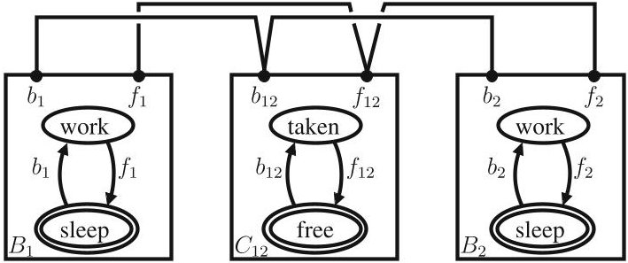

Fig.1. Mutual exclusion model in BIP

is described by Labelled Transition Systems (LTS) having transitions labelled with ports. Ports form the interface of a component and are used to define its interactions with other components. Second, interaction models, i.e. sets of interactions, define the component coordination. Interactions are sets of ports that define allowed synchronisations between components. An interaction model is

<!-- PDF_PAGE: 4 -->

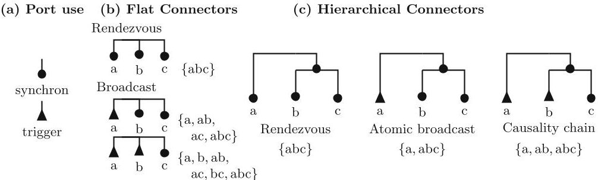

Fig.2. Flat and hierarchical BIP connectors

defined in a structured manner by using connectors [9]. Third, priorities are used to impose scheduling constraints and to resolve conflicts when multiple interactions are enabled simultaneously.

Figure 1 shows a simple BIP model for mutual exclusion between two tasks. It has two components $ B_{1}, $ $ B_{2} $ modelling the tasks and one coordinator component $ C_{12} $ . Initial states of the components are shown with double lines. The four binary connectors synchronise each of the actions $ b_{1}, $ $ b_{2} $ (resp. $ f_{1}, $ $ f_{2} $ ) of the tasks with the action $ b_{12} $ (resp. $ f_{12} $ ) of the coordinator.

Connectors define sets of interactions based on the synchronisation attributes of the connected ports, which may be either trigger or synchron (Fig.2a). If all connected ports are synchrons, then synchronisation is by rendezvous, i.e. the defined interaction may be executed only if all the connected components allow the transitions of those ports (Fig.2b). If a connector has at least one trigger, the synchronisation is by broadcast, i.e. the allowed interactions are all non-empty subsets of the connected ports comprising at least one of the trigger ports (Fig.2b). More complex connectors can be built hierarchically (Fig.2c).

An architecture can be viewed as a BIP model, where some of the atomic components are considered as coordinators, while the rest are parameters. When an architecture is applied to a set of components, these components are used as operands to replace the parameters of the architecture. Clearly, operand components must refine the corresponding parameter ones—in that sense, parameter components can be considered as types. $ ^{2} $ Figure 3 shows an architecture that enforces the mutual exclusion property $ \mathsf{A G} \neg ( c s_{1} \wedge c s_{2} ) $ on any two components with interfaces $ \{b_{1}, f_{1}\} $ and $ \{b_{2}, f_{2}\} $ satisfying the CTL formula $ \mathsf{A G} \big( f_{i} \rightarrow \mathsf{A} [ \neg c s_{i} \mathsf{W} b_{i} ] \big) $ , where $ cs_{i} $ is an atomic predicate, true when the component is in the critical section (e.g. in the state work, for $ B_{1}, B_{2} $ of Fig.1). Composition of architectures is based on an associative, commutative and idempotent architecture composition operator $ \mathrm{‘\oplus’} $ [2]. If two

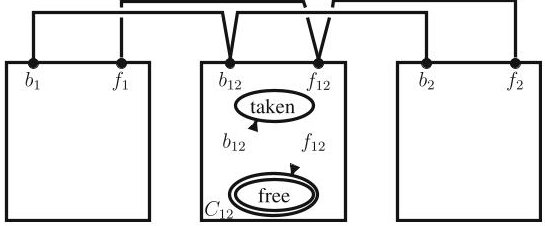

Fig. 3. Mutual exclusion architecture

<!-- PDF_PAGE: 5 -->

architectures $ \mathcal{A}_{1} $ and $ \mathcal{A}_{2} $ enforce respectively safety properties $ \varPhi_{1} $ and $ \varPhi_{2} $ , the composed architecture $ \mathcal{A}_{1}\oplus \mathcal{A}_{2} $ enforces the property $ \varPhi_{1}\wedge \varPhi_{2} $ , that is both properties are preserved by architecture composition.

Although the architecture in Fig.3 can only be applied to a set of precisely two components, it is clear that an architecture of the same style—with n parameter components and 2n connectors—could be applied to any set of operand components satisfying the above CTL formula. We use architecture diagrams [24] to specify such architecture styles, as described in the next section. (See Fig.6 in Sect. 3.1 for the diagram of the style generalising the architecture in Fig.3.)

The architecture-based design approach consists of the three stages illustrated in Fig.4. First, architecture styles relevant for the application domain—in our case, nano- and picosatellite onboard software—are identified and formally modelled. Ideally, this stage is only realised once for each application domain. The remaining stages are applied for each system to be designed. In the second, design stage, requirements to be satisfied by the system are analysed and formalised, atomic components realising the basic functionality of the system are designed (components previously designed for other systems can be reused) and used as operands for the application of architectures instantiated from the styles defined in the first stage. The choice of the architectures to apply is driven by the requirements identified in the second stage. Finally, the resulting system is checked for deadlock-freedom. Properties, which are not enforced by construction through architecture application, must be verified a posteriori. In this case study, we illustrate all steps of this process, except the requirement formalisation.

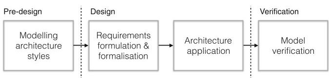

Fig. 4. Architecture-based design flow

In the first stage, we use architecture diagrams [24] to model the architecture styles identified in the case study. An architecture diagram consists of a set of component types, with associated cardinality constraints representing the expected number of instances of each component type and a set of connector motifs. Connector motifs, which define sets of BIP connectors, are non-empty sets of port types, each labelled as either a trigger or a synchron. Each port type has a cardinality constraint representing the expected number of port instances per component instance and two additional constraints: multiplicity and degree, represented as a pair m:d. Multiplicity constrains the number of instances of the port type that must participate in a connector defined by the motif; degree constrains the number of connectors attached to any instance of the port type.

Cardinalities, multiplicities and degrees are either natural numbers or intervals. The interval attributes, 'mc' (multiple choice) or 'sc' (single choice), specify whether these constraints are uniformly applied or not. Let us consider, a port type p with associated intervals defining its multiplicity and degree. We write 'sc[x,y]' to mean that the same multiplicity or degree is applied to each port instance of p. We write 'mc[x,y]' to mean that different multiplicities or degrees can be applied to different port instances of p, provided they lie in the interval.

<!-- PDF_PAGE: 6 -->

For the specification of behavioural properties enforced by architecture styles, as well as those assumed for the parameter components, we use the Computation Tree Logic (CTL). We only provide a brief overview, referring the reader to the classical textbook [3] for a complete and formal presentation. CTL formulas specify properties of execution trees generated by LTSs. The formulas are built from atomic predicates on the states of the LTS, using the several operators, such as EX, AX, EF, AF, EG, AG (unary) and E $ [\cdot\mathrm{U} \cdot] $ , A $ [\cdot\mathrm{U} \cdot] $ , E $ [\cdot\mathrm{W} \cdot] $ , A $ [\cdot\mathrm{W} \cdot] $ (binary). Each operator consists of a quantifier on the branches of the tree and a temporal modality, which together define when in the execution the operand sub-formulas must hold. The intuition behind the letters is the following: the branch quantifiers are A (for "All") and E (for "Exists"); the temporal modalities are X (for "neXt"), F (for "some time in the Future"), G (for "Globally"), U (for "Until") and W (for "Weak until"). A property is satisfied if it holds in the initial state of the LTS. For instance, the formula $ \mathrm{A}[p\mathrm{W}q] $ specifies that in all execution branches the predicate p must hold up to the first state (not including this latter), where the predicate q holds. Since we used the weak until operator W, if q never holds, p must hold forever. As soon as q holds in one state of an execution branch, p need not hold any more, even if q does not hold. On the contrary, the formula $ \mathrm{A G A}[p\mathrm{W}q] $ specifies that the subformula $ \mathrm{A}[p\mathrm{W}q] $ must hold in all branches at all times. Thus, p must hold whenever q does not hold, i.e. $ \mathrm{A G A}[p\mathrm{W}q] = \mathrm{A G}(p \vee q). $

## 3 Case Study

CubETH is a nanosatellite based on the CubeSat standard [15]. It contains the following subsystems: EPS (electrical power subsystem), CDMS (command and data management subsystem), COM (telecommunication subsystem), ADCS (attitude determination and control subsystem), PL (payload) and the mechanical structure including the antenna deployment subsystem.

This case study is focused on the software running on the CDMS subsystem and in particular on the following subcomponents of CDMS: (1) CDMS status that is in charge of resetting internal and external watchdogs; (2) Payload that is in charge of payload operations; (3) three Housekeeping components that are used to recover engineering data from the EPS, PL and COM subsystems; (4) CDMS Housekeeping which is internal to the CDMS; (5) I2C_sat that implements the $ I^{2} C $ protocol; (6) Flash memory management that implements a non-volatile flash memory and its write-read protocol; (7) the s3_5, s3_6, s15_1 and s15_2 services that are in charge of the activation or deactivation of the housekeeping component actions; (8) Error Logging that implements a RAM region that is accessible by many users and (9) the MESSAGE_LIBRARY, MEMORY_LIBRARY and I2C_sat_LIBRARY components that contain auxiliary C/C++ functions.

A high-level BIP model of the case-study is shown in Fig. 5. For the sake of simplicity, we omit some of the connectors. In particular, we show the connectors involving the HK_to_MEM, HK_to_I2C and HK_to_I2C_NOFAIL interfaces of the HK_COM subsystem, but we omit the respective connectors involving the other three Housekeeping subsystems. The MESSAGE_LIBRARY, MEMORY_LIBRARY,

<!-- PDF_PAGE: 7 -->

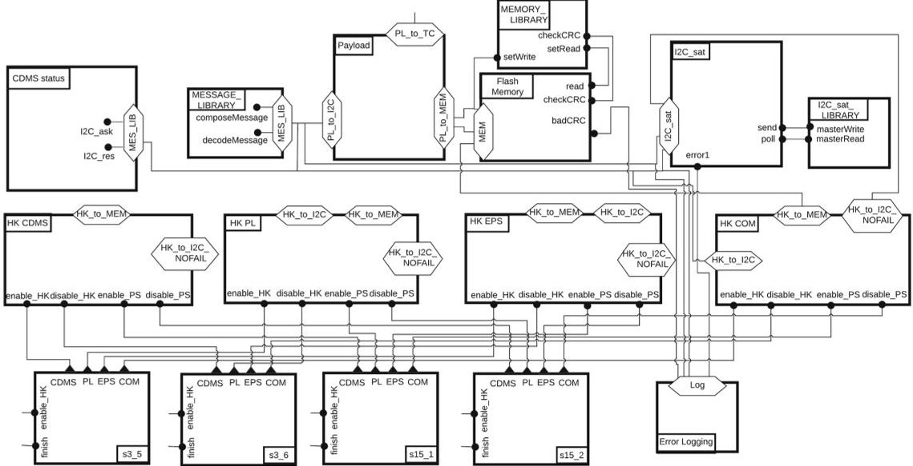

Fig. 5. The high-level interaction model

I2C_sat_LIBRARY, s3_5, s3_6, s15_1 and s15_2 components are atomic. The rest are composite components, i.e. compounds.

The full BIP model of the case study can be found in the technical report [23]. It comprises 22 operand components and 27 architectures that were generated from the architecture styles presented in the next subsection.

## 3.1 A Taxonomy of Architecture Styles for On-Board Software

We have identified 9 architecture styles from the BIP model obtained in [29]. In this section, we present 5 styles (all styles are presented in the technical report [23]). Since the identified architecture styles represent recurring patterns of satellite on-board software, the usage of the presented taxonomy is not limited to this case-study. The identified styles can also be used for the design and development of other satellite on-board systems.

For each architecture style, we have studied two groups of properties: (1) assumed properties that the operand components must satisfy so that the architecture can be successfully applied on them and (2) characteristic properties that are properties the architecture imposes on the system. In this case study, all characteristic properties are safety properties. Due to space limitations, in the next subsections, for all architecture styles except for Mutual exclusion, we omit their assumed properties. These can be found in the technical report [23].

The styles are specified by using architecture diagrams. Below, for the sake of clarity, we omit the port type cardinality if it is equal to 1. The cardinality of a component type is indicated right next to its name.

The Mutual Exclusion Style (Figure 6) generalises the architecture in Fig. 3. It enforces mutual exclusion on a shared resource (see Sect. 2).

<!-- PDF_PAGE: 8 -->

The unique—due to the cardinality being 1—coordinator component, Mutex manager, manages the shared resource, while n parameter components of type B can access it. The multiplicities of all port types are 1, hence all connectors are binary. The degree

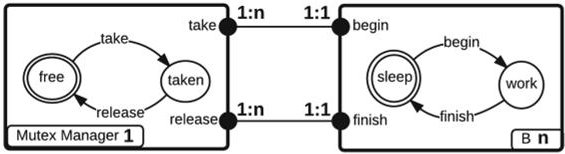

Fig. 6. Mutual exclusion style

constraints require that each port instance of a component of type B be attached to a single connector and each port instance of the coordinator be attached to n connectors. The behaviours of the two component types enforce that once the resource is acquired by a component of type B, it can only be released by the same component. The assumed and characteristic properties of this style were presented in Sect. 2.

The Client-Server Style (Figure 7) ensures that only one client can use a service offered by the server at each time. It consists of two parameter component types Server and Client with 1 and n instances, respectively. In the diagram of Fig. 7, the Server provides two services through port types offer and offer2. The Client has two port types use and use2. Since the cardinalities of offer and offer2 are k and $ k^{\prime} $ , respectively, each component instance of type Server has k port instances of type offer and $ k^{\prime} $ port instances of type offer2. Similarly, each component instance of type Client has m port instances of type use and $ m^{\prime} $ port instances of type use2.

Two connector motifs connect use (resp. use2) with offer (resp. offer2). The multiplicity:degree constraints of offer and use are 1:nm and 1:k, respectively. Since both multiplicities are 1, all connectors are binary. Because of the degree constraints, each port instance of use must be attached to k connectors, while each port instance of offer must be attached to nm connectors, i.e. all port instances of use are connected to all port instances of offer. An architecture of this style is shown in Fig. 12.

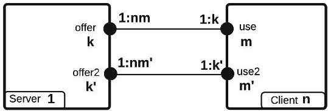

Fig.7. Client-Server style

The characteristic property of this style is 'only one client can use a provided service at each time', formalised by the CTL formula:

$$
\begin{array}{l} \forall i, j \leqslant n, \forall p \leqslant k, \mathrm {A G} \left(\neg \mathrm {C l i e n t} [ i ]. \mathrm {u s e} [ p ] \wedge \mathrm {C l i e n t} [ j ]. \mathrm {u s e} [ p ]\right), \\ \forall i, j \leqslant n, \forall p \leqslant k, \mathrm {A G} \left(\neg \mathrm {C l i e n t} [ i ]. \mathrm {u s e 2} [ p ] \wedge \mathrm {C l i e n t} [ j ]. \mathrm {u s e 2} [ p ]\right). \\ \end{array}
$$

The Action Flow Style (Figure 8) enforces a sequence of actions. It has one coordinator component of type Action Flow Manager and n parameter components of type B. The cyclic behaviour of the coordinator enforces an order on the actions of the operands. In the manager's behaviour, abi and aei stand for "action i begin" and "action i end".

<!-- PDF_PAGE: 9 -->

Each operand component c of type B provides $ n_{a}^{c} $ port instances of type actBegin and of type actEnd. Notice that $ n_{a}^{c} $ might be different for different operands of type B. The cardinalities of port types ab and ae are both equal to $ N=\sum_{c:B} n_{a}^{c} $ , where the sum is over all operands of type B. The multiplicity and degree constraints require that there be only binary connectors. An architecture of this style is shown in Fig. 11.

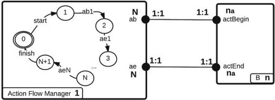

Fig. 8. Action flow style

The characteristic property of this style is the conjunction of (a) 'on each action flow's execution, every action begins only after its previous action has ended' (b) 'on each flow execution, every action occurs at most once' (c) 'the flow finishes only after the last action has ended', formalised by the following CTL formulas, in which the index i denotes the position of an action in the action flow. We consider the following mappings:

- from indices to components $seq_{c}:[1,N]\rightarrow C$, where C is a set containing all operands that execute an action;

- from indices to actions $ seq_{a}:[1,N]\rightarrow A $ , where A is a set containing all actions of the operands,

such that the action $seq_{a}(i)$ belongs to the component $seq_{c}(i)$.

$$
\forall 1 < i \leqslant N, \mathrm {A G} \left(s t a r t \rightarrow
$$

$$
\mathrm {A X} \mathrm {A} \left[ \neg B \left[ \operatorname {s e q} _ {c} (i) \right]. \operatorname {a c t B e g i n} \left[ \operatorname {s e q} _ {a} (i) \right] \mathrm {W} B \left[ \operatorname {s e q} _ {c} (i) \right]. \operatorname {a c t E n d} \left[ \operatorname {s e q} _ {a} (i - 1) \right] \right]),
$$

$$
\forall 1 \leqslant i \leqslant N, \mathrm {A G} \left(B [ s e q _ {c} (i)]. a c t B e g i n [ s e q _ {a} (i) ] \rightarrow
$$

$$
\mathrm {A X} \quad \mathrm {A} \left[ \neg B \left[ \operatorname {s e q} _ {c} (i) \right]. \operatorname {a c t B e g i n} \left[ \operatorname {s e q} _ {a} (i) \right] \mathrm {W} \operatorname {s t a r t} \right] \big),
$$

$$
\mathrm {A G} \left(s t a r t \rightarrow \mathrm {A X} \mathrm {A} [ \neg f i n i s h \mathrm {W} B [ s e q _ {c} (i) ]. a c t E n d [ N ] ]\right).
$$

The Failure Monitoring Style (Figure 9) provides monitor components that observe the state of other components. It consists of n coordinator components of type Failure Monitor and n parameter components of type B1. The cardinality of all port types is 1. Multiplicities and degrees require that each B1 component instance be connected to its dedicated Failure monitor instance.

A B1 component may enter the following three states: NOMINAL, ANOMALY and CRITICAL_FAILURE. When in NOMINAL state, the component is performing correctly. If the component cannot be reached, or if the engineering data is not correct the component enters the ANOMALY state. If a fixed

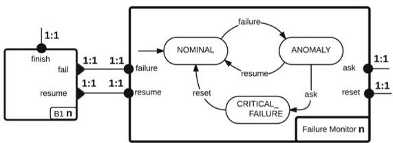

Fig. 9. Failure monitoring style

time has passed in which the component has remained in ANOMALY, the component enters the CRITICAL_FAILURE state. An architecture of this style is shown in Fig. 13.

<!-- PDF_PAGE: 10 -->

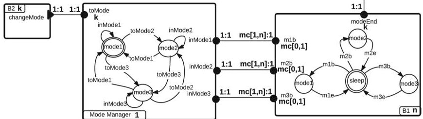

Fig.10. Mode management style (component behaviour is shown for k=3)

The characteristic property of this style is 'if a failure occurs, a finish happens only after a resume or reset', formalised by the following CTL formula:

$$
\forall c \leqslant n, \mathrm {A G} \left(B 1 [ c ]. f a i l \rightarrow \mathrm {A X} \mathrm {A} \left[ \neg B 1 [ c ]. f i n i s h \mathrm {W} \left(B 1 [ c ]. r e s u m e \vee r e s e t\right)\right]\right).
$$

The Mode Management Style (Figure 10) restricts the set of enabled actions according to a set of predefined modes. It consists of one coordinator of type Mode Manager, n parameter components of type B1 and k parameter components of type B2. Each B2 component triggers the transition of the Mode Manager to a specific mode. The coordinator manages which actions of the B1 components can be executed in each mode.

Mode Manager has k states one state per mode a port type toMode with cardinality k and k port types inMode with cardinality 1. Each port instance of type toMode must be connected through a binary connector with the changeMode port of a dedicated B2 component. B1 has k port types modeBegin with cardinality mc[0,1]. In other words, a component instance of B1 might have any number of port instances of types modeBegin from 0 until k. B1 has also a modeEnd port type with cardinality k. mib stands for "mode i begin" and indicates that an action that is enabled in mode i has begun its execution. mie stands for "mode i end" and indicates that an action that is enabled in mode i has finished its execution. Each inMode port instance of the Mode Manager must be connected with the corresponding modeBegin port instances of all B1 components through an n-ary connector. An architecture of this style is shown in Fig. 14.

The characteristic property of this style is 'an action is only performed in a mode where it is allowed', formalised by the following CTL formula:

$$
\forall i \leqslant k, \mathrm {A G} \left(B 1. m [ i ] b \rightarrow M o d e M a n a g e r. i n M o d e [ i ]\right).
$$

## 3.2 BIP Model Design by Architecture Application

We illustrate the architecture-based approach on the CDMS status, MESSAGE_LIBRARY and HK PL components. In particular, we present the application of Action flow, Mode management, Client-Server and Failure monitoring architectures to discharge a subset of CubETH functional requirements (Table 1). We additionally present the result of the composition of Client-Server and Mode management architectures. The full list of requirements is provided in [23].

<!-- PDF_PAGE: 11 -->

Table 1. Representative requirements for CDMS status and HK_PL

<table border="1"><tr><td>ID</td><td>Description</td></tr><tr><td>CDMS-007</td><td>The CDMS shall periodically reset both the internal and external watchdogs and contact the EPS subsystem with a “heartbeat”</td></tr><tr><td>HK-001</td><td>The CDMS shall have a Housekeeping activity dedicated to each subsystem</td></tr><tr><td>HK-003</td><td>When line-of-sight communication is possible, housekeeping information shall be transmitted through the COM subsystem</td></tr><tr><td>HK-004</td><td>When line-of-sight communication is not possible, housekeeping information shall be written to the non-volatile flash memory</td></tr><tr><td>HK-005</td><td>A Housekeeping subsystem shall have the following states: NOMINAL, ANOMALY and CRITICAL_FAILURE</td></tr></table>

Application of Action Flow Architecture. Requirement CDMS-007, presented in Table 1, describes the functionality of CDMS status. The corresponding BIP model is shown in Fig. 11. Watchdog reset is an operand component, which is responsible for resetting the internal and external watchdogs. CDMS status ACTION FLOW is the coordinator of the architecture applied on Watchdog reset that imposes the following order of actions: (1) internal watchdog reset; (2) external watchdog reset; (3) send heartbeat and (4) receive result.

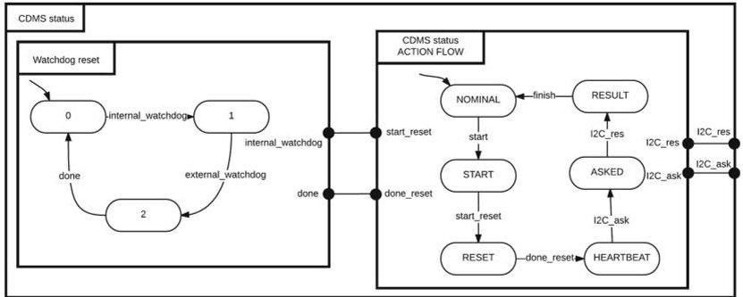

Fig.11. Application of Action flow architecture

Application of Client-Server Architecture. Requirements HK-001 and HK-003, presented in Table1, suggest the application of the Client-Server architecture on the HK PL, HK CDMS, HK EPS and HK COM housekeeping compounds (Fig.5). The four housekeeping compounds are the clients of the architecture. In Fig.12a, we show how Client-Server is applied on the HK PL process component, which is a subcomponent of HK PL. HK PL process uses the composeMessage and decodeMessage C/C++ functions of the MESSAGE_LIBRARY component to encode and decode information transmitted to and from the COM subsystem. Thus, the MESSAGE_LIBRARY is a server used by the HK PL process client. To enhance readability of figures in Fig.12a, we use hexagons to group interaction patterns of components. The meaning of these hexagons is explained in Fig.12b.

<!-- PDF_PAGE: 12 -->

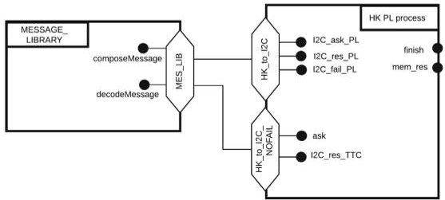

(a) Architecture application

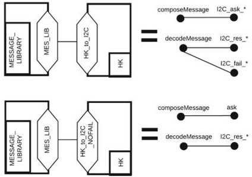

(b) Hexagons of Fig. 12a

Fig.12. Application of Client-Server architecture

Application of Failure Monitoring Architecture. Requirement HK-005 presented in Table 1, suggests the application of the Failure monitoring architecture as shown in Fig. 13. The BIP model comprises the HK PL process operand and the HK PL FAILURE MONITORING coordinator. The success port of HK PL FAILURE MONITORING is connected with the mem_res and I2C_res_TTC ports of HK PL process. The failure port of HK PL FAILURE MONITORING is connected with the I2C_fail_PL port of HK PL process. The HK PL process component executes 6 actions in the following order: (1) start procedure; (2) ask Payload for engineering data; (3) receive result from Payload or (in case of fail) abort; (4) if line of sight communication is possible send data to COM, if line of sight communication is not possible make a write request to the memory; (5) depending on action 4 either receive COM result or memory result and (6) finish procedure.

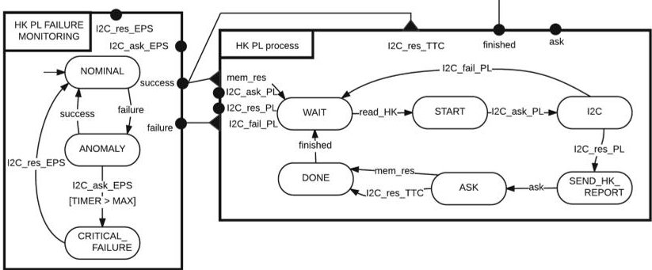

Fig.13. Application of Failure monitoring architecture

Application of Mode Management Architecture. Requirements HK-003 and HK-004, presented in Table 1, suggest the application of a Mode management architecture with two modes: (1) TTC mode, in which line of sight communication is possible and (2) MEMORY mode, in which line of sight communication is not possible. The corresponding BIP model, shown in Fig. 14, comprises the HK PL process, s15_1 and s15_2 operands and the Packet store MODE MANAGER coordinator. During NOMINAL operation, the Payload subsystem is contacted

<!-- PDF_PAGE: 13 -->

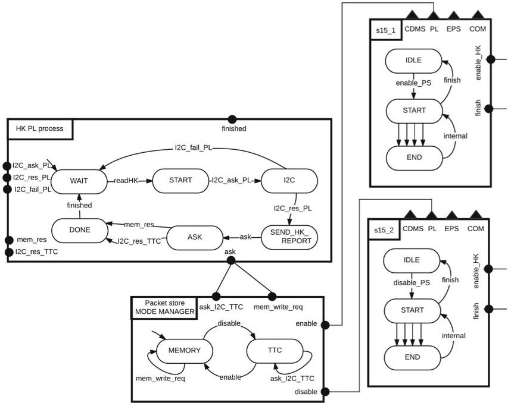

Fig.14. Application of Mode management architecture

to retrieve engineering data. Depending on the mode of Packet store MODE MANAGER, those data is then sent to the non-volatile memory, i.e. mem_write_req transition, or directly to the COM subsystem, i.e. ask_I2C_TTC transition. The mode of Packet store MODE MANAGER is triggered by the s15_1, s15_2 services.

Composition of Architectures. The architecture composition was formally defined in [2]. Here, we provide only an illustrative example. Combined application of architectures to a common set of operand components results in merging the connectors that involve ports used by several architectures. For instance, Fig. 15 shows the composition of Client-Server and Mode management architectures. The HK PL process component is a sub-component of HK PL. The application of the Client-Server architecture (Fig. 12) connects its port ask with the port composeMessage of MESSAGE_LIBRARY through the MES_LIB-HK_to_I2C interface with a binary connector. Similarly, the application of the Mode management architecture (Fig. 14) connects the same port with the port ask_I2C_TTC of Packet store MODE MANAGER with another binary connector. The composition of the two architectures results in the two connectors being merged into the ternary connector ask-ask_I2C_TTC-composeMessage (Fig. 15).

## 3.3 Model Verification

Recall (Sect. 2) that safety properties imposed by architectures are preserved by architecture composition [2]. Thus, all properties that we have associated to the CubETH requirements are satisfied by construction by the complete model of the case study example, which is presented in [23].

<!-- PDF_PAGE: 14 -->

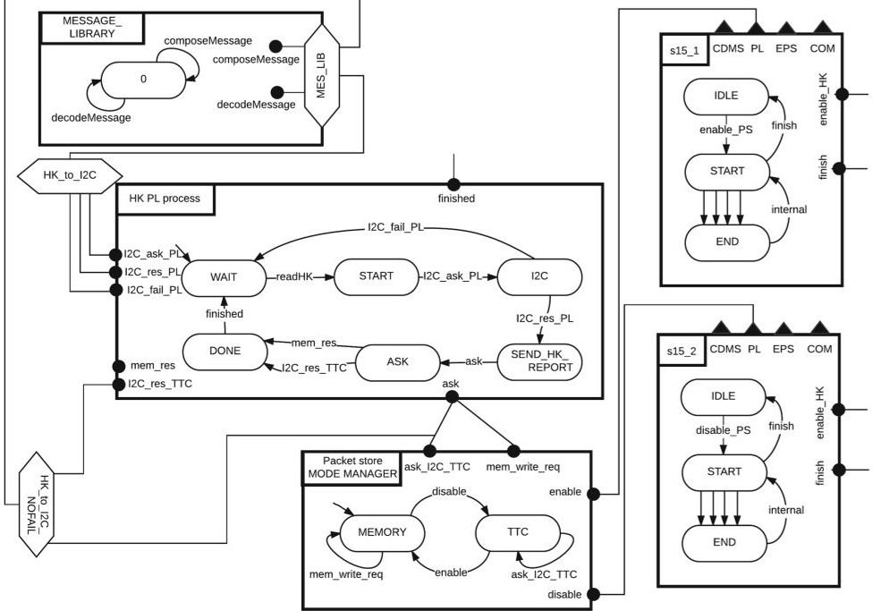

Fig.15. Composition of Client-Server and Mode management architectures

Architectures enforce properties by restricting the joint behaviour of the operand components. Therefore, combined application of architectures can generate deadlocks. We have used the D-Finder tool [7] to verify deadlock-freedom of the case study model. D-Finder applies compositional verification on BIP models by over-approximating the set of reachable states, which allows it to analyse very large models. The tool is sound, but incomplete: due to the above mentioned over-approximation it can produce false positives, i.e. potential deadlock states that are unreachable in the concrete system. However, our case study model was shown to be deadlock-free without any potential deadlocks. Thus, no additional reachability analysis was needed.

## 3.4 Validation of the Approach

The key advantage of our architecture-based approach is that the burden of verification is shifted from the final design to architectures, which are considerably smaller in size and can be reused. In particular, all the architecture styles that we have identified for the case study are simple. Their correctness-enforcing the characteristic properties—can be easily proved by inspection of the coordinator behaviour. However, in order to increase the confidence in our approach, we have conducted additional verification, using nuXmv to verify that the characteristic properties of the architectures are, indeed, satisfied. We used the BIP-to-NuSMV tool $ ^{3} $ to translate our BIP models into NuSMV—the nuXmv input language [10].

<!-- PDF_PAGE: 15 -->

Table 2. Statistics of models and verification

<table border="1"><tr><td>Model</td><td>Tool</td><td>Components</td><td>Connectors</td><td>RSS</td><td>Deadlocks</td><td>Properties</td></tr><tr><td>CubETH</td><td>D-Finder</td><td>49</td><td>155</td><td>-</td><td>0</td><td>-</td></tr><tr><td>Payload</td><td>nuXmv</td><td>13</td><td>42</td><td>8851</td><td>0</td><td>9</td></tr><tr><td>I2C_sat</td><td>nuXmv</td><td>4</td><td>12</td><td>52</td><td>0</td><td>1</td></tr><tr><td>HK PL</td><td>nuXmv</td><td>11</td><td>12</td><td>77274</td><td>0</td><td>5</td></tr><tr><td>HK EPS</td><td>nuXmv</td><td>11</td><td>12</td><td>77274</td><td>0</td><td>5</td></tr><tr><td>HK COM</td><td>nuXmv</td><td>11</td><td>12</td><td>77274</td><td>0</td><td>5</td></tr><tr><td>HK CDMS</td><td>nuXmv</td><td>10</td><td>9</td><td>12798</td><td>0</td><td>5</td></tr><tr><td>Flash Memory</td><td>nuXmv</td><td>6</td><td>15</td><td>44</td><td>0</td><td>3</td></tr><tr><td>CDMS status</td><td>nuXmv</td><td>3</td><td>6</td><td>8</td><td>0</td><td>4</td></tr><tr><td>Error Logging</td><td>nuXmv</td><td>2</td><td>2</td><td>2</td><td>0</td><td>1</td></tr></table>

RSS = Reachable State Space

Verification of the complete model with nuXmv did not succeed, running out of memory after four days of execution. Thus, we repeated the procedure (BIPto-NuSMV translation and verification using nuXmv) on individual sub-systems. All connectors that crossed sub-system boundaries were replaced by their corresponding sub-connectors. This introduces additional interactions, hence, also additional execution branches. Since no priorities are used in the model, this modification does not suppress any existing behaviour. Notice that the CTL properties enforced by the presented architecture styles use only universal quantification (A) over execution branches. Hence, the above approach is a sound abstraction, i.e. the fact that the properties were shown to hold in the subsystems immediately entails that they also hold in the complete model. The complete list of CTL formulas is presented in [23]. Table 2 presents the complexity measures of the verification, which was carried out on an Intel Core i7 at 3.50 GHz with 16 GB of RAM. Notice that component count in sub-systems adds up to more than 49, because some components contribute to several sub-systems.

## 4 Related Work

The European Space Agency (ESA) advocates a model-based design flow rather than a document-centric approach. To this end, a series of funded research initiatives has delivered interesting results that are worth mentioning. The Space Avionics Open Interface Architecture (SAVOIR) $ ^{4} $ project introduces the On-board Software Reference Architecture (OSRA) [20] that imposes certain structural constraints through the definition of the admissible types of software components and patterns of interaction among their instances. The ASSERT Set of Tools for Engineering (TASTE) $ ^{5} $ [30] is more appropriate for the detailed

<!-- PDF_PAGE: 16 -->

software design and model-based code generation. In TASTE, the architectural design is captured through a graphical editor that generates a model in the Architecture Analysis & Design Language (AADL). However, the AADL semantics is not formally defined, which inhibits it from being used for rigorous design or formal verification purposes. The Correctness, Modeling and Performance of Aerospace Systems (COMPASS) $ ^{6} $ toolset relies on an AADL variant with formally defined semantics called SLIM and provides means for a posteriori formal verification [13]. A formal semantics for the AADL has been defined in BIP, along with a translation of AADL models into the BIP language [16]. The rigorous design approach based on correct-by-construction steps is applied in the Functional Requirements and Verification Techniques for the Software Reference Architecture (FoReVer) $ ^{7} $ and the Catalogue of System and Software Properties (CSSP) projects. The former initiative advocates a top-down design flow by imposing behavioural contracts on individual components [8], while the latter adopts our architecture-based design flow relying on BIP.

Although a number of frameworks exist for the specification of architectures [25,28,35], model design and code generation [1,6,12,34], and verification [11,17,21], we are not aware of any that combine all these features. In particular, to the best of our knowledge, our approach is the first application of requirement-driven correct-by-construction design in the domain of satellite onboard software, which relies on requirements to define a high-level model that can be directly used to generate executable code for the satellite control [29].

BIP has previously been used for the design of control software. The applications closest to ours are the initial design of the CubETH [29] and the DALA robot [5] control software. While the latter design followed a predefined software architecture (in the sense of [4]), the former was purely ad-hoc. Neither was driven by a detailed set of requirements.

In [18], the authors describe the interfacing of Temporal Logic Planning toolbox (TuLiP) with the JPL Statechart Autocoder (SCA) for the automatic generation of control software. The TuLiP toolbox generates from statechart models from high-level specifications expressed as formulas of particular form in the Linear Temporal Logic (LTL). SCA is then used to generate Python, C or C++ code from the obtained statecharts. This approach is grounded in formal semantics, it provides correctness guarantees through the automatic synthesis of control behaviour. Furthermore, the transition through statecharts allows the use of graphical tools to visualise the controller behaviour. However, it also has some limitations. Most notably, it focuses exclusively on the synthesis of one controller component and is not easily amenable to the holistic design of complete software systems involving concurrent components.

<!-- PDF_PAGE: 17 -->

## 5 Conclusion and Future Work

Based on previous work [29], we have analysed the command and data management sub-system (CDMS) of the CubETH nanosatellite on-board software (OBSW), concentrating primarily on safety and modularity of the software. Starting from a set of informal requirements, we have used the architecturebased approach [2] to design a BIP model of the CDMS sub-system. We have illustrated the key steps of the BIP model design, discussed and evaluated the verification and validation procedures.

The architecture-based approach consists in the application of a number of architectures starting with a minimal set of atomic components. Each architecture enforces by construction a characteristic safety property on the joint behaviour of the operand components. The combined application of architectures is defined by an associative and commutative operator [2], which guarantees the preservation of the enforced properties. Since, architectures enforce properties by restricting the joint behaviour of the operand components, combined application of architectures can lead to deadlocks. Thus, the final step of the design process consists in verifying the deadlock-freedom of the obtained model. The key advantage of this approach is that the burden of verification is shifted from the final design to architectures, which are considerably smaller in size and can be reused. This advantage is illustrated by our verification results: while model-checking of the complete model was inconclusive, verification of deadlock-freedom took only a very short time, using the D-Finder tool.

The main contribution of the presented work is the identification and formal modelling—using architecture diagrams [24]—of 9 architecture styles, whereof 5 are presented in the paper (all styles are presented in the associated technical report [23]). Architecture styles represent recurring coordination patterns: those identified in the case study have been reused in the framework of a collaborative project funded by ESA and can be further reused in other satellite OBSW.

The case study serves as a feasibility proof for the use of architecture-based approach in satellite OBSW design. The modular nature of BIP allows iterative design for satellites in development and component reuse for subsequent missions. The automatic generation of C++ code provided by the BIP tool-set enables early prototyping and validation of software functionality even before the hardware platform is completely defined, also contributing to portability of designs. Indeed, the only non-trivial action required in order to use a different target platform is to recompile the BIP engine.

This case study opens a number of directions for future work. The most immediate consists in studying optimisation techniques, such as [27] to reduce the complexity overhead of the automatically generated models. In the framework of the ESA project, we are currently developing a tool for the automatic application and composition of architectures and a GUI tool for ontology-based specification of user requirements. We plan to integrate these, together with the BIP framework, into a dedicated tool-chain for OBSW design, providing

<!-- PDF_PAGE: 18 -->

requirement traceability and early validation. We also plan to expand our taxonomy of architecture styles and study the application of parametrised model checking techniques for their formal verification. Finally, it would be interesting to extend the architecture-based approach to real-time systems. Composability of real-time architectures will require a notion of non-interference similar to that used to ensure the preservation of liveness properties in [2].

Acknowledgements. The work presented in this paper was partially funded by the ESA CSSP project (contract no. 4000112344/14/NL/FE). We would like to thank Andreas Jung, Marcel Verhoef and Marco Panunzio for the instructive discussions in the framework of this project, which have contributed to the clarification of some of the ideas realised in this case study. Finally, we are deeply grateful to the anonymous reviewers for their constructive comments.

## References

1. Arbab, F.: Reo: a channel-based coordination model for component composition Math. Struct. Comput. Sci. 14(3), 329-366 (2004)

2. Attie, P., et al.: A general framework for architecture composability. Formal Aspects Comput. 18(2), 207-231 (2016)

3. Baier, C., Katoen, J.-P.: Principles of Model Checking. Representation and Mind Series. The MIT Press, Cambridge (2008)

4. Bass, L., Clements, P., Kazman, R.: Software Architecture in Practice. SEI Series in Software Engineering, 3rd edn. Addison-Wesley Professional, New York (2012)

5. Basu, A., et al.: Incremental component-based construction and verification of a robotic system. In: ECAI, pp. 631-635. IOS Press (2008)

6. Basu, A., et al.: Rigorous component-based system design using the BIP framework. IEEE Softw. 28(3), 41-48 (2011)

7. Bensalem, S., Griesmayer, A., Legay, A., Nguyen, T.-H., Sifakis, J., Yan, R.: D-Finder 2: towards efficient correctness of incremental design. In: Bobaru, M., Havelund, K., Holzmann, G.J., Joshi, R. (eds.) NFM 2011. LNCS, vol. 6617, pp. 453-458. Springer, Heidelberg (2011). doi:10.1007/978-3-642-20398-5_32

8. Benveniste, A., et al.: Contracts for system design. Research report RR-8147, INRIA, November 2012

9. Bliudze, S., Sifakis, J.: The algebra of connectors-structuring interaction in BIP. IEEE Trans. Comput. 57(10), 1315-1330 (2008)

10. Bliudze, S., Cimatti, A., Jaber, M., Mover, S., Roveri, M., Saab, W., Wang, Q.: Formal verification of infinite-state BIP models. In: Finkbeiner, B., Pu, G., Zhang, L. (eds.) ATVA 2015. LNCS, vol. 9364, pp. 326-343. Springer, Cham (2015). doi:10. 1007/978-3-319-24953-7_25

11. Bloem, R., Cimatti, A., Greimel, K., Hofferek, G., Könighofer, R., Roveri, M., Schuppan, V., Seeber, R.: RATSY - a new requirements analysis tool with synthesis. In: Touili, T., Cook, B., Jackson, P. (eds.) CAV 2010. LNCS, vol. 6174, pp. 425-429. Springer, Heidelberg (2010). doi:10.1007/978-3-642-14295-6_37

12. Boulanger, J.-L., et al.: SCADE: Language and Applications, 1st edn. Wiley-IEEE Press, New York (2015)

13. Bozzano, M., et al.: Spacecraft early design validation using formal methods. Reliab. Eng. Syst. Saf. 132, 20-35 (2014)

<!-- PDF_PAGE: 19 -->

14. Brandon, C., Chapin, P.: A SPARK/Ada CubeSat control program. In: Keller, H.B., Plödereder, E., Dencker, P., Klenk, H. (eds.) Ada-Europe 2013. LNCS, vol. 7896, pp. 51-64. Springer, Heidelberg (2013). doi:10.1007/978-3-642-38601-5_4

15. California Polytechnic State University. CubeSat Design Specification Rev. 13 (2014). http://www.cubesat.org/s/cds_rev13_final2.pdf

16. Chkouri, M.Y., Robert, A., Bozga, M., Sifakis, J.: Translating AADL into BIP - application to the verification of real-time systems. In: Chaudron, M.R.V. (ed.) MODELS 2008. LNCS, vol. 5421, pp. 5-19. Springer, Heidelberg (2009). doi:10. 1007/978-3-642-01648-6_2

17. Cimatti, A., Dorigatti, M., Tonetta, S.: OCRA: a tool for checking the refinement of temporal contracts. In: ASE 2013, pp. 702-705, November 2013

18. Dathathri, S., et al.: Interfacing TuLiP with the JPL statechart autocoder: initial progress toward synthesis of flight software from formal specifications. In: IEEE AeroSpace (2016)

19. Gamma, E., et al.: Design Patterns: Elements of Reusable Object-Oriented Software. Addison-Wesley Professional, Boston (1994)

20. Jung, A., Panunzio, M., Terraillon, J.-L.: On-board software reference architecture Technical report TEC-SWE/09-289/AJ, SAVOIR Advisory Group (2010)

21. Kim, J.-S., Garlan, D.: Analyzing architectural styles with Alloy. In: ROSATEA 2006, pp. 70-80. ACM (2006)

22. Mavridou, A., Baranov, E., Bliudze, S., Sifakis, J.: Configuration logics: modelling architecture styles. In: Braga, C., Ölveczky, P.C. (eds.) FACS 2015. LNCS, vol. 9539, pp. 256-274. Springer, Cham (2016). doi:10.1007/978-3-319-28934-2_14

23. Mavridou, A., et al.: Architecture-based Design: A Satellite On-Board Software Case Study. Technical report 221156, EPFL, September 2016. https://infoscience. epfl.ch/record/221156

24. Mavridou, A., et al.: Architecture diagrams: a graphical language for architecture style specification. In: 9th ICE, EPTCS, vol. 223, pp. 83-97 (2016)

25. Medvidovic, N., Taylor, R.N.: A classification and comparison framework for software architecture description languages. IEEE Trans. Softw. Eng. 26(1), 70-93 (2000)

26. Mitchell, C., et al.: Development of a modular command and data handling architecture for the KySat-2 CubeSat. In: 2014 IEEE Aerospace Conference, pp. 1-11. IEEE, March 2014

27. Noureddine, M., Jaber, M., Bliudze, S., Zaraket, F.A.: Reduction and abstraction techniques for BIP. In: Lanese, I., Madelaine, E. (eds.) FACS 2014. LNCS, vol. 8997, pp. 288-305. Springer, Cham (2015). doi:10.1007/978-3-319-15317-9_18

28. Ozkaya, M., Kloukinas, C.: Are we there yet? analyzing architecture description languages for formal analysis, usability, and realizability. In: SEAA 2013, pp. 177- 184. IEEE (2013)

29. Pagnamenta, M.: Rigorous software design for nano and micro satellites using BIP framework. Master's thesis, EPFL (2014). https://infoscience.epfl.ch/record/ 218902

30. Perrotin, M., Conquet, E., Delange, J., Schiele, A., Tsiodras, T.: TASTE: a realtime software engineering tool-chain overview, status, and future. In: Ober, I., Ober, I. (eds.) SDL 2011. LNCS, vol. 7083, pp. 26-37. Springer, Heidelberg (2011). doi:10.1007/978-3-642-25264-8_4

31. Rossi, S., et al.: CubETH magnetotorquers: design and tests for a CubeSat mission. In: Advances in the Astronautical Sciences, vol. 153, pp. 1513-1530 (2015)

32. Sifakis, J.: Rigorous system design. Found. Trends $ ^{\textcircled{R}} $ Electron. Des. Autom. 6(4), 293-362 (2012)

<!-- PDF_PAGE: 20 -->

33. Spangelo, S.C., et al.: Model based systems engineering (MBSE) applied to Radio Aurora Explorer (RAX) CubeSat mission operational scenarios. In: 2013 IEEE Aerospace Conference, pp. 1-18. IEEE, March 2013

34. SysML. http://www.sysml.org

35. Woods, E., Hilliard, R.: Architecture description languages in practice session report. In: WICSA 2005, pp. 243-246. IEEE Computer Society (2005)