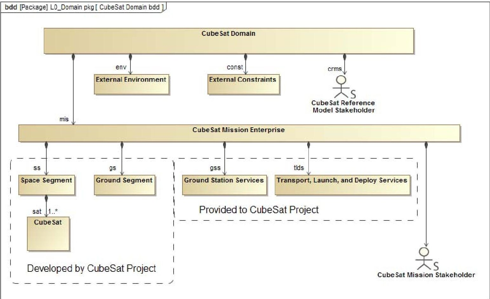
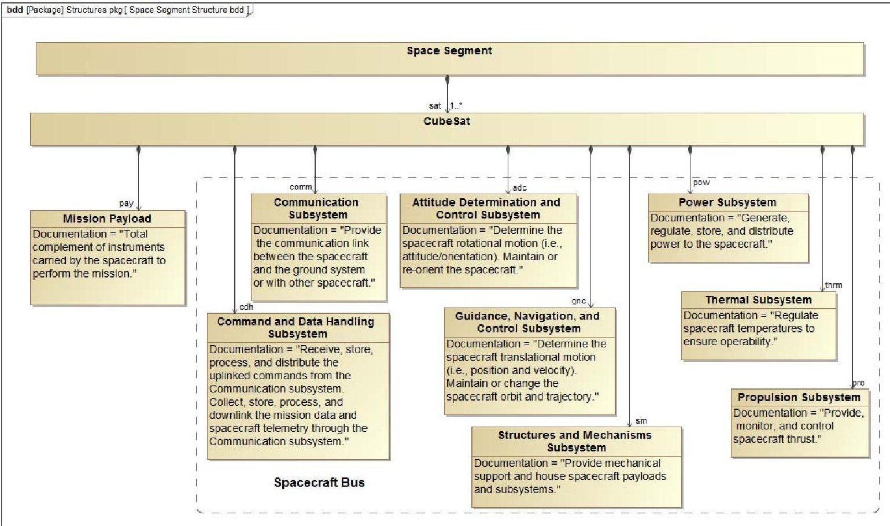
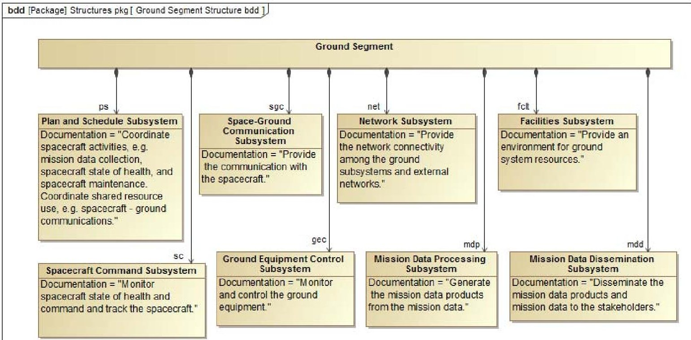
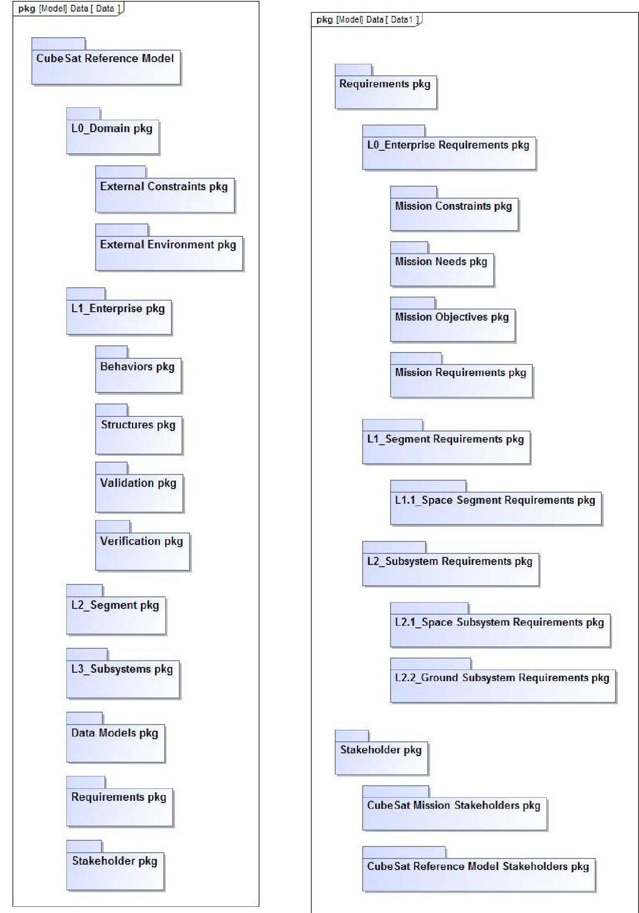
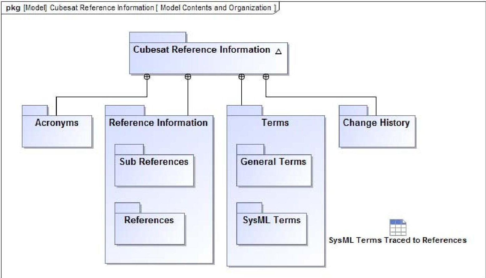
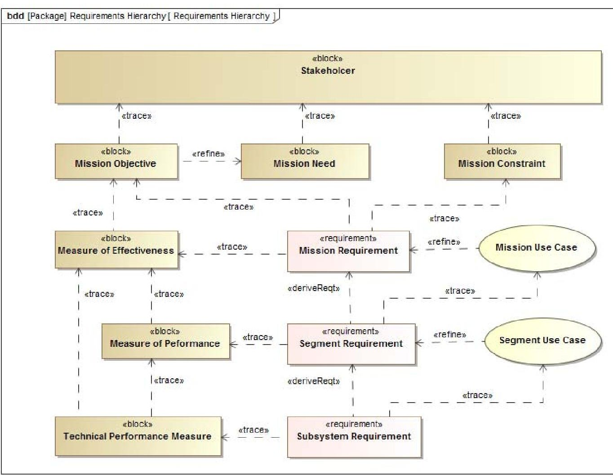
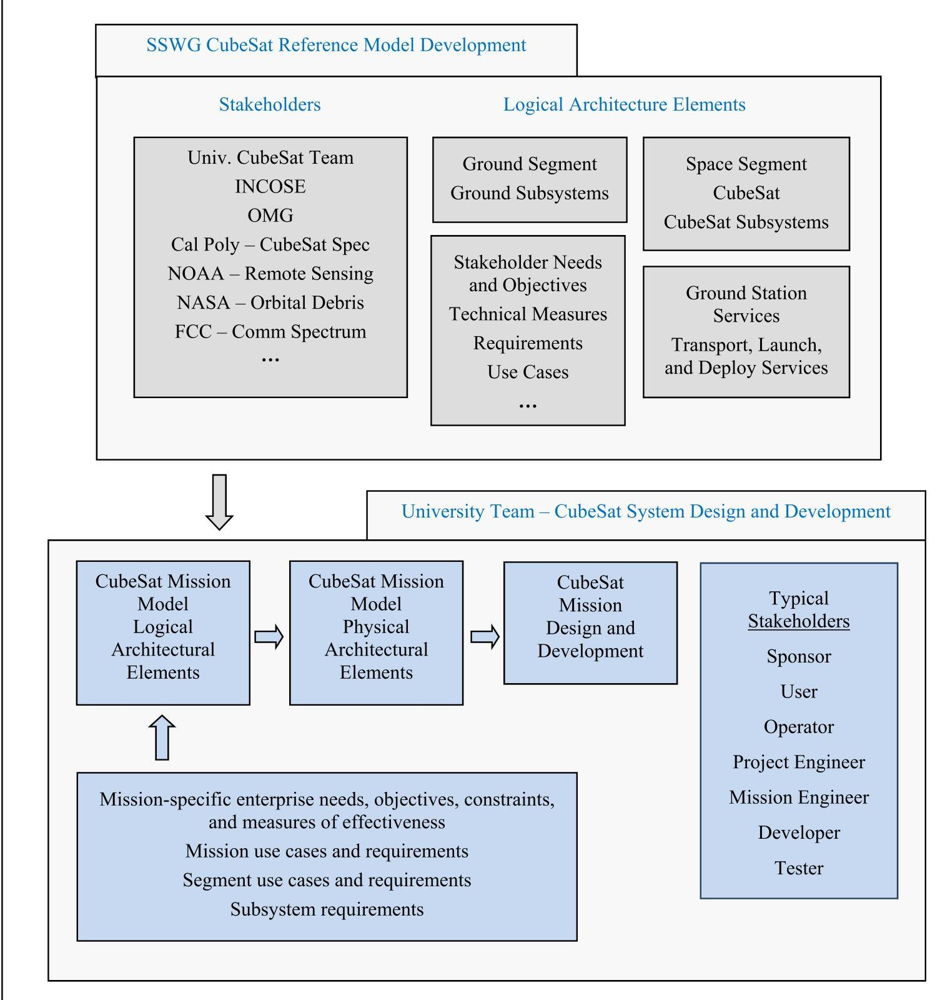
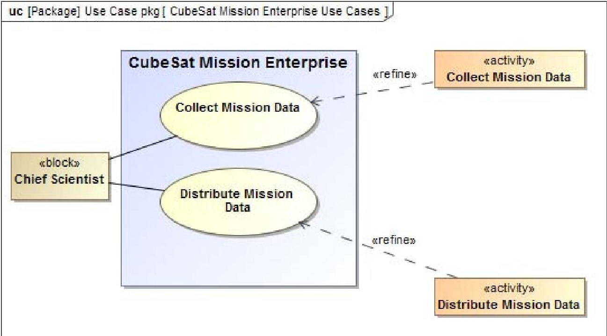
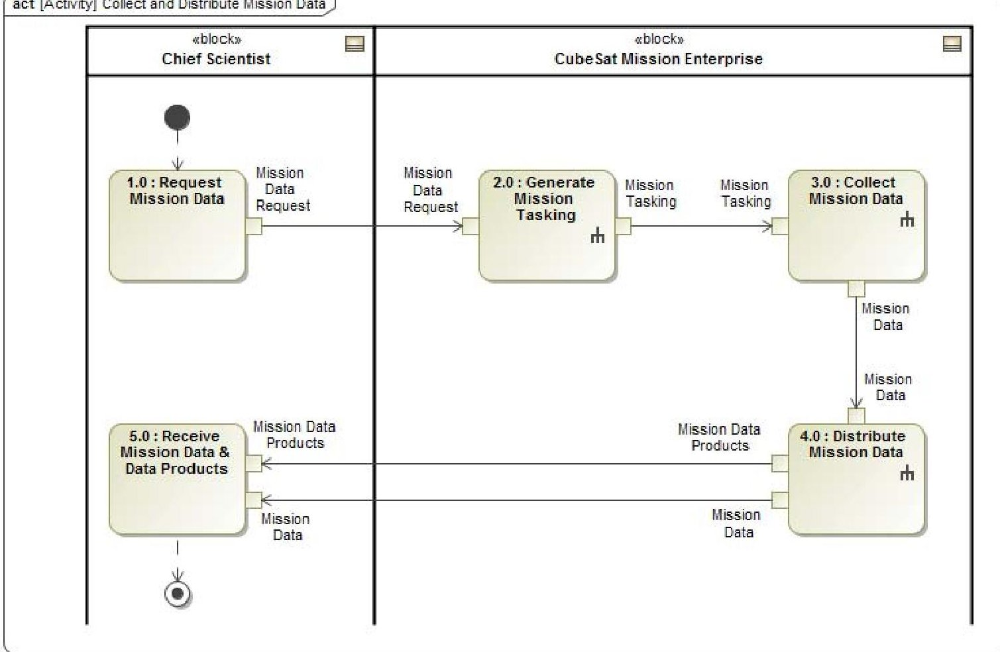
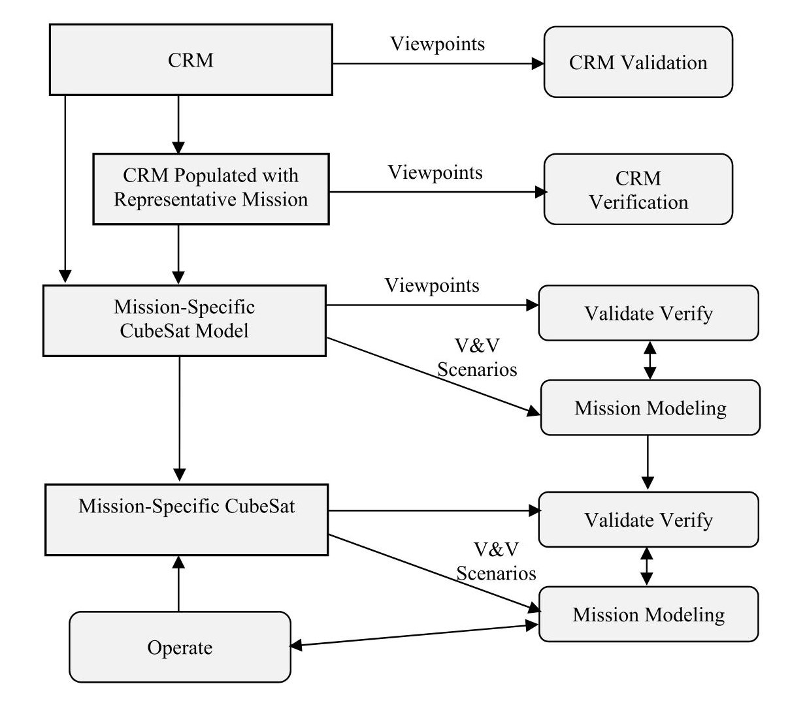

<!-- PDF_PAGE: 1 -->

# Developing a CubeSat Model-Based System Engineering (MBSE) Reference Model - Interim Status #3

David Kaslow Consultant Berwyn, PA 19312 610-405-6685 david.kaslow@gmail.com

Laura Hart The MITRE Corporation 7515 Colshire Drive McLean, VA 22102-7508 610 389-4534 lhart@mitre.org

Bradley Ayres The Aerospace Corp. 2310 E. El Segundo Blvd. El Segundo, CA 90245 937-255-3355 x3422 bradlev.avres.ctr@afit.edu

Philip T Cahill Consultant Bryn Mawr, PA 19010 610 787-0283 navyred@msn.com

Rose Yntema InterCAX 75 5th Street NW Suite 312 Atlanta GA 30308 404-592-6897 x101 rose.yntema@intercax.com

Abstract- Model-Based Systems Engineering (MBSE) is the formalized application of modeling to support key systems engineering tasks for addressing requirements, design analysis, validation, and verification. The International Council on Systems Engineering (INCOSE) established the MBSE Initiative to promote, advance, and institutionalize the practice of MBSE. As part of this effort, the INCOSE Space Systems Working Group (SSWG) has been investigating the applicability of MBSE for designing CubeSats.

Our application of MBSE is enabled by the graphical modeling language Systems Modeling Language (SysML). SysML is used to model all aspects of a system either directly or through interfaces with other models. SysML diagrams are used to describe requirements, structures, behaviors, and parametrics from the system down to the component level. Requirements and design are contained in the model rather than in a series of independent engineering artifacts.

The CubeSat Reference Model provides the logical architecture. The logical elements can be reused as a starting point for a mission-specific CubeSat logical architecture, followed by the physical architecture and the CubeSat development.

Our prior work established the CubeSat Reference Model domain as consisting of the stakeholders, CubeSat enterprise, external environment, and external constraints, with the CubeSat enterprise consisting of space and ground segments.

The CubeSat enterprise architecture has been refined to accommodate an external service providing CubeSat transportation to a launch site, integration into a launch vehicle, launch, and deployment. It has also been refined to accommodate a CubeSat project developing its own ground station or operating with an existing ground station that provides uplink and downlink services.

Space and ground subsystems had been identified in our prior work. Use cases have now been established to further define the subsystem capabilities.

logical architecture. The other is a team eventually taking the CubeSat Reference Model as a basis for its mission-specific logical and physical architectures. Therefore, there are two categories of stakeholders. A stakeholder is any entity that has an interest in the system.

It has been recognized that there are two modeling efforts. One is the SSWG developing a CubeSat Reference Model with its 978-1-5090-1613-6/17/$31.00 $2017 IEEE

The stakeholders for the CubeSat Reference Model include INCOSE, the Object Management Group (OMG), regulatory agencies, and the university teams that will be using the CubeSat Reference Model. We are exploring having NASA, NOAA, and FCC regulations contained within their own SysML models and connecting those models to our CubeSat Reference Model.

The stakeholders for the mission-specific CubeSat model are those with an interest in the mission-specific CubeSat space and ground system. Typical stakeholders for a space and ground system include sponsor, user, operator, project manager, project engineer, developer, and tester. The list of stakeholders for a university CubeSat project is much smaller.

We are collaborating with OMGs Space Domain Task Force (SDTF) to adopt the CubeSat Reference Model as an OMG specification.

## TABLE OF CONTENTS

<table border="1"><tr><td>1. INTRODUCTION</td><td>2</td></tr><tr><td>2. CUBESAT REFERENCE MODEL DEVELOPMENT</td><td>2</td></tr><tr><td>3. MODEL ORGANIZATION</td><td>3</td></tr><tr><td>4. MISSION-SPECIFIC CUBESAT MODEL</td><td>3</td></tr><tr><td>5. ENTERPRISE USE CASE</td><td>7</td></tr><tr><td>6. APPROACH TO CRM VALIDATION AND VERIFICATION</td><td>7</td></tr><tr><td>7. CONCLUSION</td><td>8</td></tr><tr><td>8. FUTURE WORK</td><td>8</td></tr><tr><td>ACKNOWLEDGEMENTS</td><td>8</td></tr><tr><td>REFERENCES</td><td>14</td></tr><tr><td>BIOGRAPHY</td><td>14</td></tr></table>

<!-- PDF_PAGE: 2 -->

## 1. INTRODUCTION

A CubeSat, a type of nanosatellite, is a low-cost standardized satellite with its origin in the CubeSat Project which was established in 1999 by California Polytechnic State University (Cal Poly), San Luis Obispo and Stanford University's Space and Systems Development Laboratory (SSDL).

The basic CubeSat unit is 10x10x10 centimeters with a mass of about 1.3 kilograms, and this cubic unit is referred to as 1U. CubeSat units can be joined to form a larger satellite. They are typically launched as secondary payloads or deployed from the International Space Station.

Model-Based Systems Engineering (MBSE) is a key practice to advance the systems engineering discipline, and the International Council on Systems Engineering (INCOSE) established the MBSE Initiative [1] to promote advance, and institutionalize the practice of MBSE. As part of this effort, the INCOSE Space Systems Working Group (SSWG) Challenge Team has been investigating the applicability of MBSE for designing CubeSats since 2011.

The SSWG team is made up of aerospace engineers and software developers from NASA centers, industry, and commercial software tool vendors in addition to aerospace students and professors. The team meets weekly via teleconferencing, and the standing meeting is on Friday at 1 P.M. U.S.A. Eastern Time. Meeting materials and links to meeting recordings are in Google Docs. Conference papers are posted on the INCOSE SSWG website.

The goals of the MBSE Challenge Project are the following:

- Demonstrate Model-Based Systems Engineering (MBSE) methodology as applied to a CubeSat mission.

- Provide a CubeSat Reference Model (CRM) that CubeSat teams can use as starting point for their mission-specific CubeSat model.

- Develop the CRM as an Object Management Group (OMG) specification.

Previously, the SSWG demonstrated the ability to model behaviors, interface with commercial off-the-shelf (COTS) simulation tools, and carry out trade studies [2]. Currently, the team is building a reference model for CubeSats to be used by aerospace students in their classroom or by a team building a mission-specific CubeSat [3], [4], [5], [6].

## 2. CUBESAT REFERENCE MODEL DEVELOPMENT

The CRM is intended to be used by university project teams designing space missions utilizing the CubeSat form-factor. The model is being developed under the assumption that the members of the team have an intermediate-level understanding of space mission analysis and design, ModelBased Systems Engineering (MBSE), and Systems Modeling Language (SysML) and that they are working

with subject matter experts who are guiding them through this effort.

MBSE is the formalized application of modeling to support key systems engineering tasks for addressing requirements, design, analysis, validation, and verification. SSWG's application of MBSE is enabled by the following: 1) a modeling language - SysML, 2) an engineering methodology, and 3) a modeling tool set from No Magic, Inc.

The CRM provides a CubeSat logical architecture. The logical components are abstractions of the physical components that perform the system functionality without imposing implementation constraints.

The physical architecture defines physical components of the system including hardware, software, persistent data, and operational procedures.

The CRM logical elements are a starting point for a mission-specific CubeSat logical architecture, followed by the physical architecture and the CubeSat development.

## CubeSat Domain and Enterprise

Figure 1 shows the CubeSat Domain, which consists of the CubeSat Mission Enterprise, Stakeholders, External Environment, and External Constraints. The External Environment consists of the Space Environment and Earth Environment. The External Constraints include Licenses and Regulations.

The CubeSat Mission Enterprise encompasses everything that involves the development, deployment, and operation of the CubeSat mission.

The CubeSat enterprise architecture has been refined to accommodate an external service providing CubeSat transportation to a launch site, integration into a launch vehicle, launch, and deployment. It has also been refined to accommodate a CubeSat project developing its own ground station or operating with an existing ground station that provides uplink and downlink services.

## Transport, Launch, and Deploy Services [6]

CubeSats are transported to a launch site, integrated into a launch vehicle, launched, and deployed, and there are many options for each step. If the CubeSat system has its own transport, launch, deployment capabilities, then they would be part of a Launch Segment at the same level as CubeSat Space and Ground Segments. Currently the CubeSat community procures these services through external entities, and this is represented by the Transport, Launch, and Deploy Services block as illustrated in Figure 1.

## Ground Station Services [6]

The CubeSat project could develop its own Ground Station or use an existing Ground Station owned by somebody else, which would be Ground Station Services as illustrated in

<!-- PDF_PAGE: 3 -->

Figure 1. There could be several providers of Ground Station Services with the service capabilities and interfaces unique to each service provider.

## CubeSat Space Segment

The CubeSat Space Segment consists of one or more CubeSats with their orbits and subsystems. The Space Segment includes designs, interfaces, and operations to comply with the requirements and constraints that are imposed by the External Environment and External Constraints, as well as those by other aspects of the mission such as the Transport, Launch, and Deploy Services. For example, a launch has a pressure and vibration profile that constrains the design of the CubeSat, and these requirements and constraints could be incorporated into a Transport, Launch, and Deploy Services model unique to the service providers.

## CubeSat Ground Segment

There are two approaches to specifying and achieving an orbit. CubeSat mission analysis can determine a preferred orbit and a range of satisfactory orbits. If the CubeSat is launched as a secondary payload, the CubeSat project will need to select a launch opportunity that leaves the CubeSat within the range of satisfactory orbits. If the CubeSat has an orbit adjust capability, it can then be moved from the satisfactory orbit to the preferred orbit. If the CubeSat is a primary payload, it can be launched directly to the preferred orbit.

The CubeSat subsystems shown in Figure 2 are broadly defined as a starting point for the mission-specific CubeSat team. For example, the Attitude Determination and Control subsystem and the Guidance, Navigation, and Control subsystem could be combined. The six subsystems contained within the dashed boundary are typically referred to as the spacecraft bus.

The Ground subsystems shown in Figure 3 are also broadly defined as a starting point for the mission-specific CubeSat team. For example, the Ground Equipment Control subsystem, Space-Ground Communication subsystem, and Network subsystem could be provided by Ground Station Services as shown in Figure 1.

## Other Services [6]

There are other services that are not specific to a CubeSat project and are not explicitly modeled in the CRM, but if they are important to the mission, they can and should be modeled by the users. For example, if GPS timing and location services are needed for CubeSat mission operations, then the GPS system should be modeled as part of the CubeSat Mission Enterprise, and its timing and position signals would be received and processed by CubeSat subsystems.

If the project intends to use relay satellites such as NASA's Tracking and Data Relay Satellite System (TDRSS), then it

would also be part of the CubeSat Mission Enterprise, and the Ground and Space Segments planning, scheduling, uplink and down link would be subject to TDRSS availability.

## 3. MODEL ORGANIZATION

Figure 4 shows the CRM's high-level organization. There are packages for the Enterprise, Segments, and Subsystems. These packages contain packages for behaviors, structures validation, and verification. Behaviors include use case activity, sequence, and state diagrams. Structures include block definition diagrams and internal block definition diagrams.

Requirements are organized by Enterprise, Space and Ground Segments, and Space and Ground Subsystems packages. The Enterprise requirements consist of mission needs, objectives, constraints, and requirements with model elements to establish the relationships to the stakeholder needs, objectives, constraints, and measures of effectiveness. Mission requirements are refined by mission use cases.

## CubeSat Reference Information

A CubeSat Reference Information model, as shown in Figure 5, has been created to accompany the CRM. It is the repository for terminology definitions, along with references, used in the CRM. Table 1 is example of the definitions. The CRM will underline any terminology with a definition provided in the CubeSat Reference Information. Hovering over the terminology will reveal the definition.

## 4. MISSION-SPECIFIC CUBESAT MODEL

The steps for developing a mission-specific CubeSat model are illustrated in Figure 6 and Figure 7. The relationships shown in Figure 6 between elements are illustrative and not prescriptive. The first step is taking the CRM and populating the mission-specific enterprise needs, objectives, constraints, and measures of effectiveness to create a mission-specific logical architecture. Mission use cases are created to refine mission requirements which support the measures of effectiveness, objectives, needs, and constraints.

Space and ground segment requirements are derived from mission requirements. Segment use cases are created to refine segment requirements which in turn trace to mission use cases. Segment measures of performance are created in support of the enterprise measures of effectiveness. Segment requirements are created in support of the measures of performance.

Space and ground subsystem requirements are derived from segment requirements and trace to segment use cases. Subsystem technical performance measures are created in support of segment measures of performance and enterprise measures of effectiveness. This results in the mission-specific logical model, as illustrated in Figure 7. Although

<!-- PDF_PAGE: 4 -->

the CRM Space and Ground Subsystems have been broadly defined, the mission teams may find it necessary to modify the subsystem definitions according to the allocated requirements.

The next step is to create the physical architecture from the logical architecture, and this is accomplished by determining the types of subsystem components that meet the functional and performance subsystem requirements. Physical components include the specific hardware, software, persistent data, and operational procedures. The final step in Figure 7 is to complete the CubeSat Mission Design and to develop the CubeSat Space and Ground Segments.

Figure 1. CubeSat Domain and Mission Enterprise

<!-- PDF_PAGE: 5 -->

Figure 2. CubeSat Space Segment

Figure 3. CubeSat Ground Segment

<!-- PDF_PAGE: 6 -->

Figure 4. CRM Package Organization

<!-- PDF_PAGE: 7 -->

## 5. ENTERPRISE USE CASE

Reference [7] describe the approach for defining behaviors of CubeSats;

- Analyze mission requirements to identify enterprise-level use cases

- Define the relationship between requirements and enterprise-level use cases

- Capture the use cases identified in first step

- Develop use case descriptions

- Capture the use case descriptions in the model

- Model the use case scenarios

- Link the activities to the use cases

- Continue decomposing the activities

Figures 8 is the Collect and Distribute Mission Data case. Figure 9 is the Collect and Distribute Mission Data activity diagram. The symbols on the Generate Mission Tasking, Collect Mission Data, and Distribute Mission Data activities denote the capability to navigate to lower level activity diagrams.

## 6. APPROACH TO CRM VALIDATION AND VERIFICATION

The CRM is basically a model of a model. That is, the CRM will be used by a mission-specific CubeSat team to design and develop their mission-specific CubeSat.

Validation confirms, by providing objective evidence, that the system, as-built (or as it will be built), satisfies the stakeholders' needs. That is, the right system has been (or will be) built.

Verification confirms, by providing objective evidence, that the system and all its elements perform their intended functions and satisfy the requirements allocated to them. That is, the system has been built right. Verification methods include inspection, analysis, demonstration, and test.

Stakeholders are any entities (individual or organization) that have an interest in the system. Typical stakeholders include users, operators, organization decision makers, parties to the agreement, regulatory bodies, developing agencies, support organizations, and society at large They can also include interoperating and enabling systems.

Stakeholders have various interests in the CRM: Some are interested in the models themselves and others are interested in the missions that can be realized from the mission-specific instantiations of the model, and some have interests in both.

## Stakeholders, Concerns, Viewpoints, and Views

ISO/IEC/IEEE 42010:2011 established the following terminology [8]:

- Stakeholders and Concerns: A concern could be manifest in many forms, such as in relation to one or more stakeholder needs, goals, expectations, responsibilities, requirements, design constraints, assumptions, dependencies, quality attributes, architecture decisions, risks or other issues pertaining to the system.

- Architecture Viewpoint: Work product establishing the conventions for the construction, interpretation and use of architecture views to frame specific system concerns

- Architecture View: Work product expressing the architecture of a system from the perspective of specific system concerns

## Regulatory Agencies

The CRM stakeholders include regulatory agencies. Licenses and regulations, timelines, and procedures must be must be well understood and part of the CRM. In the U.S. the FCC regulates the radio frequencies, NASA provides orbital debris guidelines, and NOAA regulates remote sensing.

The validation that the national stakeholders' regulations and guideline have been properly instantiated will consist of viewpoints into the CRM. The viewpoints include source regulations, guidelines, procedures, and timelines.

Verification of compliance with the regulations and timelines will be the responsibility of the mission-specific CubeSat team. Their mission-specific CubeSat model will need viewpoints for the compliant model elements, licenses, and authorizations.

## Cal Poly CubeSat Project

Another stakeholder is the Cal Poly CubeSat Project. The Cal Poly CubeSat Specification [7] specifies a CubeSat's physical, mechanical, electrical, testing, and operational requirements.

## INCOSE and OMG

INCOSE and OMG are stakeholders. They jointly developed SysML to support MBSE. An independent review team will validate that the CRM complies with accepted SysML modeling guidelines. OMG is responsible for establishing the CRM as a specification. OMG review and approval of the CRM will validate that the CRM is qualified to be a specification.

## SSWG and University CubeSat Teams

The university CubeSat teams are stakeholders since the model is to be used by them. The SSWG is a stakeholder

<!-- PDF_PAGE: 8 -->

since it is developing the model for use by the university team. A traditional pre-MBSE approach would be to negotiate a CRM requirements document and then to develop the model. In MBSE, the SSWG works with the university teams to define the model elements and relationships from the CubeSat domain and enterprise to the space and ground segments and subsystems.

Figure 10 illustrates that viewpoints into the CRM will provide the objective evidence needed for validation. The CRM will be populated with a representative mission, and then the viewpoints will provide the objective evidence for verification.

The CRM will have logical elements that can be reused by a mission-specific CubeSat team as a basis for its logical and physical CubeSat models. The CRM will have viewpoints for model elements and relationships in support of mission-specific CubeSat stakeholder needs, objectives, and technical elements as well as requirements definition, validation, and verification. As illustrated in Figure 10, the mission-specific CubeSat viewpoints will provide the objective evidence needed for validation and verification of the mission-specific CubeSat model.

Figure 10 shows the role of mission modeling in the validation and verification of the mission-specific CubeSat model and the mission-specific CubeSat. The CubeSat SysML model and the modeling tool can be configured to execute a mission scenario. This includes interfacing with commercial off-the-shelf (COTS) modeling tools [2].

## 7. CONCLUSION

After several phases of learning and applying MBSE to the CubeSat design process, the SSWG Challenge Team is now focused on developing the CubeSat Reference Model, which is a SysML model that will serve as a framework for future CubeSat developers. MBSE holds the promise of reducing the burden of systems engineering tasks, which is beneficial to small CubeSat teams, and a properly designed reference model can serve as a checklist to these teams and promote uniformity and consistency across future CubeSat models.

## 8. FUTURE WORK

The current CRM architecture has been developed down to the subsystems and includes a segment level mission data collection and distribution use case. The model elements for stakeholder needs, objectives, and technical measure are being added as well as for mission, segment, and subsystem use cases and requirements.

CRM validation and verification of the CRM will include populating it with an example mission to evaluate the completeness of the CRM SysML elements and also providing it to several university team (currently four) for evaluation. Arrangements are being made for the CRM to be evaluated by SysML and MBSE experts.

A next step is the Object Management Group (OMG) Space Domain Task Force (SDTF) initiating the OMG process for adopting a CubeSat Reference Model as an OMG specification.

Interaction with external entities include the NASA Spectrum Management Program. They will be incorporating their Spectrum Guidance for NASA Small Satellite Mission document into a SysML model. The CRM will accommodate linking to portions of that SysML model that apply to a CubeSat mission.

Additionally, we created a SysML model of the Cal Poly CubeSat Specification for linking into the CRM. We will work with Cal Poly to make CubeSat Spec SysML model a Cal Poly product.

## ACKNOWLEDGEMENTS

The CubeSat Reference Information and the Cal Poly CubeSat Specification models were developed by team member Chris Massa of Draper Laboratory.

<!-- PDF_PAGE: 9 -->

Figure 5. CubeSat Reference Information

<table border="1"><tr><td>#</td><td>Term</td><td>Description</td></tr><tr><td>1</td><td>Concept of Operations</td><td>Describes how the system will fulfill the stakeholder needs and objectives. What the system will do and the rational.</td></tr><tr><td>2</td><td>Key Performance Parameter</td><td>TMs that are so critical that failure to meet threshold performance will result in reevaluation of a technical solution and with the possibility of project termination.</td></tr><tr><td>3</td><td>Measures of Effectiveness</td><td>Operational measures of success that are closely related to the achievement of mission objectives being evaluated, in the intended operational environment under a specified set of conditions. MOEs trace to mission objectives which trace to mission needs. System validation and verification, based on the MOPs and TPMs, provide confidence that the MOEs will be achieved.</td></tr><tr><td>4</td><td>Measures of Performance</td><td>Characterize the physical or functional attributes relating to the system operation; i.e., they provide insight into the performance of the specific system.MOPs trace to system requirements which in turn trace to mission requirements and to mission needs and mission objectives.MOPs can also trace to MOEs.</td></tr><tr><td>5</td><td>Mission Needs</td><td>A concise description of the needs or services that the system must provide.It should be solution-independent and only describe the problem the system is supposed to solve.The mission need drives everything else.</td></tr><tr><td>6</td><td>Mission Objectives</td><td>The broad set of goals that must be achieved in order to successfully satisfy the stated mission need,such as the purpose to be achieved,product to be produced,or a service to be performed</td></tr><tr><td>7</td><td>Mission Requirements</td><td>Derived from the Mission Objectives and Mission Constraints and documented in a simple,concise,verifiable,and understandable format.They should be stated in terms of operational and mission outcomes rather than implementation and solution concepts.</td></tr><tr><td>8</td><td>Stakeholder</td><td>Any entity (individual or organization) that has an interest in the system. Typical stakeholders include users,operators,organization decision makers,parties to the agreement,regulatory bodies,developing agencies,support organizations,and society at large They can also include interoperating and enabling systems.</td></tr><tr><td>9</td><td>Technical Measures</td><td>Technical Measures provide the stakeholders insight into the definition and development of technical solution.MOEs,KPPs,MOPs,and TPMs are TMs.</td></tr><tr><td>10</td><td>Technical Performance Measures</td><td>Measure attributes of a system element within the system to determine how well the system or system element is satisfying specified requirementsTPMs trace to subsystem requirements.TPMs can also trace to MOPs.Verification activities provide data to the technical measurement process that is used to assess how well the technical measure is either projected to meet,or is meeting,its stated value.</td></tr></table>

Table 1. CRM Terminology Example Extract from Reference Information

<!-- PDF_PAGE: 10 -->

Figure 6. Model Elements and Candidate Relationships

These relationships between elements are illustrative not prescriptive.

<!-- PDF_PAGE: 11 -->

Figure 7. CubeSat Reference Model Provides the Foundation for the Mission-Specific CubeSat Model

<!-- PDF_PAGE: 12 -->

Figure 8. Collect and Distribute Mission Data case.

Figure 9. Collect and Distribute Mission Data activity diagram.

The symbols on the Generate Mission Tasking, Collect Mission Data, and Distribute Mission Data activities denote the capability to navigate to lower level activity diagrams.

<!-- PDF_PAGE: 13 -->

Figure 10. Validation and Verification of the CubeSat Reference Model and the Mission-Specific CubeSat Model

<!-- PDF_PAGE: 14 -->

## REFERENCES

[1] International Council on Systems Engineering (INCOSE), "MBSE Initiative," January 2007. [Online] Available: http://www.omgwiki.org/MBSE/doku.php

[2] D. Kaslow, G. Soremekun, H. Kim, S. Spangelo, "Integrated Model-Based Systems Engineering (MBSE) Applied to the Simulation of a CubeSat Mission", Proceedings of IEEE Aerospace Conference, Big Sky, MT, March 2014.

[3] D. Kaslow, L. Anderson, S. Asundi, B. Ayres, C. Iwata, B. Shiotani, R. Thompson, "Developing a CubeSat Model-Based System Engineering (MBSE) Reference Model - Interim Status", Proceedings of IEEE Aerospace Conference, Big Sky, MT, March 2015.

[4] D. Kaslow, B. Ayres, M. Chonoles, S. Gasster, L. Hart, C. Massa, R. Yntema, B Shiotani, "Developing a CubeSat Model-Based System Engineering (MBSE) Reference Model - Interim Status #2", Proceedings of IEEE Aerospace Conference, Big Sky, MT, March 2016.

[5] D. Kaslow, B. Ayres, M. Chonoles, S. Gasster, L. Hart, A. Levi, C. Massa, R. Yntema, B Shiotani, "Developing and Distributing a CubeSat Model-Based System Engineering (MBSE) Reference Model - Status", Proceedings of 32 Space Symposium, Colorado Springs, CO, April 2016.

[6] D. Kaslow, B. Ayres, P. Cahill, M. Chonoles, L. Hart, C. Iwata, A. Levi, R. Yntema "CubeSat Model-Based Systems Engineering (MBSE) Reference Model Development and Distribution Interim Status", Proceedings of AIAA Space Forum, Pasadena, CA, August 2016.

[7] D. Kaslow, B. Ayres, P. Cahill, L. Hart, R. Yntema "A Model-Based Systems Engineering (MBSE) Approach for Defining the Behaviors of CubeSats", Proceedings of IEEE Aerospace Conference, Big Sky, MT, March 2017.

[8] CubeSat Design Specification, rev. 13, The CubeSat Program, Cal Poly SLO, February 2014.

[9] ISO/IEC/IEEE 42010 2011. Systems and software engineering - Architecture description.

## BIOGRAPHY

David Kaslow has thirty-four years of experience at Lockheed Martin in both the technical and management aspects of developing ground mission capabilities. He has five years of experience at Analytical Graphics creating their Standard Object Catalog and pursuing Model-

Based Systems Engineering. Dave is a co-author of four chapters Cost-Effective Space Mission Operations. He is also the author and co-author of papers and presentation for INCOSE Annual International Symposiums and Workshops, the IEEE Aerospace Conference, the Small Satellite Workshop and the NDIA Systems Engineering Conference. Dave is the lead for the INCOSE Space Systems Working Group. He has participated in the Space Systems MBSE Challenge Team since its founding in 2007 and is a principal contributor to the CubeSat Challenge Team.

Bradley Ayres, Ph.D., is an Adjunct Assistant Professor of Systems Engineering, Department of Aeronautics and Astronautics at the Air Force Institute of Technology. He serves as the Aerospace Corporation Chair supporting AFIT and the Center for Space Research and Assurance. He received his

Ph.D. in Business Administration specializing in MIS from Florida State University in 2003. Dr. Ayres has degrees from University of Missouri (BS, Chemical Engineering), Webster University (M.A., Procurement and Acquisition Management) and AFIT (M.S., Software Systems Management). Dr. Ayres' research interests include management of complex systems, model-based systems engineering, and space systems engineering. His is a member of the PMI, INCOSE and AIAA.

Phil Cahill has forty-five years of experience in the Information Technology industry, as consultant, customer, and contractor for government and commercial systems. He spent thirty of those years with the Lockheed Martin Corporation,

concerned primarily in the specification and development of defense and space systems, and retired as a Lockheed Martin Fellow. Phil's professional interests center on System Engineering, particularly for Systems of Systems, but he developed a passion for Data Center Operations late in his career and maintains an active interest in that field. He received his PhD in Physics from the University of Illinois at Urbana-Champaign.

<!-- PDF_PAGE: 15 -->

Laura Hart is a Systems Engineer at The MITRE Company in Mclean VA where her focus is on the advancement and application of model-based systems engineering. Prior to that, Ms. Hart worked for Lockheed Martin as a Sr. member of the Corporate Engineering and Technology Advanced Practices group responsible for codifying,

teaching and applying MBSE best practices across the LM Corporation. She has over twenty years of industry experience covering a wide spectrum of responsibilities from requirements, design, implementation, integration and test within the DoD industry. Laura is an active member of the OMG and supports both the SysML and UPDM/UAF specification working groups.

Rose Yntema is the Applications Engineer at Intercax (www.intercax.com) where she applies MBSE techniques to complex systems in areas such as aerospace energy, defense, and telecommunications. She is actively involved in the development of software for integrating the total

system model (TSM) federation of models with SysML at its core, including parametric modeling and simulation, as well as quality assurance and technical support. Yntema earned her M.S. (2012) in Electrical and Computer Engineering from the Georgia Institute of Technology, and Sc.B. (2010) in Electrical Engineering from Brown University. She is a member of the INCOSE Space Systems Working Group and has co-authored papers for the IEEE Aerospace Conference in that capacity.