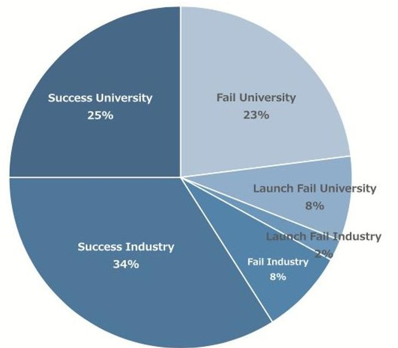
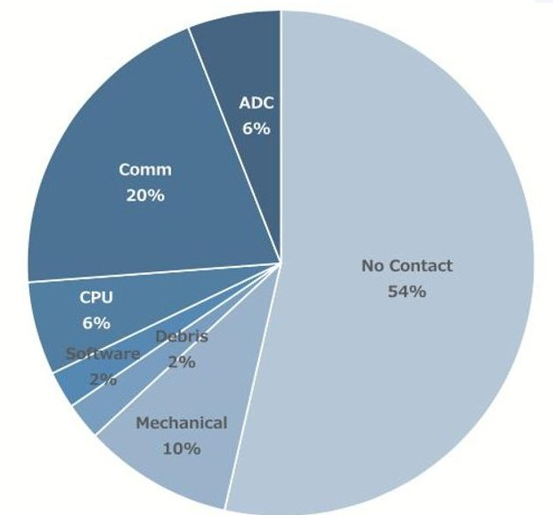
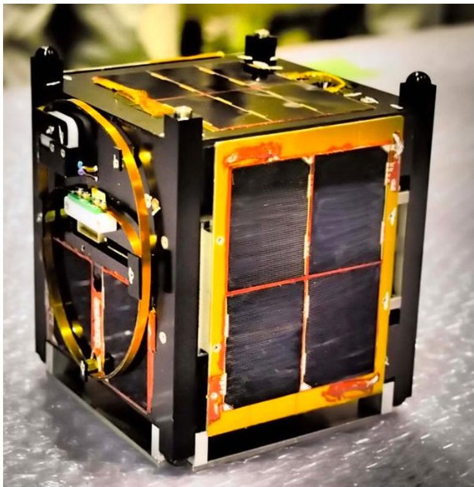
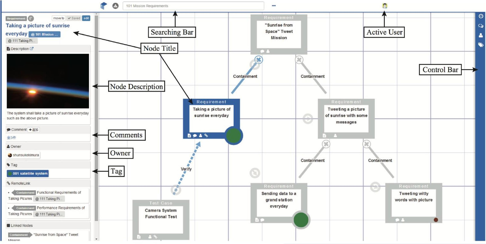
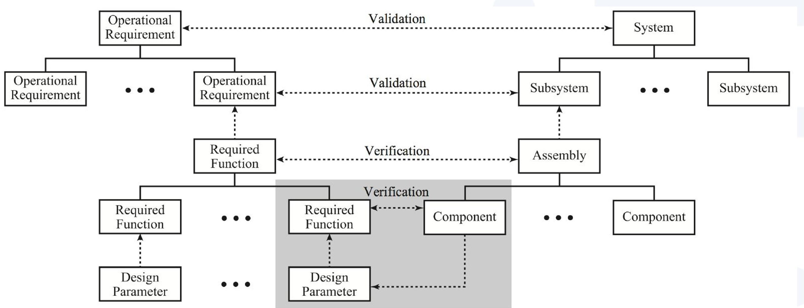
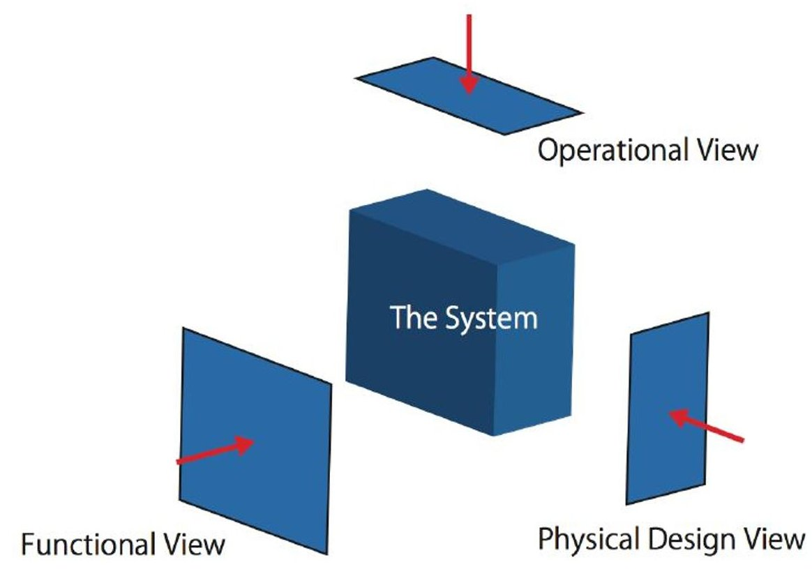
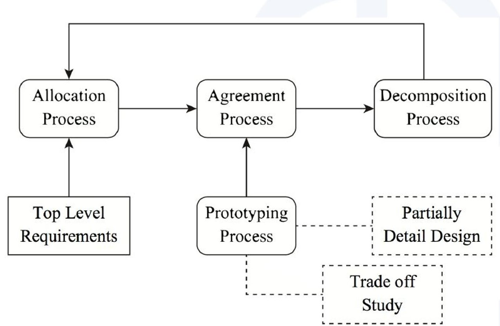
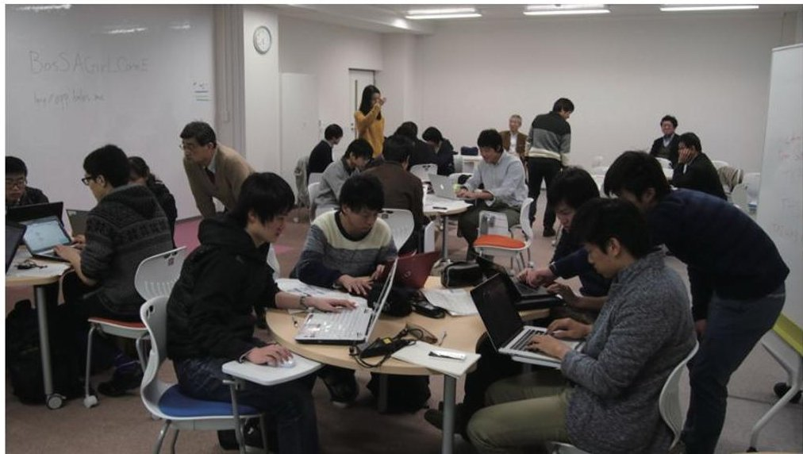
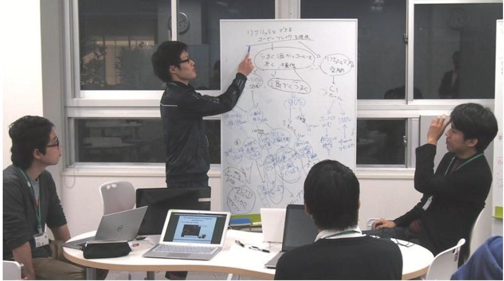
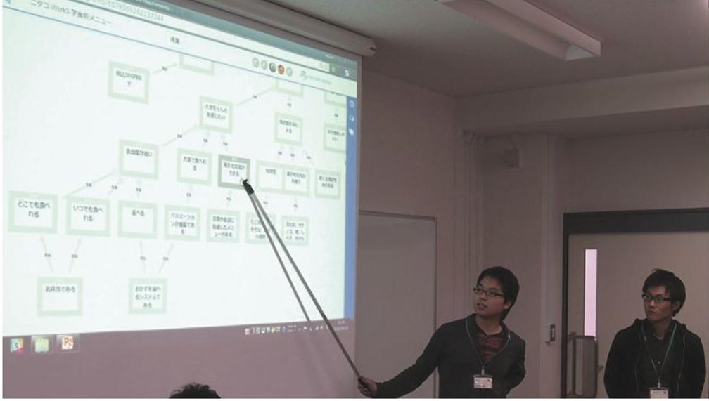

<!-- PDF_PAGE: 1 -->

# Development of Collaborative Modeling Tool and System Thinking Educational Program for Nano Satellite Developers

Y. Nambu, M. Miura, N. Kogiso, T. Hagihara, S. Kimura, R. Yoshizawa, A. Yumiyama, S. Igarashi

## Risk Management on Early Stage

The success rate of university-led nano-satellite projects has been less than 50%. Most of the causes of failure can be classified as failures in functional integration. A lack of appropriate system-level functional tests caused mission failure. This research aims to improve quality of system design of nano-satellite projects in order to improve the success rate of the nano-sat projects.

(a) Percentage of All Attempted Launches. (b) Causes for CubeSat Mission Failure Fig. 1 Survey of CubeSats Launched between 2003 and 2012 [14]

Fig. 2 OPUSAT Satellite

## Solution

We provide a self-developed system modeling tool called BALUS, a framework for requirement analysis using BALUS effectively, and design education programs using BALUS.

Self-developed system modeling tool

Framework for requirement analysis

Design education programs

<!-- PDF_PAGE: 2 -->

# Development of Collaborative Modeling Tool and System Thinking Educational Program for Nano Satellite Developers

## Self-developed Web Application

We are working on the development of a web-based system modeling tool called BALUS to support efficient and reliable system development. Well-defined descriptive models of requirements clear up the influence of changes in requirements, schedules, and costs. They also help new members to understand the system and prevent the isolation of information about requirements and verification. BALUS provides functions to create system models. A system model is a relation graph that consists of nodes and links. A node describes an element of a certain system, and a link between nodes describes the relationship of the system elements. Each node has not only a title but also a description like an html page that is written using the markdown notation.

Fig. 3 Screen of BALUS

<!-- PDF_PAGE: 3 -->

# Development of Collaborative Modeling Tool and System Thinking Educational Program for Nano Satellite Developers

## Framework of Requirement Analysis

We believe that requirement nodes in the requirement diagram should have a hierarchical structure with respect to the operational view, functional view, and physical design view. Further, functional decomposition should be conducted while obeying the independence axiom of the axiomatic design

Fig. 4 Concept of hierarchical structure of requirements

Fig. 5 Schematic image of relationship between system and view.

Fig. 6 Modeling process of the proposed approach.

<!-- PDF_PAGE: 4 -->

# Development of Collaborative Modeling Tool and System Thinking Educational Program for Nano Satellite Developers

## Design Education Practice

We applied BALUS to the course exercises for the graduate school students of Graduate Course. In this course, the students learned the design requirements and the functional decomposition method through simple examples using BALUS and through team discussions; the students were grouped into teams of about five members.

(a) Team Meeting with BALUS

(b) Team Meeting with Whiteboard

(b) Review

Fig. 7 Class Scenes

## Conclusion

Table 1. Results of Questionnaires (14/19 Answered)

<table border="1"><tr><td></td><td>(a) Questionnaires</td></tr><tr><td>01</td><td>Could you understand what a system is?</td></tr><tr><td>02</td><td>Could you understand the significance and benefits of capturing the things as a system?</td></tr><tr><td>03</td><td>Did you improve the ability to express the relation between the requirements and the function by the requirement diagram?</td></tr><tr><td>04</td><td>Did you improve the ability to think logically?</td></tr></table>

<table border="1"><tr><td></td><td>Already stood class</td><td>under-before</td><td>Could not understand</td><td>Could understand little</td><td>Could understand</td><td>Could understand perfectly</td></tr><tr><td>Q1</td><td>0</td><td>0</td><td>3</td><td>10</td><td>1</td><td></td></tr><tr><td>Q2</td><td>1</td><td>0</td><td>2</td><td>7</td><td>4</td><td></td></tr><tr><td></td><td>Already had</td><td>Did not improve</td><td>Improved a little</td><td>Improved</td><td>Perfectly improved</td><td></td></tr><tr><td>Q3</td><td>1</td><td>3</td><td>8</td><td>2</td><td>0</td><td></td></tr><tr><td>Q4</td><td></td><td>1</td><td>6</td><td>6</td><td>1</td><td></td></tr></table>

Table 2. Positive Feedback for BALUS in the Workshop

<table border="1"><tr><td>ID</td><td>Comment</td></tr><tr><td>P1</td><td>It was easy for me to create a requirement diagram that was useful for grasping the entire view of the system.</td></tr><tr><td>P2</td><td>The design was nice. I did not get lost during the operation.</td></tr><tr><td>P3</td><td>I found it easy to share information with the other team members</td></tr><tr><td>P4</td><td>The concurrent edit function was nice.</td></tr><tr><td>P5</td><td>The flexibility of creating diagrams of various types was good.</td></tr></table>

Table 3. Negative Feedback for BALUS in the Workshop

<table border="1"><tr><td>ID</td><td>Comment</td></tr><tr><td>N1</td><td>Fundamental knowledge of SE is required to use BALUS effectively; therefore, we need some lectures on SE.</td></tr><tr><td>N2</td><td>I could not understand how to connect the activity diagram and the requirement diagram in BALUS.</td></tr><tr><td>N3</td><td>It was afraid to result in functions physical and components in the requirement diagram.</td></tr><tr><td>N4</td><td>I was worried to share information via the Internet.</td></tr></table>

we described the motivation, the concept, and the features of a self-developed sys- tem modeling tool called BALUS. We also pro-posed a framework for requirement analysis using BALUS effectively. Design education programs us- ing BALUS revealed that BALUS was useful for the MBSE education and activities of students and engineers.