<!-- PDF_PAGE: 1 -->

# Feasibility study of a multispectral camera with automatic processing onboard a 27U satellite using Model Based Space System Engineering

André Pierre Mattei

Senai Innovation Institute for

Embedded Systems

Florianopolis, Brazil

andre.mattei@sc.senai.br

Luis Loures

Aeronautics Institute of Technology

Sao Jose dos Campos, Brazil

loures@ita.br

Pierre de Saqui-Sannes;

Bénédicte Escudier

ISAE-SUPAERO

Toulouse, France

pierre.de-saqui-sannes@isae.fr;

benedicte.escudier@isae.fr

Abstract- The paper discusses an experience in using SysML and the TTool software for the feasibility study of a novel multispectral camera for agricultural monitoring. Innovation lies in both automatic image processing onboard and mission control capabilities designed to comply with a 27U microsatellite. In addition to the mission accomplishment control, this innovative payload is capable of sending processed data directly to farms, critically reducing the delay between image making and its use in the field. This paper shows how MBSE and SysML may comply with phases 0 and A of a space project.

Keywords—MBSSE; Microsatellite; SysML; Model Simulation

## I. INTRODUCTION

Agriculture field conditions are dynamic and may change faster than the time necessary to imagery collection, processing, and product delivery to the farmer. Currently, raw images are downloaded from satellites to ground stations where they are processed in order to respond to specific services based on customer requests. This time delay may be not acceptable to satisfy the needs of several end users. Moreover, the presence of clouds between the satellite and the area of interest may prevent the satellite from the collection of valid data.

The project underlying the work presented in the paper aims to develop a novel payload capable of both controlling mission accomplishment and performing real time image processing. Instead of relying on the ground to acquire the intelligence needed for land management, farmers will have direct access to an almost real-time information to manage their property, as in Fig. 1. This figure shows the satellite collecting data for transmission to both a control station and a receiving station close to the farms.

The project has started with technical feasibility study of an innovative multispectral camera with automatic onboard processing, using Brazil as target and partially complying with phases 0 and A of a space project [1]. The camera is assumed onboard of a 27U satellite and incorporating those necessary elements for image processing, mission management, and data management (storing and transmission). The new architecture

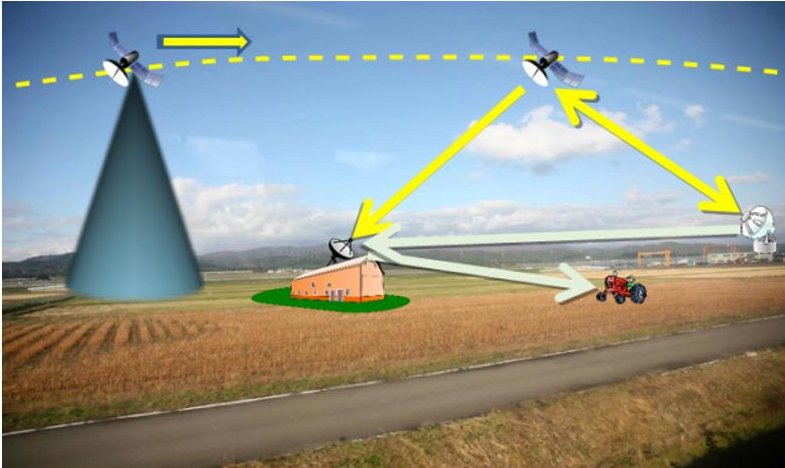

Fig. 1. After both gathering and processing data, the satellite sends maps to receiving stations on either farms or control centers.

allows the payload to manage mission accomplishment by controlling the payload subsystems and sending directives to satellite subsystems.

The feasibility study of this agricultural monitoring satellite has been supported by a Model-Based System Engineering approach that uses SysML [2] as modeling language and the free software TTool [3] for model edition, simulation, and verification.

The paper is organized as follows. Section II surveys related work. Section III introduces the methodology used during the feasibility study. Section IV presents the SysML diagrams supported by TTool, as well as the simulation and verification capabilities it offers. Section V and Section VI highlight the main results obtained during Phase O and Phase A, respectively. Section VII concludes the paper.

## II. RELATED WORK

## A. Technological solutions for satellites

Precision agriculture uses several image-processing techniques to improve the efficiency of normal activities and corrective actions performed by farmers [4] [5]: image acquisition, pre-processing, segmentation, object detection, and classification. Image acquisition is performed by a platform

<!-- PDF_PAGE: 2 -->

distant of the field of interest, such as an airplane or a satellite [6], and may use different cameras, such as multispectral [7] [8], hyperspectral [9], or radar [10].

A thematic map highlights information related to a specific crop and geographic area, [4]. These data may result in the correct placement and in the correct amount of agricultural inputs (pesticides and nutrients) that shall be used by the farmer, [11]. Nonetheless, as emphasized by Ostir et al. [12], the time necessary for image processing is currently the main obstacle for a faster cycle (meaning better management) and a way to speed up the process is to make it as automated as possible.

Several projects demonstrate that onboard data processing allows both a faster cycle for information generation and mission control. An automated monitoring system using a multispectral imaging device for precision agriculture is presented in [13]. Onboard image processing was used by [14] to detect and track objects on the ocean surface. In [15], it is found a real-time system for weed discrimination using a multispectral camera. The onboard data processing of a hyperspectral camera has also been studied by several groups to facilitate the transmission of data to the ground [16] [17]. In [18], the mission system recognizes the presence of clouds in the pictures taken by a cubesat for prioritizing data downlink. The reference [19] developed an electronic card using a FPGA Virtex7 for an earth observation satellite onboard data treatment.

## B. Use of MBSSE and SysML for satellite design

INCOSE (The International Council on Systems Engineering) defines Model-Based Systems Engineering (MBSE) as: "the formalized application of modeling to support system requirements, design, analysis, verification and validation activities beginning in the conceptual design phase and continuing throughout development and later life cycle phases" [20]. A model-based methodology defines what, how, and the tools by using a model-centric approach design.

The authors have adopted Model-Based methodology to support the Space System Engineering (MBSSE) for the project, since it is well fitted for phases 0, A, and B of the system life cycle, [1] [21]. Model-Based Systems Engineering (MBSE) has advantages when compared to the documentbased approach because of its intrinsic enhanced communication and more efficient knowledge management when dealing through project phases and subsystems. According to [22], MBSE is "the formalized application of modelling to support system requirements, design, analysis, verification, and validation activities beginning in the conceptual design phase and continuing throughout development and later life cycle phases". In the work of Kaslow et al. [23] SysML is used to support the development of a cubesat using MBSE.

## III. METHODOLOGY

This project adopts a Model-Based methodology to support Model Based Space System Engineering (MBSSE) using SysML as language for system definition, [24]. A methodology is defined by [25] as "a collection of related

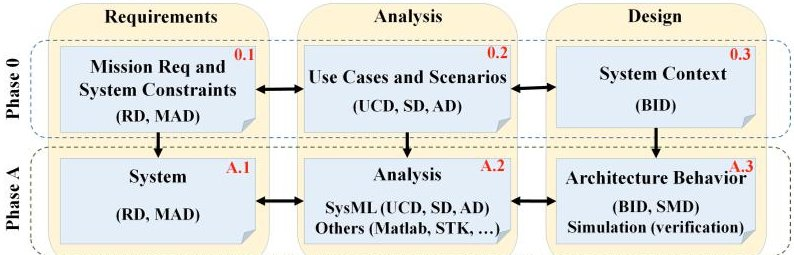

Fig. 2. MBSSE methodology applied for phases 0 and A, [21].

processes, methods, and tools". Phases and milestones are used as defined by [1], and this project addresses phase 0 mission analysis/needs identification, and phase A, feasibility.

The MBSSE is the choice for this project since facilitates application of concurrent engineering in the early phases of the space system life cycle, 0, A, and B, [1]. Phase 0 refers to mission analysis and needs identification. Phase A is a feasibility study containing possible system concepts and assess its technical and programmatic aspects. Phase B establishes a preliminary design definition by confirming the technical solutions using trade-off studies for the selected system concept.

Activities performed during this project follow the general schema presented in Fig. 2, [24]. The process adopted for this work is organized as follows: Mission Requirements Definition (phase 0); Requirements Analysis (phase A); and Architectural Design and Review Activities (partially accomplished in phase A). These processes shall be employed repeatedly during project phases. Mission requirements and system constraints are initially considered as a starting point, 0.1, and included as Requirement Diagrams (RD) and Modeling Assumptions Diagrams (MAD). In 0.1, possible mission objectives are identified and mission statement presented. In 0.2, Use-Case Diagrams (UCD), Sequence Diagrams (SD), and Activity Diagrams (AD) are engendered for better understanding of the actions, goals, and interactions during different activities performed by the satellite. During this phase, a number of tools besides SysML diagrams may be used in order to help in a first mission analysis, such as software Matlab, STK, and CNES Celestlab. In 0.3, blocks are created to provide a first approach for system design and requirements used to define some possible orbits. In A.1, system requirements are derived from 0.1 to provide more detailed RD and MAD diagrams. In A.2, analysis uses more detailed system requirements. In 0.2, mission analysis uses SysML diagrams and other software, such as Matlab and STK [26]. In A.3, a Block Instance Diagram (BID) describes a system architecture and State Machine Diagrams (SMD) give each block instance a behavior whose correctness is checked using simulations.

SysML is used as modeling language to describe processes from requirements definition to architecture design and verification. SysML is indicated for space systems development by both INCOSE, [20], and NASA, [27]. Other modeling applications are used in the project in specific fields (Matlab, STK, Scade Suite etc.).

<!-- PDF_PAGE: 3 -->

## IV. SYSML AND TTOOL

TTool supports a customized version of SysML designed with real-time system design in mind, and a 3-step process.

## A. Requirement capture

During the requirement capture phase, requirement diagrams (RD) express requirements, refinements between pairs of requirements, derivation of technical requirements from the set of requirements.

Assuming that a model abstracts a real system, that model is valid under a precise set of assumptions. TTool invites you to make these assumptions an explicit part of the SysML model. A modeling assumption diagram (MAD, not offered by the OMG-based SysML) enables expression of the modeling assumptions associated with the system and its environment.

## B. Analysis

A use-case diagram (UCD) identifies the main functions to be offered by the system, the relations between pairs of functions, and the interactions between the system and its environment.

Use-cases are documented by scenarios (sequence diagrams) and flow charts (activity diagrams).

## C. Design (including simulation and verification)

The design step defines the architecture of the system in the form of a block instance diagram, and assigns each block instance a behavior expressed by a state machine diagram. Design diagrams have a formal semantics, making them executable by the TTool's simulator. TTool further implements a press-button approach to offer verification capabilities (model checking and abstractions) by reasoning on the SysML model without writing a piece of formal code. Model checking decides whether a state or an action in the model is reachable or not. Abstraction reduces the labeled reachability graph of the SysML Model to a quotient automaton that provides the model designer with events of interest.

## V. PHASE0

## 0.1: Requirement capture

Requirements that define the mission and preliminary aspects related to both satellite and payload are expressed in the form of SysML Requirement Diagrams (RD), not presented here due to their size; they would be unreadable.

The Modeling Assumption Diagram created for camera channels captures a set of assumptions and attributes important for shaping the camera as real-time system.

## 0.2: Analysis

Requirements demands updated information in less than 15 days' period necessary for crop management and agriculture production increase.

The UCD in Fig. 3 depicts payload functions and relations with ground station, farms, and satellite. The <<include>> function expresses a mandatory inclusion.

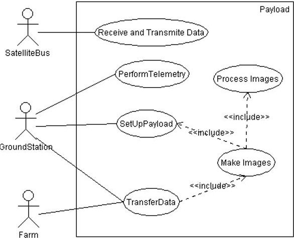

Fig. 3. System Use Case.

## 0.3: Design

Taking into account requirements and analysis, Phase 0 identifies a first approach for both mission and orbit design.

## A. Mission

Since mission statement establishes an onboard image processing for agriculture, some potential indices are identified. These indices allow the identification of suitable processing techniques in later phases.

For predicting yield: Normalized Difference Vegetation Index (NDVI), Green Vegetation Index (GVI), and Soil- Adjusted Vegetation Index (SAVI). [28]

$$
N D V I = \left(\rho_ {n i r} - \rho_ {r e d}\right) / \left(\rho_ {n i r} + \rho_ {r e d}\right) \tag {1}
$$

$$
G V I = \left(\rho_ {n i r} - \rho_ {g r e e n}\right) / \left(\rho_ {n i r} + \rho_ {g r e e n}\right)
$$

$$
S A V I = \left[ \left(\rho_ {n i r} - \rho_ {r e d}\right) / \left(\rho_ {n i r} + \rho_ {r e d} + L\right) \right]. (1 + L)
$$

where $ \rho_{nir}, \rho_{red} $ , and $ \rho_{green} $ are spectral reflectance for near infrared, red, and green wavelengths. L is a correction factor and its value is dependent on the vegetation cover and a value $ L=0.5 $ is suggested by [28] to minimize the effect of soil variations in green vegetation compared to Normalized Difference Vegetation Index (NDVI) and represents intermediate vegetation cover (0.25 for high and 1.0 for low density vegetation).

For three decades, NDVI has been used to estimate vegetation water content (VWC) with limited success. The limitation is due to NDVI saturation when vegetation coverage is dense. SWIR in 1640nm and 2130nm were used in the Normalized Difference Water Index, NDWI, with good results for corn:

TABLE I. WAVELENGTHS SELECTED FOR THE MULTISPECTRAL CAMERA.

<table border="1"><tr><td>Channel</td><td>Wavelength(μm)</td></tr><tr><td>Blue</td><td>0.480</td></tr><tr><td>Green</td><td>0.560</td></tr><tr><td>Red</td><td>0.710</td></tr><tr><td>NIR</td><td>0.850</td></tr><tr><td>SWIR short</td><td>1.640</td></tr><tr><td>SWIR long</td><td>2.130</td></tr></table>

<!-- PDF_PAGE: 4 -->

$$
N D W I = \left(\rho_ {n i r} - \rho_ {s w i r}\right) / \left(\rho_ {n i r} + \rho_ {s w i r}\right),
$$

where $ \rho_{swir} $ are spectral reflectance in the SWIR band.

Taking into account the selected indices, Table I presents the channels and corresponding wavelengths considered through this work.

## B. Satellite Bus

The platform choice is a 27U microsatellite, 54kg of total mass. This satellite type allows the use of off the shelf components and has a standard launching system called "PPOD" which makes it faster and cheaper the development of the service module.

During operation, the satellite will be able to supply energy to enable the proper functioning of onboard equipment. This is normally achieved by the solar panels except when passing in the shadow of the earth. During these periods of eclipse, the solar panels are not illuminated and therefore cannot supply energy, that's when the batteries take over. The estimated power budget is less than 70W, including a 20% margin, and this value was used for sizing the batteries.

## C. Orbit

An orbit is characterized by its six orbital parameters, or Keplerian:

- Semi-major axis/elevation: Imposed by requirements, the altitude must be between 500 and 750 km;

- Eccentricity: zero (circular orbit);

- Tilt: to cover all of Brazil, orbital inclination of $ 3 3^{\circ} $;

- Longitude of ascending node: considered a longitude of the ascending node of $ - 4 4. 3 9^{\circ} $ (Alcantara Launch Center);

- Argument of periapsis: calculated from the semi-major axis and tilt;

- Mean anomaly: it is equal to the true anomaly within the circular orbit; the initial value considered in the calculations is zero.

This section made use of the software CNES Celestlab and STK. The orbit analysis has taken into account mission needs as presented in requirements and not launcher availability.

Using orbital parameters considered above, an orbit phase

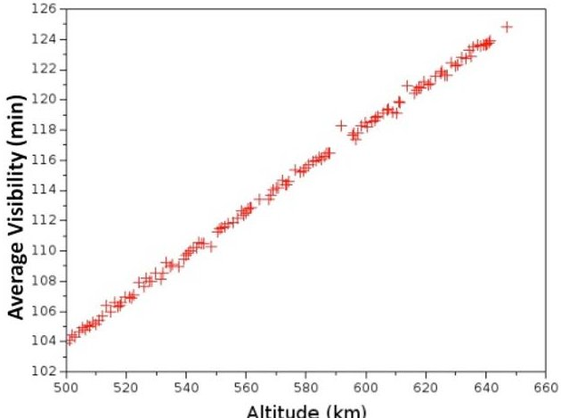

Fig. 4. Average visibility per day (minutes).

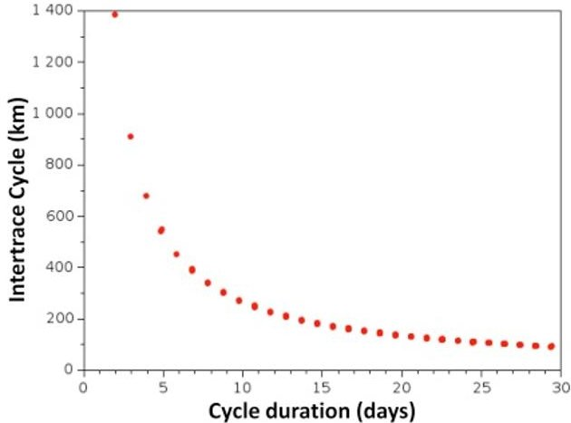

Fig. 5. Intertrace cycle according to the duration of revisits.

diagram was developed for presenting the duration of revisits according to the altitude of 128 possible orbits. An orbit is phased when the satellite passes exactly over the same track after a number of revolutions.

The ground stations used as references are in the Brazilian cities of Natal, Cuiaba, Campinas, and São Jose dos Campos. Visibility cones with an elevation of 5 degrees are considered to obtain the average visibility duration on a day in minutes as function of the orbit altitude (Fig. 4). The figure shows that the average duration of daily exposure increases with the altitude.

The intertrace cycle is defined as the distance, at the equator, between two consecutive traces in space (not in time). Intertrace shall be considered along with swath since if the second is smaller than the first one, the satellite will be forced to change its pointing direction and show deflection capability. Deflection is defined as the satellite rotation angle needed to cover the entire area of the intertrace and swath is defined as the distance on earth corresponding to the maximum width of an image. As a general rule, smaller revisit time demands larger intertrace, as shown in Fig. 5, and this will force larger swath and eventually also larger deflections (5), which can potentially make it harder onboard processing.

The satellite deflection $ (\alpha) $ depends on the satellite altitude $ (h) $ , intertrace cycle $ (I_{c}) $ , and the opening angle of the optical instrument (FOV, Field Of View), as be seen in (5).

$$
\alpha = \tan^ {- 1} \left(I _ {c} / 2 h\right) - (F O V / 2)
$$

Most suitable orbits to this mission were chosen using multicriteria optimization with Visual Prometheus software [29]. Criteria are based on the calculation of aggregate preference indexes $ \pi $ to express the degree of preference between two alternatives orbits considering the decision criteria. These indices are calculated from weight $ \varpi_{i} $ associated with each criterion $ c_{i} $ and intensity functions $ P_{i} $ dependent on the considered alternatives. Thus, considering a number N of criteria and a pair of alternatives (a,b) among M alternatives, the index of aggregate preference is given by:

$$
\pi (a, b) = \sum_ {i} ^ {N} \varpi_ {i}. P _ {i} (a, b),
$$

where $ \pi ( a,b) $ is a real between 0 and 1. The closer $ \pi ( a,b) $ is to the unit, the stronger is the preference of a over b. The calculation of this index for all pairs of alternatives enables a

<!-- PDF_PAGE: 5 -->

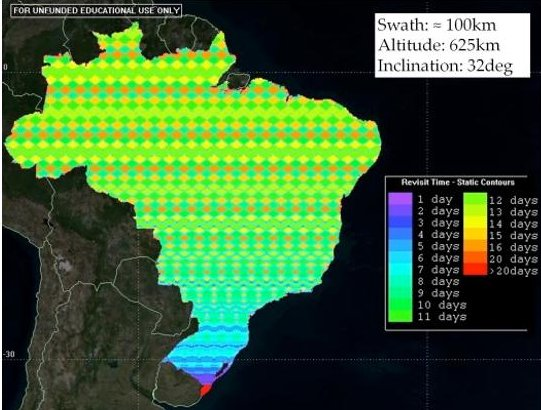

Fig. 6. Brazil coverage assessment using STK.

matrix of preference. Decision criteria were: Altitude (weight of 15%); Cycle time (weight of 32.5%); Average visibility (weight of 20%); Deflection (weight of 32.5%). Orbits were selected with this method. With a swath of 100km and altitude of 625km, one may conclude from Fig. 6 that the designer shall consider both FOV and swath for complying with 15 days revisit time requirement.

## VI. PHASE A

## A.1: Analysis

## A. Satellite bus

As usual, solar panels and batteries (during shadow periods) supply the necessary power. The power that can be generated through photovoltaic cells $ P_{avib} $ is related to the angle $ \theta $ between the normal to the solar panels and the direction of the sun.

The estimated number of cells was 116 in the lateral faces, resulting in 3.3kg of total mass and 107W of maximum power. Due to low orbit inclination, the minimum value of the average daily duration of eclipse being 32 minutes and the maximum is 35 minutes (illumination about 60min). The total work capacity of the batteries shall be equal to:

$$
C _ {m i s s i o n} = (3 5 / 6 0). P _ {m a x} = 0. 5 8. P _ {m a x} \cong 4 1 \mathrm {W}
$$

For a 3-year mission, there are about 17,000 charge discharge cycles, with 30% depth of discharge. In this case, the batteries only provide a maximum of 3W and it is possible to preserve the battery and to reach 35,000 of maximum number of cycles, thus it is necessary to have at least 14 batteries to provide 41W. Taking into account the necessary energy for systems, the power solar panels is not sufficient in early life and situation will degraded during operation, it is then recommended the use of at least one deployable panel.

For communication network, it was considered two solutions related to the physical layer, Controller Area Network Bus (CAN) and Spacewire. CAN bus is considered a good option taking into account requirements and its lower cost in comparison to Spacewire.

S band (2-4GHz) is the option for telecommand and telemetry and X band (8-12GHz) is the option for downloading images.

Considering the resolutions of 5m and 30m for approximately 2,500 pictures, and each photo having 250MB

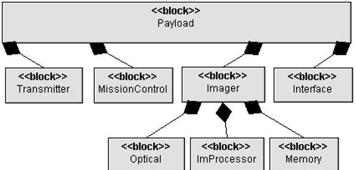

Fig. 7. General view of system context, including payload modules and some platform subsystems.

and 25MB, respectively, there would be an amount of 625 GB and 62.5 GB of images. With an average time of visibility of 120 minutes per day, it is necessary to determine the required transmission rate $ T x_{rate} $ to send the stored data (Im) during the time available (visibility time, $ V_{time} $ ) is $ T x_{rate}=I m / V_{time}. $

Using these data would require a transponder with capacity of 87Mbps and 8.7Mbps for ground resolutions of 5 and 30m, respectively. Using a component available in the cubesat market, such as EWC 27 HDR-TM [30], the available capacity is 50Mbps. Using this transponder for higher spatial resolutions, it is possible to send approximately 57% of surveilled area. Taking into account the particular interest in crop areas, the data rate is considered sufficient.

## B. Payload

Fig. 7 depicts a context diagram using the syntax of block diagrams for payload modules/functions. A black diamond denotes a "is made up" relation.

- Optical collects the light flux from the ground through a telescope;

- Image processing reads and processes data generated by Optical;

- Mission control is responsible for controlling mission accomplishment and payload modules;

- Interface exchanges data with the satellite onboard computer and distributes them through payload modules;

- Memory stores data generated by the Image processing module;

- Transmitter sends data directly to the ground.

## Optical Module

Fig. 8 presents some key figures used for developing the imager. A represents the area acquired by the imager and it depends on the detector configuration, f is the focal distance, D the aperture diameter, and h the satellite altitude. Each detector acquires image with size R (ground resolution) and detector element angle $ \theta_{r} $ , solid angle $ \omega_{d} $ , and field of view (FOV) $ \theta $ . Using these basic figures, some parameters regarding both detector and optical system telescope may be determined. [31]

Usually, imaging systems are separated into three categories: whiskbroom, pushbroom, and staring. Taking into account that onboard automatic image processing is challenging for the payload, a staring imager is a better choice for this project

<!-- PDF_PAGE: 6 -->

since it decreases both stability and vibration demands for the satellite control system. [32]

The speed of the satellite $ ( V_{sat} ) $ can be calculated with a certain degree of accuracy from the circular orbit altitude. Let $ V_{im} $ be the satellite speed in relation to the earth surface, then taking into account satellite orbit (500-750km), its speed is:

$$
\begin{array}{l l l} 7. 5 \mathrm {k m} / \mathrm {s} \leq \mathrm {V} _ {\mathrm {s a t}} \leq 7. 6 \mathrm {k m} / \mathrm {s} & \mathrm {a n d} & V _ {i m} \\ 6. 7 \mathrm {k m} / \mathrm {h} \leq \mathrm {V} _ {\mathrm {i m}} \leq 7. 1 \mathrm {k m} / \mathrm {h} \end{array}
$$

The most common telescopes are: Catadioptric, ThreeMirror Anastigmat (TMA), and Korsch, [33]. In the light of this comparison, both Korsch and Catadioptric telescopes types are considered for analysis at phase B.

For the telescope, main figures are: f and D. The ground resolution considered is 5-10m for the VNIR and the area of interest is Brazil, and the revisit time shall be lower than 15 days.

Using the required ground resolution in the VNIR range (5- 10m) and 10 $ \mu\mathrm{m} $ pixel size for VNIR range: $ 0. 5 \mathrm{m} \leq f \leq 1. 5 \mathrm{m}. $

The instantaneous swath (P) may be found in (19) and is presented in Fig. 9 as a function of f, h, and detector characteristics. It may be seen that greater swaths are found in the VNIR range due to the larger number of elements in the detector, 9216x9232 against 2048x2048 pixels for SWIR's. The swath values found are not sufficient for achieving the requirement for revisit time even for VNIR range and this result may be considered for either relax requirement for revisit time or include attitude agility for the satellite. The CCD parameters also determine the system field of view 20.

In order to avoid image distortions, during the time necessary to acquire each image (exposure time $ T_{E} $ ), satellite movement should not be more than the projection a photosensitive element onto the region along flight speed direction. The exposure time $ T_{E}\leq 2.5\mathrm{s} $ for VNIR $ (R_{vnir}\geq 5\mathrm{m}) $ and $ T_{E}\leq 3.5\mathrm{s} $ for the case of SWIR (minimum $ R_{swir}\geq 7\mathrm{m}) $ $ (V_{im}=1.97\mathrm{m / s}) $

For the telescope, it was considered as cylindrical with

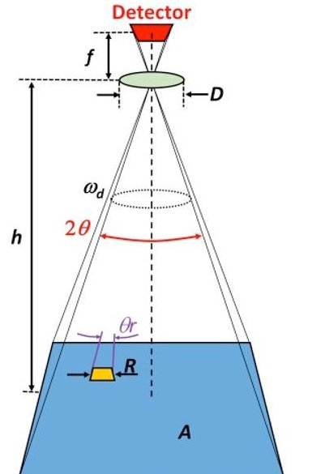

Fig. 8. General parameters used for imager development.

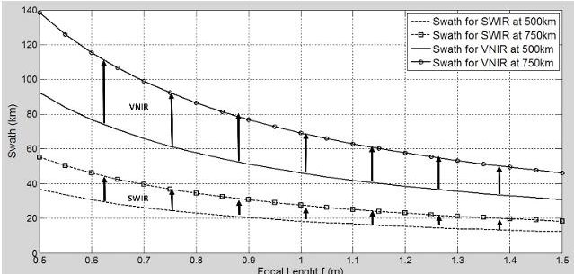

Fig. 9. Swath as a function of focal length f and altitude h for both VNIR and SWIR.

volume $ [( f / 2). D^{2} ] $ , with the combination of at least two mirrors. Furthermore, using data provided by the CNES density for mirrors $ 5 0 \mathrm{k g} / \mathrm{m}^{2} $ and aluminum protection $ 3 \mathrm{k g} / \mathrm{m}^{2} $ estimated mass is 0.95kg.

## i. Image processing Analysis and Mission control

It is considered that each pixel will be encoded in 8 bits. Consistently with the payload, the image processing software will receive 6 images from the different camera channels.

The Mission control proposed for the payload is a software architecture that provides the autonomy necessary to make the platform more capable when managing its mission. The new architecture proposed allows the payload to control the mission accomplishment management by controlling the payload subsystems and sending directives to satellite subsystems in a three-layer architecture, [34].

Taking into account the mission goals, a planner schedules activities and send orders to a robust execution software, Fig. 10. The robust execution software is responsible for optical and processing setup as well as monitor orders execution. Depending on the crop, region, and period of the year, different settings may be necessary for the optics and image processing. Planner may take many minutes to process all parameters while the execution software shall perform in seconds to create orders based on planner decisions.

## ii. Memory

Considering the chosen components, VNIR detectors generate 681Mb for each picture and SWIR 33Mb. As an example, with a swath of 100km in VNIR range, 852 pictures may cover the entire country with 580Gb per band. With a swath of 40km in SWIR range, 5,323 pictures may be

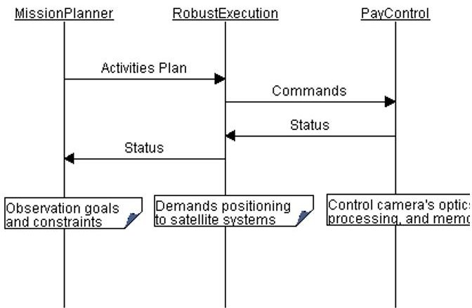

Fig. 10. Payload software architecture.

<!-- PDF_PAGE: 7 -->

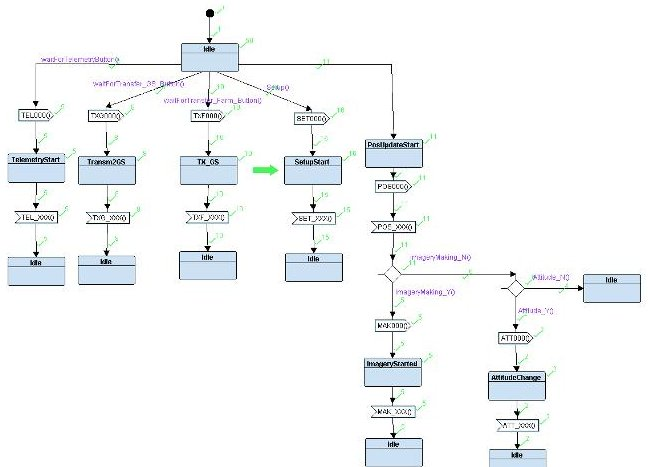

Fig. 11. TTool simulation over the system services state machine.

necessary to cover the entire country, meaning 176Gb per band. The total amount is 2.7Tb, and using lossless data compression of 50% would lead the value for 1.4Tb. If after processing image size decreases another 50%, it is necessary a capacity of 668Gb during the revisit time. Concluding a 1Tb solid state memory is enough to store all processed images even considering the whole country as target.

Whether a Block Instance Diagram usually depicts the architecture of the real system, it may also express a composition of elementary services to be provided by the system. A service is behaviorally described by a state machine, as the one depicted by Fig. 11.

## A.2: Modeling with SysML and TTool

Due to space constraints, the use-case diagrams of the payload are not depicted here, but were considered for the services provided by the satellite.

Fig. 11 depicts how the state machine diagram is associated with the services provided by the system. In this figure, messages are numbered using three letters and three numbers. Letters refer to the service provided and numbers start with 000 and increase sequentially as messages flow between systems, ending with a final message numbered XXX. TEL refers to telemetry, TXG to transmission to ground station, TXF to transmission to a farm, SET is used when payload setup is changed by the ground station, POS and ATT is a service provided by the satellite systems for informing current GPS position and set the platform attitude to perform imagery,

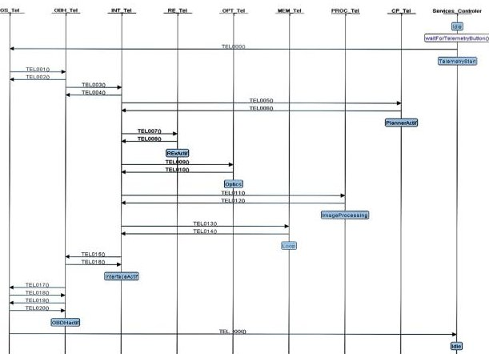

Fig. 12. Simulation trace output by TTool.

and MAK refers to those messages sent when making and processing imagery before storing them in the memory.

Simulation has enabled early debugging of the model. Fig. 11 shows (green arrow) how the simulator shows where the simulation has been stopped. Simulations also allow checking of details of the state machine, as a simulation trace may be seen in Erreur! Source du renvoi introuvable. In this figure, only messages and states involved in the telemetry service are presented. For telemetry, the ground station is the actor responsible for starting the service and for simulation purposes; it is inside the element called "Services Controller".

## VII. CONCLUSIONS

Satellites have played an increasing and acknowledged role monitoring agriculture, particularly in Brazil. The paper discusses an experience in using SysML and TTool for a feasibility study of a new payload aiming to decrease the time between information gathering and actions on the ground. A novelty proposed is a multispectral camera payload capable of processing images and manage mission accomplishment automatically.

Data obtained in this work provided the necessary information for the ongoing phase B. Next steps include the development and field test of both image processor and mission manager using manned aircraft and commercial multispectral cameras, before integration in the final destination.

## ACKNOWLEDGMENT

## TTool has been developed by Dr Ludovic Apvrille.

Contributions from ISAE-SUPAERO and ITA students are acknowledged. Acknowledgements are also due to Brazilian Space Agency (AEB), Department of Aerospace Science and Technology of the Brazilian Air Force (DCTA), and the Thales-Alenia Space (TAS) company.

## REFERENCES

[1] European Space Agency, "Space project management," ESA Requirements and Standards Division, Noordwijk, 2009.

[2] F. Jakob, S. Mazzini and A. Jung, "A SysML-Based Methodology in a Concurrent Satellite Design Process," SAE International, 2011.

[3] L. Apvrille, "TTool," Telecom ParisTech, Campus SophiaTech, 2016. [Online]. Available: http://ttool.telecom-paristech.fr/. [Accessed 26 04 2016].

[4] L. Saxena and L. Armstrong, "Saxena, L.; Armstrong, L. (2014). A survey of image processing techniques for agriculture. Proceedings of Asian Federation for Information Technology in Agriculture. (pp. 401- 413)," in Proceedings of Asian Federation for Information Technology in Agriculture, 2014.

[5] C. Yang, J. H. Everitt, Q. Du, B. Luo e J. Chanussot, "Using High- Resolution Airborne and Satellite Imagery to Assess Crop Growth and Yield Variability for Precision Agriculture," em Proceedings of the IEEE, 2013.

[6] A. Matese, P. Toscano, S. Gennaro, L. Genesio, F. Vaccari, J. Primicerio, C. Belli, A. Zaldei, R. Bianconi and B. Gioli., "Intercomparison of UAV, Aircraft and Satellite Remote Sensing Platforms for Precision Viticulture," Remote Sensing, vol. 7, pp. 2971- 2990, 2015.

<!-- PDF_PAGE: 8 -->

[7] S. A. Mathews, "Design and fabrication of a low-cost, multispectral imaging system," APPLIED OPTICS, vol. 47, $ \mathrm{n}^{\circ} $ 28, 2008.

[8] M. Drusch, U. D. Bello, S. Carlier, O. Colin, V. Fernandez, F. Gascon, B. Hoersch, C. Isola, P. Laberinti, P. Martimort, A. Meygret, F. Spoto, O. Sy, F. Marchese e P. Bargellini, "Sentinel-2: ESA's Optical High- Resolution Mission for GMES Operational Services," Remote Sensing of Environment, vol. 120, p. 25-36, 2012.

[9] S.-E. Qian, R. Girard e G. Kroupnik, "Development of Canadian hyperspectral imager onboard micro-satellites," em IEEE International Geoscience and Remote Sensing Symposium, IGARSS, 2013.

[10] A. Panetti, F. Rostan, M. L'Abbate, C. Bruno, A. Bauleo, T. Catalano, M. Cotogni, L. Galvagni, A. Pietropaolo, G. Taini, P. Venditti, M. Huchler, R. Torres, S. Lokas, D. Bibby e D. Geudtner, "Copernicus Sentinel-1 Satellite and C-SAR instrument," em International Geoscience and Remote Sensing Symposium (IGARSS), 2014.

[11] A. Suprem, N. Mahalik e K. Kim, "A review on application of technology systems, standards and interfaces for agriculture and food sector," Computer Standards & Interfaces, vol. 35, p. 355-364, 2013.

[12] K. Oštir, K. Čotar, A. Marsetič, P. Pehani, M. Perše, K. Zakšek, J. Zaletelj and T. Rodič, "Automatic near-real-time image processing chain for very high resolution optical satellite data," in 36th , Berlin, Germany, 2015.

[13] J. Das, G. Cross, C. Qu, A. Makineni, P. Tokekar, Y. Mulgaonkar and V. Kumar, "Devices, Systems, and Methods for Automated Monitoring enabling Precision Agriculture," in IEEE International Conference on Automation Science and Engineering (CASE), Gothenburg, Sweden, 2015.

[14] F. S. Leira, T. A. Johansen and T. I. Fossen, "Automatic Detection, Classification and Tracking of Objects in the Ocean Surface from UAVs Using a Thermal Camera," in IEEE Aerospace Conference, 2015.

[15] P. Symonds, A. Paap, K. Alameh, J. Rowe and C. Miller, "A real-time plant discrimination system utilising discrete reflectance spectroscopy," Computers and Electronics in Agriculture, vol. 117, p. 57-69, 2015.

[16] H. Hihara, K. Moritani, M. Inoue, Y. Hoshi e A. Iwasaki, "Onboard Image Processing System for Hyperspectral Sensor," Sensors, vol. 15, pp. 24926-24944, 2015.

[17] J. M. P. Nascimento e M. Vestias, "System-on-chip field-programmable gate array design for onboard real-time hyperspectral unmixing," Journal of Applied Remote Sensing, vol. 10, $ \mathrm{n}^{\circ} $ 1, 2016.

[18] D. R. T. Alphan Altinok, B. Bornstein, S. A. Chien, J. Doubleday and J. Bellardo, "Real-Time Orbital Image Analysis Using Decision Forests, with a Deployment Onboard the IPEX Spacecraft," Journal of Field Robotics, vol. 33, no. 2, p. 187-204, 2016.

[19] J. Naghmouchi, P. Aviely, R. Ginosar, G. Ober, O. Bischoff, R. Nadler, D. Guiser, M. Citroen, R. Freddi e M. Berekovic, "QI2S - Quick image interpretation system," em Proceedings of DASIA 2015 - DAta Systems In Aerospace, 2015.

[20] INCOSE, "INCOSE SE Vision 2020," 2007.

[21] D. Koning, H. Peter, H. Eisenmann and M. Bandecchi, "Evolving

standardization supporting model based systems engineering," in 4th International Workshop on System & Concurrent Engineering for Space Applications (SECESA 2010), 2010.

[22] S. Friedenthal, A. Moore and R. Steiner, A Practical Guide to SysML: The Systems Modeling Language, Morgan Kaufmann Publishers and OMG Press, 2009.

[23] D. Kaslow, B. J. Ayres, P. T. Cahill, M. J. Chonoles, L. Hart, C. Iwata, A. G. Levi and R. Yntema, "CubeSat Model-Based System Engineering (MBSE) Reference Model - Development and Distribution - Interim Status," in AIAA SPACE, 2016.

[24] S. Mazzini, E. Tronci, C. Paccagnini and X. Olive, "A Model-Based methodology to support the Space System Engineering (MBSSE)," in System Design & Simulation Workshop, Rome, 2010.

[25] J. A. Estefan, "Survey of model-based systems engineering (MBSE) methodologies," Incose MBSE Focus Group 25.8, 2007.

[26] STK, "Systems Tool Kit (STK)," AGI, 2017. [Online]. Available: https://www.agi.com/products/stk/. [Accessed 2017].

[27] NASA, Systems Engineering Handbook, Washington, D.C.: NASA Headquarters, 2007.

[28] S. S. Panda, D. P. Ames and S. Panigrahi, "Application of Vegetation Indices for Agricultural Crop Yield Prediction Using Neural Network Techniques," Remote Sensing, vol. 2, pp. 673-696, 2010.

[29] PROMETHEE Methods, "PROMETHEE-GAIA software," 2016. [Online]. Available: http://www.promethee-gaia.net/softwareF.html. [Accessed 19 05 2016].

[30] Syrlinks, "EWC 27 HDR-TM X Band Transmitter," 2016. [Online]. Available: http://www.syrlinks.com/en/products/cubesats/hdr-x-bandtransmitter.html. [Accessed 2005 2016].

[31] M. Abolghasemi and D. Abbasi-Moghadam, "Conceptual design of remote sensing satellites based on statistical analysis and NIIRS criterion," Opt Quant Electron, vol. 47, p. 2899-2920, 2015.

[32] J. Nieke, H. H. Schwarzer, A. Neumann and G. Zimmermann, "Imaging spaceborne and airborne sensor systems in the beginning of the next century," in SPIE 3221, Sensors, Systems, and Next-Generation Satellites, 1997.

[33] V. Costes, G. Cassar and L. Escarrat, "Optical design of a compact telescope for the next generation earth observation system," in International Conference on Space Optics, 2012.

[34] J. Kramer and J. Magee, "Self-managed systems: an architectural challenge," in Future of Software Engineering, 2007.