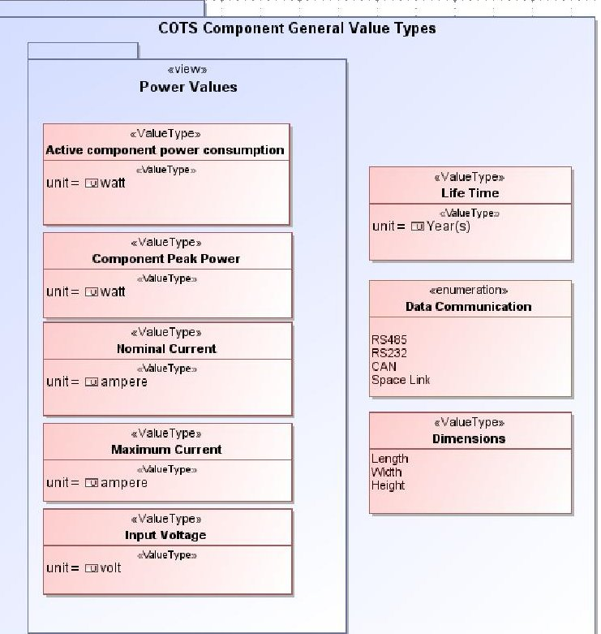
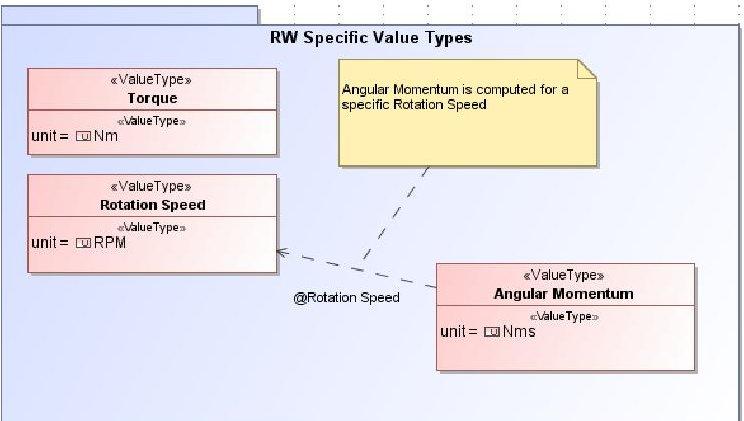
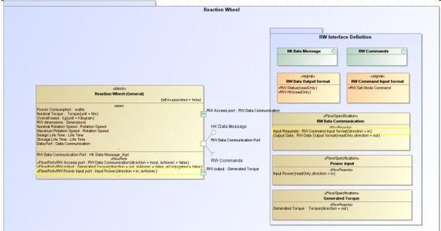
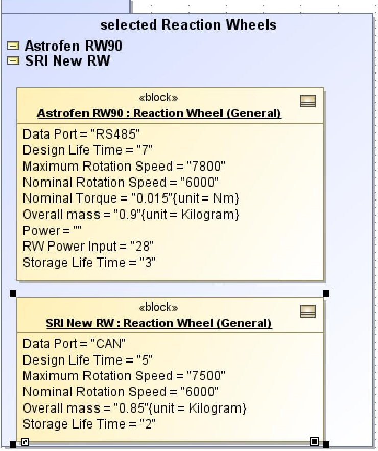

<!-- PDF_PAGE: 1 -->

68th International Astronautical Congress (IAC), Adelaide, Australia, 25-29 September 2017. Copyright ©2017 by the International Astronautical Federation (IAF). All rights reserved.

IAC-17-D1.IP Generic Satellite Model Libraries: Rapid Move to SysML M. Tahern Vernoosfaderani $ ^{a} $

$ ^{a} $ Satellite Research Institute, Iran Space Research Institute, 74, 14th St. Saadat Abad Ave. Tehran, Iran, m.taheran@isrc.ac.ir

## Abstract

Model based system engineering (MBSE) is gradually taking over the roles of document based systems engineering approaches which have been used extensively over the years in the space projects. With the growth of MBSE approaches, there will be a need for space system developers to change their Systems Engineering organizations to meet the requirements of the new standards. While this may not exert a significant cost on well-prepared companies and organizations, it is a different case for smaller and less-experienced ones. In smaller space institutions, and emerging ones, this gradual move toward the MBSE methods are non-existent or rarely systematic. Most of the technical team may not even be familiar with the term. But Establishing the MBSE approaches are inevitable, as even the standards are moving toward MBSE. This means that a solution should be used to jump start these less-experienced technical teams in to the world of MBSE. The solution proposed here is to develop a generic model library, which can be easily reused, and tailored for the specific needs of a space projects. The feature is included with the SysML plugins and in model development platforms. Using a generic model library, the cost and time of moving toward MBSE. The goal of this paper is to introduce a generic satellite model library developed for the purpose explained above. The library is specifically tailored for institutions and teams working on small satellites. This class of satellite, while diverse in mission objectives, have similar building blocks, but with different design specifications. These reusable subsystem and component structural blocks are created with as much variables as possible to facilitate future tailoring.

Keywords: MBSE. Model Library, Small Satellite

## 1. Introduction

SysML has been defined in the literature as a generalpurpose graphical modelling language for specifying analysing, designing, and verifying complex systems.

The Systems Engineering community has been faced with a paradigm shift in recent years to supplant the time-consuming paper-based efforts with new model based standards. The commonly used paper-based systems engineering has its own shortcomings, which MBSE promises to resolve. With the system models integrated in one place, interface control would be much easier, and inconsistencies would be easier to expose, as the models are not separated in different platforms.

With the urge to move toward MBSE, exemplified in the conferences dedicated to the topic and the increasing number of research papers on implementation lessons and best practices, organizations need to focus some of their efforts on this shift. While many of the organizations have moved their processes to be in accord with MBSE, the cost of such a change for smaller organizations, or in emerging industries might be high.

Therefore, one goal of this study is to pave this change process for designers and systems engineers in such organizations.

But on the other hand, most of the common modelling platforms, CAD and simulation platforms for example, use model libraries to decrease the modelling effort required by the designer and reduce time and cost of the modelling process, reaching an executable model faster. It therefore is not surprising to move our efforts toward developing libraries and reusable models in SysML.

This paper is the first step to develop a credible model library for use in Satellite Research Institute (SRI) within Iran Space Research Center (ISRC) to facilitate future systems engineering efforts in small satellite projects. SRI still uses traditional paper-based systems engineering, and SysML has not been used as the main systems engineering approach in any of its projects.

The first chapter of this paper describes the existing literature on the topic of SysML model libraries. The following sections describe the foundation for defining model libraries for small satellite design projects. The paper aims to explore the library development approach toward small satellite modelling. Different ... in this regard are introduced: one is to develop component model databases, which would replace the common

<!-- PDF_PAGE: 2 -->

datasheet structures. The second element to these libraries is common value types for parametric studies. The third element would be the common interfaces

## 2. Literature Study

Considering the growth of MBSE in recent years, there are vast amount of literature available on the topic of MBSE and SysML use. Importance of MBSE and the role it would play in the future of systems engineering efforts are explained comprehensively in the literature and this section does not focus on this subtopic as it is explored elsewhere extensively. An example of SysML use in a satellite design project is presented in [1].Of notable projects here is the cubesat reference model project. conducted by INCOSE MBSE working group for the past several years. In [2] and [3] the current state of the project and the future efforts are described.

Creating model libraries on the other hand, has not been explored extensively, particularly within the space sector and exclusively for the use of space projects.

The importance of model repositories is mentioned in [4], in which lack of knowledge and accessibility are mentioned as two reasons that prevent a significant part of the existing models from being reused. As a solution, model repositories are introduced to support reuse of previously developed models tailored to each project. It is claimed that model repositories would improve the quality and timeliness of analysis. In addition, based on this study Many organizations are beginning to develop repositories of models and archive associated data.

An extensive work on the topic of reusable models and developing model libraries has been done by [5]. Wolkl explores model libraries extensively to improve the usability of SysML modelling by providing modelling elements for reuse. Reusable functional structures, composed of elementary functions and associated flows, are used to improve the consistency of models and provide a database for conceptual design. ...emphasizes that model library elements should not be part of those that change often as it increases the effort required to create the model library higher than the resulting benefit.

[6] discusses the reuse of models to prevent the risk of reinventing the wheel, categorizing the reusable knowledge in an asset library to be communicated to designers. The two approaches, top down and bottom up approaches to the use of asset libraries are discussed.

In [7] the author explores how to provide existing generic knowledge in a standardized and formal

modelling language to designers, through Design patterns, an extension of the SysML Package stereotypes that includes specific properties. It is claimed that the use of this stereotype allows for faster conceptual modelling using partial models with predefined elements, composed of structures, behaviours, functions and even requirements.

A methodology to reuse an existing system model for a new product is described in [8]. In this work, the authors conclude that if SysML models has been developed exhaustively and with enough details, they can be used for product upgrades or development of new products which have several common elements with previously developed systems. The study demonstrates how the new project profits from the reuse of already existing system models. This process is proposed to reduce the required human effort and to save time.

## 3. Setting the libraries for satellite design

With the previously mentioned growth of model centric approaches to system design and the prospect that systems engineering would be rapidly moving toward MBSE, spacecraft developers should change their processes to model-based methods instead of the current document-based approach.

There are many reasons to consider a SysML model library useful. First, models will become valuable assets for system redesign and evolution in model-centric approaches. Second, the shift to MBSE may not exert significant changes in industrial institutions who are the main forces behind these changes themselves, or, who are prepared their human resources for this change. But for small developers this change may lead to a huge cost for adaptations.

To reduce the cost of the shift toward MBSE model libraries are a useful tool in practice. Model Libraries, New Stereotypes, and SysML profiles can all be used to smooth this process.

But the purposes of each and every modelling project is different, which brings up this concern that what is similar among the models, as we know developing a model library with the details that change frequently or from one model to another, does not sound correct and cost effective, and may not be even feasible.

With this concern in mind, the current state of library development for small satellite modelling is focused on three areas:

1- Value types specific to satellite components

<!-- PDF_PAGE: 3 -->

2- General models for commonly used satellite platform components with the most common properties and interfaces

3- Models of COTS components

The following sections provide a brief review of the activities conducted in each of the categories above.

## 4. Value Type Library

As stated earlier in the work, models are not only useful for lucid exchange of system data and system design among parties. They can be used to produce executable models. For this purpose, adding value properties to the model is essential.

For example, the most common parametric study of the SysML models in the field of satellite design has been the use of mass data to create mass budgets. It means that for each building block a value property of module mass should be considered. It can be done for power budget, fuel budgeting and alike. For any of these analytical studies, the model needs to contain several value properties to specify the blocks and behaviours.

One useful package in a model library can therefore be value types specific to small satellite elements. The designer can use these value types, available in a model library, for the value properties of the model. An example is shown in Fig.1. And Fig.2.

We sensed a need to divide the value types to general ones and those specific to each component performance. The packaging helps keep the library easier to modify and understand. There was also a need to introduce new units as well.

## 5. General component blocks

There are several similar components in conventional small satellites, which can be modelled independent of the design solution. The model library includes some of these components with as much of the specifications as possible. The model for each component includes

Fig. 1 Value type packages

Fig. 2 Value types for a specific component

- General value properties required for budget calculations and satellite system configurations. A.k.a. mass and power consumption specifications of the component, and also dimensions

- Value properties specific to each component

- Component Interfaces, including incoming commands and outgoing data, Incoming power, etc. Mechanical interfaces can be added here as well.

- Outgoing and Incoming flows of the component

Adding block activities are necessary as well. As these blocks can be used to create inhouse-made elements, the activities might be beneficial. These features will be added in future phases.

<!-- PDF_PAGE: 4 -->

Fig. 3 shows one of the packages including reaction wheel and interfaces including signals and flow specification defined for the block. Each component is modelled in a specific package with required and provided interfaces. The models will have more details added to be responsive to future modelling needs.

Fig. 3 general reaction wheel package

## 6. Component Model Library

The use of COTS components is now an accepted practice to develop affordable small satellites. Part of the design process involves selecting the right components which provide the required performance for the satellite and satisfy the technical budget constraints. It would therefore be beneficial to keep a model of these components in our repository.

When developing SysML models for these components, it is useful to remember that they would mostly be used as a black box: the internal parts would not be accessible or modifiable, and there would not be any need for part properties or any internal block diagrams. These blocks can all be modelled as encapsulated.

Modelling the behaviour and associated methods of a component is considered the second priority and is left for future efforts, as they may not be used in most cases. But this depends on the purpose of each system modelling project. The block behaviour might be useful whenever it affects the output performance of the block and the output is an input of another block in an executable model.

At this stage, the COTS component blocks do not include block operations and associated methods.

There are two approaches to developing these component models:

1. create them from scratch as an independent block

## 2. create them as an instance of a general model

Right now, the second approach is used as much as possible. But the concern is that the general component block should include each and every property of the instances. The reaction wheel example is shown in Fig 4. As it is seen, two reaction wheels are modelled as instantiations of the general reaction wheels. The repository is populated with instances of each components.

Fig. 4 Reaction wheel instances

## 7. Discussion_

The value of SysML model libraries for small satellite design is a disputable one to mind, as design may not need to be based on previously used elements or previously used concepts. But experience of other modelling environments like CAD software shows that many parts of a model can be reused. Also within one organization, model libraries can be widely used for new staff and for reusing platform or other modules, or even changing a previously used design/equipment.

This paper presented the early stage of creating a model library for small satellite design. Several concerns have been faced at this phase, including the use of flow ports with signals or standard ports with interfaces for communications with a device, which seemed replaceable with each other. Also, modelling component.

<!-- PDF_PAGE: 5 -->

operations and their associated methods have not been added as there were ambiguities on how these operations and their methods will be used in an actual modelling project. But these are being considered to find a method to properly add them to a component block.

While part of the proposed library includes COTS components that could be imported to system model, it can be suggested that COTS manufacturers can in future present SysML models of their products to facilitate the process of MBSE.

One point to remember in developing a SysML component library is that it should be compatible with other pre-existing databases. This is important as the library is being created to help the organization adapt to new modelling approaches.

In addition, as stated previously, the component model can be produced through instantiation of a general component block or as a block of its own. The latter is not used here, but it would be necessary if the general component block does not include all the required specifications/interfaces.

## 8. Conclusions

Keeping the library compatible with newer versions of SysML is also important, as right now SysML 1.3 has several previously non-existent features. Some of the SysML 1.2 features are said to becoming obsolete in future versions and these may create some difficulties in keeping a SysML model library.

This paper summarizes the first stages of developing a model library to be used for SysML modelling of small satellite design projects. With the shift toward MBSE and while SysML has become a common language for developing system models, model repositories may become organizational assets in future, and to save design and development costs of organizations by reusing previously created models.

At the same time, a model library can help an organization not previously proficient in SysML to move toward MBSE easier. develop a generic model library, which can be easily reused, and tailored for the specific needs of a space projects.

The first stage of the work presented here was focused on creating a value type library and component blocks definition with value properties, interfaces and port definitions. The general component block can be instantiated to create specific components to use in a system model.

## References

[1] Nottage, D. Corns, S. Application of model-based systems engineering on a university satellite design team, Procedia Computer Science 8 (2012) 207-213

[2] Kaslow, D. Soremekun, G. Kim, H. "Integrated model-based systems engineering (MBSE) applied to the Simulation of a CubeSat mission," 2014 IEEE Aerospace Conference, Big Sky, MT, 2014, pp. 1-14.

[3] D. Kaslow, L. Hart, B. Ayres, C. Massa, M.J. Chonoles, R. Yntema, S.D. Gasster, B. Shiotani, Developing a CubeSat Model-Based System Engineering (MBSE) reference model — Interim status #2, 2016 IEEE Aerospace Conference, Big Sky, MT, 2016, pp. 1-16.

[4] L. Reymondt, A.M. Ross, D.H. Rhodes, Considerations for Model Curation in Model-Centric Systems Engineering, IEEE Sys Con, 2016.

[5] S.J.Wölkl, Model Libraries for Conceptual Design. Diss. Ph. D. thesis, Munich, Germany: Technische Universität München, 2013.

[6] Korff, A. Re-using SysML System Architectures Proceedings of the Fourth International Conference on Complex Systems Design & Management CSD&M 2013, Springer, 2014

[7] Kruse, B. Shea, K. Design Library Solution Patterns in SysML for Concept Design and Simulation, Procedia CIRP Volume 50, 2016, Pages 695-700

[8] M. Shinuzaki, F. Mhenni, J.Y. Choley, A. Ming, Reuse of SysML Model to Support Innovation in Mechatronic Systems Design, IEEE Sys Con, 2017