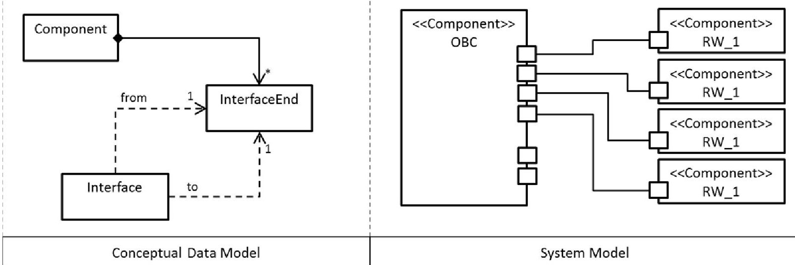
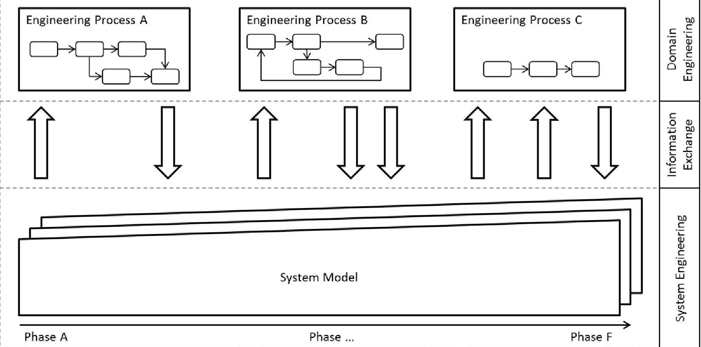
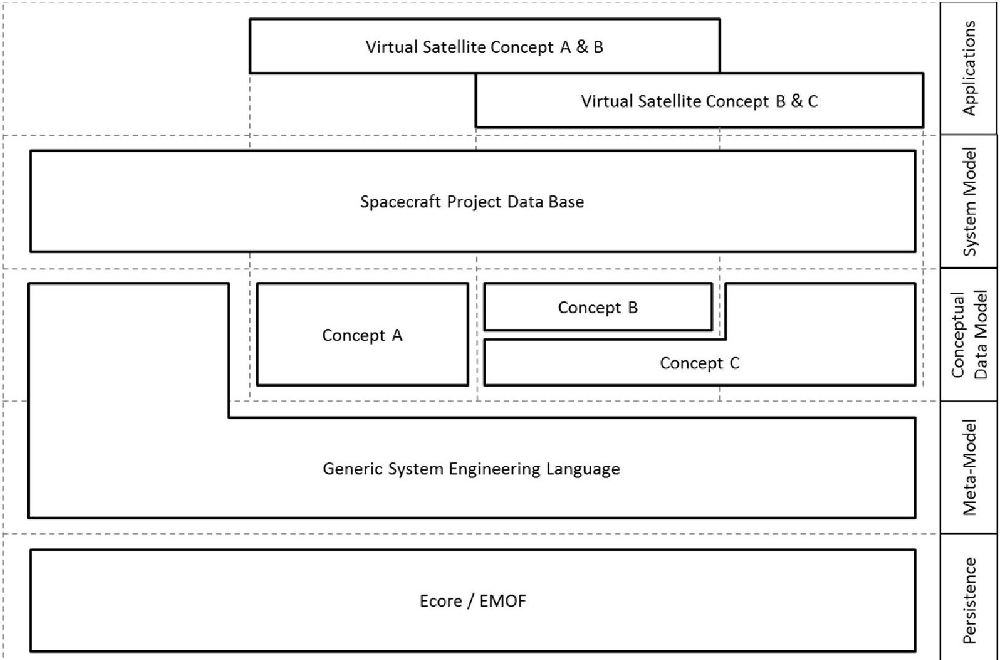
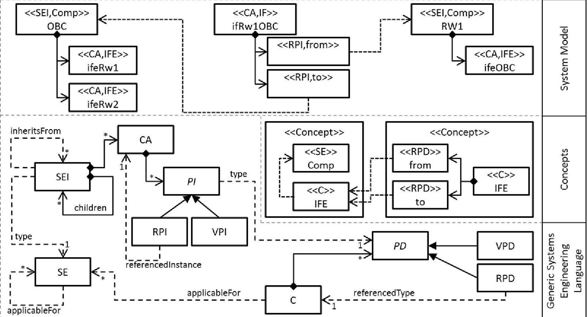
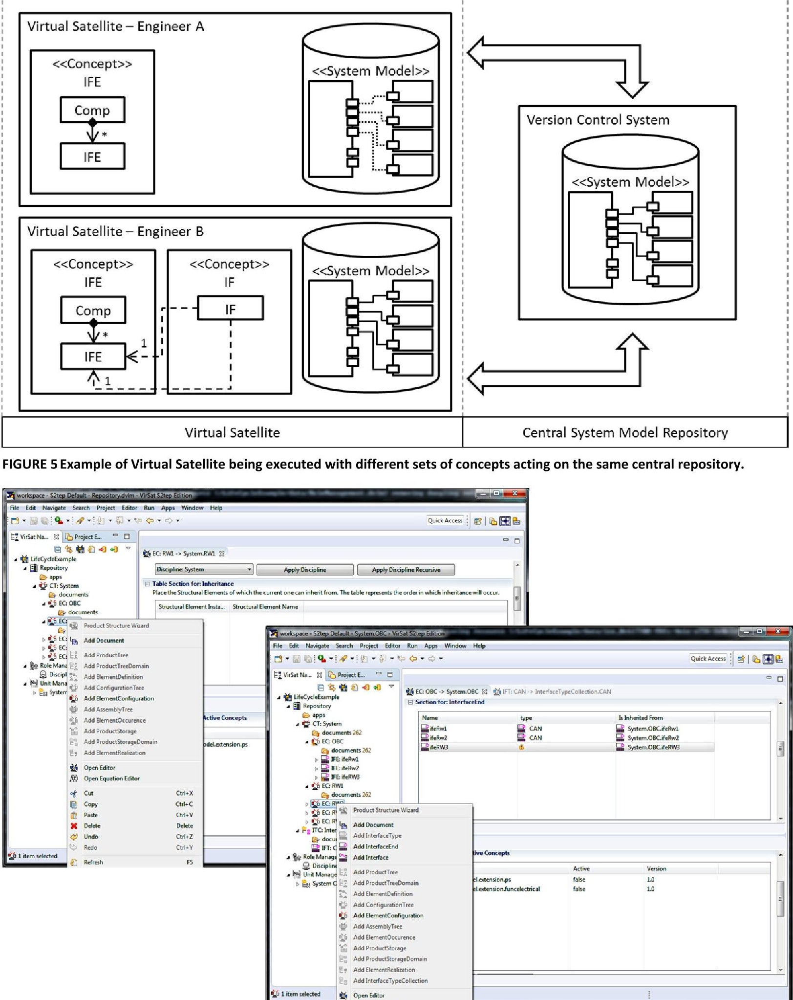
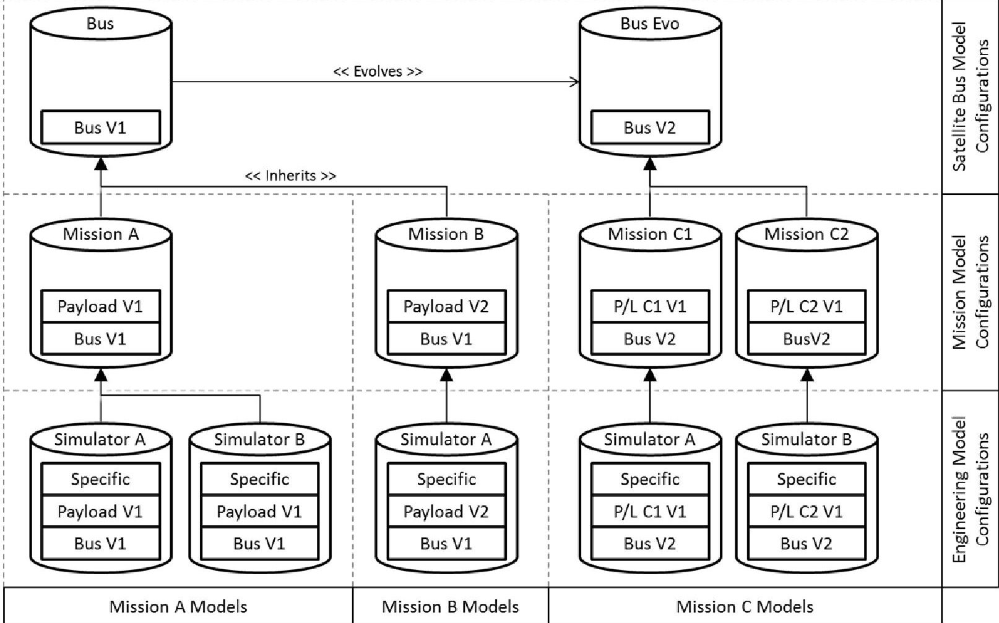
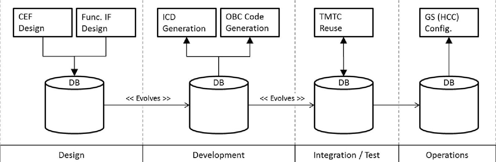

<!-- PDF_PAGE: 1 -->

# IMPLEMENTING MODEL BASED SYSTEMS ENGINEERING FOR THE WHOLE LIFECYCLE OF A SPACECRAFT

P. M. Fischer $ ^{1)} $ , D. Lüdtke $ ^{1)} $ , C. Lange $ ^{2)} $ , F.-C. Roshani $ ^{3)} $ , F. Dannemann $ ^{2)} $ and A.Gerndt $ ^{1)} $

$ ^{1)} $ DLR - Software for Space Systems and Interactive Visualization,

Lilienthalplatz 7, 38108 Braunschweig, Germany

$ ^{2)} $ DLR - Institute for Space Systems,

Robert-Hooke-Str. 7, 28359 Bremen, Germany

$ ^{3)} $ DLR - Space Operations and Astronaut Training,

Münchener Straße 20, 82234 Weßling, Germany

## Abstract

Design information of a spacecraft is collected over all phases in the lifecycle of a project. A lot of this information is exchanged between different engineering tasks and business processes. In some lifecycle phases Model Based Systems Engineering (MBSE) has introduced system models and databases that help to organize such information and to keep it consistent for everyone. Nevertheless, none of the existing databases approached the whole lifecycle yet. Virtual Satellite is the MBSE database developed at DLR. It has been used for quite some time in Phase A studies and is currently extended for implementing it in the whole lifecycle of spacecraft projects. Since it is unforeseeable which future use cases such a database needs to support in all these different projects, the underlying data model has to provide tailoring and extension mechanisms to its Conceptual Data Model (CDM). This paper explains the mechanisms as they are implemented in Virtual Satellite, which enables extending the CDM along the project without corrupting already stored information. As an upcoming major use case, Virtual Satellite will be implemented as MBSE tool in the S2TEP project. This project provides a new satellite bus for internal research and several different payload missions in the future. This paper explains how Virtual Satellite will be used to manage configuration control problems associated with such a multi-mission platform. It discusses how the S2TEP project starts using the software for collecting the first design information from concurrent engineering studies, then making use of the extension mechanisms of the CDM to introduce further information artefacts such as functional electrical architecture, thus linking more and more processes into an integrated MBSE approach.

The final publication is available at https://link.springer.com/article/10.1007/s12567-017-0166-4 and has been published in the CEAS Space Journal, September 2017, Volume 9, Issue 3, pp 351-365.

## 1. INTRODUCTION TO MODEL BASED SYSTEMS ENGINEERING IN THE LIFECYCLE OF A MULTI-MISSION SPACECRAFT PROJECT

Extension to the original DLRK conference publication: P. M. Fischer, D. Lüdtke, C. Lange, F.-C. Roshani, F. Dannemann and A. Gerndt, "Implementing Model Based System Engineering for the Whole Lifecycle of a Spacecraft", in 65. Deutscher Luft- und Raumfahrtkongress (DLRK), Braunschweig, Germany, 2016.

Currently, the German Aerospace Center (DLR) is developing a Small Satellite Technology Experiment Platform (S2TEP). Goal of this project is to develop a small multi-mission platform and to offer it to various customers to integrate their payloads to it as well as using it for future research on the platform-bus itself. Within this project, DLR occupies the unique position of planning, building and operating the satellite-bus, thus accompanying the spacecraft through its complete lifecycle. Later, either DLR or a customer will plan, build and operate a mission consisting of both the S2TEP satellite-bus and the payload together. This multi-mission scenario raises several challenges in terms of system engineering and configuration control. For instance, the interface between the bus and platform needs to be as generic as possible. It has to provide a common set of functionality that is customizable and flexible enough for all various future missions. Additionally, it needs to be considered that the interface evolves over time the same way as the S2TEP satellite-bus eventually evolves [1].

To deal with these challenges, it is intended to implement Model Based Systems Engineering (MBSE) into the S2TEP project. The software Virtual Satellite provides the engineering database to actually create the needed model of the S2TEP system. The already existing engineering processes and tasks that share common information with each other, will link to this engineering database. By this, the common sets of information are represented and exchanged across the processes using one consistent and single source of truth. In the beginning, the database will be applied to support system engineering in some critical and already identified fields such as managing the functional electrical architecture (FEA). Later in the project, new use cases, such as dealing with harness management, will be evaluated, implemented and integrated to their associated engineering processes. Introducing MBSE step-by-step into the whole lifecycle of a project is new compared to existing approaches and requires new ways of describing the data

<!-- PDF_PAGE: 2 -->

model of a systems engineering database in order to technically enable this approach.

Throughout this paper two examples will demonstrate the benefit of the MBSE approach. The first example is based on telemetry and telecommands (TMTC). The definition and description of TMTC is information which is needed by various stakeholders in the project, e.g. when developing the on-board software or when configuring the ground segment. It is absolutely necessary that both parts of the mission comply with the same specification of the TMTC to allow for flawless communication. The second example focuses on modelling FEA, which is usually performed by modelling the components of the system and describing how they are connected to each other. This is done by defining which types of connections a component provides, e.g. an interface to a certain type of data bus, and then connecting them together such as an on-board computer (OBC) being connected to the reaction wheels (RW) of the spacecraft. This FEA information is particularly important, to describe the system interfaces across domains, e.g. from the platform-bus to the payload.

This paper elaborates on the vision of implementing Virtual Satellite as MBSE tool in the whole lifecycle of the S2TEP project. Section 2 gives an overview of related work in the field of MBSE and spacecraft engineering in Europe. Additionally, it shows some details to some important modelling aspects. Section 3 clarifies on the meaning of MBSE and defines it in the context of a multimission platform such as S2TEP. Section 4 discusses the vision of MBSE over the whole lifecycle of a spacecraft and the corresponding conceptual, technical and implementation needs for extending the CDM, while Section 5 gives information of how MBSE and Virtual Satellite will actually be implemented in the S2TEP project. The paper concludes with a summary and outlines some future activities in Section 6.

## 2. RELATED WORK IN THE EUROPEAN LANDSCAPE OF MBSE FOR SPACE SYSTEMS

Designing, constructing and operating spacecraft is organized and structured in various different phases. They are known as project lifecycle phases and described by respective standards of the European Cooperation for Space Standardization (ECSS) and the European Space Agency (ESA) as well as the National Aeronautics and Space Administration (NASA). This described lifecycle starts with a Phase 0 also known as Pre-Phase A and is followed by A, B, C, D, E and ends with Phase F. Each Phase describes a certain set of engineering tasks that have to be fulfilled as well as goals in terms of defined deliverables and design reviews. In the early phases, a spacecraft project starts with feasibility studies followed by detailed design work, which is addressed in Phases A and B. This is followed by development as well as assembly, integration and test (AIT) activities in Phase C and D. Finally, the spacecraft is operated in Phase E and disposed later in Phase F [2] [3].

MBSE is not a new topic within the European space community. Several MBSE-related projects provide solutions to support the development in various parts of the lifecycle of a spacecraft. Often called databases, they provide software that allows creating a system model of the developed spacecraft. All of them allow sharing that model with several stakeholders by some central repository. Usually such repositories are connected to some kind of Version Control System (VCS). It is possible to reuse the information stored in the system model either for verification or in various places during development by interfacing it to domain specific processes. These databases have to provide a language to the engineers to actually describe the system model. This language is called the Conceptual Data Model (CDM), in computer science often referred to as meta-model. This CDM ensures the semantic correctness of the stored information [4]. Figure 1 helps to illustrate the relation between a CDM and a system model on a simple example of FEA based on a UML/SysML style notation. The displayed CDM provides the language to define Components that may contain InterfaceEnds. It also specifies Interfaces that do not contain but reference existing InterfaceEnds as their input (from) and output (to). The represented System Model makes use of the language describing five components, an OBC and four RWs. Additionally all these Components instantiate InterfaceEnds represented as the small squares being attached. Finally some Interfaces connect these InterfaceEnds e.g. from OBC to RW_1.

FIGURE 1 Example of a CDM providing the language for describing the functional electrical architecture and the System Model making use of the language instantiating it.

As mentioned before, there are several of such databases. Among others, two of them address the early phases of spacecraft development. They are called the Open Concurrent Design Tool (OCDT) [5] [6] and Virtual Satellite 3 [4]. OCDT can be seen as a tool that implements the CDM described by the ECSS Technical Memorandum E-TM-10-25 [7]. Accordingly, it tries to create a common

<!-- PDF_PAGE: 3 -->

understanding of Phase A studies within the European space community. Based on the E-TM-10-25, it will help to ease the exchange of information across agencies, companies and research institutions. Until today, it does not fully address the transition of gathered information towards Phase B.

Virtual Satellite 3 has been developed in parallel. Rather than focusing on information exchange across big entities, its major focus is on research, in particular on exchanging design information along the project lifecycle. Under constant development, it allows adjusting to new processes within DLR's Concurrent Engineering Facility (CEF) or implementing new methods of interacting with and understanding captured data. Among others, these processes and methods cover the integration of virtual reality [8] as well as formal methods as a continuous verification tool [9].

Both tools, OCDT and Virtual Satellite, are easy to use and integrate smoothly into the process of concurrent engineering, which is used for early spacecraft design. This is reflected in the data model as well. Accordingly, both underlying CDM provide capabilities to capture the product structure as well as key performance indicators of concurrent engineering studies such as masses of equipment within the system model.

Looking to Phase B, C and D, ESA was running the Virtual Spacecraft Design (VSD) project to develop a method and framework to improve exchange and organization of information. This has been captured in the Technical Memorandum E-TM-10-23 [10] [11]. With emphasis to exchange information during these phases, one major aspect is to support AIT. It means that information already used for the design is also important for activities such as simulator configuration. This requires information such as the FEA as well as operational behavior of the spacecraft and its single components. For example, interfaces or state machines can express such aspects technically. The modelled information is organized in product structures as well, but additionally, VSD delivers configuration control mechanisms that allow reusing information and restructuring it for specific applications. It allows defining single components such as a reaction wheel of the spacecraft that can be placed into different spacecraft configurations such as one for an engineering model or a configuration for a simulator bench. Information of the reaction wheel that has been specified on product level is reused and inherited by the spacecraft configurations. This approach centralizes common information such as the mass of the reaction wheel to one central point in the database. Changing this information can be automatically propagated into the various different configurations.

Within the project European Ground Segment Common Core (EGS-CC), a new ground segment infrastructure is defined and developed. This work includes the definition of a CDM to improve information exchange and configuration of ground segments, in particular between AIT and operations [12] [13]. In contrast to VSD, this project focuses on bridging the phases from AIT to operations. Accordingly, its major field of application is modelling and exchange of TMTC including FEA and incorporated standards such as the Packet Utilization Standard (PUS) [14].

RangeDB is one of the industrial implementations of a database and is developed at Airbus Defence and Space. RangeDB is based on the outcomes of E-TM-10-23 and the underlying CDM is developed closely to the CDM of EGS-CC to ease the data exchange to, e.g., Central Checkout Systems (CCS). Accordingly, it is well suited for the Spacecraft References Data Base (SRDB) use case of handling TMTC but is considered for others such as test specification and evaluation as well. It is developed with a focus on project-specific tailoring to change the CDM when needed. The database can be efficiently integrated into the spacecraft development processes since it provides several interfaces to other databases and tools [15] [16].

Even though all databases implement individual CDM, most of them are complemented by incorporating standards such as the Quantities, Units, Dimensions and Values (QUDV) [17]. These standards are an important asset to normalize the interpretation of data. The QUDV standard in particular allows assigning specific units and quantity kinds to values and derives their relationship to others [18]. By this, misinterpretation can be avoided if meters to feet are automatically converted using the modelled information of their relationship. Finally, all these databases also provide capabilities for version and configuration control, either on a technical level by version control systems or on the conceptual level in the CDM by providing information inheritance mechanisms [10].

The product structures and configuration control mechanisms defined and implemented by the CDMs and databases such as EGS- CC and VSD can be seen in other domains as well. An example from the automotive sector shows the use of product structures in Product Data Management (PDM) tools. Here, the design structure, which reflects a functional decomposition, represents the master for propagating changes to other structures as used e.g. in manufacturing. This design structure consists of two parts. Basically a structure containing all parts organized in function groups used for the cars, and a product specification representing the various configurations of cars that can be ordered. The assembly structures used in manufacturing are based on this master design structure but are not necessarily the same [19].

Regarding extensibility and tailoring, a common method is called engineering categories [20]. They are a space-related implementation of the Type Object [21] and Dynamic Template [22] pattern. In this method of engineering categories, a so called category is defined first. It is named depending on its purpose, e.g. CAD-Data in case it is supposed to handle position and orientation information of equipment Then parameters also known as properties are defined within this category such as position x and y. This category is considered as an information template that has no values so far. It can be instantiated as a category assignment and property values referencing the category and properties. Such a category assignment is usually attached to some modelled equipment, where the engineer can now define individual values for the position properties. This method is implemented in different variations in CDMs such as OCDT or VSD. The meta model of VSD highlights some additional tailoring mechanism on the engineering categories based on the Ecore meta model. Still, the way it is supposed to be used remains unclear.

Some of the described databases use XMI to persist their models. It is the XML Metadata Interchange format specified by the OMG

<!-- PDF_PAGE: 4 -->

and it supports the Meta Object Facility (MOF). MOF provides a standardized and interchangeable meta-modelling language and builds a foundation for meta-models and other modelling languages such as the Unified Modelling Language (UML) [23] [24]. The Eclipse Modeling Framework (EMF), which is also used by e.g. Virtual Satellite or VSD, provides Ecore which implements the essential part of MOF known as EMOF [25]. Using XMI, information stored in the databases can easily be transferred between them on a technical basis. Still, the concepts that the different CDMs implement, using MOF, need to be mapped for meaningful data exchange.

By providing such central databases in a project, it is possible to connect the various different business and engineering processes to it. This requires the development of adequate input/output (IO) mechanisms as, for example, in industrial databases. Once they are implemented, process stakeholders can read information from the system model, process it and write back results, which can be used again by other processes. Rather than just storing information for review, such as in classical document centric approaches, the information is now accessible, consistent and can be reused and refined. It also enables direct verification feedback to the design process, by analyzing the information in the database on the fly [26]. The IO capabilities have been shown in various ways such as exporting spacecraft configuration information into a mechanical computer aided design (CAD) process during concurrent engineering studies [27]. Others showed capabilities of feeding back mechanical CAD information back into the system model [28], thus closing the loop and providing the information to further computer aided engineering (CAE) steps. Some further work highlighted that it is possible to connect a simulator configuration process with its own individual database as well. In that case, the system database was used to actually update and construct parts of the simulator configuration database, while the simulator database was enriched with simulation-specific information [29].

A technology called Open Services for Lifecycle Cooperation (OSLC) was initially focusing on information exchange of various tools involved in the lifecycle of software products. Based on simple core functionality, and being inspired by the world-wide web, OSLC defines a standardized interface for information exchange across the different tools. Implementing this interface, the tools can link, read or provide resources for each other. Technically it is implemented by RESTful HTTP requests and Resources described in XML. On top of this OSLC CORE specification, so called domains try to standardize general resources by a minimal set of common knowledge. One of them is requirements management (RM). [30] [31] To ease the exchange of domain-specific models in systems engineering with their centralized system models of the databases, OSLC seem promising as well. More specifically, some work try realizing the concepts of the Technical Memorandum E-TM-10-23 within an OSLC architecture and thereby connecting domain-specific OSLC clients and their CDMs to it (e.g. the CDM behind a CAD model). Still, this architecture is not yet finally realized and needs further investigation [32].

## 3. DEFINITION OF MBSE IN THE CONTEXT OF A MULTI-MISSION PLATFORM

Even though MBSE is very often part of today's space projects, it is rarely defined and brought into context of the project. Nevertheless, it is important to set the correct scope to make all stakeholders in the project understand what is actually meant by introducing MBSE.

In general, experts involved in designing, engineering and operating the spacecraft have their specific and approved ways of working. They usually follow their well-established business and engineering processes, which require specific tools with their internal CDMs and data. Their processes often need information from other domains. The discipline of systems engineering identifies these special and critical sets of information, which have a direct impact to various engineering domains. They are transported from one process to the other by some sort of exchange. Usually, several different documents were exchanged in the past. In contrast to that, the model based approach is illustrated in Figure 2, where the aforementioned information dependencies are exchanged via a system model. Three levels are depicted showing the system engineering, domain engineering and the information exchange level in between. In line with the following on-board software example, the various different engineering processes provide their own individual tools but they are connected with each other. As seen, they transfer data from task to task but additionally, they either require information provided by other processes or provide information to other processes themselves. The system model acts as a central source of truth for such system-relevant information. The various different engineering processes can connect to the system model by using specific IO methods allowing the processes to store or retrieve relevant information. By today, these IO mechanisms are often based on spreadsheets or xml files, but may be changed to some more advanced exchanges mechanisms in the future. With the increasing amount of engineering processes, the detail of information in the system model is increasing over its lifetime, same as for consecutive missions in the frame of a multi-mission platform.

As an example, considering software development activities for the on-board computer (OBC), the engineers have to follow a specific process to ensure quality and correctness of their deliverables. They have to start looking at Interface Control Documents (ICD), which describe how the software is connected to other components of the spacecraft. Following these ICDs, they have to implement the software according to the specifications for the operational behavior that may include information about TMTC used between the ground segment and the spacecraft. Once the software is built, it has to be tested and verified following standards and test specifications before it can be successfully integrated into the spacecraft.

<!-- PDF_PAGE: 5 -->

FIGURE 2 The instantiations of the Conceptual Data Model along the lifecycle phases of a spacecraft. The amount of system models relating to each other increases over time on multi-mission platforms. Various discipline-specific engineering processes are fed by and contribute back to the system model.

This overall process shows an information flow and dependencies of information starting from the ICDs over more artifacts, such as TMTC, towards the final software. However, the TMTC information which has been used for developing on-board software is probably used in other places as well, as for example proposed by industrial database use cases using the information to setup the CCS. Therefore, both domains, the ones developing the OBC software and the ones setting up the CCS, have consistent data when relying on the one representation in the database. Furthermore, they can also be informed in case the others had to introduce changes to this common set of information. This ensures the TMTC used for implementing the software is the same as used for the configuration of the CCS. Hence, it is understandable that the TMTC definition that has once been used to develop the on-board software has to be reused. As already described, such a reuse may target simulator configurations in AIT or support the configuration of the ground segment for the operational phase.

## 4. THE VISION OF EXTENSIBLE MBSE IN THE WHOLE LIFECYCLE OF A SPACECRAFT

All current databases and MBSE tools are focusing on specific tasks in the lifecycle of a spacecraft. This is due to the specific business and engineering needs by their respective stakeholders or contractual boundaries such as a Preliminary Design Review (PDR). For instance, most stakeholders of Phase A designs hand over their requirements for the actual spacecraft to the industry. Even though understandable, it leads to undesired situations like model-to-text-to-model transformations when transferring information, e.g., from Phase A to B. In contrast to the already mentioned databases, Virtual Satellite is targeting for a holistic approach to support the whole lifecycle of a spacecraft. It is a declared goal to bridge the transition over phases and to maintain the database from the very first idea to the end-of-life of the spacecraft.

Virtual Satellite 3 is already the standard tool and data model for concurrent engineering studies within DLR's CEF. It is currently evolving into the new platform called Virtual Satellite 4. As part of this evolution, the database has to be enabled for Phases B and beyond. Therefore, specific use cases have to be selected and implemented into the database. Since it is a nearly impossible task to predict the important use cases for the whole period of a spacecraft mission, which can be several, sometimes even around 20 years, in advance, new ways of defining the data model are needed. These new ways have to allow for extensions and tailoring of the database when the specific needs actually arise. Virtual Satellite has enabled these new mechanisms to tailor the CDM when needed. For example, Virtual Satellite can be used to capture the product structure and the functional electrical architecture quite early in the project. Later, the CDM can easily be extended for FEA, state machines or whatever is needed by the project. Such an extension is called a concept. Even though most databases can be extended to some degrees, the way Virtual Satellite deals with it, allows to also providing software packages by concern, which means tailored to specific engineering groups of the same project or project phases in the lifecycle.

Figure 3 describes the high-level architecture to this tailoring and extension mechanisms of the CDM. The figure shows that three concepts (A, B and C) are being packed to different variations of the Virtual Satellite but still acting on the same project database. Looking at the depicted levels of the database, the most abstract one is based on Ecore, the Eclipse-specific implementation of OMG's EMOF. All information stored in the database will be persisted using XMI. A Generic Systems Engineering Language (GSEL) is defined on top of that Ecore layer. This language offers a common subset of meta-modelling capabilities needed for systems engineering and for describing future use cases of the CDM. As an example, the language provides capabilities to describe structural features as well as data containers. These structural elements and data containers are then used and instantiated by the

<!-- PDF_PAGE: 6 -->

concepts using the language. The concepts together with the GSEL construct the complete CDM. This CDM is finally used in the various different variations of Virtual Satellite. These software packages make use of the concepts in the CDM to instantiate the common system model.

FIGURE 3 Layers of the Virtual Satellite data model using Ecore as persistency for the generic system engineering language which allows defining new concepts for the CDM that can finally be instantiated in the actual project databases. The common project database is accessed by variations of Virtual Satellite with different concepts packed to the CDM.

Figure 4 provides details to the above described high-level architecture. It shows a condensed view to important modeling elements of the GSEL and provides the example of instantiating concepts into a System Model. The GSEL offers functionality to structure information in product structures as well as attaching information to it. For defining the product structures two elements are provided, forming a type-object pattern, the StructuralElement (SE) and the StructuralElementInstance (SEI) referencing the SE as its type. SEIs can contain other SEIs as their children. The applicableFor reference is used to describe which SE can actually act as a child for another one when instantiated to a SEI. Attaching information is based on the engineering categories method. CategoryAssignments (CA) can be attached to a SEI together with PropertyInstances (PI). They represent the instance of a defined Category (C) and PropertyDefinitions (PD). The ValuePropertyDefinition (VPD) and its corresponding ValuePropertyInstance (VPI) are used similar to existing implementations. In Virtual Satellite the engineering categories have been extended by a special reference property which enables more complex modeling scenarios. This ReferencePropertyDefinition (RPD) can define a Category as referencedType. Within a CA the ReferencePropertyInstance (RPI) can now be used to reference another CA. The concepts that are described in the architecture make use of the SE, Category and the PDs. In the shown example, two concepts are described: The first, which provides a SE called Component (COMP) and a Category without property called InterfaceEnds (IFE). This IFE is applicable for the Component. The second concept provides another Category called Interface (IF). It defines two reference properties: One called from and the other called to. Both of them set the referencedType to the Category IFE in the other concept. Together, the GSEL and the two concepts can be used by the engineers to describe a System Model. The displayed System Model shows two SEIs which are typed as Components from the concept. One is an OBC and the other one is a RW. Both of them contain CAs typed as IFEs. Another CA typed as IF from the second concept can now use their RPIs to create the link between an IFE of the OBC and an IFE of the RW.

<!-- PDF_PAGE: 7 -->

FIGURE 4 The Generic Systems Engineering Language used by the two Concepts for Interfaces and InterfaceEnds forming the CDM which is instantiated into the example of a System Model connecting a RW to an OBC.

Figure 5 illustrates an example of Virtual Satellite being executed with different sets of concepts still acting on the same shared data. Virtual Satellite of Engineer A is responsible for modelling components (Comp) and InterfaceEnds (IFE). As before, both the Comp and the IFE are defined in the Concept named IFE. The second Virtual Satellite of Engineer B executes the same IFE Concept plus a Concept introducing Interfaces (IF). These Interfaces reference the InterfaceEnds of the other Concepts. Engineer A can use the concept to instantiate the system model of an OBC plus some other components including the IFEs. Engineer A can share this information by the Central System Model Repository and Engineer B is now capable of connecting the IFEs by modelling Interfaces. Sharing these IFs through the central repository, the first software package still does not understand IFs in full depth since they are not relevant to the Engineer A. Still, the software is capable to deal with data conflicts, e.g., in case that an engineer removes an IFE that has already been connected by an IF by Engineer B, since the data is still stored in the System Model. The generic system engineering language does not know these features described in the concepts in full detail. It only understands the model to the level of structural elements or categories. In the example, there is enough information for the Virtual Satellite of Engineer A to realize that the category assignment representing an unknown IF is referencing the about to be deleted IFE.

Using the same mechanism, it is also possible to specify lifecycle-specific versions of the software, such as a tailored variation for the initial design in Phase A, where the underlying database will be reused and extended using later Phase B specific variations. Together with the capabilities to create different software packages acting on the same database, the CDM can be tailored systematically along the lifecycle of a project.

The database does not need to be static and completely defined once the project starts, but is extensible whenever needed. New concepts can be added during the course of the project and connected to each other enhancing already existing ones. Rather than trying to anticipate all future engineering challenges, the database can evolve in an iterative approach. Figure 6 shows a screenshot of Virtual Satellite, in the upper left corner, being first executed with only a Product Structure concept. The engineers can use it to define the Components such as OBC or RWs and attach documents to it. There is no modelling or editing capability for IF or IFEs yet. The lower right corner depicts the Virtual Satellite acting on the same data set at a later stage, having the additional concept for FEA being enabled. Now the software offers capabilities to model and edit InterfaceEnds. The FEA concept also delivers a new product structure item, the InterfaceTypeCollection (ITC), which is used in this example to define a CAN bus interface type. This interface type is referenced by the modelled IFEs in the OBC. Based on Eclipse technology, these concepts can be installed to Virtual Satellite using the feature and p2 mechanisms. Accordingly, it is possible to introduce new IO capabilities, e.g. spreadsheet export to the engineering processes, together with a concept. This ensures that IO capabilities match the actual concepts and resulting CDM at the time when they are defined and developed.

<!-- PDF_PAGE: 8 -->

FIGURE 6 Example of Virtual Satellite for S2TEP being used along the lifecycle having different sets of concepts enabled, starting with product structures only and activating the concept for interface modelling later.

All these aspects allow implementing the database as MBSE tool into new projects, still not knowing all specific needs. Introducing MBSE in such an iterative way seems promising to reduce reaction times in later processes. In particular, when MBSE is implemented in later phases, it is also considered to then give direct feedback from operations to the early development of following new missions. All this will reduce change requests after design reviews since such MBSE databases allow early

<!-- PDF_PAGE: 9 -->

verification. As first application of this Virtual Satellite concept-based MBSE approach, it will incrementally be implemented in the S2TEP project.

## 5. IMPLEMENTATION OF VIRTUAL SATELLITE AND MBSE IN THE S2TEP PROJECT

The outlined vision of Virtual Satellite as an MBSE tool for the whole lifecycle is embedded in the S2TEP project. The demand of a suitable MBSE database is high, due to the nature of S2TEP's multi-mission architecture. The overall characteristic of such a project is that the satellite bus is currently developed to the requirements of a reference payload. In the future this payload will be replaced by various different payloads, which in consequence lead to various different missions. It is planned to evolve the satellite bus and replace certain commercial-off-the-shelf (COTS) components with in-house developments over time. This will enable research in respect to the satellite bus, but raises a complex configuration control problem as well. The database is required to not just adequately manage information, such as interfaces across all bus components the same way as the interfaces to the payload, but it has to also support this use case over all variations and combinations of the actual missions.

Figure 7 elaborates on the described configuration control issues concerning the system model of the S2TEP satellite bus and the resulting missions. On the upper part of the diagram, the system model contains some initial information of the satellite bus. This system model is used for the first mission A. It is then extended by the first version of the payload, visible in the middle layer. Based on this mission-specific model, two engineering models are derived, depicted in the lowest layer. They are needed to reflect specific adaptions for specific tasks. E.g., Simulator A is running Hardware-in-the-Loop (HIL) simulations with just some dedicated equipment whereas Simulator B is running the environment as software simulation with the real satellite in the loop.

FIGURE 7 Configuration control scenarios as expected in S2TEP with various configurations, missions and application-specific models on a yet evolving satellite platform.

Such specific tasks may imply different requirements on components such as the harness or breakout boxes. Similar considerations apply for the case that an evolution of the payload is about to be flown. The content of the system model regarding the bus may stay the same, but slight variations will apply to the payload and maybe small changes to bus components. All these aspects apply for Mission C as well, where now the satellite bus has evolved. Mission C actually depicts a fictive tandem mission with two satellites carrying a combined payload. Within such a scenario, TMTC has to be specific such as the satellites must be commanded individually even though both satellite buses are basically the same.

<!-- PDF_PAGE: 10 -->

<table><tr><td>ED: Antenna -> ProductTree.Communication.Antenna</td><td>type</td></tr><tr><td>Name
RF_cond
RF_rad</td><td>RF
RF</td></tr><tr><td>Is Inherited From
ProductTree.Communication.Antenna.RF_cond
ProductTree.Communication.Antenna.RF_rad</td><td></td></tr><tr><td>Add InterfaceEnd
Remove InterfaceEnd
Drill-Down</td><td></td></tr><tr><td>IFE: RF_cond -> ConfigurationTree.Communication.ANT_1.RF_cond</td><td>IFE: RF_cond -> ConfigurationTree.Communication.ANT_2.RF_cond</td></tr><tr><td>IFE: RF_cond -> ConfigurationTree.Communication.ANT_1.RF_cond</td><td>IFE: RF_cond -> ConfigurationTree.Communication.ANT_2.RF_cond</td></tr><tr><td>UIID Section
UUID
RF_cond</td><td>b78ea6ad-fe09-4a7f-a996-68a354a85220</td></tr><tr><td>Name Section
Name</td><td>RF_cond</td></tr><tr><td>Inheritance Section
Inherits from</td><td>ProductTree.Communication.Antenna.RF_cond
Drill down</td></tr><tr><td>Property Section: References, Compositions, Values and Units
type
Override
InterfaceTypeCollection.RF_HIGH</td><td>Select Reference
Drill-Down</td></tr><tr><td>General</td><td></td></tr><tr><td>IFE: RF_cond -> AssemblyTree.Communication.ANT_1.RF_cond</td><td>IFE: RF_cond -> AssemblyTree.Communication.ANT_2.RF_cond</td></tr><tr><td>IFE: RF_cond -> AssemblyTree.Communication.ANT_1.RF_cond</td><td>IFE: RF_cond -> AssemblyTree.Communication.ANT_2.RF_cond</td></tr><tr><td>UIID Section
UUID
7c2bb264-bc20-498b-aace-717ccdef013</td><td>7b81d691-9851-42ea-b5fb-a1d7c5077557</td></tr><tr><td>Name Section
Name</td><td>RF_cond</td></tr><tr><td>Inheritance Section
Inherits from</td><td>ProductTree.Communication.Antenna.RF_cond
Drill down</td></tr><tr><td>Property Section: References, Compositions, Values and Units
type
Override
InterfaceTypeCollection.RF_HIGH</td><td>Select Reference
Drill-Down</td></tr><tr><td>General</td><td></td></tr><tr><td>IFE: RF_cond -> AssemblyTree.Communication.ANT_1.RF_cond</td><td>IFE: RF_cond -> AssemblyTree.Communication.ANT_2.RF_cond</td></tr><tr><td>IFE: RF_cond -> AssemblyTree.Communication.ANT_1.RF_cond</td><td>IFE: RF_cond -> AssemblyTree.Communication.ANT_2.RF_cond</td></tr><tr><td>UIID Section
UUID
1b5ffc8c-a0c5-4aa2-ae6-31a3d5b2e16</td><td>1b5ffc8c-a0c5-4aa2-ae6-31a3d5b2e16</td></tr><tr><td>Name Section
Name</td><td>RF_cond</td></tr><tr><td>Inheritance Section
Inherits from</td><td>ProductTree.Communication.Antenna.RF_cond
Drill down</td></tr><tr><td>Property Section: References, Compositions, Values and Units
type
Override
InterfaceTypeCollection.RF_HIGH</td><td>Select Reference
Drill-Down</td></tr><tr><td>General</td><td></td></tr></table>

FIGURE 8 Virtual Satellite showing S2TEP data containing a product structure of a Product, Configuration and Assembly Tree for configuration control purposes.

<!-- PDF_PAGE: 11 -->

The needed configuration control mechanisms are not an exclusive feature of Virtual Satellite and are present in other databases, e.g. VSD. Looking to the GSEL in Figure 4 the SEIs contain an inheritsFrom reference. Every SEI can set such a link to other SEIs and inherit their specified CAs. To which type of SEI an inheritsFrom link can be set is not depicted but actually defined in the concept as well. Virtual Satellite is capable of processing these links and copying the CAs to the inheriting SEI accordingly. Analog to class diagrams such SEIs are called Super-SEIs and Sub-SEIs. Changing a Value of a property contained in a CA of a Super-SEI it is automatically propagated to the CA of the Sub-SEI. In other databases this inheritance is fixed to the elements provided by the implemented product structure. In Virtual Satellite product structure elements can be defined in every concept, same as the inheritance.

To start with the configuration control aspect in S2TEP, it was decided to use a product structures which are similar to the ones defined in the ECSS-E-TM-10-23 and its related CDMs, as well as the ones in the automotive PDM. Therefore the concept in S2TEP provides capabilities to model a Product Tree (PT), a Configuration Tree (CT) as well as an Assembly Tree (AT) whereas the PT is used to define single equipment as they are specified. The equipment modelled in the CT inherit from the ones in the PT, same as the ones in the AT inherit from the CT.

Figure 8 shows Virtual Satellite with an example from S2TEP project data. It displays the described inheritance and configuration control mechanism on the example of an antenna. It is defined once in the PT containing an IFE being typed to the Interface Type (IFT) called RF. The antenna is opened in the top editor. Within the configuration of the S2TEP satellite bus, two of these antennas are used. Both CAs representing their IFEs are opened in the center editors. In this example, the IFT of the first antenna has been changed (override) to RF_HIGH. Accordingly, these settings are propagated into the two antennas of the actual assembly of the first S2TEP satellite bus. Changes could also be applied to the assembly, and a copy of the AT can be created and changed for the second S2TEP satellite bus.

These product structures represent a reasonable starting point, but in the context of MBSE in the whole lifecycle of S2TEP, further configurations need to be considered. As mentioned, the S2TEP satellite bus is planned to evolve over time as well. This may require new CTs which derive from the first one, but may need changes due to replaced equipment. Considering the nature of a multi-mission platform it also needs to be considered that payload and platform might be developed individually in their independent PTs and CTs. They may need to be integrated into the final assembly consisting of both the bus and the payload. Regarding the fictive example of the tandem mission, it may require an Integration Tree in between in case both satellites shall be flown with an identical payload. A further consideration needs to be respected when going back to Phase A studies defining new payloads after already successful precursor missions have been launched. Since the S2TEP project is about to build the first bus right now, a lot of these questions are not yet answered. Hence, a flexible approach is necessary to adapt to future changes.

Besides these configuration control mechanisms, which are integrated to Virtual Satellite, some specific use cases are depicted from the S2TEP project. It is intended to implement them along the way and to reflect reasonable and in terms of MBSE representative applications within the various phases of the project. Later in the S2TEP project, it is intended to extend the MBSE database with further functionality and interfaces to the processes where applicable. Figure 9 shows some of the currently selected use cases for the S2TEP project. They start with the usage of Virtual Satellite for the early CEF studies. By today, this data is still based on the old platform of Virtual Satellite 3, but there is ongoing work to implement the CEF concept also in Virtual Satellite 4 which will enable a smooth transition in the future. The data gathered are the first artefacts in the database. Currently it is assumed that the Phase A product structures can directly outline the initial Phase B product structures. Key indicators, such as masses, dimensions and power consumptions, may be used for automated design checks, e.g., the user could be notified in case a payload equipment is violating the reference-payload envelope.

FIGURE 9 Overview to the MBSE implementation in the S2TEP project. Beginning from the CEF studies, Virtual Satellite will be used to accompany the development through the phases until the spacecraft is build and ready to operate.

For Phase B, it is intended to enrich the system model with interface information. Even though starting on the level of the FEA, it is already considered to investigate interfaces of thermal and mechanical nature as well. Nevertheless, the interface information of the FEA stored in the database will be reused during the Phases C and D for Interface Control Document (ICD) generation.

<!-- PDF_PAGE: 12 -->

Additionally, it will be investigated in which respect source code for the on-board computer (OBC) might be generated. It is also intended to investigate the integration of TMTC to the database for AIT and operations. First discussions showed the importance of not to duplicating databases that are already used in the German Space Operation Center (GSOC). However, it will be inevitable to combine them where applicable to make use of correct TMTC during AIT and to provide individual TMTC specifics of the various missions directly into the control center.

With the introduction of the Hosted Control Center (HCC) at GSOC, customers will have the opportunity to directly access and control their mission. A quick instantiation of such a HCC with standardized TMTC for the bus will enhance feedback from operations into the early design when integrating the customer's payload.

By today, Virtual Satellite is ready to provide the here described GSEL to define new concepts for S2TEP as well as the intrinsic configuration control capabilities. The first Phase A studies of S2TEP have already been performed using Virtual Satellite within the CEF. Even though these first analysis have been done using the old platform, current ongoing work to integrate the CEF use case as a concept for the evolved Virtual Satellite platform will enable reuse of that data. The concept for dealing with the FEA has been defined as well and is shipped to the project members together with corresponding spreadsheet IO functionality. Once this software version is well established into the development processes, the next concepts will be integrated.

This iterative approach provides insight to various different aspects of MBSE. Rather than introducing MBSE as a whole and force everyone to change the way they work, it will combine the existing processes where necessary in a non-intrusive way. Today, this is already reflected in several discussions identifying the need of advanced configuration management for the harness design. The idea is to integrate a new harness concept by reusing the already existing functional electrical architecture. Exactly these discussions present the future use cases that should be addressed with the following S2TEP missions.

## 6. SUMMARY AND OUTLOOK

Supporting the development of a spacecraft over the whole lifecycle needs the support of MBSE. The basic idea shows that it is necessary to gather system relevant information into a common database. Such a database helps to keep the data consistent. Additionally, respective IO functionality is needed to communicate between the database as well as discipline-specific engineering and business processes.

Different from other MBSE databases in the European space community, Virtual Satellite tries to address the whole lifecycle of a spacecraft. The DLR is in a unique position of planning, designing, constructing and finally operating space missions. Therefore, use cases for Virtual Satellite can directly be derived from these projects. Since it is almost impossible to foresee all relevant use cases for such a database, Virtual Satellite introduces a new data model based on a generic systems engineering language. This new language enables the definition of certain concepts consisting of data model elements and corresponding IO capabilities. These concepts can be bundled into various different Virtual Satellite variations, all with their specific CDM consisting of these concepts but still operating on the same system model. Finally, this functionality allows implementing Virtual Satellite iteratively and adjusting the MBSE process to the needs as they arrive rather than trying to address the perfect solution from the beginning.

S2TEP is one of the first projects where Virtual Satellite is introduced as MBSE tool for the whole lifecycle of a spacecraft. S2TEP is actually not just one spacecraft but a whole family of missions based on the S2TEP satellite bus. The configuration control problems that arise with such a multi-mission setup are inevitable and require adequate tool support like MBSE. Within the S2TEP project, Virtual Satellite is already used to gather the first system model during the concurrent engineering study based on the old platform, but there is already some ongoing work to integrate this information as a concept for the evolved platform. Aspects of later phases such as the functional electrical architecture are already defined in a concept and used in the S2TEP project. On top of that, it is planned to investigate the impact of modeled TMTC in AIT and reusing it in operations to improve design feedback from GSOC back into the early design.

From current discussions, it becomes already clear that there are many more use cases to be addressed in the future. Some will be identified when the S2TEP satellite bus is evolving, some others, such as harness management, is already encountered together with complex configuration control problems. MBSE promises answers in these areas and will drive the research for Virtual Satellite in the upcoming years.

On the side of the Generic Systems Engineering Language a thorough validation is still required. It is intended to look to other projects modelling requirements and to evaluate if the GSEL provides a common superset to define these various different modelling languages.

## REFERENCES

[1] F. Dannemann and M. Jetzschmann, "Technology-Driven Design of a Scalable Small Satellite Platform," in Small Satellites, Systems & Services (4S) Symposium, Valetta, Malta, 2016.

[2] ECSS Secretariat, "ECSS-M-ST-10C Space project management - Project planning and implementation," ESA-ESTEC Requirements & Standards Division, Noordwijk, Netherlands, 2009.

[3] NASA, "Systems Engineering Handbook (NASA/SP-2007-6105 Rev 1)," National Aeronautics and Space Administration, Washington, D.C. / USA, 2007.

[4] P. M. Fischer, M. Deshmukh, V. Maiwald, D. Quantius, A. Martelo Gomez and A. Gerndt, "Conceptual Data Model - A

<!-- PDF_PAGE: 13 -->

Foundation for Successful Concurrent Engineering," in 7th International Systems & Concurrent Engineering for Space Applications Conference (SECESA), Madrid, Spain, 2016.

[5] ESA, "OCDT Community Portal," [Online]. Available: https://ocdt.esa.int/. [Accessed 20 04 2016].

[6] H. P. de Koning, S. Gerené, I. Ferreira, A. Pickering, F. Beyer and J. Vennekens, "Open Concurrent Design Tool - ESA Community Open Source - Ready to Go!," 2014. [Online]. Available: http://esaconferencebureau.com/docs/default-source/14c08_docs/open-concurrent-design-tool---esa-community-open-source-ready-to-go!.pdf. [Accessed 27 01 2017].

[7] ECSS Secretariat, "ECSS-E-TM-10-25A - Space engineering - Engineering design model data exchange (CDF)," ESA-ESTEC Requirements & Standards Division, Noordwijk, Netherlands, 2010.

[8] M. Deshmukh, R. Wolff, P. M. Fischer, M. Flatken and A. Gerndt, "Interactive 3D Visualization to Support Concurrent Engineering in the Early Space Mission Design Phase," in 5th CEAS Air and Space Conference, Delft, Netherlands, 2015.

[9] V. Schaus, M. Tiede, P. M. Fischer, D. Lüdtke and A. Gerndt, "A Continuous Verification Process in Concurrent Engineering," in AIAA SPACE 2013 Conference and Exposition, San Diego, USA, 2013.

[10] ECSS Secretariat, "ECSS-E-TM-10-23A - Space engineering - Space system data repository," ESA-ESTEC Requirements & Standards Devision, Noordwijk, Netherlands, 2011.

[11] ESA, "Virtual Spacecraft Design," 2013. [Online]. Available: http://www.vsd-project.org/. [Accessed 20 4 2016].

[12] ESA, "EGS-CC - European Ground Segment Common Core," 2013. [Online]. Available: http://www.egscc.esa.int/ [Accessed 24 02 2016].

[13] M. Pecchioli, A. Walsh, J. M. Carranza, R. Blommestijn, M.-C. Charmeau, M. Geyer, C. Stangl, P. Parmentier, H. Eisenmann, J. Rueting, P. Athmann, W. Bothmer, I. Krakowski, P.-Y. Schmerber, F. Chatte, P. Chiroli and M. Poletti, "Objectives and Concepts of the European Ground Systems Common Core (EGS-CC)," in Simulation & EGSE for Space Programmes, Noordiwjk, Netherlands, 2012.

[14] ECSS Secretariat, "ECSS-E-70-41A - Space engineering - Ground systems and operations - Telemetry and telecommand packet utilization," ESA-ESTEC Requirements & Standards Devision, Noordwijk, Netherlands, 2003.

[15] H. Eisenmann and C. Cazenave, "Evolving Classical SRDB into an Engineering Database," in The 6th International Systems & Concurrent Engineering for Space Applications Conference (SECESA), Stuttgart, Germany, 2014.

[16] H. Eisenmann, C. Cazenave and T. Noblet, "RangeDB the product to meet the challenges of nowadays System Database," in Simulation and EGSE for Space Programmes (SESP), Noordwijk, Netherlands, 2015.

[17] OMG, "SysML 1.2 RTF - ANNEX C.5 - Quantities, Units, Dimensions, Values (QUDV)," Object Management Group OMG, 2009.

[18] V. Schaus, P. M. Fischer and A. Gerndt, "Taking Advantage of the Model: Application of the Quantity, Units, Dimension, and Values Standard in Concurrent Spacecraft Engineering," in Proceedings of 23nd Annual International Symposium of the International Council of Systems Engineering, Philadelphia, USA, 2013.

[19] D. Svensson and J. Malmqvist, "Strategies for Product Structure Management in Manufacturing Firms," in Proceedings of the 2000 ASME Design Engineering Technical Conferences, Baltimore, USA, 2000.

[20] J. Rey, "Modeling with VSEE: Definition of Guidelines and Exploitation of the Models - YGT Final Report," 23 8 2013. [Online]. Available: http://www.vsd-project.org/download/documents/YGT%20final%20report%20Rey%20V2.pdf. [Accessed 19 7 2016].

[21] R. Johnson and B. Woolf, "Type object," in Pattern languages of program design 3, Boston, MA, USA, Addison-Wesley Longman Publishing Co., Inc., 1997, pp. 47-65.

[22] F. D. Lyardet, "The Dynamic Template Pattern," in The 4th Pattern Languages of Programming Conference, Monticello, Illinois, USA, 1997.

[23] OMG, "XML Metadata Interchange (XMI) Specification - Version2.5.1," Object Management Group OMG, 2015.

[24] OMG, "Meta Object Facility (MOF) Core Specification - Version 2.5," Object Management Group OMG, 2015.

[25] D. Steinberg, F. Budinsky, M. Paternostro and E. Merks, EMF Eclipse Modeling Framework, Boston, USA: Pearson Education, Inc, 2009.

[26] M. Deshmukh, V. Schaus, P. Fischer, D. Quantius, V. Maiwald and A. Gerndt, "Decision Support Tool for Concurrent Engineering in Space Mission Design," in Concurrent Engineering Approaches for Sustainable Product Development in a Multi-Disciplinary Environment: Proceedings of the 19th ISPE International Conference on Concurrent Engineering, London, Great Britain, Springer London, 2013, pp. 497-508.

[27] V. Schaus, J. Muller, P. M. Fischer, R. Wolff and A. Gerndt, "Collaborative Satellite Configuration Supporting CATIA Export," in SECESA, Lisbon, Portugal, 2012.

[28] ScopeSet - The Tools Experts, "Mapping and importing Catia Properties," [Online]. Available: http://www.vsdproject.org/download/ssdevideos/CatialImport.swf. [Accessed 06 04 2016].

[29] P. M. Fischer, H. Eisenmann and J. Fuchs, "Functional Verification by Simulation based on Preliminary System Design Data," in 6th International Conference on Systems & Concurrent Engineering for Space Applications (SECESA), Stuttgart,

<!-- PDF_PAGE: 14 -->

Germany, 2014.

[30] OSLC, "Vision | Steering Committee - Open Services for Lifecycle Collaboration," 26 July 2016. [Online]. Available: http://open-services.net/wiki/steering-committee/Vision/. [Accessed 23 May 2017].

[31] J. Wiegand, "The Case for Open Services," IBM, Somers, USA, 2009.

[32] T. Hoppe and H. Eisenmann, "Requirements of Shared Data Management Services Facilitating a Reference Architecture Realizing the Concepts of ECSS-E-TM-10-23," in Simulation and EGSE in European Space Programmes, Noordwijk, Netherlands, 2015.