<!-- PDF_PAGE: 1 -->

# Inter-Satellite Communication MBSE Design Framework for Small Satellites

Awele I Anyanhun and William W Edmonson

Department of Electrical and Computer Engineering

North Carolina A & T State University,Greensboro, NC, United States Email: {aianyanh@aggies.ncat.edu, wwedmons@ncat.edu}

Abstract—An Architectural framework for defining InterSatellite Communication system architectures based on ModelBased Systems Engineering concepts will facilitate the development of reliable and consistent system models that can be simulated, verified and validated. However, such a framework does not exist, thereby limiting our ability to define comprehensive and effective inter-satellite communication system architectures. As a means of addressing this challenge, we present an architectural framework design for defining and representing ISC system architecture for Small Satellite Systems based on an MBSE approach. The Systems Modeling Language SysML is used as the modeling tool for the framework design.

## I. INTRODUCTION

Enabling communication between Small Satellite Systems (SmSS) deployed as a sensor network in space presents a new and exciting frontier for space system exploration. Equipping these class of satellites with Inter-Satellite Communication (ISC) capabilities for information exchange and transmission will enable newer and more complex missions be accomplished. Inter-satellite communication is necessitated as a means of mitigating the Size, Weight & Power (SWaP) constraint of these group of satellites while harnessing the numerous advantages they present for space exploration in Low Earth Orbit (LEO) and beyond. The Open System Interconnection (OSI) reference model can be used as the underlying communications framework for Inter-satellite communications between small satellites operating in space as surveyed in [1]. The OSI model can be described as a conceptual framework used in defining how communication occurs in a communication system without regard to the underlying internal structure of the system. Fig. 1 depicts an example of a constellation of small satellite operating as a sensor network with ISC capabilities.

Developing SmSS with ISC capabilities involve very high levels of system complexity. Presently, members of the space community made up of space and defense agencies such as NASA, ESA and DARPA are looking to develop ISC capabilities for small satellites [2] [3]. The first step towards designing an ISC system fit for space exploration involves the creation of a model of the system that can be reasoned about, and verified and validated via simulation. Following such a process will greatly reduce cost and limit the risk of system failure. In the design of a system, developing a system model helps in dealing with system complexity. This is because the system can be modeled on different levels of

abstraction thereby omitting details that are not necessary for a given aspect of the system. In order to develop a coherent and correct model of the ISC system, it must be based on a robust architecture whose views are defined using an Architectural Framework (AF). However, due to the absence of such a AF on which an ISC for SmSS architectures can be designed, technological advancement in this area is still greatly limited. As earlier stated, the design of a SmSS-ISC link involve high levels of system complexity which include determining the appropriate communication protocols to be used and how to model them. Hence developing an ISC system remains a major challenge to ensure that the SWaP constraints can be met within additional constraints of cost and time to integrate.

Developing an architectural framework based on best practices will enable ISC architectures be described in a coherent way while dealing with the various complexity-inducing factors. This paper presents a model-based systems engineering (MBSE) architectural framework design for defining small satellites systems inter-satellite communication architectures (SmSS-ISC) Architectures. The Systems Modeling Language (SysML) [4] is used as the modeling language in describing the AF. The framework is presented as a model comprising of a set of views which conform to viewpoints to which an ISC system architecture must conform.

The paper is organized as follows: presented in Section II is a brief overview of MBSE, while in Section III, architectural framework concepts are discussed. The ISC-AF design is described in Section IV and in Section V, the conclusion and future work are presented.

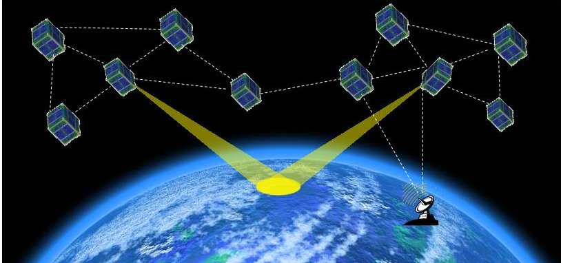

Fig. 1: Inter-Satellite Communication between Small-Satellites Systems

<!-- PDF_PAGE: 2 -->

## II. MODEL BASED SYSTEMS ENGINEERING

The concept of applying a model-based approach to the practice of Systems Engineering (SE) brought about the advent of model-based systems engineering. An apt and simplified definition of SE given in [5] states that "Systems Engineering can be defined as the practice of engineering from the systems viewpoint". Extending this definition, we can define MBSE as the practice of engineering from a systems viewpoint using models. MBSE has as its main artifact a system model that contains all relevant information required to completely and consistently describe, verify and validate a system. This system model which can be better qualified as computer-interpretable models as stated in [6] forms the distinguishable difference between the document-centric approach and model-centric approach to the practice of systems engineering.

As accurately stated in [7], to get a good understanding of MBSE, one must of necessity have a good and unambiguous definition of systems engineering. While a plethora of definitions exist for SE, the widely accepted and acknowledged definition of SE is given by INCOSE as "An inter-disciplinary approach and means to enable the realization of successful system" [8]. Based on this definition of SE, the realization of successful systems should be the expected outcome. INCOSE goes further to define MBSE as "The formalized application of modeling to support system requirements, design, analysis, verification & validation activities beginning in the conceptual design phase and continuing throughout development and later life cycle phases". Paraphrasing the above definition to concisely capture our expectation, we define MBSE as the "Formalized application of modeling to enable the realization of successful systems". The benefits of implementing an MBSE approach in either defining an AF or in the development of successful systems include the realization of a model that comprises a coherent and consistent set of views that reflect multiple viewpoints of the system [7]. Other benefits associated with the application of effective MBSE include: automatic generation and maintenance of system documents, complexity control and management, consistency of information, inherent traceability, simpler access to information, improved communication in terms of language, concept and terminology and increased understanding between stakeholders.

## III. ARCHITECTURAL FRAMEWORK CONCEPTS

Central to the SE and MBSE practice is the concept of architectural frameworks and architectures. These MBSE enabling concepts prove beneficial in the design and management of complex systems. According to ISO/IEC 42010, an architectural framework is defined as "Conventions, principles and practices for the description of architectures established within a specific domain of application and/or community of stakeholders" while it defines architecture as "The fundamental concepts or properties of a system in its environment embodied in its elements, relationships and in the principles of its design and evolution ". Architectural frameworks refer to a standard set of elements that enable and facilitate the description of

architectures in a complete, consistent, homogeneous and unambiguous way and provides guidance on how to create such descriptions [9]. As stated in [7] an AF is not in itself an architecture, but it defines a set of views that are required to describe an architecture, i.e an AF helps provides clarity about how a system in a specific domain is developed. In [10] it is aptly stated that the fundamental goal for developing an architectural framework is to promote interoperability and to codify a common set of architectures in order to prevent the need to re-invent the wheel each time an architecture is required to guide the design of a system.

Examples of existing AFs include defense-based AFs such as the United States Department of Defense AF (DODAF) [11], the United Kingdom Ministry of Defense AF (MODAF) [12], NATO AF (NAF) [13]; Non-defense based AF such as The Open Group AF (TOGAF) [14] and Enterprise AFs such as the Zachman AF [15]. These AFs provide concepts, guidelines, best practices and methods that are tailored for the needs of specific domains. They apply similar principles to organize and structure information using different levels of abstraction [9].

In the space industry, an architecture for space data systems has been developed by the Consultative Committee for Space Data Systems (CCSDS) [16]. CCSDS is an international, consensus based, space system standards organization whose members consist of NASA, ESA, JAXA and all other major space agencies. The Reference Architecture for space data systems (RASDS) [17] was developed by the CCSDS Systems Architecture working Group (SAWG). RASDS provides a standard way for describing architectures of different space data systems by using multiple views to describe the architecture of a space data system. These views include: Enterprise, Connectivity, Functional, Information and Communications Views. These views though slightly modified, are derived from the viewpoints defined in the Reference Model of Open Distributed Processing (RM-ODP) [18]. The work presented in this paper intends to provide an MBSE architectural design framework for small satellite inter-satellite communication based on AF industry standards such as ISO/IEC/IEEE 42010 [19] and specific aspects of RASDS architecture. The motivation for developing the AF is to establish a reliable framework based on best practices and methods that can be used to generate ISC architectures in a coherent manner such that they can be easily understood, analyzed and implemented.

## IV. THE ISC ARCHITECTURAL FRAMEWORK FOR SMALL SATELLITE SYSTEMS

Presented in this section is the ISC-AF for SmSS. The ISC-AF can be regarded as a set of guidelines, patterns or rules used to delineate the architecture of an ISC system. The ISC-AF specifies the way and manner in which the fundamental organization of the ISC system architecture can be presented. There exist a varied number of AF definitions in literature. For this work, our definition and ISC-AF viewpoints are adapted from [7].

<!-- PDF_PAGE: 3 -->

An ISC architectural framework can be defined as a set of Viewpoints and an Ontology. The ISC-AF will provide the structure necessary for describing ISC system architectures. An ontology is an element of an AF that defines all the concepts and terms that relate to any architecture structured according to the AF. Consequently, our ISC-AF is essentially made up of five viewpoints that conform to our defined ontology. These viewpoints depicted on the bdd in Fig. 2 are defined in a systematic manner to ensure that they conform to the ISC-AF ontology. The viewpoints which are used to define the architectural framework are represented using the following views:

1) The ISC-AF Context View

2) The ISC-AF Ontology View

3) The ISC-AF Viewpoint-Relationship View

4) The ISC-AF Viewpoint-Definition View

5) The ISC-AF Rules Definition View

The architectural framework must also be able to provide critical support for the modeling of an ISC system as shown by the use cases which constrain the main concern. These requirements are:

- Support conceptual, functional & physical architecture design- The AF must be able to support the modeling of both the structure and behavior of an ISC system architecture.

- Be suitable for multiple applications- The framework must be generic enough to support different types of ISC architectures.

- Comply with AF standards- The AF must comply with best practice standards for the development of coherent ISC architectures.

- Comply with RASDS- Designing the AF with compliance to specific aspects of RASDS architecture ensures it complies with the space industry best practice standards.

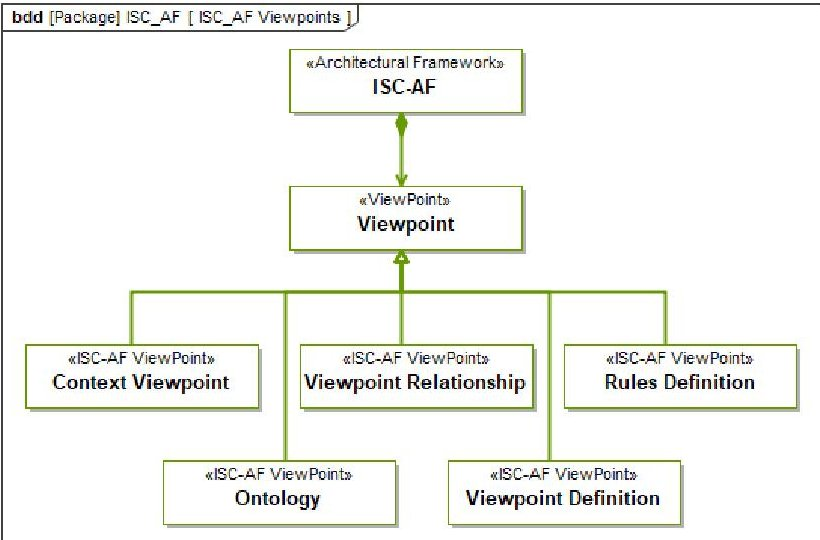

Fig. 2: The ISC-AF Viewpoints (adapted from [7])

## A. ISC-AF Context View

The ISC-AF viewpoint is used to define the context for the inter-satellite communication architectural framework. The view which conforms to this viewpoint describes in context the concern which the ISC-AF is designed to address. Shown on the CV diagram in Fig. 3 is the ISC-AF Context View. From the diagram it can be seen that the main concern which the ISC-AF is developed to address is to Provide an architectural framework for modeling ISC systems for SmSS. In order for this requirement to be fulfilled, there are other concerns that must be met and these are shown by the Include relationship. This means that the main concern depicted by the central use case Provide an architectural framework for modeling ISC systems for SmSS is not considered complete without fulfilling the concerns depicted by the use cases:

- Provide guidelines and a generic platform to support and describe a robust ISC architecture

- Model a communication system based on the OSI framework

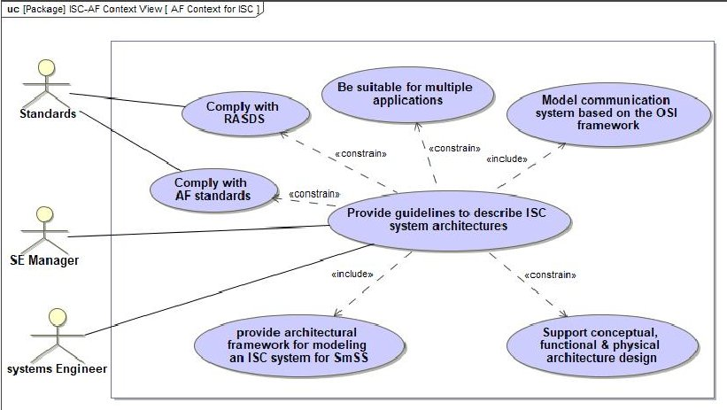

Fig. 3: Context View showing the ISC-AF Context viewpoint

## B. ISC-AF Viewpoint Relationship View

The Viewpoint Relationships View conforms to the Viewpoint Relationships Viewpoint. This viewpoint is used to depict the relationships between perspectives and the viewpoints which are grouped together to make up the ISC-AF perspectives. A perspective can be defined as a collection of related views. The ISC-AF consists of three perspectives which address the required concepts related to the ISC-AF Ontology. The ISC-AF perspectives include:

1) The ISC-AF Perspective: The ISC-AF perspective is made up of the viewpoints to which the views depicted in this work belong. This perspective can be viewed as the meta-model to which all ISC architectures created must conform to. Since this perspective represents the architectural framework viewpoints and views, its viewpoints will not be a part of any existing architecture developed using the ISC-AF. Shown on the VRV in Fig. 4 is the ISC-AF perspective depicting its different viewpoints and their relationships. The AF perspective viewpoints which are used to define the ISC-AF are:

- ISC-AF Context Viewpoint

- Viewpoints Relationships Viewpoint

<!-- PDF_PAGE: 4 -->

- Viewpoint Definition Viewpoint

- Rules Definition Viewpoint

- ISC Ontology Viewpoint

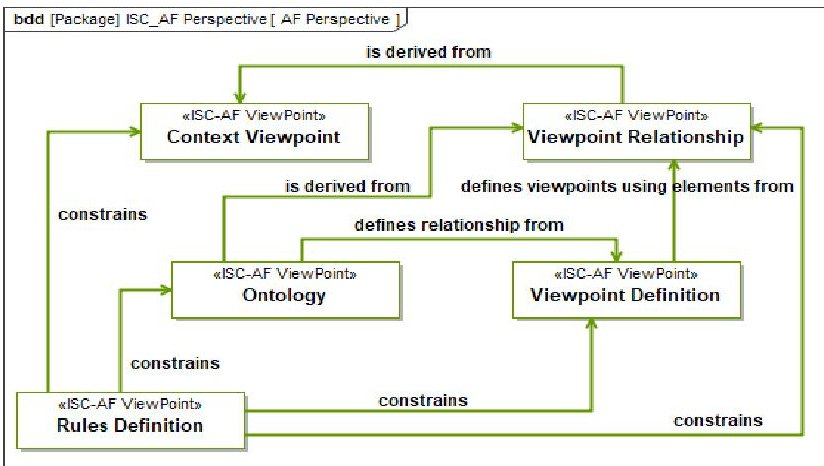

Fig. 4: Viewpoint Relationship View showing the ISC-AF Perspective (adapted from [7])

2) The Requirement Perspective: The Requirement perspective defines viewpoints that allow the requirements of the ISC system to be captured. The relationships between the viewpoints captured in the requirement perspective are shown on the VRV in Fig. 5. The requirement perspective viewpoints include:

- Requirement Traceability Viewpoint - This viewpoint describes the decomposition of the ISC system requirements and also captures the relationship between requirements and system elements that satisfy them.

- Requirement Description Viewpoint - This viewpoint defines a structured description of high-level system requirements.

- Requirement Context Viewpoint - This viewpoint is used to define the requirements in a given context.

- Requirement Source Viewpoint - This viewpoint is used to define the origin of a requirement.

- Functional requirement Viewpoint - This viewpoint defines the functional/logical requirements.

- Non-Functional Requirement Viewpoint - This viewpoint defines the non-functional requirements.

3) The System Perspective: The System Perspective defines viewpoints that allow aspects of an ISC system's structure and behavior to be captured. The concepts in this perspective form the basis for the existence of the ISC-AF. The viewpoints described in this perspective comply with those found in RASDS [20] and the relationship between them is depicted on the VRV in Fig. 6. The viewpoints are:

- Functional Viewpoint - This viewpoint describes the functional/logical structure of the ISC link.

- Connectivity Viewpoint - This viewpoint defines the physical elements that make up the ISC system and connectivity between them.

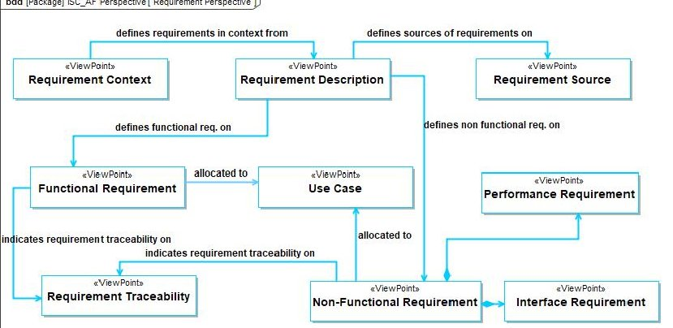

Fig. 5: Viewpoint Relationship View showing the ISC-AF Requirement Perspective

- Communication Viewpoint - This viewpoint describes the ISC link system communication protocols that support communication between small satellites.

- Interface Viewpoint - This viewpoint is used to define ISC system interfaces.

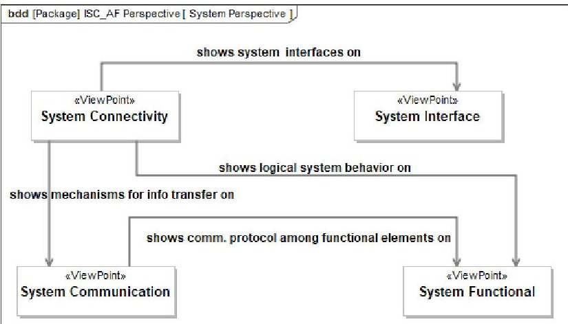

Fig. 6: Viewpoint Relationship View showing the ISC-AF System Perspective

## C. ISC-AF Viewpoint Definition View

The Viewpoint Definition view realizes the Viewpoint Definition Viewpoint, this view is used to define the various viewpoints within the perspectives that make up the ISC-AF. In this view, the viewpoint elements within a given viewpoint can be identified and also the relationships between the elements. Shown in Table I is a summary of the ISC-AF perspectives and their accompanying viewpoints.

## D. ISC-AF Rule Definition View

The ISC-AF Rules Definition View conforms to The Rules Definition Viewpoint. This viewpoint is used to define all the rules that constrain the ISC-AF. Therefore depicted in the ISC-AF rules definition view are various rules which are used to constrain aspects of the AF. The rules defined in this view are established in order to ensure consistency in the AF and the corresponding architecture which will be created based

<!-- PDF_PAGE: 5 -->

TABLE I: ISC-AF Viewpoint Definition View

<table border="1"><tr><td>Perspective</td><td>Viewpoint</td><td>Purpose</td></tr><tr><td rowspan="5">ISC-AF Perspective</td><td>AF Context Viewpoint</td><td>Used to define the context for the ISC-AF. This context defines the needs the ISC-AF is trying to address.</td></tr><tr><td>ISC-AF Ontology Definition Viewpoint</td><td>Used to identify and define concepts and terms to be used for the ISC framework.</td></tr><tr><td>ISC-AF Viewpoint Relationship Viewpoint</td><td>Used to show relationships between viewpoints that make up the ISC-AF and groups them into perspectives.</td></tr><tr><td>ISC-AF Viewpoint Definition Viewpoint</td><td>Used to define a particular viewpoint</td></tr><tr><td>ISC-AF Rules Definition Viewpoint</td><td>Used to define the rules that constrain the ISC-AF</td></tr><tr><td rowspan="6">ISC-AF Requirements Perspective</td><td>ISC System Requirement traceability Viewpoint</td><td>Used to show the relationship between requirements and the model elements that satisfy, verify, refine.</td></tr><tr><td>ISC System Functional Requirements Viewpoint</td><td>Used to define the ISC systems functional requirements which will be required of the system</td></tr><tr><td>ISC System Non-Functional Requirements Viewpoint</td><td>Used to define any system requirements that are not functional based and which put a constrain on the ISC system</td></tr><tr><td>Requirement Source Viewpoint</td><td>Used to define and show the origin of each requirement</td></tr><tr><td>Requirement Context Viewpoint</td><td>Used to define the needs from a specific point of view by putting the into context.</td></tr><tr><td>Requirement Description Viewpoint</td><td>Used to provide a high level abstract description of a requirement.</td></tr><tr><td rowspan="4">ISC-AF System Perspective</td><td>ISC System Connectivity Viewpoint</td><td>Used to identify and define the structure of an ISC system showing the system elements, their properties and behaviors.</td></tr><tr><td>ISC System Communication Viewpoint</td><td>Used to define the layered sets of communication protocols based on the OSI model that support ISC. It describes mechanisms for information transfer between small satellite systems.</td></tr><tr><td>ISC System Functional Viewpoint</td><td>Used to define the ISC systems functional structure and how functions interact with each other.</td></tr><tr><td>ISC System Interface Definition Viewpoint</td><td>Used to define interfaces between systems and between system elements within an ISC system.</td></tr></table>

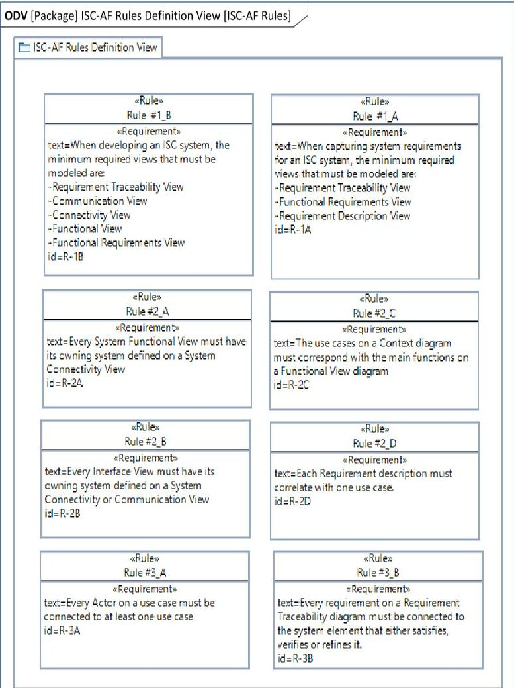

Fig. 7: Rule Definition View showing some ISC-AF Rules

on the AF. There are three rule types adapted from [7] that are defined for the ISC-AF:

Rule #1: Rules that define the minimum set of views that have to be present in an architecture based on the architectural framework.

Rule #2: Rules that define consistency checks between viewpoints and the views based on them.

Rule #3: Rules that define consistency checks within viewpoints and the views based on them.

Some of the ISC-AF rules corresponding to the three rule types stated above are depicted in the RDV diagram shown in Fig.7

## E. ISC-AF Ontology Definition View

The ISC Ontology Definition Viewpoint is used to define all the concepts that belong to the ISC domain. These concepts, their definitions, and the relationships between them are portrayed in the ISC-AF Ontology Definition View which is divided into three groups with each group corresponding to the AF, Requirement and System concepts respectively. The ODV showing the various ontology terms

<!-- PDF_PAGE: 6 -->

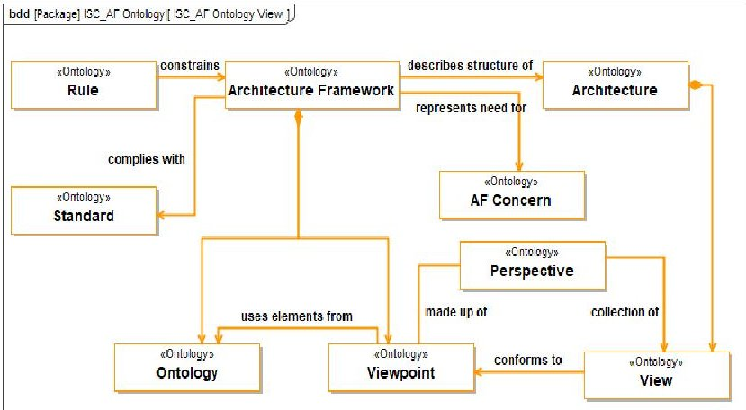

Fig. 8: Ontology Definition View for the AF Concept

and corresponding relationships are shown in Fig. 8 - 10 while a complete view of the ISC-AF ontology showing the relationship between all three concepts is portrayed in Fig. 11.

- ISC Architectural Framework: A defined set of one or more viewpoints and an ontology. It specifies how an ISC system architecture should be organized and the kind of information that can be presented.

- ISC Architecture: Is a description of an ISC system consisting of a set of views which conform to corresponding viewpoints. An ISC architecture is based on the ISC-AF.

## 1) Ontology for the ISC Architecture Concept:

- Viewpoint: A viewpoint provides the framework for defining the content and structure of a view. A view is based on a viewpoint.

- View: A view is a representation or visualization of the ISC system architecture from the perspective of a defined viewpoint. A view can only conform to a single viewpoint and it is an artifact that describes an aspect of the architecture.

- Perspective: A perspective is a collection of views which are grouped together based on a common purpose.

- Rule: A rule is a construct that constrains the architectural framework and corresponding architecture.

- Standard: A Standard represents a set of best practices that the AF must adhere to.

- Ontology: Defines all the terms and concepts which relate to ISC system architecture structured according to the ISC-AF.

- AF Concern: An AF concern refers to a requirement which the AF must address.

- Requirement: Is a desired feature, property or behavior of a system that is either needed or wanted by an ISC system.

- Requirement Description: Is a tangible description of the services required by the system and the constrains under which it must operate.

## 2) Ontology for the ISC Requirement Concept:

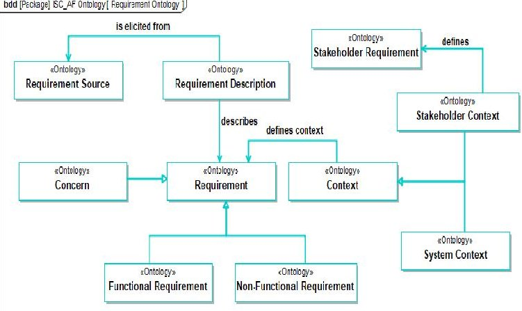

- Requirement Source: The origin of a requirement.

Fig. 9: Ontology Definition View for the ISC Requirement Concept

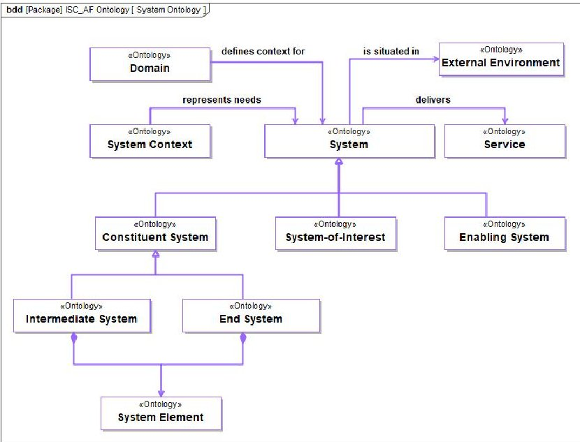

Fig. 10: Ontology Definition View for the ISC System Concept

- Concern: Is a requirement whose context will represent an architecture, or a viewpoint.

- Context: A context can be defined as a 'point of View' from which a requirement or system can be understood or assessed.

- Functional Requirement: It defines a function a system should provide, something the system should do.

- Non-Functional Requirement: Is a property or attribute that a system must possess, a condition the system must meet or a constraint under which the system must operate or be developed.

- System Context: A 'point of view' from which the whole/part of the system can be understood.

- Stakeholder Context: A 'point of view' from which a stakeholder role is understood.

- 3) Ontology for the ISC System Concept:

- System: A set of interacting elements organized to satisfy one or more 'system context'.

<!-- PDF_PAGE: 7 -->

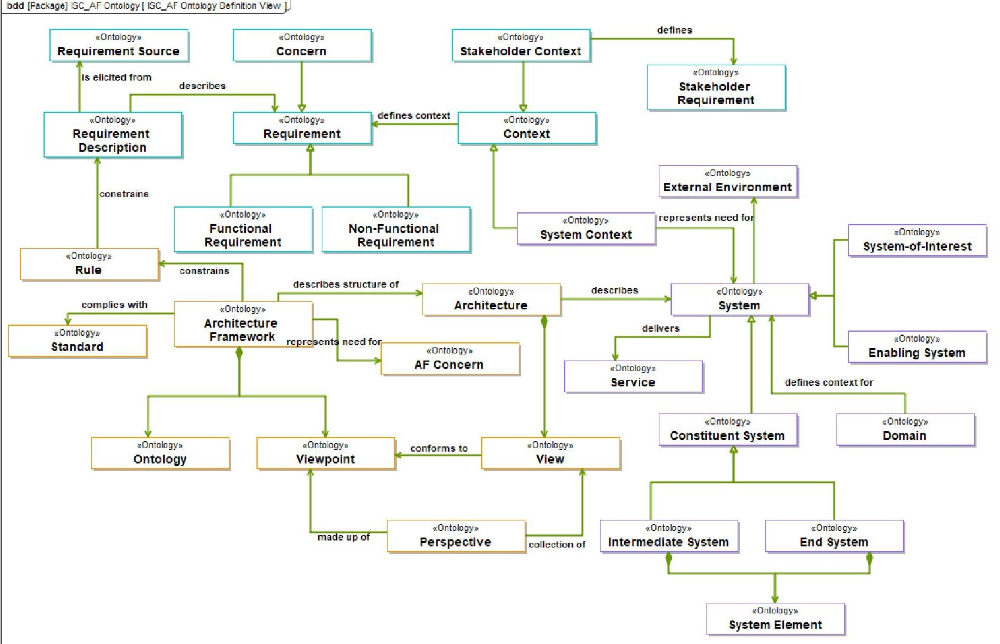

Fig. 11: Ontology Definition View showing the complete ISC-AF Ontology

- Constituent System: A type of system whose elements are one or more system elements.

- System-of-Interest: A type of system that describes the system being developed.

- System Element: A basic part of a constituent system.

- Enabling System: A type of system that interacts with the system-of-interest yet sits outside its boundary.

- End System: A type of system that generates information and may directly forward it to another end system or rely on intermediate systems for this service.

- Intermediate System: A type of system that is mainly involved in forwarding received information. It may or may not modify the information being forwarded.

- External Environment: Refers to the environment in which the system must operate.

## V. CONCLUSION

In this paper, we presented an architectural framework design for Small Satellite Systems (SmSS) Inter-Satellite Communication (ISC) based on an MBSE approach. The Systems Modeling Language (SysML) was used as the modeling tool to aid in the development process. The architectural framework (AF) designed provides a standard framework for modeling an ISC system architecture. The AF enables the representation

of an ISC system architecture based on viewpoints which are realized by a set of views. The AF is presented as a set of views conforming to viewpoints which focus on specific concerns regarding the AF and these views are represented using bdds and use case diagrams.

## REFERENCES

[1] R. Radhakrishnana, W. Edmonsona, F. Afghahb, R. Rodriguez-Osorioc, F. Pinto Jr, and S. Burleigh, "Survey of inter-satellite communication for small satellite systems: Physical layer to network layer view," arXiv preprint arXiv:1609.08583, 2016.

[2] M. Aerospace, "Darpa wants real-time cubesat communications to link micro-satellite constellations," 2015. [Online; accessed 20-December 2016].

[3] E. S. A. European Space Agency, "Network and link layer solutions for inter-satellite links between small satellites," 2016. [Online; accessed 20-December-2016].

[4] L. Delligatti, SysML distilled: A brief guide to the systems modeling language. Addison-Wesley, 2013.

[5] C. Dickerson and D. N. Mavris, Architecture and principles of systems engineering. CRC Press, 2016.

[6] A. Reichwein and C. J. Paredis, "Overview of architecture frameworks and modeling languages for model-based systems engineering," in ASME 2011 International Design Engineering Technical Conferences and Computers and Information in Engineering Conference, pp. 1341- 1349, American Society of Mechanical Engineers, 2011.

[7] J. Holt and S. Perry, SysML for systems engineering, 2nd Edition: A model-based approach, vol. 10, chapter 11. IET, 2014.

[8] INCOSE, "Systems engineering vision 2020," September 2007. [Online; accessed 24-October-2016].

<!-- PDF_PAGE: 8 -->

[9] H. Chalé Gongora, T. Gaudre, and S. Tucci-Piergiovanni, "Towards an architectural design framework for automotive systems development," 2013.

[10] R. Hilliard, "The role of architecture frameworks: Lessons learned from iso/isc/ieee 42010," in Proceedings of the IST-115 Symposium on Architecture Definition & Evaluation, Toulouse, France, 2013.

[11] D. o. D. United States Department of Defence, "Department of defence architectural framework," 2010. [Online; accessed 19-December-2016].

[12] M. o. D. Minstry of Defence, "Mod architectural framework," 2016. [Online; accessed 19-December-2016].

[13] N. A. T. O. North Atlantic Treaty Organisation, "Nato architectural framework," 2013. [Online; accessed 19-December-2016].

[14] TOGAF, "The open group architectural framework," 2009. [Online; accessed 19-December-2016].

[15] J. A. Zachman, "John zachman's consise definition of the zachman framework," 2008.

[16] CCSDS/ASRC, "Consultative committee for space data systems," 2016. [Online; accessed 16-December-2016].

[17] P. Shames and T. Yamada, "Reference architecture for space data systems," in International Telemetering Conference Proceedings, International Foundation for Telemetering, 2003.

[18] ISO/IEC10746, "Reference model-open distributed processing," 2016. [Online; accessed 16-December-2016].

[19] ISO/IEC/IEEE42010, "Systems & software engineering- architectural description," 2011. [Online; accessed 16-December-2016].

[20] P. Shames, "Modeling space data systems architectures rasds and sysml," 2010.