<!-- PDF_PAGE: 1 -->

# Model-Transformation-Based Computational Design Synthesis for Mission Architecture Optimization

Sebastian J. I. Herzig Jet Propulsion Laboratory California Institute of Technology 4800 Oak Grove Dr. Pasadena, CA 91109 818-393-3059 Sebastian.J.Herzig@jpl.nasa.gov

Sanda Mandutianu Jet Propulsion Laboratory, California Institute of Technology 4800 Oak Grove Dr. Pasadena, CA 91109 626-318-1566 Sanda.Mandutianu@jpl.nasa.gov

Hongman Kim Jet Propulsion Laboratory, California Institute of Technology 4800 Oak Grove Dr. Pasadena, CA 91109 818-354-0608 Hongman.Kim@jpl.nasa.gov

Sonia Hernandez Jet Propulsion Laboratory California Institute of Technology 4800 Oak Grove Dr. Pasadena, CA 91109 818-354-0418 Sonia.Hernandez-Doran@jpl.nasa.gov

Travis Imken Jet Propulsion Laboratory California Institute of Technology 4800 Oak Grove Dr. Pasadena, CA 91109 818-354-5608 Travis.Imken@jpl.nasa.gov

Abstract—In this paper, a model-based approach to exploring the trade space of multi-spacecraft mission architectures is introduced. Missions involving multiple spacecraft are inherently more complex to design than traditional single spacecraft missions. This is particularly true for fractionated mission concepts, where spacecraft have diverse roles and distributed responsibilities, and fulfilling mission goals requires communication and collaboration. In practice, this complexity and the lack of computational models and tools limit design teams to consider small design spaces and force them to quickly fixate on a single mission design. However, design fixation at such early stages often leads to sub-optimal designs. Towards overcoming this limitation, we propose an automated approach to exploring and visualizing the trade space of multi-spacecraft mission architectures that aids users in decision making, and provides a basis for identifying solutions that are Pareto-optimal with respect to user-defined science requirements, technical and resource constraints, and mission objectives. Central to our approach is the automated synthesis and analysis of mission architecture alternatives from a set of user-provided functional requirements and mission goals, as well as a library of spacecraft components and analysis models. Design rules (synthesis knowledge) are provided in the form of model-transformation rules. Sequences of endogenous model transformations are applied in-place to produce sets of candidate solutions, thereby effectively searching the design space. The search process is guided by the specified objectives, and is implemented using evolutionary algorithms. We demonstrate our approach to architectural optimization using a simplified radio interferometry mission design as a case study. We conclude that using the proposed approach, the number and diversity of candidate mission architectures available for consideration can be significantly increased. Furthermore, the automated synthesis and evaluation of mission architectures can lead to emergent and non-intuitive solutions to be discovered.

## TABLE OF CONTENTS

1. INTRODUCTION...1

2. CASE STUDY DESCRIPTION...2

3. OVERVIEW OF APPROACH...4

4. MISSION ARCHITECTURE GENERATION USING MODEL-TRANSFORMATIONS...6

978-1-5090-1613-6/17/$31.00 ©2017 IEEE

5. IDENTIFICATION OF PARETO-OPTIMAL MISSION ARCHITECTURES USING GENETIC ALGORITHMS .7

6. APPLICATION TO CASE STUDY ...8

7. RELATED WORK ...12

8. CONCLUSIONS ...13

ACKNOWLEDGMENTS ...13

REFERENCES ...13

BIOGRAPHY ...14

## 1. INTRODUCTION

Missions involving multiple, communicating spacecraft have recently gained increased attention [1], [2] due to their potential benefits in reducing cost, increasing robustness [3], and enabling novel types of missions [4]. Such missions are typically referred to as fractionated [5] or (networked) constellation missions. Particularly small form factor spacecraft, such as CubeSats [6] are seen as promising enablers. This is because of their overcoming of the typical criticism of constellation missions being prohibitively expensive due to the expected high launch mass [7]. Also, advancements in autonomy make operations of constellations more manageable and less costly.

The design of (networked) constellation missions represents a major, open challenge. Particularly the inherently large design space that results from the fractional nature of such types of missions introduces challenges in early phases when architectural trades are performed. In an effort to aid designers in identifying high performing, near-optimal mission architectures, this paper introduces a novel approach to exploring the architectural trade space of constellation missions. Specifically, we introduce and evaluate a model-based design space exploration method that represents the core of the overall approach.

Exploring the trade space of multi-spacecraft mission architectures requires topological exploration. This requires answering questions such as: how many spacecraft are in the constellation? What is the primary function and purpose of each of these spacecraft? How does each spacecraft best

<!-- PDF_PAGE: 2 -->

contribute in achieving an overall mission goal? Depending on the mission requirements and objectives, fundamentally different communication and mission architecture topologies, and configurations of each of the spacecraft involved can be the resulting optima. Having to consider such additional dimensions, and resulting additional system-wide trades makes the design of constellation missions significantly more complex than that of single spacecraft missions. Therefore, we argue that the effective exploration of the space of, and comparison of candidate mission architectures requires computational assistance. The approach proposed in this paper fuses the concepts of model-transformations from model-driven software engineering [8], heuristic optimization from artificial intelligence [9], and integrated system analysis and simulation from model-based systems engineering [10].

A number of model-based architectural design space exploration methods have been reported in the past (see, e.g., [11], [12]). However, most of these methods either make strong assumptions about the form of the objective functions and structure of the produced solutions, do not scale well, or use (quasi-)exhaustive search methods. Also, only few are rooted in sound, formal frameworks. The method proposed in this paper is intended to fill these gaps.

The paper is structured as follows: in section 2 we introduce the motivating case study that is also used as an example throughout the paper. Section 3 then provides an overview of our proposed approach to trade space exploration of multiasset spacecraft mission architectures. Mission architecture generation and identifying optimal mission architectures is elaborated in more detail in sections 4 and 5, respectively. The approach is applied to the case study in section 6. We compare our approach to related work in section 7. The paper closes with conclusions in section 8.

## 2. CASE STUDY DESCRIPTION

Of particular interest to the astronomy science community is the observation of distant objects at frequencies below 30 Mhz. For instance, this enables tracing of low-energy transitions, such as hyperfine atomic splitting. However, given that the angular resolution is proportional to $ \frac{\lambda}{D} $ , where $ \lambda $ is the wavelength and D the size of the antenna, a single antenna with a diameter of hundreds of kilometers would be required to gather meaningful data. In practice, radio interferometers are used in such cases. Radio interferometers are radio telescopes consisting of multiple antennas that receive radio waves from the same astronomical object and achieve the same angular resolution as that of a single telescope with the same aperture [13]. Due to the long baselines (distances between telescopes) that are required, and due to severe distortions of radio signals at frequencies below 30 Mhz by

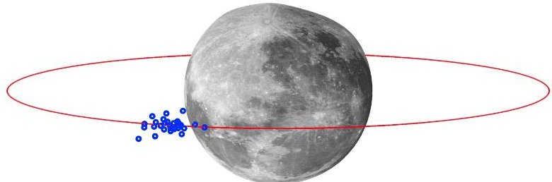

Figure 1. Assumed reference orbit around the moon (circular, red). All spacecraft in the constellation fly in close proximity (blue).

the ionosphere, Earth-based telescopes cannot be used.

One possible solution is a space-based radio interferometer, where a number of satellites act as an array of radio telescopes [4]. This requires at least two spacecraft to work together to achieve the overarching mission goal, making it a representative example of a (networked) constellation mission. How many spacecraft are required, and how capable each of these spacecraft should be such that scientific benefit is maximized and cost is minimized, is a complex optimization problem. We use this mission concept as a case study to demonstrate and evaluate our approach introduced in this paper.

The considered mission concept assumes a number of satellites that act as radio interferometers. These observing spacecraft first collect data for a period of up to 10 hours. Then, each spacecraft downlinks its data (in ordered sequence), possibly via one or more relays. We assume that all spacecraft are flying in close proximity in a cluster around the moon (see Figure 2). The cluster follows a circular reference path (shown in red), and distances between each spacecraft can range from tens to hundreds of kilometer.

In the optimization problem, we allow each spacecraft to be either a 3U or 6U CubeSat (4 kg and 12 kg, respectively) [6], or a Small Satellite (100 kg). It is assumed that only certain types of components and combinations of components can feasibly be placed on certain types of spacecraft. For instance, we allow a high gain (25 dBi) antenna and Ka-band transmitter only as part of a Small Satellite. Ultra High Frequency (UHF) and X-band transmitters can be combined with low (1 dBi) and medium (10 dBi) gain antennas on any spacecraft type. Also assumed is that combining a low gain antenna with a Ka-band transceiver is not sensible. Any spacecraft can optionally also be equipped with an interferometry payload that consists of a low frequency receiver and antenna. Spacecraft can transmit the collected science data to one other spacecraft in the constellation, or directly to a ground station. For the ground station, we assume two possible receiving ends: a X-band antenna with 72 dBi, and a Ka-band antenna with 85 dBi. To be determined are the optimal number of and individual configurations of each spacecraft, and the communication network topology. This is done by identifying mission architectures that minimize cost, maximize scientific return and minimize mission duration.

To enable the identification of near-optimal (i.e., highperforming) mission architectures, a number of analysis models used in determining the scientific return, total mission cost and mission duration given a candidate mission architecture were devised.

In our case study, scientific return is measured by coverage. Here, coverage is an indicator of how many samples used for reconstructing the real image are collected over time [13]. As the spacecraft move in their respective orbits, the baselines change, giving rise to new samples. The resulting density of samples depends on the number of spacecraft acting as radio interferometers, and the amount of time that a particular target is observed. To simplify, the following fictitious analytical coverage model was created, which mimics the general trend that was observed in a more sophisticated simulation model:

$$
c o v = \left(1 - \frac {2}{n _ {o b s}}\right) ^ {1 + 9 \left(1 / t _ {o b s}\right)} + 0. 0 5 \frac {t _ {o b s}}{3}
$$

Equation 1 is plotted in Figure 2 for three example observa-

<!-- PDF_PAGE: 3 -->

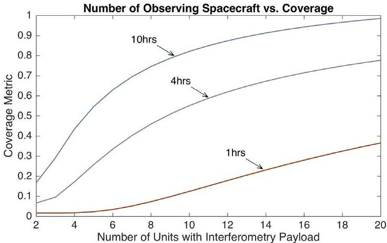

Figure 2. Representative (but fictitious) coverage model used in estimating quality of science return. Times reflect number of hours spent observing target.

tion periods and as a function of the number of spacecraft equipped with the appropriate payload instruments. The assumption is made that, even with long observation times, a small number of spacecraft will not yield a high coverage. Ideal coverage is achieved if a large number of observing spacecraft are in the constellation, and the period of observation is maximized.

The overall mission duration is dependent not only on the period of observation, but also dictated by the amount of time taken to downlink all collected scientific data. We assume a fixed data collection rate of 12 Mbps (Megabit per second) by the interferometry payload (see [4]). This leads to a static amount of science data collected per spacecraft i of $ d_{science,i}=1 2 \cdot t_{o b s} $ , where $ t_{o b s} $ is the time spent observing (assumed same for all spacecraft). As mentioned previously, for simplicity, each spacecraft can either transmit to one other spacecraft or transmit to a ground station. This leads to a total amount of data that must be transmitted by a particular spacecraft i of:

$$
d _ {o u t, i} = d _ {s c i e n c, i} + \sum_ {j = 1} ^ {n _ {s c}} d _ {i n, j}
$$

In Equation 2, $ d_{in,j} $ represents the amount of data received from other spacecraft j, in Megabytes. The time taken by spacecraft i to send $ d_{out,i} $ to a target depends on the link speed $ r_{i} $ :

$$
t _ {t r a n s m i t, i} = \frac {d _ {o u t , i}}{7 . 5 r _ {i}}
$$

Note that in Equation 3, the denominator is a conversion factor from Megabits per second to Megabytes per minute.

The link speed depends primarily on the link length, transmit power, and gains of the antennas used on the receiving and transmitting ends. Values for these parameters depend strongly on the configuration of the individual spacecraft. Approximate link speeds for some of the considered link configurations are captured in Table 1. These were derived by applying standard link budgeting practice (see, e.g., [14]) and assuming a desired link margin of at least 3 dBi. Note that

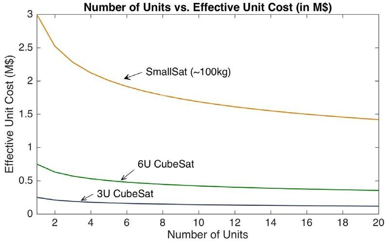

Figure 3. Representative (but fictitious) cost model used to determine the effective base unit cost per spacecraft. Total unit cost depends on final configuration of spacecraft (optional payload, secondary comm).

for inter-spacecraft communication a path length of 200 km is assumed, and for downlinking to Earth 385,000 km.

In accordance with the described mission concept of operations, the total mission duration is the sum of the time spent observing by all spacecraft $ t_{obs} $ (converted to minutes), plus the sum of the times each spacecraft spends transmitting its data (collected by payload and received from other spacecraft) to another node in the network. This is described in Equation 4:

$$
t _ {m i s s i o n} = \sum_ {i = 1} ^ {n _ {s c}} t _ {t r a n s m i t, i} + 6 0 t _ {o b s}
$$

Trading off the scientific benefit and observation time is the overall cost of the mission. For this purpose, a simplified cost model was created that takes into account economies of scale:

$$
c _ {i} = c _ {b a s e, t y p e (i)} \cdot n _ {t y p e (i)} ^ {- 0. 2 5} + c _ {c o n f, i}
$$

$$
c _ {t o t a l} = \sum_ {i = 1} ^ {n _ {s c}} c _ {i} + 1 0 0, 0 0 0 t _ {o b s}
$$

Equation 5 accommodates for the idea that the unit price per spacecraft depends on the number of units of the same type of spacecraft bought. We assume that the price per unit depends on the base price $ c_{base,type(i)} $ of the particular spacecraft, where we assume $ 250,000 for a 3U CubeSat,

Table 1. Computed communication rates. 385k km case assumes 72 dBi receive antenna gain for X-band, and 85 dBi for Ka-band (similar to DSN).

<table border="1"><tr><td>Transmitter Configuration</td><td>200km</td><td>385km</td></tr><tr><td>UHF,3W,1dBi</td><td>5Mbps</td><td>-</td></tr><tr><td>X-Band,5W,10dBi</td><td>1.6Mbps</td><td>0.7Mbps</td></tr><tr><td>Ka-Band,15W,25dBi</td><td>220Mbps</td><td>80Mbps</td></tr></table>

<!-- PDF_PAGE: 4 -->

$750,000 for a 6U CubeSat, and $3,000,000 for a Small Satellite. This equation is plotted for the various considered spacecraft types in Figure 3. The total cost $ c_{i} $ of a particular spacecraft i depends on its configuration and expected complexity. This is accounted for by $ c_{conf,i} $ , where we say that having the interferometry payload costs an additional $ 50,000, and a secondary communication system $ 100,000 (e.g., one for inter-spacecraft communication, and a second for downlinking to Earth). The total cost of the mission $ c_{total} $ (see Equation 6) is defined as the sum of the cost of the individual spacecraft in the constellation, plus $ 100,000 per hour of observation. Note that this cost model and all amounts mentioned are fictitious, but considered sufficiently representative.

## 3. OVERVIEW OF APPROACH

Our approach is based on fundamental concepts from modelbased systems engineering, and uses methods from modeldriven software engineering and artificial intelligence. Figure 4 summarizes the major components and data flows in the proposed framework and approach: architecture generation, analysis, evaluation and evolution of architectures. The generation and evaluation is enabled by a set of mission-agnostic design rules, a library of components and a set of analysis models, and is guided towards the optima by mission-specific requirements, constraints and objectives. The starting point for the generation is either a baseline solution or an empty model. Output are near-optimal mission architectures, and visualizations of the trade space (e.g., approximated Pareto frontiers).

The case study demonstrates well that, even for a limited problem, designing a networked constellation mission involves a large number of highly interconnected analyses and complex trades. To aid designers and decision makers in identifying near-optimal mission architectures, we propose a computationally assisted approach that builds on results from [15] and [16]. A core concept is the automatic generation of mission architectures using computationally applied design rules. Candidate mission architectures are compared by determining how well they meet certain mission-specific requirements and objectives.

## Model-Transformation-Based Exploration

Central to the approach is the generation of architecture models using in-place endogenous model transformations [17]. Typically, model transformations are thought of as a method for translating a model from one language to another, particularly in MBSE applications (e.g., a transformation of a descriptive systems model to an analytical model). Here, we say that the input and output model conform to the same modeling language, making the transformation endogenous rather than exogenous. It is also the input model that is transformed, and returned in a modified form as the output model, making the transformation in-place. Since the model transformations are used in evolving an input model, we equate them with design rules in our approach.

Model transformations typically act on the level of types Generally, these can be seen to consist of two distinct parts: a left-hand side that represents a matching condition, and a right-hand side that specifies the effect of applying the rule i.e., how elements matched in the left-hand side are modified As an example, consider the input model illustrated at the top of Figure 5. Assume the existence of a transformation rule that adds a new spacecraft to the constellation as well

as a communication link from an existing spacecraft to the new spacecraft. Applying the described rule to the initial model illustrated at the top of Figure 5 leads to two possible modified states of the input model. These are illustrated at the bottom of the figure. Both states are possible, since the rule is specified to apply to any existing kind of spacecraft. Similarly, if the rule is applied to either of the resulting output models, three alternative models can be produced. This is known as the model state space.

Following this idea further with an arbitrarily sized set of model transformation rules and number of transformation applications, a larger set of models can be generated. In effect, a tree is built, where each path from the root to a leaf node is the result of applying a certain sequence of model transformation rules with particular left-hand side bindings, producing a particular model state. If the particular model represented by each node does not violate any invariants (i.e., any requirements or constraints), it is a well-formed (but possibly sub-optimal) solution to the initial design problem.

## Functional, Goal-Based Mission Descriptions as Primary Mission-Specific Input

Key in guiding the exploration process towards optima is the specification of mission-specific requirements and objectives. In our approach, we propose that this should be done by providing the Solver Core with a (potentially highly abstract) goal-based, functional description of the mission concept. This description should contain the functions that parts of the constellation mission must perform, as well as any precedence constraints. For instance, for a simple mission, in which the goals may be only vague, such a description could possibly only contain the ordered sequence of the actions "Collect Data" and "Transmit Data to Earth". There are numerous ways in which each function can be implemented concretely: for instance, for something as abstract as Collect Data, one may envision taking a picture with a camera, or collecting radio waves. Transmit Data to Earth only carries the meaning that data has to be transmitted in some way, with the post-condition being that all data to be transmitted must arrive at some point in the future at Earth. Whether a relay satellite is used in the process is not specified. Such abstract functions, how they can be implemented concretely, as well as their appropriate pre- and post-conditions are to be defined in a reusable library.

Providing a goal-based functional description of the mission as primary input has two effects. Firstly, solutions are bounded to only those that perform the desired functionality. Secondly, no assumptions about the concrete implementation of a (possibly abstract) function are made. The architecture generation process relies only on synthesizing components known to fulfill the desired functions, which are previously captured knowledge fragments stored in a library. This reduces bias and reliance on heritage architectures, and enables the discovery of emergent solutions.

Since synthesis is a design activity in which components are selected by the kinds of functions they perform, functional descriptions can directly be encoded in the model transformation rules. However, a dedicated language, and an automated generation of the appropriate rules, may be more suitable for this purpose.

<!-- PDF_PAGE: 5 -->

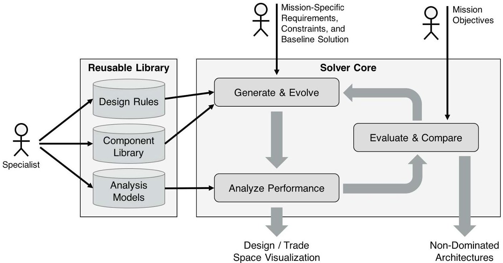

Figure 4. Overview of proposed architecture generation, and trade space exploration framework.

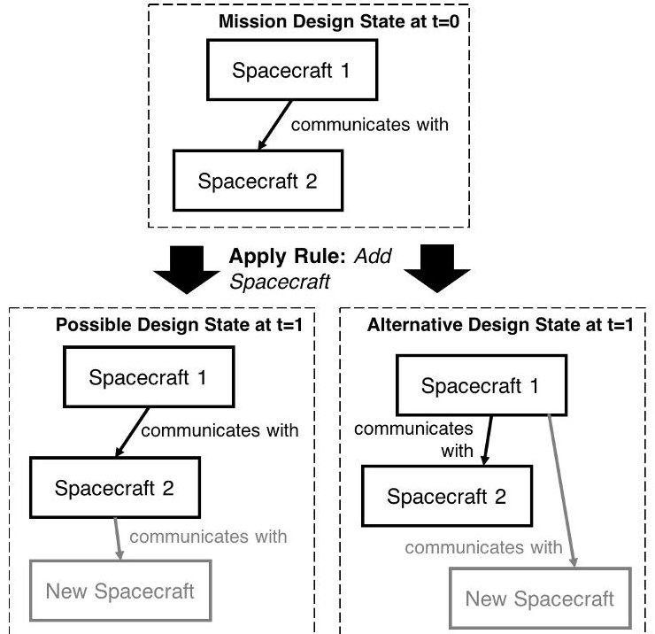

Figure 5. Illustration of proposed rule-based generation of mission architectures.

## Reusable, Model-Based Design Knowledge Libraries for Automated Synthesis

To support the synthesis process described in the previous section, and ease creation or selection of appropriate design rules, a library containing structural elements, their functions and interfaces, and their behavior should exist. The library should also contain related analysis models that allow for determination of mission-agnostic, but constellation-mission and spacecraft-domain-specific performance characteristics. For instance, the library should contain the concept of a Solar Array, which performs the function Generate Power and outputs Electrical Power at its interface. How much power is generated should be determined from the size of the associated panels using an associated analysis model from the library. The library should also contain hyponymous relationships ("B is a kind of A") to allow for more sophisticated reasoning from the general to the specific when exploring the design space: for instance, to capture knowledge such as "Take Picture" (function of camera) is a kind of "Collect Data" function.

## Integrated Analysis & Optimization

The described model-transformation-based computational design synthesis and design space exploration approach allows for the generation of candidate solutions that satisfy a specified set of requirements and constraints on the topology of the mission architecture. However, evaluating and comparing two or more architectures requires the prediction of performance characteristics that may need more sophisticated analysis or simulation. For instance, when designing spacecraft missions, the prediction of how much fuel is required for performing station keeping maneuvers, and whether the specified fuel of the spacecraft is exhausted before the intended end of the mission, requires a detailed analysis involving complex gravitational models. Among other elements, involved in this analysis are also predictions of the total mission time given the selected communications architecture and payload configuration. This leads to a complex, intertwined analysis of the system and necessarily requires integrated analysis where dependencies among solvers must be clearly defined.

In our approach, we separate the generation of architectures and their analysis for this purpose. In the generation certain decisions are made, while other characteristics are derived analytically. For instance, one can decide on the amount of fuel to carry on board, but not on the achievable total $ \Delta V $ . In this case, $ \Delta V $ is a derived property $ ^{2} $ . Running such analyses as part of the optimization requires a framework capable of scheduling and executing a variety of different kinds of analyses.

Primarily of interest when analyzing a generated architecture

<!-- PDF_PAGE: 6 -->

are values for the objectives. These are computed as part of the analysis process. In our approach, multi-objective optimization algorithms should influence the generation of candidate solutions to steer the exploration towards optima: that is, they must directly influence the sequence of, and types of design rules that are applied. Alternatively, a naive optimization would exhaustively or randomly explore the space of architectures and pick the most promising solution candidates.

## Trade Space Visualization

The final component of our approach and framework is the visualization of the results. While a detailed discussion on the topic of visualization is deemed outside the scope of this paper, a short discussion is included nonetheless for completeness.

Due to the complexity of the problem of identifying optimal constellation mission architectures, and the very large size of the design space, visualizing the trade space is non-trivial. While well-known methods such as scatter plots can be used for illustrating approximated Pareto-frontiers to show trade-offs between various objectives, it should be taken into account that each point on the graph represents a potentially fundamentally different mission architecture. Since the approach is meant to support rather than replace a designer, and resulting near-optimal architectures are meant to act as starting points or spark creativity, methods of clustering architectures by some similarity score, and displaying common features, may be suitable. Alternatively, trade trees [18] may be appropriate visualization techniques.

## 4. MISSION ARCHITECTURE GENERATION USING MODEL-TRANSFORMATIONS

In the following, our concrete approach to mission architecture generation using model-transformations is detailed. Two elemental parts are discussed: firstly, the definition of a meta-model defining the types of elements in a domain (here: constellation missions) and their relations, and secondly a concrete method for defining model-transformation rules for generating well-formed models conforming to the meta-model.

## Defining Design Spaces Using Problem-Specific Meta- Models

A first step in defining the optimization problem is to create a problem-specific meta-model. This defines the types of elements in the solution domain that should be part of a solution candidate, as well as the relations between the elements. A particular candidate solution then includes zero or more instances of these meta-elements. In our approach, we use the Ecore language for defining meta-models. Ecore is a meta-meta-modeling language - i.e., a language for defining meta-models - and is part of the Eclipse Modeling Framework (EMF) [19].

Consider the example meta-model from Figure 6 in which two concepts from the domain of constellation missions are defined (as classes): Spacecraft and ConstellationMission. Also defined are relations between the different elements of the domain: a single instance of a ConstellationMission is said to be composed of two or more Spacecraft instances. Note carefully the "two or more", which is a cardinality constraint. Any instance of a ConstellationMission that is composed of less than two Spacecraft instances is invalid and

said to not be well-formed. A ConstellationMission is also characterized by a property missionDuration. Furthermore, a Spacecraft instance references zero or more other Spacecraft instances through a relationship communicatesWith. This reference relationship is meant to be a simple way of capturing a communication path between two spacecraft, and is to be interpreted as such.

Notice that the meta-model formally captures and integrates some requirements on what one would consider a wellformed (or correct) solution. For instance, cardinality constraints ensure the existence of an appropriate amount of instances. Not all constraints on the structure can be expressed appropriately using the class diagram syntax of Ecore. To add additional restrictions on the well-formedness of a solution, we use the Object Constraint Language (OCL), using which invariants can be defined that traverse a model through the paths defined in the meta-model. In this manner, one can ensure, for instance, that no Spacecraft communicates with itself (i.e., references itself). Other, more sophisticated invariants may include checking whether there are any communication loops present.

In our approach, a problem-specific meta-model is intended to be an extension of an existing base meta-model for constellation missions, in which all elements deemed common to a broad class of constellation missions are defined. This metamodel can then be reused and extended, and is considered part of the reusable library discussed in Section 3.

## Defining a Baseline Solution

As a starting point for the design space exploration, our approach requires an initial instance of the meta-model to be defined. This can be a baseline solution, or an empty instance model. For instance, a starting point for a typical constellation mission may be a reference design, or a heritage design. The baseline solution is used as the initial input model to start the design space exploration from.

Notice that a baseline solution itself can encode a number of requirements and boundary conditions. For instance, if ground station networks are considered as part of the design problem, and a particular ground station network with known properties is to be utilized, it can be modeled as an instance and included in the baseline solution.

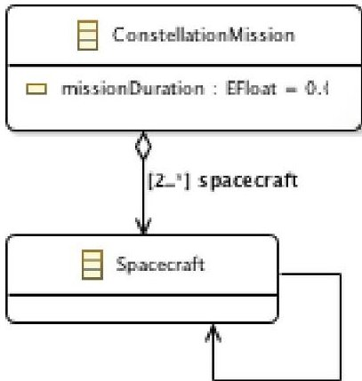

[0...*] communicatesWith

Figure 6. Example meta-model in Ecore syntax defining the concept of a Constellation Mission and associated communicating Spacecraft.

<!-- PDF_PAGE: 7 -->

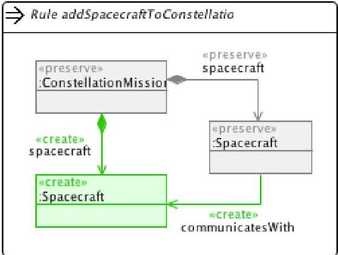

Figure 7. Example in-place transformation rule in Henshin syntax. Application of this rule adds a new Spacecraft instance to an existing Constellation Mission, and adds a communication link from an existing Spacecraft instance. Note that execution of this rule requires an input model with at least one Constellation Mission instance and one Spacecraft instance.

## Capturing Design Rules as Transformation Rules

A number of languages and execution engines for the model transformation mechanism described in Section 3 exist within the EMF ecosystem (e.g., QVTo [20], ATL [21], and Henshin [22]). Some model transformation frameworks also include design space exploration and optimization components, such as the VIATRA-DSE framework [16].

For the implementation of our approach, we have chosen the Henshin model transformation framework. This decision was based on an evaluation of various frameworks. Primarily the strong, formal graph transformation semantics, efficient interpreter engine, ability to graphically define transformation rules (providing an easier introduction to the concepts), and natural treatment of endogenous model transformations were deciding factors.

Figure 7 illustrates an example rule in Henshin syntax for adding a new Spacecraft instance to an existing ConstellationMission instance. Notice that both the left- and right-hand side of the rule (see Section 3) are shown on one diagram. The stereotype "preserve" captures elements that are part of the left-hand side matching condition that are to be preserved on the right hand side. The rule matches all combinations of ConstellationMission and Spacecraft instances that exist in the model, where any of the possibly matched Spacecraft instances must compose the particular matched ConstellationMission instance. In addition to the preserved elements, the right hand side also includes the action to create a new instance of a Spacecraft that composes the matched Constellation mission, and to add a communication link to the new Spacecraft instance from the matched Spacecraft instance. These elements to be created are stereotyped with "create". Note that in a model with no Spacecraft instances and only one ConstellationMission instance this rule would not match. In a model with just one Spacecraft instance (which, according to the meta-model definition is invalid) a match would be found, and, after applying the transformation rule, turn the previously invalid model into a valid one. In a model with two or more Spacecraft instances, a single execution of the rule could match any of the Spacecraft instances.

Some design rules are generic enough to be applicable for any

constellation mission. Such design rules are deemed missionagnostic and should be part of a reusable library as discussed in section 3.

## 5. IDENTIFICATION OF PARETO-OPTIMAL MISSION ARCHITECTURES USING GENETIC ALGORITHMS

In Section 3, three possible methods for identifying nearoptimal architectures are briefly mentioned: exhaustive search, random search, or an optimization algorithm that can evolve solutions towards optima. Exhaustive search is deemed impractical due to the expected size of the design space for most types of constellation missions. Random search may also be computationally costly, and the probability of generating a near-optimal solution is very low if the problem is sufficiently large.

This section describes a possible implementation of the third alternative: a specific adaptation of a genetic algorithm (see Figure 8). Genetic algorithms are non-exact optimization methods inspired by the process of natural selection. A population of candidate solutions (or individuals) is evolved toward better solutions using biology-inspired processes of selection, crossover and mutation. The initial population is typically created through a random process. Once a stop criteria has been reached (that is used to, e.g., determine whether solutions sufficiently close to optima have been found), the current population of the most "fit" individuals is output. Here, most "fit" refers to non-dominated solutions. A solution is non-dominated if none of the objective functions can be improved in value without degrading some of the other objective values in the result set. By restricting attention to the set of choices that are non-dominated (or Pareto-optimal), a designer can make tradeoffs in this set without having to consider the full range of every parameter. More details on Pareto-optimality and genetic algorithms can be found in the related literature on optimization [9].

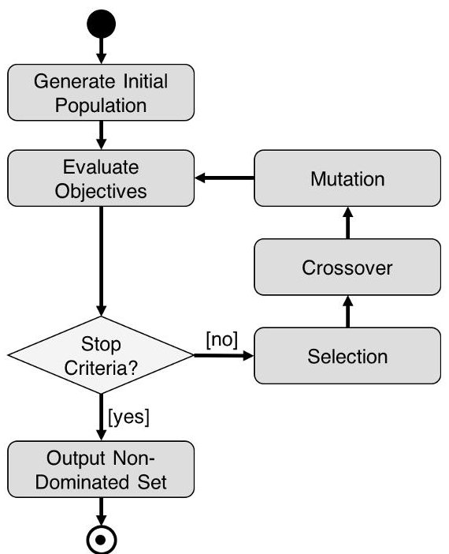

Figure 8. Typical procedural flow for genetic algorithms.

<!-- PDF_PAGE: 8 -->

## Solution Candidates as Sequences of Transformations

In genetic algorithms, individuals in populations are composed of a set of properties (often referred to as chromosomes). In practice, chromosomes are typically sequences of binary numbers. In a similar spirit, one can represent an individual as a sequence of model transformation rule applications (and corresponding rule matching conditions). As mentioned in Section 3, applying a sequence of in-place endogenous transformations to a given model produces one or more candidate solutions. Allowing for an alteration of the length of each individual in the population (e.g., by allowing for empty, or fully preserving, transformations), candidate solutions can be represented by a sequence of chromosomes, each of which is a particular transformation application. An initial population can be generated by, e.g., randomly choosing a set of model transformations.

It should be noted that by encoding candidate solutions as individuals in a population, the size of the generated models is bounded by the number of chromosomes. This means that in cases where meta-models are used with unrestricted cardinalities (e.g., "zero or more"), the solution space is bounded by the initial solution and the number of chromosomes.

## Analysis of Generated Models & Evaluation of Objectives

A fundamental operation in genetic algorithms is selection. Selection is based on evaluating the fitness of each individual in the population. Fitness is determined by evaluating the objective functions. Here, we distinguish between two kinds of criteria for fitness: whether or not (or how well) an individual meets specified constraints (e.g., whether the solution is a well-formed model and all OCL invariants are satisfied), and how well it meets its objectives relative to other members of the population. This requires a complete check of all constraints and an evaluation of all objective functions for each member of the population at each step in the genetic algorithm.

As mentioned in Section 3, the evaluation of objective functions for determining properties of interest of a constellation mission architecture can require the execution of a number of highly interconnected analysis models. For this purpose, we devised a simple Java-based analysis framework for parametric execution of a number of kinds of analysis models. Specialized wrappers were developed that can directly interact with select software (e.g., MATLAB), and launch external programs and read back the produced output (e.g., Python code). Direct transformations of the generated architecture model to analysis models that can directly be executed using off-the-shelf simulation engines have not been prototyped, but are conceivable in principle.

## Evolution of Population

Similar to any application of genetic algorithms, individuals in a population are evolved through application of selection, mutation and crossover operators. Figure 9 illustrates an example of a crossover operation. Crossover is a process in which two or more solutions from a previous generation are recombined into a new solution. In the depiction, two solutions (of different length) are recombined into a new solution through a single-point crossover operation, where the crossover point is chosen arbitrarily. Selection occurs through evaluation of the objective functions and constraints. Mutation occurs by replacing chromosomes with other transformation rules or empty transformations.

A select number of frameworks exist that implement concepts

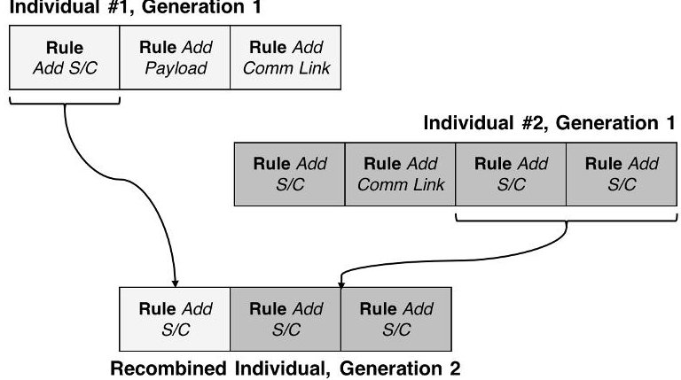

Figure 9. Example crossover operation. Individuals in the population are sequences of model transformations (and bindings).

similar to the ones described in this section, most notably the VIATRA DSE framework [16] and the MOMoT framework [15]. Both frameworks are fundamentally rooted in EMF. Our implementation is based on the MOMoT framework due to its integration with the Henshin model transformation engine, and due to its integration with the open source Javabased MOEA (Multi-Objective Evolutionary Algorithm) optimization framework and algorithm library $ ^{3} $ . The integration with the MOEA framework gives access to a large number of mature and stable implementations of a large number of evolutionary algorithms (such as NSGA-II and NSGA-III), and natively makes use of multi-core and multi-processor architectures to distribute computations.

## 6. APPLICATION TO CASE STUDY

In this section, the proposed approach is applied to the case study introduced in section 2. Discussed are the meta-model, transformation rules, objectives and constraints, optimization run configuration and visualizations of the near-optimal solution candidates.

## Definition of Design Space

To be determined in the case study are the trade-offs between cost, scientific return and overall mission duration. Varied can be the number, type and configuration of each spacecraft in the constellation. Spacecraft can be configured to carry an interferometry payload, and one or two (possibly different) types of communication systems. Also varied can be the communications network topology within the constellation, where we require some directed communication path from each spacecraft to at least one ground station to exist in order for the solution to be well-formed.

The elements of interest in the described design problem are captured using an Ecore meta-model, the major components of interest of which are illustrated in Figure 10. Note that the full meta-model defines three specializations of Antenna and Transceiver to reflect the possible variants of low (1 dBi), medium (10 dBi) and high (25 dBi) gain antennas, and UHF-, X- and Ka-band transmitters. All properties that are derived (i.e., computed through some analysis) can be identified in the figure by their prefix " / ". Notice that a subset of the meta-model can be considered generic enough to apply to any constellation mission. Only InterferometryMission and

<!-- PDF_PAGE: 9 -->

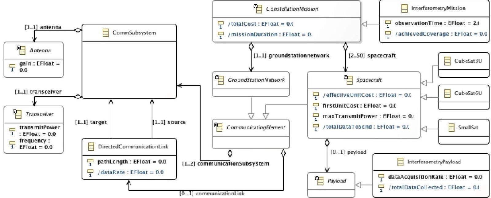

Figure 10. Meta-model for models of networked constellation mission architectures in Ecore, with extensions specific to radio interferometry missions (e.g., see payload type "InterferometryPayload". Abstract classes are marked with "A". Note that concrete classes for "GroundStationNetwork", "Antenna" and "Transceiver" are not shown for brevity, but are similar in spirit to "CubeSat3U", "CubeSat6U" and "SmallSat".

InterferometryPayload are elements specific to the considered mission. Elements such as CubeSat3U and the various antenna types can be considered components from a reusable model library that is generic for the space domain. This illustrates the ability to reuse much of the design knowledge which was discussed in Sections 3 and 4.

Certain well-formedness constraints cannot be expressed using the class diagram syntax of Ecore alone. To alleviate this, the following OCL invariants are embedded in the metamodel to ensure well-formedness:

- At least two spacecraft must have the interferometry payload configured

- All spacecraft must have some communication path to the ground station

- No communication loops may exist - that is, no situation may exist where a spacecraft sends data to itself (either direct or via one or more hops)

- No spacecraft may directly communicate with itself

- Source and target communication systems (frequency bands) must be compatible

- UHF-band transmitters may only be combined with a low gain antenna

- X-band transmitters may only be combined with a medium gain antenna

- Ka-band transmitters may only be combined with a medium or high gain antenna

- A Ka-band transmitter can only be placed on a Small Satellite

Notice that the last four invariants are particularly interesting since they resemble design heuristics. While similar in nature to the invariant "Source and target communication systems (frequency bands) must be compatible" in that some form of ensuring compatibility is encoded, no formal compatibility check is performed. The invariants are purely based on expert knowledge, encoding current state of technology or assumptions about possible antenna designs. Therefore, such invariants must be defined and validated carefully. Note that

some of these conditions may never be invalidated if the transformation rules are designed carefully: for instance, if only certain combinations of transmitters and antennas are added to Spacecraft instances.

To illustrate the use of OCL within the context of the case study, consider the first invariant. In OCL, this condition can be expressed in the context of ConstellationMission:

$$
\begin{array}{l} \mathrm {s p a c e c r a f t} \rightarrow \mathrm {s e l e c t} ( \\ \mathrm {p a y l o a d} < > \mathrm {n u l l}) - > \mathrm {s i z e ()} > 1 \\ \end{array}
$$

This invariant incorporates a query on the instance model, where a filter-like query is employed to select only those Spacecraft instances that the particular ConstellationMission instance is composed of (via the compositional relationship spacecraft) that contain a payload. For the latter, a null check is performed to identify whether the corresponding property has been set. It is then checked whether the result of the query (a set) contains more than one element. Only if this condition is true can a candidate solution be well-formed. Similar to before, embedded OCL expressions can either be mission-agnostic and be reused across all constellation mission designs, or mission-specific, thereby representing a number of formalized requirements that can be reused across missions.

## Baseline Solution

As a baseline solution, an instance of the Constellation Mission class was created, and a GroundStationNetwork added. The GroundStationNetwork has two CommSubsystem instances, one featuring a Ka-band receiver and an antenna with a gain of 85 dBi, and the other featuring a X-band receiver and an antenna with a gain of 72 dBi. While fictitious, the assumed configuration is deemed reasonable when compared to existing ground station networks.

<!-- PDF_PAGE: 10 -->

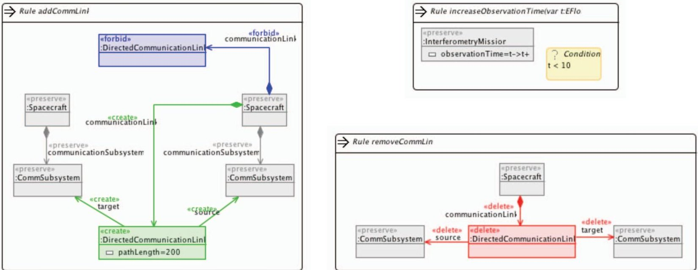

Figure 11. Excerpt of the transformation rules used in the case study, in Henshin syntax. Left: add a communication link between two spacecraft, given that the spacecraft to transmit data is not yet assigned a communication target. Upper right: increase observation time by one hour if below 10 hours. Lower right: remove an existing communication link between two spacecraft.

## Design Rules

To explore the space of candidate architectures, a number of design rules were defined using (endogeneous) model transformation rules in Henshin syntax. An excerpt of the rules used in the context of the case study is illustrated in Figure 11. Two of the rules are dedicated to creating or removing communication links. These are used in exploring the space of possible communication topologies. Notice that these rules contain mission-specific elements: for instance, the assumption that inter-spacecraft communication links have a fixed path length of 200 km. Also notice the mission-specific rule increaseObservationTime that is used to increase the observation time by one hour. Application of this rule allows for some variation in operations.

Additional rules that were created, but are not illustrated or discussed in detail are:

- Adding and removing of the different kinds of spacecraft to or from the constellation (similar to Figure 7), including setting of properties such as the base price (firstUnitCost)

- Configuration of communication subsystems for spacecraft (one rule each for a number of feasible transceiver and antenna combinations)

- Configuration of spacecraft with the interferometry payload

- Modification of the time spent observing

Notice that the application of certain rules implicitly allocates primary functions to the spacecraft: e.g., allocation of an InterferometryPayload configures a primary function of the particular spacecraft to be the collection of scientific data, and relay functionality is allocated if a Spacecraft has an incoming and outgoing communication link. No rules were defined for modifying the ground station, as it is assumed a requirement to utilize the initially given ground station network.

## Constraints & Objectives

Each candidate solution is evaluated to determine if (or how well) it meets a set of constraints and objectives.

In the case study application, we incorporate all constraints on the possible solutions in the meta model - either directly in the class diagram (e.g., using cardinality restrictions) or as OCL invariants. To measure how well the constraints are met, each generated solution is evaluated using the Ecore validation framework which internally also evaluates all OCL expressions. Only solutions with no violations are considered valid, and are passed on to the next stage in which objectives are evaluated.

Four objectives are used in the case study application: total mission cost (see Equation 6) is to be minimized, coverage (see Equation 1) is to be maximized, total mission duration (see Equation 4) is to be minimized, and the length of the nonempty transformations placed in sequence is to be minimized. The latter objective is used as a heuristic measure of the complexity of the solution and to minimize the number of rules that may cancel out one another (e.g., to avoid sequences such as: add spacecraft, remove the new spacecraft, add spacecraft, ...).

To evaluate the objective functions, a number of helper classes were written in Java. The Java-based coverage model is a simple implementation of Equation 1, and was written by utilizing the standard built-in Java Math libraries. The required information, such as the number of observing spacecraft and selected observation time, was extracted by traversing the produced instance model using the reflective EMF API [19]. Equation 4 was implemented in a similar fashion. As part of this implementation, a simple communications model was developed that determines a maximum data rate for each communication link given the link configuration (transmit and receive antenna gain, transmit power, path length, frequency band). Required values are extracted from the instance model being evaluated. Note that certain assumptions - e.g., about desired link margin - were made in determining data rates. As part of this, a simple "simulation"

<!-- PDF_PAGE: 11 -->

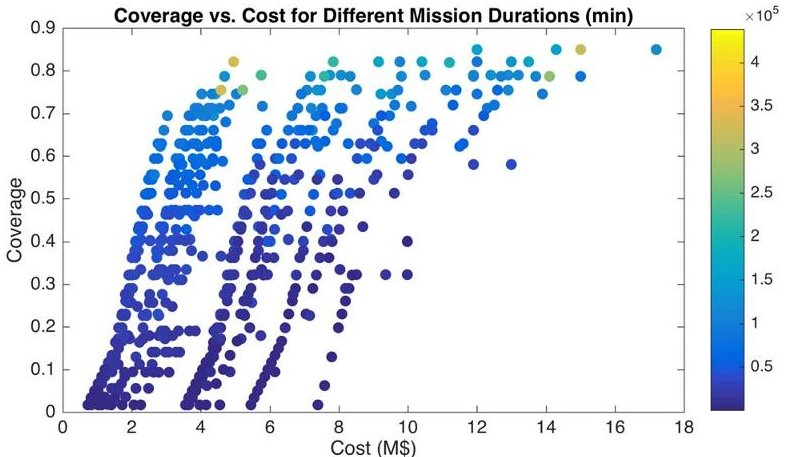

Figure 12. Achieved coverage versus total mission cost. Coloring represents mission duration (in minutes).

model was also conceived, which propagates the amount of data collected by spacecraft that do not act as relays to their respective targets. Thereby, the total amount of data transmitted to a target by each spacecraft node can be determined (see Equation 2). Knowing the speed of the transmit link, the total time spent sending data can be computed (see Equation 3). Finally, the cost model (Equation 6) was also implemented in Java. All objective functions are asynchronous and can be called by multiple parallel threads concurrently.

## Optimization Run Configuration & Environment

As mentioned in Section 5, the MOMoT [15] framework was used as a basis for the implementation. The optimization run configuration was created using the provided Xtext-based language.

For the optimization, the MOEA implementation of the NSGA-II [23] genetic algorithm was used. Each individual in the population was configured to have 180 chromosomes (i.e., up to 180 model transformations), and the population size was set to 1,000. Up to 100,000 evaluations per run of the algorithm were allowed, with 30 runs being executed in sequence. The optimization was performed on a computer equipped with a 8-core Intel Core i7 and 16GB of DDR3 memory. As selection, mutation and crossover operators, Tournament Selection, One-Point Crossover and random placements of placeholder (empty) transformations were included. Visualization of the results was performed by storing the objective values of the final population in a CSV file, and plotting the results as a scatter plot.

## Results

Running the optimization took an average of 7 minutes for each of the 30 runs. In each run, a population of 1,000 candidate solutions is evolved, each of which incorporates up to 180 transformation rules. As mentioned, up to 100,000 evaluations are performed in each run.

Figures 12, 13 and 14 capture the resulting trade space. The Pareto-frontiers are clearly visible in each case. Note that each dot in the graphs represents a unique mission architecture that was generated. From analyzing the results, a number of insights were gathered: somewhat to be expected was the trend that missions that are low in cost typically have little coverage, even if the mission duration is very long. Interesting to call out are low cost missions with long mission durations: for instance, some generated architectures incorporate a larger number of 3U CubeSats, thereby achieving high coverage with moderate observation

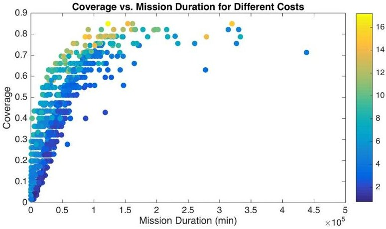

Figure 13. Achieved coverage versus total mission duration. Coloring represents expected cost (in M$).

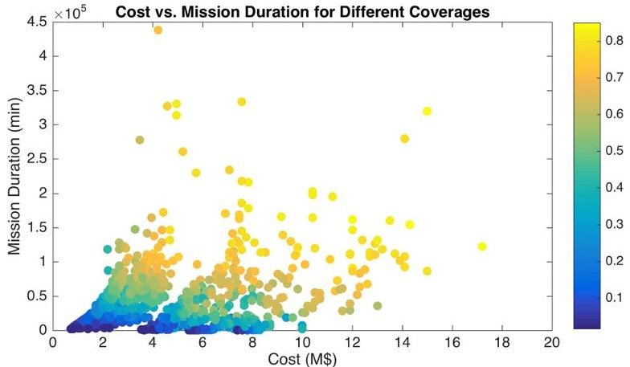

Figure 14. Cost versus total mission duration. Coloring represents achieved coverage.

time, and relatively low cost of the spacecraft, but fairly long mission durations (and hence higher operations cost) due to the limited communication abilities (3U CubeSats are assumed to only be able to downlink to Earth using an Xband transmitter, but cross-link using UHF). It was interesting to discover that such missions favored direct downlinks to Earth, since little was gained by employing a higher speed cross-link (see the left of Figure 15 for an example). As illustrated in Figure 14, decreasing mission duration increases mission cost. In fact, missions with short durations and high coverage can only be achieved at high cost: this is due to the downlink being a bottleneck for comparatively "cheap" satellites. Only a Small Satellite can be configured with a Ka-band communication system, which significantly reduces the amount of time required to downlink all data. One generated mission architecture with comparatively short mission duration, fair coverage, but relatively high cost is illustrated in Figure 15 on the right. Notice the use of UHF for the cross-link, which is indicative of a sub-optimal solution: a Ka-band link would have provided much higher data rates, thereby (even if just slightly) decreasing the total mission duration.

Note carefully the apparent "jumps" in the trade space graphs: these are an effect of the different costs of the types of spacecraft. Recall that the incorporation of a Small Satellite instance costs four times as much as a 6U CubeSat instance. This significant difference in cost produces a visible "gap" as visible in Figures 12 and 14. However, the benefits with respect to communication of using a Small Satellite with a Ka-band transmitter can overall be more beneficial than using a larger set of smaller spacecraft with respect to objectives

<!-- PDF_PAGE: 12 -->

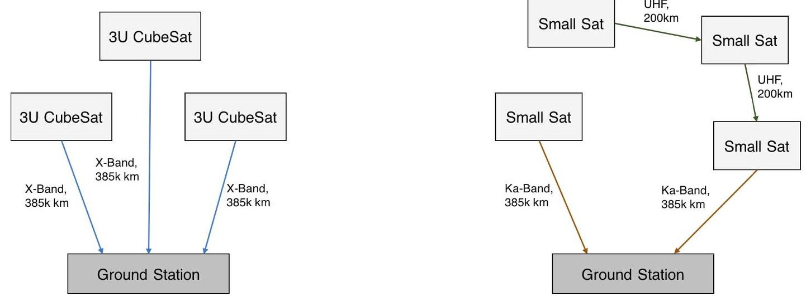

Figure 15. Two of the 996 well-formed solution candidates in the result set. Left: solution with lowest cost (approx. $1M), but low coverage (0.0167, 1 hrs observation) and long mission duration (3,222 min). Right: solution with low mission duration (2,133 min) and fair coverage (0.4, 9 hrs observation), but high cost (approx. $10M).

other than cost.

What was interesting to observe from analyzing the final population was that there was practically no Spacecraft instance that was not equipped with the radio interferometry payload. From this we can deduce that, under the given conditions, the additional cost of adding the interferometry payload to a node is almost always outweighed by the increased coverage. This deduction is, of course, very much dependent on the accuracy of the assumptions - i.e., the accuracy of the coverage model and the cost incurred by adding the payload - but represents an interesting insight nonetheless. Also noteworthy is that mission architectures that incorporate a great number of 3U and 6U CubeSats seem to be dominated by communication topologies in which a greater number of direct downlink paths to the ground station network exist. This is likely due to the benefit of a slightly higher transmission rate for UHF-based cross-links being negligibly small. However, as is expected, the addition of a Small Satellite often leads to a preference of the 3U and 6U CubeSats cross-linking to the Small Satellite. Interestingly, architectures composed of mostly Small Satellite instances seem to prefer a smaller number of direct downlinks. This is likely due to the comparatively small amount of data being collected by each node as compared to the link data rate, or an indication of sub-optimality of the particular solution.

An interesting insight gained from analyzing the trace of the optimization run was that the random initial generation of solutions produced a great number of non-well-formed individuals. It took several hundred crossover and mutation operations to produce the first well-formed solutions. However, once a well-formed solution was found, the optimizer evolved the population to an ever greater number of wellformed solutions, demonstrating the good fit of evolutionary algorithms to the problem. What should be considered in future applications is the more careful generation of the initial population. Further experimentation with, and the impact of different configurations and types of selection, mutation and crossover operators should also be performed and investigated. Also investigated should be whether larger population sizes can alleviate some of the observations with regards to potential sub-optimality of the solutions.

It should be noted that the results are biased by the assumptions that flow into the simple analysis models used.

Therefore, some of the observations may be the result of a lack of detailed analysis. Certain configurations may not even be practical or feasible: e.g., that all nodes carry the same interferometry payload. Accounting for this may require incorporating additional OCL invariants to be added to the meta-model. An analysis of the stability of the solutions through perturbation of the input parameters was not performed, but should be done in the context of an actual mission design. Also noted should be that while not all produced solutions may be optimal, the fact that they are near-optimal is deemed sufficient, since one of the primary use cases of the produced mission architectures is deemed the sparking of creativity in early design phases.

Finally, an insightful observation from analyzing the results was that, without additional analysis and tooling, the large size and diversity of the solutions can be overwhelming, and identifying trends and similarities between the solutions is non-trivial. Points on the produced trade graphs can be in close proximity, but may be derived from mission architectures with distinctly different topologies. A thorough analysis revealed that some architectures do share certain computable properties: e.g., the same assets, but different communication paths. Clustering algorithms based on a measure of architectural similarity should be investigated in the future for this purpose.

## 7. RELATED WORK

The specific application of model transformations for the purpose of generating and identifying optimal multi-spacecraft mission architectures has not previously been reported. However, there are a number of related works that employ similar concepts or have similar goals. Here, we focus on modelbased computational design synthesis methods.

Mackey et al. perform automated design synthesis of space mission architectures using planning algorithms [2]. While their goal is to also identify optimal architectures, and to show cost-benefit trade-offs, a quasi-exhaustive search is performed. Cornford et al. describe the generation of architectural variants in SysML, and their evaluation using the process integration and design optimization framework ModelCenter. Analysis models are generated from each architectural variant [1]. Schmidt and Helms also report

<!-- PDF_PAGE: 13 -->

research similar to ours, where attributed graph grammars are used to represent the design space of arbitrary systems in a model-based way [24], [25]. Graphs are used to represent one particular architectural design, and rules are employed to transform the graph. Kerzhner et al. propose a computational design synthesis method where aggregates of small satellites ("Satlets") with assigned primary functions (e.g., attitude control or communication) are synthesized into larger systems based on mission requirements [12]. SysML is used for representing the design space. Similar work by Crossley and DeLaurentis investigates methods for navigating the decision space that consider the potential positive impact of interdependencies among system of systems elements as well as the negative impacts (e.g. risk-likelihood and consequences of disruption) [26]. Guariniello and DeLaurentis also analyze functional dependencies in modular spacecraft architectures [27]. Moeller et al. report a framework for large trade space generation and assessment [28].

Identifying optimal designs requires performance characteristics of the different alternatives to be evaluated. Helms [25] and Canedo [29] describe the automated generation of simulation models in Modelica [30] and AMESim [31] from functional descriptions for the purpose of multi-physics system-level simulations. However, because of the high computational cost, this approach becomes infeasible when (hundreds of) thousands of solution candidates exist. Some approaches use simplified models to combat the computational cost and to provide quick estimates. This can be justified particularly in early phase design due to the large uncertainties present. For instance, Kerzhner describes an approach to model architectural exploration problems using Mixed-Integer Linear Programming (MILP) [32]. This approach employs relatively simple linear equations for determining performance characteristics. Herzig et al. propose a solver-independent specification of an optimization problem in UML (and OCL), and a transformation to a solver specific language [11]. The paper describes the transformation to a MILP problem, but notes that also other solvers could be used depending on the characteristics of the problem (e.g., if nonlinear constraints are required).

## 8. CONCLUSIONS

In this paper, a novel approach and model-based framework to mission architecture design and trade space exploration is introduced. Core to the approach is the automated synthesis of mission architecture candidates using model transformations, and the identification of non-dominated and Paretooptimal solution candidates through application of genetic algorithms.

Even though evaluation of the framework and approach was performed only in a limited scope, it produced promising results and a number of useful insights. For instance, a large number of near-optimal alternative architectures can be produced from an abstract description of the mission (science) objectives in a fairly reasonable timeframe. However, not all of these architectures necessarily represent sensible solutions to a human. To increase the quality of the produced solutions, a great number of constraints must likely be defined. It is interesting to observe that this is similar to defining a large set of requirements, with the exception being that, here, these requirements are captured in a formal language, take the form of constraints, and are interpretable by a computer.

A takeaway from the application of the framework to the

case study is that working directly with the meta-model and transformation rules is possibly not practical. This is due to a number of reasons: firstly, while rich in features, some aspects of the available user-facing tooling are not sufficiently mature and stable. Secondly, deep knowledge of a number of sophisticated concepts and languages not commonly taught in engineering disciplines is required to define a specific optimization problem. Future work should include the identification or definition of a singular language for describing all aspects of a design problems. From this definition, the metamodel, transformation rules and optimization configuration should be generated automatically (e.g., through model transformations). In particular, UML / SysML should be evaluated as part of this, similar to the investigations performed by Herzig et al. in a previous study [11].

Future work should also include the investigation of different optimization algorithms and methods for subdividing the overall design space exploration problem. One of the limitations of genetic algorithms is the necessity of having to evaluate each individual in a population during each generation. Particularly when computationally expensive models are made use of, this may have a severe impact on runtime. One way of alleviating this problem is the subdivision of the overall optimization problem into smaller sub-problems, such as is proposed in [33], or by using multi-fidelity models.

## ACKNOWLEDGMENTS

The work described in this paper was performed at the Jet Propulsion Laboratory, California Institute of Technology, under a contract with the National Aeronautics and Space Administration.

## REFERENCES

[1] S. Cornford, R. Shishko, S. Wall, B. Cole, S. Jenkins, N. Rouquette, G. Dubos, T. Ryan, P. Zarifian, and B. Durham, "Evaluating a fractionated spacecraft system: A business case tool for darpa's f6 program," in Aerospace Conference, 2012 IEEE. IEEE, 2012, pp. 1-20.

[2] R. Mackey, S. Uckun, M. Do, and J. Shah, "Fracsat: Automated design synthesis for future space architectures," in Aerospace Conference, 2013 IEEE. IEEE, 2013, pp. 1-12.

[3] O. Brown, P. Eremenko, and C. Roberts, "Cost-benefit analysis of a notional fractionated satcom architecture," in Proc. of the 24th AIAA International Communications Satellite Systems Conference, AIAA-2006-5328, San Diego, CA, 2006.

[4] S. Schaffer, A. Branch, S. Chien, S. Broschart, S. Hernandez, K. Belov, J. Lazio, L. Clare, P. Tsao, J. CastilloRogez, and E. J. Wyatt, "Using operations scheduling to optimize constellation design," in Proceedings of the 26th International Conference on Automated Planning and Scheduling.

[5] O. Brown and P. Eremenko, "The value proposition for fractionated space architectures," DTIC Document, Tech. Rep., 2006.

[6] H. Heidt, J. Puig-Suari, A. Moore, S. Nakasuka, and R. Twiggs, "Cubesat: A new generation of picosatellite for education and industry low-cost space experimentation," 2000.

<!-- PDF_PAGE: 14 -->

[7] P. Molette, C. Cougnet, P. Saint-Aubert, R. Young, and D. Helas, "Technical and economical comparison between a modular geostationary space platform and a cluster of satellites," Acta Astronautica, vol. 11, no. 12, pp. 771-784, 1984.

[8] T. Stahl, M. Voelter, and K. Czarnecki, Model-Driven Software Development: Technology, Engineering, Management. John Wiley & Sons, 2006.

[9] K. Deb, Multi-Objective Optimization using Evolutionary Algorithms. John Wiley & Sons, 2001, vol. 16.

[10] J. Fisher et al., "Model-based systems engineering: a new paradigm," Incose Insight, vol. 1, no. 3, pp. 3-16, 1998.

[11] S. J. I. Herzig, K. Berx, K. Gadeyne, M. Witters, and C. J. J. Paredis, "Computational design synthesis for conceptual design of robotic manufacturing cells."

[12] A. A. Kerzhner, M. D. Ingham, M. O. Khan, J. Ramirez, J. De Luis, J. Hollman, S. Arestie, and D. Sternberg, "Architecting cellularized space systems using modelbased design exploration," in AIAA SPACE 2013 Conference and Exposition, 2013, p. 5371.

[13] A. R. Thompson, J. M. Moran, and G. W. Swenson Jr, Interferometry and synthesis in radio astronomy. John Wiley & Sons, 2008.

[14] W. J. Larson and J. R. Wertz, Space Mission Analysis and Design. Microcosm, Inc., 1992.

[15] M. Fleck, J. Troya, and M. Wimmer, "Marrying searchbased optimization and model transformation technology," Proc. of NasBASE, 2015.

[16] A. Horvath and D. Varró, "Dynamic constraint satisfaction problems over models," Software & Systems Modeling, vol. 11, no. 3, pp. 385-408, 2012.

[17] K. Czarnecki and S. Helsen, "Feature-based survey of model transformation approaches," IBM Systems Journal, vol. 45, no. 3, pp. 621-645, 2006.

[18] S. J. Kapurch, NASA Systems Engineering Handbook. DIANE Publishing, 2010.

[19] D. Steinberg, F. Budinsky, E. Merks, and M. Paternostro, EMF: Eclipse Modeling Framework. Pearson Education, 2008.

[20] Object Management Group (OMG), "Meta object facility (mof) 2.0 query/view/transformation specification 1.1," Final Adopted Specification (January 2011), 2011.

[21] F. Jouault, F. Allilaire, J. Bézivin, I. Kurtev, and P. Valduriez, "Atl: a qvt-like transformation language," in Companion to the 21st ACM SIGPLAN symposium on Object-oriented programming systems, languages, and applications. ACM, 2006, pp. 719-720.

[22] T. Arendt, E. Biermann, S. Jurack, C. Krause, and G. Taentzer, "Henshin: advanced concepts and tools for in-place emf model transformations," in International Conference on Model Driven Engineering Languages and Systems. Springer, 2010, pp. 121-135.

[23] K. Deb, A. Pratap, S. Agarwal, and T. Meyarivan, "A fast and elitist multiobjective genetic algorithm: Nsgaii," IEEE Transactions on Evolutionary Computation, vol. 6, no. 2, pp. 182-197, 2002.

[24] L. Schmidt and J. Cagan, "Optimal Configuration Design: An Integrated Approach Using Grammars," Journal of Mechanical Design, vol. 120, no. 1, pp. 2-9, March 1998.

[25] B. Helms and K. Shea, "Computational Synthesis of Product Architectures Based on Object-Oriented Graph Grammars," Journal of Mechanical Design, vol. 134, no. 2, pp. 1-14, 2012.

[26] W. Crossley and D. DeLaurentis, Modeling and Simulation Support for System of Systems Engineering Applications. John Wiley & Sons, Feb. 2015, ch. Air Transportation Systems.

[27] C. Guariniello and D. A. DeLaurentis, "Maintenance and recycling in space: Functional dependency analysis of on-orbit servicing satellites team for modular spacecraft," in AIAA Space Conference, 2013.

[28] R. C. Moeller, C. Borden, T. Spilker, W. Smythe, and R. Lock, "Space Missions Trade Space Generation and Assessment Using the JPL Rapid Mission Architecture (RMA) Team Approach," in Aerospace Conference, 2011 IEEE. IEEE, 2011, pp. 1-11.

[29] A. Canedo, E. Schwarzenbach, and M. A. A. Faruque, "Context-sensitive synthesis of executable functional models of cyber-physical systems," in Proceedings of the ACM/IEEE 4th International Conference on Cyber-Physical Systems - ICCPS 2013. Association for Computing Machinery (ACM), 2013. [Online]. Available: http://dx.doi.org/10.1145/2502524.2502539

[30] "The Modelica Association," http://www.modelica.org, 2007.

[31] "Amesim," http://www.plm.automation.siemens.com/en_us/products/lms/imagine-lab/amesim/, 2015.

[32] A. A. Kerzhner and C. J. Paredis, "A mathematical programming-based approach for architecture selection," in ASME 2012 International Design Engineering Technical Conferences and Computers and Information in Engineering Conference. American Society of Mechanical Engineers, 2012, pp. 497-510.

[33] S. J. Herzig, B. Kruse, F. Ciccozzi, J. Denil, R. Salay, and D. Varró, "Towards an approach for orchestrating design space exploration problems to fix multiparadigm inconsistencies." in MPM@MoDELS, 2014, pp. 61-66.

BIOGRAPHY

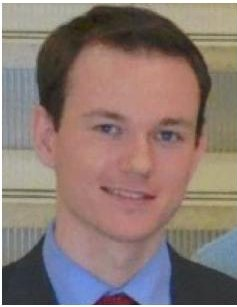

Sebastian J. I. Herzig received his Dipl.-Ing. (equiv. to B.Sc. + M.Sc.) degree in Aerospace Engineering and B.Sc. degree in Computer Science from the Technical University Munich, Germany in 2011, and a Ph.D. in Mechanical Engineering from the Georgia Institute of Technology in 2015. He is currently a Software Systems Engineer at the NASA Jet Propulsion Laboratory.

His work is primarily focused on MBSE infrastructure development, research in design automation, and the application of MBSE to flight and ground projects. He is also the principle investigator of the research task that the results in this paper relate to.

<!-- PDF_PAGE: 15 -->

Sanda Mandutianu is a senior system software engineer at the Jet Propulsion Laboratory. She has promoted Model Based Systems Engineering at JPL since 2008, leading a system model pilot for the early phase of the Europa Explorer. She has worked on the Europa Clipper, ARRM (Asteroid Redirect Robotic Mission NASA-JPL), and currently on the NeMO (Next Mars Orbiter) projects.

She is supporting JPL's Integrated Model Centric Engineering Initiative. Her interests cover systems and software architecture, agent-based and semantic technologies, artificial intelligence, and how the innovative and conceptual aspects can effectively apply. She holds an MS in Physics from the University of Bucharest, Romania.

Hongman Kim is a systems engineer at Jet Propulsion Laboratory. He is currently working on model integration and resource analysis for NASA's Europa project, and development of engineering environment for JPL's Innovation Foundry. Before joining JPL, he was a project manager at Phoenix Integration, Inc., where he led development of model-based systems engineering (MBSE) technology. He also worked on a number of government funded projects including points cloud visualization, distributed computing, and design optimization. He holds a PhD degree in Aerospace Engineering from Virginia Tech.

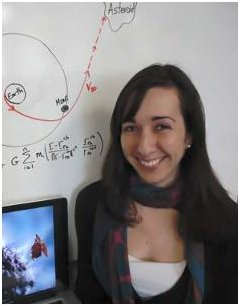

Sonia Hernandez received her Master's degree in 2009 at the University of Maryland, where she focused on cooperative control of autonomous vehicles. Her Ph.D., obtained in 2014, is from The University of Texas at Austin, where she specialized in closed-form solutions for low-thrust trajectory design. During her Ph.D. she was a co-op at Goddard, working on OSIRIS-Rex. She is now

part of the Mission Design and Navigation section at JPL where she is a maneuver analyst on Cassini, ensuring that the spacecraft stays on it's planned trajectory course.

Travis Imken is a systems engineer in the Project Systems Engineering and Formulation section at JPL. With an active interest in SmallSat technologies and science missions, he is engaged in activities from Pre-Phase A concept development to flight system engineering. Travis is a systems engineer on the deep space Lunar Flashlight and NEA Scout missions, funded through HEOMD's Advanced Exploration and launching on SLS's EM-1 mission. He is also the project systems engineer on the RainCube mission, which will vertically profile precipitation from LEO using a Ka-band radar. Travis has over 8 years of hands-on and systems-level experience with the Bevo-1, Bevo-2, ARMADILLO, and RACE CubeSat missions, and delivered flight hardware for the JPL INSPIRE CubeSats.