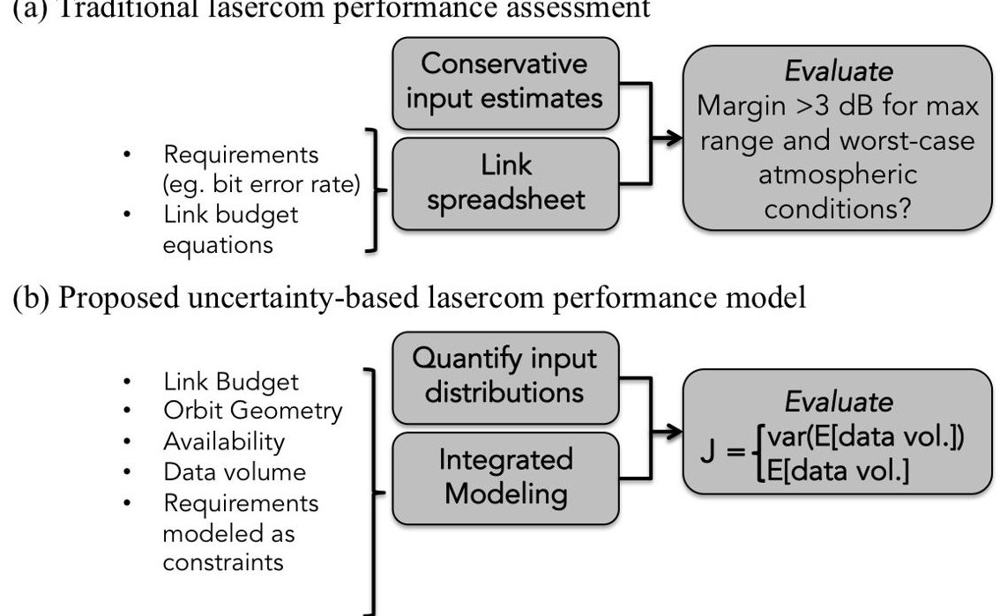
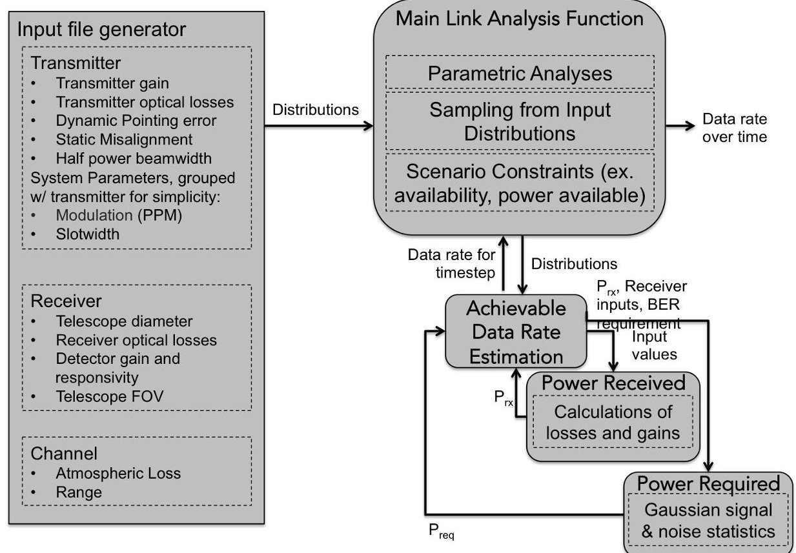
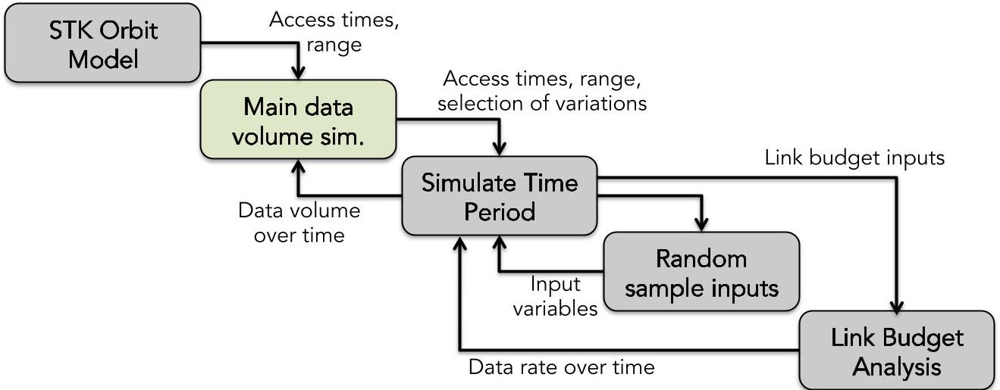
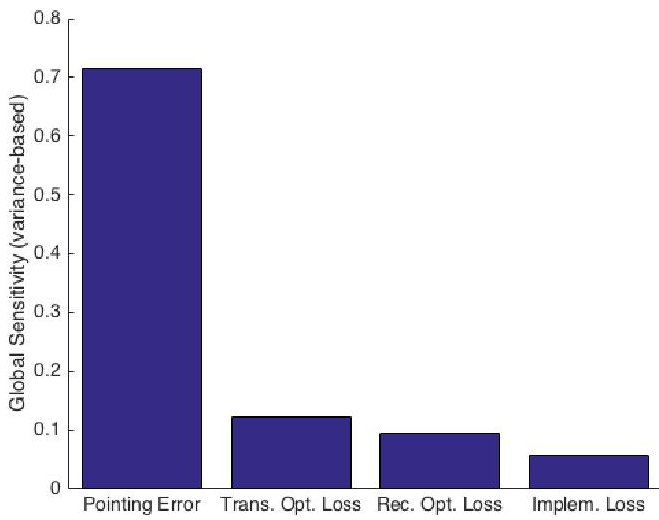
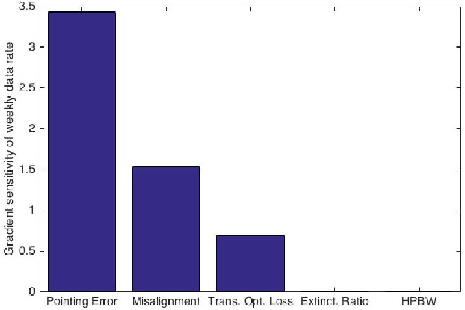
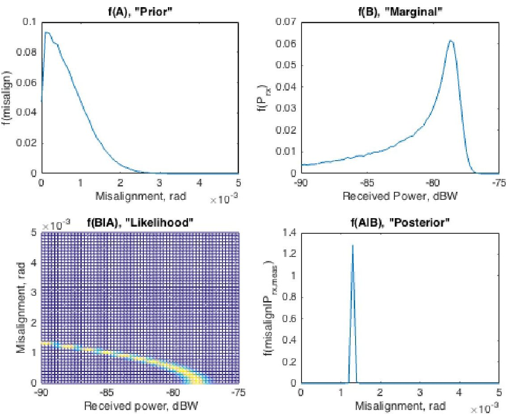

<!-- PDF_PAGE: 1 -->

# Probabilistic Methods for Nanosatellite Engineering: A Lasercom Case Study

Emily B. Clements $ ^{*} $ and Kerri Cahoy $ ^{\dagger} $

Space Telecommunications, Astronomy, and Radiation Laboratory, Cambridge, MA, 02139, USA

Applying current systems engineering methods to nanosatellites can result in overdesigning or mismanaging the typically higher risk tolerance of nanosatellite platforms. Emerging systems engineering approaches (e.g. multidisciplinary optimization or Bayesian-based design) could address this gap. However, these approaches require use of integrated performance models. Integrated performance models with a validated set of input distributions and tools to use them do not yet exist for some complex systems such as laser communications (lasercom) systems. In this paper, we present our work towards building a lasercom link analysis model with a validated set of input distributions, and apply it to several examples to investigate whether the model enables improvements in systems engineering. The scope of this work is restricted to an initial subset of nanosatellite-based lasercom systems and related ground stations where we expect that the higher platform-specific variations such as unpredictable pointing error may make the approach especially useful. We build uncertainty-based lasercom performance models for the Nanosatellite Optical Downlink Experiment (NODE), a student project at MIT. We evaluate the utility of our new models for different phases of systems engineering by prioritizing analysis and test activity through Sobol' and gradient sensitivity analysis and Bayesian-based experiment design. While we focus on a nanosatellite lasercom example, the process for characterizing the input distributions and modeling performance is generalizable to other lasercom systems or other multidisciplinary space systems.

## I. Introduction

A probabilistic approach to systems engineering improves decision making under uncertainty for complex systems, $ ^{1} $ and may be particularly useful for multidisciplinary systems such as laser communications payloads, which combine the disciplines of electrical and mechanical engineering with physics. Current laser communication (lasercom) models (e.g. deterministic models with a 3 dB margin requirement) do not accurately predict bit error rate under highly variable atmospheric losses $ ^{2} $ or platform-specific variable losses such as orbit tracking of nanosatellites $ ^{3} $ (usually flown as secondary payloads, although satellite mass categories can vary; we use the definition of nanosatellites as total mass less than 10 kg based on Buchen $ (2014)^{4} $ ).

In this paper, we analyze an example nanosatellite lasercom link using a probabilistic systems engineering methodology based on integrated modeling. We extend the work of Stout (2015), who used Sobol' sensitivity analysis to prioritize thermal tests for thermal model validation, to efficiently guide decision making under uncertainty throughout system development. We present link uncertainty quantification and propagation results, and a sensitivity analysis to aid in prioritization of resources. The results highlight the potential for achieving higher performance using an uncertainty-based approach, as it quantitatively identifies which design parameters play the largest role in increasing the likelihood of improved performance.

Our approach is to build and validate an integrated lasercom performance model with a library of input distributions and to investigate how these tools can be used to improve systems engineering. To ensure the model and library are relevant to real hardware, we will focus the model testing of a direct detect Master Oscillator Power Amplifier (MOPA) with a Fast Steering Mirror (FSM) system, such as the Nanosatellite Optical Downlink Experiment (NODE); NODE is an ongoing program at MIT for demonstrating moderate

<!-- PDF_PAGE: 2 -->

rate (10-100 Mbps) optical communications downlink from a CubeSat using a 0.2 W, 1500 nm, 2.26 mrad laser beam. $ ^{5} $

Figure 1. A comparison of (a) the traditional deterministic, spreadsheet-based performance model and (b) the proposed uncertainty-based performance model. In this example data volume is the metric of interest, but some systems may have other metrics, such as data rate.

While there are many possible applications for this approach, in this paper we focus on using probabilistic models to guide prioritizing how to apply resources to analysis and environmental testing of space payloads for characterizing system performance. This process can help to inform systems engineers who must make decisions about which component-level and system-level tests are necessary for performance characterization under resource-constrained situations. $ ^{a} $

## A. Paper Organization

In Section II we provide background on laser communications and modeling, with a focus on nanosatellite systems. In Section III, we describe the application examples used in this paper and the modeling approach, including model setup and input statistics. In Section IV, we describe the results of the probabilistic modeling of the application examples and how these results may be used in program development. Finally, in Section V, we summarize the paper.

## II. Background and Literature Review

This research enables a probabilistic approach to nanosatellite laser communications by filling gaps in uncertainty quantification of inputs to lasercom analyses and by demonstrating the use of these input distributions in lasercom systems engineering. While other researchers have proposed methods like expert elicitation to get rough approximations of inputs, and some researchers have modeled limited aspects of the link (such as atmospheric variability measurements for a small number of ground stations), there is a literature gap in comprehensively estimating these input distributions based on first principles and experimental data. Such approaches have been reported for deep-space RF communications but not for lasercom. Using these distributions also requires a new, statistical modeling approach for lasercom, which we address in this paper.

Multidisciplinary space system modeling, also referred to here as "integrated modeling" for brevity, has

<!-- PDF_PAGE: 3 -->

been used to integrate many aspects of space programs, including systems engineering and subsystems such as structures, thermal, optical, controls, and others. Model-based systems engineering has been used for guiding test and verification activities. The JPL TeamX system has been tailored for CubeSats in the TeamXc software tool. Robinson (2010) used Matlab to link subsystem models for simulating operations of a conceptual design. More recently, Model-Based Systems Engineering (MBSE) tools have been used to link subsystem models to do operational analysis of a CubeSat. Finally, Structural-Thermal-Optical (STOp) analysis has been used for assessing requirements on the James Webb Space Telescope. While the models used in this paper do not specifically leverage any of these software tools, the evolution of these tools has enabled more practical integration of satellite engineering analysis tools, such as being able to command applications through MATLAB.

Multidiscplinary models with uncertain input distributions have been used in systems engineering through space program development, including tradespace exploration, design verification assessments, and model validation. Each of the methods described in this section have shown promise for improving the development of space systems, either by improving the expected performance, reliability, or making the program development process more efficient. In this research we plan to make it possible to extend such methods to nanosatellite lasercom, and will present several application examples.

## A. Background on Nanosatellite Laser Communication

As described in Clements (2016), lasercom is attractive for nanosatellites for several reasons, including power efficiency, spectrum usage, and space heritage of similar systems. Lasercom offers more bits per unit energy than radio frequency (RF) communication because the wavelengths for lasercom are much shorter than for RF, so the beam divergence isn't as high. Lasercom has also been demonstrated in space on larger spacecraft, such as the Lunar Laser Communication Demonstration (LLCD), Optical Inter-Orbit Communications Engineering Test Satellite (OICETS), and the Small Optical TrAnsponder (SOTA), although the Size, Weight, and Power (SWaP) of these missions has exceeded the size of CubeSat communications systems, so miniaturization and/or redesign is necessary.

Several organizations are developing lasercom systems for nanosatellites. Aerospace Corporation has developed the OCSD mission to demonstrate lasercom at 1064 nm with data rates of GB per second. $ ^{20,21} $ The University of Florida is developing compact modulators for CubeSat lasercom systems, $ ^{22} $ and NASA is developing lasercom for interplanetary missions. $ ^{23} $ MIT is developing the Nanosatellite Optical Downlink Experiment (NODE), which is the focus of this paper.

## B. Lasercom Integrated System Models

Literature on integrated modeling of lasercom systems has generally focused on subsystem modeling such as theoretical analysis of spatial tracking performance to predict pointing losses. $ ^{24,25} $ More complete models such as the Strategic Optical Link Tool $ ^{26} $ have been described for detailed deterministic optimization problems, but there are not yet reports in the literature of such tools being applied using uncertainty propagation. As noted in Chan (2000), lasercom systems are complex, and therefore, systems engineering of lasercom systems focuses on breaking the system down into subsystems and modeling at lower levels rather than building an end-to-end integrated system model. $ ^{27} $ There remains a need to define an appropriate level of abstraction of system-level lasercom models to maintain model fidelity while managing system complexity.

## C. Lasercom Input Uncertainty Quantification

This section provides a few specific examples of inputs to an uncertainty-based lasercom performance model. The trades between different transmitter and receiver architectures have been well documented, $ ^{16,28} $ but unmodeled component-specific and system-specific variations can still cause performance results that are inconsistent with modeling predictions.

Space Terminal: Qualification of components for the space environment is a critical aspect of the performance of the overall payload. Some components, including Fiber Bragg Gratings (FBGs) and Erbium Doped Fiber Amplifiers (EDFAs), have been radiation tested, building confidence that these components would perform as expected in the space environment. $ ^{29,30} $

The telecom industry standards require components to undergo shock and thermal testing, but the system can still experience launch-induced misalignment. The NFIRE mission reported a shift of up to 1.7 mrad

<!-- PDF_PAGE: 4 -->

from launch, although they could not disambiguate launch from other contributing factors (measurement errors during ground tests or shifts from gravity loads) $ ^{31} $

The space terminal can also have platform-specific uncertainty distributions. For example, tracking of nanosatellites is difficult because existing tracking systems are designed for larger spacecraft, so nanosatellite operators face errors as high as 10 km in Two Line Element (TLE) statistics. $ ^{3} $ For nanosatellites that use GPS, orbital elements are still only as good as the most recent communications pass plus error from orbit propagation. $ ^{32} $ While inaccurate orbit determination may not significantly impact RF communications, these errors can be the same order of magnitude as the spot size of lasercom transmitters (about 1-2 mrad) or the field of view of lasercom receivers (about 0.1 mrad).

We are building on this work by developing a comprehensive, hardware-specific library of input distributions for the NODE space terminal $ ^{5} $ that can be generalized to other direct detection MOPA space-based lasercom transmitters, as described in Table 1.

Channel: Characterization of uncertainty in channel (path between space terminal and ground terminal) effects in laser communications has been generally limited to modeling variability in atmospheric inputs. Atmospheric attenuation and turbulence conditions have been characterized at a limited number of candidate ground station locations. $ ^{33,34} $ For example, Wilson (2012) $ ^{35} $ includes a comparison of MODTRAN (a software tool that simulates optical transmission at a range of wavelengths) data with statistics of measurements at the Optical Communications Telescope Laboratory (OCTL) from 2006-2011. Alliss (2012) has extensively characterized cloud-related availability of different ground sites. $ ^{36} $ Cloud coverage, which affects the availability of ground stations, can be approximated based on databases of historical cloud cover. $ ^{37} $ While these examples have focused on the atmospheric variability in isolation, in this work, we combine these channel-related uncertainty distributions with input distributions relating to the space and ground terminals as shown in Table 1.

Ground Terminal: The use of commercial off-the-shelf (COTS) parts in ground terminals, such as the use of amateur telescopes as receivers, can also affect performance. For example, optical losses can be caused by coatings which are not perfectly reflective at 1550 nm, but because the coating may not have not been characterized for 1550 nm, the optical loss may be unknown. Implementation losses, which capture difference in performance between theory and practice, have been observed in the lab of about 3 dB, $ ^{38} $ but these may be higher when transitioning from a prototype to a field unit. Receive and implementation losses are typically measured prior to launch, and unless the launch or space environment affect the components, these losses would be known for on-orbit operations.

## III. Approach

We have selected three representative cases from the development of one lasercom configuration: the Nanosatellite Optical Downlink Experiment (NODE). $ ^{5,38-43} $ NODE is an approximately 1.5U $ \times $ 1U $ \times $ 0.5U, 10 W (consumed power) payload that will demonstrate up to 100 Mbps downlink from a CubeSat. The system operates at 1550 nm and is designed to downlink to a 30 cm amateur telescope equipped with a COTS APD, but it is also compatible with existing LEO-tracking telescopes such as the Optical Communications Telescope Laboratory (OCTL). NODE uses a Master Oscillator Power Amplifier (MOPA) direct detection architecture and uses primarily COTS electronics, including a fast steering mirror (FSM) for fine pointing to augment coarse bus pointing. The three cases were selected to cover different phases of program development: the design phase, the prototyping phase, and on-orbit test planning.

1. Design Phase of Direct Detect MOPA Lasercom System: We prioritize analysis tasks using sensitivity analysis of a simple downlink model. In this example, we examine the sensitivity of the link margin to several system parameters (pointing error, transmitter optical loss, receiver optical loss, and implementation loss) using the variance-based Sobol' sensitivity analysis as described in Saltelli $ (2008)^{44} $ and given in Equation 1.

$$
S _ {i} = \frac {\operatorname {V a r} \left(E \left(Y \mid X _ {i}\right)\right)}{\operatorname {V a r} (Y)}
$$

Where $ S_{i} $ is the sensitivity index associated with a parameter such as transmitter optical losses, $ X_{i} $ the value of the parameter, and Y is the performance metric such as data volume. Thus $ S_{i} $ is the ratio of the variance of the expected value of the data volume (or other performance metric) given a known parameter value to the variance of the performance metric with no known parameters.

<!-- PDF_PAGE: 5 -->

This case uses the link model shown in Figure 2.

Figure 2. Model Setup of the detailed link model. The input file generation is based on distributions that follow those described in Clements (2016) with updates based on component-level testing that has been performed since that paper, as given in Table 1. The link analysis function estimates the link margin and maximum achievable data rate based on the received power for a given set of losses compared with the required power for a given data rate.

2. Guidance of Prototype Testing of Direct Detect MOPA Lasercom System: We prioritize prototyping and testing tasks using gradient sensitivity analysis of a more detailed operational simulation (using a full model as shown in Figure 3). This model includes a more detailed breakdown of the most sensitive parameter from Example 1 (pointing error). The elements of the breakdown include static launch-induced misalignment. We focus on space terminal parameters to guide environmental test planning: static launch-induced misalignment, pointing error, transmitter optical loss, extinction ratio, and beamwidth. These are all parameters that can be characterized through a combination of vibration, thermal vacuum (TVAC) and over the air tests.

3. On-Orbit System Performance Modeling: During (simulated) on-orbit testing, we use an extension of the Bayesian-based model validation approach of Stout (2015). $ ^{45} $ We simulate the process of characterizing the launch induced misalignment post-launch by extrapolating the likely misalignment from measurements of received power given other link model uncertainties such as atmospheric loss variability as a function of varying range.

## A. Model Setup

We built a multidisciplinary model of the lasercom link in MATLAB, touching on the disciplines such as physics, optics, orbital dynamics, and atmospheric dynamics. We modeled the required power using Gaussian statistics. We validate the model against previous results (Kingsbury 2015) and then characterize performance uncertainty with Monte Carlo analysis and assess the system sensitivities using Sobol' and gradient sensitivity analysis.

The Case 1 (design phase) model uses link margin as the metric of interest, and calculates a probability distribution for the link margin as a function of the input distributions described in Table 1 using Monte Carlo analysis. Table 1 is based on distributions that follow those described Clements (2016) $ ^{5} $ with updates based on component-level testing that has been performed since that paper. Each run of the Monte Carlo

<!-- PDF_PAGE: 6 -->

analysis calculates transmitter gain and optical loss, pointing loss, free space loss, atmospheric loss, receiver optical losses, etc. and compares the resulting received power at the ground-based detector with the required power for a given data rate. Then Sobol' sensitivity analysis calculates the sensitivities to each of these gains and losses.

The Case 2 (prototyping phase) and 3 (on-orbit phase) performance model incorporates the Case 1 link model into a larger operational context by simulating the data volume transferred by a nanosatellite lasercom system over a given time period. The model calculates the data rate for a given set of inputs and access conditions (time and range), as illustrated in Figure 3. The model takes in data from an STK simulation of nanosatellite orbit and generates access times and corresponding ranges. An achievable data rate is determined based on the range and other conditions for each timestep such as atmospheric loss. We note that while the model was built for the NODE program, it is modular, enabling easy adaptation to other architectures.

Figure 3. Analysis steps of the on-orbit operations simulation (used for Cases 2 and 3).

Table 1. Input distributions for Monte Carlo analysis. The distributions are uniform in scalar units rather than decibel units. These inputs are derived from those presented in Clements (2016), but have been updated based on the latest component-level testing and analysis

<table border="1"><tr><td>Variable</td><td>Value</td><td>Rationale</td></tr><tr><td>Pointing error</td><td>N(0,0.35)mrad</td><td>Sum of various errors from preliminary pointing budget for pre-calibration case,so Normal distribution is assumed(post calibration has negligible uncertainty).</td></tr><tr><td>Launch-induced Misalignment</td><td>N(0,0.85)mrad</td><td>2σvalue is derived from max displacement tolerances of bolted interfaces.</td></tr><tr><td>HPBW</td><td>1.33mrad+/-2%</td><td>Per collimator datasheet,46collimation at room temp.is accurate to1%. Doubled for conservatism at temperature extremes.</td></tr><tr><td>Tx optical losses</td><td>N(-1.5,1)dB</td><td>Assumes0.1dB per splice with1dB standard deviation from thermal-induced output variations of electro-optical components.</td></tr><tr><td>Extinction Ratio(ER)</td><td>U(6.31×10-5,1.58×10-4)</td><td>Reported in Kingsbury2015 thatER varied between-38and-42dB.38</td></tr><tr><td>Ground Station Availability</td><td>0.6-0.8</td><td>Analysis performed by anotherMIT graduate student,I. del Portillo Barrios using data fromMODIS.47</td></tr></table>

## IV. Results

Through modeling the performance sensitivities at different stages of NODE development, we characterized the impact on system performance uncertainty from different parts of the system, as described further in Section IV Subsections A and B. We find that the Bayesian approach, which leverages pre-existing knowledge of input statistics, can inform the process of characterizing system parameters during environmental testing to ensure the highest priority tests are completed, as described in Subsection C.

<!-- PDF_PAGE: 7 -->

## A. Design Phase of Direct Detect MOPA Lasercom System

We modeled the sensitivities in the link budget analysis module of Figure 3, with the model inputs binned into pointing error, transmitter optical loss, receiver optical loss, and implementation loss. Each of these bins has several contributing factors, so this grouping helps to quickly identify which subset of parameters to focus on. As shown in Figure 4, we find that, as expected, $ ^{b} $ pointing error had the greatest effect on the variance of the link margin, indicating that greater effort should be put into contributions to pointing error as modeling efforts move forward. As the pointing error parameter bin is refined, the sensitivity analysis can be repeated with a more detailed breakdown of the factors contributing to pointing error, as shown in Case 2.

Figure 4. (a) Global sensitivity analysis of design phase model shows pointing error as the greatest factor. (b) Global sensitivity analysis of the prototype phase model shows pointing error as the greatest contributor to variance in data volume. These sensitivities are normalized by overall variation in expected performance, so they are used as a relative metric to compare sensitivities of different inputs rather than for assessing whether the system meets requirements.

## B. Guidance of Prototype Testing

As the program converges on a nominal design, the local, gradient sensitivity of the nominal point design becomes of greater interest than a global sensitivity analysis because the design is less likely to vary significantly from the point design, so we assessed the gradient sensitivities of the performance model to the transmitter parameters described in the approach section. As shown in Figure 4, we find that the most important system parameter is pointing error, as it was in the design phase analysis, but the added parameter of static launch-induced misalignment is also a significant contributor, followed by transmitter optical losses. Therefore, the highest priority environmental test for characterizing performance is dynamic pointing tests (ex. air bearing tests), followed by vibration/shock testing, followed by system-level thermal vacuum testing, which would help to characterize how optical losses vary over temperature (currently the biggest uncertainty for transmitter optical losses, as discussed in Table 1).

Prior to this Case 2 analysis, NODE component-level testing under consideration was focused on TVAC testing of components to help characterize transmitter optical losses, but this analysis indicates that these tests may be more necessary for checking survivability than for characterizing performance variations. This may allow the team to reduce the instrumentation required for the TVAC test because fewer types of measurements may be required during temperature cycling than previously thought by the NODE team.

## C. On-Orbit System Performance Modeling

We simulated an on-orbit experiment to characterize the launch-induced misalignment, as shown in Figure 5. The "prior" distribution is the estimated launch-induced misalignment before running on-orbit experiments. The "marginal" distribution is the probability distribution of the received power accounting for all input

<!-- PDF_PAGE: 8 -->

Figure 5. Simulation of the first step of a series of on-orbit experiments to characterize misalignment. Used Bayes' Rule to estimate misalignment based on received power and estimated prior distribution of misalignment. The "prior" distribution shows the estimated launch-induced pointing error prior to any on-orbit measurements. The "Marginal" distribution gives the distribution of received power with maximum uncertainty. The "Likelihood" is the conditional probability of received power given a particular value of launch-induced misalignment. These are combined with a measured received power using Bayes' Rule to produce an updated estimate of launch-induced misalignment, the "posterior" distribution.

<!-- PDF_PAGE: 9 -->

uncertainties, including the lack of knowledge of misalignment. The "likelihood" distribution is a conditional probability distribution of the received power for a given misalignment.

Each step of the Bayesian update simulation uses a "truth" input (0.0017 mrad misalignment in this example) and the conditional probability of received power given that truth input to simulate a received power for a particular on-orbit experiment. As this experiment is repeated, the histogram of received power generated converges to the true on-orbit misalignment; we show the first step in Figure 5.

In comparison with traditional systems engineering, in which on-orbit operations follow a pre-specified set of commissioning experiments, this approach is more flexible. It enables the team to quickly prioritize the next set of on-orbit tests using sensitivity analysis with updated input distribution models based on on-orbit data. By maximizing the utility of these tests, the system may be able to more quickly complete commissioning and begin the operations phase.

## V. Summary

We used the NODE $ ^{5} $ laser communications technology demonstrator to assess the use of a probabilistic methodology for nanosatellite systems engineering. We developed and applied a methodology for nanosatellite systems engineering using integrated models and uncertainty analysis. Through sensitivity analysis of models at design phase and prototyping phases, we were able to prioritize analysis and test planning efforts, and we demonstrate the potential for using probabilistic models in Bayesian-based characterization of system parameters during system validation testing.

While it is difficult to make a quantitative claim about the improvements of a probabilistic systems engineering process over traditional approaches based on one example, we found that this approach gave useful information for known problems in space systems engineering, such as deciding which activities to prioritize given limited resources.

## Acknowledgments

Emily Clements was supported by the MIT Lincoln Laboratory Lincoln Scholars Program. The NODE program is funded by the MIT Deshpande fund.

## References

$ ^{1} $De Neufville, R., de Weck, O., Frey, D., Hastings, D., Larson, R., Simchi-Levi, D., Oye, K., Weigel, A., Welsch, R., et al., "Uncertainty management for engineering systems planning and design," Engineering Systems Symposium, MIT, Cambridge, MA, 2004.

$ ^{2} $Cheung, K., "The role of margin in link design and optimization," 2015 IEEE Aerospace Conference, IEEE, 2015, pp. 1-11.

$ ^{3} $Riesing, K., "Orbit determination from two line element sets of ISS-deployed cubesats," 2015.

$ ^{4} $Buchen, E., "SpaceWorks 2014 Nano/Microsatellite Market Assessment," 2014.

$ ^{5} $Clements, E., Aniceto, R., Barnes, D., Caplan, D., Clark, J., del Portillo, I., Haughwout, C., Khatsenko, M., Kingsbury, R., Lee, M., et al., "Nanosatellite optical downlink experiment: design, simulation, and prototyping," Optical Engineering, Vol. 55, No. 11, 2016, pp. 111610-111610.

$ ^{6} $ Hamberg, O. and Tosney, W., "The effectiveness of satellite environmental acceptance tests," The Journal of Environmental Sciences, Vol. 32, No.1, 1989, pp. 20-26.

$ ^{7} $Cheung, K.-M., "Statistical Link Analysis-A Risk Analysis Perspective," Interplanetary Network Directorate Progress Report, 2010, pp. 42-183.

$ ^{8} $Bjorkman, E. A., Sarkani, S., and Mazzuchi, T. A., "Using model-based systems engineering as a framework for improving test and evaluation activities," Systems Engineering, 2012.

$ ^{9} $Zarifian, P., Imken, T., Matousek, S. E., Moeller, R. C., Bennett, M. W., Norton, C. D., Rosenberg, L., Alibay, F., Spangelo, S., Banazadeh, P., et al., "Team Xc: JPL's collaborative design team for exploring CubeSat, NanoSat, and SmallSat-based mission concepts," Aerospace Conference, 2015 IEEE, IEEE, 2015, pp. 1-10.

$ ^{1 0} $Robinson, J. B., An integrated evolutionary model approach to small satellite engineering, Ph.D. thesis, Massachusetts Institute of Technology, 2010.

$ ^{11} $ Kaslow, D., Soremekun, G., Kim, H., and Spangelo, S., "Integrated model-based systems engineering (MBSE) applied to the Simulation of a CubeSat mission," Aerospace Conference, 2014 IEEE, IEEE, 2014, pp. 1-14.

$ ^{1 2} $Spangelo, S. C., Cutler, J., Anderson, L., Fosse, E., Cheng, L., Yntema, R., Bajaj, M., Delp, C., Cole, B., Soremekum, G., et al., "Model based systems engineering (MBSE) applied to Radio Aurora Explorer (RAX) CubeSat mission operational scenarios," Aerospace Conference, 2013 IEEE, IEEE, 2013, pp. 1-18.

<!-- PDF_PAGE: 10 -->

$ ^{13} $Spangelo, S. and Cutler, J., "Optimization of Single-Satellite Operational Schedules Towards Enhanced Communication Capacity," AIAA Guidance, Navigation, and Control Conference, , No. August, 2012.

$ ^{1 4} $Spangelo, S. C., Kaslow, D., Delp, C., Cole, B., Anderson, L., Fosse, E., Gilbert, B. S., Hartman, L., Kahn, T., and Cutler, J., "Applying model based systems engineering (MBSE) to a standard CubeSat," Aerospace Conference, 2012 IEEE, IEEE, 2012, pp. 1-20.

$ ^{1 5} $ Mosier, G. E., Howard, J. M., Johnston, J. D., Parrish, K. A., Hyde, T. T., McGinnis, M. A., Bluth, A., Kim, K., and Ha, K. Q., "The role of integrated modeling in the design and verification of the James Webb Space Telescope," Optical Science and Technology, the SPIE 49th Annual Meeting, International Society for Optics and Photonics, 2004, pp. 96-107.

$ ^{1 6} $Alexander, S. B., Optical communication receiver design, SPIE Optical engineering press Bellingham, Washington, USA, 1997.

$ ^{17} $ Boroson, D. M., Robinson, B. S., Murphy, D. V., Burianek, D. A., Khatri, F., Kovalik, J. M., Sodnik, Z., and Cornwell, D. M., "Overview and results of the lunar laser communication demonstration," SPIE LASE, International Society for Optics and Photonics, 2014, pp. 89710S-89710S.

$ ^{18} $ Jono, T., Takayama, Y., Kura, N., Ohinata, K., Koyama, Y., Shiratama, K., Sodnik, Z., Demelenne, B., Bird, A., and Arai, K., "OICETS on-orbit laser communication experiments," Lasers and Applications in Science and Engineering, International Society for Optics and Photonics, 2006, pp. 610503-610503.

$ ^{19} $ Takenaka, H., Koyama, Y., Akioka, M., Kolev, D., Iwakiri, N., Kunimori, H., Carrasco-Casado, A., Munemasa, Y., Okamoto, E., and Toyoshima, M., "In-orbit verification of small optical transponder (SOTA): evaluation of satellite-to-ground laser communication links," SPIE LASE, International Society for Optics and Photonics, 2016, pp. 973903-973903.

$ ^{20} $Rowen, D., Dolphus, R., Doyle, P., and Faler, A., "OCSD-A / AeroCube 7-A Status Update," Cal Poly CubeSat Developer's Workshop, 2016.

$ ^{21} $Rowen, D. and Dolphus, R., "3-Axis Attitude Determination and Control of the AeroCube-4 CubeSats," AIAA/USU Conference on Small Satellites, 10th Annual CubeSat Developers' Workshop, 2013.

$ ^{22} $Serra, P., Barnwell, N., and Conklin, J. W., "A Novel, Low Power Optical Communication Instrument for Small Satellites," 2015.

$ ^{23} $Kovalik, J., Farr, W., and Piazzolla, S., "Laser Communications Subsystem for Interplanetary CubeSats," 2015, Poster at ISSC.

$ ^{2 4} $Win, M. Z., "Estimation and tracking for deep-space optical communications," OE/LASE'89, 15-20 Jan., Los Angeles. CA, International Society for Optics and Photonics, 1989, pp. 80-87.

$ ^{25} $Win, M. Z. and Chen, C.-C., "Analysis of a spatial-tracking subsystem for optical communications," OE/LASE'92 International Society for Optics and Photonics, 1992, pp. 318-325.

$ ^{2 6} $Moision, B. and Xie, H., "An Approximate Link Equation for the Direct-Detected Optical PPM Link," Interplanetary Network Progress Report, Vol. 199, No. 27, 2014, pp. 1.

$ ^{27} $Chan, V. W., "Optical space communications," IEEE Journal of Selected Topics in Quantum Electronics, Vol. 6, No. 6, 2000, pp. 959-975.

$ ^{2 8} $Caplan, D. O., "Laser communication transmitter and receiver design," Journal of Optical and Fiber Communications Reports, Vol. 4, No. 4-5, 2007, pp. 225-362.

$ ^{29} $ Gusarov, A., Berghmans, F., Deparis, O., Fernandez, A. F., Defosse, Y., Mégret, P., Decréton, M., and Blondel, M. "High total dose radiation effects on temperature sensing fiber Bragg gratings," Photonics Technology Letters, IEEE, Vol. 11, No. 9, 1999, pp. 1159-1161.

$ ^{30} $Berné, O., Caussanel, M., and Gilard, O., "A model for the prediction of EDFA gain in a space radiation environment," Photonics Technology Letters, IEEE, Vol. 16, No. 10, 2004, pp. 2227-2229.

$ ^{31} $Fields, R., Lunde, C., Wong, R., Wicker, J., Kozlowski, D., Jordan, J., Hansen, B., Muehlnikel, G., Scheel, W., Sterr, U. et al., "NFIRE-to-TerraSAR-X laser communication results: satellite pointing, disturbances, and other attributes consistent with successful performance," SPIE Defense, Security, and Sensing, International Society for Optics and Photonics, 2009, pp. 73300Q-73300Q.

$ ^{32} $Gangestad, J., Hardy, B., and Hinkley, D., "Operations, orbit determination, and formation control of the AeroCube-4 CubeSats," 2013.

$ ^{33} $Alliss, R. J. and Felton, B. D., "Improved Climatological Characterization of Optical Turbulence for Space Optical Imaging and Communications," Advanced Maui Optical and Space Surveillance Technologies Conference, 2010, p. E25.

$ ^{34} $Nugent, P. W., Shaw, J. A., and Piazzolla, S., "Infrared cloud imager development for atmospheric optical communication characterization, and measurements at the JPL Table Mountain Facility," InterPlanetary Network Progress Report, Vol. 42, No. 192, 2013, pp. 1-31.

$ ^{35} $ Wilson, K., Antsos, D., Roberts Jr, L., Piazzolla, S., Clare, L., and Croonquist, A., "Development of the Optical Communications Telescope Laboratory: A Laser Communications Relay Demonstration Ground Station," 2012.

$ ^{3 6} $Alliss, R. J. and Felton, B., "The mitigation of cloud impacts on free-space optical communications," SPIE Defense, Security, and Sensing, International Society for Optics and Photonics, 2012, pp. 83800S-83800S.

$ ^{37} $Del Portillo Barrios, I., Optimal locations for the ground segment of optical space communications networks, Ph.D. thesis, Massachusetts Institute of Technology, 2016.

$ ^{38} $ Kingsbury, R. W., Optical communications for small satellites, Ph.D. thesis, Massachusetts Institute of Technology, 2015.

$ ^{39} $Kingsbury, R., Caplan, D., and Cahoy, K., "Compact optical transmitters for CubeSat free-space optical communications," SPIE LASE, International Society for Optics and Photonics, 2015, pp. 93540S-93540S.

$ ^{40} $ Kingsbury, R., Caplan, D., and Cahoy, K., "Implementation and validation of a CubeSat laser transmitter," SPIE LASE, International Society for Optics and Photonics, 2016, pp. 973905-973905.

$ ^{41} $Nguyen, T., Riesing, K., Kingsbury, R., and Cahoy, K., "Development of a pointing, acquisition, and tracking system for a CubeSat optical communication module," SPIE LASE, International Society for Optics and Photonics, 2015, pp. 93540O- 93540O.

<!-- PDF_PAGE: 11 -->

$ ^{42} $ Kingsbury, R., Riesing, K., and Cahoy, K., "Design of a free-space optical communication module for small satellites," 2014.

$ ^{4 3} $ Kingsbury, R., Nguyen, T., Riesing, K., and Cahoy, K., "Fast-steering solutions for cubesat-scale optical communication," Proc. of International Conference on Space Optics, 2014.

$ ^{4 4} $Saltelli, A., Ratto, M., Andres, T., Campolongo, F., Cariboni, J., Gatelli, D., Saisana, M., and Tarantola, S., Global sensitivity analysis: the primer, John Wiley & Sons, 2008.

$ ^{4 5} $Stout, K. D., Bayesian-based simulation model validation for spacecraft thermal systems, Ph.D. thesis, Massachusetts Institute of Technology, 2015.

$ ^{4 6} $ Thorlabs Inc., 4.7 mm FOCAL LENGTH FIBER PIGTAIL COLLIMATOR, revision c ed., December 2010, Drawing 17382-E01, Part number CFS5-1550-APC.

$ ^{4 7} $ del Portillo Barrios, I., personal communication.