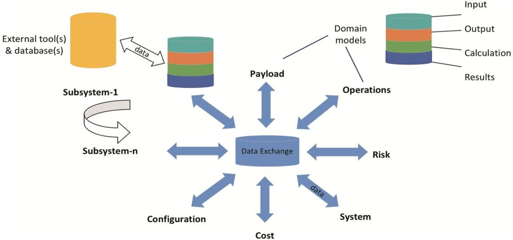
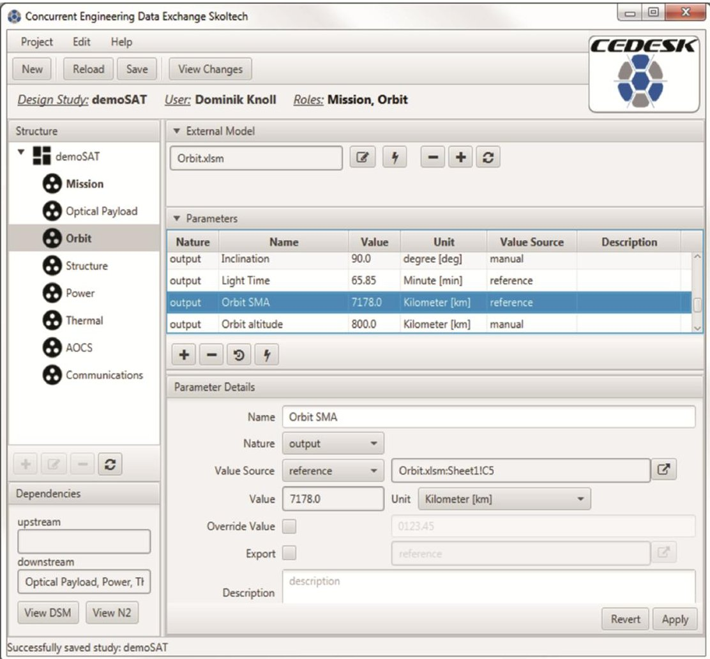
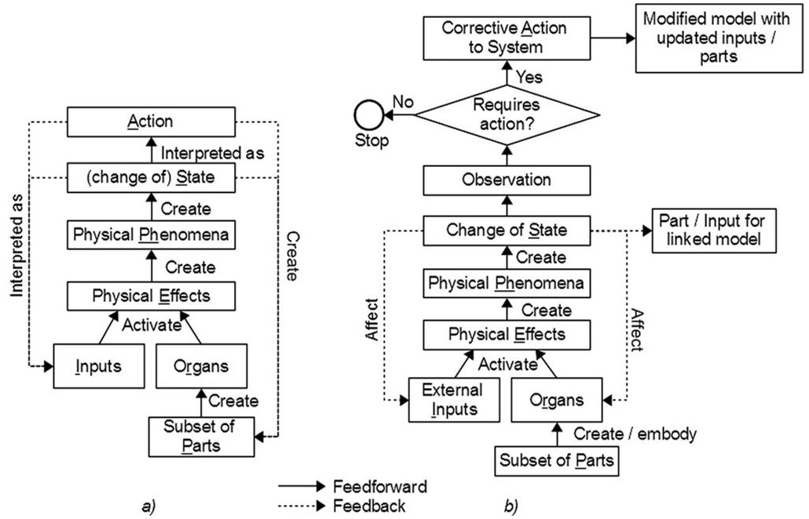
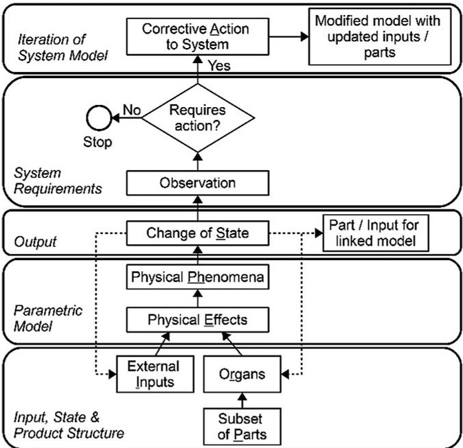
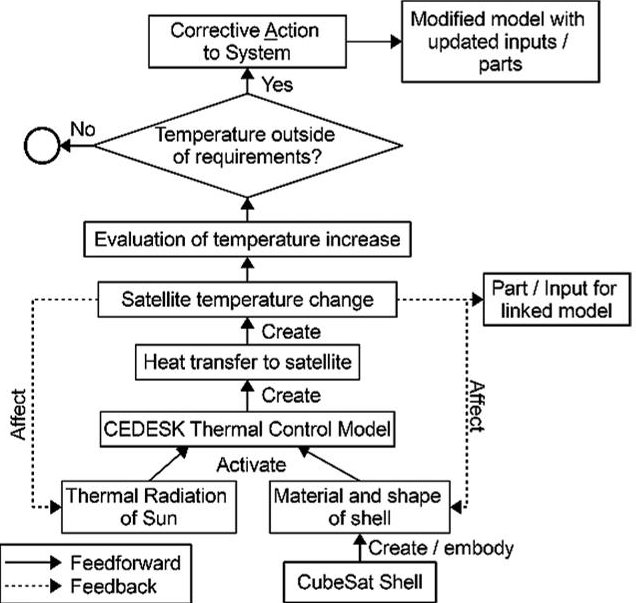

<!-- PDF_PAGE: 1 -->

# Study of Data Structures and Tools for the Concurrent Conceptual Design of Complex Space Systems

Clément Fortin $ ^{1(\textcircled{1})} $ , Grant McSorley $ ^{2} $ , Dominik Knoll $ ^{1} $ , Alessandro Golkar $ ^{1} $ and Ralina Tsykunova $ ^{1} $

$ ^{1} $ Skolkovo Institute of Science and Technology, Moscow, Russia {c.fortin,d.knoll,a.golkar}@skoltech.ru, ralina.tsykunova@skolkovotech.ru

$ ^{2} $ University of Prince Edward Island, Charlottetown, Canada gmcsorley@upei.ca

Abstract. Concurrent design facilities are used by space agencies and private organizations to conduct preliminary design activities in the development of space systems. Concurrent conceptual design is characterized by dynamic exchanges between a limited team of experts, defining the operational requirements, the systems architecture, the baseline design, and budgets for different resources. The results are a preliminary system baseline and product requirements that are used as inputs to the subsequent product development phases.

A study of the input and output of this early phase of product development has confirmed that data generated in concurrent design studies essentially describes behavior with a limited set of information about the geometry. The geometry at this stage is mainly composed of functional configurations with geometric envelopes.

Based on this behavioral information content, the authors have looked at the SAPPhIRE model of causality, initially developed by Chakrabarti, as a potential data structure to support this early phase of system development and possibly all phases of the product lifecycle.

In this current work, we present two concrete examples of concurrent conceptual design data structures for space applications and show how such data structures could be represented within the extended SAPPhIRE model.

When compared to current PLM data structures, the use of the extended SAPPhIRE model represents an alternative means of structuring information and communicating this information between stakeholders, providing better understanding of the relation between a system's structure, function and behavior. It also explicitly represents the links between subsystems and the iterative nature of the design process.

Keywords: Conceptual design·Functional system model Behavioral system model·Concurrent engineering·Space systems Product lifecycle management·Product data management Concurrent data exchange

<!-- PDF_PAGE: 2 -->

## 1 Introduction

For most systems and products, the conceptual design phase is generally carried out by a small group of individuals working closely together with computer-based models of their subsystem of competence. In recent years for space systems, this phase is being carried-out in concurrent design facilities, which have been developed by space agencies and private organizations. The concurrent conceptual design is characterized by dynamic exchanges between a limited team of experts that study the operational requirements, evaluate different options of systems architecture, a baseline design, and budgets for the system-level spacecraft resources (e.g. mass, power, and link budgets). The typical result of a concurrent design study is made of a preliminary system baseline and product requirements, which are used as inputs to subsequent phases of the product development process.

To appropriately support this effort and to better integrate its results with the subsequent phases of the system and product development, it is important to analyze the types of information that are required at the conceptual phase. The aim of this work is to present such an analysis for satellite systems and the preliminary results. Based on these results, we propose a data model that is well suited to support this early phase of the system design and the subsequent phases through to the system delivery and operation phases.

The paper is structured as follows: In Sect. 2 we set the context of our work on concurrent conceptual design of complex space systems. Section 3 contains the analysis of information used in the conceptual design of two satellite case studies: CubseSat and LaserNaut. We explain the extended SAPPhIRE model in Sect. 4, and the application of this model to the concurrent data exchange tool CEDESK in Sect. 5. This application is demonstrated through modelling of the thermal subsystem of the CubeSat analysed in Sect. 2. Finally we sum up our work and give an outlook on future work.

## 2 Concurrent Design and Engineering

The conceptual or preliminary design of complex engineering products (such as space missions) requires contributions from multiple disciplines, including engineers focused on specific subsystems as well as programmatic, manufacturers and operation experts. In the space field, concurrent design is defined as an engineering design methodology that brings people with expertise in different fields together in a collaborative physical workspace to design in parallel and closely coordinated to effectively achieve cohesive and feasible product or system designs [1]. Space agencies adopting the concurrent engineering approach have been able to reduce the duration of a preliminary design analysis to between 3 and 6 weeks against 6-9 months [2].

Among other things, the tool for enabling collaboration and exchange of data among experts of different disciplines on a common system model plays an important role. Such a data exchange tool acts as a data repository for the shared system model and allows engineers participating in the design study to connect their domain specific models. Figure 1 shows the architecture of the data exchange and its linkages to domain specific models.

<!-- PDF_PAGE: 3 -->

Fig.1. A central data exchange connecting all domain models, adapted from [1]

Fig. 2. The user interface of CEDESK data exchange client for each discipline expert

<!-- PDF_PAGE: 4 -->

The European space community has published a technical memorandum [3] for standardizing the data exchange in order to foster interoperability among different tools. An instance of such a data exchange tool is CEDESK [4]. This tool is able to store parametric system models in accordance to [3]. In CEDESK, model entities represent the system structure, its parameters, units of measures, links between parameters, users, and roles.

A system is represented as a product breakdown structure in the form of a hierarchical tree of model nodes. Each model node contains a list of parameters and a list of external models. External models represent models made by third-party engineering tools. Parameters can be of different nature: input, internal or output. Parameters can get their value from other parameters, external models or it is set manually by the user. Parameters can be associated to a unit of measure.

CEDESK allows multiple users to work concurrently on the design of a system, while distributing design authority over subsystems among discipline experts. Figure 2 shows the user interface used by discipline experts to collaborate on a system model, here a satellite with its subsystems and disciplines, such as 'Orbit' with its design parameters.

## 3 Classification of Information Types in Conceptual Design Studies

In order to properly define the most appropriate data structure for the concurrent conceptual design of complex systems, it is important to study the types of data that are needed at this early stage of the product development. To reach this goal, we analyzed data generated during two feasibility studies of projects supported by the CEDESK application described above: CubeSat and LaserNaut. This representative data of a concurrent conceptual design study, was generated by students and researchers from Skoltech participating in Satellite Engineering projects. The satellite design included the following conventional subsystems: Attitude Determination and Control System (ADCS), Communication, Power, Orbit, Thermal, and Structure as well as an Optical payload. Input and output data of each subsystem were extracted from the CEDESK database for the analysis. The data for each subsystem was divided into three general categories: behavioral, geometrical and state data. Geometric data is data, which can be measured in physical units and directly refers to the physical dimensions of a system. State data represents important design variables of the system that generally correspond to requirements or other important parameters. Behavioral data is data that correspond to a physical phenomena and its constitutive equations. The results of the analysis are presented in Tables 1 and 2 below.

Table 1. Detailed analysis of CubeSat conceptual phase data

<table border="1"><tr><td rowspan="2">Data</td><td colspan="2">AOCS</td><td colspan="2">Com</td><td colspan="2">M&amp;P</td><td colspan="2">Optical</td><td colspan="2">Orbit</td><td colspan="2">Power</td><td colspan="2">Thermal</td><td colspan="2">Structure</td></tr><tr><td>in</td><td>out</td><td>in</td><td>out</td><td>in</td><td>out</td><td>in</td><td>out</td><td>in</td><td>out</td><td>in</td><td>out</td><td>in</td><td>out</td><td>in</td><td>out</td></tr><tr><td>Behavioral</td><td>6</td><td>20</td><td>16</td><td>1</td><td>17</td><td>17</td><td>-</td><td>3</td><td>-</td><td>-</td><td>3</td><td>6</td><td>2</td><td>2</td><td>1</td><td>9</td></tr><tr><td>Geometric</td><td>0</td><td>0</td><td>1</td><td>1</td><td>0</td><td>0</td><td>-</td><td>5</td><td>-</td><td>-</td><td>-</td><td>10</td><td>7</td><td>-</td><td>7</td><td>7</td></tr><tr><td>State</td><td>6</td><td>-</td><td>11</td><td>-</td><td>-</td><td>-</td><td>14</td><td>1</td><td>3</td><td>4</td><td>6</td><td>1</td><td>10</td><td>-</td><td>4</td><td>-</td></tr></table>

<!-- PDF_PAGE: 5 -->

Table 2. Classification of conceptual phase data from CubeSat and LaserNaut studies

<table border="1"><tr><td rowspan="2">Data Type</td><td colspan="3">CubeSat</td><td colspan="3">LaserNaut</td></tr><tr><td>Input</td><td>Output</td><td>Total</td><td>Input</td><td>Output</td><td>Total</td></tr><tr><td>Behavioral</td><td>39%</td><td>67%</td><td>53%</td><td>76%</td><td>76%</td><td>76%</td></tr><tr><td>Geometric</td><td>13%</td><td>26%</td><td>20%</td><td>22%</td><td>21%</td><td>22%</td></tr><tr><td>State</td><td>47%</td><td>7%</td><td>27%</td><td>2%</td><td>3%</td><td>3%</td></tr></table>

Table 1 presents the detailed results obtained from the analysis of the results of the CubeSat feasibility study. The results show that the amount of behavioral data, for both inputs and outputs, is greater than or equal to the amount of geometric data in 6 out of 8 system models. Table 2 presents a summary of the CubeSat analysis as well that of the LaserNaut system. In each case, the overall amount of behavioral data is greater than the amount of geometric data. The results confirm our hypothesis, which means that we need to predominantly operate with non-geometric data during the initial phases of product development. It should be noted that there are significant differences in the proportion of state data between the two studies. The reasons for this discrepancy will be a topic of future work.

## 4 Extended SAPPhIRE Model for Supporting Concurrent Conceptual Design

The SAPPhIRE (State-Action-Parts-physical Phenomenon-Inputs-oRgan-physical Effect) causality model developed by Chakrabarti et al. [5], shown in Fig. 3a, provides a visual representation of how the behavior and function of the system are brought about

Fig. 3. (a) Original SAPPhIRE Model (based on [9]) (b) Extended SAPPhIRE Model [11]

<!-- PDF_PAGE: 6 -->

through one or multiple changes of state which occur due to the physical laws acting upon the system. This model provides a richer representation, at various levels of granularity, of the relationships between the function, behavior and structure of a system, than previous function-behavior-structure models, such as those of [6-8].

The significant proportion of behavioral information found to be present during the conceptual design of satellite systems suggests that such a system representation using causal chains would be particularly useful at this stage of the design process. Indeed, the original application of the SAPPhIRE model [5] was to support the synthesis of innovative solutions at the conceptual design stage. A structured database was created containing representations of both natural and artificial systems using the SAPPhIRE model, allowing designers to browse or search based on the model constructs. In further work, it was demonstrated how the model could also be used for the analysis of design problems [9]. In both cases, the objective was to aid designers in exploring the design space. Subsequently, the SAPPhIRE model has been modified for the representation of in-service [10], test [11] and conceptual design data [12], and proposed as a framework for product lifecycle management [11].

The current work proposes a data model appropriate for not only the conceptual design phase, but for subsequent lifecycle phases as well, and as such, the extended SAPPhIRE model (Fig. 3b), proposed by two of the co-authors in [11], will be adopted. This adaptation of the SAPPhIRE model more closely reflects the evolution of a product throughout its lifecycle than the original SAPPhIRE model, and reframes certain elements of the model to be more directly applicable to the typical product lifecycle stages. Table 3 presents the elements of the extended SAPPhIRE model and a more detailed comparison with the original SAPPhIRE model is presented in [11].

Table 3. Constructs of the extended SAPPhIRE model - Based on [9] and [11]

<table border="1"><tr><td>Construct</td><td>Definition</td></tr><tr><td>Change of State</td><td>A change in a property of a system (and environment) over a given duration of time, which is involved in an interaction</td></tr><tr><td>Observation</td><td>The interpretation of the change of state which precedes potential corrective action</td></tr><tr><td>Corrective Action</td><td>Action taken based on observation of change of state which may modify the current system</td></tr><tr><td>Parts</td><td>A set of physical components and interfaces that constitute the system and its environment. Includes assemblies and sub-assemblies</td></tr><tr><td>Phenomenon</td><td>An interaction between a system and its environment</td></tr><tr><td>External Input</td><td>A physical variable that crosses the system boundary, and is essential for an interaction between a system and its environment</td></tr><tr><td>Organ</td><td>A set of properties and conditions of a system and its environment required for an interaction between them. Typically consisting of the geometric features, key characteristics and physical properties of the parts</td></tr><tr><td>Physical Effect</td><td>A principle of nature that underlies/governs an interaction, usually in the form of a constitutive or physical law</td></tr></table>

<!-- PDF_PAGE: 7 -->

As indicated by the arrows linking the model elements in Fig. 3, both models provide a logical process for understanding a causal chain within a system. Of particular importance in Fig. 3b are the connections from the change of state to the current subset of parts and the external inputs, and from corrective action to the modified model. These arrows indicate that the results from the change of state or corrective action can modify the configuration of a system, giving rise to physical, behavioral and functional changes over time. The concept of linked models is also made explicit in the extended model, indicating that the result of a state change can act as a part or input to a linked system.

In order to effectively collaborate during the conceptual design phase, engineers require the means to share information regarding partially developed systems in a structured fashion. It is proposed that the extended SAPPhIRE model can be used to not only allow the querying of previously documented systems, but if combined with a collaborative design tool such as CEDESK, can enable the efficient communication and sharing of conceptual design data as it is created. By associating the appropriate elements of the CEDESK system models with the appropriate SAPPhIRE constructs, this conceptual design data can be stored and reused in future projects. It is believed that this combination of a generic model of causality with domain specific system models will allow for efficient reuse of the data created, increasing its value to the organization. In the following section, a case study will be presented for an initial integration of CEDESK and the extended SAPPhIRE model.

## 5 Mapping of CEDESK Data Structure to the SAPPhIRE Model

As previously stated, the primary model entities in CEDESK represent the system structure, its parameters, units of measures, links between parameters, users, and roles [4].

Fig. 4. Mapping of CEDESK elements to extended SAPPhIRE model

<!-- PDF_PAGE: 8 -->

The parameters can be of type input, output or state. In order to explore the behavior and evaluate the functionality of the system model (represented by output parameters), the input and state parameters are used to resolve the parametric models composing the system. Viewed in this way, these elements of the CEDESK data structure can be mapped to the extended SAPPhIRE model as shown in Fig. 4. In examining the use of CEDESK for a design study, three additional observations were made regarding system requirements, the product structure, and iterations of the system model.

System Requirements. Requirements are defined before beginning the conceptual design study, and are not considered explicit inputs unless used to resolve a system model. However, it was found that designers did record requirements within CEDESK, for example in spreadsheets used for calculating system model results. It is suggested that a new requirements parameter be defined to reflect this. This parameter would be directly related to requirements for evaluating whether the outputs of a model iteration are acceptable.

Product Structure. While the product structure remains high level at the conceptual design stage, certain decisions are made and recorded within CEDESK in terms of component type, shape and material, which are not treated as inputs to system models. It is suggested that this type of data be classified as part or organ parameters.

Modelling Iterations. The extended SAPPhIRE model also explicitly represents the evolution of the system through iteration. This is part of the generic concurrent design process developed by [4], and covered in CEDESK data structure by keeping track of the change history of the parameters. This allows to reconstruct the evolution of design parameters over design iterations. Since at the conceptual design phase the emphasis is on exploration, there is no approval enforced. The appropriate balance of control and design freedom is an area for future work.

From Fig. 4, it can be seen that the individual CEDESK elements are mapped to multiple SAPPhIRE elements. In order to resolve this and facilitate the integration of the models, an extension of the CEDESK data structure is proposed where these parameters are further refined as part, organ, external input, change of state, physical effect, and requirement. An example of the application of this extended data structure is presented next.

## 5.1 Cubesat Design Study

We use data generated during a design study of an integrated satellite model, where the mission requirements were to obtain an earth observation satellite with optical payload, and using Excel-based sizing models founded on FireSAT from SMAD [13]. The systems breakdown structure was defined a-priori and the design dependencies among parts of the system preliminarily identified [4]. Being a preliminary design each physical subsystem or logical element of the mission is described in basic parametric models.

A thermal control model of the satellite was used to calculate the surface heating due to the radiation from the sun. In order to calculate equilibrium temperatures, the CEDESK model for thermal control required inputs regarding the CubeSat mission as

<!-- PDF_PAGE: 9 -->

well as its configuration and thermal properties. These inputs and outputs are presented in Table 4. These elements are further defined based on the proposed extension to the CEDESK data structure. It can be seen that from the temperature requirements equipment list it is possible to derive information regarding the initial structure of the system, as it relates to the thermal subsystem model (e.g. avionics baseplates, batteries, solar arrays, etc...). Furthermore, the material of the CubeSat shell, considered an organ, as well as the parametric model of the satellite's thermal behavior, considered the physical effect, were extracted from data within the thermal control model.

Table 4. Corresponding CEDESK and SAPPhIRE model elements from CubeSat study (sample)

<table border="1"><tr><td colspan="5">CEDESK Element</td><td>SAPPhIRE Element</td></tr><tr><td rowspan="13">Thermal Inputs</td><td rowspan="3">Temperature requirements(deg Celsius)</td><td>Equipment</td><td>Operational</td><td>Survival</td><td></td></tr><tr><td>Avionics baseplates</td><td>-20-60</td><td>-40-75</td><td>Requirement</td></tr><tr><td>Batteries</td><td>10-30</td><td>0-40</td><td>Requirement</td></tr><tr><td rowspan="4">Mission</td><td>Orbit altitude</td><td colspan="2">620km</td><td>External Input</td></tr><tr><td>Orbit inclination</td><td colspan="2">21.5deg</td><td>External Input</td></tr><tr><td>Internal power dissipation</td><td colspan="2">126W</td><td>Organ</td></tr><tr><td>Power dissipation spike</td><td colspan="2">139W</td><td>Organ</td></tr><tr><td rowspan="6">Satellite configuration and thermal properties</td><td>Bus geometry</td><td colspan="2">Octogonal</td><td>Organ</td></tr><tr><td>Main Diameter</td><td colspan="2">0.6m</td><td>Organ</td></tr><tr><td>Height</td><td colspan="2">0.7m</td><td>Organ</td></tr><tr><td>Absorbing area</td><td colspan="2">1.5m2</td><td>Organ</td></tr><tr><td>Radiating area</td><td colspan="2">1.5m2</td><td>Organ</td></tr><tr><td rowspan="2">Thermal Outputs</td><td>Equilibrium Temperature Hot conditions</td><td colspan="2">-8.173degC</td><td>Change of State</td></tr><tr><td>Equilibrium Temperature Cold conditions</td><td colspan="2">-23.763degC</td><td>Change of State</td></tr><tr><td rowspan="4">Extracted Elements</td><td colspan="3">Avionics baseplates</td><td>Part</td></tr><tr><td colspan="3">Batteries</td><td>Part</td></tr><tr><td colspan="3">Parmetric model of thermal behavior</td><td>Physical Effect</td></tr><tr><td colspan="3">AL7075-T6</td><td>Organ</td></tr></table>

Once the elements from CEDESK are mapped to the SAPPhIRE model elements, a graphical representation can be created describing the thermal behavior of the satellite (Fig. 5). While the elements included in the model are high-level summaries of the data presented in Table 4, it nonetheless provides a clear representation of the thermal behavior of the overall CubeSat. In future work, the graphical representation will be developed into an interactive model which can be used to retrieve the data to which the elements are linked. It is important that this related data be as specific and detailed as possible as it will allow reviewing the design rationale for the system. It also facilitates verification that all relevant information is considered when analyzing a particular module. Moreover, access to detailed data would increase the effectiveness of keyword searches completed on a behavioral database.

<!-- PDF_PAGE: 10 -->

Fig. 5. Extended SAPPhIRE model applied to CubeSat thermal model

## 6 Conclusion

In this project, we analyzed typical concurrent design data structures based on the CEDESK data exchange tool, which has been developed to support conceptual design activity for space systems. The results of this analysis indicate that the extended SAPPhIRE model is a viable representation of the essential elements in a concurrent design study and that it can facilitate the representation, data exchange and reuse of information generated in such studies. This approach can also potentially contribute to the creation of a library of concurrent design models.

The extended SAPPhIRE model represents an alternative means of structuring system information and communicating this information between various stakeholders and provides a better understanding of the relation between structure, function and behavior of a system. It also explicitly represents the linking of input and output parameters to other subsystems, the decision making process necessary for evaluating the current design, and the iterative nature of the design process.

The extended SAPPhIRE model could also be used as a support data structure for the complete product lifecycle where the product structure, the system behavior and process information are all important. The integration of concurrent design studies to further phases of system and product development, which is an ongoing challenge in product lifecycle management, could then be greatly simplified.

Although it is too early to say that our results can be generalized to all space system development studies as well as those of other fields of design, this preliminary research clearly demonstrates the potential of this approach. We certainly consider our results as preliminary observations based on two pilot studies, but intend to extend this approach to multiple mission studies in our future work.

<!-- PDF_PAGE: 11 -->

## References

1. Bandecchi, M., Melton, B., Gardini, B., et al.: The ESA/ESTEC concurrent design facility. In: Negele, H., Fricke, E., Schulz, A. (eds.) 2nd European Systems Engineering Conference, p. 329, EuSec, Munich, 13-15 September 2000. Herbert Urtz Verlag, Munich (2000)

2. Di Domizio, D., Gaudenzi, P.: A model for preliminary design procedures of satellite systems. Concurrent Eng. 16(2), 149-159 (2008). https://doi.org/10.1177/1063293X08092488

3. ESA European Cocorporation for Space Standardization. ECSS-E-TM-10-25A, Space engineering - Engineering design model data exchange (CDF) (2010)

4. Knoll, D., Golkar, A.: A coordination method for concurrent design and a collaboration tool for parametric system models. In: 7th International Systems and Concurrent Engineering for Space Applications Conference, Madrid, Spain, 5-7 October 2016 (2016). https://doi.org/ 10.1177/1063293X17732374

5. Chakrabarti, A., Sarkar, P., Leelavathamma, B., et al.: A functional representation for aiding biomimetic and artificial inspiration of new ideas. AI EDAM 19(2), 113-132 (2005). https:// doi.org/10.1017/S0890060405050109

6. Hubka, V.: Principles of engineering design. Butterworth Scientific, London (1982)

7. Gero, J.S., Kannengiesser, U.: The situated function-behaviour-structure framework. Des. Stud. 25(4), 373-391 (2004). https://doi.org/10.1016/j.destud.2003.10.010

8. Umeda, Y., Ishii, M., Yoshioka, M., et al.: Supporting conceptual design based on the function-behavior-state modeler. AI EDAM 10(4), 275-288 (1996). https://doi.org/10.1017/S0890060400001621

9. Chakrabarti, A., Srinivasan, V.: Sapphire-an approach to analysis and synthesis. In: Norell Bergendahl, M., Grimheden, M., Leifer, L., et al. (eds.) ICED09: 17th International Conference on Engineering Design, p. 417, California, 24-27 August 2009. The Design Society, Paolo Alto, California (2009)

10. Jagtap, S.: Capture and structure of in-service information for engineering designers. Dissertation. University of Cambridge (2008)

11. McSorley, G., Fortin, C., Huet, G.: Modified SAPPhIRE model as a framework for product lifecycle management. In: Marjanovic, D., Storga, M., Pavkovic, N., et al. (eds.) DS 77: DESIGN 2014 13th International Design Conference, p. 1843, Dubrovnik, 19-22 May 2014. The Design Society, Glasgow, UK (2014)

12. Tsykunova, R.: Study of data structures, tools and processes to support concurrent conceptual design of space products. Thesis, Skolkovo Institute of Science and Technology (2016)

13. Wertz, J.R., Everett, D.F., Puschell, J.J., (eds.): Space Mission Engineering: The New SMAD, 3rd edn. Microcosm Press, El Segundo (2011)