<!-- PDF_PAGE: 1 -->

# International Conference on Space Optics—ICSO 2000

Toulouse Labège, France

5-7 December 2000

Edited by George Otrio

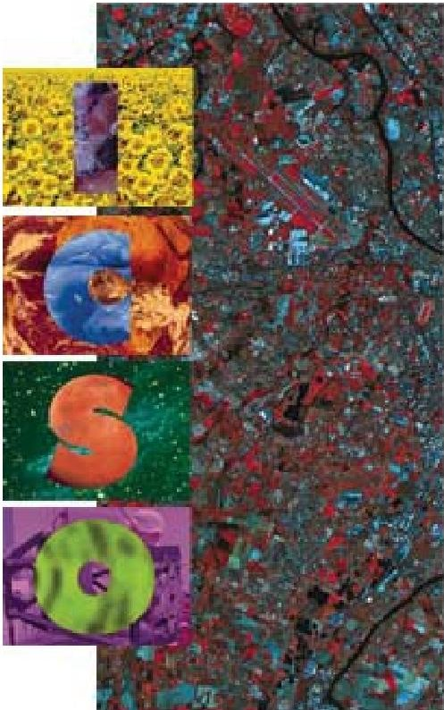

Uncooled micro-earth sensor for micro-satellite attitude control: Earth remote sensing application

J.-Y. Fourniols, G. Soto-Romero, F. Bony, C. Vergnenègre, et al.

<!-- PDF_PAGE: 2 -->

# Uncooled Micro-earth sensor for micro-satellite attitude control: Earth remote sensing application

JY. Fourniols, G. Soto-Romero, F. Bony, C. Vergnenegre, J.J. Simonne, D. Esteve $ ^{*} $ J. Albukerque $ ^{**} $

(*)Laboratoire d'Analyse et d'Architecture des Systèmes LAAS-CNRS, 7 Avenue du Colonel Roche, F-31077 Toulouse Cedex, France

(**) CNES Toulouse

## ABSTRACT

MEMS technology now makes possible to produce active microdevices combining detection, signal processing, and data storage with accuracy and compactness. In view of their characteristics, it can be expected that such microsensors will be used extensively in space applications dedicated to micro and nano satellites.

For this purpose, a specific investigation dealing with the complete development of a micro-earth sensor used for attitude control of Low Earth Orbit satellites is under realization and test. Based on an infrared uncooled 320x240 microbolometer the experimental characterization of the final active system consists of three microsensors linear arrays of 240 pixels of the same technology, radialy spaced at $ 1 2 0^{\circ} $ , watching and receiving earth IR radiations. The transition between excited and non excited pixels will determine the IR image of the Earth/Space transition hidden in IR atmosphere response. Specific on-chip algorithms have been implemented to extract the transition and compute the attitude satellite position in roll and pitch.

The complete physical system modeling of one linear 240 pixels array including earth models, optic characteristics, microbolometer behavioral models, mixed analog/digital electronics and associated algorithms is consistent (at $ \pm 8 \% $ ) with the breadboard measurements.

Keywords: Microsystems, Active imaging sensor, top-down modeling, earth depointing, uncoooled microbolometer

## 1. INTRODUCTION

Progress in infrared technology during the last decade has been emphasized by the emergence of uncooled sensors when performances of bidimensional arrays have reached the level of those displayed by III-V and II-VI quantum detectors a few years before. After a period where pyroelectric sensing using different kinds of polymers have been developed, especially in night vision civil and military applications, microbolometer arrays are now the most prevailing approach in infrared technology. This breakthrough seems definitely due to the technical skill to process sacrificed material layers, the air film between the pixels and the processing electronics offering a much better thermal insulation than the material used in between in pyroelectric detectors.

This evolution of the microelectronic technology, together with other post-processing steps, was a starting point of the MEMS concept, designed with a similar perspective of development as electronic circuits. However, as it could figure out that MEMS be dedicated to mass production applications, the space industry was in a first stage hesitating to make its revolution by introducing MEMS in its design. Afterwards, it became evident that the microsystem technology could fit the high added value required by this field. Two approaches were therefore considered: either the straight design of the whole satellite, or the development of functionnalities leading step by step to the same objective

Our work is included into this second approach with the development of an earth horizon sensor for systems to be used in a AOCS (Attitude Orbital Control System). Based on a microbolometer array, a breadboard equipment will be elaborated and tested after a virtual prototyping. Experiment data will be presented, and a guideline to go further with the integration of this camera using MEMS technology will be presented.

<!-- PDF_PAGE: 3 -->

## 2. MIRES PROJECT

The MIRES project (Micro InfraRed Earth Sensor) purpose is to integrate detection and data processing on a high performance and reliable micro-system for space applications. It is based on a system which includes three integrated sensors, which are constituted by three microbolometer linear arrays, positioned at $ 1 2 0^{\circ} $ from each other, and observing the discontinuity between earth radiance and vacuum to retrieve several points. These points are supposed to be an ideal Earth/Space transition, from which will be deduced the satellite orientation in terms of roll and pitch angles. A microthruster array and associated control unit complete the project but are out of the scope of this paper.

It is obvious that only two measurements of the Earth/Space transition operated by two linear arrays (also called optical heads) are needed to estimate the satellite depointing. However, the third optical head increase the global system F.O.V (Field of view); in addition its measurement can be used to improve the system accuracy

The fig.1 shows the basic principle of positioning the MIRES optical heads for a LEO (Low Earth Orbit) satellite centered on the earth ( without depointing ). Special mission design considerations accounting with the limited energy and mass budget available to a micro satellite are: aperture angle higher than 18 degrees, pointing deviation lower than 0.1 degrees, volume around 200cm3, weight approximately 250g; power consumption lower than 2W, orbit from 500 to 1000 km.

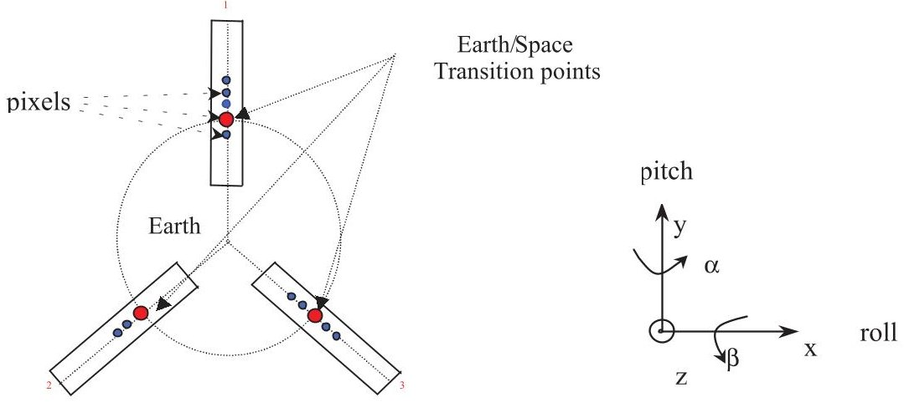

Fig. 1: Position of the three optical heads linear arrays and satellite reference axis/depointing angles

The Earth/Space transition follows the shape of the earth radiance profile as shown in the upper part of fig 2:

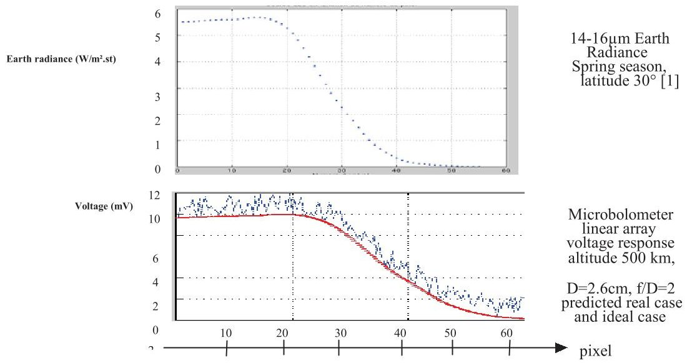

Fig. 2: upper-part: infrared simulated microbolometer array response of earth/space transition bottom-part: comparison between measurement and simulation

<!-- PDF_PAGE: 4 -->

However, due to the diffusion effect produced by the atmosphere, the transitions are to be extracted from a spread image of the emitted flux from the earth given by the linear arrays (bottom part Fig.2). The radiance of the earth for a tangential altitude has been extracted from a data given by NASA $ ^{1} $

A specific filtering is needed to extract signal from noise induced either by temperature variation or by FPN (Fixed pattern noise ), which means a random fixed noise from 1 to 5 Volts. Then a specific algorithm implanted on a DSP (Data Signal Processing) gives access to a 'fixed point' on the transition zone, by using one out of the three following approaches :

- the neuronal approach

- the filtering approach

- an identification with a mathematical function describing the transition (hyperbolic tangent, see PICARD project).

The second approach has been used in this work and will be presented in chapter 4.

Main features from preliminary investigations are:

- The linear infrared uncooled microbolometer array included in each optical head should be composed at least of 240 pixels.

- Each optical head has its own associated optical system, which allows to concentrate radiance of Earth/Space transition on the detector surface. In the same time, the optical system design may reduce the spectral band to the 14-16 $ \mu m $ because of the less important seasonal, latitudinal and climatic variations in the Earth radiance profiles $ ^{(1)} $ . Finally, it must conserve the optical resolution and a F.O.V stated above by the specifications, whatever could be the altitude of the satellite orbit ranging between 500 and 1000 Km.

- Each optical head is associated to a data processing electronics, which may be able to read data from the detector (the Earth/Space transition response) from which are deduced the roll and pitch angles with a frequency around 10 Hz.

In a first approach, the electronic system is composed by an analog to digital conversion of the signal issued from the detector, data storage and specific algorithms hardware implemented for transition estimation and angles restitution. Other alternative which involves an analog solution for the transition estimation is currently being explored.

## 3. DESCRIPTION OF THE VIRTUAL SIMULATOR

Whatever the field of application: automotive, medicine, space, ..., any concrete realization or demonstrator is implemented in industry after the achievement of a virtual prototyping, the only way to save cost and time, but also to optimize the different parameters of the final hardware architecture, and to assess system performances and reliability as well.

- the modeling of the scene, the scene being the Earth/Space horizon radiance profiles vs. tangent height in the 15 $ \mu m $ spectral band $ ^{(3)} $ .

- The basic virtual prototyping $ ^{(2)} $ works for the entire optical head modeling chain, physical behavior of the system, and covers:

- the modeling of the optical system, including the lens transmittance per wavelength unit, focal distance, lens diameter from which are deduced the F.O.V and the optical resolution (must be $ > 1 8^{\circ} $ and $ < 0.1^{\circ} $ respectively)

the modeling of the IR detector. It includes the model of an uncooled microbolometer pixel response, given through its size, sensitivity in Volts/Kelvin and integration time. The thermal focal plane control, sequential control and power supply are also included to deduce by a hierarchical model the behavior of a 320x240 FPA (Focal Plane Array, type of array which is used in our experiment where, when necessary, only one row is activated). These parameters, directly related to uncooled IR technologies, are completed by physical noise, 1/F noise and FPN (Fixed Pattern Noise) models, set up from experiments, to fit the simulator results with the pixel response measurements.

<!-- PDF_PAGE: 5 -->

- the modeling of the data processing and storage electronics. Two different architectures (which will be detailed in chapters 4 and 5) are available, depending on the application of the virtual simulator (Thermal IR imagery or MIRES applications).

The fig. 3 shows the physical expressions used in the virtual prototyping to simulate the scene, optical system and ideal detector response. The behavioral models of the electronic designs are not included in the diagram, which means that the output at this level of the simulation tool is the ideal analog output issued from a linear microbolometer FPA exposed to the Earth/Space radiance.

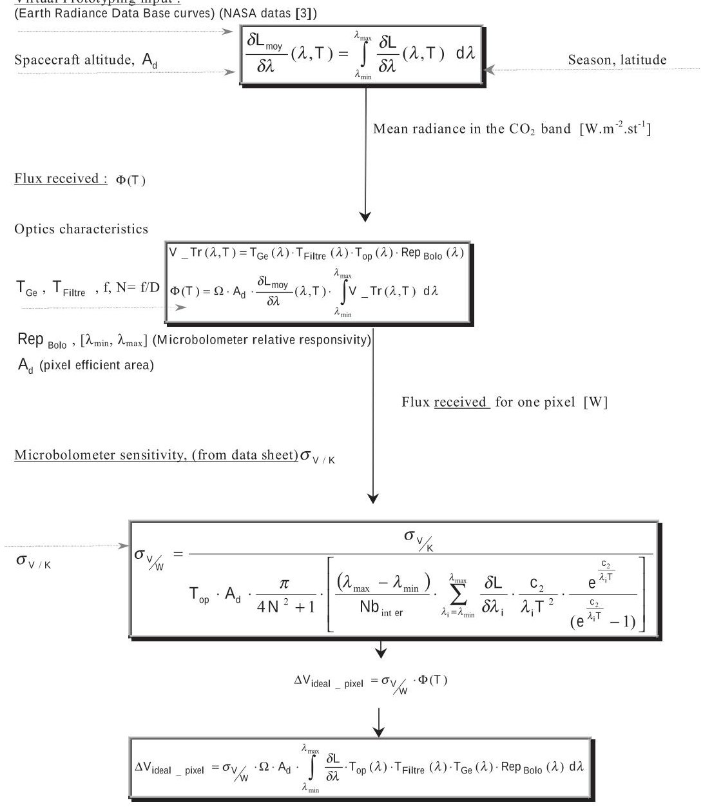

Fig.3 - Implementation of a Microsystem simulator.

The parameters at the left side are "user accessible"; changing these values allows to simulate different system configurations (alter the optic materials, evolution on detector performances, etc...).

The validation of the virtual prototype has been performed from experiments where images were taken on a special OGSE (On Ground Support Equipment). As a result, the comparison between simulation and experience revealed a difference lower than 15%. In addition, the presence of feedback loops in the virtual prototyping organization allows to optimize the parameters for a best performances configuration $ ^{(2)} $

<!-- PDF_PAGE: 6 -->

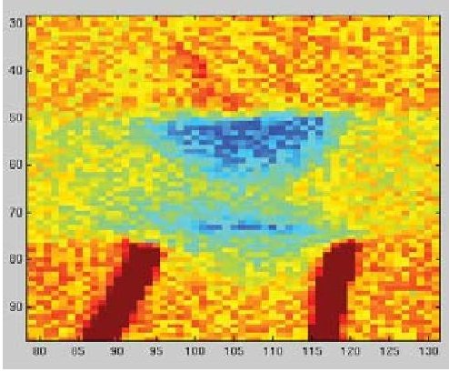

Simulation

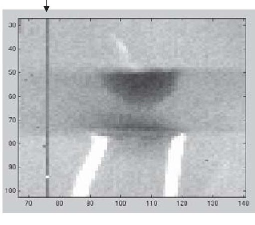

Measurement

Fig.3bis - Correlation between of one Peltier at 300K : dead column of the microbolometer appears in the right image

## 4. DESCRIPTION OF THE HARDWARE-BREADBOARD DEMONSTRATOR

## 4.1. Optic System

The optical system used in the sensor is shown in Fig. 4. It consists of two standard ZnSe lens and is designed to focus the infrared beam radiated from the Earth. Thus, it must fulfil some specifications such as a total aperture angle of $ 1 8^{\circ} $ an angular resolution of $ 0. 1^{\circ} $ and a spectral bandwidth of $ \pm4\mu m $ around $ 12\mu m $

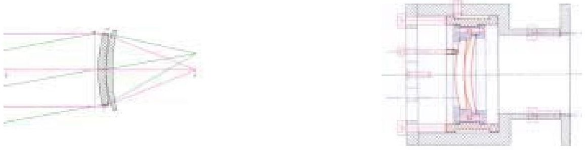

Fig. 4: Scheme of the optical system

The optics is placed in front of the sensitive surface of the camera and is mounted on a mechanical support which enables to adjust precisely the focusing of the incident parallel beam. The two optics are AR (Anti Reflection) coated in order to maximize the transmission factor at $ \lambda=1 0. 6 \mu \mathrm{m} $ . This coating ensures a transmission factor between 72.5% and 99.5% for each optics through the range of wavelength. To sum up, the optical system presents a f/# number of 1.5. The aperture angle equals $ 1 9^{\circ} $ and the angular resolution is $ 0.1^{\circ}. $

The optical system is used to concentrate the radiated power of an infrared source on the sensitive surface of the detector. The optical power received by the detector is given by:

$$
\Psi_ {\mathrm {d}} = \mathrm {L T} (\lambda) \left(\frac {\pi \Phi_ {0} \Phi_ {1}}{4 \mathrm {p}}\right) ^ {2}
$$

Where:

L is the luminance of the blackbody (uniform source) $ [ \mathrm{W.m}^{-2}.\mathrm{st}^{-1} ] $

T( $ \lambda $ ) is the transmission factor of the optic and the filters

$ \Phi_{0},\Phi_{1} $ are the diameters of the object and lens [m]

p is the object-to-lens distance [m]

Theoretical results are consistent with measurements (error less than 10%) , using the setting up shown on Fig. 5.

<!-- PDF_PAGE: 7 -->

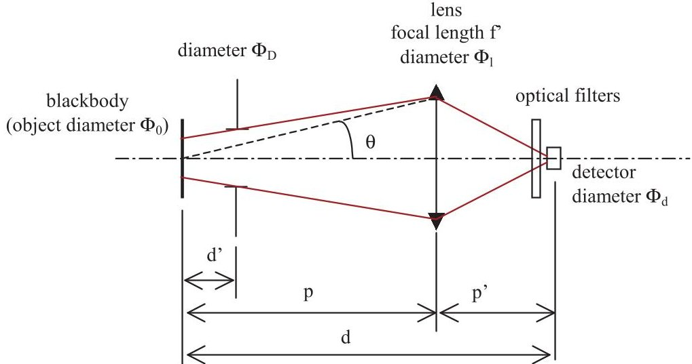

Fig. 5: Measure of the radiated flux emitted by the blackbody

## 4.2. Electronic Architectures

The Breadboard has been defined from a 320x240 microbolometer FPA, with a pixel size of 41x41 $ \mu $m and a 51 $ \mu $m pitch. The active pixel material is $ \mathrm{V d O_{2}} $

A first electronic design has been developed (partnership LAAS-CNRS / SODERN) with the objective to use the detector both in classic thermal IR imagery and in MIRES applications. It includes a four electronic cards architecture which:

- provides the regulated power supplies for both the detector and electronics.

- provides all digital signals useful to the microbolometer, especially the signals of pixel synchro (length of one pixel reading time), line and frame synchro; the integration time is also controlled through this card.

- controls the thermal focal plane of the detector.

- converts the analog output signal into a 12 bits digital one, ensuring the data storage and processing, and sets out the result on a parallel port.

For MIRES applications, the window is programmed to be 1x240 (linear array)

The measurements performed with a first Earth/Space transition simulator made of height Peltier cells at $ \mathrm{T=30^{\circ} C} $ and $ \mathrm{T=15^{\circ} C} $ have featured a response signal amplitude of 17mV between high and low levels (see Fig 6). If we compare that result with the earth/space transition simulation using virtual prototyping in which has been entered the parameter values dealing with the breadboard, the existence of an offset value appears, due to the radiance difference between ground experiments (Peltiers) and space conditions.

However, the offset value can be cancelled after signal processing at the output of the camera by using an appropriate "reference image". obtained with a thermal calibrated plane at same temperature as the Peltier cell at $ \mathrm{T=2 7 0^{\circ} K} $ Thus the breadboard output signal is consistent with the simulation results (see fig 6). The simulation parameters values are: Systems simulator parameters:

Mission parameters:

Satellite altitude = 800 Km.

System parameters:

Radiance input = Low latitudes at spring mean radiance

Optical parameters: same as hardware configuration.

F/D=1.5

2 ZnSe lenses

Detector parameters:

pitch 51 $ \mu $m, pixel size 41 $ \mu $m Fixed Pattern Noise calibrated by measurements pixel frequency 1MHz integration time: 75 $ \mu $s sensitivity measured $ (\sigma_{\mathrm{V / K}}=5 \mathrm{m V / K} $ at F/D=1) NeTD measured (detector+ analog electronics) = 100mK

<!-- PDF_PAGE: 8 -->

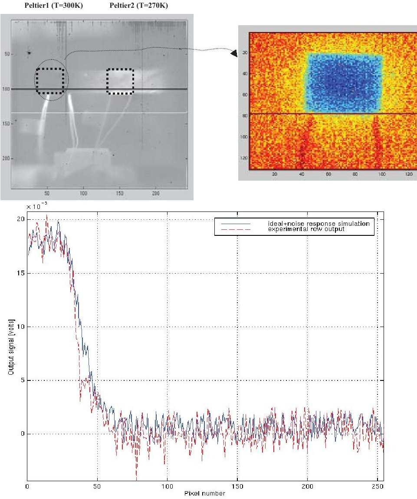

Fig. 6 : Comparison between measurement and system simulation

## 4.3. Post-processing algorithms

We are now ready to determine a fixed point (pixel number in the linear array) on the transition curve as introduced in chapter 3 (see fig 6).

In the ideal case, the number of pixels concerned with the transition zone moves from around 70 at low altitudes down to 30 at around 1000 Km.

A coarse, then a fine approach used to stand the earth and the space levels allow to determine the pixel number in the transition zone such that the two triangles ABC and A'B'C (see fig. 6bis) keep a constant ratio between their areas. This corresponds to the criterium selected by the algorithm.

The coarse approach determines the high level and low level mean value. In the same time, a first correction of the transition curve is operated (by normalization of the signal $ ^{(4)} $ ), together with an approximated estimation of the singular points A,B and C. Then, the fine approach improve the first estimation of the reference triangle ABC and calculates its area.

Depending on the criterium value different solutions A'B' can be selected. The optimization of this ratio was done, and it has been shown that the location of the selected pixel should be positioned close to the point C. Even if the signal-to-noise ratio is decreased, the seasonal and latitudinal variations do not modify this issue.

We would like to emphasize the importance of the algorithm, as the pixel number must be selected without any error (pixel resolution) to keep the system precision specification (less than $ 0. 1^{\circ} $ ). This has been checked with a maximum noise amplitude of 2.1 mV for a signal of 10 mV.

<!-- PDF_PAGE: 9 -->

The minimal time cost and computing requirements constraint may also be respected, avoiding a complex algorithm solution, due the frequency and packaging constraints.

Recent works are trying to compare for constant SNR both PICARD algorithm and this approach. The complete results will be presented at the conference. First results of hardware algorithm implementation, show that our approach, which can be less accurate in some cases, needs 15ms, while hyperbolic tangent takes around 4s.

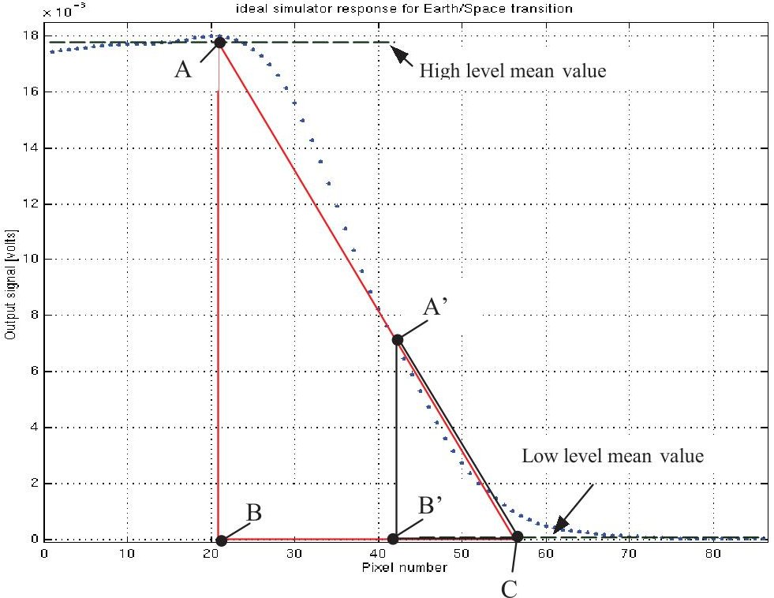

Fig 6bis. Diagram of the post processing algorithms principle

## 5. THE MICROSYSTEM DEVELOPMENT ARCHITECTURE

The Breadboard architecture can not be directly transformed into a MEMS architecture due to the complexity of the electronic design (which is not presented due to patents pending). Therefore, new specific MIRES electronic architecture is currently developed, in which data processing and transition pixel number estimation are already integrated.

The main drawback of this new approach is to use one row of the matrix 320x240, without the possibility of thermal imagery development with other windows sizes. In the other side, the advantage is that by means of a simple electronic design, we can extract the analog output signal just delivered by the microbolometer for a selected line (neither filtering procedures nor data conversions on breadboard's FPGA). The time to get the output signal is lowered around 5x compared to the breadboard system with a window size of 1x240.

After getting the analog signal of a selected linear array (system input), the new architecture will convert it by 14 bits ADC, in relationship with the power consumption constraint (2W for all the system). As like as in the breadboard system, the microbolometer output signal will be subtracted from a "reference signal" delivered by either a flight calibration procedure nor ground calibration procedure (stored in EEPROM memories).

<!-- PDF_PAGE: 10 -->

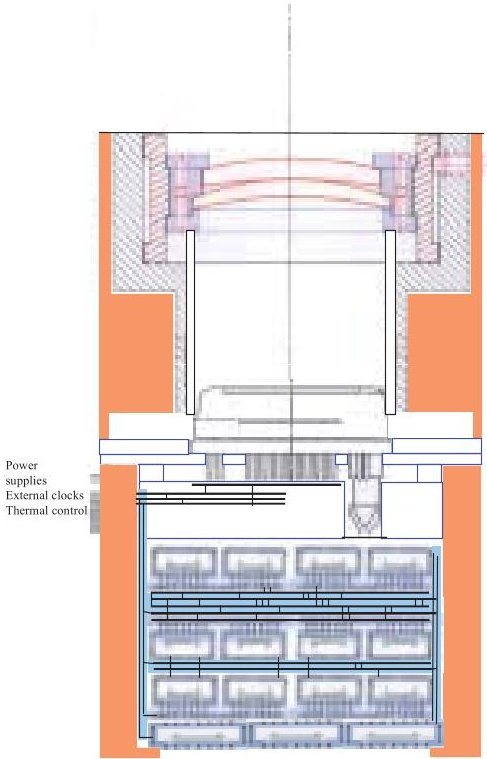

Fig. 7: One optical head of MIRES

(ZnSe optical + microbolometer + analog and digital signal processing + earth/space algorithms implemented on microcontroller). Note that power supply and thralm focal plane control are not yet included in MIRES hardware.

## 6. CONCLUSION

As a summary, the whole analysis of a MIRES project has been conducted by using a breadboard camera allowing to select a single pixel following the earth-vacuum transition. This step was necessary to extract an accurate information from a signal widely affected by different sources of noise. Virtual prototyping have been achieved in this phase and hardware implementation was completed with a classic electronic approach. To fulfil the requirements of the mission specifications, this project must be extended to a MEMS technology approach. The first examination of this new architecture is proposed and emphasizes how the process should be simplified.

Different algorithms are compared and optimized in term of cpu time consuming, first results will be presented at the conference with the complete view of real hardware realization.

## 7. ACKNOWLEDGMENTS

We would like to acknowledge the CNES Toulouse center- Centre National d'Etudes Spatiales (the French National Space Administration) for funding the different parts of this investigation.

In the same time special thanks are given to our partners of SODERN-Paris for their technical participation. We have gained much from technical discussion with many, including M. Batiste & M. Pierjan.

## 8. REFERENCES

1. Wertz, James R. Spacecraft attitude determination and control. Kluwer academic publishers, Dordrecht, 1978.

2. J.Y.Fourniols, C.Rossi, G. Soto-Romero, J. Albukerque, A. Bardoux, J.J.Simonne, "Virtual Prototyping of MEMS for micro-satellite: Development of a micro-earth sensor and micro-thrusters", NanoSpace International Conference, NanoSpace 2000, 23-28 January 2000; South Harbor Hotel, League-City TX, USA, 16p (proceedings on CDROM)

3. T.B.McKee, R.I.Whitman, and R.E. Davis "Infrared horizon profiles for summer conditions from project scanner" NASA TN-D-4741 August 1968.

4. Alperovich Vladimir, Topaz Jeremy M. "Correction of errors due to profile shape in statistic earth horizon sensors" SPIE Proceeding, Vol. 2426, p.336- 344, 1995.