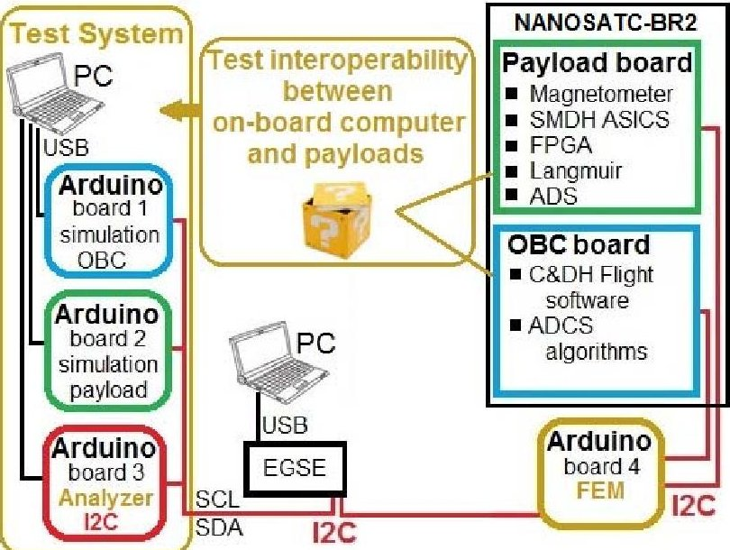
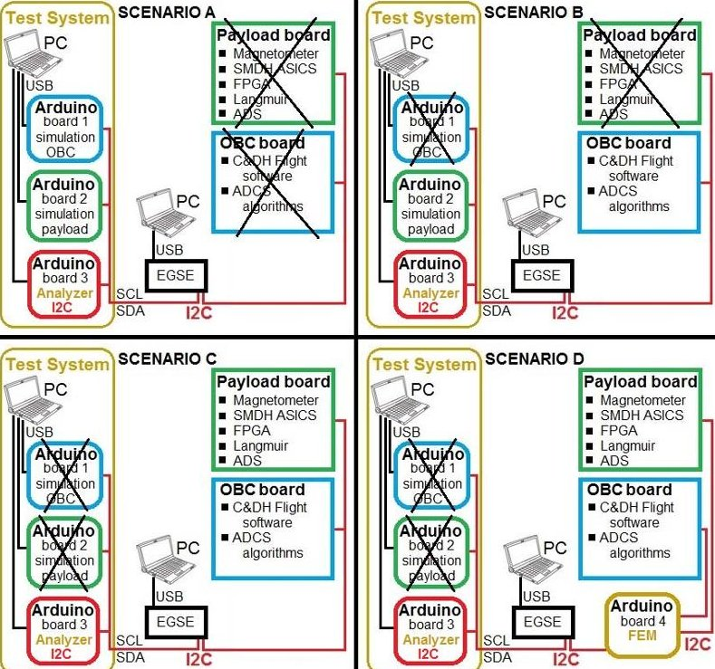
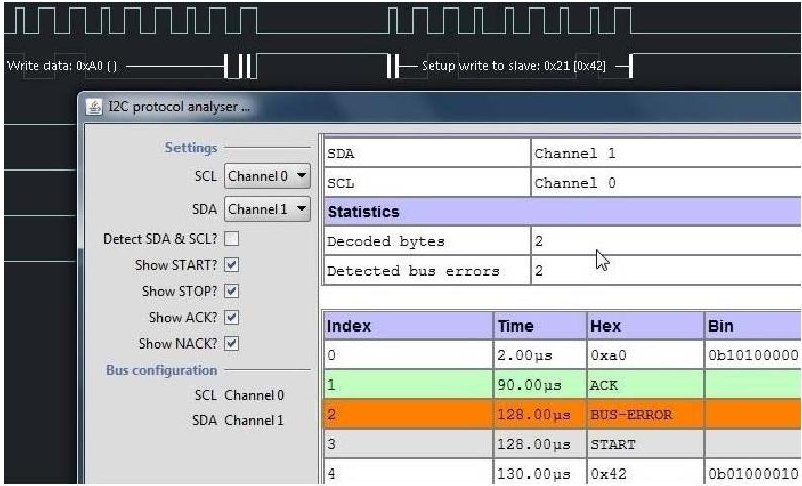
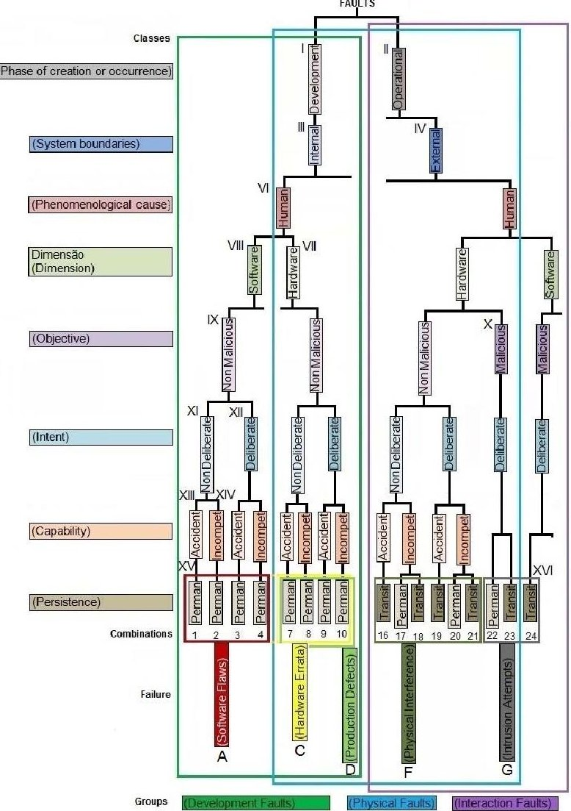

<!-- PDF_PAGE: 1 -->

# Dependability verification of nanosatellite embedded software supported by a reusable Test System

Carlos A P L Conceicao

Carlos A P L Conceicao

Instituto Nacional de Pesquisas Espaciais

São José dos Campos, Brazil

carloscaplc@iae.cta.br

Carlos L G Batista

Instituto Nacional de Pesquisas Espacias

São José dos Campos, Brazil

carlos.gomes@crn.inpe.br

Fátima Mattiello-Francisco

Instituto Nacional de Pesquisas Espaciais

São José dos Campos, Brazil

fatima.mattiello@inpe.br

Abstract The use of CubeSats has increased tremendously over the 15 years since the standard creation because the low cost and reduced project development cycle. However, one of the most concerns in reducing a project delivery time is the collateral effect in test process, resulting in failures in the mission operation. This paper proposes the combined use of the ModelDriven Engineering (MDE) and Model-Base Testing (MBT) approaches in the Validation and Verification (V&V) process of a nanosatellite mission, focusing on an evolved way to measure the dependability requirements of the interoperable on-board software. The proposal counts on a reusable Test System (TS) based on Arduinos that are integrated in the engineering model of the Cubesat architecture via $ \mathrm{I}^{2} \mathrm{C} $ bus. From the behavioral models of both the on-board computer and the satellite payloads, source code can be generated in order to be embedded in the Arduinos, prototyping in the TS the expected behavior of the interactions between the specified subsystems. These models can also be useful to derive test suites following a MBT approach. Thus the TS can support the execution of different test cases at different stages of development of the software intensive subsystems. The proposed V&V process is discussed in the context of a particular nanosatellite named NanosatC-Br2 under development at INPE.

Keywords dependability; CubeSat; interoperability verification; failure

## I. INTRODUCTION

The first proposed CubeSat satellite platform emerged around 15 years ago aiming allow students to design, develop, test and even place a spacecraft in orbit [5]. The U-Class satellites have been used in academic environments and emerging companies of the sector seeking to qualify innovative space technologies at reduced costs and time. However, because the short period of the project development cycle not all tests required are performed leading to the occurrence of many cases of mission failure. Testing is recognized as a fundamental activity for assuring quality of a system showing dependability evidences of a mission operation [4].

The dependability of a system seeks to prevent failures in the services provided and reduce their severity to an acceptable level covering the attributes of reliability, availability, maintainability, security, integrity and confidentiality [1]. Thus dependability requirements must be specified and tested, following a well established verification and validation (V&V) process.

Model-Based Testing (MBT) is an approach that relies on the existence of abstract models of an application to generate, execute and evaluate tests [3]. It has been applied with success

in testing of real-time systems, with special emphasis on avionic, railway, and automotive domains. The MBT approach has been effective in failures detection and performance analysis [2].

Recent experiments using MBT in the verification and validation (V&V) process of space system embedded software have demonstrated cost-effective on identifying system faults and project artifacts non-conformances [10]. Focusing on the integration phase of communicating software intensive subsystems, the methodology Interoperability and Robustness (InRob) [7] proposes the use of behavioral models of the interoperable subsystems in formal notation in order to generate test suites aiming to check whether two or more implementations interact as expected. InRob also addresses test case generation to check the robustness of the implementations under testing in the presence of failures. InRob methodology was recently adapted to Unified Modeling Language (UML) [12]. The InRob-UML methodology addresses real-time aspects of interoperability between two communicating subsystems and checks how these implementations interoperate in the presence of invalid entries or under hazardous environmental conditions in the communication channel.

The Model-Driven Engineering approach (MDE) enforces the continued use of models in different stages of the project development cycle, in order to support the process of V&V of complex systems [8].

The process of V&V adopted in space mission project cycle has its importance in ensuring the quality of development of the space segment: the spacecraft and its integration with payloads and operation. Different V&V techniques are used to verify compliance with the subsystems requirements at different phases of the project life cycle aiming improvement, safety and confidence in the mission operation [4].

The early stages of the development require a special attention to the requirements. Usually two thirds of the time in a space mission development is committed to an early attention to analysis, testing, review and validation. But just one third of the costs are being spent at this time [11]. If there are misunderstandings at the requirements definition and the necessary tests are not performing to validate the mission development cycle stages, it may result in a component failure, system failure, mission loss or even the loss of a life. Dependability requirements shall be specified and verified earlier in the development cycle.

The National Institute for Space Research (INPE) has been developing research in nanosatellites platforms looking for

<!-- PDF_PAGE: 2 -->

acquires knowledge and develops new technologies to meet national and international needs. Currently, INPE has in orbit the NanosatC-Br1, a 1U CubeSat. The mission goal is to collect data from the Earth's magnetic field and test integrated circuits designed in Brazil for resistance to radiation in flight.

The second satellite of this family, the NanosatC-Br2, is a 2U CubeSat, for science and technology purposes, which is in development and expected to be launched in 2017 [7].

## II. OBJECTIVE

This paper proposes the combined use of the MDE and MBT approaches in the V&V process of NanosatC-Br2, by means a reusable Test System (TS) in the different development stages of communicating software intensive subsystems.

The reusable Test System (TS) is based on Arduinos that are integrated in the NanosarC-Br2 backbone $ \mathrm{I}^{2} \mathrm{C} $ bus). The TS supports the traffic analysis of the message through the satellite $ \mathrm{I}^{2} \mathrm{C} $ bus.

In the early stage of the development cycle, the TS will support the verification of dependability requirements of the communicating embedded software. From functional requirements specifications of the on-board computer subsystem and the satellite payloads subsystems, behavioral models are built in.

The objective is to verify and validate the behavior of these satellite subsystem prototypes in nominal situation and exception conditions under the communication channel point of view.

From these models, source code can be generated in order to embed them in the Arduinos, prototyping in the TS the expected behavior of the interactions between the specified subsystems.

These behavioral models can also be useful to derive test suites following MBT approach like InRob, which will be necessary to validate the subsystems communication in the integration phase considering hardware in the loop.

Thus the TS can also support the execution of different suites of test cases at different stages of development of the embedded software on-board computer subsystem.

## III. PROPOSED TEST SYSTEM

The proposed TS uses a simple and low-cost architecture. The basic resource is COTS Arduino boards that can be added in TS architecture as necessary. In addition, there are several computer applications already developed for Arduino architecture and available at open source communities that will be useful for test execution and measurements on the tests.

Figure 1 shows the TS architecture as an extension of the CubeSat $ \mathrm{I}^{2} \mathrm{C} $ bus.

Figure 1. TS Architecture

The Arduino boards 1 and 2 are configured to simulate the behavior of both the on-board computer (OBC) and payload subsystems respectively. The board 3 is configured with a logic analyzer to analyze the traffic on the $ \mathrm{I}^{2} \mathrm{C} $ bus (Figure 3).

The EGSE (Electrical Ground Support Equipment), usually provided by Cubesat suppliers as part of the nanosatellite engineering models, composes the TS architecture. It allows to boot satellite components and to control testing on the OBC and payloads.

Other important component of the TS architecture is the fault injection facility. Configured as a Fault Emulator Mechanism (FEM) in the satellite communication bus, it is also implemented in an Arduino (board 4 in Figure 1) in order to support robustness testing of the subsystems. The fault injection is an approach which consists of deliberately inserting faults into the system in such way that the behavior of the system can be evaluated under faults condition [12].

Thus the TS architecture supports the analysis of the communication between the satellite subsystems through the $ \mathrm{I}^{2} \mathrm{C} $ bus. It allows to configure TS components according to the evolution of the testing phases without major changes and/or costs.

## IV. SCENARIOS FOR TS REUSING

Four scenarios were conceived to demonstrate the reuse of the TS in an evolved way driven by models. They focus respectively on the V&V activities related to: A) dependability requirements specification; B) subsystem acceptance; C) subsystem integration under nominal condition; D) subsystem integration under exception conditions.

Each scenario is represented in Figure 2 and described in terms of the TS architectural elements, which configuration can also include EGSE and the satellite engineering model in addition to Arduinos boards. The engineering model comprises CubeSat hardware and real software embedded in OBC and payload boards.

<!-- PDF_PAGE: 3 -->

Figure 2. Test scenarios based on the $ \mathrm{I}^{2} \mathrm{C} $ bus

Scenario A: The Arduino boards 1 and 2 are configured to simulate by software the subsystems OBC and a chosen payload respectively. From the subsystems requirements formally represented in state based behavioral models, specific tools can generate source code in order to embed in the Arduinos, simulating the subsystem behavior. Using MBT approach, test suites can be automatically derived from those models with test purpose techniques. Because these Arduinos are interconnected through the satellite $ \mathrm{I}^{2} \mathrm{C} $ bus and the board 3 analyzes the traffic, the test cases execution allows evaluating the subsystems requirements. Thus, regarding interoperability, whether a subsystem does not interact as expected, showing any inconsistency in the test report, improvements on the subsystem requirement specification will proceed.

Scenario B: Only one Arduino board is configured to simulate a subsystem by software, as in Scenario A. Other Arduino is substituted by the real subsystem, configuring the hardware in the loop (HIL) and the use of satellite $ \mathrm{I}^{2} \mathrm{C} $ bus. This scenario purpose is to support HIL acceptance testing, aiming to show evidence of HIL requirements compliance. An important issue in this scenario is the reuse of the test suites already specified in Scenario A, reducing cost and effort in acceptance phase.

Scenario C: Both OBC and payload are real subsystems at the satellite $ \mathrm{I}^{2} \mathrm{C} $ bus. Arduino board (board 3) monitors the traffic through the bus checking the data packets and transmission time between the subsystems. The objective of this scenario is to check if these subsystems interact in conformance to the behavioral models designed and verified in scenario A under nominal condition. Regarding the test suites, interoperability test suites already specified in Scenario A are reused, reducing cost and effort in the integration phase;

Scenario D: Sets up both real OBC and one real payload using a FEM (board 4) that is placed in serial on the $ \mathrm{I}^{2} \mathrm{C} $ . As the two subsystems are already tested under nominal condition at the

integration phase, this scenario goal is to support robustness testing. The FEM has an important role in this scenario because the fault injections are not intrusive in the subsystems under testing. It supports the verification of the subsystems interactions under exception conditions that were specified. Regarding the test suites properly specified for robustness testing, InRob methodology can be used to guide automatic test case generation focusing on real time aspects of the communicating subsystems.

One can observe that the Scenario A enables prototyping two or more satellite subsystems using software implementations embedded in Arduino boards, allowing verify the interoperability requirements by simulation.

In order to support the traffic monitoring on the satellite $ \mathrm{I}^{2} \mathrm{C} $ bus, the free logic analyzer (Logic Analyzer - LogicSniffer) was configured on the Arduino board (board 3) and plugged on the bus.

Figure 3. Reading the information on the $ \mathrm{I}^{2} \mathrm{C} $ bus

The Figure 3 shows some information packets being read at the satellite $ \mathrm{I}^{2} \mathrm{C} $ bus with a deliberated interference voltage, which causes errors in the package as highlighted in index 2 [9].

## V. DENPENDABILITY ANALYSIS

Inspired on the dependability tree taxonomy proposed in [1], which addresses the attributes of dependability, fault categories and the concept of environments that might be affected by failures, a study was performed in order to identify dependability attributes related to nanosatellite.

The means to achieve dependability are: fault prevention, fault tolerance, fault removal and fault forecasting.

Regarding environment, the space segment is the target because the nanosatellite operation starts when it is accepted for use in orbit. The stakeholders' environments can consist of the following elements: the physical world, users, service providers, intruders may be human or system developer and infrastructure tools.

According to the taxonomy, eight fault classes are considered relevant. Each fault class is divided into two subclasses as defined below and showed in Figure 4:

<!-- PDF_PAGE: 4 -->

1. Phase of creation or occurrence: I) Development faults, II) Operational faults;

2. System boundaries: III) Internal faults, IV) External faults;

3. Phenomenological cause: V) Natural events faults, VI) Human-made faults;

4. Dimension: VII) Hardware faults, VIII) Software faults;

5. Objective: IX) Non-malicious faults, X) Malicious faults;

6. Intent: XI) Non-deliberate faults, XII) Deliberate faults;

7. Capability: XIII) Accidental faults, XIV) Incompetence faults;

8. Persistence: XV) Permanent faults, XVI) Transient faults.

These fault classes can be combined resulting various possibilities, however not all combinations are feasible neither might occur. An example is a natural event fault not related to incompetence faults as well as some other relationships.

As result, 31 feasible fault combinations represented in Figure 4 by Arabic numerals were grouped in the following 9 fault types with partial overlapping in some cases: A) Software Flaws, B) Logic Bombs, C) Hardware Errata, D) Production Defects, E) Physics Deterioration, F) Physical Interference, G) Intrusion Attempts, H) Viruses and Worms and I) Input Mistake.

One can observe that the dependability tree shown in Figure 4 does not contain all faults previously identified because the natural events fault will be not considered in dependability analysis in the nanosatellite context.

Thus the fault classes of interest are represented in three groups partially overlapped, referred as: Development Faults; Physical Faults; and Interaction Faults. The development faults group covers three fault types (A, C and D) among the 9 types listed above. The physical faults group covers four fault types (C, D, F and G) and the interaction faults group covers two fault types (F and G).

A fault branch of the tree demonstrates that a particular fault type represented in the leave might be caused by one or more fault classes depending on the relationship with the previous or subsequent level.

The dependability tree supports the analysis of the dependability requirements modeled in Scenario A. The models show evidences of unexpected situations which may result in inconsistencies and failures.

For instance, in Scenario D, a fault injection in the $ \mathrm{I}^{2} \mathrm{C} $ bus by FEM will emulate failure type F (Physical Interference).

Figure 4. Dependability tree (modified) [1]

After FEM injecting a fault, some other fault may occur. If the purpose of the injected fault is to provoke a delay in sending information from subsystem A to B and there is no requirement to B deals with this situation in the modelling, such evidence will occur. The system as a whole can get in failure.

The cause-effect analysis of an injected fault using the dependability tree is discussed below in Table I. .

In a particular scenario that a time fault is injected causing a software error, depending on which level the injection takes place in the tree, different possible causes shall be analyzed. The column 3 show the level that the fault is injected; the column 2 shows the fault class and sub class related to that fault according to the dependability tree; and the column 1 shows that the type of error caused by the injected fault shall be analyzed in terms of particular aspects. For instance, software error caused by fault injected at operational level means that functional implementation shall be checked in terms of requirement specification.

<!-- PDF_PAGE: 5 -->

TABLE I. FAULT INJECTION

<table border="1"><tr><td>Column 1</td><td colspan="3">Column 2</td><td>Column 3</td></tr><tr><td>Software Error</td><td colspan="3">Dependability tree
Faults</td><td>Fault injection time</td></tr><tr><td>Erroneous requirements</td><td>I</td><td>Development</td><td></td><td></td></tr><tr><td></td><td></td><td></td><td>II</td><td>Operational</td></tr><tr><td></td><td></td><td></td><td></td><td>the system operation</td></tr><tr><td>Buffer overflow</td><td>III</td><td>Internal</td><td></td><td></td></tr><tr><td></td><td></td><td></td><td>IV</td><td>External</td></tr><tr><td></td><td></td><td></td><td></td><td>external</td></tr><tr><td></td><td>V</td><td>Natural</td><td></td><td></td></tr><tr><td>Coding with some errors</td><td>VI</td><td>Human-Made</td><td>V</td><td>Human-Made</td></tr><tr><td></td><td></td><td></td><td></td><td>test team</td></tr><tr><td></td><td></td><td></td><td>VII</td><td>Hardware</td></tr><tr><td>Variable dimensioning
insufficient</td><td>VIII</td><td>Software</td><td></td><td></td></tr><tr><td>Flow of information
not set</td><td>IX</td><td>Non-Malicious</td><td>IX</td><td>Non-Malicious</td></tr><tr><td></td><td>X</td><td>Malicious</td><td></td><td></td></tr><tr><td>Operation not set</td><td>XI</td><td>Non-Deliberate</td><td></td><td></td></tr><tr><td></td><td></td><td></td><td>XIII</td><td>Deliberate</td></tr><tr><td></td><td></td><td></td><td></td><td>error</td></tr><tr><td>Variable does not exist</td><td>XIII</td><td>Accidental</td><td></td><td></td></tr><tr><td></td><td></td><td></td><td>XIV</td><td>Incompetence</td></tr><tr><td></td><td></td><td></td><td></td><td>and/or modeling</td></tr><tr><td>Endless loop</td><td>XV</td><td>Permanent</td><td>XV</td><td>Permanent</td></tr><tr><td></td><td></td><td></td><td></td><td>Permanent system
failure</td></tr><tr><td></td><td>XVI</td><td>Transient</td><td></td><td></td></tr><tr><td colspan="5">If no time delay setting,
fault in software specification
Software Flaws
Physical
Interference
Fault injection on the bus to cause delay in the information exchange time between the subsystems</td></tr></table>

## VI. TS IN NANOSATC-BR2 PROJECT

NanosatC-Br2 is a 2U-class nanosatellite being developed by CRS/INPE in cooperation with Brazilian Federal Universities and emergent companies. The mission goal is to qualify in orbit innovative technologies in addition to the scientific purposed experiments that collect data from the Earth's magnetic field and ionosphere. As mentioned in figures 1 and 2, there are 5 payload experiments on board NanosatC-Br2 named: Magnetometer; PFGA; Langmuir Probe (SLP); SMDH and ADS [6]. In addition, the On Board Computer (OBC) software comprises 2 components: Control and Data Handling (C&DH) and Attitude and Determination Control System (ADCS) algorithm that are technological targets for qualification in orbit.

This section discusses TS reuse in the context of NanosatCBr2 V&V process, following the 4 scenarios described in section IV. The discussion addresses the combined use of MDE and MBT approaches considering real subsystems requirements.

For the sake of space, the requirements are related to two subsystems interoperation only: SLP payload subsystem and OBC subsystem. The communication channel is the $ \mathrm{I}^{2} \mathrm{C} $ bus

and follows the standard protocol master-slave, being both OBC the master and payload boards slaves.

Focusing on the interoperability between C&DH function embedded in OBC and SPL, the basic requirements are:

(i) SLP shall wait for an OBC command to start the data collection;

(ii) SLP shall collect data during 5 seconds, storing in SLP local memory;

(iii) OBC shall command SLP to start data transference packets no early than 5 seconds after (ii);

(iv) SLP data transference to OBC shall be controlled by OBC, which sends a sequence of N packet requests, where N is a configurable parameter received from ground station;

(v) OBC shall wait a specified time T (timeout) for SLP response at each command sent. In case the response does not come, OBC shall restart the communication and last SLP buffer must be erased.

Regarding the first use of TS in scenario A, these NanosatC-Br2 requirements were written in natural language. Based on these requirements behavioral models were specified in formal notation in order to be evaluated. OBC and SLP functional behaviors were modeled using state based diagrams. The modeling supported the review of the interoperability requirements between these subsystems. It was possible to categorize and detail each subsystem states, events for state transitions, actions and guard conditions. The EGSE allowed observing the information traffic through the $ \mathrm{I}^{2} \mathrm{C} $ bus either among Arduino boards and/or satellite engineering models boards as well. Beacon packets were transmitted from the OBC embedded software, which was simulated in TS Arduino, to the NanosatC-Br2 engineering model in order to be delivered to ground station, following scenario B in Figure 2. Also a data packet was transmitted from OBC board as master and received by board 2, which simulates a slave subsystem of the satellite, according to scenario A.

The test result in scenario A showed evidences that crash or lock on the $ \mathrm{I}^{2} \mathrm{C} $ bus might occur due to no stable voltage between master and slave elements. A transistor was used for controlling the flow of electricity, solving the problem.

From MDE perspective, it was possible to prototype the subsystems. Existing software tools aided the modeling process and supported the source code generation to be embedded in Arduino board. The execution of the codes using TS allows simulating the behavioral models in compliance with the specified requirements. UML tools can also be used in many cases. Software based tools like UPPALL and Eclipse environment [8] help to generate computer codes based on state models.

From MBT perspective, available tools might aid to validate the models using model checking techniques, for instance. UPPALL tool supports the verification of requirements properties in the model. Test case suites can be automatically generated using InRob-UML.

<!-- PDF_PAGE: 6 -->

Regarding the TS reuse in the 3 other proposed scenarios the challenge lies in a suitable modelling transformation.

## VII. MITIGATION OF FAILURE

Failure modes can be identified in each test scenario, following a FMEA table (Failure Mode and Effect Analysis). The technique consists on identifying possible causes for the detected failure, based on the fault effects in the dependability tree, which subsystems may be affected, what need to do to prevent failure and what mitigations should be done to prevent the failure mode.

Table II shows some mitigations associated with possible failures detected in the four proposed scenarios.

TABLE II. FMEA

<table border="1"><tr><td>Analyzed item</td><td>Fault type/identifying combination belonging</td><td>Class fault (n°)</td><td>Fault identified</td><td>Fault effect (failure)</td><td>Place affected by fault</td><td>Control mechanisms for fault detection</td><td>Mitigation to avoid fault</td></tr><tr><td>Scenario A: OBC and SLP modeling</td><td>Software Flaws (A)/1</td><td>Development Faults (I)</td><td>Erroneous Software Requirements</td><td>The subsystem does not properly perform what is specified in requirements</td><td>Data transfer</td><td>Data modeling</td><td>Review requirements and modeling using MDE and MBT</td></tr><tr><td>Scenario B: OBC and SLP (Only one of the subsystem in the loop. The other is Arduino board)</td><td>Software Flaws (A)/1</td><td>Permane nt Faults (XV)</td><td>No control in information transmission time</td><td>Subsystem still awaiting information</td><td>Exchange of information stop</td><td>Using RTC</td><td>Controlling exchange of information time</td></tr><tr><td>Scenario C: OBC and SLP</td><td>Software Flaws (A)/1</td><td>Permane nt Faults (XV)</td><td>Software without detection go into an infinite loop</td><td>Subsystems stop to exchange information</td><td>Internal failures of communication between subsystems</td><td>Data flow</td><td>Analyze possible ways of information flow modeling</td></tr><tr><td>Scenario D: OBC and SLP</td><td>Physical Interference(F)/19</td><td>External Faults(IV)</td><td>Interference voltage</td><td>Subsystem does not perform data transfer as requirement s. Loss of information</td><td>Subsystems</td><td>Data modeling and EGSE</td><td>Analyze the modeling possible physical external interference and physical faults</td></tr></table>

For instance, in scenario A, an erroneous requirement can lead to a modeling fault (development fault class). The TS will be useful to show failure evidences during the prototype execution guided by suitable test suites that were generated using MBT tools. Thus, the mitigation comprises review the requirements, improving the models (last column in Table 1).

## VIII. CONCLUSION

The proposed Test System architecture in combination with MDE and MBT approaches demonstrate to successfully address the dependability verification issues highlighted in the studies and scenarios presented in this work. Interoperability and robustness requirements can be verified along nanosatellites development in a cost-effective V&V process.

The reuse of the TS architecture driven to integration testing is the key element for time and effort reduction. At low cost the four proposed scenarios cover whole V&V process.

The Test System can be reused in different phases of a particular nanosatellite development cycle and also several nanosatellites of the same family as well. The modular architecture shows that the resources used to implement the TS prototype are COTS, effective and flexible enough to support testing many payloads in nanosatellite project based on CubeSat standard.

The selection of possible failures types and fault classes from the dependability taxonomy helps to establish a view of the interrelationship of failures modes and what consequences may trigger. This view is very useful for failure mitigation.

The combined use of MDE and MTB approaches promises to save effort in development and testing process. However the available tools to modelling, code generation and test suite derivation need improvements. Moreover, investments in model transformation are necessary.

## REFERENCES

[1] Algirdas Avizienis, Jean-Claude Laprie, Brian Randell, Carl Landwehr, TECHNICAL RESEARCH REPORT, Basic Concepts and Taxonomy of Dependable and Secure Computing, 2004, pp. 1-8, Available in: <http://www.nasa.gov/pdf/636745main_day_3-algirdas_avizienis.pdf> Access: january 2016.

[2] BINDER, R. V., LEGEARD, B., AND KRAMER, A. Model-based testing: Where does it stand?, 2015, pp. 52-55, Available in: <https://www.researchgate.net/publication/272414727_Model-Based_Testing_Where_Does_It_Stand>, Access: june 2016.

[3] EL-FAR, I. K., AND WHITTAKER, J. A. Model-based software testing. In Encyclopedia of Software Engineering, J. J. Marciniak, Ed., vol. 1. John Wiley & Sons, Inc., 2002, pp. 825-837, Available in: < http://www.crcnetbase.com/doi/abs/10.1081/E-ESE-120046903 >, Access: june 2016.

[4] European Cooperation for Space Standardization, Space product assurance, Software dependability and safety, ECSS-Q-HB-80-03A, 2012, pp. 10-34, Available in: < https://www.google.com.br/search?q=InRob%3A+Anapproachfortesting interoperabilityandrobustnessofreal-timeembedded+software&ie=utf- 8&oe=utf-8&client=firefox-b- ab&gfe_rd=cr&ei=wJXRV6_JCYmq8we40KLwBQ#q=Space+product +assurance%2C+Software+dependability+and+safety>, Access: february 2016.

[5] Helvajian, H.,Janson W., Small Satellites: Past, Present, and Future, 2008, pp.25-39, Available in: < http://www.aerospace.org/publications/aerospace-books/small-satellites past-present-and-future/> , Access: dezember 2015.

[6] Innovative Solution In Space BV: IGIS User Manual, 2011, pp. 8-26.

[7] Mattiello-Franciscoa, F., Martins, E. Cavalli, A. R., Yano, E. T., InRob: An approach for testing interoperability and robustness of real-time embedded software, 2011, pp. 1-4, Available in: <http://www.sciencedirect.com/science/article/pii/S0164121211000550 >, Access: november 2015.

[8] Montecchi, L., Model-Driven Engineering and its Application for Dependability Analysis, Introduction to MDE, Workshop, INPE, Brazil, 2016.

[9] Philips Semiconductors: AN10216-01, $ \mathrm{I}^{2} \mathrm{C} $ MANUAL, 2003, pp. 4-25, Available in: <http://www.nxp.com/documents/application_note/AN10216.pdf>, Access: july 2015.

[10] Utting, M., Pretschner, A., Legeard, B., A TAXONOMY OF MODELBASED TESTING, 2006, pp. 2-5, Available in: < http://wwwbruegge.in.tum.de/lehrstuhl_1/files/teaching/ws0708/Manage

<!-- PDF_PAGE: 7 -->

mentSoftwareTesting/uow-cs-wp-2006-04.pdf>, Access: december 2015.

[11] TEST IN SPACE, DESCRIPTION OF SERVICE MULTI-PAYLOAD SATELLITE PROGRAM, pp. 4-6, Available in: <http://www.testinspace.com/pdf/TIS_Description_of_Service.pdf>, Access: march 2016.