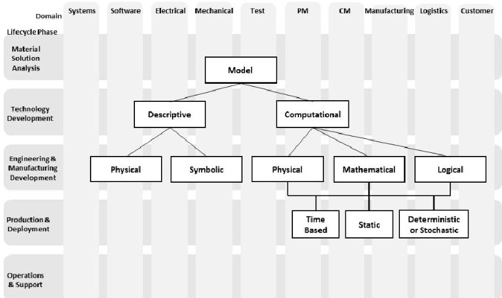
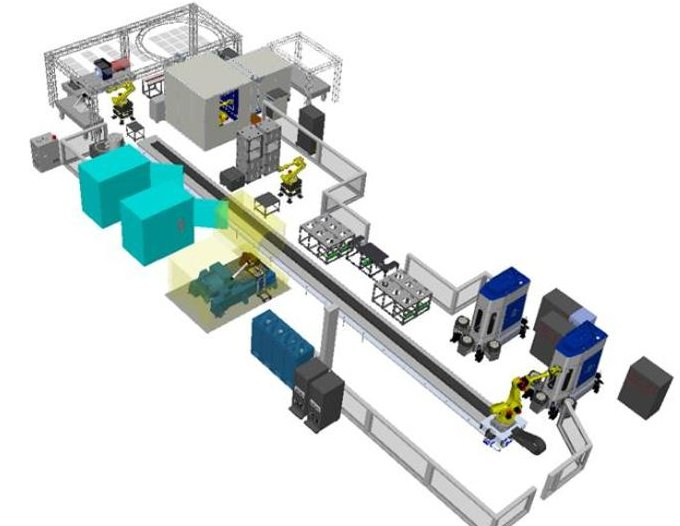
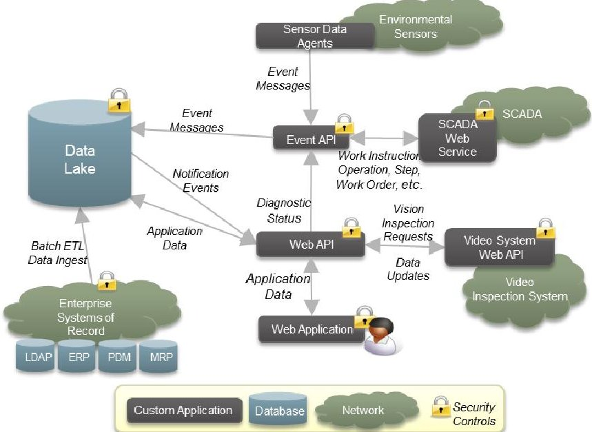

<!-- PDF_PAGE: 1 -->

# Digital Product Assurance for Model-Based Open Manufacturing of Small Satellites

Christopher Runge 1131 E. Hermans Road Tucson, AZ, USA Christopher_Runge@ Raytheon.com

Kevin Lynch

1131 E. Hermans Road

Tucson, AZ, USA

Kevin_J_Lynch@

Raytheon.com

Randall Ramsey

1131 E. Hermans Road

Tucson, AZ, USA

Ramsey@

Raytheon.com

Terri Pauline

1131 E. Hermans Road

Tucson, AZ, USA

Terri_Pauline@

Raytheon.com

Abstract-Technology advances in numerous domains have made it feasible for satellites to be small, inexpensive, and relatively fast to produce, facilitating a goal of the US Operationally Responsive Space office to deploy short-term space assets quickly and cheaply for sensing, scientific, and communications missions. This paper describes the digital product assurance method being piloted for low-cost manufacturing of small satellites at Raytheon and the information system built to support it, providing assured quality with comprehensive transparency. The method includes a novel component selection and testing capability that contributes to low cost. The pilot project exists in a next-generation space factory with an open manufacturing architecture, supporting both space and traditional air vehicle product assembly, integration, and test. Small 6U sized satellites have been designed by Space Dynamics Laboratory and then assembled, integrated and tested at Raytheon's space factory for planned 2016 launches. The digital product assurance method is implemented in the Open Manufacturing Information System (OMIS), with the goal of assuring product quality while maintaining speed and low cost. Both the method and OMIS are described in this paper.

Keywords: model-based engineering, operationally responsive space, open manufacturing, digital product assurance

## I. INTRODUCTION

Chartered by the Deputy Secretary of Defense in 2007, the Operationally Responsive Space (ORS) office is working with the broader space community, including industry and academia, to establish the capabilities needed to provide "assured space power focused on timely satisfaction of Joint Force Commander's needs," [1] or in other words, to provide small, affordable satellites fast.

Typically, automated manufacturing facilities that deliver both speed and rigorous process control are very expensive to establish and maintain for low-volume product production, creating a non-viable business model for many small satellite design agents to be able to build and maintain such a facility [2]. Open Manufacturing is a business model that separates the performer of the design processes from the performer of the manufacturing processes with a modular architecture that clearly defines the interface between design and manufacturing with design constraints imposed by the manufacturing and test capabilities. The goal is to enable plug-and-play of designer/manufacturer pairings, with a

standardized and widely available interface for Open Manufacturing.

Models are integral to the product technical baseline specification, spanning the lifecycle and domains, including requirements, design, manufacture, assembly, and test processes, standardizing unambiguous descriptions of components and processes [3]. Figure 1 shows the breadth of models across the product lifecycle and domain space that when integrated, provide a concurrently developed, consistent, and complete product baseline specification.

Figure 1. Integrated Model-Based Product Baseline Specification (from [9])

Designers not only design for manufacture as required for compatibility with the factory, preventing costly factory retooling, but can also accurately predict how long production will take and how much it will cost. These capabilities are enabled through validated models of manufacturing, supply chain systems and processes that include cost. Model-based engineering and open manufacturing enhances affordability with computable integrated cross-domain models that expose risk earlier, accelerate product development through concurrency and collaboration, enable more complete evaluation of trade spaces, and enhance reliability with continuous requirements and system verification [4].

## II. BACKGROUND

Over the past 10 years, Raytheon has been developing and deploying advanced engineering and manufacturing

<!-- PDF_PAGE: 2 -->

capabilities that have become competitive discriminators for entering the responsive space market. To complement Raytheon's long history of developing world-class electro-optical subsystems and exo-atmospheric missile systems (e.g., Standard Missile 3 (SM-3), Exoatmospheric Kill Vehicle (EKV)) Raytheon deployed advanced manufacturing and test automation systems (e.g., Presidio, Fusion, Missile Integration and Test Facility (ITF), Raytheon Redstone Missile Integration Facility) and enterprise information management systems (e.g., SAP Manufacturing Integration and Intelligence (MII) and Supervisory Control and Data Acquisition (SCADA)).

Advancing the Open Manufacturing model, Raytheon agreed to assemble, integrate, and test satellites designed by another organization, the Space Dynamics Laboratory (SDL). The interface between Raytheon and SDL to share information about manufacturing and test capabilities was initially person-to-person communication, highlighting the need for more formalized manufacturing capability descriptions and models.

## III. DIGITAL PRODUCT ASSURANCE

To meet ORS affordability and timeline requirements, Raytheon executed three strategic initiatives. The first was to leverage robotics and other automated manufacturing and test solutions to enable affordable, low-volume production [5]. The second strategy was to assure product quality through digital means in a model-based environment, as opposed to traditional, time-consuming manual oversight [6, 7]. Finally, the third initiative was to use commercial off-the-shelf (COTS) components that are deemed to be good enough for the mission (aka "Responsive Space Parts"), which can result in a dramatic reduction in component cost [8]. Raytheon's Open Manufacturing initiatives provide rapid quality assurance through the use of model-based engineering to build-in consistency across design, manufacturing process, and test models.

## A. Architecture and Infrastructure

Initial work in 2015 demonstrated that Raytheon could apply its unique expertise and systems to the goals of ORS, including actually delivering a small number of small satellites. To demonstrate automated manufacturing and test capabilities, Raytheon extended its systems to create a Small Space Assembly Workstation (SSAW) that integrates computer-controlled torque wrenches and robot-driven satellite testing processes. The automated next-generation space factory, equipped with a variety of environmental sensors, video monitoring, and integration with the SCADA systems is shown in Figure 2.

Figure 2. Digital Assurance Equipped Next Generation Space Factory

Serving as an information integration hub for the next-generation space factory, the Open Manufacturing Information System (OMIS) was developed to manage the interactions among manufacturing and test platforms. A significant portion of the benefits of a model-based engineering environment can be captured at the manufacturing and inspection process levels [9]. OMIS accomplishes this through an event-centric engine that is tightly coupled with applications, data agents, and programmatic interfaces. Figure 3 shows the OMIS system architecture and its integration with external sensors, enterprise systems of record, and the manufacturing and test environment.

Figure 3. Open Manufacturing Information System (OMIS) Architecture

Extensive detail about components, test results, work instruction compliance, and manufacturing operations are instantly available so that product quality insight is validated from a variety of viewpoints and at many levels of detail in real-time. This has been successfully piloted on 6U sized satellites with Space Dynamics Laboratory as the designer, and Raytheon as the manufacturer.

<!-- PDF_PAGE: 3 -->

## B. Digital Product Assurance

Raytheon developed OMIS to enable digital product and process transparency, a concept analogous to software transparency [10]. Attempts are being made to validate and verify both product and process model designs [11]. Product and process variability are analyzed in real-time during manufacturing to predict product performance ranges. A semantically precise model integration method is being considered [12]. Event driven and built around a data lake infrastructure, extensive details about space system components, test results and assembly operations are captured. Product and process quality insight is available from a variety of viewpoints and to various levels of detail.

As with traditional Raytheon factory operations, the small space assembly process is controlled by existing enterprise systems such as ERP, MRP, MII, and SCADA. Digital product assurance results from digitally capturing, in realtime, for each assembly operation and step:

a) Start and stop time

b) Assembly operator ID and operator qualification status

c) Assembly equipment calibration status

d) Parts and tools used

e) Torque values applied

f) Load, shock, temperature, and humidity sensor readings

g) Visual part inspection results

h) Actual versus expected accumulated satellite weight

Meanwhile, numerous high-definition cameras and microphones are recording all activities taking place in the assembly area. These recordings are time-stamped, stored, and indexed. The recordings in conjunction with captured event data for robotic movement of product serve as an assurance of a continuous custody chain for the product as it flows through the factory, assuring nothing non-conforming with the process specification is done and the product does not have periods of time where it is unaccounted for in the monitoring system.

At times during the assembly process, a variety of tests are run. A small robot takes the satellite to different stations to test flight software, optics, tracking, and other subsystems. A large robot moves the unit to special chambers for vacuum, vibration and thermal testing. The details and results of these tests are also captured, time-stamped, correlated, and displayed.

The streamed event data from assembly operations, multiple video/audio recordings, robot movement, and test equipment execution is fused, in real-time, across time and product serial number. Fused data is checked in real-time to identify out-ofbound and anomalous conditions, higher order events, and emergent process/tooling performance degradation. Analytics are displayed on the OMIS console along with system health, workflow status, and alerts of conditions requiring human decision or action. This extensive automated surveillance of

assembly, integration and test activities mitigates the need for multiple human quality assurance observers. Rather than manual observation and reporting, the "correctness" of parts, equipment, processes, and people are digitally validated.

When a product fails, hundreds of hours may be required to investigate, interview, analyze, and report of the source of the problem. Often months or years have passed between the manufacture and use of the product, significantly reducing the chance of obtaining accurate details surrounding its assembly, integration and test. With digital product assurance, forensic analysis of any process or product failure is easily and quickly accomplished by viewing all events surrounding a potential process or product. Event search and process status displays may be used to locate relevant information. Data mining techniques are employed to discover related correlated observations and causation. Fallible human memory and subjective observation is replaced by digital facts.

Data science is employed for post-production analysis of the volumes of collected data. Data scientists explore and correlate events and associated component data to uncover non-obvious relationships and develop insight to improve satellite design and manufacturing process and tooling. The insights allow Raytheon to further improve component selection, testing, manufacturing process, and operator education, with the goal of increased affordability and higher quality satellites.

## C. Responsive Space Parts

Another significant change from traditional space approaches that small satellites are driving pertains to the parts and components that are used. Traditionally, satellites would be designed to use "space-qualified" parts and components, which were designed, manufactured, and/or tested "to meet the special electrical, mechanical, or environmental requirements required for use in the deployment of satellites or other spacecraft ... operating at altitudes greater than 100km." [13] Certification that a system is space-qualified provides assurance that it will be able to function in the space environment for its planned lifespan, but it comes with significant cost. A space-qualified component may cost orders of magnitude more than a similar COTS equivalent and have a very long purchasing lead time.

The ORS office is driving to use COTS parts and components, which are readily available, to reduce costs and increase design options. This approach is deemed feasible because the satellites such as those being developed by ORS are needed for relatively limited functions and short missions, making some of the requirements for "space-qualified" less strict.

Operation in space, even if for a moment, subjects a system to extreme conditions, and it is important to have assurance that the system will function under those conditions. Many of those conditions can be simulated to a large degree in test

<!-- PDF_PAGE: 4 -->

environments. The risks of using COTS components can then be assessed and managed by characterizing how they perform, and possibly fail, under various space-like conditions.

For example, Raytheon purchased a commercially available general purpose processor board for under $100. This board is currently designed into the satellites Raytheon is assembling. Testing of this board and the avionics stack in which it is contained will determine its validity for use in space. If as expected, the test results are positive, the cost of each satellite can be significantly reduced.

As more such components are tested, a "Responsive Space Parts" catalog will evolve, containing COTS components that have been subjected to various space-like conditions indicating them to be appropriate for specific space applications. The more such COTS components are incorporated into a design, the lower the final cost of each unit.

## IV. CONCLUSION

Small satellites are expected to be much more prevalent this decade, and continuous work must be done to achieve cost goals. This paper describes the digital product assurance method that has been piloted and its implementation in the Open Manufacturing Information System (OMIS). To drive costs down, human intervention is traded with increased product production surveillance, and components that were previously left unconsidered are made available through sophisticated testing. Design, test, and manufacturing models are being integrated in the production of small satellites, with a clear separation of concerns, facilitated by the method.

## ACKNOWLEDGMENT

## REFERENCES

Our thanks to: Operationally Responsive Space, Dr Jeff Welch, George Moretti, George Ball, Randy Gricius, Dan Cheeseman, the Space Dynamics Laboratory, Applied Minds, Inc., and Raytheon Missile Systems.

[1] National Security Space Office, Department of Defense (2007). Plan for operationally responsive space: A report to congressional defense committees.

[2] Vance, L., Woida, R., & Spalt, C. (2014). "Adaptation of manufacturing to mass production of nanosatellites." 28th Annual AIAA/USU Conference on Small Satellites, Aug. 4-7, 2014, Logan, Utah.

[3] Gaševic, D., Djuric, D., & Devedžic, V. (2009). Model driven engineering and ontology development. Springer Science & Business Media.

[4] National Defense Industrial Association Systems Engineering Division M&S Committee. (2011). Final report of the Model Based Engineering (MBE) Subcommittee.

[5] Toy, G., Hawksworth, D., & Garbo, B. (2015). "The next generation of space manufacturing: model based and digitally assured." 29th Annual AIAA/USU Conference on Small Satellites, Aug. 8-13, 2015, Logan, Utah.

[6] G. Ball, C. Runge (2014). "Producing reusable engineered systems through ontology (PRESTO): an information sciences approach to architecture-driven, model-based, concurrent engineering." Journal of Defense Modeling and Simulation Applications, Methodology, Technology.

[7] Ball, G., Runge, C., and Peoble, L. (2015). "An information-centric approach to engineering and manufacturing cyber physical systems in the defense industry." Procedia Computer Science, 61, 128-132.

[8] Underwood, C., Richardson, G., and Savignol, J. (2001). "SNAP-1: A low cost modular COTS-based nano-satellite-design, construction, launch and early operations phase." 15th AIAA. In USU Conference on Small Satellites.

[9] Quintana, V., Rivest, L., Pellerin, R., Venne, F., and Kheddouci, F. (2010). "Will model-based definition replace engineering drawings throughout the product lifecycle? A global perspective from aerospace industry." Computers in Industry,61(5), 497-508.

[10] do Prado Leite, J. C. S., & Cappelli, C. (2010). "Software transparency." Business & Information Systems Engineering, 2(3), 127-139.

[11] Maropoulos, P. G., & Ceglarek, D. (2010). "Design verification and validation in product lifecycle." CIRP Annals-Manufacturing Technology, 59(2), 740-759.

[12] G. Simko, T. Levendovszky, S. Neema, E. Jackson, T. Bapty, J. Porter, & J. Sztipanovits (2012, August). "Foundation for model integration: semantic backplane." In ASME 2012 International Design Engineering Technical Conferences and Computers and Information in Engineering Conference (pp. 1077-1086). American Society of Mechanical Engineers.

[13] Departments of Defense and State. (2009). Final Report to Congress Section 1248 of the National Defense Authorization Act for Fiscal Year 2010 (Public Law 111-84).