<!-- PDF_PAGE: 1 -->

# Effect of satellite formations and imaging modes on global albedo estimation

Sreeja Nag $ ^{a,*} $ , Charles K. Gatebe $ ^{b} $ , David W. Miller $ ^{c} $ , Olivier L. de Weck $ ^{d} $

$ ^{a} $ NASA Goddard Space Flight Center, MD/Bay Area Environmental Research Institute, CA, USA

b NASA Goddard Space Flight Center/Universities Space Research Organization, MD, USA

$ ^{c} $ NASA Headquarters/Massachusetts Institute of Technology, MA, USA

$ ^{d} $ Massachusetts Institute of Technology, Cambridge, MA, USA

## ARTICLE INFO

Article history:

Received 7 January 2015

Received in revised form

27 February 2016

Accepted 4 April 2016

Available online 6 April 2016

Keywords:

Small satellite

Formation flight

Cubesat

BRDF

Multi-angular

Remote sensing

Constellation

## ABSTRACT

We confirm the applicability of using small satellite formation flight for multi-angular earth observation to retrieve global, narrow band, narrow field-of-view albedo. The value of formation flight is assessed using a coupled systems engineering and science evaluation model, driven by Model Based Systems Engineering and Observing System Simulation Experiments. Albedo errors are calculated against bi-directional reflectance data obtained from NASA airborne campaigns made by the Cloud Absorption Radiometer for the seven major surface types, binned using MODIS' land cover map - water, forest, cropland, grassland, snow, desert and cities. A full tradespace of architectures with three to eight satellites, maintainable orbits and imaging modes (collective payload pointing strategies) are assessed. For an arbitrary 4-sat formation, changing the reference, nadir-pointing satellite dynamically reduces the average albedo error to 0.003, from 0.006 found in the static reference case. Tracking pre-selected waypoints with all the satellites reduces the average error further to 0.001, allows better polar imaging and continued operations even with a broken formation. An albedo error of 0.001 translates to $ 1.36 \mathrm{~W / m^{2}} $ or 0.4% in Earth's outgoing radiation error. Estimation errors are found to be independent of the satellites' altitude and inclination, if the nadir-looking is changed dynamically. The formation satellites are restricted to differ in only right ascension of planes and mean anomalies within slotted bounds. Three satellites in some specific formations show average albedo errors of less than 2% with respect to airborne, ground data and seven satellites in any slotted formation outperform the monolithic error of 3.6%. In fact, the maximum possible albedo error, purely based on angular sampling, of 12% for monoliths is outperformed by a five-satellite formation in any slotted arrangement and an eight satellite formation can bring that error down four fold to 3%. More than 70% ground spot overlap between the satellites is possible with $ 0.5^{\circ} $ of pointing accuracy, 2 Km of GPS accuracy and commands uplinked once a day. The formations can be maintained at less than 1 m/s of monthly $ \Delta V $ per satellite.

$ \textcircled{2} $ 2016 IAA. Published by Elsevier Ltd. All rights reserved.

## 1. Introduction

Distributed Space Missions (DSMs) are gaining momentum in their application to earth science missions owing to their ability to increase observation sampling in spatial, spectral temporal and angular dimensions. DSMs include homogenous (such as RapidEye [1]) and heterogeneous constellations (such as Cosmo-SkyMed [2], QB50 [3], Disaster Monitoring

Constellation/DMC [4], NASA A-Train), autonomous formation flying formations (such as Tandem-X [5], Proba-3 [6], PRISMA [7]) and fractionated spacecraft (such as DARPA System F6 [8], JPL's Phoenix cellularized architecture [9]). To avoid being cost prohibitive, small satellites will be required to enable DSMs, especially those with large numbers. Small satellites （<50kg) have technically demonstrated formation technologies [10] and missions such as CanX-4 and CanX-5 [11] are now (2015) beginning to show formation flight feasibility using CubeSats.

In Earth science remote sensing, distributed space missions or DSMs have been traditionally used to simultaneously

<!-- PDF_PAGE: 2 -->

improve sampling in the following four dimensions of an observed image - spatial, temporal, spectral, and radiometric. Spatial resolution of an image can be increased by using multiple satellites in formation flight to synthesize a long baseline aperture as shown for optical interferometry [12-14] and synthetic aperture radars [5,15-17]. Constellations of evenly spaced satellites on repeat track orbits [2,4] ensure temporal sampling within a few hours as well as continuous coverage maintenance. Spectral sampling can be improved by fractionating the payload (fractionated spacecraft) such that each physical entity images a different part of the spectrum and has customized optics to do so. Radiometric resolution depends on the resolution of the other sampling dimensions for a fixed instrument mass and complexity. Since DSMs allow sampling improvement in any dimension by increasing satellite number instead of size, radiometric resolution can be improved without compromising on other science sampling requirements.

Formations have enabled science that cannot be performed with single spacecraft, such as gravimetry by GRACE [18] and GRAIL [19] or coronographs using nulling occultors like DARWIN [13]. This paper and associated research focuses on improving angular sampling, which is a critical dimension for Earth observations. Angular sampling implies taking images of the same ground spot at multiple 3D angles of solar incidence and reflection simultaneously. Lack of such sampling leads to misinterpretation in science products, for example, Amazon greenness from MODIS data [20]. The requirement to make near-simultaneous measurements deems monoliths less optimal for accurate and dense angular sampling than distributed systems [21,22]. Monolithic spacecraft have traditionally approximated the angular samples by combining measurements taken over time with forward-aft (e.g. TERRA's MISR [23]) or cross-track swath (e.g. TERRA's MODIS [24]) sensors or autonomous manoeuvrability (e.g. CHRIS [25] on Proba-3). However, a single satellite can make measurements only along a restrictive plane with respect to the solar phase and most Earth observation satellites are even more restricted since they are on sun-synchronous orbits. Further, the angular measurements are separated in time by many minutes along-track or more than a week cross-track. In areas of fast changing surface/cloud conditions especially during the snow melt season/tropical storms, a few days can make a big difference in reflectance. Those that autonomously manoeuvre have to be commanded to observe specific targets, thus lack global coverage and repeatability.

Near-simultaneous angular sampling can be improved by using a formation or constellation of nanosatellites [26]. The formation can make multi-spectral measurements of a ground spot at multiple 3D angles at the same time as they pass overhead by using narrow field of view instruments in controlled formation flight. While this measurement-making mechanism was suggested more than ten years ago (Leonardo BRDF [21,27]) it never went past the concept ideation stage and no detailed analysis was performed on its science impact or technical feasibility. Recent literature [22,28] has shown that closed loop and maintainable formations and spectrometer payloads are available for multi-angular formation flight. The widely accepted metric to quantify the angular dependence of remotely sensed signal is BRDF or Bidirectional

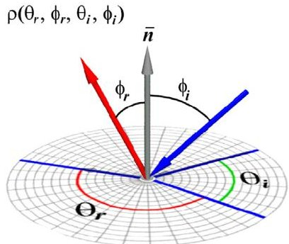

Fig.1. BRDF geometry and angles in terms of two vectors incoming solar irradiance (blue) and outgoing reflected radiance (red), measured at VNIR wavelengths (figure adapted from University of California Berkeley's open-source, open-access class curriculum at http://www.eecs.berkeley.edu/). (For interpretation of the references to color in this figure legend, the reader is referred to the web version of this article.)

Reflectance-distribution function. BRDF of an optically thick body is a property of the surface material and its roughness. It is the ratio of reflected radiance to incident irradiance that depends on 3D geometry of incident and reflected elementary beams [29]. It depends on four major angles as shown in Fig.1 the solar zenith angle $ \left( \phi_{\mathrm{i}} \right) $ solar azimuth angle $ \left( \theta_{\mathrm{i}} \right) $ measurement zenith angle or the co-elevation $ \left( \phi_{\mathrm{r}} \right) $ and measurement azimuth angle $ \left( \theta_{\mathrm{r}} \right) $ The azimuth angles, $ \theta_{\mathrm{i}} $ and $ \theta_{\mathrm{r}} $ are added to provide one angle called the relative azimuth angle. Several review studies have confirmed the applicability of BRDF accuracy as a reliable metric to design new measurement solutions in multi-angular remote sensing [31]. BRDF is required for the calculation of many Earth Science products such as albedo, vegetation indices, photosynthetic activity and ice cloud optical properties [30], therefore BRDF estimation accuracy affects estimation accuracy of all its dependents. This paper will demonstrate the simulated impact of different variables in formation design on the accuracy of albedo, calculated from retrieved BRDF, globally.

Albedo is the hemispherical integration of BRDF over all measurement zenith and azimuth angles, for a single solar incidence direction (black sky albedo) or all solar incidence (white sky albedo). Inaccurate estimation of BRDF significantly affects narrow-band, narrow-field-of-view albedo estimation. The NASA ARMCAS airborne campaign [32] of 1998 in Alaska measured reflectance at thousands of zenith and azimuth angles using the Cloud Absorption Radiometer (CAR) that was flown around in circles on an airplane and estimated albedo using these measurements. Nadir reflectance albedo, when compared to albedo estimated from integrating hemispherical measurements, shows up to 50% error. The error depends on the wavelength or location (sea ice vs. tundra) sampled. A more recent study [33] shows 15% 20% difference between vegetation albedo estimated using CAR compared to MODIS albedo products.

The Earth's albedo has been an important component of climate studies and the Earth Radiation Budget since the 1960s [34]. Incoming radiation is measured better than 0.03% of 1368 W/m $ ^{2} $ but total outgoing radiation is accurate to just 1% of 341.3 W/m $ ^{2} $ , causing an imbalance called the missing energy [35,36]. Narrow-band albedo uncertainties of surfaces such as polar ice caps are one of the three biggest contributors [37] to our lack of understanding of the Earth Radiation Imbalance. Improving albedo estimation by even 0.0025 corresponds to

<!-- PDF_PAGE: 3 -->

improving reflected flux by $ 0.0025\times1368 \mathrm{W / m^{2}} $ and, thus total outgoing radiation by $ 3.4 \mathrm{W / m^{2}} $ or 1%. We show that BRDF estimation using multi-angular formations allows better narrowband albedo estimation of different global surfaces, than using monoliths. Better surface albedo accuracy is guaranteed to improve Earth Radiation Imbalance uncertainties.

## 2. Formation architecture evaluation method

A formation flight configuration is a unique combination of the number of satellites, orbit parameters, relative geometry, payload field of view, etc. An imaging mode is a collective strategy among the satellites, as they fly in formation, of pointing the payload to obtain multi-angular images of the same ground spot at the same time. A formation architecture is defined as a formation flight configuration that follows a unique imaging mode. Optimal architectures are those which minimize BRDF estimation errors, number of satellites and maintenance.

The methodology employed to assess the optimal formation architectures and validate their albedo estimation capabilities couples Model-Based Systems Engineering (MBSE) with Observing System Simulation Experiments (OSSE). A tradespace of formation architectures can be analysed by varying the configuration design variables in the MBSE model and assessing its effect on data assimilation and science products using OSSEs, as shown in Fig. 2. Technical constraints filter out those architectures that cannot be maintained using current CubeSat technology and the MBSE model outputs specifications (e.g. data rate required) that can be supported [28]. Only the orbits and mode variables, their permutations, impact on simulated measurements and eventual science performance will be discussed in this paper. While the orbits module determines how the satellites will be organized in space, the imaging mode strategies dictate where they will point to measure the same spot at many angles simultaneously.

The science evaluation model is driven by observing system simulation experiments or OSSEs [22]. Inputs to the model are four angles from Fig.1 for all satellites in a formation, for every given instant of time, for a given set of orbits, imaging modes and the surface type of interest. Reference BRDF ('Truth Data') is the set of reflectance values of the surface type of interest

measured by the Cloud Absorption Radiometer (CAR) [38,39,56], NASA's heritage airborne BRDF instrument developed at Goddard Space Flight Center (GSFC), at all angles. Since airborne data is available for very few regions globally, the NASA MODIS database is used to divide the Earth grid into seven major surface types (water, forests, grasslands/savannah, croplands, cites, snow, deserts) and airborne BRDF data for each surface type used as reference. The automated model simulation selects a sample of BRDF values, that correspond to those angles which the simulated orbits can measure, from the reference BRDF and uses it as data to invert a BRDF basis model and estimate the model parameters. These parameters are then used to run the forward model and calculate reflectance at all angles. The difference between this estimated reflectance and the reference data is called the 'BRDF error' and is represented as a Root Mean Square value (RMS). BRDF can then be used to calculate albedo. The difference between albedo calculated from the reference data and the automated model simulation is the albedo error.

The BRDF and albedo RMS errors at every instant of time are the outputs from the science performance evaluation model and determine the goodness of the input formation design and corresponding angular spread. By calculating the error over time for a full tradespace of formation architectures helps us judge them based on an intricately coupled science metric. Science based errors can be traded against the cost of increasing the number/size of satellites in and complexity of the DSM for making value-centric decisions in engineering design. In this paper, albedo estimation errors for different surface types of the Earth, as the formation flies over them, will be used as the performance metric. The number of satellites, arranged in orbital configurations that are feasible to maintain, will be used as the cost metric.

## 2.1. Formation flight configurations

Hundreds of feasible formation flight configurations in low Earth orbit were generated for science performance evaluation with different imaging modes. Modelling for closed loop formations, maintainable using CubeSat technology, can be performed using different types of models with increasing fidelity but decreasing computational ease. Previous literature [26] has described the 3 levels of modelling for the enumerating formation flight configurations for the multi-angular

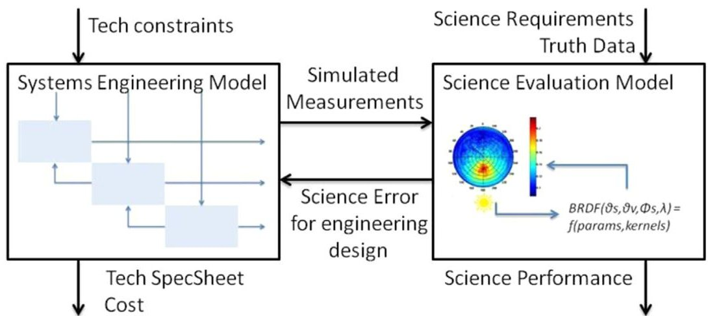

Fig. 2. Tradespace Analysis Tool overview. OSSE-based Science Evaluation (right box) is tightly coupled to the traditional MBSE module (left box).

<!-- PDF_PAGE: 4 -->

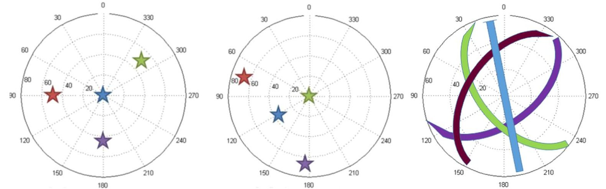

Fig. 3. Angular coverage for any single ground point by Mode #1 through #3 using four satellites whose measurements are marked in red, blue, purple and green. The BRDF polar plot's radius indicates a measurement zenith angle and the plot's azimuth is a measurement's relative azimuth to the solar plane, both in degrees. In Mode #1 [left], the satellite making measurements in blue is the reference and images the point nadir to it. In Mode #2 [center], the reference satellite changes over the course of the orbit. The shown snapshot corresponds to the satellite making measurements in green as reference. In Mode #3 [right], all satellites stare at the same ground point and provide an arc of measurements over time, instead of an snapshot. (For interpretation of the references to color in this figure legend, the reader is referred to the web version of this article.)

observation problem - Hill's Equations corrected for Earth's curvature (using the dual spiral equations or numerical corrections), modified Hill's equations with J2 and drag and orbit modelling in the Earth-Centric-Earth-Fixed frame using differential Keplerian elements.

The lower level models were used to streamline the tradespace of design variables [26], and only the most sensitive variables were retained for generating architectures for evaluation, namely the Keplerian parameters of the chief orbit, number of satellites, differential RAAN and TA of the satellites with respect to the chief orbit. Only true anomaly (TA) and right ascension of the ascending node (RAAN) were allowed to be different among the satellites because CubeSat propulsion cannot maintain a formation with varying inclination or other elements, as learned from the lower level models. Eight differential RAAN-TA slots of approximately $ 5^{\circ} $ around the chief satellite were found to provide sufficient measurement zenith (co-elevation) and azimuthal coverage of the ground spot beneath the formation. Those slots can be populated with a variable number of satellites to generate hundreds of RAAN-TA combinations, for a given chief orbit and satellite number. When the satellite number was varied from 3 to 8 and 5 representative chief orbits considered, hundreds of permutations were possible. The generated formations do not need active, continuous maintenance. Periodic station-keeping using CubeSat technology will be discussed in Section 6.

## 2.2. Imaging modes

For any formation configuration, three imaging modes are considered for multi-angle imaging of the ground spot instantaneously under the formation. Therefore, the number of possible architectures is three times the number of configurations generated in Section 2.1. The modes are characterized by the dwell time per target, spatial coverage the designer is willing to forego, autonomy of the system and the control abilities of the individual satellites in the formation. The concept of operations for each mode is described below. Fig. 3 shows an example of angles at which a 4-satellite formation measures the instantaneous ground spot beneath the formation, as it flies around the globe. The angles are plotted

on a BRDF polar plot (polar coordinates), where the center of the plot is the ground spot being imaged, the radius is the view zenith angle of the measurement and the polar azimuth is the relative azimuth with respect to the sun. The stars indicate the angles at which the measurement is made for any given ground spot, colored differently for every satellite in this example formation. The solar zenith angle cannot be shown on this polar plot and, if known accurately, is found to negligibly affect estimation errors [22].

## 2.2.1. MODE #1: reference constant, nadir pointing

One satellite in the formation is the designated leader and always points to the nadir. The other satellites in the formation point their payloads to the ground spot directly nadir to the leader satellite. The number of angular measurements of an instantaneous ground spot, as the formation flies over millions of ground spots globally, is therefore equal to the number of satellites in the formation (Fig. 3 [left]). In Fig. 3 left, the blue measurement is made by the leader and will always be at the center. The angular pattern for other measurements is different for every spot because of the continually changing relative geometry between the satellites. This mode allows for continuous imaging of the ground track, but it needs coordinated attitude control.

## 2.2.2. MODE #2: reference changing, nadir pointing

Like Mode #1, there is one leader satellite in the formation which points nadir while the others follow its ground track by autonomous slewing. However, in this mode, the leader satellite changes over the course of the orbit so as to optimize the angular coverage for a given, instantaneous ground spot. An example measurement at the same instant of time as Fig. 3 [left] is shown in Fig. 3 [center], where the satellite corresponding to the green measurement is the reference or leader satellite pointing nadir instead of the one corresponding to the blue measurement. The formation configuration at the shown instant is exactly the same; it is only the change in the nadir-looking satellite that causes the difference in the angular spreads. The angular pattern in Mode #2 is different for every instant and spot, including the central measurement color. This mode allows for improved performance and

<!-- PDF_PAGE: 5 -->

continuous imaging of the ground track, but needs maximum torque authority in the attitude control systems when the reference changes from one to another satellite multiple times in one orbit.

## 2.2.3. MODE #3: ground reference, slew and stare

All satellites point to the same ground target as they approach over the horizon and recede into the horizon of their instrument fields of view. Imaging time is limited by the satellite's slewing abilities. Line measurements on the polar plot are obtained such that the number of arcs (great circles) equal to the number of satellites in the formation (Fig. 3 [right]). These measurements are not instantaneous, unlike Mode #1 and Mode #2, and are made for a single ground spot, as long as that spot is in view of the payload (over more than 10 min for typical low Earth orbits). The relative orientation of the arcs will be different for different ground spots. Dwelling at the same ground spot for more time and at more angles allows more angular coverage to be obtained, but at the cost of continuous coverage of the ground track because the formation has to forgo other ground spots in the time it stares at one.

For all the imaging modes, accurate attitude determination and control systems (ADCS) are a necessity because all satellites need to point their payloads at the same ground spot at approximately the same time. The feasibility of CubeSat ADCS to meet this co-pointing requirement in terms of attitude determination, control accuracy and jitter stability is discussed in Section 6.

## 3. Impact of imaging modes

The impact of the three imaging modes on science performance is quantified by comparing albedo estimation errors for a few 4-satellite formation configurations with changing imaging modes. The comparative analysis in this section is performed for a single surface type (savannah), single waveband (red) and over a representative variety of formation configurations (as per Ref. [26]) at the same chief orbit so that everything but imaging modes is as non-differentiating as possible. Results from the imaging mode analysis are presented before those from formation configurations so that the best mode for albedo and BRDF estimation can be used in the full-factorial simulations. Section 4 will clearly show how albedo estimation is further improved from the best of Section 3, due to better formation configurations.

The BRDF signature of the savannahs at red wavelengths (seen in the right-hand box of Fig. 2) shows an angular feature called the hotspot, whose spread and intensity is important for vegetation analysis and affects albedo. They are thus a representative surface type for differentiating the performance of imaging modes. The maximum time a satellite spends over the African savannah is 20 min, therefore a simulation of only that fraction of an orbit is considered. The reference data ('truth' at any time step) is assumed to be that collected by CAR over the savannah. In the simulations presented in Section 5, CAR BRDF data corresponding to the surface type expected instantaneously under the leader satellite, as the formation flies over the globe partitioned into seven surface types, will be used as 'truth'.

The reference orbit was chosen to be at 650 km altitude and 51.6° inclination since it corresponds to the orbital plane of the International Space Station and is the inclination for which maximum opportunities of hosted payload launches are available. Sun-synchronous orbits at 500-700 km, with altitude dependent inclinations, also have similar number of hosted launches and could have been an alternative choice. Primary launchers for CubeSats are yet to demonstrate success, thus secondary launch has been used as a baseline. The imaging payloads were assumed to be rigidly mounted on the spacecraft, with no intelligent pointing mechanism by themselves. The slewing capability of the satellites was limited to $ + / - 6 0^{\circ} $ because CubeSat imagers have lower signalto-noise ratios compared to big instruments, and slews greater than $ 6 0^{\circ} $ cause a further 5-fold drop in those numbers. Additionally, $ 6 0^{\circ} $ limits the maximum spatial distortion of ground pixels so that images from the nadir-pointing satellite and the furthermost satellite can be combined into one multiangular image. The six baseline formations used for the imaging mode analysis have differential RAAN and TA only. A full tradespace of chief orbits, formation architectures with all possible combinations of differential RAAN-TA, and number of satellites will be considered in Section 5.

The performance of all six baseline formations in all imaging modes is compared in terms of their albedo error (as per the model in Section 2). First, all are simulated to operate in Mode #1 (Section 3.1). Second, the best performing formation configuration is selected from the six and simulated to operate in Mode #2. Each satellite in the 4-satellite formation is simulated as the nadir-pointing satellite and the effect on albedo estimation error calculated (Section 3.2). Third, three of six baseline formations are simulated with Mode #3 operations, corresponding to the best and two worst performers from Mode #1 operations. A simple algorithm, described in Section 3.3, is used to identify waypoints that all the satellites will track.

The albedo estimation errors for formations in all simulations are compared to errors expected by the monolithic instrument, MISR [23], as a function of only angular sampling and calculated in the same way (Section 2). MISR is one of the suite of instruments in the multi-billion dollar spacecraft, Terra (NASA Earth Observing System), which flies as part of the A-Train. It has nine cameras - four pointing aft, four pointing forward and one pointing nadir. The boresight angles of pointing to make 9 simultaneous measurements in the along-track direction are: $ 0^{\circ},+\! / 2 6. 1^{\circ},\pm 4 5. 6^{\circ},\pm 6 0. 0^{\circ} $ and $ \pm 7 0. 5^{\circ}. $ The actual zenith angle of view on the ground is slightly higher than these values because of the Earth's curvature. Since Terra operates at a 710 km altitude (average), MISR is able to prove up to $ 8 0^{\circ} $ of view zenith. Its relative azimuth with respect to the sun at any given time is obtained from Terra's TLE database within AGI Systems Tool Kit (STK) $ ^{1}. $

3. 1. Nadir pointing, constant reference satellite (Mode #1 operations)

Six formation configurations using four satellites was analyzed, for estimating the albedo of savannah vegetation as

<!-- PDF_PAGE: 6 -->

RAAN and TA, in the form of osculating Keplerian elements, for 4 satellites in a formation when arranged in 6 different configurations as part of a reduced full factorial case study. The other Keplerian elements are the same for all satellites, $ \mathrm{SMA}=6 3 7 8+6 5 0 \mathrm{~km}, $ $ i=51.6^{\circ}, $ $ \omega=0, $ $ e=0. $

<table border="1"><tr><td></td><td>Sat #1</td><td>Sat #2</td><td>Sat #3</td><td>Sat #4</td></tr><tr><td>Config #1</td><td>0::0</td><td>0::-5</td><td>-5::-1</td><td>-5::-6</td></tr><tr><td>Config #2</td><td>0::0</td><td>0::-5</td><td>-5::-1</td><td>5::-4</td></tr><tr><td>Config #3</td><td>0::0</td><td>0::-5</td><td>-5::-6</td><td>5::-4</td></tr><tr><td>Config #4</td><td>0::0</td><td>0::-5</td><td>-5::-3</td><td>5::-4</td></tr><tr><td>Config #5</td><td>0::0</td><td>0::-5</td><td>-5::-3</td><td>3::-3</td></tr><tr><td>Config #6</td><td>0::0</td><td>0::-3</td><td>-3::0</td><td>-3::-3</td></tr></table>

the formation flies over Southern Africa, where the first satellite always points its payload nadir while the others point at the ground below the first satellite. Four of six orbital elements were the same across all satellites: a=6378+ 650 km, i=51.6 $ ^{\circ} $ , $ \omega=0 $ , e=0, and the RAAN and TA were perturbed by small amounts as listed in Table 1. All formations (using their initial osculating elements) and the MISR sensor were simulated on STK starting October 13, 2013. A 20min time window was identified when the formation flies over southern Africa and when the solar zenith angle is $ \sim 30^{\circ} $ to match with the true CAR data available for savannah vegetation. The time window is also selected such that MISR's Africa-crossing time window is about an hour ahead of the formation's time window and thus the solar illumination conditions match for TERRA's orbit and the formation's chief orbit.

The albedo estimation error simulated from the above 6 formations was compared at every minute of a 20 min simulation - Fig. 8 [Top]. A low albedo error of 0.001 corresponds to $ 3 4 1 \mathrm{~ W / m^{2}} \times0. 0 0 1=0. 3 4 \mathrm{~ W / m^{2}} $ of uncertainty in the total outgoing radiation, assuming that the albedo measured by the CAR airborne instrument is the 'truth'. The NOAA prescribed accuracy of the Earth radiation budget is $ 0. 3 \mathrm{~ W / m^{2}} $ in the shortwave radiation, relevant since BRDF is applicable only to solar wavelengths [57]. Current estimates of total outgoing radiation are an order of magnitude off and reduction in the albedo error, as a function of global position and time, will improve estimates greatly. The low of 0.001 and high of 0.013 in Fig. 4 corresponds to albedo errors of 1% and 10% respectively in comparison with the truth. The best formation, among the 6 presented, averages 0.006 in albedo error over 20 min, which analytically translates to $ 8. 2 \mathrm{~ W / m^{2}} $ in total outgoing radiation error. The albedo error strongly correlates with the BRDF error, which is calculated as a root mean square (RMS) quantity over all view zenith and relative azimuth angles. The BRDF error ranges from 10% to 19%, corresponding to 1% to 10% of albedo error.

The best performing formation in terms of average, savannah albedo estimation is Config #3 (red) and the worst performing is Config #1 (green). The satellites in those formations are arranged in three and two planes respectively (Table 1). Each column in the table in Fig. 4 [Bottom] represents the achieved sampling at the 1st, 10th and 20th minute of the simulation respectively, by the best, worst and MISR configuration. The stars on the polar plot correspond to view zenith (radius of the plot) and relative azimuth angle

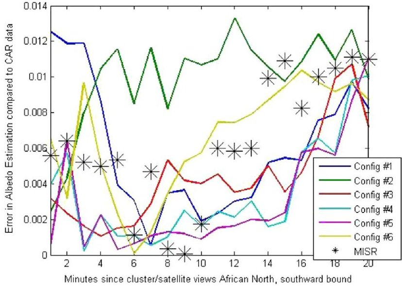

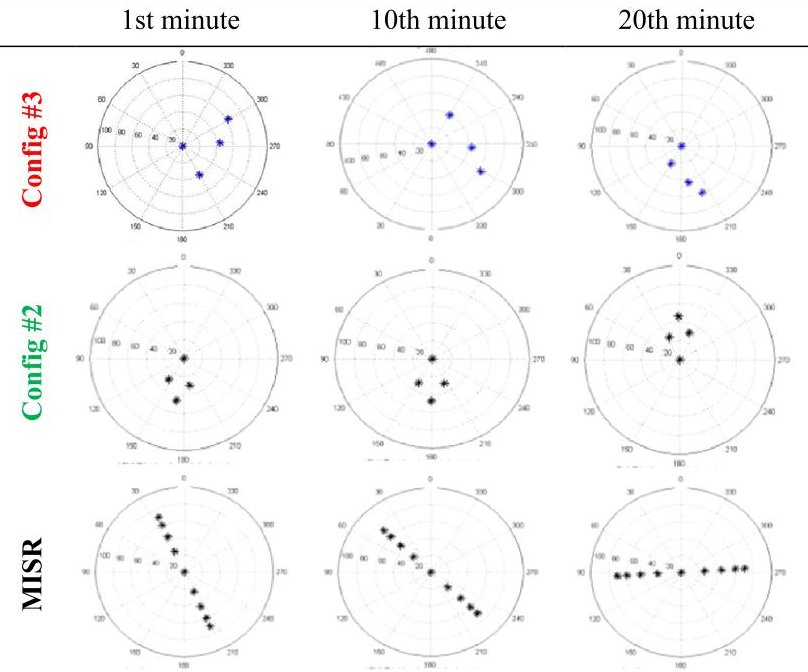

Fig. 4. [Top] Albedo error over time as the 4 satellite formation (in different configurations) flies over Africa, assuming the surface type to be uniformly savannah. The black stars represent simulated albedo errors by MISR (from TLE data), half an hour before. [Bottom] Sampling achieved on the BRDF polar plot for the best (Config #3) and worst (Config #2) configuration and MISR. Angular sampling is shown for the initial (1 minute after start), middle (10 minute after start) and final (20 minutes after start) sections of the simulation. (For interpretation of the references to color in this figure legend, the reader is referred to the web version of this article.)

(polar azimuth of the plot) of the simulated simultaneous measurements. The formation plots have 4 stars each because 4 satellites make 4 near simultaneous measurements and MISR has 9 stars because of its 9 cameras. Over the 20-min period of the simulation, the angular samples by either formation or MISR rotates around the polar plot (changes relative azimuth) with some changes in view zenith and solar zenith angle. One full rotation is expected over one orbit. Satellites in Config #3 sample both the top and bottom hemisphere of BRDF polar plot for most of the simulation, therefore are able to capture the angular signature of the savannah and minimize error. Satellites in Config #2 cover only a very localized part of the hemispheres at any time and thus performs the worst.

MISR covers the zenith spread uniformly but the line of measurements rotates around the polar plot. It samples both top and bottom hemispheres only along one azimuth.

<!-- PDF_PAGE: 7 -->

Sampling achieved on the BRDF polar plot for the best (Config #3) configuration using the fourth satellite as reference. Angular sampling is shown for the initial (1 minute after start), middle (10 minute after start) and final (20 minutes after start) sections of the simulation using the 4-satellite formation, that starts when the formation's reference satellite passes over the northern part of Africa.

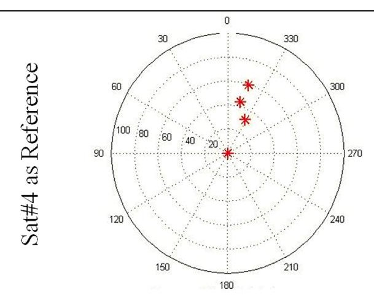

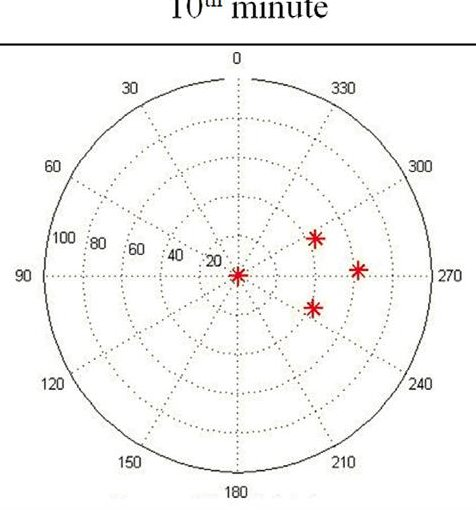

$$
2 0 ^ {\mathrm {t h}}
$$

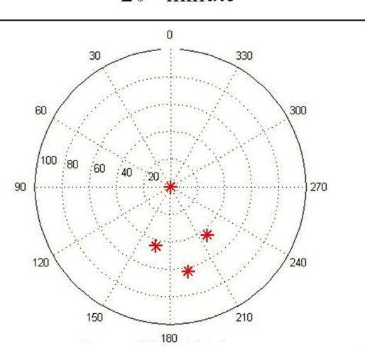

In any formation configuration, the nature of the angular spread obtained at any ground spot and the sampling on the BRDF polar plots is influenced significantly by which satellite points nadir, henceforth called the instantaneous reference satellite. By changing the reference satellite, the mission designer can get a wider variety of and more customizable spreads for any ground spot, using the same number of satellites as Mode #1.

Moreover, for more than ten minutes, the angular sampling is oriented right-left. This causes the samples to miss hotspot angular feature and results in higher errors toward the end of the simulation. Sampling the upper and lower hemispheres at all times, in the very least, and covering an optimal spread of zenith and azimuth within them is important, as highlighted theoretically using heuristic optimization [22] and verified by the above simulation. The rise of errors for both MISR and Config #3 correspond to the time in the simulation when the hemispheres were inadequately sampled. The increase in errors is found to be more for albedo estimation than in BRDF errors.

The best performing formation of the 6 formations operating from the simulations in Mode #1 (Config #3) was selected for Mode#2 analysis. If the first satellite is operated as reference for the full time, angular spread would correspond to the row named 'Config #3' in Fig. 8 [Bottom] because it is the same satellite that nadir-pointed all through in Mode #1 simulations. Alternatively if the fourth satellite is operated as reference for the full time, the angular spread at the 1st, 10th and 20th minute would correspond to Table 2. The difference in spreads is apparent and, using the first and fourth satellites as reference allows coverage of both hemispheres at complementary times.

## 3.2. Changing the reference satellites (Mode #2 Operations)

The Config #3 formation is simulated over 20 min with each of the four satellites as reference, and the corresponding albedo estimation error curves shown in Fig. 5. Using the first satellite as reference minimizes the error in the first $ \sim10 $ min while using the fourth satellite does the same in the last $ \sim10 $ min. The angular spreads corresponding to the minimum

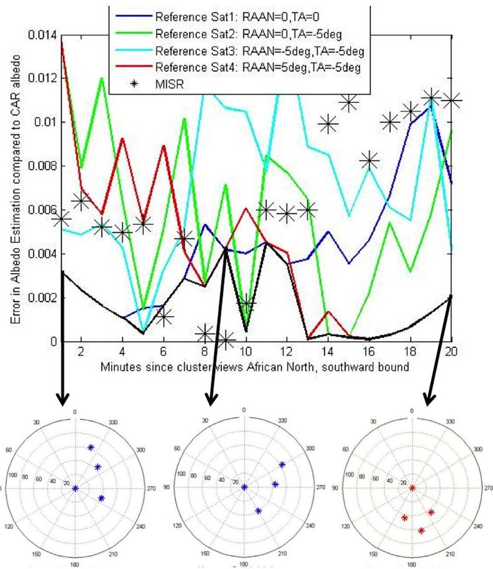

Fig. 5. Albedo error over time as the 4 satellite formation (in formation Config #3 from Table 1), when a different satellite is used as reference over Africa when the surface type is savannah. The black line is the minima of all the curves and shows achievable error by varying the reference to get the spread pointed out. The bottom panels show the angular sampling at the 1st, 9th and 20th minute of simulation; note the similarity to the first two panels of Fig. 4-bottom (Config #3) and last panel of Table 2 respectively. The black stars represent simulated albedo errors by MISR (from TLE data), half an hour before in time. (For interpretation of the references to color in this figure legend, the reader is referred to the web version of this article.)

albedo error at the 1st, 9th and 20th minute of simulation are indicated by the black arrows in Fig. 5. The first two polar plots (blue spots and blue curve) correspond to spreads available using the first satellite as reference and the last polar plot is the spread when the fourth satellite is used as reference (red spots and red curve). The minimum of the curves

<!-- PDF_PAGE: 8 -->

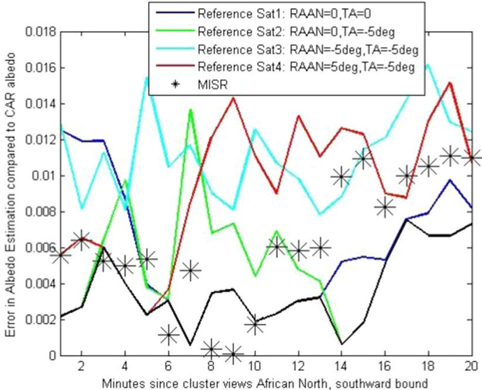

Fig. 6. Albedo error over time as the 4 satellite formation (in formation Config #2 from Table 1) when a different satellite is used as reference over Africa when the surface type is savannah. The black line is the minima of all the curves and shows achievable error by varying the reference to get the spread pointed out. (For interpretation of the references to color in this figure legend, the reader is referred to the web version of this article.)

(first blue then red) thus gives the achievable error by imaging under Mode #2 operations, using the formation Config #3. The error drop at the 10th minute is due to the second satellite acting as reference (green), which may be ignored to avoid moving to a new reference satellite only for a couple of minutes. In the unavailability of angular samples in both hemispheres, the science models seem to be able to reconstruct the BRDF and albedo better if measurements of vegetation reflection are available in the lower angular hemisphere i.e. the hotspot region than in the upper hemispheres.

The baseline formation in Mode #2 averages less than 0.003 in albedo error over 20 min, which analytically translates to 4.1 W/m $ ^{2} $ in total outgoing radiation error and is half of the error simulated in Mode #1 operations. Moreover, imaging Mode #2 operations shows better angular performance than the monolithic MISR, in the last few minutes and similar performance as MISR in the first half, in spite of having less than half the number of sensors.

Formation Config #1 (Table 1) showed one of the worst average errors over time, when operated under Mode #1. However, when imaging mode #2 operations were used on Config #1, simulations show significant improvement in albedo estimation errors, as seen by comparing the blue curve in Fig. 4 to the black curve in Fig. 6. As before, the minima of the curves (black) in Fig. 6 is the achievable error when the reference satellite is changed from #2 (green) to #4 (red) to #1 (blue) to #2 (green). Errors better than MISR are seen at many instances in time in the simulation. This shows that even if satellites cannot be initialized or maintained in exactly optimal relative orbits due to deployment errors, disturbances over mission lifetime or drift, Mode #2 can drive down the error significantly and sometimes, even do better than the 9-sensor monolithic spacecraft (black line vs. black asterisks in Fig. 6). This simulation also shows that the estimation error

can increase more than two-fold for a 4-sat formation if the wrong satellite acts as reference or the reference-baton is incorrectly passed due to mistakes in imaging mode planning or scheduling. Given algorithmic correctness, the most important driving technology for Mode #2 success is ADCS capabilities for co-pointing the payload, as required in Mode #1 as well, and the ability to agilely switch from one reference's nadir pointing to another. CubeSat capabilities to support these requirements will be discussed in Section 5.

## 3.3. Tracking ground spots (Mode #3 operations)

Imaging mode #3 is expected to reduce the estimation errors further than Mode #2 because more angular measurements are available per ground spot due to being tracked by all satellites as they fly over from horizon to horizon. Since only a few ground spots can be imaged, these waypoints need to be carefully pre-selected and the satellites programmed to track them upon approach. A very simple algorithm was used for waypoint selection: Formation configurations #1 to #3 from Table 1 (corresponding to best and worst errors in Mode #1) were simulated over a 20 min pass over Africa. For every point on the African $ 5^{\circ}\times 5^{\circ} $ grid, the satellites in view and their corresponding access times and angles were computed. In Mode #3 operations, the angular spread for any spot comprises of all the angles, over all the times that all the satellites can access that spot at less than $ 60^{\circ} $ nadir angle. All such measurement spreads were obtained and the BRDF and albedo error calculated with respect to reference data of the savannahs. The ground spots were then sorted in terms increasing error and decreasing access time. Ground spots with minimum error, which had at least 2 min of observation time, were selected, and preference was given to waypoints that could offer continuous minimum error. While this selection algorithm is simple and efficient, a more advanced one will be required if the mission designer were to go with Mode #3 operations.

The simulation of Mode #3 operations applied to the three 4-satellite baseline formations is shown in Fig. 7. BRDF errors correlated well with albedo errors for the savannahs. The number of plateaus, per formation configuration, represent the number of ground spots tracked in the 20 min simulation. Since one multi-angular image is created per ground spot, the albedo error over one spot is the same, therefore the plateau. As the number of satellites in the formation increases, the height of the plateau and the albedo error is expected to drop. The ground spots corresponding to the minimum albedo error have been marked with arrows of similar color in Fig. 7 [Top] and the angular spreads achieved for those spots shown in Fig. 7 [Bottom]. Unlike the spreads in Mode #1 and #2, these measurements are not instantaneous. The number of spots on each plateau corresponds to the number of minutes the formation images that ground spot. For example, the angular spreads shown in Fig. 7 [Bottom] have been imaged over five to six minutes.

It is apparent that using Mode #3 increases the spread significantly and drops the minimum possible and maximum allowable error by an order of magnitude - compare Fig. 7 against Fig. 5. Errors can be near zero and, over time, average to less than 0.001. To put the numbers in context, 0.001 in

<!-- PDF_PAGE: 9 -->

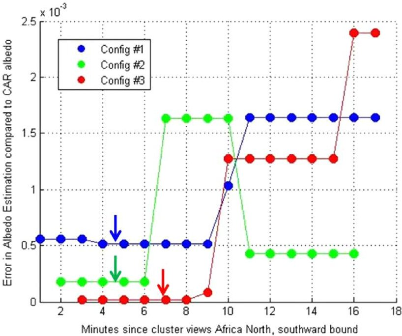

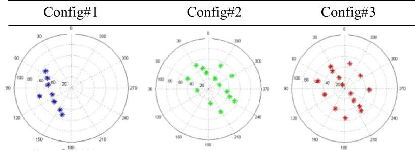

Fig. 7. [Top] Albedo error over time as the 4 satellite formation (in 3 configurations from Table 1) flies over Africa, operating in Mode #3 and using albedo minimization as the objective for waypoint selection with a simple algorithm. [Bottom] Angular sampling achieved, on the BRDF polar plot for the three configurations (color coordinated across plots), when the formation tracked the ground spot corresponding to the plateaus marking with arrows in the top plot.

global albedo accuracy translates to $ 0. 3 \mathrm{~ W / m^{2}} $ in accuracy in total outgoing shortwave radiation, a standard NOAA has recommended to achieve [57]. Mode #3 therefore decreases savannah albedo errors further than what Mode #1 (0.006) and #2 (0.003) are capable of, for the same set of satellite orbits.

The number of different orbital planes in the formation is equal to number of arcs in the angular spread. For example, since Config #1 (blue) has two planes with different RAAN, its angular spread shows two arcs. Config #2 and #3 have three planes so three distinct arcs can be seen. Differential true anomaly does not affect the angular spread in Mode #3. The angular spread covers both the hemispheres in the BRDF polar plot, however, this oversampling in the angular space comes at the cost of spatial coverage. Fig. 7 shows that only 2-3 ground spots (2-3 plateaus) could be sampled in all of Africa in the 20min simulation. Since Africa or any other geographical reason of its size has a diversity of surface types, we will need more than a couple of ground spots to characterize the albedo or BRDF of all characteristically. Therefore, the waypoint selection algorithm will also need scientists' input on the allowable angular-spatial trade-off along with the ADCS capabilities.

Mode #3 is also a more efficient method for taking multiangle images within the Arctic and Antarctic Circles because formations with only differential RAAN and TA will converge into a string of pearls configuration at the poles. Orbits with different RAAN offer maximum cross track spread at the

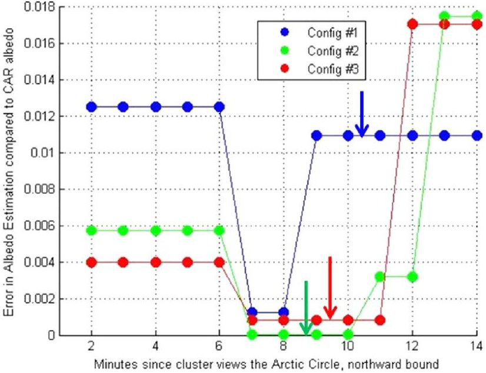

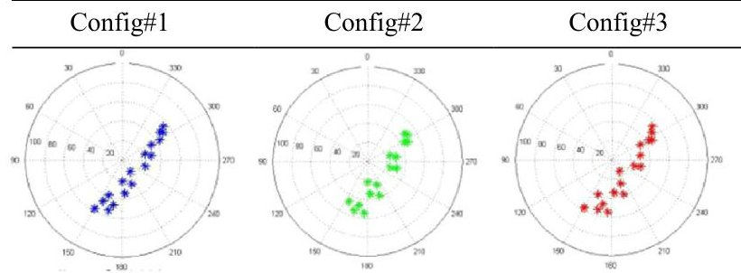

Fig. 8. [Top] Albedo error over time as the 4 satellite formation (in selected configurations) flies within and over the Arctic Circle, operating in Mode #3 and using albedo minimization as the objective for waypoint selection with a simple algorithm. [Bottom] Angular sampling achieved, on the BRDF polar plot for the three configurations (color coordinated across plots), when the formation tracked the ground spot corresponding to the plateaus marking with arrows in the top plot.

Equator and none at the poles. In other words, the angular spread and corresponding error for a 9-satellite formation with more than double the number of sensors than all the simulations presented, would be the same as monolithic MISR. Differential inclinations offer maximum cross-track spread at the poles, however they cannot be maintained with CubeSat propulsion capabilities [26]. Mode #3 operations can introduce some azimuthal spread at near-polar ground spots, in spite of a string-of-pearls formation configuration, because 5-10 min of imaging at off-nadir allows for variations with respect to the solar plane.

Fig. 8 shows the results of the 14 min simulation when the 3 baseline configurations of the 4-satellite formation flew over the Arctic Circle. The chief orbit inclination was changed to $ 9 0^{\circ} $ because the ISS inclination does not reach the poles, but the altitude kept the same at 650 km to preserve the time period. The reference data used as "truth" is that collected by the CAR over snow and sea ice in the Arctic [32]. Snow BRDF data at near infrared wavelengths contains the sunglint, an angular feature in the hemisphere opposite to the hotpot in the savannah data, which needs to be accurately captured for accurate albedo retrievals. As before, the ground spots were selected by picking those with minimum albedo error. The angular spread at the ground spots corresponding to the plateaus marked with arrows can be seen in Fig. 8 [Bottom]. They look very similar because all differential RAAN-TA formations converge similarly at the poles. The angular spread is not as good as over Africa - compared to Fig. 12 [Bottom]-but better than the straight line expected from Mode #1 or #2

<!-- PDF_PAGE: 10 -->

operations. The average albedo error over 14 min for the 3 configurations is 0.01, 0.005 and 0.005 translating to 13.68 to $ 6. 8 4 \mathrm{~ W / m^{2}} $ in total outgoing radiation error respectively, over the poles. Angular spread and albedo retrievals at the poles can be improved further if a Walker constellation [58] is used instead of a formation because it provides maximum RAAN spread, however multi-angle images outside of the poles would not be possible unless a constellation of formations is used.

## 3.4. Selection of a mode for global simulations

Since Mode #2 provides the lowest albedo errors without compromising on spatial coverage, it was simulated on dynamically changing surface types as the formation flies over the globe. The reference satellite sequence is assumed to be pre-calculated at mission control and the formation informed of it well in advance. All measurement and solar angles were calculated per satellite in Config #3 from Table 1, at every time step over a full day (>15 orbits) and, BRDF and albedo errors calculated with respect to reference CAR data ('truth') corresponding to the surface type expected under the formation at that time step. Config #3 is selected as an example in this section due to its best performance when operated in Mode #1 and its MISR-like performance when operated in Mode #2.

Fig. 9-left shows the albedo estimation errors over one day. The ribbon beneath the X-axis indicates the surface type expected under the dynamically changing reference satellite, used to calculate the albedo error. The blue curve indicates the minimum of all the 4 error curves when each of the 4 formation satellites are used as reference and the black stars indicate MISR's expected error. The breaks in the curves along the X-axis are because BRDF and albedo can only be retrieved for near solar wavelengths. The simulation enforces an solar zenith angle $ < 8 0^{\circ} $ condition, causing a set of 15 discrete measurement periods for 15 orbits (orbit day only). The

example formation performs equally well or better as a monolithic spacecraft with twice as many sensors. The results presented will be bettered if operated in Mode #3, and worsened if operated in Mode #1, as seen in Sections 3.1-3.3. Better results are also expected if more than 4 satellites and other formation architectures are used, as will be seen in Section 4.

Zooming into one of the fifteen simulation orbits in Fig. 9 left allows us to understand how the error varies hourly. The results from the first orbit (5% of the day) are shown in Fig. 9 right. Since MISR leads the formation by half hour and gets daylight earlier, the MISR error curve (black asterisks) is slightly shifted in time compared to the formation (blue). They do not access the same surface types at the same time. The simulation only 'images' when all 4 satellites are in sunlight to avoid discretely high errors as the model may not converge due to lack of sufficient angular samples.

Some surface types have higher reflectance and thus higher absolute errors. The errors seen over croplands and savannah are somewhat less than those over snow or water. In terms of percentages, water errors are typically 35-40% compared to CAR reference for both the formation and MISR, while land errors are typically between 15 and 25% - in keeping with localized results in previous literature [22]. Errors over the desert are close to zero due to near-Lambertian reference data and a measurement at any one angle is sufficient to exactly characterize this field exactly. The albedo range shown in Fig. 9's Y-axis corresponds to a BRDF range of 0.015 to 0.07.

## 4. Impact of formation flight configurations

A full tradespace of formations over many chief orbits and over the full range of RAAN-TA combinations, all operating in Imaging Mode #2 as per the process described in Section 3.4, will be evaluated globally and over multiple orbits in this

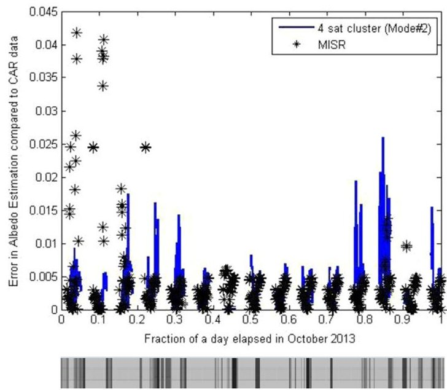

x 10-3

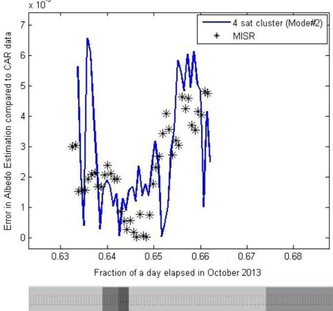

Fig. 9. Albedo RMS errors (assuming perfect Mode #2 operations) and MISR for a 1 day simulation (left) and a 1 orbit simulation (right). The bars at the bottom show the surface type number in gray scale from 1 to 7 as seen by the formation at any given time instant where 1=water, 2=forest, 3=croplands, 4=grasslands, 5=snow/ice, 6=desert, 7=cities. Surface types on the right are 1,3,4,1,3 respectively. (For interpretation of the references to color in this figure legend, the reader is referred to the web version of this article.)

<!-- PDF_PAGE: 11 -->

RAAN-TA $ \left( \mathrm{i n}^{\circ} \right) $ slots for the full factorial enumeration of formation architectures.

<table border="1"><tr><td>RAAN</td><td>0</td><td>-5</td><td>5</td><td>0</td><td>-5</td><td>5</td><td>5</td><td>-5</td></tr><tr><td>TA</td><td>-5</td><td>-6</td><td>-4</td><td>5</td><td>6</td><td>4</td><td>-1</td><td>1</td></tr></table>

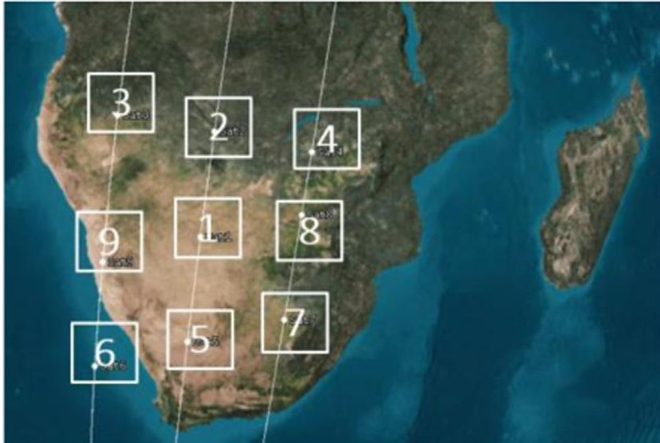

Fig. 10. 8 available differential RAAN-TA slots (exact values in Table 3) arranged around the reference satellite (+1), as enumerated in an AGI-STK simulation. At any instant, one satellite points nadir while the others point to the ground spot below the nadir-pointing, reference satellite.

section. Mode #2 has been selected because it minimizes albedo estimation errors and does not compromise on spatial coverage. The best performing formation thus selected can be bettered using Mode #3 imaging operations.

The configuration variables considered for a full factorial study are: number of satellites, chief orbit altitude and inclination and the relative RAAN-TA of the satellites with respect to a reference. Chief orbits are chosen among the representative ones with easily available commercial, secondary launches i.e. Landsat orbit （710 km/98.2 $ ^{\circ} $ ）, Iridium orbit （790 km/86.4 $ ^{\circ} $ ）, ISS orbit （425 km/51.6 $ ^{\circ} $ ）, ISS raised orbit （650 km/51.6 $ ^{\circ} $ ） and a popular secondary SSO orbit （600 km/ 97.787 $ ^{\circ} $ ）as offered by Spaceflight Services Inc $ ^{2} $ . To prevent variable space explosion, the number of satellites is limited between 3 and 8. Three satellites is the minimum required for the BRDF OSSE models and eight corresponds to NASA ARC's Edison Demonstration [40] and CYGNSS mission [41], currently the highest number of commissioned satellites in any NASA-sponsored DSM.

Formations can be maintained using CubeSat technology if the only differential Keplerian elements used are RAAN and TA [6]. For any given number of satellites (say, N), N-1 RAAN TA differential combinations are picked from the 8 available $ \left(^{8}C_{N-1}\right) $ in Table 3. These 8 slots have been selected as the corners of $ a+/ - 5^{\circ} $ square in RAAN and TA, with the reference satellite in the center and no common TAs to avoid collisions, as shown in Fig. 10. For a given altitude-inclination combination, there are a total of 1254 RAAN-TA combinations for 3 to 8 satellites, all of which will be explored and compared.

RAAN-TA combinations around an approximate square are assumed to be sufficient representation for a full factorial RAAN-TA spread because the square's nodes and edges provide a view zenith-relative azimuth angle spread that covers the BRDF polar plot at the Equator, in a manner appropriate for error minimization. A few degrees of RAAN-TA variation from these 8 slots results in a view zenith-relative azimuth variation that is not found to be of significant impact to BRDF or albedo estimation errors. Moreover, the cost of RAAN-TA maintenance within less than a degree is not deemed worth the little impact gained.

The full factorial tradespace comprises of a total of 246 $ \left(^{8} \mathrm{C}_{2}+^{8} \mathrm{C}_{3}+^{8} \mathrm{C}_{4}+^{8} \mathrm{C}_{5}+^{8} \mathrm{C}_{6}+^{8} \mathrm{C}_{7} \right) $ RAAN-TA combinations for a 3,4,5,6,8 satellite formation, respectively, for each chief orbits considered. To find the reference satellite schedule for mode #2 operations needs the simulation of every satellite as reference, therefore the full factorial simulation contains 1254 $ \left(3 \times^{8} \mathrm{C}_{2}+4 \times^{8} \mathrm{C}_{3}+5 \times^{8} \mathrm{C}_{4}+6 \times^{8} \mathrm{C}_{5}+7 \times^{8} \mathrm{C}_{6}+8 \times^{8} \mathrm{C}_{7} \right) $ architecture simulations for each of the 5 chief orbits, at every one of the 1440 min of the day. In other other words, the albedo and BRDF calculation algorithm shown in Fig. 2's right box and described in Section 2 is run 9,028,800 times to cover the entire tradespace, streamlined to a single imaging mode. The sensitivity of the albedo error to chief orbit, number of satellites and RAAN-TA or relative spatial geometry is demonstrated in the following sections using varying subsets of the above simulations.

## 4.1. Error dependence on chief orbit

A 4-satellite formation with the RAAN-TA combinations from Config #3 in Table 1 was simulated on System Tool Kit's High Precision Propagator for a full day for the 5 different chief orbits (different altitude-inclination combination) mentioned above. The expected albedo estimation errors for

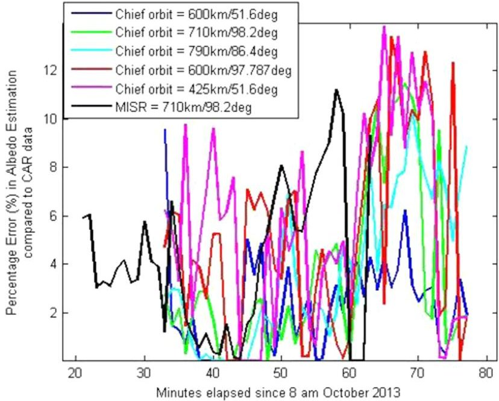

Fig.11. Error in albedo estimation error when the formations are flown at different altitudes/inclinations compared to MISR. Corresponding to the shown percentages, absolute albedo error ranges from 0 to 0.042. (For interpretation of the references to color in this figure legend, the reader is referred to the web version of this article.)

<!-- PDF_PAGE: 12 -->

Time-averaged albedo errors for the five 4-satellite formation architectures (with varying altitude/inclination of orbit) and MISR over several orbits of simulation.

<table border="1"><tr><td>Chief orbit altitude/inclination</td><td>Absolute albedo error</td><td>Percentage albedo error(%)</td></tr><tr><td>Formation(600km/51.6°)</td><td>0.0021</td><td>2.4</td></tr><tr><td>Formation(710km/98.2°)</td><td>0.004</td><td>3.8</td></tr><tr><td>Formation(790km/86.4°)</td><td>0.0025</td><td>4.0</td></tr><tr><td>Formation(600km/97.79°)</td><td>0.0049</td><td>5.6</td></tr><tr><td>Formation(425km/98.2°)</td><td>0.0052</td><td>5.8</td></tr><tr><td>MISR(710km/98.2°)</td><td>0.0065</td><td>3.6</td></tr></table>

one orbit are plotted as percentages in Fig. 11, colored per chief orbit. The curves are out of phase because the periods of the orbit are different and the satellites go into sunlit areas at different times. MISR's error has been plotted in black. There are several occasions when some or all formation architectures, using as less as 4 satellites, outperform MISR such as between the 45th and 60th minute of the simulation in Fig. 11.

Comparing average errors over time, the formation in the ISS orbit performed (blue curve in Fig.11) marginally better than the others and is marginally outperformed by MISR Appendix I shows that as less as one orbit's errors are representative of errors over an extended period of simulation therefore the one-day simulations in this paper are deemed appropriate to capture the performance dependencies of different variables. Table 4 shows that there is no analytical trend between the chief orbit and estimation errors. Their average improvement is centred around $ \sim 25\% $ in BRDF and $ \sim 4\% $ in albedo. A 4-sat formation in Mode #2 operations is thus, insensitive to chief orbit, allowing the mission designer significant flexibility in choosing along available launches. Orbit notwithstanding, as low as 4 satellites can make better measurements at many instances than multi-sensor monoliths can, making a strong case for using them as complementary sensor systems.

## 4.2. Error dependence on satellite number

Observing system simulations have shown that if angular measurements were placed optimally on the angular view zenith-relative azimuth plane, then given the current BRDF models, the RMS error for BRDF or albedo does not depend on the number of satellites as long as a minimum of three are available [22]. In an astrodynamically constrained space environment with limited maintenance capabilities of CubeSats, larger numbers of satellites help to counter the lack of optimality in angular arrangement. Simulations presented in this section and the subsequent one shows that the average albedo error drops as the number of satellites increases from 3 to 8.

Table 5 and Fig.12 show the results of 154 $ \mathrm{(^{8} C_{2}+^{8} C_{3}+^{8} C_{4})} $ RAAN-TA combinations simulated for a 3,4,5 satellite formation respectively, one with ISS attributes $ (6 5 0 \mathrm{k m} / 5 1. 6^{\circ}) $ and another with LandSat attributes $ (7 1 0 \mathrm{k m} / 9 8. 2^{\circ}) $ . The albedo errors at every time step are calculated per architecture (imaging mode #2 only) and the average over time decreases as 5.25%, 3.51%, 2.47%, 1.89%, 1.64% and 1.49% from 3 to

Table 5 Time-averaged percentage errors in albedo estimation for mode #2 operations over an orbital simulation with 154 RAAN-TA combinations per 2 chief orbits - ISS (650 km/51.6 $ ^{\circ} $ ) and LandSat (710 km/98.2 $ ^{\circ} $ ) - with variable number (N) of satellites.

<table border="1"><tr><td></td><td colspan="2">N=3</td><td colspan="2">N=4</td><td colspan="2">N=5</td></tr><tr><td></td><td>Min</td><td>Max</td><td>Min</td><td>Max</td><td>Min</td><td>Max</td></tr><tr><td>ISS</td><td>1.86</td><td>8.87</td><td>1.31</td><td>7.41</td><td>1.06</td><td>6.19</td></tr><tr><td>LandSat</td><td>1.90</td><td>6.01</td><td>1.63</td><td>5.23</td><td>0.95</td><td>4.58</td></tr></table>

Histogram for all RAAN-TA combi and time steps for high ISS orbit

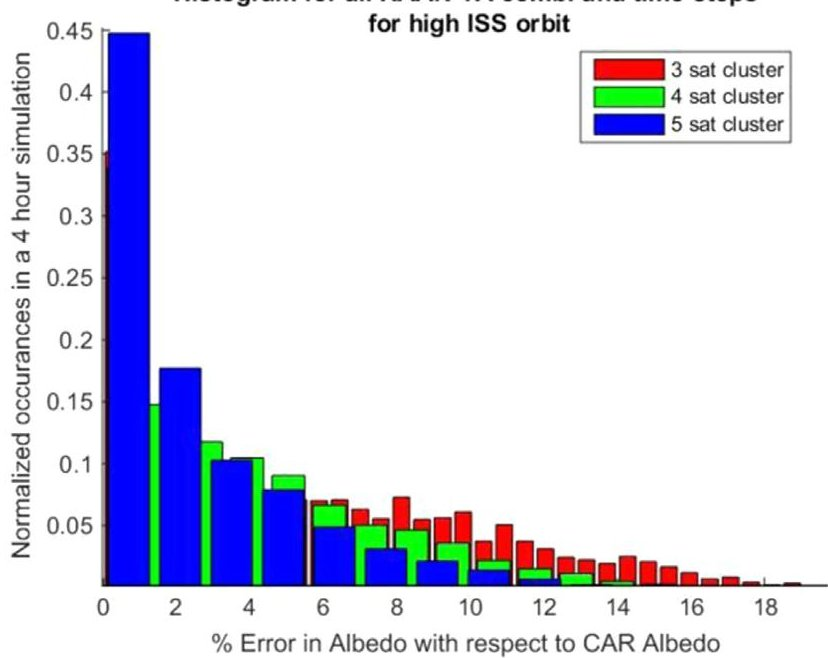

Fig. 12. Distribution of percentage albedo error for all time steps in 4 h for all RAAN-TA combinations with variable number of satellites in the formation, operating in Imaging Mode #2.

8 satellites respectively. In comparison, the time-averaged error for MISR is 3.61% , slightly higher than the 4-satellite formation average. However, the numerical mean across time or even RAAN-TA may overestimate albedo error because the time series of errors is a one-tailed distribution (Fig. 12). Therefore, we also report the minimum and maximum time-averaged errors per satellite number across all RAAN-TA combinations in Table 5. The numbers clearly demonstrate that both maximum and minimum time-averaged albedo errors decrease with increasing number of satellites. The same trend is also seen when maximum and minimum albedo errors over time are plotted against satellite number, instead of the time-average.

If Fig. 2's histogram is plotted for Imaging Mode #1 operations, where every satellite acts as reference for the entire time thus resulting in thousands more architectures, the relative shapes remain the same. However, the error percentage on the X axis extends to 200% because of the lack of optimal formation geometry. Thus, increasing the satellite number decreases albedo errors, even in sub-optimal operations where the reference satellite failed to swap due to ADCS errors or J2-caused drift, making a strong case for increasing satellite numbers to subdue operational risks.

<!-- PDF_PAGE: 13 -->

## 4.3. Error dependence on differential Keplerian elements

As calculated before, any N-satellite formation with a specific chief orbit can be arranged in formation in hundreds of configurations, even with only RAAN-TA variation with respect to the chief satellite and constrained to only 9 slots. This section analyses the effect of those formations on the albedo error. It is difficult to analytically predict a consistent trend in formation arrangement that will minimize errors because Mode #2 causes the reference satellite and angular spread to change based on a data-driven numerical inversion. Therefore, the science evaluation model is of critical

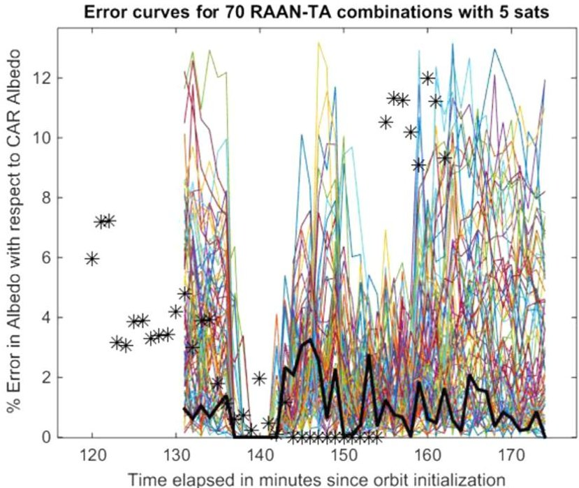

Fig. 13. Albedo error as a percentage of true CAR albedo over one orbit when a 5 satellite formation is simulated for a full factorial of differential RAAN-TA formation architectures with a chief orbit of $ 6 5 0 \mathrm{k m} / 5 1. 6^{\circ} $ $ 0-13 \% $ albedo error corresponds to 0 to 0.018 absolute albedo error. The black curve shows the formation with minimum error (1.06% and $ \sim 0.001 $ in absolute).

importance in selecting the optimal configuration for a given number of satellites and the reference satellite schedule over time. More satellites, by definition, improve angular spread by virtue of having a well spread out 9 slots so there are few interesting formation trends for N>5.

Fig.13 shows the error curves over 93 min (one orbit only) for all RAAN-TA differential combinations with 5 satellites for a chief orbit at 650 km, ISS inclination. As seen in Section 4.1 chief orbits are non-differentiating, therefore the ISS orbit can be used without any loss of generality. The messy nature of the plots is due to 70 curves for 70 possible methods to arrange 4+1 satellites into 8+1 slots. The thick black line indicates the RAAN-TA architecture whose mean albedo error over a 4 hour period is the minimum and the black asterisks indicate the albedo error due to MISR's measurements in a similar time period, calculated in the same way. While MISR does extremely well for $ \sim 50\% $ of the orbit, as expected because of its nine sensors well-spread in the zenith direction, it is outperformed by the 5 satellite formation for the section of the orbit when its sensors become perpendicular to the vegetation hotspot or snow sunglint region, or sample left-right only. The errors are plotted as percentages to prevent biases caused due to sampling different surface types at the same time. A histogram plot of the time series confirms that the best and worst formations consistently do well and badly, respectively, through the entire simulation.

The albedo estimation error for all permutations in an ISS chief orbit is plotted in Fig.14. There are architecture options in all satellite numbers that outperform MISR's error percentage. The RAAN-TA arrangement in the 3 and 4 satellite case is highlighted in the inset, showing the availability of angular spread on the BRDF polar plot. The range of errors over RAAN-TA permutations per satellite number is very large, as predicted in Table 5 and Fig.14. While MISR is outperformed by some 3-sat arrangements, any error in orbit maintenance or Mode #2 operations can cause the error to shoot above multi-sensor monoliths. To mitigate risk and

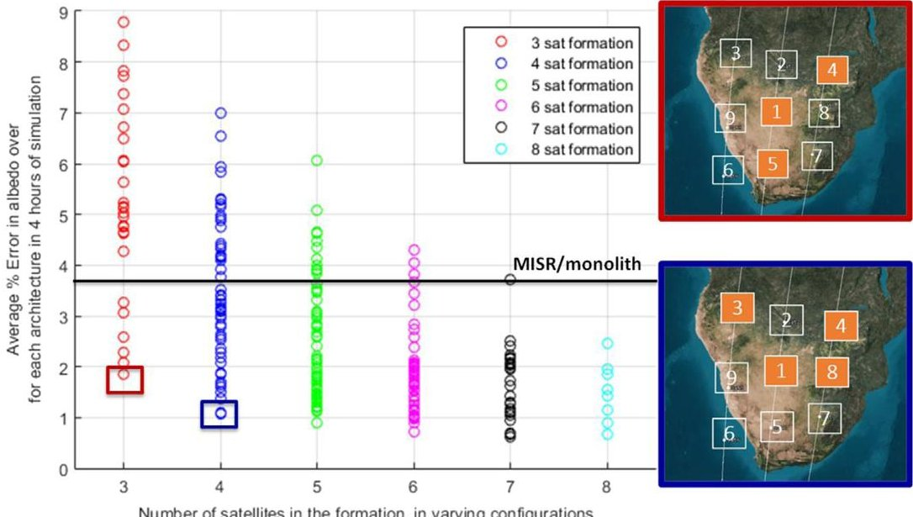

Fig. 14. Average albedo error over time for increasing satellite number at a 650 km, $ 51. 6^{\circ} $ orbit vs. mission cost for satellite development only. Each circle represents a combination of differential RAAN and TA. The horizontal black line represents MISR's error of 0.0065 or 3.6%. Insets correspond to the satellite arrangement with the lowest error of 0.002 and 0.0015 using 3 (red) and 4 (blue) satellites respectively. (For interpretation of the references to color in this figure legend, the reader is referred to the web version of this article.)

<!-- PDF_PAGE: 14 -->

since the maximum error over all RAAN-TA architectures decreases with satellite number, a formation of 7 to 8 satellites outperforms MISR's errors, irrespective of how they are arranged. Differential RAAN-TA arrangement is thus as important as number of satellites, but its importance is reduced in the context of operational concerns.

A decreasing trend is also seen when maximum % error over the full simulated time period is plotted against increasing satellite number instead of the time-average (which trends downward irrespective of if the best, worst and average RAAN-TA arrangements per satellite number are considered - Section 4.3). The maximum error allowed at any time is 6.4% and 19.38% for a 3-sat formation, dropping to 3.07% and 7.63% for an 8-sat formation, at the best and worst case RAAN-TA arrangements respectively. The maximum error allowed by MISR's geometry at any time is $ \sim 12\% $ , tied with the worst case RAAN-TA arrangement for a 5-satellite formation. In other words, MISR can be outperformed by any 5-8 satellite formation arranged in the slots proposed in Fig.10 and the best few of the arrangements using 3-4 satellites (for example, the insets in Fig.14). MISR's performance relative to the formations is worse when maximum error across time is considered instead of the time-average because MISR's line of inflexibly mounted sensors misses many angular features when they line up approximately perpendicular to the solar principal plane (or beta angle $ \sim 90^{\circ} $ ), causing the BRDF and albedo errors to shoot up at two instances per orbit. Formations operating in Mode #2 adjust their geometry, such that their effective angular spread always covers the angular features. Therefore, even the maximum allowed error of the best 8-satellite formation is a four fold improvement over MISR, calculated in terms of angular sampling.

Parallel literature [22] has shown that, in terms of BRDF error caused due to angular undersampling, at least 6 satellites in a few of the slotted RAAN-TA arrangements and 8 satellites in any arrangement, are needed to outperform MISR. Albedo estimation needs lower numbers: 3 and 7 or 5 satellites respectively, depending on time-average or maximum albedo error being the metric. This is because it is a less rigorous metric by virtue of having one error term. BRDF, in comparison, is the root mean square value of the error term at every angular direction. Therefore, CubeSat formations can serve as an excellent complement to flagship missions by filling up the sampling gaps in BRDF or albedo.

## 5. Formation flight maintenance

Previous literature [28] on a preliminary survey of current cubesat technologies that can support the proposed satellite formations in Fig.14 shows the critical enablers to be attitude control systems to meet the continuous co-pointing requirement of the formation's satellites and propulsion systems to ensure that the differential RAAN-TA spread does not diverge beyond a few degrees of the optimum. The discussion below will show that current capabilities are sufficient for mission development, assuming the availability of a multi-spectral imaging payload.

## 5.1. Formation co-pointing

Attitude determination and control systems (ADCS) are of great importance for all modes because of the co-pointing requirement for near-simultaneous measurement at the same ground spot, at every time step and over the mission's lifetime. For a $ 1 0 2 4 \times1 0 2 4 $ pixel CCD focal plane and a ground sampling of 500 m, pointing accuracy of $ 0. 0 3^{\circ} $ is needed to capture images within one pixel of error, which is theoretically possible using BCT's XACT system $ ^{3} $ . Pointing stability over each second is treated very briefly - Blue Canyon's XACT system shows simulated pointing stability of 0.4 arcsec $ (0. 0 0 0 1 1^{\circ}) $ over 1-second intervals. Detailed jitter analysis will need to be performed in later Phase B design analysis, in keeping with spacecraft structure and wheel speeds. Sub second integration time for attitude stability analysis is considered sufficient because an image is expected to be generated every 7-10 km depending on the type of spectral imagers are used [28], and the orbital velocity is $ \sim 7. 3 $ km/s. This section will show the deterioration in integrated image size with increasing pointing errors and demonstrate that acceptable performance is possible even with the ADCS control uncertainty of $ 0. 5^{\circ} $ (based on BRITE Sat's flight heritage [42]). Position errors up to 2 km have been considered, which have been demonstrated using GPS and CubeSat orbit determination software (e.g. University of Michigan's RAX [43]). The impact of attitude errors, caused due to errors in both attitude and position, have been computed.

The best (Config #3) and worst (Config #2) performing configurations among the baseline formations in Table 1 were simulated in the Local Vertical Local Horizontal (LVLH) frame of the reference satellite and the view zenith angle and relative azimuth angle subtended by them at the common ground spot over one orbit computed, assuming Mode #1 operations. The view zenith and relative azimuth angle curves for each satellite in either formation configuration - Fig. 15-serve as angular requirements for the ADCS system. The overlapping ground spots of all satellites in the formation produce a multi-angular image. Assuming conical fields of view (FOV), the ground spot of the nadir-looking satellite will be circular with a radius of $ \mathrm{h^{*}t a n} (\mathrm{F O V} / 2). $ The ground spot of all other satellites will be ellipses whose heel-toes are oriented in the azimuthal direction, and size given by Ref. [44]. The full circle or ellipse is assumed to fit within a square (with sharp or rounded corners) focal plane array such that the ground spot overlaps shown in this section correspond to the overlap of the processed images. The circle and ellipses will change shape, orientation and position depending on attitude and position errors. Assuming the attitude error in the nadir and azimuth direction are $ \Delta \eta $ and $ \Delta \varPhi $ , the pointing error in the nadir direction is the same while that in the azimuthal direction is scaled $ (\Delta \varPhi^{*} \sin \eta). $ The projected ellipse orientation rotates by the latter amount due to these errors. Similarly, assuming errors of $ \Delta I, \Delta C $ and $ \Delta R $ in the in-track, cross-track and radial directions, the resulting mapping errors can be computed [44]. A new nadir angle per satellite, per time step can be found by adding the pointing error to the ideal, and the ground projection ellipse length and

<!-- PDF_PAGE: 15 -->

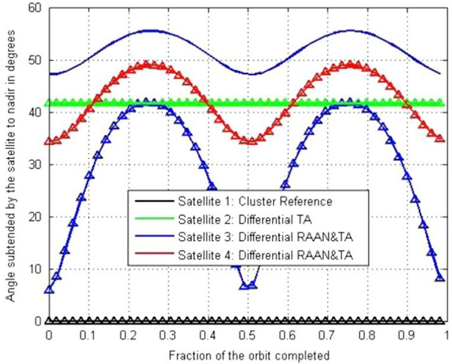

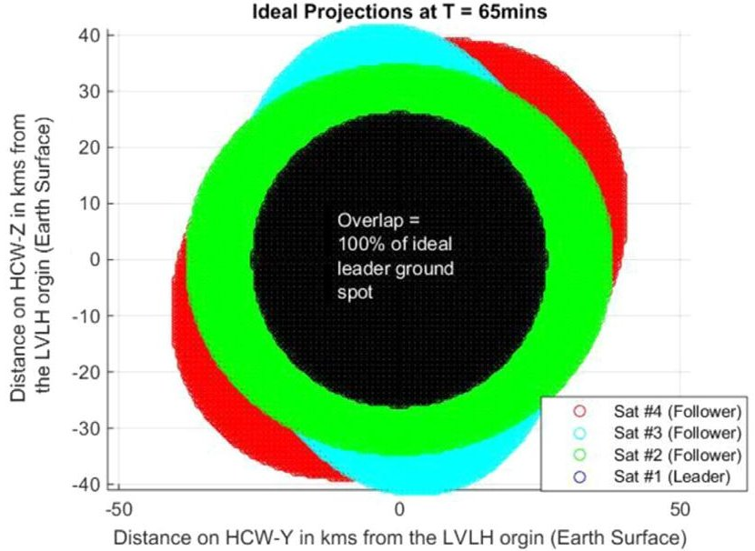

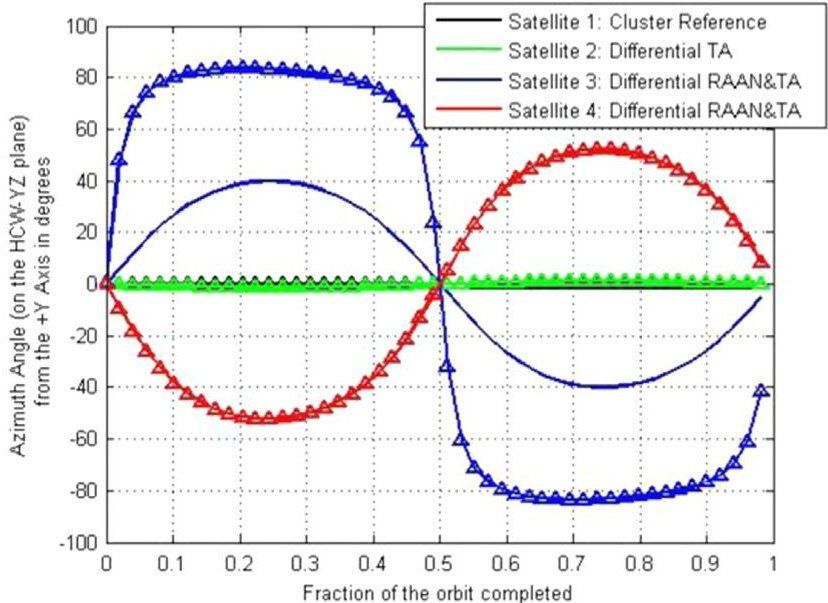

Fig. 15. [Top] View zenith angle and [Bottom] relative azimuth angle with respect to the velocity vector at the ground target under the reference satellite as sampled by the 4 satellites (different colors) in formation Config #3 (continuous line) and Config #2 (triangular markers). All angles are in LVLH frame. Some curves overlap because of the same relative geometry between some pairs of satellites in Config #2 and #3.

width recalculated [44]. The center of the ellipse shifts from the LVLH center by an amount given by Eq. (1).

$$
\begin{array}{l} \alpha = \mathrm {I T} \mathrm {e r r} + \mathrm {N a d i r} \mathrm {e r r} ^ {*} \cos \Phi + \mathrm {A z i m} \mathrm {e r r} ^ {*} \sin \Phi \\ \beta = \mathrm {C T} \mathrm {e r r o r} + \mathrm {N a d i r} \mathrm {e r r} ^ {*} \cos \Phi - \mathrm {A z i m} \mathrm {e r r} ^ {*} \sin \Phi \\ \end{array}
$$

The ideal overlap of ground spots for the 4-sat Config #2 at the 65th minute, or 67% onto its orbit, is seen in Fig. 16-top. A flat earth is assumed, for simplicity and because Earth curvature introduces little difference in the overlap results for a reference satellite with a~20 km ground spot. The overlap between the ground spots is a perfect circle that covers 100% of the ground pixels of the reference or leader satellite. Assuming 1° of attitude error (demonstrated on CanX [11]) and 2 km of position error (demonstrated on RAX [43]), the erroneous overlap between the ground spot at the same time is shown in Fig. 16-bottom. The shifted spots reduce the overlap to 73% of the ground pixels of the leader satellite. A constant position error shows no effect on ground spot overlap (affected only by relative changes). Random and different position errors per satellite cause a ground overlap change, but

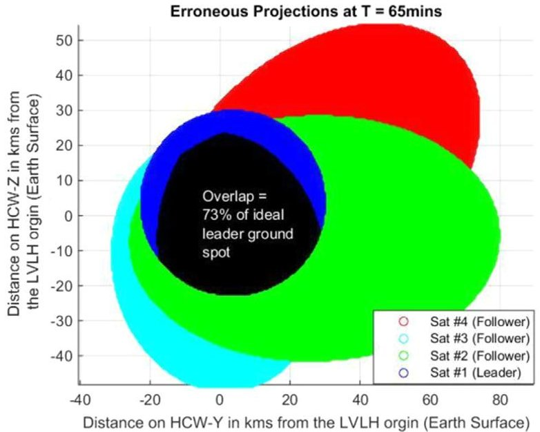

Fig.16. Ground spot overlap for the Config #2 formation from Table 1, ideally (top) and with a $ 1^{\circ} $ attitude error and 4 km position error (bottom) for all satellites. The projects are for one instant of time, 67% into the orbital period. Flat Earth assumed.

effects of < 2 km position errors are small compared to < 1 $ ^{\circ} $ attitude errors. It is far cheaper to reduce that position error than the attitude error on CubeSats. The effect of increasing constant attitude error on all satellites on the percentage overlap of their ground spots over a full orbit is shown in Fig.17, for Config #3 and Config #2. Config #3 is less affected by the attitude error. Less than 1 degree errors result in better than 50% overlap, irrespective of configuration. If attitude control like BRITE constellation (within 0.5 $ ^{\circ} $ ）[45] is possible, overlaps are better than 90% indicating successful co-pointing. When attitude errors are modelled as Gaussian distributions instead of a constant bias, a 1 $ \sigma $ error of 0.5 $ ^{\circ} $ when inputted into 100 Monte Carlo runs result in $ \sim 30\% $ instances of the ground spot overlap greater than 98% and negligible instances of less than 60% overlap. Since multi-angular images and BRDF need co-pointing, greater than 1 $ ^{\circ} $ total errors will generate large amounts of useless data due to less than 50% ground spot overlaps.

A nominal relative position error of $ \pm2 $ km causes a $ \pm0.07^{\circ} $ error in pointing for the baseline orbit, which creeps up to $ \pm0.5^{\circ} $ for a $ \pm15 $ km error. Current GPS measurements

<!-- PDF_PAGE: 16 -->

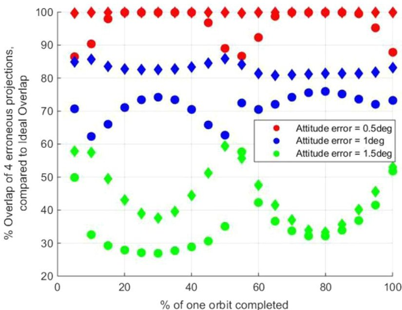

Fig. 17. Percentage overlap among the ground spots of 4 satellites in Config #3 (diamonds) and Config #2 (circles) formations from Table 1. Position (2 km for all) and attitude errors (by color) are assumed as a constant bias. Flat Earth assumed.

on satellites estimate position within 2 km error [43]. Current propagation software such as STK's HPOP demonstrates that when satellites, that were initially separated by up to $ 1 0^{\circ} $ in true anomaly, are propagated over a year, the time period between predictions and actual values are off by up to 3 seconds within a matter of 7 days. Time period mismatches are due to eccentricity induced in a perfectly circular orbit by gravity harmonics and are far more significant in differential TA than RAAN. This propagation error of 23 km (3 s for a 650 km orbit) added to determination error of 2 km leads to $ 2. 2^{\circ} $ of pointing error over and above what the ADCS systems can achieve (assuming $ 0. 5^{\circ} $ ). While the build up of time period, position drift and pointing errors is non-linear and gets worse with time, we assume a conservative $ 0. 3^{\circ} $ per day. Therefore, to keep pointing errors $ < 1^{\circ} $ and ground spot overlaps $ > 70\% $ , the ground should communicate the satellites states, reference satellite sequence and waypoint sequence to the entire formation every day. Position correction will be discussed in Section 5.2. The command frequency could be reduced further, but will need either one of the following two improvements: (a) More precise control over the path of the satellites, so that satellite states can be well predicted over larger time frames. While this is state of art for big satellites, CubeSats are not there yet; (b) Inter-satellite communication and better on-board processing, so that the satellites can run the algorithms on their own, communicate their decisions to each other and work in tandem. A ground check can validate these autonomous decisions. On-board processing demos such as SpaceCube Mini [46] (GSFC) are likely to increase the TRL of option (b) and make it viable for reliable spaceflight.

Imaging modes #2 and #3 may introduce more pointing error, and thus overlap error, in the system because a slew is necessary to change reference satellite or waypoint respectively, which adds extra requirements on control. Slew rates calculated in Ref. [28] using quaternions differentiation on the required angles and their rates in Fig. 15 show that payload pointing requires < 0.001% of the maximum torque authority of commercial reaction wheels like MAI-400 and most of the

0. 625 mNm is available for cancelling disturbing torques. For Mode #1 operations, the momentum driver is the Earthpointing pitch-yaw manoeuvre and co-pointing within the LVLH frame is negligible in comparison. The maximum momentum storage needed, at over any orbit, is 0.8 mNms. Since the momentum storage capacity of MAI-400 is 11.8 mNms, continuous payload operations are possible without any dumping. Assuming a maximum of $ \pm 6 0^{\circ} $ slew to change reference satellites (Mode #2) or waypoints (Mode #3), up to $ 2^{\circ} / s $ of slewing is needed. Such a slew will accumulate 13.9 mNms of stored momentum and need a torque of 0.465 mN. Since the former exceeds MAI-400's capacity, higher capacity reaction wheels will be needed for the imaging mode slew manoeuvres. Blue Canyon's Model #RWp100 at 300 g, < 2 W, 4 mNm of torque and 100 mNms of capacity is a good alternative candidate.

For all accumulated momentum due to secular disturbances, MAI-400 needs to be de-saturated every 6 hours. Magnetic torquers can be used for desaturation as in the MicroMAS mission whose momentum storage requirements are greater than the currently presented mission [47]. Alternatively, if thrusters are to be used, for MOI=0.4 kg-m $ ^{2} $ and a 20 cm moment arm between two thrusters per degree of freedom (12 DOF in all), each desaturation manoeuvre will need a $ \Delta V $ of 0.0295 m/s. The annual budget then translates to 43 m/s for each wheel, which can be handled with electrospray propulsion because of the low thrust requirement. Dumping 11.8 mNms translates to an impulse requirement of 0.118 N-s, which can be fulfilled by thrusting 200 $ \mu $ N thrusters for 10 min during the eclipse, non-science operations phase.

## 5.2. Formation station-keeping

Propulsion in the proposed mission will be needed for formation initialization, maintenance and de-orbiting, and momentum dumping, if needed. Formations can be initialized, both in terms of differential RAAN and TA, either using separate hosted payload launches [48], propulsion from the carrier launch vehicle (LV) such as Orbital Sciences Corporation's Pegasus rocket $ ^{4} $ from a propulsive adapter such as Spaceflight Inc's SHEPRA [49] or the spacecraft's internal propulsion (cold gas or electric). LV propulsion is easier to negotiate if the formation is the primary payload. A propulsive adapter can be used if secondary launch is selected and spacecraft fuel is unavailable. A formation with multiple RAAN planes, such as a multi-plane Walker constellation, can be initialized by deploying planar groups of satellites followed by satellite deployment within the same plane.

To minimize the requirements imposed on LVs for achieving a large RAAN spread, satellites can be launched into a slightly different altitude and inclination than the chief orbit, wait for precession to correct it to the target RAANs and, if required, use onboard propulsion to correct the differentials [59]. The more the differential inclination and altitude, the faster the planar spread is achieved, however more the fuel required to initialize and correct the differentials. TA spread in the same plane can be achieved by atmospheric drag manoeuvres such as those proposed by the CYGNSS mission [41]

<!-- PDF_PAGE: 17 -->

or $ \Delta V $ burns to enter and exit an appropriate phasing orbit. The greater the size of the orbit, the faster is the TA deployment because of faster differential phase change between the satellites being separated, however, more $ \Delta V $ is needed to achieve larger phasing orbits via Hohmann transfers. Therefore, there is a trade-off between initialization $ \Delta V $ and time for achieving both RAAN and TA spreads [28].

Maintenance against atmospheric drag is negligibly required for orbits above 500 km, even for formation keeping [28]. Propagating different orbits with varying differential RAAN and TA using the High Precision Propagator (HPOP) on STK showed that, over a year, differential RAAN does not break the relative spacing between them, but differential TA does. The satellites drift in differential TA is because globallyvarying gravity changes the eccentricity of the orbit of each satellite by different amounts. Gravity harmonics rotate the argument of perigee as a function of eccentricity, thus the perigee of each satellite's orbit is caused to rotate differently. This translates to an irregular phase difference in the orbits' time period and thus changes the differential TA. Careful analyses in parallel literature [50] has shown that modeling gravity harmonics to a high degree of fidelity is not trivial and simple plug-ins of covariance sigmas is not sufficient to predict exact behavior [51,52]. Our simulations, summarized below, have used multiple high-precision propagators that include $ 2 1 \times2 1 $ spherical harmonics (J2, J3, J4, etc. zonals). Recognizing the complexity of harmonic effects due to a generic orientation of the LVLH frame with respect to the Earth's spin axis [52], they have been excluded in the scope of this paper. Instead, different scenarios of formation deployment in space and time have been considered and the worst drift used for the maintenance budget.

The mean anomaly drift is a function of initial conditions of each satellite, propagator used in the simulation and epoch of insertion. For example, in a 650 km, 51.6 $ ^{\circ} $ orbit (ISS), a satellite is expected to move $ 5^{\circ} $ of mean anomaly in 81.2 seconds. If a satellite (say, Sat 2) is inserted lagging a reference satellite (say, Sat 1) by $ 5^{\circ} $ in initial position but at the same instant, and if a satellite (say, Sat 3) is inserted 81.2 s after a reference satellite, but at the same initial orbital position then all three satellites should behave similarly if gravity is uniform. However, they behave very differently in simulation. Not only do Sat 1 and Sat 2 diverge due to going over different regions of the Earth at different times, Sat 2 and Sat 3 diverge with respect to Sat 1 in different ways. Since Sat 3 is inserted 81.2 s later in the earth rotating frame, it is inserted at a different point on the earth fixed frame and therefore experiences slightly different gravity harmonics compared to Sat 1. These slight differences cause different relative trajectories, when propagated over a year, irrespective of the propagator used. In fact, the relative trajectories are different for different propagators and initial conditions as well. Fig. 18 compares the mean anomaly between Sat 2 and Sat 1 (blue) and Sat 3 and Sat 1 (red), using AGI STK's High Precision Orbital Propagator (HPOP) and using NASA Ames' in-house orbital propagator [53]. Mean anomaly has been calculated as the angle subtended at the centre of the Earth by the two satellites. The corresponding view zenith angles of Sat 2 or Sat 3 subtended under Sat 1, starts at $ 45^{\circ} $ for both initial conditions and propagators, but has similar shaped curves as the mean anomaly

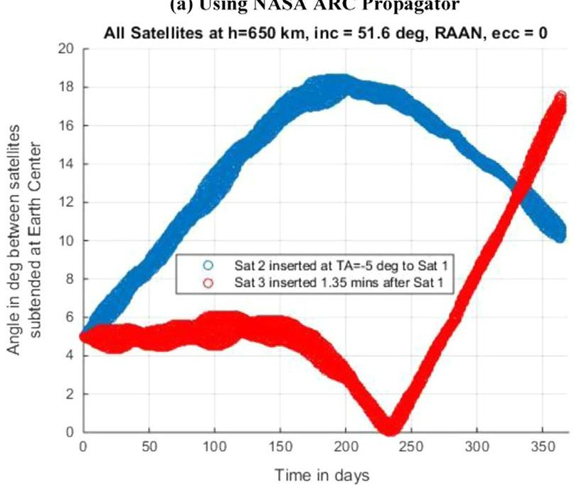

(b) Using STK HPOP Propagator

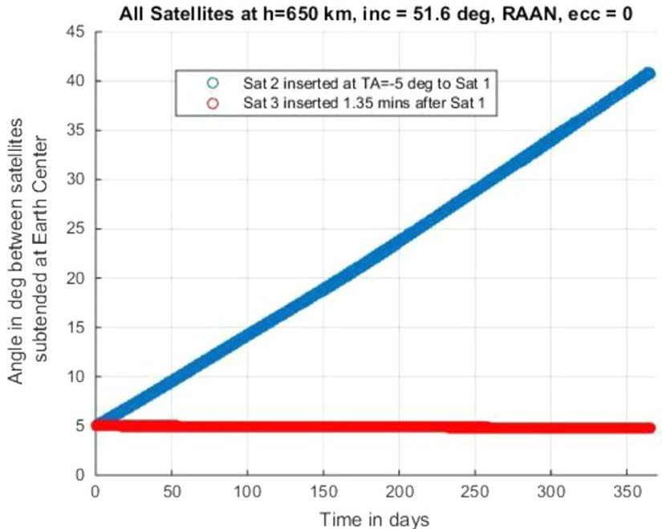

Fig. 18. Earth centric angle (analogous to TA) between 2 satellites inserted differentially, in space (blue) and in time (red), on the same orbit with respect to a reference satellite at 650 km, $ 5 1. 6^{\circ} $ $ \mathrm{RAA/N/TA/e=0} $ . The orbits were propagated using NASA ARC's LightForce propagator (a) and using AGI STK's HPOP or Astrogator propagator (b). (For interpretation of the references to color in this figure legend, the reader is referred to the web version of this article.)

curves in Fig. 18 between the bounds of $ 0-8 0^{\circ} $ for the ARC propagator and $ 4 5^{\circ}-0 $ for STK HPOP.

When the satellites in the STK HPOP simulation are introduced as Brouwer-Lyddane mean, short elements instead of osculating, Keplerian elements, the same initial conditions result in different relative behavior. When two satellites are inserted within $ 5^{\circ} $ of the initial position of a reference satellite in the same orbital plane, one leading and another trailing the reference, the differential TA drift behaves differently. The trailing satellite falls back linearly while the leading satellite virtually collides with the reference after 8 months and then increasingly trails it. Allocation of maintenance resources to correct for differential drift needs flexibility in terms of launch windows, global point of deployment and small changes in satellite behavior that cannot be precisely modelled in

<!-- PDF_PAGE: 18 -->

Delta-V and Time trade-off for delta-TA corrections

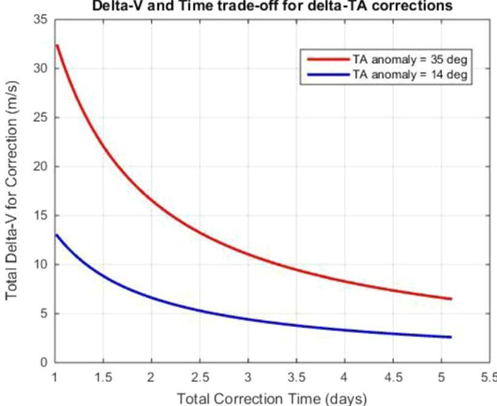

Fig. 19. Annual correction fuel vs. time required for reducing the divergent true anomaly, calculated equal to earth centric angle in Fig. 18, between any pair of satellites in the same orbit at 650 km, $ 51. 6^{\circ} $ . The trade-off is achieved by varying the size of the phasing orbit.

simulation but which may result in unpredictably large drifts. Since all the modelling in this section has been done in the global, Earth-centric inertial frame and the relative states of satellites calculated only as the last step, the orientation of the LVLH frame is not expected to produce extra anomalies. If the drift analysis were to be in LVLH or ECEF, the effect of a nonperfect alignment of the Earth's spin axis with the coordinate system adopted should be assessed analytically [54].

Propulsive manoeuvres will be needed to correct for drifting relative TA because too much diverging drift will break the formation and too much converging drift will increase the risk of inter-satellite collisions. Assuming the worst TA drift among all the above simulations (HPOP propagation of Sat 2 in Fig.18), $ 3 5^{\circ} $ of differential drift needs to be corrected over one year. The ARC propagator is more optimistic and predicts the need of $ 1 4^{\circ} $ of TA drift to be corrected annually. TA corrections are possible using a phasing orbit or atmospheric drag manoeuvres. There is a trade-off between required $ \Delta V $ and time, depending on the size of the phasing orbit as seen in Fig.19. Assuming the availability of 1-5 days per month for these corrections, 0.4 to 1.8 m/s is needed per satellite, which can easily be supported by CubeSat cold gas thrusters such as those provided by AustinSat. It is possible that general relativity acts as a source of disturbance just as zonal harmonics does [50,55]. However, since the presented simulations have accounted for all the operational variables (epoch and position of insertion) and multiple propagators, and since relativity effects on low Earth orbits is extremely small, it has been descoped from the current mission design.

Table 6 summarizes the propulsion budget per satellite for the baseline formation, listed as Config #3 in Table 1 including the trades between time and fuel. The maintenance budget is dependent on altitude and spherical harmonics of gravity and both electric and chemical propulsion are found feasible. Wheel desaturation can be performed with magnetorquers therefore optional in the budget.

Table 6 Propulsion budget per satellite for initialization and maintenance of the CubeSat baseline formation Config #3 in Table 1. The leader sat takes no time or fuel to initialize.

<table border="1"><tr><td>$\Delta V$</td><td>Time</td><td>Comments</td></tr><tr><td colspan="3">Initialization</td></tr><tr><td>10-220m/s</td><td>200-20 days</td><td>Trade-off between fuel-time for2 sats separated inRAAN</td></tr><tr><td>1-3m/s</td><td>26-7 days</td><td>Trade-off between fuel-time for3 sats separated inTA</td></tr><tr><td colspan="3">Maintenance against atmospheric drag(per month)</td></tr><tr><td>0-4m/s</td><td>$\sim$1h</td><td>From500km to400km(electric feasible)</td></tr><tr><td colspan="3">Maintenance against unpredictableJ2(per month)</td></tr><tr><td>0.4-1.8m/s</td><td>1-5days</td><td>To correct induced eccentricity(electric feasible)</td></tr><tr><td colspan="3">Reaction wheel desaturation(per month)</td></tr><tr><td>&lt;11m/s</td><td>10min</td><td>Total for all3wheels(electric feasible)</td></tr></table>

## 6. Summary and future work

We confirm applicability of using formation flight for multi-angular earth observation. The product estimated by imaging any ground spot simultaneously at different angles is called BRDF and is used to calculate the ground spot's narrowband albedo. Measurements are repeated for all points in the satellites' ground track. The value of formation flight is assessed using a coupled systems engineering and science evaluation model. Model Based Systems Engineering was used to generate architectures by permuting possible values of the design variables and checking if existing subsystems can support it. Observing System Simulation Experiments (OSSEs) were used to calculate the BRDF (RMS) and albedo error for each architecture. Error is calculated with respect to reference data, which is angular reflectance measured by NASA's airborne CAR instrument for the seven major Earth surface types, whose global distribution is obtained from the MODIS' land cover product.

Previous work has described the development and streamlining of the OSSE to retain only the most sensitive variables [22] and, of orbit design variables to retain only the combinations that can be maintained and that affect the OSSE errors significantly [26]. A preliminary report has shown the existence of CubeSat technology to support such a multi-angular formation flight mission in terms of subsystems [28]. This paper introduces three payload pointing strategies or modes and shows the effect of each on albedo estimation errors. It then assesses a tradespace of satellite orbits, maps their effect on estimation error and recommends a few baseline orbits with pointing operations that outperform multi-sensor monoliths in terms of angular sampling and associated errors. Since the exhaustive mission design is too detailed for a single publication, the technical aspects of the problem and its proposed implementation have been presented here. Parallel, cited literature is expected to complement this paper and support the important result that multiple platform missions with small satellites can effectively fill gaps in our knowledge of Earth.

Different imaging modes improve estimation errors, compared to the case when the same satellite points nadir while other satellites point to its nadir (Mode #1). Four satellites in non-optimal orbits over the savannah show an average Mode

<!-- PDF_PAGE: 19 -->

#1 error of 0.006 (Section 3.1). Changing the reference satellite dynamically (Mode #2) simulates an average error of 0.003, which is comparable to MISR, a single large platform with nine sensors (Section 3.2). Mode #2 errors are lower than 0.005 for all surface types and as low as zero for some (Section 3.4). Tracking pre-selected waypoints with all the satellites (Mode #3) reduces the albedo errors further, by providing more view angles, and can facilitate better polar albedo estimation (Section 3.3). Mode #3 errors average 0.001 over 20 min for the savannah surface type. To put the numbers in context, 0.001 in global albedo accuracy translates to $ 0. 3 \mathrm{~ W / m^{2}} $ in accuracy in total outgoing radiation, a standard NOAA has recommended. Moreover, the current accuracy of total outgoing radiation is $ 3. 4 \mathrm{~ W / m^{2}} $ , which corresponds to 0.0025 in albedo accuracy. However, this mode requires additional algorithms to select which ground spot to look and for how long, and scientists' input on the priority of retrieved products and spatio-angular trade-offs.

As a result of running a full factorial simulation on formation architectures with varying altitude, inclination and relative geometry, we found that 3 and 4 satellites arranged in RAAN-TA arrangements shown in Section 4.3 provide time-averaged albedo estimation errors of 1.86% (0.002) and 1.31% (0.0015) respectively, better than MISR's 3.6% (0.0065). Seven single-sensor satellites arranged in any of the slotted arrangements perform better than the 9-sensor monolith, in terms of angular sampling when averaged over time. When maximum albedo estimation error across all time was compared between MISR and the formations, MISR provided a 12% error, approximately the same as the worst case 5-satellite formation. MISR can be outperformed in terms of maximum albedo error by the best-case 3 to 4 satellite formations (4.2% to 6.4%) and 5 to 8 satellites arranged in any way (3% being the best). Altitude and inclination of the orbits affected errors insignificantly as long as all satellites shared the same altitude and inclination. BRDF is used as an input into several other critical Earth Science products, such as photosynthetic efficiency and vegetation indices therefore the formation flight implementations presented in this paper is also relevant for improving the accuracy for all products dependent on BRDF.

CubeSat ADCS and propulsion systems are capable of slewing and co-pointing the satellites to the same ground spot at the same time and maintaining orbits that are slight different in RAAN and TA (all the proposed formations) respectively. ADCS system analysis showed that the ground spot overlap for satellite attitude errors of 0.5 $ ^{\circ} $ and 1 $ ^{\circ} $ is 90-100% and 60-85% (respectively) of the perfect ground spot overlap if there had been no determination or control errors. Position errors up to 2 km were assumed. Commercial reaction wheels are shown to support the slew rates required to point the satellites at $ < 0.03 \% $ of maximum torque and no required momentum dumping because of cyclic motion. Pointing stability and jitter analysis are topics of future study. Momentum dumping every 6 hours using electric thrusters, or magnetorquers, is sufficient to handle worst-case disturbing forces. Initialization $ \Delta V $ is identified as a cost-differentiator among the architectures generated by varying the orbit variables. Less than 10 m/s/year of maintenance $ \Delta V $ is required for altitudes greater than 500 km, primarily for correcting against gravity zonal harmonics. Detailed analysis on required thrust

profiles and de-orbiting budgets will be discussed in a future publication.

## Acknowledgment

The authors acknowledge the following people, without whose help this paper in its present quality would not have been possible: Rajesh Poudyal (GSFC) for extracting and postprocessing the BRDF data for the CAR instrument, Warren Wiscombe (GSFC) for his contribution and consistent drive toward Leonardo-BRDF which first proposed the concept of formation flight for BRDF, Jacqueline LeMoigne (GSFC), Ralph Kahn (GSFC), Kerri Cahoy (MIT), Daniel Selva (Cornell), Alexei Lyapustin (GSFC) for their invaluable ideas toward making this study better and three anonymous reviewers for their comments to improve its readability. The primary author was funded by the Schlumberger Faculty for the Future Fellowship (FFTF) and the NASA Earth and Space Science Fellowship (NESSF).

## Appendix. Simulation time period

The simulations to calculate errors for every time step in a mission's life for the different architectures are very time-consuming. A four-hour truth simulation takes a few seconds per time step, per satellite, and comprises less than 3 daytime orbits. It is important to understand if the performance of an architecture over one daytime orbit (i.e. one of 15 continuous curves in Fig. 9-left) is well correlated to its performance in subsequent orbits when the metric is percentage error with respect to reference data, given a relevant surface type. If so, the OSSE can be run only for one orbit, reducing computation time to less than a third of the current.

Table 7 shows the correlation between the measurements taken over two randomly picked day time orbits for all architectures - RAAN-TA combinations, chief orbits, reference satellites and satellite numbers - to understand the mean predictability among orbits across all variables. The 86% correlation between the two orbits at p<0.01 indicates that two fully simulated orbits perform very similar to one another for the same architecture. Therefore, while this paper presents results over multiple orbits, going forward only one orbit's simulation is sufficient to assess performance as long as both land and water surface types are well represented and percentage errors are used.

## Table 7

Pearson correlation coefficient between all albedo error percentages for the 3 daytime orbits in a 4-hour simulation of 3, 4 and 5 satellite formations in all possible RAAN-TA combinations and 5 chief orbits. The orbits are in chronological order since the start of the simulation and the third orbit is only half-simulated causing low correlation. All correlations are significant （ $ p<0.01 $ ）.

<table border="1"><tr><td>Orbit#</td><td>#1</td><td>#2</td></tr><tr><td>#1</td><td>1</td><td>0.86</td></tr><tr><td>#2</td><td>0.86</td><td>1</td></tr></table>

<!-- PDF_PAGE: 20 -->

## References

[1] G. Tyc, J. Tulip, D. Schulten, M. Krischke, M. Oxfort, The RapidEye mission design, Acta Astronaut. 56 (2005) 213-219.

[2] F. Covello, F. Battazza, A. Coletta, G. Manoni, G. Valentini, COSMO-SkyMed mission status: Three out of four satellites in orbit, in: Proceedings of IEEE International Geoscience and Remote Sensing Symposium, IEEE, 2009.

[3] E. Gill, P. Sundaramoorthy, J. Bouwmeester, B. Zandbergen, R. Reinhard, Formation flying within a constellation of nano-satellites: The QB50 mission, Acta Astronaut. 82 (1) (2013) 110-117.

[4] A. da Silva Curiel, L. Boland, J. Cooksley, M. Bekhti, P. Stephens, W. Sun, M. Sweeting, First results from the disaster monitoring constellation (DMC), Acta Astronaut. 56 (1) (2005) 261-271.

[5] G. Krieger, A. Moreira, H. Fiedler, I. Hajnsek, M. Werner, M. Younis, M. Zink, TanDEM-X: a satellite formation for high-resolution SAR interferometry, IEEE Trans. Geosci. Remote Sens. 45 (11) (2007) 3317-3341.

[6] P. Lamy, L. Damé, S. Vivès, A. Zhukov, ASPIICS: a giant coronagraph for the ESA/ PROBA-3 Formation Flying Mission. In SPIE Astronomical Telescopes+Instrumentation, International Society for Optics and Photonics, 2010, July, pp. 773118-773118.

[7] S. D'Amico, J.-S. Ardaens, R. Larsson, Spaceborne autonomous formation-flying experiment on the PRISMA mission, J. Guid. Control Dyn. 35 (2012) 834-850.

[8] M. Gregory O'Neill, Annalisa L. Weigel, Assessing fractionated spacecraft value propositions for earth imaging space missions, J. Spacecr. Rocket, 48 (6) (2011) 974-986.

[9] A.A. Kerzhner, M.D. Ingham, M.O. Khan, J. Ramirez, J. De Luis, J. Hollman, D. Sternberg, Architecting Cellularized Space Systems using Model-Based Design Exploration, in: Proceedings of AIAA SPACE 2013 Conference and Exposition, 2013, September, p. 5371.

[10] S. Muñoz, J. Greenbaum, G. Lightsey, T. Campbell, S. Stewart, G. Holt, 'The fastrac mission: Operations summary and preliminary experiment results', in: Proceedings of Small Satellite Conference, Logan, Utah, 2011.

[11] N. Orr, J. Eyer, B. Larouche, R. Zee, Precision formation flight: the CanX-4 and CanX-5 dual nanosatellite mission, in: Proceedings of Small Satellite Conference, Logan, Utah 2007, 2007.

[13] B. Calvel, I. Cabeza, A. Cabral, E. Manske, J. Rebordao, R. Sesselmann, A. Verlaan. High precision optical metrology for Darwin: design and performance, in: Proceedings of the 5th International Conference on Space Optics, Vol. 554, 2004, June, pp. 501-507.

[12] Carpenter, G. Kenneth, Schrijver CarolusJ., Karovska Margarita, The Stellar Imager (SI) project: a deep space UV/Optical Interferometer (UVOI) to observe the Universe at 0.1 milli-arcsec angular resolution, Astrophys. Space Sci. 320 (1-3) (2009) 217-223.

[14] N. Woolf, Terrestrial Planet Finder. in Bioastronomy, 99 213, 143, 2000.

[15] S. Ramongassie, L. Phalippou, E. Thouvenot, D. Massonnet, Preliminary design of the payload for the interferometric cartwheel, in: Proceedings of the International Geoscience and Remote Sensing Symposium, 2000, Vol. 3, pp. 1004-1006. IEEE.

[16] J.P. Aguttes, The SAR train concept: An along-track formation of sar satellites for diluting the antenna area over N smaller satellites, while increasing performance by N, Acta Astronaut. 57 (2) (2005) 197-204.

[17] F. Caltagirone, A. Capuzi, A. Coletta, C. Galeazzi, E. Lopinto, A. Moccia, SABRINA the Italian Mission for Endowing COSMO-SkyMed with Bistatic and Interferometric Capabilities, EUSAR 2006.

[18] B.D. Tapley, S. Bettadpur, M. Watkins, C. Reigber, The gravity recovery and climate experiment: Mission overview and early results, Geophys. Res. Lett. 31 (2004) 9.

[19] Maria T. Zuber, David E. Smith, Michael M. Watkins, Sami W. Asmar, Alexander S. Konopliv, Frank G. Lemoine, H. Jay Melosh, et al., Gravity field of the Moon from the Gravity Recovery and Interior Laboratory (GRAIL) mission, Science 339 (6120) (2013) 668-671.

[20] Douglas C. Morton, Jyoteshwar Nagol, Claudia C. Carabajal, Jacqueline Rosette, Michael Palace, Bruce D. Cook, Eric F. Vermote, David J. Harding, Peter R. J. North, Amazon forests maintain consistent canopy structure and greenness during the dry season, Nature 506 (7487) (2014) 1221-1224.

[21] J. Esper, S. Neeck, W. Wiscombe, M. Ryschkewitsch, J. Andary, Leonardo-BRDF: A New Generation Satellite Constellation, in International Astronautical Congress; 51st; Rio de Janeiro, Brazil, 2-6 Oct. 2000.

[22] S. Nag, C.K. Gatebe, O. de Weck, Observing system simulations for small satellite formations estimating bidirectional reflectance, Int. J. Appl. Earth Obs. Geoinf. 43 (2015) 102-118.

[23] David J. Diner, Jewel C. Beckert, Terrence H. Reilly, Carol J. Bruegge, James E. Conel, Ralph A. Kahn, John V. Martonchik, et al., Multi-angle Imaging SpectroRadiometer (MISR) instrument description and experiment overview, IEEE Trans. Geosci. Remote Sens. 36 (4) (1998) 1072-1087.

[24] Xiaoxiong Xiong, Robert Wolfe, William Barnes, Bruce Guenther, Eric Vermote, Nazmi Saleous, Vincent Salomonson, Terra and Aqua MODIS design, radiometry, and geometry in support of land remote sensing, in: Ramachandran, Bhaskar, Justice, Christopher O., Abrams, Michael J. (Eds.), Land Remote Sensing and Global Environmental Change, Springer, New York, 2010, pp. 133- 164.

[25] Michael J. Barnsley, Jeff J. Settle, Mike A. Cutter, Dan R. Lobb, Frederic Teston, The PROBA/CHRIS mission: A low-cost smallsat for hyperspectral multiangle observations of the earth surface and atmosphere, IEEE Trans. Geosci. Remote Sens. 42 (7) (2004) 1512-1520.

[26] S. Nag, J. LeMoigne, D.W. Miller, O.L. De Weck, A Framework for Orbital

Performance Evaluation in Distributed Space Missions for Earth Observation. in IEEE Xplore, IEEE Aerospace Conference 2015 (2015).

[27] S.P. Hughes, L.M. Mailhe, A preliminary formation flying orbit dynamics analysis for Leonardo-BRDF, 2001, in: Proceedings of the IEEE Aerospace Conference, 2001.

[28] Sreeja Nag, Design and evaluation of distributed spacecraft missions for multiangular Earth observation (Ph.D. thesis), Massachusetts Institute of Technology, Cambridge, MA, USA, 2015, Available online at: https://dspace.mit.edu/ handle/1721.1/98586.

[29] F.E. Nicodemus, Geometrical considerations and nomenclature for reflectance, US Department of Commerce, 160, National Bureau of Standards Washington, D.C, 1977

[30] Mark J. Chopping, Terrestrial applications of multiangle remote sensing, In: Advances in Land Remote Sensing, Springer, Netherlands, 2008, pp. 95-144.

[31] M.J. Barnsley, A.H. Strahler, K.P. Morris, J.-P. Muller, Sampling the surface bidirectional reflectance distribution function (BRDF): 1. Evaluation of current and future satellite sensors, Remote Sens. Rev. 8 (4) (1994) 271-311.

[32] G. Thomas Arnold, S.-C. Tsay, Michael D. King, Jason Y. Li, Peter F. Soulen, Airborne spectral measurements of surface-atmosphere anisotropy for Arctic sea ice and tundra, Int. J. Remote Sens. 23 (18) (2002) 3763-3781.

[33] C.K. Gatebe, C.M. Ichoku, R. Poudyal, M.O. Román, E. Wilcox, Surface albedo darkening from wildfires in northern sub-Saharan Africa, Environmental Research Letters 9 (no. 6) (2014) 065003.

[34] Vonder Haar, H. Thomas, Verner E. Suomi, Measurements of the earth's radiation budget from satellites during a five-year period. Part I: extended time and space means, Journal of the Atmospheric Sciences 28 (no. 3) (1971) 305-314.

[35] Norman G. Loeb, Seiji Kato, Wenying Su, Takmeng Wong, Fred G. Rose, David R. Doelling, Joel R. Norris, Xianglei Huang, Advances in understanding top-of-atmosphere radiation variability from satellite observations, Surv. Geophys. 33 (3-4) (2012) 359-385.

[36] Kevin E. Trenberth, T. Fasullo John, Tracking Earth's energy, Science 328 (5976) (2010) 316-317.

[37] Daniel R. Feldman, Chris A. Algieri, Jonathan R. Ong, William D. Collins, CLARREO shortwave observing system simulation experiments of the twenty-first century: Simulator design and implementation, J. Geophys. Res.: Atmos. 116 (D10) (2011).

[38] Charles K. Gatebe, Michael D. King, Alexei I. Lyapustin, G. Thomas Arnold, Jens Redemann, Airborne spectral measurements of ocean directional reflectance, J. Atmos. Sci. 62 (4) (2005) 1072-1092.

[39] Michael D. King, Maxwell G. Strange, Peter Leone, Lamdin R. Blaine, Multiwavelength scanning radiometer for airborne measurements of scattered radiation within clouds, J. Atmos. Ocean. Technol. 3 (3) (1986) 513-522.

[40] Bruce Yost, EDSN-Edison Demonstration for SmallSat Networks Overview, in: Proceedings of Small Satellite Conference, Logan, Utah, 2013.

[41] Rose, Randy, Will Wells, Debi Rose, Chris Ruf, Aaron Ridley, and Kyle Nave. "Nanosat Technology And Managed Risk; An Update Of The CYGNSS Microsatellite Constellation Mission Development, in: Proceedings of Small Satellite Conference, Logan, Utah, 2014.

[42] Cheng, Jake, Jakob Lifshits, Cordell Grant, Mihail Barbu, and Robert Zee, The BRITE Constellation Space Telescope Design and Test of a Wide Field, High Resolution, Low Noise Optical Telescope for a Nanosatellite Constellation, in: Proceedings of Small Satellite Conference, Logan, Utah, 2011.

[43] Arlas, Jessica, Sara Spangelo. GPS results for the radio aurora explorer II cubesat mission, in: Proceedings of AIAA Region III Student Conference, Ann Arbor, MI, 2012.

[44] J.R. Wertz, D.F. Everett, J.J. Puschell, Space Mission Engineering: The New SMAD, Microcosm Press, 2011.

[45] W.W. Weiss, S.M. Rucinski, A.F.J. Moffat, A. Schwarzenberg-Czerny, O.F. Koudelka, C.C. Grant, R.E. Zee, et al., BRITE-constellation: nanosatellites for precision photometry of bright stars, Publ. Astron. Soc. Pac. 126 (940) (2014) 573.

[46] Lin, Michael, Thomas Flatley, John Godfrey, Alessandro Geist, Daniel Espinosa, David Petrick, SpaceCube 2.0: An Advanced Hybrid Onboard Data Processor, NASA Tech Briefs Report number GSC-15760-1, 2011.

[47] E.D. Wise, Design, analysis, and testing of a precision guidance, navigation, and control system for a dual-spinning Cubesat (SM thesis), Massachusetts Institute of Technology, Cambridge MA, 2013.

[48] A. Marinan, A. Nicholas, K. Cahoy, Ad hoc CubeSat constellations: Secondary launch coverage and distribution, in: Proceedings of IEEE Aerospace Conference, 2013, pp. 1-15, doi: http://dx.doi.org/10.1109/AERO.2013.6497174.

[49] Jason Andrews, Spaceflight Secondary Payload System (SSPS) and SHERPA Tug-A New Business Model for Secondary and Hosted Payloads, in: Proceedings of Small Satellite Conference, Logan, Utah, 2012.

[50] Lorenzo Iorio, Matteo Luca Ruggiero, Christian Corda, Novel considerations about the error budget of the LAGEOS-based tests of frame-dragging with GRACE geopotential models, Acta Astronaut. 91 (2013) 141-148.

[51] G. Renzetti, Satellite orbital precessions caused by the octupolar mass moment of a non-spherical body arbitrarily oriented in space, J. Astrophys. Astron. 34 (4) (2013) 341-348.

[52] G. Renzetti, Satellite orbital precessions caused by the first odd zonal J 3 multipole of a non-spherical body arbitrarily oriented in space, Astrophys. Sp. Sci. 352 (2) (2014) 493-496.

[53] Fan Y. Yang, Bron Nelson, Roberto Carlino, Andres D. Perez, Nicolas Faber, Chris Henze, Arif G. Karacahoglu, Conor O'Toole, Jason Swenson, Jan Stupl, LightForce Photon-pressure Collision Avoidance: Efficiency Analysis in the Current Debris Environment and Long-Term Simulation Perspective, International Astronautical Congress, Jerusalem, Israel, 2015.

<!-- PDF_PAGE: 21 -->

[54] Lorenzo Iorio, Perturbed stellar motions around the rotating black hole in Sgr $ A^{*} $ for a generic orientation of its spin axis, Phys. Rev. D 84 (12) (2011) 124001.

[55] Lorenzo Iorio, Herbert I.M. Lichtenegger, Matteo Luca Ruggiero, Christian Corda, Phenomenology of the Lense-Thirring effect in the solar system, Astrophys. Sp. Sci. 331 (2) (2011) 351-395.

[56] C.K. Gatebe, M.D. King, Airborne spectral BRDF of various surface types (ocean, vegetation, snow, desert, wetlands, cloud decks, smoke layers) for remote sensing applications, Remote Sens. Environ. 179 (2016) 131-148.

[57] L.P. Dyrud, J.T. Fentzke, G.S. Bust, K. Cahoy, W.J. Wiscombe, B. Gunter, H.C. Carlson et al., GEOScan: a geoscience facility from space, in: AGU Fall Meeting Abstracts, vol. 1, 2011, p. 1955.

[58] J.G. Walker, Continuous Whole-Earth Coverage by Circular-Orbit Satellite Patterns, Tech. Rep. 77044, Royal Aircraft Establ., 1977.

[59] G.B. Palmerini, Deployment of spacecraft large formations, in: Spaceflight Mechanics 2003, Advances in the Astronautical Sciences 114 (2003) 189-196.