<!-- PDF_PAGE: 1 -->

# Formally Verified Run Time Assurance Architecture of a 6U CubeSat Attitude Control System $ ^{*} $

Kerianne H. Gross $ ^{1} $ , Matthew A. Clark $ ^{2} $ , Jonathan A. Hoffman $ ^{3} $

Air Force Research Laboratory, Wright-Patterson Air Force Base, OH, 45433 Aaron W. Fifarek $ ^{4} $

LinQuest Corporation, Dayton, OH, 45431 Kuldip S. Rattan $ ^{5} $

Wright State University, Dayton, OH, 45435 Eric D. Swenson $ ^{6} $

Air Force Institute of Technology, Wright-Patterson Air Force Base, OH, 45433 Michael W. Whalen $ ^{7} $

Rockwell Collins, Cedar Rapids, IA 52402

Intelligent controller designs based on artificial intelligence and machine learning promise superior performance over traditional control techniques; however, the lack of transparency in intelligent control systems and the opportunity for emergent behaviors limits where these systems may be applied. Run Time Assurance (RTA) is a proposed methodology to allow intelligent (unverified) controllers to perform within a predetermined envelope of acceptable behavior. Rather than depending entirely on offline verification, RTA provides an online verification approach. Based on the Simplex Architecture, RTA architectures use a decision module to monitor control system performance and switch control from an unverified controller to a verified backup controller if the unverified controller violates acceptable behavior ranges or is forced to operate outside of predetermined conditions. The focus of this work is to combine formal methods analysis with an RTA architecture to generate proof that the output of the RTA controller does not violate safety properties. A 6U CubeSat attitude control subsystem case study is presented and formal methods are used to prove the outputs of the verified controller, decision module, and the larger RTA control system never violate a set of safety properties describing actuator limitations.

## I. Introduction

As the demand for increasingly complex and autonomous systems grows, designers may consider artificial intelligence or machine learning for more advanced, reactive systems control. While the performance gained by such increasingly intelligent systems may be far superior to traditional control techniques, the lack of transparency in the systems and opportunity for emergent behavior limits usability of the systems. New methods must be developed to ensure the control output of such controllers does not put the system or people interacting with it in danger. This challenge was highlighted by the Air Force Chief Scientist in his 2010 Technology Horizons Report, stating "It is possible to develop systems having high levels of autonomy, but it is the lack of suitable [verification and validation (V&V)] methods that prevents all but relatively low levels of autonomy from being certified for use." $ ^{1} $

<!-- PDF_PAGE: 2 -->

Run Time Assurance (RTA) is a proposed methodology to allow unverified controllers, such as an intelligent controller, to perform within a predetermined envelope of acceptable behavior. In contrast to offline verification, RTA provides online bounding of system performance. Run Time Assurance encompasses three distinct technologies: first, a run time or real-time monitoring and prediction scheme designed to detect failures not previously identified (software failure) or anticipated (bad environmental design assumptions) before they are about to occur; second, a failsafe recovery or steering mechanism guaranteed to recover the system in the event the monitor detects an eminent failure; third, a structured argument (or assurance case), supported by evidence, justifying that a system is acceptably safe not only through offline tests, but also through reliance on real-time monitoring, prediction, and failsafe recovery. $ ^{2,3} $ The performance of the system is monitored by a decision module that includes a set of acceptable conditions and behaviors. If the system is forced to operate outside of predetermined conditions or any of the acceptable behavior ranges are violated, the decision module switches control from the unverified controller to an appropriate verified backup controller, which could be thought of as the controller's "plan B." The system may have one or more verified backup controllers capable of tasks such as gracefully transitioning control from the unverified controller function to another verified controller function, maintaining a safe system state (i.e. avoiding an obstacle, or performing a holding pattern), or performing the same tasks expected of advanced controller with less efficiency. The designed system of verified backup controllers and decision modules can be analyzed using formal methods to ensure that none of the pre-determined safety conditions are violated.

The key contribution of this paper is the combined use of formal methods analysis tools and an RTA architecture to provide a combination of offline and online verification. The RTA architecture is implemented on a 6U CubeSat attitude control system that is presented as a case study. A set of formal verification tools are used to provide formal evidence that the controller does not violate safety properties specified for the system. The RTA architecture allows for the insertion of an intelligent or adaptive controller and ensures performance of the system with a decision module, and verified controller that are verified through the use of formal methods.

This paper begins with a brief overview of RTA concepts and design, followed by a description of formal methods analysis. Next, the case study 6U CubeSat attitude control subsystem is described. Then the process of applying different formal methods analysis techniques during the requirements, architecture, and modeling and simulation phases is described. The results of the formal methods analysis are presented and complemented with a simulation demonstration of the RTA controller's ability to monitor the unverified controller switch control. Capabilities, challenges, and gaps in the process are identified and discussed. Conclusions and recommendations are made for next steps in this research.

## II. Background

## A. Run Time Assurance

RTA architectures are based on concepts from software sandboxing and the Simplex Architecture. Sandboxing is a technique of isolating sections of code to limit the section's ability to cause critical system errors and is often used in software and web-based security testing to isolate untested and untrusted code from active critical resources. $ ^{4} $ This is similar to RTA which isolates the unverified controller from the rest of the control system. The Simplex Architecture $ ^{5} $ provides protection of the plant by isolating the complex controller and adding a decision

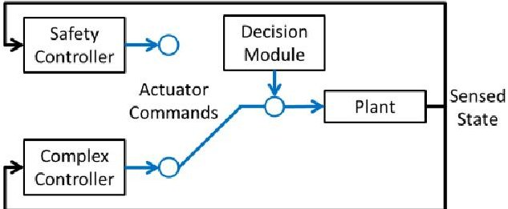

Figure 1. The Simplex Architecture

module and safety controller, as depicted in Figure 1. Whenever the complex controller threatens the safety of the plant, the decision module activates, switching control to a proven safety controller. In this research, the Simplex "complex controller" is analogous to the RTA "unverified controller," and the "safety controller" corresponds to the "verified controller." The Simplex Architecture has been applied to systems such as a fleet of remote-controlled cars, a pacemaker, a set of advanced aircraft maneuvers, and an autonomous waypoint tracking system. While sandboxing techniques and Simplex Architectures are sometimes used only in testing environments, the RTA architecture is envisioned to be deployed with the operational system to ensure safe behavior of the system in its environment.

In the proposed RTA architecture pictured in Figure 2, the system state is sent to each of the subcomponents: the unverified controller, the verified controller, and the decision module. The verified and unverified controller each provide actuator commands to the decision module. The decision module monitors the unverified controller, and if a safety property is violated, control is switched to the verified controller. The verified controller has been

<!-- PDF_PAGE: 3 -->

verified to meet safety properties through some offline verification method such as formal methods analysis, simulation, and flight test. The RTA is not limited to one verified safety or recovery controller. A control system might be devised such that it has multiple recovery controllers and switches to the appropriate one based on the state of the system.

The decision module is not limited to switching only when a specific safety property is violated either; the decision to switch could be made on a much more complex set of criteria.

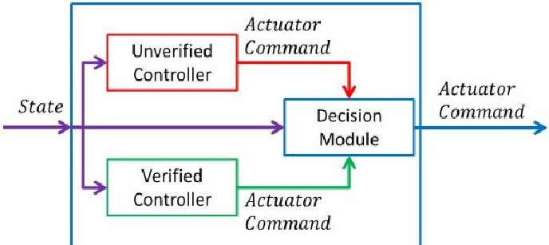

Figure 2. Run Time Assurance Architecture

For example, the F-16 Automatic Ground Collision Avoidance System (Auto GCAS) developed by AFRL and Lockheed Martin $ ^{10} $ could be considered an RTA system if one examines it's core functionality. Auto GCAS depends on the pilot to be the primary controller of the aircraft. In the RTA analogy, the pilot could be thought of as the "unverified controller" because he or she is subject to situations such as gravity-induced loss of consciousness, target fixation, task saturation, or loss of situational awareness that may compromise his or her ability to control the aircraft. Continuing with the RTA analogy, the prescripted automatic recovery maneuver Auto GCAS uses to avoid terrain would be considered the "verified controller." This automatic maneuver rolls the aircraft to wings level and pulls up to 5gs to avoid colliding with the terrain.The Auto GCAS algorithm serves as the "decision module" in the RTA analogy with the responsibility to monitor the path of the aircraft, switch control to an automatic recovery controller when a collision is imminent, and switch control back to the pilot when the aircraft has cleared the terrain. The Auto GCAS "decision module," uses a complex algorithm that compares a projection of the automatic recovery maneuver to a two dimensional projection of the terrain with buffers ahead of the aircraft to determine if a ground

collision is imminent. When the projection of the recovery maneuver intersects the projection of the terrain with safety buffers as show in Figure 3, the Auto GCAS "decision module" switches control from the pilot (unverified controller) to the automatic recovery maneuver (verified controller). Once the terrain is cleared, the Auto GCAS "decision module" switches control from the automatic recovery maneuver back to the pilot. This example simplifies the Auto GCAS functionality, but illustrates an alternative implementation of an RTA architecture than the case study presented in this paper.

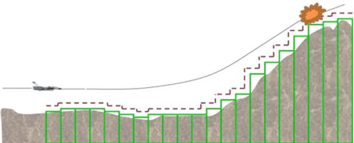

Figure 3. The Auto GCAS Automatic Maneuver and Terrain Projection Comparison.

## B. Formal Methods Analysis

The NASA Langley Formal Method Group defines formal methods as "mathematically rigorous techniques and tools for the specification, design and verification of software and hardware systems." $ ^{11} $ This field of study relies on the foundational belief that mathematically rigorous statements (i.e., well-formed mathematical logic) used to form specifications of a system can be verified through an exhaustive process to determine the correctness of a system. A formally designed system can be checked by an algorithmic process (typically with model checkers or theorem provers). Model Checking utilizes graph theory to build finite models to exhaustively examine and verify the correctness of decision mode logic and discrete state machines. One of the primary advantages of model checking is the algorithmic way that these tools can progress through these constructed models. Model checking tools utilize various techniques to be able to reason on these systems such as binary decision diagrams (BDDs), k-induction, property directed reachability, etc. Model checking produces either a proof or a counter example. A proof is produced if no violation of a formal specification was discovered in the exploration of the finite state machine (FSM). A counterexample is a trace through the FSM that illustrates how the formalized specification could be violated. Model checkers describe the techniques to examine the FSM, not how the individual case is determined to be upheld or is valid. The decisions on feasibility at specific "nodes" (individual state machine locations) is leveraged off of the use of satisfiability (SAT) solvers or Satisfiability Modulo Theory (SMT) solvers that add modulo theory to SAT capabilities. These tools perform the specific node analysis to provide the model checker results that can be utilized in many of the techniques mentioned previously. Some examples of solvers include Yices1 $ ^{12} $ , Yices2, CVC4 $ ^{13} $ , Z3 $ ^{14} $ , MathSAT $ ^{15} $ , and SMTInterpol. $ ^{16} $ In this work, formal methods tools are used to prove that the output of the RTA controller does not violate safety properties of the system.

<!-- PDF_PAGE: 4 -->

## III. Case Study: AFIT 6U CubeSat Testbed

The 6U CubeSat owned by the Air Force Institute of Technology (AFIT) is used as a case study for the formally verified RTA architecture approach. Background information on CubeSats, reaction wheel array actuation, and previous work in formal analysis of the rate-limited PID controller is presented in this section.

## A. CubeSats

CubeSats are small satellites built in units, or U, which are nominally $ 1 0 \times1 0 \times1 0 \mathrm{c m}^{3} $ or 1 liter, in volume and weigh 1.3 kilograms (3 pounds) or less. CubeSats are generally much less expensive to design, test, transport and launch than larger traditional satellites and therefore present a potential time and cost effective approach to meet DoD project needs. $ ^{17} $ However, the limited size and weight of smaller CubeSats provide little space for mission-specific payloads and the advanced subsystems required to support them. To meet the increasing needs associated with anticipated DoD missions, AFIT's Center for Space Research and Assurance (CSRA) is currently developing 6U, 12U, and 27U CubeSats which promise larger payload capacity than the traditional 1U and 3U versions. $ ^{18} $ This research looks at the 6U size, a version of which is currently under development at AFIT.

## B. Reaction Wheel Array Attitude Control

The primary spacecraft actuator used in this work is a reaction wheel array. Reaction wheels are common actuators used for precision spacecraft attitude control that work by exchanging momentum with the spacecraft. By contrast, actuators such as thrusters or magnetic torque devices interact with the environment to apply an external torque to the spacecraft, which changes the spacecraft total angular momentum. The angular momentum of the wheels is equal and opposite to the angular momentum that it exchanges with the spacecraft, so that the total angular momentum of the spacecraft remains constant. A description of the four wheel pyramid reaction wheel array, equations of motion and rate-limited PID control scheme used in this work is presented in previous work. $ ^{19} $

## C. System Level Decomposition and Signal Flow

As described in previous work, $ ^{19} $ a 6U CubeSat is decomposed from the system level into a controller and the environment. The controller subsystem contains the software portion of the controller, while the environment includes models of the 6U CubeSat structure, reaction wheel array actuator and sensors at varying levels of abstraction. The environment is further functionally decomposed into the reaction wheel array and the structure. The sensors are completely abstracted and it is assumed that the controller receives perfect truth data. The reaction wheel array is explored one more level down to the individual reaction wheels. The simulated environment outputs the current system state including the orientation of the spacecraft as a quaternion, the rotation rates of each of the major axes of the spacecraft, and the rotation rates of each of the individual reaction wheels. At each step in the simulation of the system, a unit delay is placed between the output of the environment and the controller. The controller receives the state information from the previous time step and uses that to calculate a commanded angular acceleration with a rate limited PID controller for each of the reaction wheels in order to approach and eventually achieve the desired spacecraft orientation. The angular acceleration commands are received and implemented by each of the individual reaction wheels. The reaction wheels then contribute angular momentum to the reaction wheel array which exchanges its total angular momentum with the spacecraft structure. The structure updates the state of the spacecraft and the environment outputs the system state. This signal of the system is depicted in Figure 4.

<!-- PDF_PAGE: 5 -->

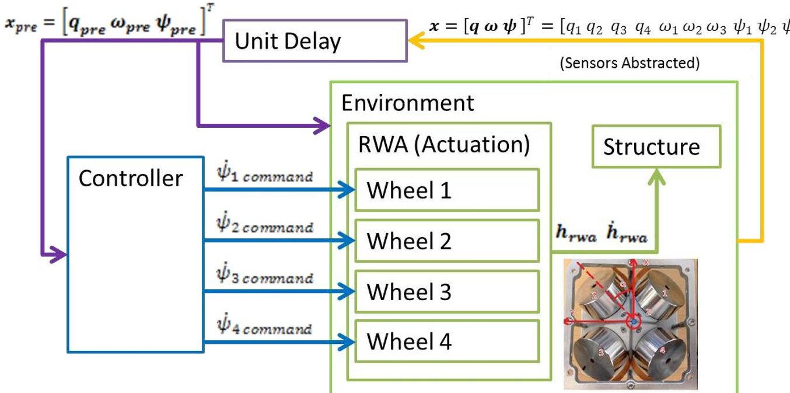

Figure 4: 6U CubeSat Signal Flow

## D. Rate-Limited PID Controller

The controller used in this work is a rate limited PID controller based on the controller introduced by Bong Wie, $ ^{20} $ in which the change in angular momentum of the reaction wheel array is calculated from the following equation:

$$
\dot {h} _ {r w a} = K _ {P} I q _ {e (1 2 3)} + K _ {D} I \omega + K _ {I (1, 1)} \Delta t q _ {e (1)} + K _ {I (1, 1)} \Delta t q _ {e (2)} + K _ {I (1, 1)} \Delta t q _ {e (3)} - \omega^ {\times} \left(I \omega + h _ {r w a}\right)
$$

where $ \dot{h}_{rwa} $ is the reaction wheel array angular momentum change, $ K_{P}, $ $ K_{I}, $ and $ K_{D} $ are the proportional, integral, and derivative gains of the controller, $ q_{e(123)} $ is a vector part of the error quaternion, I is the spacecraft 3x3 inertia, $ \omega $ is the spacecraft angular velocity vector, $ \Delta t $ is the time step of the simulation, $ \omega^{\times} $ is a skew symmetric matrix with offdiagonal components comprised of the angular velocity vector elements, and $ h_{rwa} $ is the reaction wheel array angular momentum. The gains of this controller are calculated from the following equations:

$$
K _ {P} = I \left(\omega_ {n} ^ {2} + \frac {2 \zeta \omega_ {n}}{T}\right)
$$

$$
K _ {I} = I \left(\frac {\omega_ {n} ^ {2}}{T}\right)
$$

$$
\boldsymbol {K} _ {D} = \boldsymbol {I} \left(2 \zeta \omega_ {n} + \frac {1}{T}\right)
$$

$$
T = \frac {1 0}{\zeta \omega_ {n}}.
$$

For the simulation, $ \zeta $ is 5, $ \omega_{n} $ is 1, and $ \Delta t $ is 0.001. The resulting reaction wheel commanded angular acceleration is calculated as:

$$
\dot {\psi} _ {c o m} = S _ {p i n v} \dot {h} _ {r w a}
$$

where $ \dot{\psi}_{com} $ is a vector of the commanded change in angular velocity for each of the four reaction wheels, and $ S_{pinv} $ is the pseudoinverse of the S matrix that orients the angular momentum contribution of each reaction wheels with the principal axis of the spacecraft. Rate limits are placed on the commanded angular velocities for each of the wheels that limit the maximum acceleration, and the maximum velocity that can be produced from the commanded acceleration given the current angular velocity of the reaction wheels.

<!-- PDF_PAGE: 6 -->

## IV. Methodology

In this section, the RTA architecture controller implementation is presented, and the results of the formal methods analysis are discussed.

## A. Run Time Assurance Controller Architecture

This work extends previous research by implementing an RTA architecture in the controller block. In previous work, the controller block only contained rate-limited PID control software. In this work, the controller is decomposed into the unverified controller, verified controller, and decision module. The verified controller contains the rate-limited PID controller from the previous work, which has been proven using formal methods not to violate the two safety properties of interest. The unverified controller could contain any control design, including controllers that use artificial intelligence and machine learning,

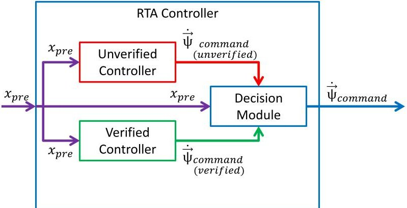

Figure 5. Signal flow in the RTA controller.

that potentially provides better performance than the verified rate-limited PID controller. The decision module contains the logic which determines which control signal, verified or unverified, is sent to the actuator. The system state is received by the unverified controller, verified controller, and decision module. The decision module also receives a commanded reaction wheel acceleration vector from each of the controllers. The signal flow in the RTA controller is summarized in Figure 5.

## B. Decision Module Design

The key component of this design is the decision module, which can be thought of as a switching mechanism. The decision module receives the current state of the system and the command from each of the two controllers. The process of isolating an unverified controller, designing a decision module to monitor its performance and switch to a verified controller has several advantages. One of the primary reasons to use a decision module is to allow the unproven control system to prove itself over the course of hundred, thousands, or more hours of performance. After a sufficient time in service, the unverified controller may prove that it will not violate the safety properties, and the decision module and verified controller backup could be removed.

In this work, desired safety properties are used to constrain the operating region of the unverified controller and inform the decision to switch to a verified backup controller. The safety properties are arranged in if-else logic, which provides several advantages. During the design process, a designer may want to check to see if the unverified controller violates other properties of interest beyond those used to constrain the operating envelope of the unverified controller. An if-else decision tree enables the addition of a new constraint to the unverified controller without compromising the other system constraints. In addition, breaking properties into like groups in if-else statements allows reviewers to quickly inspect, debug and isolate problems in the code.

In this implementation, the decision module first checks to see if the unverified controller has violated any of the safety properties in the past. The rationale for checking previous instances of violations first is that if the unverified controller has previously violated a safety property, it cannot be trusted until a reset, redesign, or other change is implemented. Mode logic to incorporate unverified controller resets is left for future work. Second, the decision module then checks to see if the unverified controller violates the maximum commanded acceleration property for any of the four wheels in the array. Third, the decision module checks that the commanded angular acceleration will not result in a predicted angular velocity that exceeds the maximum velocity property for any of the four wheels. As depicted in Figure 6, if no violation of the safety properties has occurred, and the commanded angular acceleration to each reaction wheel from the unverified controller does not exceed the maximum allowable limit, and the angular velocity of each wheel resulting from the commanded angular acceleration does not exceed the maximum allowable angular velocity of the reaction wheel array, then the decision module allows the output from the unverified controller to pass through to the actuators. If however, a violation has previously occurred, or the output command of the unverified controller exceeds motor limits or will result in an angular velocity limit violation in any of the wheels, then the decision module sends the output of the verified controller to the actuators, as depicted in Figure 7.

<!-- PDF_PAGE: 7 -->

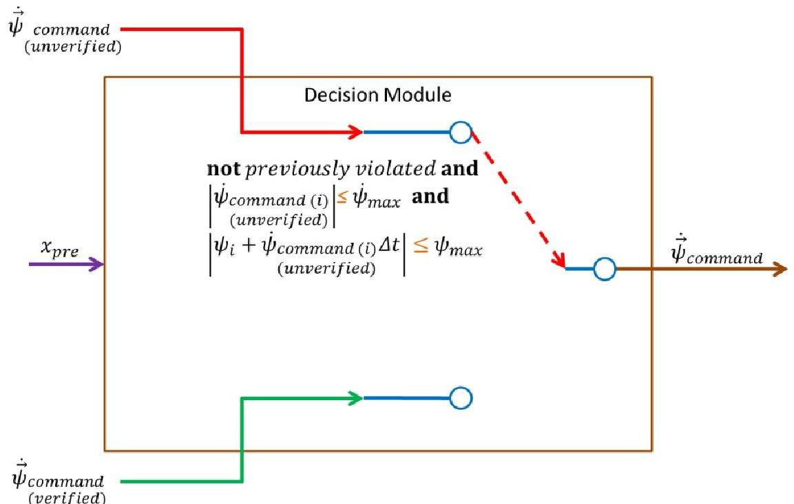

Figure 6: Signal flow through the decision module when the safety properties of the system are not violated by the unverified controller.

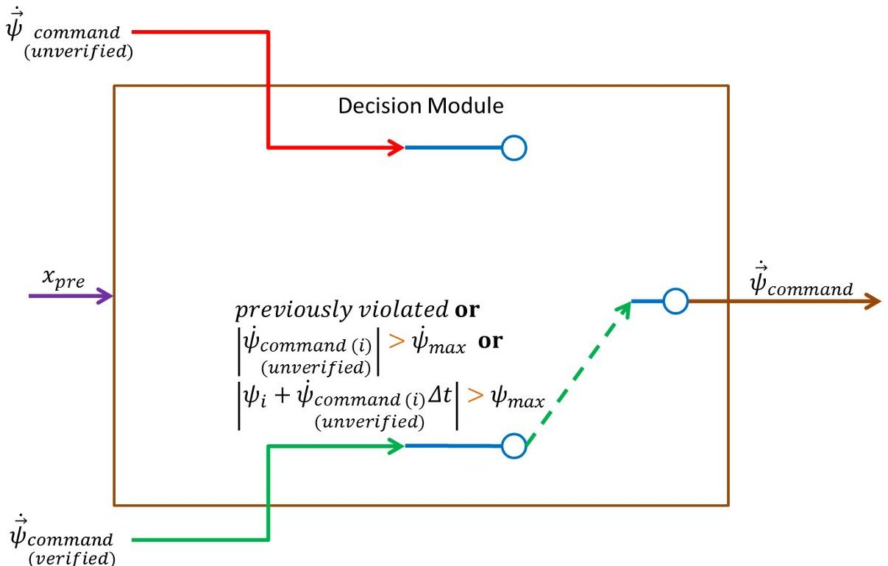

Figure 7: Signal flow through the decision module when the safety properties of the system are violated by the unverified controller.

## C. Formal Methods Analysis Toolset

This section describes the formal methods tools used in this research to analyze the requirements, architecture, and model of the design. First, the Specification and Analysis of Requirements (SpeAR) framework is used to apply model checking and limited theorem proving analysis to the system requirements. Second, the Assume Guarantee REasoning Environment (AGREE) annex is used to complete assume-guarantee contract analysis to the architecture of the system written in the Architecture Analysis & Design Language (AADL). Finally, Simulink Design Verifier is used to analyze the Simulink model of the system.

<!-- PDF_PAGE: 8 -->

## 1. System Requirements and SpeAR

The requirements for the RTA control system are expressed in a mathematically rigorous framework currently under development by Rockwell Collins and AFRL called the Specification and Analysis of Requirements (SpeAR) tool. The SpeAR tool allows subject matter experts to write system requirements in peer-reviewed specification templates $ ^{19} $ that allow for formal analysis. This part of the process serves two purposes. First, expressing requirements in a formalized notation gives them a precise, mathematical meaning. This requires engineers to unambiguously state the true meaning of each requirement. Second, SpeAR translates formalized requirements into logical expressions that can be analyzed using model checking techniques.

By comparing system requirements to high level system properties in a model checker, requirements and derived requirements added throughout the design of the system can be analyzed for completeness and consistency. The properties and requirements documented in SpeAR are translated into a Lustre $ ^{22} $ model and sent to JKind, $ ^{23} $ a k-induction model checker. $ ^{24} $ JKind uses Satisfiability Modulo Theory (SMT) solvers, such as Z3, $ ^{25} $ to inductively prove that a given model meets its formal specification. In the instance of SpeAR, the model is defined by the formalized system requirements and the specification defined by its properties. JKind either reports that the system's properties are satisfied by the given requirements, or it provides a sequence of inputs, referred to as a counterexample, that demonstrates one way in which a property can be violated. This counterexample can be used by domain experts to refine either the requirements or the properties until a proof is obtained.

## 2. System Architecture and AGREE

The properties and requirements expressed in SpeAR are then used to develop the system architecture in the Architecture Analysis & Design Language (AADL). AADL was standardized by SAE in 2004 as an architecture modeling framework to allow analysis of system designs prior to detailed development. $ ^{26} $ AADL allows for the inclusion of annexes for additional functionality. The Assume Guarantee REasoning Environment (AGREE) AADL annex $ ^{27} $ was developed by Rockwell Collins and University of Minnesota as part of the DARPA High Assurance Cyber Military Systems (HACMS) program to use assume-guarantee contracts to evaluate the behavior of the subsystem components within the greater system. Properties in SpeAR are documented as guarantees of the system in AGREE, and requirements developed in SpeAR are used to build the system behavior. Like SpeAR, AGREE utilizes JKind and Z3 to conduct model checking and theorem proving to assure that the guarantees hold. Again, like SpeAR, Z3 outputs proofs or counterexamples that your architecture fulfills the guarantees with the given assumptions. If the guarantee is falsified, a counterexample is produced showing how the system architecture violated the guarantee.

## 3. System Model and Simulink Design Verifier

The verified architecture provides the framework for a Simulink model and simulation of the control system. The assumptions and guarantees developed during the architecture phase are used to manually write the Simulink files. The model is then analyzed using Simulink Design Verifier to prove that the properties (documented as guarantees in AGREE, and as properties and requirements in SpeAR) hold true throughout the modeling phase. Simulink model reference blocks were used to reference each of the subsystems and compose the entire system.

## D. Decision Module Verification

This section describes the specific decisions made in the process of verifying the RTA controller design using the formal methods tools describe in the previous section.

## 1. Safety Properties

In previous work, $ ^{19} $ formal methods were used to prove that the rate-limited PID controller would not violate two safety properties: the maximum angular velocity and the maximum angular acceleration of the reaction wheels, as presented in Figure 8, where the subscript i corresponds to the individual reaction wheels. These two safety properties are designed to protect the motor that actuates the reaction wheels from damage. In this work, these two safety properties are used to formally analyze the requirements, architecture, and model of the RTA controller. When applied to each of the 4 reaction wheels, a total of 8 safety properties used to analyze the output of the RTA controller components.

Safety Properties:

1) $ \left| \dot{\psi}_{i}\right| \leq \dot{\psi}_{max} $

$$
2) \left| \psi_ {i} + \dot {\psi} _ {i} \Delta t \right| \leq \psi_ {m a x}
$$

$$
i = 1, 2, 3, 4
$$

Figure 8. Desired safety properties of the controller.

<!-- PDF_PAGE: 9 -->

## 2. Verification Approach

The work presented in this paper expands upon that previous work by adding an isolated unverified controller and decision module in an RTA framework and proving that the output of the RTA controller architecture will not violate the same two safety properties. By definition, the unverified controller is such that it cannot be proven to hold the desired safety properties in all cases using formal methods. The verified controller, however, should be proven using formal methods or an alternative verification method. For instance, in practice a verified controller may be one that has proven its performance over a long period

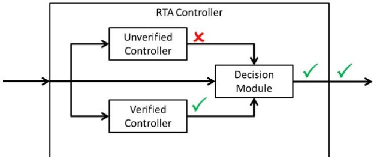

Figure 9. Expected formal verification analysis results for the RTA controller and subcomponents.

of operational service. In this research, the verified controller is analyzed using formal methods to prove that it never violates the two safety properties; however, other verification methods might be used. Similarly, the decision module is analyzed using formal methods to prove that the constraints on the unverified controller are sufficient to guarantee that decision module output never violates the controller safety properties. The proof evidence from each of the RTA controller subcomponents is combined compositionally to form the RTA controller subsystem which is then also formally analyzed to prove that the output of the larger RTA controller does not violate safety properties. Figure 9 summarizes which outputs of the RTA controller and its subcomponents are formally verified in this approach.

## 3. Assumptions

The nature of model checking requires assumptions to be made which constrain its searchable space. Without constraints the model checker may assign any of the appropriate data type to the signals entering the component of interest, without regard to whether meaning of these numbers are physically possible. For example, the model checker may assign an altitude of 30,000 feet and then instantaneously assign an altitude of 100,000 feet in the next time step, without an assumption constraining the maximum climb rate of the aerospace model. In addition to constraining the space to that which is physically possible and reducing computational demands, formal assumptions provide precise documentation of design assumptions that may be evaluated by subject matter experts. Assumptions should be used with caution, as they can over constrain the search space and ignore critical areas where the system under analysis could enter.

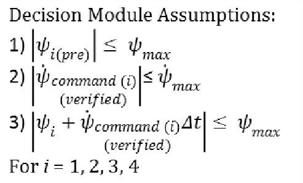

Figure 10. Assumptions used by the decision module to constrain the formal methods analysis space.

In this work, three assumptions are made about the decision module input in order to constrain the model checker. First, it is assumed that the previous reaction wheel speeds entering the decision module do not exceed the maximum reaction wheel speeds. Mode logic to deal with the eventuality that the reaction wheels are spinning faster than the allowable at system initialization is left for future work. Second and third, it is assumed that the verified controller output does not violate the two safety properties governing maximum velocity or acceleration. The mathematical expression of these assumptions is presented in Figure 10. This assumption is valid because the rate-limited PID controller is formally proven to meet these properties as a part of this analysis. In general, assuming that inputs to the decision module meet properties should only occur if proof of that claim exists, otherwise the assumption would unnecessarily constrain the model checker.

## V. Results and Discussion

This section describes the results of the formal methods analysis on the requirements, architecture, and model of the system as well as a simulation demonstration of the RTA controller's active switching logic.

<!-- PDF_PAGE: 10 -->

## A. Formal Analysis

The RTA controller design was successfully implemented in SpeAR, AADL, and Simulink. Using SpeAR's reason tool, AGREE, and Simulink Design Verifier, the implementation of the controller in each of these tools was analyzed against the eight safety properties described in section IV. In SpeAR and AGREE the unverified controller, verified controller, and decision module were all analyzed separately before they were combined compositionally into the RTA controller and analyzed at the controller subsystem level. All eight of the properties were proven valid for the verified controller, decision model, and larger RTA controller subsystem; however, the properties could not be proven for the unverified controller. The results of the SpeAR analysis, which shows that all 8 properties are valid for all but the unverified controller, is presented in Figure 11. These results are as expected. In other words based on the assumptions on the input to each of the subsystems, and the derived requirements of the subsystems, it was proven that no case existed in which the output of the verified controller, decision module, or RTA controller as a whole would violate the safety properties of the system in abstracted requirements and architecture levels of the system description. SpeAR is being developed by members of the same organization responsible for developing AGREE and uses the same underlying solvers as AGREE, JKind and Z3. SpeAR and AGREE are both designed to enable compositional verification, the capability that allows the designer to pull design information from the subcomponent level to the subsystem level. For this research, it means that SpeAR and AGREE can pull information from the verified controller, unverified

<table class="table table-bordered"><thead><tr><th>Property</th><th>Result</th></tr></thead><tbody><tr><td>✓ r_01a_ctrl</td><td>Valid (1s)</td></tr><tr><td>✓ r_01b_ctrl</td><td>Valid (1s)</td></tr><tr><td>✓ r_01c_ctrl</td><td>Valid (1s)</td></tr><tr><td>✓ r_01d_ctrl</td><td>Valid (1s)</td></tr><tr><td>✓ r_02a_ctrl</td><td>Valid (1s)</td></tr><tr><td>✓ r_02b_ctrl</td><td>Valid (1s)</td></tr><tr><td>✓ r_02c_ctrl</td><td>Valid (1s)</td></tr><tr><td>✓ r_02d_ctrl</td><td>Valid (1s)</td></tr><tr><td>✓ SixU_CubeSat_v2_Unverified_Controller~0.r_01a_ctrl</td><td>Invalid (0s)</td></tr><tr><td>✓ SixU_CubeSat_v2_Unverified_Controller~0.r_01b_ctrl</td><td>Invalid (0s)</td></tr><tr><td>✓ SixU_CubeSat_v2_Unverified_Controller~0.r_01c_ctrl</td><td>Invalid (0s)</td></tr><tr><td>✓ SixU_CubeSat_v2_Unverified_Controller~0.r_01d_ctrl</td><td>Invalid (0s)</td></tr><tr><td>✓ SixU_CubeSat_v2_Unverified_Controller~0.r_02a_ctrl</td><td>Invalid (0s)</td></tr><tr><td>✓ SixU_CubeSat_v2_Unverified_Controller~0.r_02b_ctrl</td><td>Invalid (0s)</td></tr><tr><td>✓ SixU_CubeSat_v2_Unverified_Controller~0.r_02c_ctrl</td><td>Invalid (0s)</td></tr><tr><td>✓ SixU_CubeSat_v2_Unverified_Controller~0.r_02d_ctrl</td><td>Invalid (0s)</td></tr><tr><td>✓ SixU_CubeSat_v2_Unverified_Controller~0.r_output_ctrl_unv</td><td>Invalid (0s)</td></tr><tr><td>✓ SixU_CubeSat_v2_Verified_Controller~0.r_01a_ctrl_ver</td><td>Valid (0s)</td></tr><tr><td>✓ SixU_CubeSat_v2_Verified_Controller~0.r_01b_ctrl_ver</td><td>Valid (0s)</td></tr><tr><td>✓ SixU_CubeSat_v2_Verified_Controller~0.r_01c_ctrl_ver</td><td>Valid (0s)</td></tr><tr><td>✓ SixU_CubeSat_v2_Verified_Controller~0.r_01d_ctrl_ver</td><td>Valid (0s)</td></tr><tr><td>✓ SixU_CubeSat_v2_Verified_Controller~0.r_02a_ctrl_ver</td><td>Valid (0s)</td></tr><tr><td>✓ SixU_CubeSat_v2_Verified_Controller~0.r_02b_ctrl_ver</td><td>Valid (0s)</td></tr><tr><td>✓ SixU_CubeSat_v2_Verified_Controller~0.r_02c_ctrl_ver</td><td>Valid (0s)</td></tr><tr><td>✓ SixU_CubeSat_v2_Verified_Controller~0.r_02d_ctrl_ver</td><td>Valid (0s)</td></tr><tr><td>✓ SixU_CubeSat_v2_Decision_Module~0.r_01a_ctrl_dm</td><td>Valid (0s)</td></tr><tr><td>✓ SixU_CubeSat_v2_Decision_Module~0.r_01b_ctrl_dm</td><td>Valid (0s)</td></tr><tr><td>✓ SixU_CubeSat_v2_Decision_Module~0.r_01c_ctrl_dm</td><td>Valid (0s)</td></tr><tr><td>✓ SixU_CubeSat_v2_Decision_Module~0.r_01d_ctrl_dm</td><td>Valid (0s)</td></tr><tr><td>✓ SixU_CubeSat_v2_Decision_Module~0.r_02a_ctrl_dm</td><td>Valid (0s)</td></tr><tr><td>✓ SixU_CubeSat_v2_Decision_Module~0.r_02b_ctrl_dm</td><td>Valid (0s)</td></tr><tr><td>✓ SixU_CubeSat_v2_Decision_Module~0.r_02c_ctrl_dm</td><td>Valid (0s)</td></tr><tr><td>✓ SixU_CubeSat_v2_Decision_Module~0.r_02d_ctrl_dm</td><td>Valid (0s)</td></tr></tbody></table>

Figure 11. SpeAR Analysis Results.

controller, and decision module up to complete analysis of the RTA controller as a whole. If desired, it could pull information from the controller and environment levels up to complete a system level verification as well. In SpeAR and AGREE, compositional verification of the RTA controller took less than a second to complete. The results of the AGREE analysis for the RTA controller are shown in Figure 12. The results are expanded at the RTA level to reveal the velocity and acceleration properties for each wheel. The decision module (DM_sub) and verified controller (VER_sub) properties are all also proven; however the properties are invalid for the unverified controller (UNV_sub), as indicated by the red box with containing the exclamation mark. In order to completely prove the RTA controller, one simply needs to remove the safety property guarantees from the unverified controller.

<!-- PDF_PAGE: 11 -->

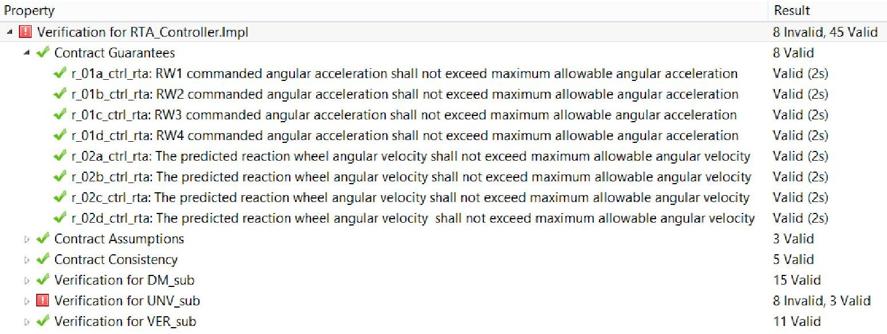

Figure 12. AGREE Analysis Results.

The Simulink model could be analyzed using Simulink Design Verifier at the component level but the size of the model prevented RTA level analysis from being completed. Theoretically analysis at the RTA level should be possible using model reference; however the Simulink model contains a much more detailed implementation of the system than the SpeAR and AADL model, resulting in a more computationally complex analysis task. For example, Simulink Design Verifier analysis of the decision module was able to prove all 8 of the safety properties as valid; however it took Simulink Design Verifier 23 seconds to complete the analysis for the decision module, while it took SpeAR less than 1 second and AGREE about 16 seconds to prove all the properties of the RTA controller, and it's decision module, and verified controller subcomponents. Simulink results of the rate-limited PID controller analysis were similar. When trying to prove RTA controller level analysis, the results were undecided due to nonlinearities. This is likely the result of a bug in Simulink Design Verifier which is expected to be fixed in future releases and may enable RTA controller level analysis in the near future. The results of the Simulink Design Verifier analysis for the decision module is shown in Figure 13.

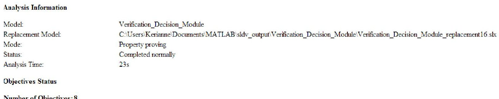

Figure 13. Simulink Design Verifier Decision Module Analysis Results.

## B. Simulation

For the purposes of demonstrating the switching action of the RTA controller, a ramp function was used in the place of the unverified controller because it was sure to violate system safety properties. The rate-limited PID verified controller and the decision module are as described in section IV. A slewing maneuver was simulated from an orientation of [0,0,0] to [90, 45, -45] degrees, as shown in Figure 14. The simulation results are shown in Figure 15.

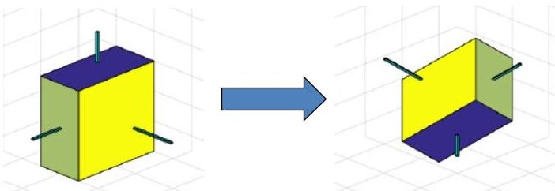

Figure 14. Initial and final orientation of the 6U CubeSat for the simulated slewing maneuver.

<!-- PDF_PAGE: 12 -->

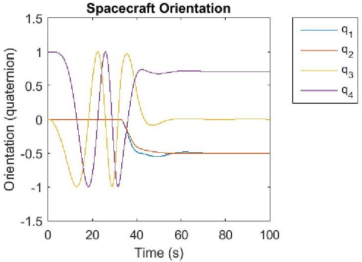

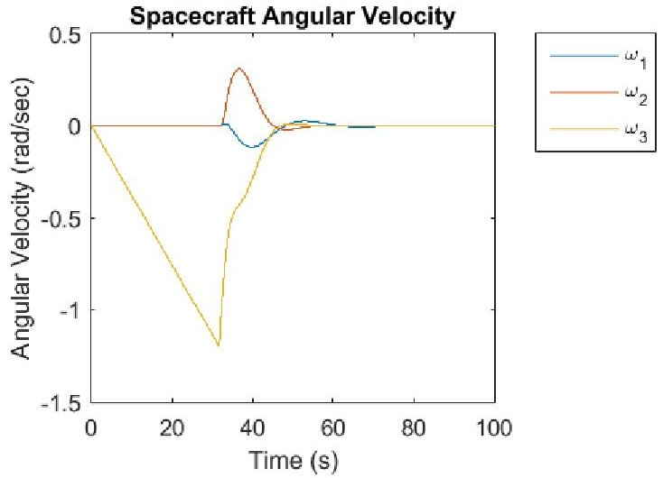

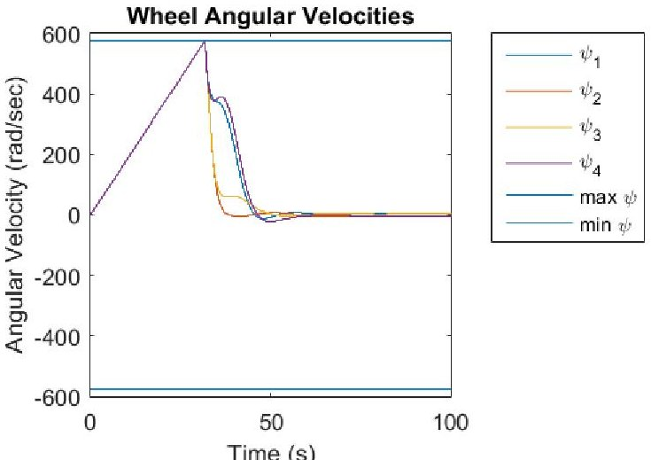

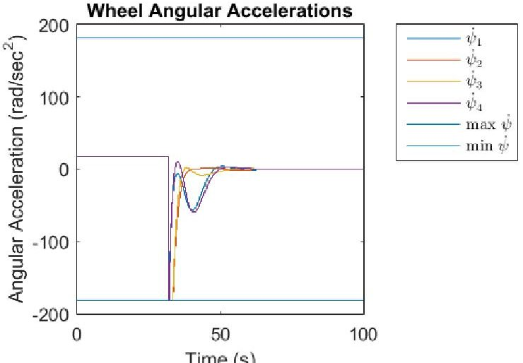

Figure 15: Simulation of the RTA controller with ramp function in the unverified controller block.

The spacecraft orientation is expressed as a quaternion and eventually completes the desired maneuver. As seen in Figure 15, the unverified controller (ramp function) maintains control by issuing the constant acceleration command until 31 seconds into the simulation when the reaction wheel velocity exceeds the maximum allowable. After that point, the decision module switches command to the verified controller (rate-limited PID controller) for the remainder of the slewing maneuver. The rate-limited PID controller reaches the maximum negative acceleration possible immediately after the switch in an attempt to dramatically decrease wheel speeds. After a few seconds, the acceleration commands leave the maximum acceleration as the PID controller begins to settle out.

If the rate limiting is removed from the PID controller, and this controller is placed in the unverified controller block, the velocity and acceleration limits of the reaction wheels are not violated for this maneuver, so the PID controller without rate limiting has control over the system during the entire simulation. This simulation is shown in Figure 16.

<!-- PDF_PAGE: 13 -->

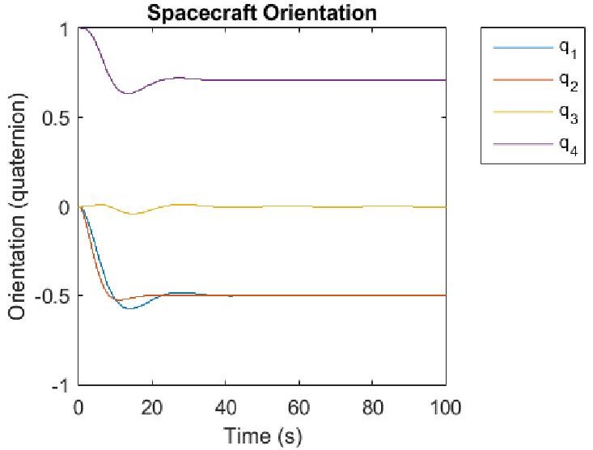

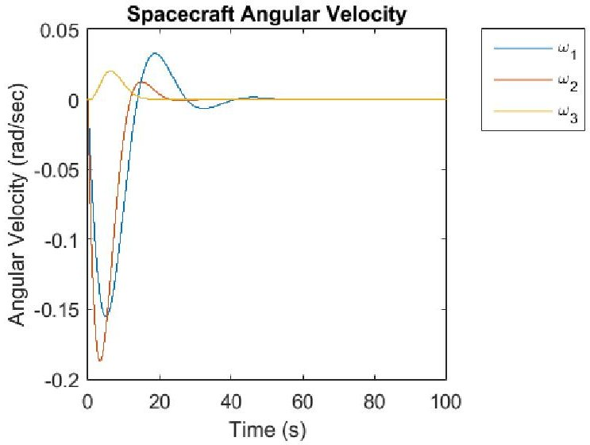

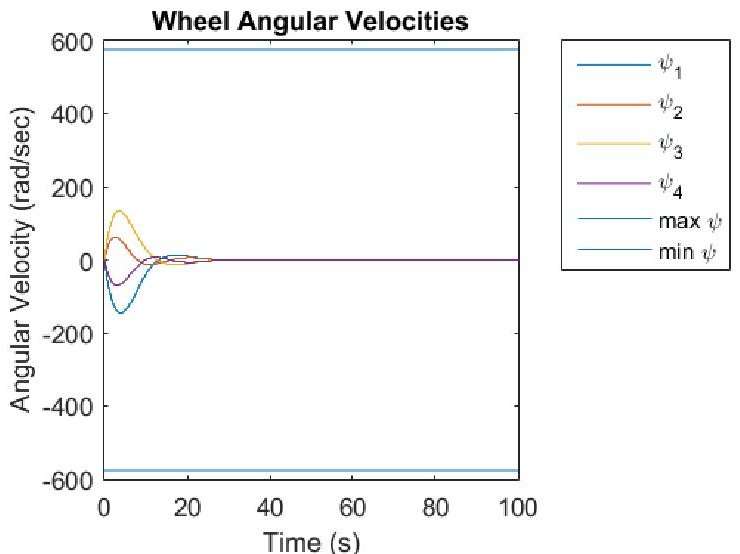

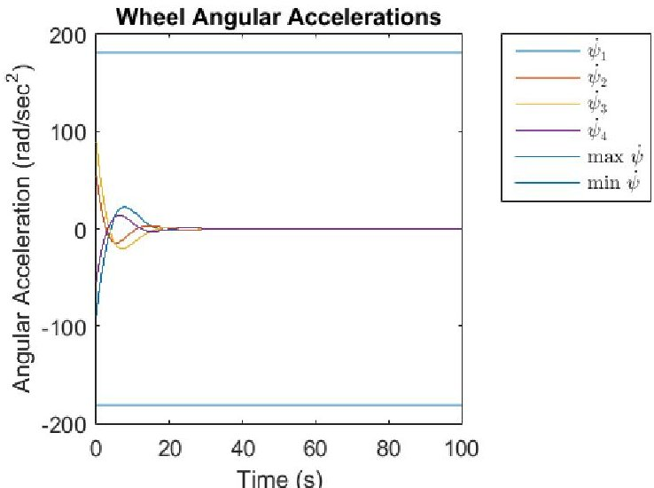

Figure 16: Simulation of the RTA controller with unlimited PID controller in the unverified controller block.

## VI. Assumptions and Limitations

Several assumptions limit the fidelity of the analysis and simulation. First, a simplifying assumption is made that the sensors provide perfect truth data and the sensors themselves are abstracted out of the simulation. Second, it is assumed that the reaction wheel speeds input into the controller will not exceed the maximum angular velocity, and that only the controller can cause this condition to occur. In other words, the angular velocity of the reaction wheels is assumed to not exceed the maximum allowable before the controller can react. Third, it is assumed that the system does not experience any external torques such as gravity gradients or aerodynamic drag. Fourth, it is assumed that the system does not experience faults. Fifth, it is assumed that the CubeSat motion can be completely described using rigid body dynamics. Sixth, the simulation was conducted with a fixed time step. Initially the simulation was run at 10 Hz; however error propagation during the ramp phase of the simulation was exceptionally high at approximately 30%. In the simulation presented here, the rate was increased to 1000 Hz, which reduced the calculation error to 0.3% over the 200 second simulation. Properties of the reaction wheel array and 6U CubeSat testbed were measured or estimated where possible; however some properties were assigned based on comparative performance for similar systems. The 6U CubeSat testbed 3x3 inertia matrix was taken from the AFIT SolidWorks model estimate. The individual reaction wheel and motor 3x3 inertia matrix was measured about the spin axis using the Model XR250 Measurement Instrument. The maximum reaction wheel speed used was the maximum speed observed in the laboratory as measured by a laser tachometer.

## VII. Future Work

This work could be expanded in the future with the addition of mode logic, the use of two or more actuators, the use of three or more controllers within the RTA controller architecture, and the introduction of an intelligent controller. Mode logic could be added to deal with faults or situations outside of the system's current operating range. For example, the current design is limited by an assumption that the reaction wheels are not spinning above

<!-- PDF_PAGE: 14 -->

the maximum rate before the controller can react; however, this situation is possible if a fault occurs. Incorporating mode logic to react to this situation will allow the removal of this assumption. Using two or more actuators will also make the control system more resilient. For example, the current control system design is intended to slew a satellite from rest in one position to rest in another position; however CubeSats can experience large angular velocities after being ejected from a CubeSat launcher and attempting to slow the spacecraft angular velocity with only a reaction wheel array actuator can cause the reaction wheels to saturate, a condition that occurs when a reaction wheel reaches a velocity limit that prevents it from exerting additional influence on the spacecraft attitude. Incorporating mode logic and an external torque actuator such as a magnetic torque coil, which interacts with the Earth's magnetic field to control the spacecraft attitude, could make the spacecraft more resilient in this scenario and others. The RTA controller design presented in this paper only features two controllers: verified and unverified. Future iterations could include three or more controllers, where the decision module functions more like a negotiator that prioritizes control tasks based on the current spacecraft state as well as the output of the control tasks it is monitoring. A third controller within the RTA control architecture could be used to transition from one controller to another, or provide functionality to deal with a specific fault. Finally, the unverified controller block could play host to an artificially intelligent or learning controller that provides a more optimal control approach.

## VIII. Conclusions

The approach presented in this paper lays the groundwork for formally verified spacecraft attitude RTA control designs. Initial results on the application to a 6U CubeSat attitude control system with reaction wheel actuation indicate that the use of an RTA architecture is a viable way to assure that unverified intelligent control algorithms do not violate a predefined set of properties. However, much more work is required to build a controller design that is robust to faults and environmental conditions and interface that controller with the spacecraft hardware.

## References

$ ^{1} $Dahm, W. J. A. "Technology Horizons a Vision for Air Force Science & Technology During 2010-2030," USAF HQ, 2010.

$ ^{2} $ Clark, M. et al., "A study on Run Time Assurance for Complex Cyber Physical Systems," Air Force Research Laboratory, Aerospace Systems Directorate, Wright-Patterson AFB OH, 2013, URL: http://www.dtic.mil/cgi-bin/GetTRDoc?AD=ADA585474 [cited 23 November 2015].

$ ^{3} $Assistant Secretary of Defense / Research and Engineering (ASD/R&E), Autonomy Community of Interest (COI), "DoD Autonomy Test and Evaluation," Verification and Validation (TEVV) Investment Strategy, Alexandria, VA, Jun. 2015, URL: http://www.defenseinnovationmarketplace.mil/resources/OSD_ATEVV_STRAT_DIST_A_SIGNED.pdf [cited 27 July 2015].

$ ^{4} $Reis, A., Barth, A., and Pizano, C, "Browser security: lessons learned from google chrome," Commun. ACM. Vol. 52, 2009,pp.45-49.

$ ^{5} $Sha, L., "Using simplicity to control complexity," IEEE Software, vol. 18, no. 4, pp. 20-28, 2001.

$ ^{6} $Crenshaw, T.L., Gunter, E., Robinson, C.L., Shaw, L., Kumar, P.R., "The Simplex Reference Model: Limiting Faultpropagation due to Unreliable Components in Cyber-physical System Architectures," in RTSS '07, Washington, DC, 2007, pp. 400-412.

$ ^{7} $Bak, S., Chivukula, D.K., Adekunle, O., Sun, M., Caccamo, M., and Sha, L. "The System-level Simplex Architecture for Improved Real-time Embedded System Safety," in Proceedings of the 2009 $ 15^{\mathrm{th}} $ IEE Real-Time and Embedded Technology and Applications Symposium, 2009.

$ ^{8} $Seto, D., Ferriera, E., and Marz, T., "Case Study: Development of a Baseline Controller for Automatic Landing of an F-16 Aircraft Using Linear Matrix Inequalities (LMIs)," Software Engineering Institute, Carnegie Mellon University, Pittsburgh, PA, Technical Report CMU/SEI-99-TR-020, 2000, URL: http://resources.sei.cmu.edu/library/asset-view.cfm?AssetID=13489 [cited 12 January 2015].

$ ^{9} $Bak, S., Manamcheri, K., Mitra, S., & Caccamo, M. "Sandboxing controllers for cyber-physical systems," in CyberPhysical Systems (ICCPS), IEEE/ACM International, 2011.

$ ^{1 0} $Swihart, D. E., Barfield, A. F., Griffin, E. M., Lehmann, R. C., Whitcomb, S. C., Skoog, M. A., Flynn, B., Prosser, K. E., "Design, Integration and Flight Test of an Automatic Ground Collision Avoidance System," Gyroscopy and Navigation, Vol. 2, Issue 2, 2011, pp. 84-91.

$ ^{11} $Butler, R., "What Is Formal Methods?" NASA Langley Research Center Formal Methods Program, URL: http://shemesh.larc.nasa.gov/fm/fm-what.html [cited 12 January 2015].

$ ^{1 2} $Dutertre, B. "Yices 2.2," presented at CAV'14, Vienna, Austria, 2014, URL: http://yices.csl.sri.com/papers/cav2014.pdf [cited 19 November 2015].

$ ^{13} $Barrett, C., Conway, C., Deters, M., Hadarean, L., Jovanovic, D., King, T., Reynolds, A., and Tinelli, C., "CVC4," in Computer Aided Verification, ser. Lecture Notes in Computer Science, Springer Berlin Heidelberg, 2011, vol. 6806, pp. 171-177. URL: http://dx.doi.org/10.1007/978-3-642-22110-1 14, [cited 15 June 2015].

$ ^{1 4} $De Moura, L. and Bjørner, N. "Z3: An efficient SMT solver," in Tools and Algorithms for the Construction and Analysis of Systems. Springer, 2008, pp. 337-340.

<!-- PDF_PAGE: 15 -->

$ ^{15} $Bruttomesso, R., Cimatti, A., Franzn, A., Griggio, A., and Sebastiani, R., "The Mathsat4 SMT solver," in Computer Aided Verification, ser. Lecture Notes in Computer Science, Springer Berlin Heidelberg, 2008, vol. 5123, pp. 299-303. URL: http://dx.doi.org/10.1007/978-3-540-70545-1 28 [cited 14 January 2015].

$ ^{1 6} $Christ, J., Hoenicke, J., and Nutz, A. "Smtinterpol: An interpolating smt solver," in Model Checking Software, Springer, 2012, pp. 248-254.

$ ^{17} $ Wertz, J. R., Everett, D. F., Pushcell, J.J. "Space Mission Engineering: The New SMAD," Microcosm Press, 2011.

$ ^{18} $Swenson, E. D. "6U CubeSat - Design, Build, Test," Air Force Institute of Technology, 2014.

$ ^{19} $Gross, K. et al "Evaluation of Formal Methods Tools Applied to a 6U CubeSat Attitude Control System," AIAA Space 2015 Conference and Exposition.

$ ^{20} $Wie, B. Space Vehicle Dynamics and Control, $ 2^{nd} $Ed., AIAA Education Series, AIAA, Reston, VA, 2008, pp. 131-132.

$ ^{21} $Dwyer, M. B., Avrunin, G. S., Corbett J. C., "Property Specification Patterns for Finite-state Verification," Proceedings of the Second Workshop on Formal Methods in Software Practice, ACM, 1998, pp. 7-15.

$ ^{22} $ Halbwachs, N., Caspi, P., Raymond, P., & Pilaud, D. "The synchronous data flow programming language LUSTRE," Proceedings of the IEEE, Vol. 79., No. 9, 1991, pp. 1305-1320.

$ ^{23} $ Gacek, A., "JKind," Rockwell Collins. URL: https://github.com/agacek/jkind [cited 14 January 2015].

$ ^{24} $De Moura, L., Ruess, H., Sorea, M., "Bounded Model Checking and Induction: From Refutation to Verification," Proceedings of the 15th International Conference on Computer Aided Verification, Vol. 2725, 2003.

$ ^{25} $De Moura, L. and Bjørner, N. "Z3: An Efficient SMT Solver," Tools and Algorithms for the Construction and Analysis of Systems, Springer, 2008, pp. 337-340.

$ ^{26} $ "Architecture Analysis and Design Language," URL: http://www.sei.cmu.edu/architecture/research/model-based engineering/aadl.cfm [cited 14 Jan. 2015].

$ ^{27} $Whalen, M. W., Gacek, A., Cofer, D., Murugesan, A., Heimdahl, M., Rayadurgam, S., "Your "What" Is My "How": Iteration and Hierarchy in System Design," IEEE Software, Vol. 30, No. 2, 2013, pp. 54-60.