<!-- PDF_PAGE: 1 -->

67th International Astronautical Congress (IAC), Guadalajara, Mexico, 26-30 September 2016. Copyright ©2016 by the International Astronautical Federation (IAF). All rights reserved.

IAC-16.B4.7.6x32964

QuSAD -An Interactive Space Mission Analysis, Design, and Simulation Toolkit

Benjamin Grzesik $ ^{a\ast} $ , Esfandiar Farahvashi $ ^{a} $ , Mohamed Khalil Ben Larbi $ ^{a} $ , Christopher Trentlage $ ^{a} $ , Enrico Stoll $ ^{a} $

$ ^{a} $ TU Braunschweig - Institute of Space Systems (IRAS), Hermann Blenk-Str. 23, 38108 Braunschweig, b.grzesik@tubraunschweig.de

* Corresponding Author

## Abstract

Due to standardisation and technological advancements in miniaturization, CubeSats have become more and more popular and enable space accessibility for a broad community, allowing university students to gain hands-on experience in satellite and space mission design.

A continuously increasing number of manufacturers offer hardware for CubeSats that is conform to the standard. The variety of components poses the challenge of finding an optimum component combination without exceeding the mission requirements and resources. An optimum design needs the possibility to choose from a large pool of components while using design analyses methods to evaluate the potential of the design. To keep a tool at hand that condenses the necessary knowledge of components, system, mission design, operations, and analysis functionality, the Institute of Space Systems at TU Braunschweig (IRAS) is developing an Interactive, Space Mission Analysis, Design, and Simulation Toolkit.

The toolkit's core module is QuSAD (SQL-Based CubeSat Analyse and Design Tool). It consists of an SQL and a MATLAB segment. An SQL database with available commercial off the shelf (COTS) CubeSat components was developed, currently containing more than 230 components sorted by attitude determination and control system (ADCS), electronic power system (EPS), on-board data handling (OBDH), communication, propulsion, structure, payload subsystems, and available kits. Additionally, a database for customized components either own developments or for educational purposes is implemented. The MATLAB segment provides a graphical user interface and an extendable modular structure that can connect and interact with the database, accommodate basic tools to assist the design process, analyse trade-off parameters, and evaluate design budgets. The user can interactively select his satellite mission using COTS components from the database and integrate them into a virtual satellite. Subsequently, the design can be analysed, saved, and optimised using the Profile Viewer to assess mass, volume, cost, link, and power budgets. The software provides three main functionalities in the current state: database handling, CubeSat design, and profile view.

Future development of the tool should extend the COTS database and existing modules, implement additional system models, and add or embed complex functionality of existing tools developed at the IRAS. Examples are orbit propagation, battery degradation trending, thermal analyses, mission planning according to Space Debris Mitigation (SDM) Guidelines, conjunction analyses, and 3D-Visualization.

The paper will give an overview of the current state of existing technology and tools, describe the already implemented QuSAD features as the core of the newly developed tool, and present a technology roadmap for new functionalities based on existing tools and research of the IRAS.

Keywords: Space Mission Design, CubeSat, MATLAB, System engineering, Space Situation Awareness

## Nomenclature

<table border="1"><tr><td colspan="6">Nomenclature</td></tr><tr><td>a</td><td>Semi-major axis</td><td>Lr,a</td><td>Receiving Antenna Loss [dB]</td><td>Vsat</td><td>Current satellite volume</td></tr><tr><td>Eb,req</td><td>Required signal to noise ratio</td><td>Lm</td><td>Miscellaneous Losses [dB]</td><td>Vallow</td><td>Allowed CubeSat volume</td></tr><tr><td>N0,req</td><td></td><td>Lfs</td><td>Free Space Loss [dB]</td><td>Vi</td><td>Volume of subsystem</td></tr><tr><td>Csat</td><td>Current sat. Design costs</td><td>msat</td><td>Current satellite mass</td><td>μ</td><td>Gravitational const. Earth</td></tr><tr><td>Csat</td><td>Max. allowed design costs</td><td>mallow</td><td>Allowed CubeSat mass</td><td></td><td></td></tr><tr><td>di</td><td>Depth</td><td>Pdem</td><td>Requ. power generation</td><td></td><td></td></tr><tr><td>Gt,a</td><td>Transmitting Antenna Gain [dB]</td><td>Pgen</td><td>Design power generation</td><td></td><td></td></tr><tr><td>Gr,a</td><td>Receiving Antenna Gain [dB]</td><td>Pr</td><td>Receiving signal strength</td><td></td><td></td></tr><tr><td>i/wi</td><td>Width</td><td>Psens</td><td>Receiver sensitivity</td><td></td><td></td></tr><tr><td>Lt</td><td>Transmitter Loss [dB]</td><td>Pt</td><td>Transmitted Power [dBm]</td><td></td><td></td></tr><tr><td>Lt,a</td><td>Transmitting Antenna Loss [dB]</td><td>Pr</td><td>Received Power [dBm]</td><td></td><td></td></tr><tr><td>Lr</td><td>Receiver Loss [dB]</td><td>R</td><td>Radius Earth</td><td></td><td></td></tr></table>

<!-- PDF_PAGE: 2 -->

## Acronyms/Abbreviations

AFSK - Audio Frequency Shift Keying

BPSK - Binary Phase Shift Keying

COTS - Commercial Off the Shelf

RS - Reed Solomon

GS - Ground Station

GUI - Graphical User Interface

OAP- Orbit Average Power

SSA - Space Situational Awareness

ADCS - Attitude Determination and Control System

EPS - Electronic Power System

OBDH - On-Board Data Handling

## 1 Introduction

Due to CubeSat's popularity and its standardised design, a continuously increasing number of manufacturers offer hardware which is specially matched to the CubeSat specifications. This has an advantageous effect on CubeSat design e.g. it can reduce development time. The available off-the-shelf components can be simply used rather than designing and manufacturing each satellite component individually. The disadvantage of COTS components is that they are not allowing customization of the system parameters which limits the flexibility. This makes the search for an optimum component combination difficult without exceeding the mission requirements and budget. As a consequence, it is important to have a large pool of COTS components to choose from, and using design analyses methods to achieve an optimum CubeSat design. To aggregate the existing CubeSat components and to ease the process of CubeSat design, a database for preliminary design studies is developed at the Institute of Space Systems (IRAS) at the TU Braunschweig as part of an interactive, Space Mission Analysis, Design, and Simulation Toolkit. For the first stage of the tool development, the main goal was to establish a CubeSat component database on satellite subsystem level using available components on the market. In addition, a suitable modular programming language had to be selected for interacting with the database. The program had to be capable of providing graphical user interfaces to assist the user during the design process and to perform and visualize various system design analysis. As a result, due to its strong mathematical and visualization functions MatLab has been chosen for the program core. A modular development approach shall allow the implementation of additional features in further development steps. To enable QuSAD (SQL-Based Cube Sat Analyse and Design Tool) incorporating the large steadily growing number of available COTS components and to allow the user to interact with the database existing components the software was divided into an SQL and the mentioned MatLab segment. For the SQL segment, a MySQL database has been defined and set up to register and

categorize available COTS component on satellite subsystem level. To have a maximum of flexibility also custom components, either to use for the satellite design or as idealized exemplary components for educational purposes, can be define and added to the database. The MatLab segment has been developed to connect with the database, import the available components and provides the User interface to interact with the components and create multiple CubeSat designs. The intuitive MatLab GUIs provide numerous functions to guide and support the user through the design process and to assess the feasibility of the created CubeSat and to analyse relevant key design budgets. The software possesses various output options which again can be used by other programs for further processing and is described in the following chapters in more detail.

## 1.1 Software Tool Requirements

To put the above-mentioned demands into practice, a general framework has been set up for the software development to define primary requirements regarding the software design. The primary requirements (P) for the initial development are described as following:

P1. An easily maintainable component database shall be established which can continuously be added with new elements. This ensures that the database can be kept updated with new component releases. The database shall be structured on subsystem level.

P2. The software shall consist of an interface to the database and be able to access the components for the CubeSat design and shall be programmed in MatLab with a modular code-build to allow further modifications and module implementations. The software shall provide a GUI for user interactions and report generation.

P3. The software shall provide trade off analyses methods in the terms of design budgets with respect to major system drivers. Based on the budgets, possibilities for design optimization should be provided.

P4. The Software shall provide interface possibilities for 3D-visualizations such as for rapid prototyping or CAD-software.

With respect to the above constraints, secondary requirements (S) were defined to additionally support the primary requirements as well as to further enhance the software features:

S1. In accordance to P1, the database shall be easily accessible. It shall be implementable for other software as well and the inexperienced user must not corrupt the database content by accident.

S2. In accordance to P4, the database shall contain product datasheets, pictures as well as STEP-

<!-- PDF_PAGE: 3 -->

files which can be retrieved by the software at any time.

S3. In accordance to P2, the traceability and clarity of the program code shall be a top priority to ease the modification or implementation of modules by third party editors.

S4. The software behaviour shall be highly dynamic. The user should feel free to modify CubeSat constructions as well as component parameters. In this way, the user can experiment freely for the purpose of achieving the optimum design (P3).

S5. The user shall be able to create and save multiple CubeSat designs. This may allow the user to load previous designs for the purpose of further editing or design comparison.

S6. The software should be used for educational purposes. Moreover, students with no or little experience in satellite design should be able to use the software.

2 Space Mission Design / Requirements QuSAD Designing a space mission is a highly complex multidisciplinary, and iterative process and the mission-constraints have an impact on the space mission system segments and especially on the satellite design. Therefore it is essential to specify feasible mission objectives with respect to the available resources and technical possibilities. Successful system engineering and project management are mandatory to keep an overview of the designs of each segment and their subsystems and to ensure, that those are conform to the overall mission objectives at each step of the design process. Specifying mission objectives requires a high amount of experience, different literature (i.e. [1], [2], [3]) are published that focus on this subject and present similar empirical guidelines which may assist through the process of designing and analysing space missions within a limited timeline in which a trade-off has to be made between the optimum design, and the feasible design. In contrary to the large spacecraft, a nano-satellite CubeSat, consist of a standardized design with certain restraints. As a result, many variable design parameters are converted into constant parameters. For example, the mass, size, mechanical, and electrical properties as well as the geometrical shape of the CubeSat are predefined in the CubeSat Design Specification of the California Polytechnic State University [4]. Having design constrains is a great basis for developing computational design methods hence the outputs of each design step can be compared to the given constrains in means to optimize the components.

Fortescue et al. [3] introduces a computational design approach in means of optimizing the design process of CubeSats. As a first step, the structural subsystem will

determine the size (1U, 2U, etc.) of the CubeSat. Secondly, while operating the Satellite, the electrical components will require power. Therefore, the total demanded power of the consumers has to be estimated as well as the generated and stored power. Subsequently, the total volume of the components is summed up and compared to the allowed volume which is determined by the size of the satellite. If the volume exceeds this value, the design will be infeasible and must be reconsidered (Volume Trade-off). In case the volume conditions are met, the total mass and costs of the system are determined in the final step. It has to be clarified whether a deorbiting device is needed so that the design is conform to the guidelines given by the Inter-Agency Space Debris Coordination Committee (IADC) [5].

The feasibility check of the design process is based only on comparing the total volume vs. the allowed volume. In other words, the design quality was rated by establishing a volume budget.

Besides the volume budget, several other budgets have to be reviewed to fully clarify the feasibility of the design. For example, although the volume condition of the satellite is met, the total mass may exceed the allowed mass value dictated by CubeSat Design Specifications [4] for the corresponding satellite size.

Therefore, the design concept introduced before was used as a simple guideline for QuSad's development and was further enhanced with additional design evaluation and budget analysing tools (Figure 1).

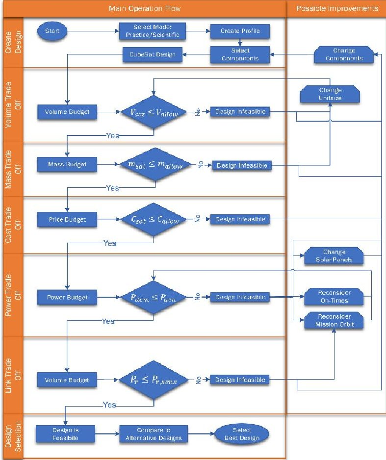

Figure 1: QuSAD operational flow.

<!-- PDF_PAGE: 4 -->

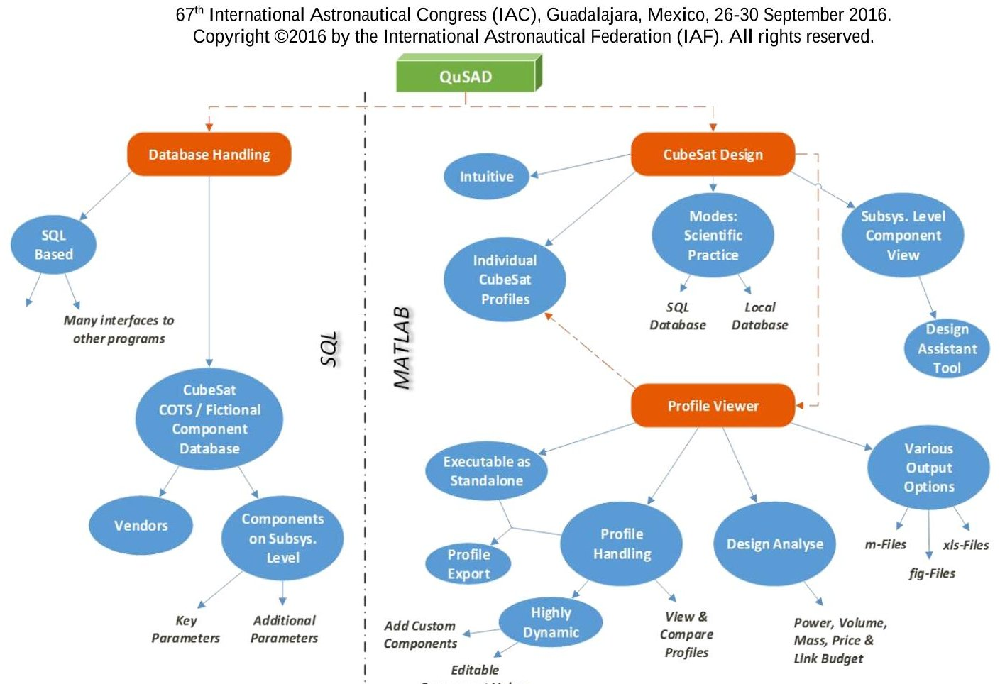

Figure 2: QuSAD functions and program overview.

The already implemented process steps for QuSAD can be summarized as following:

## i. Mass Trade-Off:

Using the mass budget tool, the satellite's overall mass is compared to the allowed mass which is specified by the size of the structure component (1U, 2U, etc.) with respect to the CubeSat Design Specifications [4]. In case the satellite mass is above the allowed mass, the user has to reconsider the structure size or the installed components.

## ii. Cost Trade-Off:

The price budget tool compares the overall satellite price compared to the available satellite funds which have to be provided manually by the user. If the price is out of the given range, the user has to reconsider the installed components.

## iii. Power Trade-Off:

The power budget will calculate the generated power by solar panels and the demanded power of the consumers based on the selected components from the database. In case too much power is consumed than generated the user may have to adapt the operational scenario (reduce the on-time of components or reconsider the mission orbit). Another change to the satellite design would be to switch to more efficient solar panels or less power consuming components.

## iv. Link Budget Trade-Off:

The link budget analyses the communication link between the satellite and the ground station. In case the signal strength is too weak to be clearly detected by the receiver, the user has to reconsider the parameters of the ground station communication equipment or install more

powerful transceiver which will demand more power mass or volume from the satellite system.

After the feasibility of the CubeSat is checked and the design is optimized, the user can open other alternative CubeSat designs to compare the parameters and to choose the most mission suited design. Figure 1 shows the adapted operational flow and design decision process that has been implemented in the QuSAD software. Of course, this will change within future releases and additional design support functionalities.

## 3 QuSAD Software

The overall software functions are categorized into the three major sections Database Handling, CubeSat Design and Profile Viewer (Figure 2) while the last two can be operated conjoined or separately.

## 3.1 QuSAD 'Database Handling' module

QuSAD consists of an SQL-database which is easily usable and maintainable and provides interfaces to other software. The database can only be accessed by a qualified editor via password and is structured that the database tables contain vendors and COTS components broke down and sorted on subsystem level.

Those elements can be real components for Scientific Mode as well as non-existing custom educational elements for the Practice Mode.

The component parameters consist of key design parameters as well as additional parameters such as STEP-files for 3-D visualization and interfacing with CAD or rapid prototyping hardware i.e. 3D-Printers.

<!-- PDF_PAGE: 5 -->

## 3.2 QuSAD 'CubeSat Design' module

The CubeSat Design module is the main section of the software consisting of several MatLab GUIs which provide user interfaces to create CubeSats (or so-called 'profiles') based on available database components. This enables the user to create and save numerous profiles with individual specifications such as name and comments. After creating a profile, the user can decide between the scientific and practice operation mode. Choosing the scientific mode will grant the software access to the SQL-database with actual COTS components while the practice mode will grant access to individually defined educational. Additionally, the databases can be saved and loaded locally. In this way, the users/students are able to practice or operate the software based on provided databases without being connected to the main SQL-database and therefore avoiding any chance of corrupting the database by mistake. The user can choose and add components with the help of a Design Assistant Tool by applying a filter based on desired parameter properties to ease the decision-making process and build up a profile.

## 3.3 QuSAD Profile Viewer module

The Profile Viewer section is used to view and handle the profiles and their components while all the parameters being summarized in a single table inside a GUI. By selecting components, the corresponding pictures and comments are shown and in addition the user can open the related datasheets, URL and STEP-files directly from the GUI. The viewer can be opened multiple time to compare different CubeSat profiles simultaneously and it can be called either within the CubeSat Design section or as a standalone version. The capability of being able to run as a standalone version outside of the main application allows a quicker method to handle profiles in case the user's intention is only to view and edit components of an existing profile without adding any new components to the existing satellite design. Additionally, the Profile Viewer provides the option of exporting profiles with the containing components and the entire corresponding component information's such as pictures, datasheets. This feature is especially useful to pass on a profile to a third person who is not in possession of the whole QuSAD software-package. In this case, it is sufficient to forward the file that was created after the exporting process, containing the profile data and the profile viewer GUI. The viewer provides additional interfaces to call the built-in analyse tools (see 3.3.1 ff.) to evaluate the current design.

## 3.3.1 Link budget

The receiver's capability to detect and distinguish the signal is expressed via the signal-to-noise ratio (SNR) that compares the incoming carrier signal power to the thermal noise of the receiving device. To determine the

feasibility of the communication link the SNR is

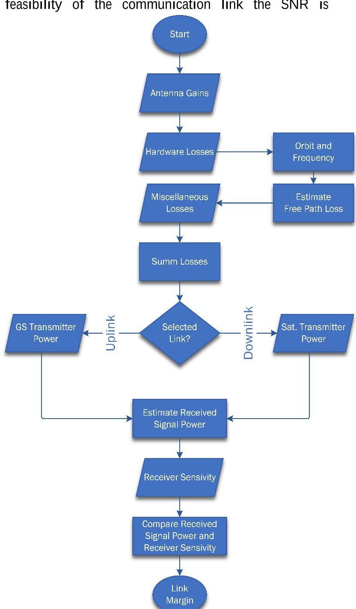

Figure 3: QuSAD link budget calculation process. Parallelogram shapes describe user input values rectangular shapes describe calculation processes.

transformed to energy per bit per noise power spectral density Eb/N0 [6]. A communication link is possible if the energy per noise power is higher than the requested value which is a function of signal Modulation Techniques (MT) (such as BPSK or Reed Solomon) and the demanded Bit Error Rate (BER) as shown in (3.1).

$$
\frac {E _ {b}}{N _ {0}} > \frac {E _ {b , r e q}}{N _ {0 , r e q}} (B E R, M T)
$$

Using this method for establishing a link budget requires knowledge about the system temperature of the receiving device. The QuSAD Tool uses a component database that contains a list of transceivers which are obtainable from

<!-- PDF_PAGE: 6 -->

internet stores but the information is not uniform and may vary significantly from vendor to vendor. As a result, a simplified method of determining the link budget is used in the tool that is based on the receiver sensitivity a value that is usually provided by the manufacturers in combination with BER and the signal modulation technique (e.g. receiver sensitivity of -104 dBm at $ 10^{-5} $ BER and AFSK-Modulation). The link budget model used in QuSAD, is based on standard procedures [7], [8], [9] and examines the feasibility of the communication link between the satellite and the ground station. It further analyses its resistance towards disturbances until the signal can't be distinguished by the receiver. A margin is calculated based on comparing the incoming signal power to the receivers sensitivity and its capability to detect the signal. The incoming signal power is calculated with following equation:

$$
\begin{array}{l} P _ {r} = P _ {t} + G _ {t, a} + G _ {r, a} \\ - \left(L _ {t} + L _ {t, a} + L _ {r} + L _ {r, a}\right) \\ + L _ {m} + L _ {f s}) \\ \end{array}
$$

The received and transmitted power describes the signal power after receiving and transmitting the signal by the corresponding devices, respectively. The antenna gain describes the ability to amplify the transmitted or received signal power. The transmitter and receiver losses describe the occurring losses during signal processing by the transceiver devices such as coax or cable losses. Furthermore, the antenna losses contain any losses that occur during forwarding the signal from transmitter to antenna such as cable losses due to poor/long cabling. The miscellaneous losses summarize other losses not mentioned in the equation such as atmospheric losses. Table 1 lists the typical losses that are pre-implemented for the link budget calculation by QuSAD.

Table 1: Miscellaneous losses used by QuSAD for link budget calculations Adapted from: [6].

<table border="1"><tr><td>Miscellaneous Losses</td><td>Estimated Loss[dB]</td></tr><tr><td>Atmospheric Loss</td><td>0.6</td></tr><tr><td>Modulation / Demodulation Loss</td><td>2.3</td></tr><tr><td>Polarization Loss</td><td>1.1</td></tr><tr><td>Converter / Amplifier Loss</td><td>0.5</td></tr></table>

The free path loss refers to the power loss occurring from the signal passing the distance between both radios. This includes a line of sight communication with no disturbances such as multi-pathing due to surfaces reflection or signal blocking through building and trees. Figure 3 provides an overview of the implemented process for the link budget calculation of QuSAD tool. The Antenna gain parameters are queried from the database or manually provide by the user. Respectively

the orbit parameters and used frequency bands are needed Because of the typical frequencies for CubeSat transceivers that rarely exceeds the MHz range the free path loss of a satellite is calculated according to [10] and worst case distance between both radios when the satellite is on the horizon of the ground station [6]. The overall loss is estimated and the other values for losses see Table 1 are summed to calculate the total miscellaneous losses. The overall gain is estimated depending on the selection whether the satellite is transmitting or receiving. The receiving signal power is calculated and the feasibility of the communication line is confirmed if the available link margin exceeds the required signal to noise ratio (3.3).

$$
\frac {E _ {b}}{N _ {0}} > \frac {E _ {b , r e q}}{N _ {0 , r e q}} (B E R, M T)
$$

## 3.3.2 Power budget

Power budget provides an overview of the satellite's power generation and consumption. To estimate a power budget the overall average power consumption of the satellite's components during an orbit is compared to the overall average orbit power generation (OAC) of the main power sources (typically solar panels for CubeSat). A positive power margin indicates that more power is generated than consumed during an orbit. On the other hand, a negative value indicated that more power is consumed than generated during an orbit. As long as this status occurs on rare occasions, the batteries may recover depending on the available power margin and the Depth of Discharge. In QuSAD a different approach was chosen compared to classic spacecraft design, where the power budget is used to estimate the required size of the solar panels to achieve a positive power margin. The power budget model in QuSAD is primarily used to examine the feasibility of the power system for a selected CubeSat design with components chosen from the database. To estimate the average power generation of the solar panels, QuSAD evaluates the possible illumination scenarios that may occur during the CubeSat's movement and adjusts them to their relative occurrence probability. Figure 7 illustrates the process of QuSAD's power budget evaluation. In general, during a CubeSat's orbital motion, QuSAD assumes three possible illumination scenarios for the satellite:

Scenario (I): Only one panel is illuminated (worst case scenario for power generation). This scenario occurs when sun incident angle is $ \phi_{1}=0^{\circ} $

is scenario further divided into the two sub-scenarios: (i) Only a single top/bottom panel is illuminated.

(ii) Only a single side panel is illuminated.

This differentiation is done because for CubeSat's larger than 1U, the side panels are typically larger than the top/bottom panels. So the generated power by a single

<!-- PDF_PAGE: 7 -->

top/bottom panel will be significantly lower as by a single side panel.

Scenario (II): Two panels are illuminated at the same time with a maximum power generation at $ \phi_{1,2}=4 5^{\circ} $ For the same reason as in Scenario I, this scenario is again divided into the two sub-scenarios:

(i) Two side panels are illuminated at the same time.

(ii) A top/bottom and a side panel are illuminated at the same time.

Scenario (III): Three panels are illuminated at the same time with a maximum power generation at $ \phi_{1,2,3}= 4 5^{\circ} $ .Due to the cuboid shape only a maximum of three panels can be illuminated at the same time and there for this scenario represents the maximum possible power outcome during CubeSat orbiting.

Using these scenarios the power generation of each scenario is calculated and weighted with the corresponding relative occurrence probability $ p_{i} $ of each scenario with overall 26 illumination possibilities. As example the probability that 2 side panels are illuminated at the same time is $ \frac{4}{26} $ . All probabilities are listed in Table 2. The adjusted powers are summed up to obtain the average power generation capability that is possible by the solar panel combination of the given CubeSat design. Based on mission duration, the end of life power generation is calculated by taking a 3% solar cell efficiency degradation per year [1] into account.

Table 2: Used probabilities for QuSAD OAP calculation

<table border="1"><tr><td>Scenario</td><td>Relative probability</td><td>occurrence</td></tr><tr><td>I.i</td><td>2/26</td><td></td></tr><tr><td>I.ii</td><td>4/26</td><td></td></tr><tr><td>II.i</td><td>4/26</td><td></td></tr><tr><td>II.ii</td><td>8/26</td><td></td></tr><tr><td>III</td><td>8/26</td><td></td></tr></table>

The overall concept of the model used for the power budget calculation is inspired by [7], [9]and [10] and is presented below (Figure 4).

The power budget process used by QuSAD requires the orbit altitude (h) of the S/C and beta-angle ( $ \beta $ ) defined as angle between the vector to the sun and the orbital plane of the S/C. The orbit characteristics are calculated according to (3.4)-(3.7).

$$
t _ {U} = 2 \cdot \pi \sqrt {\frac {a ^ {3}}{\mu}}
$$

$$
\frac {t _ {E}}{t _ {U}} = \frac {2 \cdot \alpha}{3 6 0 ^ {\circ}}
$$

$$
\begin{array}{l} \alpha = \sin^ {- 1} \left(\frac {\sqrt {\left(\frac {R}{a}\right) ^ {2} - \sin^ {2} (\beta)}}{\cos (\beta)}\right) \\ w i t h \beta < \left| \sin^ {- 1} \left(\frac {R}{a}\right) \right| \\ \end{array}
$$

$$
t _ {s} = t _ {U} - t _ {E}
$$

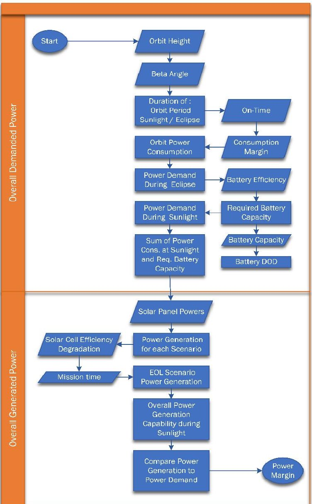

Figure 4: QuSAD process used to calculate the power budget.

Based on the designs component power consumption,

<!-- PDF_PAGE: 8 -->

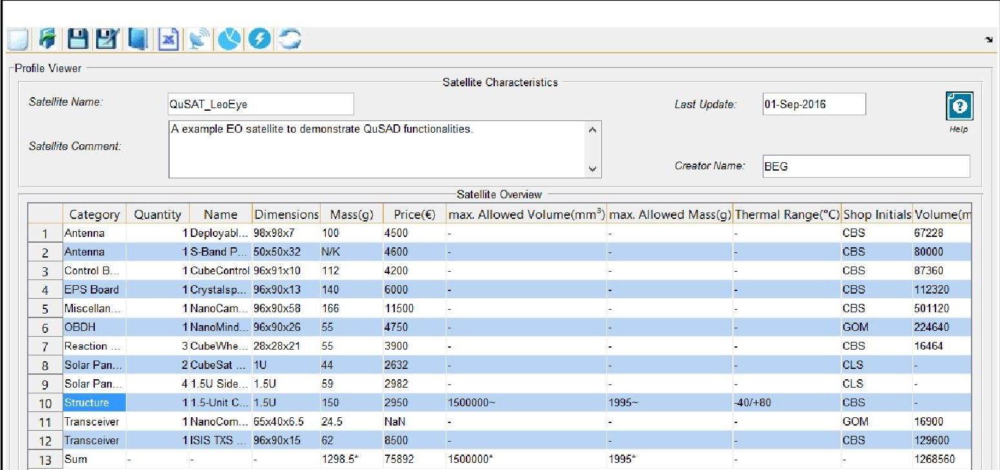

Figure 5: QuSAT LeoEye profile showing selected components.

component on-time, orbit period $ t_{\mathrm{U}} $ and 15% consumption margin [1] the average orbit power consumption is calculated. Table 2.7 provides a list of fictional components with their on-time and the resulting power consumption.

Table 3: On orbit power consumption of the fictional CubeSat 'CubePower' based on its components and operational on times

<table border="1"><tr><td>Component</td><td>Max. power consumpt. [W]</td><td>On-time [%]</td><td>On-time [h]</td><td>Orbit power consumpt. [Wh]</td></tr><tr><td>EPS Board</td><td>0.015</td><td>100</td><td>1.508</td><td>0.022</td></tr><tr><td>Board/CPU</td><td>0.132</td><td>100</td><td>1.508</td><td>0.199</td></tr><tr><td>Camera</td><td>0.66</td><td>60</td><td>0.905</td><td>0.597</td></tr><tr><td>Transmitter</td><td>0.18</td><td>10</td><td>0.1508</td><td>0.272</td></tr><tr><td>Receiver</td><td>2.64</td><td>100</td><td>1.508</td><td>0.398</td></tr><tr><td>Margin</td><td></td><td></td><td></td><td>15%</td></tr><tr><td>Sum</td><td></td><td></td><td></td><td>1.712</td></tr></table>

The battery capacity requirement during an eclipse can be calculated based on eclipse duration (as a fraction of the orbit duration), the power consumption during this time and the battery transmission (90%). The overall demanded power is a sum of the required battery capacity and the power consumption during sunlight. Based on the illumination scenarios the power generation capability is estimated and a linear degradation model of 3% per year for end of life (EOL) power generation is assumed. The overall generated power is weighted with the duration of sunlight per orbit and finally the average power margin is calculated.

## 4 QuSAD Design Analyses Modules

The logic and formulas used for the design analyses were shown in the previous section. This section describes the results of the tool with an exemplary satellite mission that uses components of the database. In addition to the already established functionalities, it will give a technical roadmap and an outlook of the future planned developments.

## 4.1 Definition of example scenario

To show the results the tool can generate, an example mission is defined. A 1.5 unit CubeSat for Earth observation should be designed. The satellite will be deployed from ISS in an orbit of 400 km and build with available components of the QuSAD database (Figure 6). For this example mission, the initial budget will not be limited.

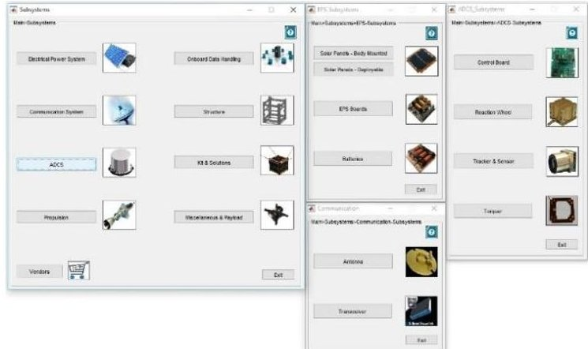

Figure 6: Subsystem selection of QuSAD component database.

<!-- PDF_PAGE: 9 -->

## 4.1.1 Selecting Components

To fulfil the mission, components for the subsystems has to be selected from the database.

After creating a "Profile" that stores all selected components the selection starts with choosing a 1.5 U structure and the other subsystems. For QuSAT LeoEye an EPS, 4 side and 2 top/bottom solar panels, S-Band/UHF/VHF antennas and transceiver, attitude control system with 3 small reaction wheels, an onboard computer and a camera payload are selected. The selected components for each subsystem is shown in the Profile in Figure 5. With the profile data, the analyses functions can be used. The results are discussed in the following subsections.

## 4.1.2 Power Trade-Off

The power analyses tool is able to acquire the mounted components from the profile viewer. Based on provided orbit parameters, the orbit period along with the sun and eclipse durations are calculated. This gives a baseline operational scenario for the consumers. In the following, the power trade-off capabilities are demonstated based on two scenarios. In the first scenario, all components (including payload) are operated in 100% of the orbit time except for the transmitter which is by default set to 10% - this approximatley equals one ground station contact. In this scenario, the selected solar panels are capable of generating a orbit average power of 3.88 Wh while the consumers require 4.79 Wh. This leads to a negative power margin of -0.905 Wh, so a design or operational scenario adoption should be considered. In the second scenario, the payloads operational on-time is adjusted to 60 % hence the optical camera used as

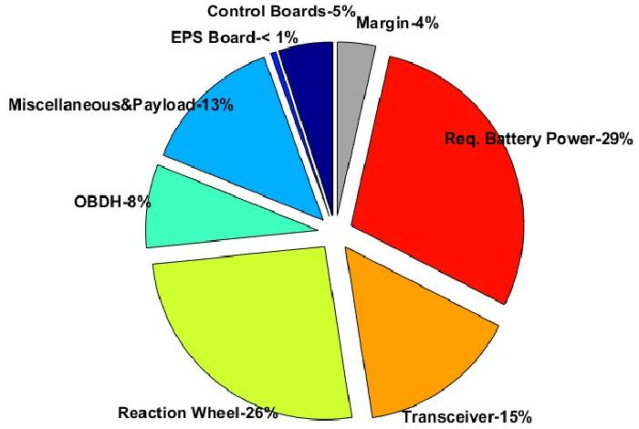

Figure 7: QuSAD power budget - adapted power consumption - positive budget

payload needs sunlight to take images. So the payload operations can be restricted to sunlit part of an orbit. Additionally, the on-time of the attitude control components used for a precise imaging was adjusted accordingly. This modifications decreasing the

operational on-time of the payload to 60% and the reactions wheels to 70% brings the design to a slightly positive power margin that is shown in Figure 7.

## 4.1.3 Link Budget Trade-Off

QuSAD's link calculation section is shown in Figure 8

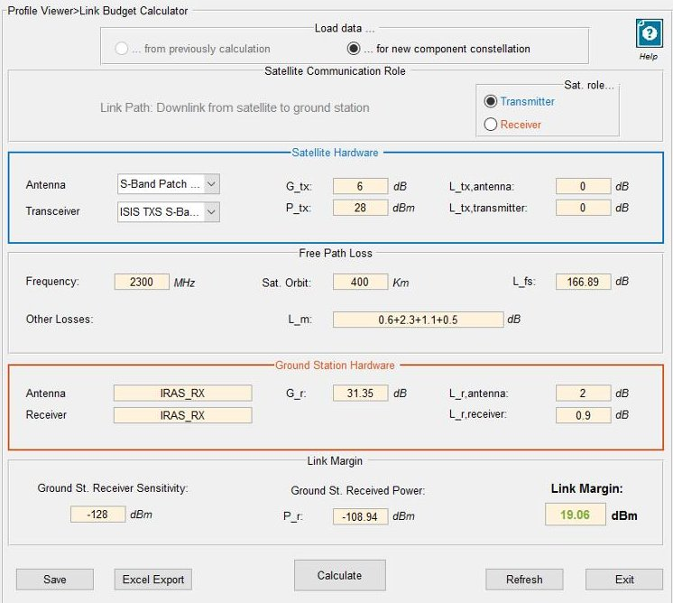

Figure 8: Link budget calculation for S/C transmitting in S-Band.

Here, the user is able to perform individual link analyses for the downlink as well as for the uplink. By determining the transmitting and receiving hardware and by providing additional information regarding the ground station properties a link margin for each link path can be calculated. In the presented example, the S-Band antenna and transmitter are selected for the satellite and values for a fictional IRAS ground station are filled in. The downlink link margin is calculated resulting in a 19 dBm sufficient link margin for S-Band communication link.

## 4.1.4 Mass Trade-Off, Volume and Cost Trade-Off

The mass and volume trade-off uses the available volume and mass constraints given by the 1.5 U structure. For the cost trade-off the overall price of the components (~75892 €) is used because no limit was preliminary defined. In Figure 9 the mass budget GUI is shown. It can be clearly seen that the selected components are not exceeding the mass constraints of the structure derived from the CubeSat design specification [4], in fact, there is a margin of approx. 700 g $ \cong $ 35% of the maximum mass available. This can lead to rather considering a structure of 1 U that allows 1.33 kg and could fit the components of the current design in terms of 1.295 kg mass. A similar assessment can be made for the volume. For this budget the margin of 10 % does not allow the reduction of the structural component (see Figure 10).

<!-- PDF_PAGE: 10 -->

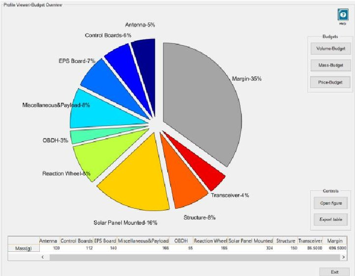

Figure 9: QuSAD mass budget for example mission QuSAT LeoEye.

## 5 Future Development

Upcoming development of the tool aims at extending the COTS database and existing modules, implementing additional system models, and adding or embedding complex functionality of existing tools developed at the IRAS. In this way QuSAD shall become an advanced space mission simulation software that incorporates features which will reach beyond the satellite design phase. The next planned functionalities are described in the following subsections.

## 5.1 Propagator Module

As a base for more sophisticated analyses modules, an orbit propagation module will be implemented. IRAS has developed three propagator modules, two of which are numerical and one is semi-analytic:

- ZUNIEM (numerical)

- NEPTUNE (numerical)

- FLORA (semi-analytic)

All propagators take into account the most influential orbit perturbations, such as atmospheric drag, Earth's Zonal Harmonics, Third Body perturbations or solar radiation pressure. Which perturbations shall be taken into account depends on the target orbit and can be defined by a user input. The propagators feature an interface to different programming languages. This allows an easy implementation into the software described here, no matter what the final programming language will be.

## 5.2 Advanced power budget

The implementation of an advanced orbit propagator allows the significant improvement of the accuracy of the current power budget analyses in terms of predicting the OAP. In this case, the current power analyses module will be improved with in-depth numerical power

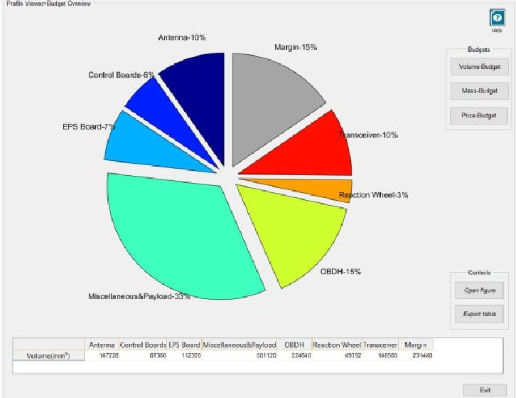

Figure 10: Volume budget for QuSAD example satellite QuSAT LeoEye.

simulation subroutines rather than generic analytical methods. The calculation of the solar panel incidents angels will be based on orbit position and the earth-sun geometry. When including an attitude model the power simulation can be enhanced even further. To provide additional functions beyond the design phase, a battery degradation model can be implemented and to support satellite operations, the tool can be extended to be used for telemetry trending and analyses.

## 5.3 Thermal modelling

The thermal modelling simulation will be based on MatLab and shall provide temperature assessments of a design within a certain temperature accuracy. The necessary values for simulating the thermal budget will be queried from the database and complemented by user input. Included in the tool is a standalone graphical interface that allows the user to perform a simulation of individual CubeSat profiles. The simulation model will use a simplified node model and will as well use simplifying analytical formulas as a mean to find a balance between accuracy and computing performance.

## 5.4 Attitude Module

At IRAS Guidance, Navigation, and Control (GNC) algorithms and methods are developed and tested in a Matlab/Simulink six degrees of freedom simulation environment. This environment, which is primarily intended for the evaluation and analysis of the achievable performances via closed-loop simulation of different control and approach strategies, can be adapted to an ADCS module for simulating attitude the behavior of S/C in QuSAD. The methods that can be used in this module to describe attitude, are Euler angles, rotation matrices and quaternions. To eliminate the problem of gimbal lock in simulations, quaternions should be used instead of Euler angles. With the aid of the Euler equations of

<!-- PDF_PAGE: 11 -->

motion the differences in the S/C attitude is calculated. Within the simulation phase the satellite model is rotated and moved according to its position vector and quaternion. For this purpose, during a simulation steps each rotation of the coordinate vector of the model is performed using the quaternion and adds the position vector to it.

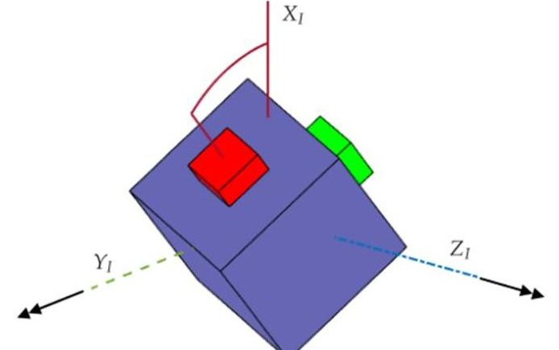

Figure 11: Movement of satellite models rotations vector $ ( X_{1} ) $ caused by disturbance torque $ ( Y_{1} ) $ and with resulting torque $ ( Z_{1} ) $

Space Situational Awareness (SSA) analyses module The Space Debris Mitigation guidelines are an important aspect of the design and operation of a satellite. An Space Situational Awareness (SSA) module should implement the applicable guidelines of the IADC [5]:

- Deorbiting not later than 25 years after the end of the operational life.

- During re-entry burn up above 15 km.

- Minimization of the risk of explosion.

- No generation of space debris.

To comply with the directives with regard to the maximum lifetime after end of operations of 25 years and to find the maximum possible orbital altitude, the SSA module should interface with analysis tools existing at IRAS - e.g. DRAMA (Debris Risk Assessment and Mitigation Analyses) [11] , [12]) - to perform debris risk assessment and mitigation analyse.

## 5.5 Design Optimization algorithms

A module introducing optimization algorithms and trade off criterias should make the tool more automated and more user-friendly. Several optimization algorithms exist ranging from rather simple Newton's method to more sophisticated approaches such as genetic algorithms (GA) or simulated annealing (SA). When configuring a CubeSat, several areas may benefit from or even require an optimization. An example is the positioning of the respective subsystems within the CubeSat. Regarding volume, three criteria need to be fulfilled. Firstly, the sum of the volumes of all subsystems needs to be smaller than

the unit volume. Secondly, the dimensions of each subsystem need to be smaller than the respective CubeSat dimensions, and thirdly, the assembled subsystems need to fit into the CubeSat structure. The first two requirements can be defined, by:

$$
\begin{array}{l} \sum_ {i} V _ {i} \leq V _ {g e s} \\ \forall V _ {i}: \quad w _ {i} \leq w \wedge h _ {i} \leq h \wedge d _ {i} \leq d \\ \end{array}
$$

where V is ... w is.. d,h

It is a prerequisite that the centre of mass (CoM) is located as close as possible to the volumetric centre (CoV) of the CubeSat to enhance stability:

$$
\sqrt {\left(x _ {C O M} - x _ {C O V}\right) ^ {2} + \left(y _ {C O M} - y _ {C O V}\right) ^ {2} + \left(z _ {C O M} - z _ {C O V}\right) ^ {2}} \rightarrow 0
$$

Those two examples show that the presented software can highly profit from optimization algorithms.

## 5.6 Orbit Visualization

Based on existing tools of IRAS, a 3D and 2D visualization of the satellite orbits will be implemented. The tool DOCTOR (Display of Objects Circulating in Terrestrial Orbits) is a space debris visualization tool that visualizes the space debris environment in three dimensions in real-time, based on propagations conducted on a graphics processor. With DOCTOR, the orbits of thousands of objects can be filtered and displayed. Additionally information such as the object ID, orbital data, ground track or country of origin. In the scope of QuSAD, a visualization of orbit and ground track will aid in the mission design.

## 6. Conclusions

The presented tool QuSAD offers a dynamic, simple and intuitive software with an intuitive user interface to simplify and ease the process of satellite design for experienced space mission designers as well as for unexperienced students. Based on an SQL database, the software assists the user during the design process of CubeSat and as provides various components as well as budget analysing tools. Commercial of the shelf CubeSat components can be selected from a database to create different satellite concepts and perform initial trade-off studies. To do so, QuSAD provides price, mass, volume, link as well as power budget tools to illustrate the corresponding distributions and margins on subsystem level and to allow system design parameter trade-off studies. For maintenance of the database, it can be simply updated with new components based on MYSQL. The modular concept of the tool makes it easily extendable.

<!-- PDF_PAGE: 12 -->

New features, like design optimization, orbit propagation, and SSA analyses module, are under development. Those upcoming upgrades will take more relevant design parameters into account and addresses the import topic of space situational awareness especially for small satellite developments and will turn the tool into S/C simulation, analyses and design tool that can be also used during satellite operations and post-mission disposal.

## List of references

[1] J. R. Wertz and W. J. Larson, Space mission analysis and design: SMAD, 3rd ed., vol. Vol. 8 of Space technology library, Torrance, Calif.: Microcosm Press, 2010.

[2] C. J. Lowe and M. Macdonald, "Rapid modebased inter-disciplinary design of a CubeSat Mission," 2014, p. 325.

[3] P. W. Fortescue, J. Stark and G. Swinerd, Spacecraft systems engineering, 4th Edition ed., Hoboken, N.J.: Aerospace Series. Wiley, 2011.

[4] S. Lee, A. Hutputanasin, A. Toorian, W. Lan, R. Munakata, J. Carnahanand and Pignatelli, D., "Cubesat design specification rev.13.," California Polytechnic State University., 2015.

[5] Anon., "IADC space debris mitigation guidelines," in iadc-02-01 revision 1. Interagency space debris coordination committee., 2007.

[6] P. Berlin, Satellite platform design, 2005.

[7] J. R. Wertz, D. F. Everett and J. J. Puschell, Space mission engineering: The new SMAD, Hawthorne CA: Microcosm Press, 2011.

[8] Anon., "Wireless link budget analysis," www.tranzeo.com, 2010. [Online]. Available: http://www.tranzeo. [Accessed 15 12 2015].

[9] Anon., "Power system and budget analysis," 2014. [Online]. Available: www.diyspaceexploration.com. [Accessed 15 12 2015].

[10] C. Clark and R. Logan, "Power budgets for mission success," 2011. [Online]. Available: www.clyde-space.com. [Accessed 15 12 2015].

[11] V. Braun, J. Gelhaus, K. C. Sanchez-Ortiz, O. J. N., R. Dominguez, C. Wiedemann, H. Krag und P. Vörsmann, ,DRAMA 2.0 - ESA's space debris risk assessment and mitigation analysis tool suite, in 64th International Astronautical Congress, 2013.

[12] J. Gelhaus, C. Kebschull, V. Braun, N. Sanchez- Ortiz, E. P. Endrino, J. M. C. d. Oliveira und R. D. González, Drama final report - upgrade of esa's space debris mitigation analysis tool suite., " Institute of Aerospace Systems/ DEIMOS Space S.L.U., 2014.

[13] W. Ley, K. Witmann and W. Hallmann, Handbuch der Raumfahrttechnik, 2011.

[14] J. Zyren and A. Petrick, "Tutorial on basic link budget analysis," 1998. [Online]. Available: www.sss-mag.com. [Accessed 15 12 2015].