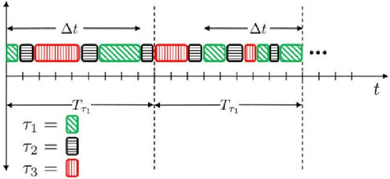
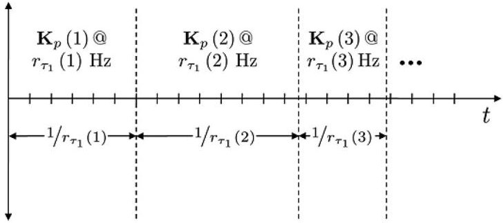
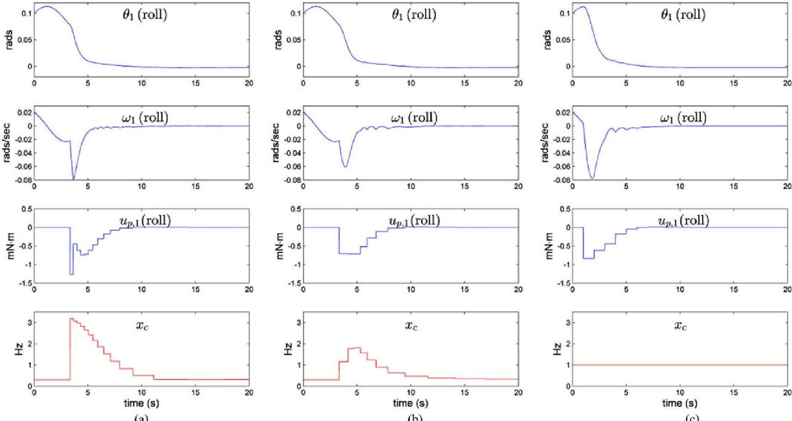
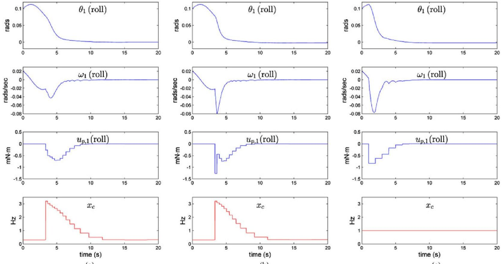
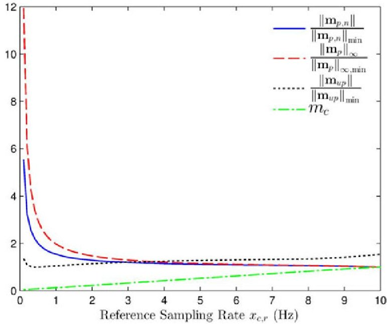

<!-- PDF_PAGE: 1 -->

# Coupled Cyber-Physical System Modeling and Coregulation of a CubeSat

Justin M. Bradley, Member, IEEE, and Ella M. Atkins, Senior Member, IEEE

Abstract—We propose the application of state-space techniques to develop a novel coupled cyber-physical system (CPS) model and use feedback control to dynamically adjust CPS resource use and performance. We investigate the use of a gain scheduled discrete linear quadratic regulator controller and a forward-propagation Riccati-based controller to handle the discrete-time-varying system. We demonstrate the value of our approach by conducting a disturbance-rejection case study for a small satellite (CubeSat) application in which resources required for attitude control are adjusted in real-time to maximize availability for other computational tasks. We evaluate CPS performance through a set of metrics quantifying physical system error and control effort as well as cyber resource utilization and compare these with traditional fixedrate optimal control strategies. Results indicate that our proposed coupled CPS model and controller can provide physical system performance similar to fixed-rate optimal control strategies but with less control effort and much less computational utilization.

Index Terms Coregulation, CubeSat, cyber-physical system (CPS), feedback, low earth orbit satellites, metrics, small satellite.

## I. INTRODUCTION

CYBER-PHYSICAL systems (CPS) are "engineered systems that are built from and depend upon the synergy of computational and physical components" [1]. While systems comprised of physical and computing (cyber) components have existed for decades, typically the design and analysis of the physical elements have not considered computational and communication elements and vice versa, except to ensure the minimum requirements imposed by one can be met by the other (e.g., a physical vehicle must carry, power, and dissipate heat from computing elements). Here, "physical" implies elements of the system occupying physical space, whereas "cyber" refers to the intangible "thinking" (computing) and "communicating" components of the system. This makes CPSs analogous to the mind-body paradigm in biological animals.

CPS as a field of study is growing rapidly. CPS research emphasizes the need for new models, abstractions, methods, metrics, and codesign techniques that encapsulate the system more holistically than was previously possible. While the depth offered by separately modeling and analyzing physical and cyber subsystem behaviors is useful, aberrant system behavior (i.e.,

when laws of compositionality or composability do not hold) may be undesirable at best and dangerous at worst. Accounting for as many subsystem interactions as possible can reduce the negative side effects of such behaviors as well as providing provable holistic system characteristics (e.g., stability) [2]. Integrated analyses can enable more efficient, safe, secure, and capable systems as we increase the level of autonomy in CPS devices and vehicles.

CPS typically requires an interacting suite of communication and processing tasks. This requirement can become a limiting factor forcing real-time System (RTS) engineers to design inflexible schedules. RTS designers traditionally aim to provide hard timing guarantees particularly for safety-critical physical system controllers, with best-effort execution of noncritical (soft real-time) tasks. For sampled-data control systems, this is done using periodic or time-triggered sampling of the system also known as Riemann sampling [3]. The effects of processor unavailability are rarely taken into account during the design of the physical system controller; therefore, hard timing guarantees are expected. Without taking computing system limitations into account, the controller may ask for more resources than are needed to achieve performance objectives. As a result, Riemann sampling may waste cyber resources during quiescent periods of physical system activity, in addition to providing suboptimal system performance [3], [4]. Event-triggered or Lebesgue sampling holds promise for better resource utilization and control performance at the expense of scheduling complexity for the RTS [3]. Perhaps more importantly, although there has been some recent work exploring event-based feedback control [4] [8], as well as a hybrid control approach that switches between Riemann and Lebesgue sampling [9], Lebesgue sampling is still a largely unexplored area relative to Riemann sampling [3].

In the early 2000s, NASA and the Department of Defense (DoD) pushed to increase autonomous operations onboard spacecraft to help accomplish mission objectives more efficiently [10]. Due to their safety-critical nature guidance, navigation, and control (GNC) activities are traditionally allocated cyber resources in accordance with a worst-case-maneuver scenario. This has relegated science activities to utilization of remaining resources to accomplish science-related computing tasks. Typically, cyber resources onboard spacecraft are exceedingly scarce relative to modern desktop or laptop computers due to stringent radiation-hardened and certification requirements as well as limited onboard power and heat dissipation capability. EO-1 [11] was the first of a series of NASA missions entitled "Earth Observer" (EO) targeting both science and technology demonstration goals. It had two Mongoose M5 processors, one for command and data handling functions and one

<!-- PDF_PAGE: 2 -->

dubbed "Wideband Advanced Recorder Processor" (WARP). EO-1's Autonomous Sciencecraft Experiment was required to meet autonomy and science objectives utilizing 4 MIPS and 128 MB RAM of computing resources on the WARP processor alone [12]. Such difficulties have identified the clear need for resource reclamation such that GNC and other activities are allocated cyber resources in accordance with need to maximize mission productivity. However, spacecraft missions to-date have yet to run GNC tasks at slower rates than would be required for worst-case maneuver scenarios [13].

In this paper, we apply state-space techniques to the realtime feedback coregulation of physical actuation and real-time controller task rate of execution (or sampling rate) for attitude control of a small spacecraft (CubeSat). With this scheme, computational resources devoted to attitude control during quiescent periods can be directed to other tasks such as communication, data gathering/processing, or mission planning. Because linear feedback control is used to regulate sampling rate, computing complexity is O(1) thereby offering minimal overhead for scheduling resources.

We conduct a CubeSat case study simulating disturbance rejection to the 3-DOF attitude of the CubeSat which uses reaction microwheels as physical actuators for attitude control. The CubeSat has an onboard computer and real-time operating system (RTOS) with presumed schedulability restraints representing the cyber system. A modeling abstraction of control task execution rate is coupled to the state-space model for attitude control allowing the dynamic adjustment of that rate and forming a discrete-time-varying CPS model. We apply two new controllers to handle the discrete-time-varying system: a feedback controller where the gains are scheduled over the time-varying sampling rate of the system and a forward-propagation Riccati-based (FPRB) controller. Although LQR gains are often scheduled using high-performance bounded LQR (see[14], [15]) in aerospace applications, we believe this to be the first time controller gains have been scheduled over a dynamically changing control task execution rate. We further hope to add more empirical evidence of the utility of (and forward-integration) FPRB controllers, the full understanding of which remains an open question in control theory [16] -[19]. Finally, we evaluate coupled CPS performance in terms of physical tracking error, control effort, and CPU resource requirements for the control task.

We aim to provide the benefits of Riemann sampling: ease of RTS scheduling, hard timing guarantees, and the rich theory of digital control while also providing some of the benefits of Lebesgue sampling: as-needed cyber resource utilization. Our abstraction allows an engineer to treat scheduling of a control task as a control problem where interactions between cyber and physical states are represented in a common regulation framework.

In this paper, we further work in [20] and [21] by refining and simplifying the state-space representation of the cyber system and rigorously capture its form using digital control formulations. We also introduce two new controllers for discrete-time-varying systems: Gain-Scheduled Discrete Linear Quadratic Regulator (GSDLQR) and a FPRB controller

discussed in Section IV-B. Alongside these new physical control laws, we introduce two cyber control laws for the cyber system as discussed in Section V-C. Metrics similar to those we developed in related work [22] are used to measure simulated performance of the proposed physical and cyber control laws applied to attitude control of our CubeSat. To our knowledge, this is the first time a dynamic sampling rate scheme has been investigated for a spacecraft.

## II. BACKGROUND AND RELATED WORK

Although CPS research is, by necessity, multidisciplinary, CPS researchers have largely arisen from the control and RTS communities underscoring the importance of the interaction between computing and control functions in a system. Next, we first discuss the ter illustrate the obstacles resulting from controller implementation on a digital computer. We then discuss research aimed at overcoming those obstacles as it relates to CPS. This is followed by a discussion of CPS applied to aerospace systems and how our work relates.

## A. Real-Time Systems and Digital Control

Since computing resources are finite, a simplifying assumption of infinitely-fast sampling rate is not realizable in practice. In a RTOS processor, time is allocated to tasks according to a schedule. If we use a RTOS to implement control of a system, the timing of reading sensors, calculation of control input, and output of the control signal is of paramount importance and can have an impact on both the design of the controller and the scheduling algorithm. In traditional control theory, one of two approaches to digital control are typically applied [23]:

1) An engineer designs a continuous-time controller to meet appropriate timing, steady state, overshoot, and stability margin requirements. A sampling rate meeting design criteria is selected, and a discrete equivalent of the continuous controller is found. This method of design is called emulation.

2) A sampling rate meeting design criteria is selected. The system is then discretized at that sampling rate, and digital control techniques are used to design an appropriate controller.

In either case, the assumption is then made that the RTOS can guarantee the sampling rate chosen.

Assume $ \tau_{1} $ is a control task implemented on an RTOS. That is, assume $ \tau_{1} $ receives sensor values from the A/D converter, obtains an updated system state estimate $ \mathbf{x}_{p} $ , computes the control input $ \mathbf{u}_{p} $ , and outputs the control signal to the D/A converter. In addition, assume that the control input is applied at the completion of the task and is held for $ T_{\tau_{1}} $ seconds, which is the period of task $ \tau_{1} $ . Note that $ T_{\tau_{1}} $ is the control task period or sampling period and that $ \frac{1}{T_{\tau_{1}}}=r_{\tau_{1}} $ is the sampling rate or control task execution rate. In a preemptive RTOS containing multiple high-priority tasks, timing is unpredictable. We do not know precisely when the control task will be executed or whether it will be preempted by a higher priority task. We only know that it will complete by its deadline which we assume is $ T_{\tau_{1}} $ We demonstrate this in Fig. 1. In this schedule, each task has a

<!-- PDF_PAGE: 3 -->

Fig. 1. Preemptive scheduling on a single processor.

periodic rate at which it must be executed, but because the tasks are preemptable higher priority tasks may be serviced first. Schedule feasibility is determined based on the worst-case execution time of a task $ \tau $ (WCET $ (\tau) $ ) and total system utilization. In a preemptive scheduling paradigm, the delays for the physical system being controlled are

$$
\dot {\mathbf {x}} _ {p} (t, \Delta t) = \mathbf {A} _ {p} \mathbf {x} _ {p} (t, \Delta t) + \mathbf {B} _ {p} \mathbf {u} _ {p, \mathrm {Z O H}} (t, \Delta t)
$$

where $ \Delta t\in[\mathrm{WCET}(\tau_{1}),T_{\tau_{1}}] $ and $ \mathbf{u}_{p,\mathrm{ZOH}}(t,\Delta t) $ represents the zero-order held (ZOH) control input at time t which is held for task period $ T_{\tau_{1}} $ . In the preemptive RTOS, the delay is dictated by context switches between tasks, the task period $ T_{\tau_{1}} $ , any tasks that preempted $ \tau_{1} $ , and the computation time required to complete $ \tau_{1} $ .

Traditional digital control leverages the sampled-data system assumption that the reading of sensors, calculation of control input, and output of the control signal happens instantaneously and always with a current estimate of the physical system state. That control input is then "held" for the entire sampling time until the next cycle. In other words, it is assumed there is no delay in the system. The problem of control under the varying delays associated with digital real-time control have been studied extensively in the Digital Control, Networked Control Systems, Automotive, Aerospace, and RTS communities [23]-[31].

## B. Cyber-Physical System Foundations

From the cyber perspective, RTS research focuses on task scheduling to provide guarantees of hard-deadline tasks and the best effort and execution of soft-deadline tasks. Offline static schedulers as well as online dynamic schedulers have been proposed to provide provable timing guarantees for given task sets [32]. Some RTS-centric CPS research has attempted to redefine task execution and scheduling paradigms to accommodate and provide guarantees for classes of tasks suited for more dynamic CPS, for example, tasks with varying periodicity [8], [33]. Anytime control [34] [36] tries to improve controller accuracy as a function of available cyber resources. In feedback scheduling [37] [41], cyber resource allocation is modified in real time according to the evolving needs of the tasks requiring these resources; however, specifics of how these tasks compute their resource needs are abstracted out of the scheduling problem.

The control systems community has established a theory of hybrid systems to simultaneously capture continuous and discrete state models. In a hybrid system, a finite state machine

represents discrete system modes potentially having different sets of dynamics, constraints, and controllers. This formulation has provided the ability to model systems that switch between different controllers, potentially with different task rates, and that "jump" or switch through discontinuities or nonlinearities [42], [43]. Control-theoretic analyses of hybrid systems has focused on characterizing reachability and guaranteeing stability of all reachable states. Stability has been an important topic in hybrid systems research and has followed traditional Lyapunovbased energy proofs [44]. Research in this area has primarily focused on handling the "jumps" typically representing nonlinearities in system dynamics rather than changes in control task execution rate.

The research most related to our work has come from researchers who have examined event-triggered control and time-varying control and sampling to reduce the number of sampling instants. Bini and Buttazzo recently proposed an optimal control formulation to optimize both control inputs and sampling pattern trajectory, a computationally feasible quanitzation-based method to estimate or approximate the optimal control solution, and proved optimality for first-order systems [45]. Varying time control is proposed by Kowalska and Mohrenschildt wherein a similar optimal control problem over control inputs and sampling instants is solved for a receding horizon with a computationally tractable algorithm [46] but loss of optimality guarantee [45]. Our work is similar by allowing for variable sampling instants, but whereas their work focuses on optimality over a planned trajectory, our technique focuses on increasing robustness to system disturbances and deviations from planned trajectories through proportional feedback control which determines the sampling rate. Additionally, our feedback coregulation scheme could be used to supplement optimal sampling pattern techniques by accepting the optimal sampling pattern as the reference trajectory and using feedback coregulation to offer minor adjustments based on aberrant conditions.

## C. Aerospace Cyber-Physical System

Safety-critical aerospace systems require task schedules executing on RTOSs that have been analyzed offline to show hard deadlines are met and that soft real-time tasks will receive sufficient attention for effective mission accomplishment. To date, aerospace systems, particularly low-cost platforms such as CubeSats and small Unmanned Aircraft Systems, have additional cyber resources beyond what would be minimally required if a RTOS was used. This allows tasks to be executed in a best-effort or soft real-time mode as would be provided by an embedded Linux distribution. This speeds design and development in that the full suite of Linux-based tools and kernel modules can be used. This simple execution strategy can be successful so long as tasks either underutilize available cyber resources or the system is never placed at risk by missing one or more deadlines.

Large spacecraft systems have typically addressed the problem of physical and cyber resource utilization through task scheduling. For an orbiting spacecraft, science payload data collection must often occur within a relatively short time

<!-- PDF_PAGE: 4 -->

window (e.g., a few minutes for low earth orbit [47]). During this window, the system must maximize its efforts to collect science data. There is generally a short time window during which the system can prepare resources for this intense data collection activity. Traditionally, such task scheduling problems have been addressed by ground operators manually constructing plans with write and check procedures [47]. The Continuous Activity Scheduling, Planning, Execution, and Replanning planner was used onboard EO-1 to optimize science activities based on incoming data [12]. An iterative repair algorithm was used to improve task execution schedule. This science planner was highly successful and has continued to evolve for infusion into additional missions. Other planners include the Automated Scheduling and Planning Environment where scheduling is combined with mission planning [48] and the Heuristic Scheduling Testbed System [49].

We present this related work to create awareness that the work presented in this paper couples cyber and physical systems in the regime of equations of motion rather than models used for task scheduling. That is, at the feedback control level, cyber and physical resources are balanced dynamically rather than at a higher planning level presumed in [45] and [46] and in traditional satellite task scheduling. Our approach does not replace traditional planning, but rather supplements it by allowing reactive reallocation of resources within the reference trajectories commanded by the planner.

## D. Our Previous Work

In [21] and [20], we first formulated a holistic CPS control system for coregulation through the addition of cyber "states" to the state-space formulation of traditional inverted pendulum and spring-mass-damper control systems. The additional states were used to govern sampling rate thereby fitting into a dynamic scheduling paradigm. In hybrid systems, NCS, and digital control, the sampling rate is chosen, designed, and analyzed offline, a priori, or in the case of optimal sampling control sampling instants are chosen for a receding horizon. Our formulation instead allows for the dynamic adjustment of the sampling rate in response to disturbances (or changes in tracking error) by adjusting cyber resources in conjunction with physical system performance.

The cyber model used in [21] and [20] was a double integrator which limited the response of the cyber system. However, a digital device capable of reallocating its resources in discrete intervals via task scheduling or varying CPU voltage would be capable of applying an "impulse" to the system that enables sampling rate to step between values. In this manuscript, we propose a model more closely matching this reality.

## III. CUBESAT EQUATIONS OF MOTION

Attitude control of a class of picosatellites called "CubeSat" [50] is a compelling CPS challenge because of the unstable system dynamics and widely-varying pointing accuracy requirements for data collection and communication versus quiescent drift periods. Typically, science data can be collected much faster than it can be communicated, a problem confounded by constraints on orbital windows in which a ground station is

accessible. This requires the CubeSat to devote substantial effort to manipulating data onboard, as was done with EO-1 [12], to improve science output. CubeSats, therefore, usually contain substantial computing power for their size. At any given time, computational activities on a CubeSat can easily consume $ 10\%-50\%^{1} $ of available energy resources, motivating the need for CPS codesign techniques that coregulate both cyber and physical resources.

CubeSat missions are accomplished with a 1-3kg satellite containing major onboard subsystems such as attitude control, communication, power distribution, generation, and storage, command and data handling, and payload. Pointing may require rotational movements once or more per orbit depending upon the mission. A spacecraft in a 500 km circular orbit spends 38% of its time in eclipse meaning that energy can be generated during the other 62% of the orbital period. Since a typical time period for a 500-km altitude orbit is about 95 min, this poses a challenge for energy utilization. Data transmission requires energy that depends on multiple factors such as data rate, signal strength, antenna size and type, etc. These factors provide motivation for communication and position-aware computing. In this study, we focus on making the cyber system (i.e., RTS) able to regulate the attitude control sampling rate so that it can achieve appropriate balance between that and resource availability for other tasks such as science data handling.

## A. Equations of Motion

The equations of motion for attitude control of a CubeSat can be developed using Euler equations for rigid body kinematics and dynamics with a diagonal inertia matrix J. The equations used in this paper assume a circular orbit and small perturbations about the equilibrium point about which the equations of motion are linearized. The dynamics about the pitch (subscript 2) axis are represented as

$$
\begin{array}{l} \dot {\theta} _ {2} = \omega_ {2} \\ \dot {\omega} _ {2} = \frac {3 \omega_ {o} ^ {2} \left(J _ {3} - J _ {1}\right)}{J _ {2}} \theta_ {2} + \frac {M _ {2}}{J _ {2}} \\ \end{array}
$$

where the body-fixed pitch axis is assumed to be aligned with one of the principal axes of the spacecraft. The torque applied $ \left(M_{2}\right) $ is equal to and opposite in direction to the rate of change of angular momentum of the microwheel (i.e., $ \dot{H}_{2}^{w}=-M_{2} $ ). The angular velocity for a circular orbit is $ \omega_{o}=\sqrt{\frac{\mu}{R^{3}}} $ where $ \mu $ is the gravitational constant, and R is the radius of the orbit.

The dynamics about roll (subscript 1) axis and yaw (subscript 3) axis are represented by

$$
\begin{array}{l} \dot {\theta} _ {1} = \omega_ {1} - \omega_ {o} \theta_ {3} \\ \dot {\theta} _ {3} = \omega_ {3} - \omega_ {o} \theta_ {1} \\ \dot {\omega} _ {1} = \frac {\omega_ {o} \left(J _ {2} - J _ {3}\right)}{J _ {1}} \omega_ {3} + \frac {3 \omega_ {o} ^ {2} \left(J _ {3} - J _ {2}\right)}{J _ {1}} \theta_ {1} + \frac {M _ {1}}{J _ {1}} \\ \dot {\omega} _ {3} = \frac {\omega_ {o} \left(J _ {1} - J _ {2}\right)}{J _ {3}} \omega_ {1} + \frac {M _ {3}}{J _ {3}} \\ \end{array}
$$

<!-- PDF_PAGE: 5 -->

where roll and yaw axes are assumed to be aligned with the principal axes of the spacecraft perpendicular to each other and perpendicular to the pitch axis. Note that the equations of motion are linearized about an equilibrium point where the bodyfixed axes of the spacecraft are aligned with a local vertical local horizontal (LVLH) reference frame. Hence, $ \left( \omega_{1},\omega_{2},\omega_{3}\right) $ are components of the perturbation about the equilibrium point in the angular velocity vector with respect to an inertial frame expressed in the body-fixed frame of reference. $ \theta_{1},\theta_{2} $ , and $ \theta_{3} $ are perturbations of the 3-2-1 Euler angles that define the spacecraft attitude with respect to the LVLH coordinate frame. The torque applied $ \left(M_{1},M_{3}\right) $ is equal to and opposite in direction to the rate of change of angular momentum of the microwheel $ \left(\mathrm{i.e.}\dot{H}_{1}^{w}=-M_{1}\mathrm{and}\dot{H}_{3}^{w}=-M_{3}\right). $

We can rewrite the open-loop equations in state-space form

$$
\dot {\mathbf {x}} _ {p} = \mathbf {A} _ {p} \mathbf {x} _ {p} + \mathbf {B} _ {p} \mathbf {u} _ {p}
$$

where the states and controls are

$$
\begin{array}{l} \mathbf {x} _ {p} = \left(\theta_ {1}, \theta_ {2}, \theta_ {1} \theta_ {3}, \omega_ {1}, \omega_ {2}, \omega_ {3}, H _ {1} ^ {w}, H _ {2} ^ {w}, H _ {3} ^ {w}\right) \\ \mathbf {u} _ {p} = \left(M _ {1}, M _ {2}, M _ {3}\right) \\ \end{array}
$$

and matrices $ \mathbf{A}_{p} $ and $ \mathbf{B}_{p} $ are taken from (1) and (2). The CubeSat considered is similar to the RAX-2 CubeSat developed and deployed by the Michigan Exploration Lab (MXL) in the University of Michigan Aerospace Engineering Department [51]. It has mass of 3 kg with dimensions of $ 3 0 \mathrm{c m} \times 1 0 \mathrm{c m} \times 1 0 \mathrm{c m} $ and inertia matrix $ \mathbf{J}=\mathrm{d i a g} \left(0. 0 0 5, 0. 0 2 5, 0. 0 2 5\right) \mathrm{K g} \cdot \mathrm{m}^{2}. $ The altitude of the spacecraft is assumed to be 500 km above Earth's surface which results in an orbital angular velocity $ \omega_{o}=0. 0 0 1 1 \frac{\mathrm{r a d}}{\mathrm{s}}. $ Because this work also introduces a cyber system model, we use the subscript "p" to indicate that these equations depict the physical system.

Depending on the configuration of the spacecraft, the linearized system can either be stable or unstable [52]. For our CubeSat, the system matrix $ \mathbf{A}_{p} $ has unstable poles; thus, it requires active control to stabilize.

## IV. DISCRETE CUBESAT MODEL

As discussed in Section II-A, there are several sources for uncertain delays when implementing a controller on an RTOS. Nevertheless, the traditional sampled-data assumption of no delay is reasonable to make under most scenarios. In a modern digital control system, it is likely that dedicated A/D and D/A converters remove conversion delays, and we assume that a predictive algorithm can always provide the current physical system state at the moment the control output is calculated thereby removing the delay in state estimation. This assumption allows us to leverage digital control theory to discretize the CubeSat model and design digital controllers.

## A. Discrete CubeSat Model

If we assume the control task is a hard-deadline task and that execution deadlines are always satisfied by the RTS, we can discretize the system for a given sampling period. In the most general case, the discrete system matrices may vary

due to parameter changes, uncertainty in dynamics, or in our case, a time-varying sampling rate. We reflect the discrete-time-varying nature of the system using the variable k, representing an execution cycle of the control task. Assuming a ZOH, we can write the physical system as

$$
\mathbf {x} _ {p} (k + 1) = \boldsymbol {\Phi} _ {p} (k) \mathbf {x} _ {p} (k) + \boldsymbol {\Gamma} _ {p} (k) \mathbf {u} _ {p} (k)
$$

where

$$
\begin{array}{l} \Phi_ {p} (k) = e ^ {\mathbf {A} _ {p} T _ {\tau_ {1}} (k)} \\ \Gamma_ {p} (k) = \int_ {0} ^ {T _ {\tau_ {1}} (k)} e ^ {\mathbf {A} _ {p} \eta} d \eta \mathbf {B} _ {p}. \\ \end{array}
$$

We note that in traditional digital control theory, a constant sampling period is assumed and the resulting system would be

$$
\mathbf {x} _ {p} (k + 1) = \Phi_ {p} \mathbf {x} _ {p} (k) + \Gamma_ {p} \mathbf {u} _ {p} (k)
$$

in which system matrices $ \Phi_{p} $ and $ \Gamma_{p} $ are constant over each cycle [23].

## B. Physical System Control Laws

The design of feedback controllers for a system that can dynamically adjust its own sampling rate is a relatively new area for research [45], [46]. As a result, we borrow from strong foundations in digital, optimal, and nonlinear control and seek to apply them to discrete-time-varying systems. We propose two controllers: a GSDLQR and a FPRB controller.

1) Gain Scheduled DLQR Control: Infinite horizon DLQR controllers are designed assuming a fixed sampling rate and constant system matrices. For a given stabilizing sampling rate because our system is completely controllable it is possible to compute an infinite horizon DLQR controller with a finite cost where the cost function is given by

$$
J = \frac {1}{2} \sum_ {k = 0} ^ {\infty} \mathbf {x} _ {p} ^ {\mathrm {T}} (k) \mathbf {Q} \mathbf {x} _ {p} (k) + \mathbf {u} _ {p} ^ {\mathrm {T}} (k) \mathbf {R} \mathbf {u} _ {p} (k).
$$

The resulting optimal control law is given by

$$
\mathbf {u} _ {p} (k) = - \mathbf {K} _ {p} \mathbf {x} _ {p} (k)
$$

where

$$
\mathbf {K} _ {p} = \left(\mathbf {R} + \boldsymbol {\Gamma} _ {p} ^ {\mathrm {T}} \mathbf {P} \boldsymbol {\Gamma} _ {p}\right) ^ {- 1} \boldsymbol {\Gamma} _ {p} ^ {\mathrm {T}} \mathbf {P} \boldsymbol {\Phi} _ {p}
$$

and P is the positive definite solution to the discrete-time algebraic Riccati equation (DARE)

$$
\mathbf {P} = \mathbf {Q} + \boldsymbol {\Phi} _ {p} ^ {\mathrm {T}} \left(\mathbf {P} - \mathbf {P} \boldsymbol {\Gamma} _ {p} \left(\mathbf {R} + \boldsymbol {\Gamma} _ {p} ^ {\mathrm {T}} \mathbf {P} \boldsymbol {\Gamma} _ {p}\right) ^ {- 1} \boldsymbol {\Gamma} _ {p} ^ {\mathrm {T}} \mathbf {P}\right) \boldsymbol {\Phi} _ {p}.
$$

In the simulations carried out for our work, $ \mathbf{Q}=1 0 0 \mathbf{I}_{9} $ and $ \mathbf{R}=1 0^{5} \mathbf{I}_{3} $ where $ \mathbf{I}_{n} $ is the $ n\times n $ identity matrix.

Consider the effect of sampling rate on the DLQR gains for our CubeSat system in Table I computed while holding the Q and R matrices constant. Higher sampling rates result in larger gains while lower sampling rates result in smaller gains [53]. While lower sampling rates conserve energy, most often system robustness suffers as a result. This trend has been explored and quantified in the literature [31], [54]. For our CubeSat, we specify upper and lower bounds for sampling rate. We choose a

<!-- PDF_PAGE: 6 -->

TABLE I

SCALING FACTOR COMPARISON FOR NORMALIZED DLQR CUBESAT GAINS

<table border="1"><tr><td>SAMPLING RATE</td><td>$\| \mathbf{K}_{p}\|_{2}$</td></tr><tr><td>$r_{\tau_{1},\max}$</td><td>0.0626</td></tr><tr><td>$r_{\tau_{1}}=1\mathrm{Hz}$</td><td>0.0325</td></tr><tr><td>$r_{\tau_{1},\min}$</td><td>0.0050</td></tr></table>

Fig. 2. Gain scheduling over $ r_{\tau_{1}} $ (k) (sampling rate).

maximum sampling rate $ r_{\tau,\mathrm{max}} $ for which we can guarantee that the control task is schedulable and a minimum sampling rate $ r_{\tau,\mathrm{min}} $ for which we can still guarantee physical system stability have

$$
r _ {\tau_ {1}, \max } = 1 0 \mathrm {H z}
$$

$$
r _ {\tau_ {1}, \min } = 0. 1 \mathrm {H z}.
$$

To illustrate the relationship between sampling rate and gain, we computed the matrix norm of DLQR gains for the CubeSat discretized at $ r_{\tau_{1},\max},r_{\tau_{1},\min} $ and an intermediate rate $ r_{\tau_{1}}= 1. 0 \mathrm{~ H z} $ (see [55]). These gains are listed in Table I.

Because this study focuses on the dynamic adjustment of sampling rate, and since DLQR gains vary significantly over the range of possible rates, a constant DLQR gain will yield suboptimal results. Gain scheduling is a technique traditionally applied to nonlinear systems where the complexity of the nonlinear system prevents or greatly complicates the design of feasible controllers. In this paradigm, a nonlinear system is linearized about operating points or equilibrium points and linear system control designs and techniques can be applied. The effects of nonlinearities in the system are then mitigated by "scheduling $ ^{2} $ the designed gains via an interpolating scheme to compute gains at intermediate operating points [56], [57].

We use this strategy as inspiration for developing a gain scheduling scheme over operating points of the cyber system (i.e., sampling rates). We design DLQR controllers for the CubeSat at discrete sampling rates between $ r_{\tau_{1},\min} $ and $ r_{\tau_{1},\max} $ where each sampling rate is an operating point of the CPS. We then "schedule" the appropriate DLQR gains for the CubeSat corresponding to the commanded sampling rate $ r_{\tau_{1}}(k) $ as illustrated in Fig. 2. This paradigm ensures that the DLQR gain used to compute the next control input corresponds with the newly commanded sampling period for the control task.

2) FPRB Control: The optimal DLQR control is found by either propagating the DARE in (5) backward from a final condition for finite-horizon control, or by finding the steady-state positive definite solution to the DARE for infinite-horizon control. Now suppose we know system matrices $ \Phi_{p} (k) $ and $ \Gamma_{p} (k) $ k=1,2,3,...,N. We could then propagate the DARE in (5) backward from a final condition to obtain the optimal discrete-time-varying control [58]. Since we do not know how the sampling rate will evolve (i.e., it is dynamically adjusted based on error in the physical system trajectory as described in Section V), we do not know the system matrices in advance.

Forward-Integration Riccati-Based control is an emerging control design method wherein the solution to the forward-intime control Riccati equation is used to compute the control gain. While research is still investigating the stability and performance guarantees of this method, it has empirically shown to be effective in controlling a wide array of systems [16], [17]. We apply this strategy to our discrete-time-varying CubeSat attitude control problem by computing

$$
\mathbf {u} _ {p} (k) = - \mathbf {K} _ {p} (k) \mathbf {x} _ {p} (k)
$$

where

$$
\mathbf {K} _ {p} (k) = \left(\mathbf {R} + \boldsymbol {\Gamma} _ {p} ^ {\mathrm {T}} (k) \mathbf {P} (k) \boldsymbol {\Gamma} _ {p} (k)\right) ^ {- 1} \boldsymbol {\Gamma} _ {p} ^ {\mathrm {T}} (k) \mathbf {P} (k) \boldsymbol {\Phi} _ {p} (k)
$$

and $ \mathbf{P} (k) $ is found iteratively using the forward-in-discrete-time algebraic Riccati equation as

$$
\begin{array}{l} \mathbf {P} (k) = \mathbf {Q} + \boldsymbol {\Phi} _ {p} ^ {\mathrm {T}} (k) \left(\mathbf {P} (k - 1) - \mathbf {P} (k - 1) \boldsymbol {\Gamma} _ {p} (k)\right) \\ \left(\mathbf {R} + \boldsymbol {\Gamma} _ {p} ^ {\mathrm {T}} (k) \mathbf {P} (k - 1) \boldsymbol {\Gamma} _ {p} (k)\right) ^ {- 1} \\ \left. \boldsymbol {\Gamma} _ {p} ^ {\mathrm {T}} (k) \mathbf {P} (k - 1)\right) \boldsymbol {\Phi} _ {p} (k) \\ \end{array}
$$

with initial-time boundary condition $ \mathbf{P} ( 0 ) \geq\mathbf{0} $ . As before, in the simulations carried out for this study, $ \mathbf{Q}=1 0 0 \mathbf{I}_{9} $ and $ \mathbf{R}=1 0^{5} \mathbf{I}_{3} $ . As will be shown in Section VIII, this controller is effective and only requires the forward-propagation of the DARE.

## V. CYBER-PHYSICAL SYSTEM MODEL

Having designed controllers for a discrete-time-varying CubeSat model, we now present our state-space cyber model, two cyber controllers, and couple this model to the state-space CubeSat model via feedback control.

## A. State-Space Cyber Model

The proposed coregulation scheme is applicable to both RTOS and non-RTOS (traditional Linux) operating system environments. In the case of a non-RTOS (embedded Linux) environment, timers would activate threads in accordance with each proposed sampling rate; differences between predicted and actual task completion time may be more substantial than on a RTOS but such differences are analogous to realistic disturbances impacting physical system states and control commands. In this paper, for simplicity we assume an RTOS that frequently updates its ordered priority queue based on arriving (new or

<!-- PDF_PAGE: 7 -->

modified) tasks. As such, we assume the RTOS also has the capability to nearly instantaneously (ignoring context switch time) modify the priority and sampling rate of the control task. For this study, we assume that the sampling rate can be regulated any time the control task is not running or in an interrupted state (i.e., it has completed a cycle and has not started a new one). To apply state feedback, we require a cyber model represented by an ordinary differential equation. This has the added benefit of providing "memory" or filtering. The cyber model of sampling rate is

$$
\dot {x} _ {c} = u _ {c}
$$

where $ x_{c} $ is the cyber state representing the frequency of the control task $ \tau_{1} $ (i.e. $ x_{c}=r_{\tau_{1}}=1/T_{\tau_{1}} $ ), and $ u_{c} $ a forcing term adjusting the rate of change of the sampling rate. This implies that $ x_{c} $ has units $ 1/s $ , or Hz, and $ u_{c} $ has units $ 1/s^{2}. $

## B. Open-Loop Cyber-Physical System Model

We augment the continuous-time physical system with our proposed cyber model forming the open-loop CPS equations

$$
\left[ \begin{array}{c} \dot {\mathbf {x}} _ {p} \\ \dot {x} _ {c} \end{array} \right] = \left[ \begin{array}{c c} \mathbf {A} _ {p} & 0 \\ \mathbf {0} & 0 \end{array} \right] \left[ \begin{array}{c} \mathbf {x} _ {p} \\ x _ {c} \end{array} \right] + \left[ \begin{array}{c c} \mathbf {B} _ {p} & 0 \\ 0 & 1 \end{array} \right] \left[ \begin{array}{c} \mathbf {u} _ {p} \\ u _ {c} \end{array} \right].
$$

Since the cyber model will also be implemented on a digital computer, we can apply the formula in (3) to specify the CPS model as a set of difference equations as follows:

$$
\begin{array}{l} \left[ \begin{array}{c} \mathbf {x} _ {p} (k + 1) \\ x _ {c} (k + 1) \end{array} \right] = \left[ \begin{array}{c c} \boldsymbol {\Phi} _ {p} (k) & 0 \\ \mathbf {0} & 1 \end{array} \right] \left[ \begin{array}{c} \mathbf {x} _ {p} (k) \\ x _ {c} (k) \end{array} \right] \\ + \left[ \begin{array}{c c} \boldsymbol {\Gamma} _ {p} (k) & 0 \\ 0 & T _ {\tau_ {1}} (k) \end{array} \right] \left[ \begin{array}{c} \mathbf {u} _ {p} (k) \\ u _ {c} (k) \end{array} \right] \\ \end{array}
$$

and note again that $ x_{c} ( k )=r_{\tau_{1}} ( k )=1 / T_{\tau_{1}} ( k ). $ Because $ T_{\tau_{1}} ( k )=1 / x_{c} ( k ) $ and $ \Phi_{p} ( k ) $ and $ \Gamma_{p} ( k ) $ are functions of $ x_{c} $ [as per (3)], the system is now nonlinear.

## C. Cyber System Control Law

To design a control law for the new cyber model, we must examine dependences between the cyber and physical systems. In the closed-loop system, performance is directly dependent on the execution rate of the control task due to the ZOH nature of the RTOS implementation. System state $ \mathbf{x}_{p} $ is fed back into the cyber system from which we can compute the performance metric $ \mathbf{x}_{p}-\mathbf{x}_{p,r} $ where $ \mathbf{x}_{p,r} $ is the physical state reference trajectory. We want the cyber system to in turn adjust sampling rate based on the performance of the physical system.

As a result, we design a two-part control law for the cyber system. One part reacts to off-nominal disturbance conditions in the physical system, and the other drives the task execution rate to a reference rate. We introduce two versions of the cyber control law for comparison in our results. In Version One, $ u_{c,1} (k) $ , we include the control input scaling such that

$$
u _ {c, 1} (k) = \mathbf {K} _ {c p} (k) \left(\mathbf {x} _ {p} (k) - \mathbf {x} _ {p, r}\right) - k _ {c} \left(x _ {c} (k) - x _ {c, r}\right). \tag {7}
$$

where $ x_{c,r} $ is the cyber system reference trajectory (i.e., a desired sampling rate for $ \tau_{1} $ ), and $ k_{c} $ is a gain. For $ u_{c,1} $ , $ \mathbf{K}_{cp} $ has units necessary to cancel physical state units

$$
\begin{array}{l} \mathbf {K} _ {c p} = \left[ \frac {1}{\mathrm {s} ^ {2}} \quad \frac {1}{\mathrm {s} ^ {2}} \quad \frac {1}{\mathrm {s} ^ {2}} \quad \frac {1}{\mathrm {s}} \quad \frac {1}{\mathrm {s}} \quad \frac {1}{\mathrm {s}} \right] \\ \frac {1}{N \cdot m \cdot s ^ {3}} \quad \frac {1}{N \cdot m \cdot s ^ {3}} \quad \frac {1}{N \cdot m \cdot s ^ {3}} \\ \end{array}
$$

and $ k_{c} $ has units 1/s. In Version Two, $ u_{c,2} (k) $ , we eliminate the scaling and the nonlinearity in the cyber system so that the cyber controller is equally aggressive regardless of its current sampling rate. Therefore

$$
\begin{array}{l} u _ {c, 2} (k) = \frac {1}{T _ {\tau_ {1}} (k)} \mathbf {K} _ {c p} (k) \left(\mathbf {x} _ {p} (k) - \mathbf {x} _ {p, r}\right) \\ - \frac {1}{T _ {\tau_ {1}} (k)} k _ {c} \left(x _ {c} (k) - x _ {c, r}\right). \\ \end{array}
$$

For $ u_{c,2} $ $ \mathbf{K}_{cp} $ and $ k_{c} $ now have units

$$
\begin{array}{l} \mathbf {K} _ {c p} = \left[ \frac {1}{\mathrm {s}} \quad \frac {1}{\mathrm {s}} \quad \frac {1}{\mathrm {s}} \quad \dim \quad \dim \quad \dim \right. \\ \left. \frac {1}{N \cdot m \cdot s ^ {2}} \quad \frac {1}{N \cdot m \cdot s ^ {2}} \quad \frac {1}{N \cdot m \cdot s ^ {2}} \right] \\ k _ {c} = \dim \\ \end{array}
$$

where dim indicates the quantity is dimensionless. Note that if there is nonzero error in the physical system, the cyber system should increase the sampling rate. Therefore, $ \mathbf{K}_{cp} $ is specified as a gain vector with

$$
\mathbf {K} _ {c p} (k) = \left\{ \begin{array}{l l} k _ {c p, i}, & \mathrm {i f} x _ {p, i} (k) - x _ {p, i, r} \geq 0 \\ - k _ {c p, i}, & \mathrm {i f} x _ {p, i} (k) - x _ {p, i, r} < 0 \end{array} \right.
$$

$ \forall k_{cp,i}\in \mathbf{K}_{cp},x_{p,i}\in \mathbf{x}_{p},x_{p,i,r}\in \mathbf{x}_{p,r}. $ This control law allows the cyber system to adjust its resources in accordance with the performance of the physical system as it simultaneously targets a reference execution rate. In practice, it is likely a trajectory planner would update reference trajectories for both the physical and cyber system to meet mission and performance requirements.

## D. Closed-Loop Cyber-Physical System Model

Now that we have discrete controllers for both the physical and cyber system, we can write the closed-loop equations of the full CPS model using (6)-(8). Since we are regulating $ \mathbf{x}_{p} $ to zero, $ \mathbf{x}_{p,r}=\mathbf{0} $ and for $ u_{c,1} $ we have

$$
\begin{array}{l} \mathbf {x} _ {p} (k + 1) = \left(\boldsymbol {\Phi} _ {p} (k) - \boldsymbol {\Gamma} _ {p} (k) \mathbf {K} _ {p} (k)\right) \mathbf {x} _ {p} (k) \\ x _ {c} (k + 1) = T _ {\tau_ {1}} (k) \mathbf {K} _ {c p} \mathbf {x} _ {p} (k) \\ + \left(1 - T _ {\tau_ {1}} (k) k _ {c}\right) x _ {c} (k) + T _ {\tau_ {1}} (k) k _ {c} x _ {c, r}. \\ \end{array}
$$

For $ u_{c,2} $ , we have

$$
\begin{array}{l} \mathbf {x} _ {p} (k + 1) = \left(\Phi_ {p} (k) - \Gamma_ {p} (k) \mathbf {K} _ {p} (k)\right) \mathbf {x} _ {p} (k) \\ x _ {c} (k + 1) = \mathbf {K} _ {c p} \mathbf {x} _ {p} (k) + \left(1 - k _ {c}\right) x _ {c} (k) + k _ {c} x _ {c, r}. \\ \end{array}
$$

<!-- PDF_PAGE: 8 -->

## VI. CYBER-PHYSICAL SYSTEM METRICS

We demonstrate the effectiveness of our proposed methodology by analyzing and comparing simulation results against fixed-rate optimal control strategies. Measuring holistic CPS performance requires the development of additional metrics to evaluate more than traditional control performance indicators (e.g., rise time, settling time, etc.). To appropriately compare results, we utilize three metrics that account for both physical and cyber performance.

## A. Physical State Metric

To gauge the effectiveness of the control and rate of the control task on the physical system, we examine the time-average squared error of physical state $ \mathbf{x}_{p} $ . Let $ \mathbf{m}_{p} $ represent the metric for physical state, and let subscript j indicate the jth entry in the state vector. In addition, let $ x_{pj,r} $ be the reference trajectory for the jth physical state. We then compute time-averaged physical state error as

$$
\mathbf {m} _ {p} = \left[ \begin{array}{c} \frac {1}{t _ {\mathrm {f}}} \int_ {0} ^ {t _ {\mathrm {f}}} \left(x _ {p 1} (t) - x _ {p 1, r} (t)\right) ^ {2} d t \\ \vdots \\ \frac {1}{t _ {\mathrm {f}}} \int_ {0} ^ {t _ {\mathrm {f}}} \left(x _ {p j} (t) - x _ {p j, r} (t)\right) ^ {2} d t \end{array} \right]
$$

where $ t_{\mathrm{f}} $ is the final time. This metric provides an assessment of how well the CubeSat attitude and angular velocities are being regulated by the RTS. To facilitate comparison, we also make use of a normalized physical state metric wherein we leverage the inherent discrete nature of the simulation to normalize the metric for each physical state

$$
\mathbf {m} _ {p, n} = \left[ \begin{array}{c} \frac {1}{t _ {\mathrm {f}} x _ {p 1 , \max } ^ {2}} \sum_ {i = 1} ^ {n} t _ {i} \left(x _ {p 1, i} - x _ {p 1, r}\right) ^ {2} \\ \vdots \\ \frac {1}{t _ {\mathrm {f}} x _ {p j , \max } ^ {2}} \sum_ {i = 1} ^ {n} t _ {i} \left(x _ {p j, i} - x _ {p j, r}\right) ^ {2} \end{array} \right]
$$

where j is the jth state, and there are n discrete samples of the state.

## B. Cyber Rate Metric

In this study, we focus attention on regulating the sampling rate. Although in a RTS many tasks would consume resources, we assume that utilization of the control task is proportional to utilization of the total RTS. Lower utilization could result in reduced energy requirements for the RTS (e.g., with a voltage scaling CPU) or the liberation of resources that can be devoted to other tasks. For this metric, we select a maximum sampling rate $ x_{c,\max}=r_{\tau_{1},\max} $ under which the complete RTS remains schedulable (i.e., can meet all hard real-time task deadlines). We define our metric to be the time-averaged percent of maximum

sampling rate as

$$
\begin{array}{l} m _ {c} = \frac {1}{t _ {\mathrm {f}} x _ {c , \max }} \sum_ {i = 1} ^ {n} t _ {i} x _ {c, i} \\ = \frac {1}{t _ {\mathrm {f}} x _ {c , \max }} \sum_ {i = 1} ^ {n} 1 \\ = \frac {n (n + 1)}{2 t _ {\mathrm {f}} x _ {c , \max }} \\ \end{array}
$$

where n is the number of time slices from time $ t\in[0,t_{\mathrm{f}}] $ . This metric was chosen over the traditional RTS utilization definition (as described in Section VII) because it allows us to easily compare and analyze different controller designs independent of the RTOS implementation.

## C. Control Effort Metric

An important measure of system performance is how much physical control effort is expended to meet performance requirements. This effort, a function of both sampling rate and control gain, requires energy expenditure for the CPS and therefore minimizing control effort can improve endurance and mission performance. An important consideration in the design of an energy efficient control law is the sampling rate. Generally, as sampling rate increases higher gain values can be tolerated while the system remains stable, while slower sampling rates require lower gains [31].

We are interested in minimizing control effort while maintaining closed-loop stability and trajectory tracking, captured in physical metric (12). It is common in optimal control to minimize $ \mathbf{u}^{\mathrm{T}}\mathbf{u} $ as in the DLQR cost function in (4). Because energy expenditure is generally a monotonically increasing function of control, minimizing control effort reduces energy expenditure Our metric for control effort in this context only includes effort for the physical system $ \mathbf{u}_{p} $ given that we do not throttle CPU clock rate or turn cores ON/OFF. Taking the DLQR cost term as a cue and due to the discrete nature of the control input caused by the ZOH, we define a control effort metric as the discrete time squared average

$$
\mathbf {m} _ {u p} = \left[ \begin{array}{c} \frac {1}{t _ {\mathrm {f}}} \sum_ {i = 1} ^ {n} t _ {i} u _ {p 1, i} ^ {2} \\ \vdots \\ \frac {1}{t _ {\mathrm {f}}} \sum_ {i = 1} ^ {n} t _ {i} u _ {p j, i} ^ {2} \end{array} \right]
$$

where j is the jth control input.

## VII. CUBESAT CASE STUDY

To develop a realistic case study of attitude control of a CubeSat, we summarize the CubeSat literature with focus on simulating responses to disturbances. We then describe our CubeSat cyber model.

<!-- PDF_PAGE: 9 -->

## A. Physical Characteristics and Setup

Low-earth orbit presents a challenging environment due to the potential for plasma-induced and magnetic disturbances, high velocity debris and meteoroids, atmospheric drag, radiation, solar wind, and dust [59] -[63]. All are sources of disturbance on attitude and orbit of a CubeSat. Generally, a CubeSat has three reasons to adjust its attitude: scientific data acquisition, communication with a ground station, or to maximize solar energy harvesting. Pointing activities must be planned and carried out within narrow time constraints, and it is critical that controllers be capable of rejecting disturbances to achieve these goals. As discussed in Section II-B, optimal control input and sampling pattern algorithms [45], [46] have been proposed to schedule controller sampling rate and conserve computing resources; however, these algorithms do not attempt to deal with disturbances which are more effectively handled by feedback control [45]. In this paper, we have proposed such a CPS feedback control formulation and therefore focus on highlighting its ability to deal with disturbances.

Our tests generate system responses to initial conditions representing an impulsive disturbance due to an impact or other transient event that perturbs the attitude and corresponding angular rates of the CubeSat. The controller objective is then to restore both attitude and angular rates to a zero reference state. The initial conditions on the physical state representing this disturbance are defined as

$$
\mathbf {x} _ {p 0} = \left[ \begin{array}{c c c c c c c c c} 0. 1 & 0. 5 & 0. 2 & 0. 0 2 & 0. 0 1 & 0. 0 0 5 & 0 & 0 & 0 \end{array} \right]
$$

where states (1,2,3) are roll, pitch, and yaw in the LVLH reference frame, states (4,5,6) are elements of the angular velocity vector, and states (7,8,9) represent angular momentum of each of three reaction microwheels used in control. Because we are regulating states to zero, the reference trajectory is

$$
\mathbf {x} _ {p, r} = \left[ \begin{array}{c c c c c c c c c} 0 & 0 & 0 & 0 & 0 & 0 & 0 & 0 \end{array} \right].
$$

In a 500-km orbit altitude (see[64], [65]) above Earth's surface, our simulated CubeSat spends roughly 62% of its orbit (59 min) in sunlight during which energy is collected via solar panels, producing about 7 W of power, and stored in a 7.4 V, 4.4 Ah LiOn battery [66], [67]. While it is possible to store energy in the microwheels (see[68], [69]), we assume they are used strictly for attitude control and that energy for control of the microwheels is only delivered from the battery system [67]. We also assume that the solar energy harvesting is sufficient during each orbital period to replenish the energy expended during eclipse. We use one reaction wheel for each axis of rotation which has characteristics (similar to [70] - [72]) shown in Table II.

## B. Cyber Characteristics and Setup

Current trajectories of CubeSat development suggest that the time will come when the majority of computationally intense tasks onboard a CubeSat will be those associated with autonomous decision making and science data handling [73]----[75]. However, at present, GNC tasks still consume a nontrivial portion of cyber resources. With this in mind, we posit

TABLE II REACTION MICROWHEEL CHARACTERISTICS

<table border="1"><tr><td>CHARACTERISTIC</td><td>VALUE</td></tr><tr><td>Max Torque</td><td>30mN·m</td></tr><tr><td>Supply Power</td><td>7.0W@6500r/min，5mN·m</td></tr><tr><td>Wheel Inertia</td><td>0.001766969kg·m2</td></tr><tr><td>Mass</td><td>500g</td></tr></table>

that significant savings can be realized by adjusting GNC tasks in accordance with pointing performance.

We assume the computing platform onboard the CubeSat is running a RTOS capable of dynamically adjusting the period of the control task as long as the control task is not running or in an interrupted state. As discussed in Section IV-B, we set hard limits on the cyber rate based on the maximum schedulability for the control task and the performance requirements of the CubeSat. For our particular system, we choose

$$
x _ {c, \max } = r _ {\tau_ {1}, \max } = 1 0 \mathrm {H z}
$$

$$
x _ {c, \min } = r _ {\tau_ {1}, \min } = 0. 1 \mathrm {H z}.
$$

Such hard limits are similar to saturation limits on typical physical actuators, and rates outside this range are not allowed. RTS utilization is defined as

$$
U _ {\mathrm {R T S}} = \sum_ {i = 1} ^ {n} \frac {e _ {\tau_ {i}}}{P _ {\tau_ {i}}}
$$

where $ e_{\tau_{i}} $ is the worst-case execution time of $ \tau_{i} $ (WCET $ \left( \tau_{i}\right) $ ), $ P_{\tau_{i}} $ is the period of task $ \tau_{i} $ , and n is the number of tasks [32]. In Earliest Deadline First (EDF) scheduling, $ U_{\mathrm{RTS}} \leq 1 $ implies a valid schedule such that all deadlines will be met [32]. Assuming EDF scheduling and recalling that $ \tau_{1} $ is the attitude control task, we assume that without $ \tau_{1} $ $ U_{\mathrm{RTS}}=0.70 $ and that $ \mathrm{WCET}\left( \tau_{1}\right)=0.03\mathrm{s} $ . Therefore

$$
U _ {\mathrm {R T S}} \left(x _ {c, \max }\right) = U _ {\mathrm {R T S}} + 0. 0 3 x _ {c, \max } = 1
$$

$$
U _ {\mathrm {R T S}} \left(x _ {c, \min }\right) = U _ {\mathrm {R T S}} + 0. 0 3 x _ {c, \min } = 0. 7 0 3
$$

which implies a significant reduction in cyber resource utilization when we reduce the sampling rate.

Ideally, a system utilizing our proposed feedback CPS control scheme would supply initial and reference trajectories for the cyber system analogous to those supplied to the physical system. Cyber state reference trajectories may be specified implicitly in the form of a nominal planning algorithm or through an optimal control scheme as in [45]. Here, through testing, we explicitly define the initial and reference cyber states as

$$
\begin{array}{l} x _ {c 0} = 0. 3 \mathrm {H z} \\ x _ {c, r} = 0. 3 \mathrm {H z} \\ \end{array}
$$

to help illustrate the differences in controller behavior and demonstrate good cyber resource reclamation. With the 0.3 Hz reference rate, $ U_{\mathrm{RTS}}(0.3)=0.709 $ , resulting in a 29.1% cyber resource utilization savings relative to the maximum rate.

<!-- PDF_PAGE: 10 -->

(a)

(b)

(c)

Fig. 3. Gain scheduled DLQR CPS comparisons. (a) GSDLQR using $ u_{c,1} $ . (b) GSDLQR using $ u_{c,2} $ . (c) Traditional DLQR control at 1 Hz.

Cyber gains would be best selected using an optimal control scheme or alternatively using rules of thumb similar to those in classical control (e.g., Ziegler-Nichols, Nyquist stability criterion, or meeting rise time, settling time, overshoot, and steady state criteria) [76]. In this study, we have manually tuned the gains using the error criteria discussed in Section VI as guides to develop gains which appropriately capture the utility of our method. The error criteria could be used to formulate an optimal control problem to choose optimal gains, but we leave this for future work. $ \mathbf{K}_{cp} $ was determined by manual tuning as

$$
\mathbf {K} _ {c p} = \left[ \begin{array}{c c c c c c c c} 1 & 1 & 1 & 1 & 1 & 1 & 0 & 0 & 0 \end{array} \right].
$$

Similarly, the control gain of the cyber system was tuned to

$$
k _ {c} = 0. 5.
$$

## VIII. CUBESAT CYBER-PHYSICAL SYSTEM SIMULATION RESULTS

Our simulation is executed over a 20-s interval which is sufficient in our case to observe disturbance rejection behavior.

We illustrate the utility of our variable-rate control laws by comparing them with fixed-rate DLQR controllers and with each other in our CubeSat case study. We first offer some specifics of our MATLAB simulation. In the results, we use as baseline designs DLQR controllers designed at fixed sampling rates $ r_{\tau_{1},\mathrm{max}} $ $ r_{\tau_{1},\mathrm{min}} $ , and $ r_{\tau_{1}}=1\mathrm{Hz} $ . We first compare time response plots of GSDLQR control against a fixed1 -Hz DLQR control design. We then compare time response plots of FPRB control against GSDLQR control and fixed1 -Hz DLQR control.

Finally, to compare all designs, we use the evaluation metrics presented in Section VI and tabulate the results.

## A. Simulation

MATLAB offers two primary methods of control system simulation, continuous, and discrete. In the case of continuous time systems, ordinary differential equation solvers such as ode45 can be used to simulate linear and nonlinear system response to initial values. Specifically aimed at control design for both discrete and continuous linear systems lsim provides the system response to a user defined control input. All of MATLAB's simulation techniques assume either a purely continuous system or a discrete system executed at a single sampling rate. Our proposed technique, however, requires a mechanism for simulating a system with a time-varying sampling rate.

To manage this difficulty we use a fourth-order Runge-Kutta variable time step ordinary differential equations solver, namely MATLAB's ode45, to solve each time-varying discrete step of the simulation. At each discrete step (integration cycle) of the simulation the "initial condition" is the final state from the previous integration cycle, and the control input is held constant during that cycle. As the control loop execution rate $ x_{c} $ changes according to the cyber system dynamics, the length of an integration cycle changes. Because MATLAB ode45 is a one-step solver, we can piece together the output from multiple executions of ode45 based only upon the "initial conditions" $ \mathbf{x}_{p,\mathrm{prev}} $ as shown in Algorithm 1. We have chosen a highly accurate integrator to enable us to look into the true system response including "ripple" or transients between discrete (sample-and-hold) cycles [23], [77].

<!-- PDF_PAGE: 11 -->

Algorithm 1: Algorithm for Simulation of CPS

Initialize variables

while $ t < t_{\mathrm{final}} $ do

% Propagate the cyber system

$ x_{c}=x_{c}+T_{\tau_{1}} u_{c} $

tspan| $ = \left[ t,t+\frac{1}{x_{c}} \right] $

% Propagate the physical system

$ \mathbf{K}_{p} = \mathrm{computeKp}\left(t,\mathbf{x}_{p,prev},x_{c}\right) \% $either Gain scheduled or FPRB control

$ [t,x_{p}]=\mathrm{ode45}\left( @CPSmodel\left( \right),\mathrm{tspan},\mathbf{x}_{p,prev}\right) $

$ \mathbf{x}_{p,prev}=\mathbf{x}_{p}(\mathrm{end},:) $

% Collect the states and inputs

end while

## B. Gain-Scheduled Discrete Linear Quadratic Regulator Cyber-Physical System Designs

GSDLQR control was applied to the CubeSat CPS as discussed in Section IV-B1 and simulated with initial state disturbance-induced error specified in Section VII. In Fig. 3, we show the response of states $ \theta_{p,1} $ (roll angle), and $ \omega_{p,1} $ (angular velocity in roll direction), the physical control for roll $ u_{p,1} $ and the cyber state $ x_{c} $ . In Fig. 3(a), cyber controller $ u_{c,1} $ (7) is used, and in Fig. 3(b), $ u_{c,2} $ (8) is used.

Recall that the state $ x_{c} $ is the sampling rate of the system for the next time step. Because $ x_{c0}=0.3\mathrm{Hz} $ , the system does nothing for $ T_{\tau_{1}}(0)=3.\bar{3}\mathrm{s} $ while waiting for the next update to observe the error in the physical states. At time $ t=3.\bar{3}\mathrm{s} $ , the controller executes and computes a new sampling rate that is higher due to the large physical state error. As $ \mathbf{x}_{p} $ approaches zero, the reference value, the cyber controller begins to push the sampling rate down to $ x_{c,r} $

There are minor differences between using cyber controllers $ u_{c,1} $ and $ u_{c,2} $ as seen in Fig. 3. In the equations for $ u_{c} $ (7) and (8), there is balance between the errors in the physical states forcing $ x_{c} $ high and the error in the cyber state forcing it low. That balance is scaled by $ T_{\tau_{1}}=\frac{1}{x_{c}} $ as seen in (6). Hence, when $ x_{c} $ is high, $ u_{c} $ is less forceful thereby attenuating that balance, and when $ x_{c} $ is low (e.g., $ < 1 $ ), that balance is magnified. This effect is seen in the more gradual slopes of $ x_{c} $ both ramping up and ramping down in Fig. 3(b) which has the added benefit of resulting in lower control effort and cyber resource utilization while providing similar physical system performance (this is shown in more detail in Table III).

## C. Forward-Propagation Riccati-Based Cyber-Physical System Designs

We now select $ u_{c,1} $ as the controller for the cyber system and show comparisons of our FPRB design from Section IV-B2 with the GSDLQR controller also using $ u_{c,1} $ . In Fig. 4, we show time response plots for the same states and control $ \left( \theta_{1},\omega_{1},u_{p,1},x_{c} \right) $ In Fig. 4(a), we show FPRB control using $ u_{c,1} $ and in Fig. 4(b) GSDLQR control using $ u_{c,1} $ . We then show the fixed-rate DLQR at 1 Hz in Fig. 4(c) for reference.

TABLE III COMPARISON OF CPS CONTROL DESIGNS

<table border="1"><tr><td>DESIGN</td><td>$\|\mathbf{m}_{p,n}\|$ $\|\mathbf{m}_{p,n}\|_{\min}$</td><td>$\|\mathbf{m}_{p}\|_{\infty}$ $\|\mathbf{m}_{p}\|_{\infty,\min}$</td><td>$\|\mathbf{m}_{up}\|$ $\|\mathbf{m}_{up}\|_{\min}$</td><td>$m_{c}$</td></tr><tr><td>DLQR@10Hz</td><td>1.0000</td><td>1.0000</td><td>71.9176</td><td>1.0000</td></tr><tr><td>DLQR@1Hz</td><td>1.4253</td><td>1.9743</td><td>58.0076</td><td>0.1000</td></tr><tr><td>DLQR@0.1Hz</td><td>7.9076</td><td>18.1157</td><td>1.0000</td><td>0.0100</td></tr><tr><td>GSDLQR CPS using $u_{c,1}$</td><td>2.4131</td><td>4.0907</td><td>78.8988</td><td>0.0786</td></tr><tr><td>GSDLQR CPS using $u_{c,2}$</td><td>2.4563</td><td>4.1937</td><td>67.2715</td><td>0.0599</td></tr><tr><td>FPRB CPS using $u_{c,1}$</td><td>2.7085</td><td>4.5546</td><td>32.7810</td><td>0.0824</td></tr><tr><td>FPRB CPS using $u_{c,2}$</td><td>2.5723</td><td>4.3232</td><td>47.3717</td><td>0.0613</td></tr></table>

Consider the physical control effort $ \left(u_{p,1}\right) $ applied by FPRB and GSDLQR control. Despite having nearly identical physical and cyber state trajectories, the control effort for GSDLQR spikes very low initially, and only subsequently follows a trajectory similar to that of FPRB. The FPRB controllers generally exert much less control effort on the physical system for nearly identical responses in physical and cyber states than the DLQR controllers, suggesting FPRB out-performs GSDLQR and fixedrate （1 Hz）DLQR control.

## D. Design Comparisons

In this section, the metrics presented in Section VI are used to evaluate the effectiveness of all presented controller designs. We investigate three baseline DLQR controllers at $ r_{\tau_{1},\mathrm{max}} $ $ r_{\tau_{1}}=1\mathrm{Hz} $ and $ r_{\tau_{1},\mathrm{min}} $ and simulate them in the traditional manner using the chosen sampling rate. The first baseline design $ r_{\tau_{1},\mathrm{max}} $ represents a system design wherein CubeSat pointing performance is most valued and RTS bandwidth is plentiful. The design assuming $ r_{\tau_{1},\mathrm{min}} $ represents the opposite extreme where cyber resources are scarce and more highly valued than attitude pointing accuracy. This may be appropriate where cyber resources are prioritized to favor tasks such as communication or science data collection. Finally, we choose $ r_{\tau_{1}}=1\mathrm{Hz} $ as a compromise between these two extremes.

In Table III, we show a comparison of the different designs using our metrics. Table III reveals some important tradeoffs between control strategies. The DLQR fixed-rate controller at 1 Hz controls the physical states very well while using reasonable physical and cyber control effort. GSDLQR controllers offer a significant savings in cyber effort but result in higher error in physical state trajectories and a very large amount of physical control effort cost (see column 4) even exceeding the fixed rate 10-Hz controller.

The FPRB controllers show promise in balancing cyber and physical cost metrics via online rather than a priori specification. On the cyber side, FPRB CPS using $ u_{c,2} $ (i.e., the last row in Table III), when compared with the maximum fixedrate 10-Hz controller, achieves slightly poorer physical control, most of the error of which occurs in the transient portion during time $ t=[0,3.3\bar{3}] $ before the controller responds. However, at that expense it achieves significantly lower cyber resource utilization. In fact, RTS utilization goes from $ U_{\mathrm{RTS}}(10)=1 $ to $ U_{\mathrm{RTS}}(0.613)=0.718 $ , a 28.2% savings in RTS cyber resource utilization.

<!-- PDF_PAGE: 12 -->

(a)

Fig. 4. FPRB CPS Comparisons. (a) FPRB using $ u_{c,1} $ . (b) GSDLQR using $ u_{c,1} $ . (c) Traditional DLQR Control at 1 Hz.

On the physical side, as seen in column four of Table III, the FPRB controllers use significantly less control effort over our 20s simulation than all but the lowest effort controller (DLQR@0.1 Hz). If we assume a constant power bias to operate the electronics, the mechanical power of each wheel is

$$
P _ {i} = \Omega_ {i} u _ {p, i}
$$

where $ \Omega_{i} $ is the angular speed of the ith wheel [78]. The total mechanical power for all wheels is [78]

$$
P _ {\mathrm {t o t a l}} = \left| P _ {1} \right| + \left| P _ {2} \right| + \left| P _ {3} \right|.
$$

FPRB CPS using $ u_{c,1} $ (i.e., the sixth row in Table III) gives us 12.2% savings in average total power and a 44.1% savings in peak power compared with the fixed-rate DLQR 10-Hz controller.

Finally, in Fig. 5, we show a plot of the same metrics in Table III as we sweep over reference sampling rates $ x_{c,r} $ . We assume that the reference sampling rate is given as part of a higher level planning algorithm or perhaps as part of an optimization strategy as discussed in Section VII-B. As expected, physical trajectory error metrics go down with increased sampling rate, while cyber rate and control effort metrics go up.

## IX. CONCLUSION

Research in CPS demands creative approaches to develop new models and abstractions to couple interacting cyber and physical control strategies. To this end, we propose an abstraction to couple CPS control that builds upon linear state-space feedback control. The physical dynamics state-space model is augmented with an abstracted model of the cyber system, and a control formulation is proposed to dynamically regulate cyber resources

Fig. 5. Metrics with changing reference sampling rate $ x_{c,r}. $

based on physical state error. We have applied our coregulation approach to attitude control of a small satellite system (CubeSat) and conducted a disturbance-rejection case study based on that platform.

Our CPS controller enables the cyber system, specifically the attitude controller, to operate at a lower sampling rate than might otherwise be chosen based on a single worst-case condition yet still retaining robustness to disturbances. This strategy can free cyber resources thereby allowing the cyber system to reallocate resources to other tasks, or to conserve energy by reducing processor clock speed or turning off cores. We have also devised baseline GSDLQR and FPRB control law formulations,

<!-- PDF_PAGE: 13 -->

proposed evaluation metrics, and investigated the performance of the controllers in simulation. Results indicate that FPRB formulations can indeed dynamically balance cyber and physical resource use via our coregulation scheme.

While this representation makes progress toward a holistic CPS representation for coregulation, there are important issues requiring further investigation. In this study, we did not provide a formal optimization scheme to determine the best values for the gains $ \mathbf{K}_{cp} $ or $ k_{c} $ . Future work is also needed to explore alternative performance metrics, domain models, and disturbances to provide additional insight into the tradeoffs between GSDLQR, FPRB, and fixed-rate digital control. Additionally, a critical component for future use of this proposed system will be establishing formal stability guarantees for the CPS. Finally, our results and proposed system would be strengthened by experimental verification in a real CubeSat or similarly complex robotic platform.

## ACKNOWLEDGMENT

The authors would like to thank Ali Nasir of the Pakistan Space and Upper Atmosphere Research Commission, as well as Dennis Bernstein and Ilya Kolmanovsky of the Aerospace Engineering Department, University of Michigan, for valuable input, advice, and suggestions.

## REFERENCES

[1] National Science Foundation (NSF), "Cyber-physical systems," Jan. 31, 2013.

[2] J. Sztipanovits, X. Koutsoukos, G. Karsai, N. Kottenstette, P. Antsaklis, V. Gupta, B. Goodwine, J. Baras, and S. Wang, "Toward a science of cyberphysical system integration," Proc. IEEE, vol. 100, no. 1, pp. 29-44, Jan. 2012.

[3] K. J. Aström and B. M. Bernhardsson, "Comparison of riemann and lebesgue sampling for first order stochastic systems," in Proc. 41st IEEE Conf. Decision Control, 2002, vol. 2, pp. 2011-2016.

[4] M. Velasco, P. Marti, and E. Bini, "Control-driven tasks: Modeling and analysis," in Proc. Real-Time Syst. Symp., 2008, pp. 280-290.

[5] J. Lunze and D. Lehmann, "A state-feedback approach to event-based control," Automatica, vol. 46, no. 1, pp. 211-215, 2010.

[6] W. Heemels, J. Sandee, and P. Van Den Bosch, "Analysis of event-driven controllers for linear systems," Int. J. Control, vol. 81, no. 4, pp. 571-590, 2008.

[7] M. Lemmon, T. Chantem, X. S. Hu, and M. Zyskowski, "On self-triggered full-information h-infinity controllers," in Hybrid Systems: Computation and Control, New York, NY, USA: Springer, 2007, pp. 371-384.

[8] P. Tabuada, "Event-triggered real-time scheduling of stabilizing control tasks," IEEE Trans. Autom. Control, vol. 52, no. 9, pp. 1680-1685, Sep. 2007.

[9] H. Voit, A. Annaswamy, R. Schneider, D. Goswami, and S. Chakraborty, "Adaptive switching controllers for systems with hybrid communication protocols," in Proc. Am. Control Conf., 2012, pp. 4921-4926.

[10] S. Chien, R. Sherwood, G. Rabideau, R. Castano, A. Davies, M. Burl, R. Knight, T. Stough, J. Roden, P. Zetocha, R. Wainwright P. Klupar, J. V. Gaasbeck, P. Cappelaere, D. Oswald, "The techsat-21 autonomous space science agent," in Proc. 1st Int. Joint Conf. Auton. Agents Multiagent Syst., 2002, pp. 570-577.

[11] S. Ungar, J. Pearlman, J. Mendenhall, and D. Reuter, "Overview of the earth observing one (eo-1) mission," IEEE Trans. Geosci. Remote Sensing, vol. 41, no. 6, pp. 1149-1159, Jun. 2003.

[12] S. Chien, R. Sherwood, D. Tran, B. Cichy, G. Rabideau, R. Castano, A. Davies, R. Lee, D. Mandl, S. Frye, B. Trout, J. Hengemihle, J. D'Agostino, S. Shulman, S. Ungar, T. Brakke, D. Boyer, J. V. Gaasbeck, R. Greeley, T. Doggett, V. Baker, J. Dohm, and F. Ip, "The eo-1 autonomous science agent," in Proc. 3rd Int. Joint Conf. Auton. Agents Multiagent Syst. 2004, vol. 1, pp. 420-427.

[13] S. A. Chien, R. Knight, A. Stechert, R. Sherwood, and G. Rabideau, "Using iterative repair to improve the responsiveness of planning and scheduling," in Proc. Artif. Intell. Planning Scheduling, 2000, pp. 300-307.

[14] J. M. Shewchun and E. Feron, "High performance bounded control," in Proc. Am. Control Conf., 1997, vol. 5, pp. 3250-3254.

[15] P. Miotto, J. M. Shewchun, E. Feron, and J. D. Paduano, "High performance bounded control synthesis with application to the f18 HARV," in Proc. AIAA Guidance, Navigation, Control Conf., 1996, pp. 1-8.

[16] M.-S. Chen and C.-Y. Kao, "Control of linear time-varying systems using forward Riccati equation," J. Dyn. Syst., Meas. Control, vol. 119, no. 3, pp. 536-540, 1997.

[17] A. Weiss, I. Kolmanovsky, and D. S. Bernstein, "Forward-integration Riccati-based output-feedback control of linear time-varying systems," in Proc. Am. Control Conf., 2012, pp. 6708-6714.

[18] A. Weiss, I. V. Kolmanovsky, M. Baldwin, R. S. Erwin, and D. S. Bernstein, "Forward-integration Riccati-based feedback control for spacecraft rendezvous maneuvers on elliptic orbits," in Proc. Annu. Conf. Decision Control, 2012, pp. 1752-1757.

[19] A. Prach, O. Tekinalp, and D. S. Bernstein, "A numerical comparison of frozen-time and forward-propagating Riccati equations for stabilization of periodically time-varying systems," in Proc. Am. Control Conf., Jun. 2014, pp. 5633-5638.

[20] J. M. Bradley and E. M. Atkins, "Toward continuous state-space regulation of coupled cyber-physical systems," Proc. IEEE, vol. 100, no. 1, pp. 60-74, Jan. 2012.

[21] J. M. Bradley and E. M. Atkins, "Computational-Physical State CoRegulation in Cyber-Physical Systems," in Proc. ACM/IEEE Conf. CyberPhys. Syst., Apr. 2011, pp. 119-128.

[22] J. M. Bradley and E. M. Atkins, "Cyber-physical optimization for unmanned aircraft systems," J. Aerosp. Inform. Syst., vol. 11, pp. 48-60, 2013.

[23] G. Franklin, M. Workman, and D. Powell, Digital Control of Dynamic Systems. Boston, MA, USA: Addison-Wesley, 1998.

[24] J. Hespanha, P. Naghshtabrizi, and Y. Xu, "A survey of recent results in networked control systems," Proc. IEEE, vol. 95, no. 1, pp. 138-162, Jan. 2007.

[25] J. Nilsson, "Real-time control systems with delays," Ph.D. dissertation, Dept. Autom. Control, Lund Inst. Technol., Lund, Sweden, 1998.

[26] E. Fridman, A. Seuret, and J.-P. Richard, "Robust sampled-data stabilization of linear systems: An input delay approach," Automatica, vol. 40, no. 8, pp. 1441-1446, 2004.

[27] S. Diop, I. Kolmanovsky, P. Moraal, and M. Van Nieuwstadt, "Preserving stability/performance when facing an unknown time-delay," Control Eng. Pract., vol. 9, no. 12, pp. 1319-1325, 2001.

[28] J. Nilsson, B. Bernhardsson, and B. Wittenmark, "Stochastic analysis and control of real-time systems with random time delays," Automatica, vol. 34, no. 1, pp. 57-64, 1998.

[29] J. Richard, "Time-delay systems: an overview of some recent advances and open problems," Automatica, vol. 39, no. 10, pp. 1667-1694, 2003.

[30] D. B. Kingston and R. W. Beard, "Real-time attitude and position estimation for small UAVS using low-cost sensors," in Proc. AIAA 3rd Unmanned Unlimited Tech. Conf., Workshop Exhibit, 2004, pp. 2004-6488.

[31] F. Zhang, K. Szwaykowska, W. Wolf, and V. Mooney, "Task scheduling for control oriented requirements for cyber-physical systems," in Proc. Real-Time Syst. Symp., 2008, pp. 47-56.

[32] C. M. Krishna and K. G. Shin, Real-Time Systems. New York, NY, USA: Tata McGraw-Hill, 1997.

[33] J. Kim, K. Lakshmanan, and R. R. Rajkumar, "Rhythmic tasks: A new task model with continually varying periods for cyber-physical systems," in Proc. IEEE/ACM 3rd Int. Conf. Cyber-Phys. Syst., 2012, pp. 55-64.

[34] D. Fontanelli, L. Greco, and A. Bicchi, "Anytime control algorithms for embedded real-time systems," Hybrid Systems, Comput. Control, vol. 4981, pp. 158-171, 2008.

[35] V. Gupta, "On an anytime algorithm for control," in Proc. 48th IEEE Conf. Decision Control, 2010, pp. 6218-6223.

[36] R. Bhattacharya and G. Balas, "Anytime control algorithm: Model reduction approach," J. Guid., Control, Dyn., vol. 27, no. 5, pp. 767-776, 2004.

[37] L. Sha, T. Abdelzaher, K. Arzén, A. Cervin, T. Baker, A. Burns, G. Buttazzo, M. Caccamo, J. Lehoczky, and A. Mok, "Real-time scheduling theory: A historical perspective," Real-time Syst., vol. 28, no. 2, pp. 101-155, 2004.

[38] K. Arzén, A. Cervin, J. Eker, and L. Sha, "An introduction to control and scheduling co-design," in Proc. 39th IEEE Conf. Decision Control, 2002, vol. 5, pp. 4865-4870.

<!-- PDF_PAGE: 14 -->

[39] J. Eker, P. Hagander, and K. Arzén, "A feedback scheduler for real-time control tasks," Control Eng. Pract., vol. 8, no. 12, pp. 1369-1378, 2000.

[40] J. A. Stankovic, T. He, T. Abdelzaher, M. Marley, G. Tao, S. Son, and C. Lu, "Feedback control scheduling in distributed real-time systems," in Proc. 22nd Real-Time Syst. Symp., 2001, pp. 59-70.

[41] C. M. Krishna and K. G. Shin, "On scheduling tasks with a quick recovery from failure," IEEE Trans. Comput., vol. 100, no. 5, pp. 448-455, May 1986.

[42] C. Tomlin, J. Lygeros, and S. Sastry, "Synthesizing controllers for nonlinear hybrid systems," Hybrid Syst., Comput. Control, vol. 1386, pp. 360-373, 1998.

[43] A. Nerode and W. Kohn, "Models for hybrid systems: Automata, topologies, controllability, observability," Hybrid Syst., vol. 736, pp. 317-356, 1993.

[44] M. S. Branicky, "Multiple Lyapunov functions and other analysis tools for switched and hybrid systems," IEEE Trans. Autom. Control, vol. 43, no. 4, pp. 475-482, Apr. 1998.

[45] E. Bini and G. Buttazzo, "The optimal sampling pattern for linear control systems," IEEE Trans. Autom. Control, vol. 59, no. 1, pp. 78-90, Jan. 2014.

[46] K. Kowalska and M. Mohrenschildt, "An approach to variable time receding horizon control," Optimal Control Appl. Methods, vol. 33, no. 4, pp. 401-414, 2012.

[47] S. Harrison, M. Price, and M. Philpott, "Task scheduling for satellite based imagery," in Proc. 18th Workshop UK Planning Scheduling Spec. Interest Group, 1999, vol. 78, pp. 64-78.

[48] G. Rabideau, R. Knight, S. Chien, A. Fukunaga, and A. Govindjee, "Iterative repair planning for spacecraft operations using the ASPEN system," Artificial Intell., Robot. Autom. Space, vol. 440, pp. 99-106, 1999.

[49] N. Muscettola, "HSTS: Integrating planning and scheduling," Camegie Mellon Univ., Pittsburgh, PA, USA, Tech. Rep. CMU-RI-TR-93-05, DTIC Document, 1993.

[50] H. Heidt, J. Puig-Suari, A. Moore, S. Nakasuka, and R. Twiggs, "Cubesat: A new generation of picosatellite for education and industry low-cost space experimentation," in Proc. Small Satellite Conf., 2000, pp. 1-19.

[51] J. Springmann, B. Kempke, J. Cutler, and H. Bahcivan, "Initial flight results of the rax-2 satellite," in Proc. Small Satellite Conf., 2012, pp. 1-9.

[52] P.C. Hughes, Spacecraft Attitude Dynamics. New York, NY, USA: Dover, 2012.

[53] P. K. Khosla, "Choosing sampling rates for robot control," in Proc. IEEE Int. Conf. Robot. Autom. Proc., 1987, vol. 4, pp. 169-174.

[54] E. M. Atkins and R. M. Sanner, "QoS tradeoffs for guidance, navigation, and control," in Proc. IEEE Aerosp. Conf., Mar. 2002, vol. 7, pp. 7-3333-7-3341.

[55] V. Lappas, N. Adeli, L. Visagie, J. Fernandez, T. Theodorou, W. Steyn, and M. Perren, "Cubesail: A low cost cubesat based solar sail demonstration mission," Adv. Space Res., vol. 48, no. 11, pp. 1890-1901, 2011.

[56] W. J. Rugh, "Analytical framework for gain scheduling," IEEE Control Syst., vol. 11, no. 1, pp. 79-84, Jan. 1991.

[57] K. J. Åström, "Theory and applications of adaptive control—A survey," Automatica, vol. 19, no. 5, pp. 471-486, 1983.

[58] F. L. Lewis, D. Vrabie, and V. L. Syrmos, Optimal Control. New York, NY, USA: Wiley, 2012.

[59] D. J. Kessler, R. C. Reynolds, and P. D. Anz-Meador, "Orbital debris environment for spacecraft designed to operate in low earth orbit," Defense Tech. Inform. Center, Fort Belvoir, VA, USA, Tech. Rep., 100 471, 1989.

[60] D. J. Kessler, "Orbital debris environment for spacecraft in low earth orbit," J. Spacecraft Rockets, vol. 28, no. 3, pp. 347-351, 1991.

[61] L. E. Murr and W. H. Kinard, "Effects of low earth orbit," Amer. Sci., vol. 81, pp. 152-165, 1993.

[62] H. B. Garrett, "Space environments and survivability," in The International Handbook of Space Technology, New York, NY, USA: Springer, 2014, pp. 37-59.

[63] H. Svedhem, G. Drolshagen, E. Grün, O. Grafodatsky, and U. Prokopiev, "New results from in situ measurements of cosmic dust - data from the Gorid experiment," Adv. Space Res., vol. 25, no. 2, pp. 309-314, 2000.

[64] W. Blackwell, G. Allen, C. Galbraith, T. Hancock, R. Leslie, I. Osaretin, L. Retherford, M. Scarito, C. Semisch, M. Shields, M. Silver, D. Toher, K. Wight, D. Miller, K. Cahoy, N. Erickson, "Nanosatellites for earth environmental monitoring: The micromas project," in Proc. IEEE Geosci. Remote Sensing Symp., 2012, pp. 206-209.

[65] D. Selva and D. Krejci, "A survey and assessment of the capabilities of cubesats for earth observation," Acta Astronautica, vol. 74, pp. 50-68, 2012.

[66] J. W. Cutler and H. Bahcivan, "Radio aurora explorer: A mission overview," J. Spacecraft Rockets, vol. 51, pp. 1-9, 2014.

[67] H. Kayal, F. Baumann, K. Briess, and S. Montenegro, "Beesat: A pico satellite for the on orbit verification of micro wheels," in Proc. 3rd Int. Conf. Recent Advances Space Technol., 2007, pp. 497-502.

[68] P. Tsiotras, H. Shen, and C. Hall, "Satellite attitude control and power tracking with energy/momentum wheels," J. Guid., Control, Dyn., vol. 24, no. 1, pp. 23-34, 2001.

[69] G. Falbel, J. Puig-Suari, and A. Peczalski, "Sun oriented and powered, 3 axis and spin stabilized cubesats," in Proc. IEEE Aerosp. Conf., 2002, vol. 1, pp. 1-447.

[70] Clyde Space. (2014, May) Small satellite reaction wheels. http://www.clyde-space.com/products/reaction_wheels

[71] Microsat Systems Canada Inc. (2014). MSCI MicroWheel 200. http://www.reactionwheel.com/products/MicroWheel-200.pdf.

[72] Sinclair Interplanetary. (2014, May) Microsatellite reaction wheels (-0.060-). http://www.sinclairinterplanetary.com/reactionwheels/ 60%20mNm-sec%20wheel%202013b.pdf?attredirects=0

[73] P. J. Pingree, D. L. Bekker, T. A. Werne, and T. O. Wilson, "The prototype development phase of the cubesat on-board processing validation experiment," in Proc. Aerospace Conf., 2011, pp. 1-8.

[74] J. Schaffner, "The electronic system design, analysis, integration, and construction of the cal poly state university cp1 cubesat," in Proc. Small Satellite Conf., 2002, pp. 1-12.

[75] S. A. Asundi and N. G. Fitz-Coy, "Design of command, data and telemetry handling system for a distributed computing architecture cubesat," in Proc. IEEE Aerosp. Conf., 2013, pp. 1-14.

[76] G. F. Franklin, J. D. Powell, and A. Emami-Naeini, Feedback Control of Dynamics Systems. New Jersey, NJ, USA: Pearson Higher Education, 2010.

[77] M. G. Kranc, "Compensation of an error-sampled system by a multirate controller," Trans. Amer. Inst. Electr. Eng., Part II, Appl. Ind., vol. 76, pp. 149-159, Jul. 1957.

[78] H. Schaub and V. J. Lappas, "Redundant reaction wheel torque distribution yielding instantaneous l2 power-optimal spacecraft attitude control," J. Guid., Control, Dyn., vol. 32, no. 4, pp. 1269-1276, 2009.

Justin M. Bradley (M'15) received the B.S. degree in computer engineering and the M.S. degree in electrical engineering from Brigham Young University, Provo, UT, USA, and the M.S. and Ph.D. degrees in aerospace engineering from University of Michigan, Ann Arbor, MI, USA.

He is a Research Fellow with the Department of Aerospace Engineering, University of Michigan. He spent several years with the National Ignition Facility, Lawrence Livermore National Laboratory, as a Control Systems Software Engineer. He has worked

with unmanned aircraft systems (UAS) as a Member of the Multiple AGent Intelligent Coordination and Control (MAGICC) Laboratory, Brigham Young University, Provo, UT, USA, and the Autonomous Aerospace Systems Laboratory, University of Michigan. His research interests include cyber-physical system codesign techniques and long-duration autonomy primarily in the context of aerospace and robotics applications.

Ella M. Atkins (SM'14) received the B.S. and M.S. degrees in aeronautics and astronautics from Massachusetts Institute of Technology, Cambridge, MA, USA, and the M.S. and Ph.D. degrees in computer science and engineering from University of Michigan, Ann Arbor, MI, USA.

She is an Associate Professor with the Department of Aerospace Engineering, University of Michigan, where she is the Director of the Autonomous Aerospace Systems (A2SYS) Laboratory. She previously was on the Aerospace Engineering faculty,

University of Maryland, College Park.

Dr. Atkins is the past-chair of the AIAA Intelligent Systems Technical Committee, AIAA Associate Fellow, small public airport owner/operator and private pilot. She is on the National Academy's Aeronautics and Space Engineering Board, was a Member of the Institute for Defense Analysis Defense Science Studies Group, and was on an NRC committee to develop an autonomy research agenda for civil aviation.