<!-- PDF_PAGE: 1 -->

# Defining the Optimal Requirements for the Liquid Indium Microelectric Propulsion System

Sara Spangelo, $ ^{*} $ Damon Landau, $ ^{\dagger} $ Shawn Johnson, $ ^{\ddagger} $ Nitin Arora, $ ^{\S} $ and Thomas Randolph $ ^{\sharp} $ Jet Propulsion Laboratory, California Institute of Technology, Pasadena, California 91109

DOI: 10.2514/1.A33242

Recent technology advancements in microelectric propulsion will enable the next generation of small spacecraft to perform trajectory and attitude maneuvers with significant $ \Delta V $ requirements, provide thrust over long mission durations, and replace reaction wheels for attitude control. These advancements will open up the class of mission architectures achievable by small spacecraft to include formation flying, proximity operations, and precision pointing missions in both low Earth orbit and interplanetary destinations. The goal of this study is to establish the optimal performance parameters for future microelectric propulsion technology that are applicable to a broad range of flight demonstration platforms (for example, dedicated 3- to 12-unit CubeSats to evolved expendable launch vehicle secondary payload adaptor-class spacecraft) for a variety of applications, including low Earth orbit and Earth escape orbit transfers, travel to interplanetary destinations, hover and drag makeup missions, and performing reactionwheel-free attitude control. An integrated systems-level model for propulsion, spacecraft (power, data, telecommunication, thermal management), and orbit and attitude maneuvers is developed to support solution space exploration. Microelectric propulsion system performance parameters are derived that maximize the performance capability subject to realistic system-level constraints in the context of upcoming mission opportunities where microelectric propulsion is enabling or advantageous relative to other technologies.

## Nomenclature

Nomenclature

$ A $ = area, $ m^{2} $

$ a $ = altitude, km

$ D $ = density, $ kg/cm^{3} $

$ d $ = duty cycle

$ f $ = fraction

$ g $ = gravitational acceleration, $ m/s^{2} $

$ I $ = current, A

$ I_{sp} $ = specific impulse, s

$ i $ = inclination, deg

$ M $ = mass, kg

$ m $ = margin

$ \dot{m} $ = mass flow rate, $ kg/s^{2} $

$ N $ = number

$ P $ = power, W

$ T $ = thrust, N

$ t $ = temperature, K

$ U $ = units (CubeSat)

$ V $ = voltage, V

$ V_{ex} $ = exhaust velocity, $ m/s $

$ \gamma $ = solar panel power to mass ratio, $ W/m^{2} $

$ \epsilon $ = emissivity

$ \eta $ = efficiency

$ \mu $ = Earth's gravitational constant, $ m^{3}/kg/s^{2} $

$ \sigma $ = Stefan-Boltzmann constant, $ W/m^{2}/K^{4} $

## I. Introduction

CUBESATS have evolved from educational tools to a platform for technology demonstrations and are capable of performing

Received 20 January 2015; revision received 29 June 2015; accepted for publication 9 August 2015; published online 4 November 2015. Copyright 2015 by Sara Spangelo. Published by the American Institute of Aeronautics and Astronautics, Inc., with permission. Copies of this paper may be made for personal or internal use, on condition that the copier pay the $10.00 per-copy fee to the Copyright Clearance Center, Inc., 222 Rosewood Drive, Danvers, MA 01923; include the code 1533-6794/15 and $10.00 in correspondence with the CCC.

high-value science missions [1-3]. The National Science Foundation has a dedicated program funding nanosatellites to study space weather [4,5], NASA has a dedicated launching opportunity through their CubeSat Launch Initiative [6], and NASA research centers are also developing a variety of CubeSats for both near-Earth [7,8] and interplanetary applications [9-12]. Micropropulsion has been identified as a necessary technology to enable these small spacecraft to maneuver and perform formation flying, create constellations, travel and explore interplanetary destinations [13,14], and perform attitude control with a lower-mass system (relative to conventional reaction wheel systems). An increasing number of CubeSats are being proposed for constellation applications [15,16], where propulsion capabilities are required or highly desired for achieving and maintaining the desired orbits. Orbit transfers, particularly to interplanetary destinations, are challenging for low-thrust propulsion systems on small spacecraft because typical high-thrust maneuvers cannot be used and small spacecraft are extremely mass, volume, and power constrained [17]. Furthermore, typical existing CubeSats do not usually operate at the high-power or high-voltage levels required to support propulsion systems, nor do they have solutions for managing the resulting high thermal loads (most existing CubeSats rely on passive thermal control).

Solar electric propulsion (SEP) has been proposed and used on a variety of interplanetary mission architectures on large missions, including optimized trajectories to the Mars surface for scientific exploration, discovery-class mission applications, and asteroid belt missions [18-23]. Technology advancements in miniaturized propulsion systems, such as Aerojet Rocketdyne's systems, Busek's thrusters, Massachusetts Institute of Technology's ion electrospray propulsion system, Clyde Space's CubeSat pulse plasma thruster, and Jet Propulsion Laboratory, California Institute of Technology's (JPL's) microelectrospray propulsion thruster [17,24], are being developed that satisfy the size, power, thermal, and launch constraints of small spacecraft, including three-unit (3U) CubeSat-class systems. Recent work has demonstrated the applicability of electric propulsion solutions for optimal time and propellant solutions for operational responsiveness in low Earth orbit (LEO) [25]. Similar systems-level studies have investigated the economic benefits of chemical-electric orbit-raising missions [26,27] and optimized CubeSat missions with SEP for Earth-escape trajectories [28], which inform our approach.

Most existing electric propulsion systems exceed the mass or volume envelopes for CubeSats, have low efficiency or low thrust, or are designed for precise pointing maneuvers. Emerging microelectric propulsion (MEP) technologies offer the potential to overcome these

<!-- PDF_PAGE: 2 -->

challenges by providing a high specific impulse and thrust from a miniaturized thruster that satisfies the power, mass, volume, and thermal constraints of small spacecraft. MEP systems use electric power to accelerate propellant to high exhaust velocity to achieve high momentum transfer efficiency and fuel efficiency.

The goal of this paper is to direct the future development of MEP for optimal performance in the context of highly relevant, upcoming small spacecraft mission opportunities. Toward this goal, we perform a broad solution space exploration with different MEP parameters for a variety of realistic examples across multiple mission families and spacecraft sizes [ranging from small 3U CubeSats to evolved expendable launch vehicle secondary payload adaptor (ESPA)-class systems]. First, we develop parametric analytic systems-level integrated models for propulsion, attitude control, power, telecommunication, and thermal, which are key elements in small spacecraft design. The models include appropriate mass, power, and size scaling laws for propulsion, power, and thermal subsystems. Second, we identify upcoming mission architectures where MEP offers specific advantages over alternative technologies, including Earth-escape trajectories, trajectories that travel to interplanetary destinations such as Mars-sample return architectures, constant-acceleration missions [including drag makeup missions such as the Gravity Recovery and Climate Experiment (known as GRACE) [29]] and applications where MEP can replace traditional reaction wheels for precision or coarse attitude control [24]. Third, we explore the solution space by studying different missions with our parametric systems-level models and assessing the sensitivity of performance metrics relative to key MEP parameters. This drives establishing a set of technical specifications for the MEP technology of the future to maximize its performance in the applicable class of missions. These specifications are applicable to any MEP system, regardless of propellant type. Although this work focuses on MEP for a small spacecraft form factor, the models and approach are applicable to other propulsion technologies and larger spacecraft architectures.

## II. Model

A systems-level model is essential to capture all interacting dynamics and constraints of this problem, particularly because small spacecraft are highly constrained and are extremely resource constrained. The multidisciplinary integrated model consists of analytic representations of the propulsion system, orbital dynamics, the energy collection and management system, and the thermal management system. In this section, we describe the underlying models and scaling for all subsystem components for the thruster, solar panels, thermal system, structure, and bus, which includes the attitude control system (ACS), as well as power and data management. In the model, we make the following assumptions:

1) The thrusters generate thrust perfectly in the desired direction (note that there are margins assigned to propulsion system mass, power, and time to account for inefficiencies). Attitude control is accomplished by use of onboard reaction wheels in the case of primary propulsion and by the thrusters when they perform attitude control.

2) The power processing unit (PPU), heater, and neutralizer are sized to accommodate the number of active thrusters and power levels. Note that future studies should investigate diverse architectures that consider multiple thrusters sharing a single PPU, although the mass savings are marginal.

3) There are no solar eclipses or occultations in the trajectories.

4) The solar panels are sized to support continuous thrusting and nominal bus operations.

5) The spacecraft mass and volume are constrained by conventional CubeSat form factors for small spacecraft and extrapolated for larger ones (up to ESPA-class spacecraft).

6) The payload and communication system power is ignored in sizing the power system; it is sized for the propulsion system and bus. This is because the payload is expected to operate at a different time than the propulsion system, such as when the spacecraft has reached its destination, and the payload power is generally significantly less

than the thruster power based on our experience with these types of CubeSat designs.

7) Margins are assumed to be 10% for propellant mass, thrust time, and thruster power; see [30,31].

8) Margins are assumed to be 20% for the spacecraft mass and power (other than propulsion system components), selected because the designs are at the preliminary design review level of maturity, as the basic configuration is set by CubeSat standards and most of the components exist; see [31].

9) The spacecraft radiator is body fixed and mounted on the largest external side of the spacecraft structure.

10) The spacecraft radiator faces free space, which is the temperature of a black body. The radiator does not have any incident light from the sun, Earth, moon, or other planetary bodies.

11) The thermal system is 10% of the total system mass.

12) Spacecraft volume constraints are neglected, as spacecraft mass generally constrains the system for this class of spacecraft. In internal JPL studies, we have found that the mass constraint is far more limiting for small spacecraft with MEP because of the small thruster, PPU, electronics, and high-density propellant.

13) When multiple thrusters are operated simultaneously, they each have the same performance as an individual thruster.

14) When multiple thrusters are used successively (if required due to lifetime constraints), the performance of each thruster is not dependent on when it is used. Furthermore, it is assumed that the mass increases with the number of thrusters (this neglects mass savings by reusing the same PPU and additional mass that may be required for switching mechanisms).

15) Performance degradation of components (solar panels, thrusters, etc.) with time is neglected. These inefficiencies are accounted for in the allocated margins.

## A. Propulsion

NASA's Jet Propulsion Laboratory is developing a liquid metal propellant microfabricated MEP thruster that uses indium as propellant [24]. The JPL's MEP thruster uses a capillary-force-driven propellant management system that does not use pressurization, valves, or moving parts. Producing a compact and scalable thruster is pushing the limits of microfabrication techniques. The JPL MEP system is modeled analytically in this section.

The number of emitters $ n_{e} $ is a function of the thruster side s, spacing sp, and the emitter density $ d_{e} $:

$$
n _ {e} = \left(\frac {s}{\mathrm {s p}}\right) ^ {2}, \quad d _ {e} = \frac {n _ {e}}{s ^ {2}}
$$

The mass flow rate $ \dot{m} $ is a function of the charge-to-mass ratio $ (Q/M) $ and the current from each emitter $ I_{e} $ . The exhaust velocity $ V_{\mathrm{ex}} $ , beam voltage $ V_{b} $ , and thrust $ T $ are a function of the specific impulse $ I_{\mathrm{sp}} $ and beam efficiency $ \eta_{b} $ :

$$
\dot {m} = I _ {e} / (Q / M)
$$

$$
V _ {\mathrm {e x}} = I _ {\mathrm {s p}} g
$$

$$
V _ {b} = \frac {V _ {\mathrm {e x}} ^ {2}}{2 \eta_ {b} (Q / M)}
$$

$$
T = \frac {I _ {b} V _ {\mathrm {e x}}}{(Q / M)}
$$

In the JPL MEP system, the beam current is a system constraint. The total beam current $ I_{b} $ is a function of $ n_{e} $ and the emitter efficiency $ \eta_{e} $ . The beam power is a function of the beam current and voltage $ V_{b} $ and the power into the PPU takes into account the PPU efficiency $ \eta_{\mathrm{PPU}} $ . The neutralizer efficiency $ \eta_{n} $ is a function of the neutralizer

<!-- PDF_PAGE: 3 -->

Table 1 Model parameters

<table border="1"><tr><td>Parameter</td><td>Symbol</td><td>Value</td><td>Units</td></tr><tr><td>Number of emitters</td><td>$n_{e}$</td><td>500</td><td>— —</td></tr><tr><td>Side of thruster</td><td>$s$</td><td>11.2</td><td>mm</td></tr><tr><td>Thruster emitter spacing</td><td>sp</td><td>0.5</td><td>mm</td></tr><tr><td>Charge-to-mass ratio(ion mode)</td><td>$Q/M$</td><td>843,000</td><td>C/kg</td></tr><tr><td>Single extractor current</td><td>$I_{e}$</td><td>10</td><td>$\mu$A</td></tr><tr><td>Gravity constant</td><td>$g$</td><td>9.81</td><td>m/s^{2}$</td></tr><tr><td>Beam efficiency</td><td>$\eta_{b}$</td><td>0.8</td><td>— —</td></tr><tr><td>Extractor efficiency</td><td>$\eta_{e}$</td><td>0.8</td><td>— —</td></tr><tr><td>PPU efficiency</td><td>$\eta_{\mathrm{PPU}}$</td><td>0.81</td><td>— —</td></tr><tr><td>Neutralizer voltage</td><td>$V_{n}$</td><td>100</td><td>V</td></tr><tr><td>Heater power(s=11.2mm)</td><td>$P_{h}(s)$</td><td>0.65</td><td>W</td></tr><tr><td>Neutralizer voltage</td><td>$V_{n}$</td><td>100</td><td>V</td></tr><tr><td>Propulsion system margin(mass and power)</td><td>$m_{p}$</td><td>0.2</td><td>-</td></tr><tr><td>MEP thruster mass</td><td>$M_{T}$</td><td>0.04</td><td>kg/thruster</td></tr><tr><td>Slope term in PPU mass scaling</td><td>$\alpha$</td><td>0.04</td><td>kg/thruster</td></tr><tr><td>Constant term in PPU mass scaling</td><td>$\beta$</td><td>0.06</td><td>kg</td></tr><tr><td>Spacecraft system margin(mass and power)</td><td>$m_{s}$</td><td>0.1</td><td>— —</td></tr><tr><td>Telecommunication power</td><td>$P_{t}$</td><td>15</td><td>W</td></tr><tr><td>Telecommunication duty cycle</td><td>$d_{t}$</td><td>0.17</td><td>— —</td></tr><tr><td>Spacecraft bus power</td><td>$P_{b}$</td><td>4</td><td>W</td></tr><tr><td>Maximum solar panel power to volume ratio for fixed panels</td><td>$P_{\mathrm{max,fix}}$</td><td>2.6</td><td>W/cm^{3}$</td></tr><tr><td>Maximum solar panel power to volume ratio for deployed panels</td><td>$P_{\mathrm{max,dep}}$</td><td>40</td><td>W/cm^{3}$</td></tr><tr><td>Solar panel power to mass ratio for fixed panels</td><td>$\gamma_{\mathrm{fix}}$</td><td>15</td><td>W/kg</td></tr><tr><td>Solar panel power to mass ratio for deployed panels</td><td>$\gamma_{\mathrm{dep}}$</td><td>120</td><td>W/kg</td></tr><tr><td>Solar panel power efficiency for deployed panels</td><td>$\eta_{\mathrm{sp}}$</td><td>0.8</td><td>— —</td></tr><tr><td>Solar panel gimbal</td><td>$m_{\mathrm{sp,gim}}$</td><td>0.2</td><td>kg</td></tr><tr><td>Thermal system efficiency</td><td>$\eta_{\mathrm{th}}$</td><td>0.8</td><td>— —</td></tr><tr><td>Radiator efficiency</td><td>$\eta_{\mathrm{rad}}$</td><td>0.8</td><td>— —</td></tr><tr><td>Radiator emissivity</td><td>$\varepsilon$</td><td>0.8</td><td>— —</td></tr><tr><td>Stephan-Boltzmann constant</td><td>$\sigma$</td><td>$5.67\cdot10^{-8}$</td><td>W/m^{2}/K^{4}$</td></tr><tr><td>Radiator temperature</td><td>$t_{\mathrm{rad}}$</td><td>313</td><td>K</td></tr><tr><td>Black-body temperature</td><td>$t_{b}$</td><td>4</td><td>K</td></tr><tr><td>Thermal system mass fraction</td><td>$f_{\mathrm{th}}$</td><td>0.1</td><td>-</td></tr><tr><td>Maximum system density</td><td>$D_{\mathrm{max}}$</td><td>0.002</td><td>kg/cm^{3}$</td></tr></table>

voltage $ V_{n} $ and the beam efficiency $ \eta_{b} $ . The neutralizer power $ P_{n} $ includes power to run both the beam and neutralizer:

$$
I _ {b} = \eta_ {e} n _ {e} I _ {e}
$$

$$
P _ {b} = I _ {b} V _ {b}
$$

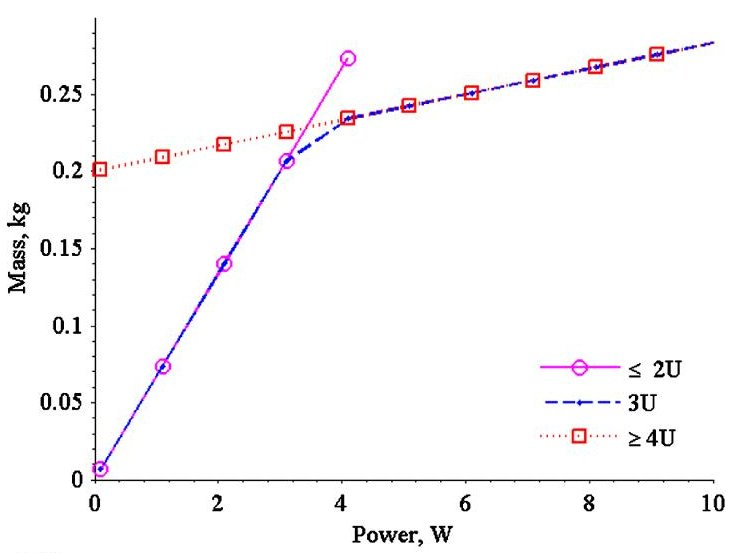

$$
P _ {\mathrm {P P U}} = \frac {P _ {b}}{\eta_ {\mathrm {P P U}}}
$$

$$
\eta_ {n} = \frac {\eta_ {b}}{V _ {n}}
$$

$$
P _ {n} = \frac {I _ {b}}{\eta_ {n}} + V _ {n} I _ {b}
$$

The total propulsion system power $ P_{p} $ is a function of the propulsion system margin $ m_{p} $ , the number of thrusters $ N_{t}, P_{n} $ , and the heater power $ P_{h} $ , which depends on the thruster size. The total system efficiency $ \eta_{S} $ is the ratio of the output beam power and input power:

a) Mass versus power

$$
P _ {p} = N _ {t} \left(1 + m _ {p}\right) \left(P _ {\mathrm {P P U}} + P _ {n} + P _ {h} (s)\right)
$$

$$
\eta_ {S} = \frac {N _ {t} T V _ {\mathrm {e x}}}{2 P _ {p}}
$$

The total propulsion system mass $ M_{\mathrm{pr}} $ is a function of $ m_{p} $ ; the thruster mass $ M_{T} $ (which includes the heater and neutralizer); the propellant mass $ M_{\mathrm{prop}} $ ; and the PPU and board mass $ M_{\mathrm{PPU}} $ , where $ \alpha $ and $ \beta $ are a function of the PPU architecture:

$$
M _ {\mathrm {p r}} = \left(1 + m _ {p}\right) \left(M _ {T} N _ {t} + M _ {\mathrm {p r o p}} + M _ {\mathrm {P P U}}\right)
$$

$$
M _ {\mathrm {P P U}} = \alpha N _ {t} + \beta
$$

## B. Spacecraft

Next, we describe the sizing of the power and mass of the thermal, bus, and structural subsystems, as these drive the system design. The average power consumption of the system $ P_{s} $ is based on power and duty-cycle values:

$$
P _ {s} = \left(1 + m _ {s}\right) \left(P _ {t} d _ {t} + P _ {b}\right) + P _ {p} d _ {p}
$$

where $ m_{s} $ is the system margin; $ P_{s} $ is the average power collected by the sun; $ P_{b} $ is the average power consumed by the bus in nominal operations; $ P_{\mathrm{te},i} $ is the power used for telecommunications operations; and $ d_{p} $ and $ d_{t} $ are the duty-cycle fractions for the propulsion and telecommunications systems, respectively.

The solar panels are sized to ensure average power consumption $ P_{s} $ can be collected continuously. For CubeSats with a size less than 3U,

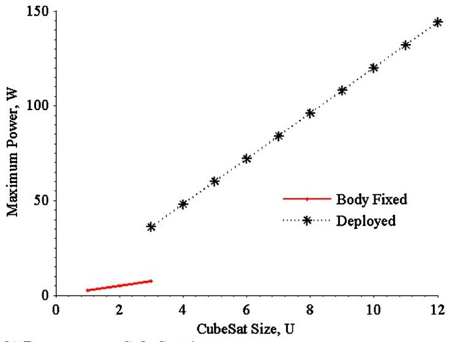

b) Power versus CubeSat size

Fig.1 Scaling for fixed and deployed solar panels.

<!-- PDF_PAGE: 4 -->

we assume the solar panels are fixed due to limitations of existing commercial-off-the-shelf (COTS) parts, and this is convention in the community. CubeSats of this size often have limited attitude control, so we also assume the required solar panels are on every spacecraft face, such that, regardless of orientation, the spacecraft can collect the required amount of power. The fixed solar panels are on four of the six spacecraft sides, where the other two usually smaller sides house the thruster nozzles, telecommunication antennas, and any other instrument sensors. The deployed solar panels typically unfold from two of the six sides, leaving considerable surface area for the other external components. The maximum power that fixed solar panels can generate $ P_{\mathrm{max},\mathrm{fix}} $ is a function of the spacecraft size U. The total solar panel mass $ M_{\mathrm{sp},\mathrm{fix}} $ is a function of the required total power, where $ \gamma_{\mathrm{fix}} $ is the power to mass ratio for fixed panels:

$$
P _ {s} \leq P _ {\max , \mathrm {f i x}} U
$$

$$
M _ {\mathrm {s p}, \mathrm {f i x}} = \frac {P _ {s}}{\gamma_ {\mathrm {f i x}}}
$$

For spacecraft with a size greater than or equal to 3U, the solar panels can be deployed as deployable COTS parts exist, such as the high watts per kilogram (HAWK) and extendable-Hawk (eHAWK) panels from moving mechanical assemblies (MMA) [32]. We assume these spacecraft have good attitude control, as the bus includes an altitude control system suite and a gimbal, such that they can always point the solar panels for maximal power collection. The maximum power that can be generated is a function of the spacecraft size (due to storage and deployment constraints), and the total mass is a function of the gimbal mass and required power:

$$
P _ {s} \leq P _ {\max , \mathrm {d e p}} U
$$

$$
M _ {\mathrm {s p , d e p}} = m _ {\mathrm {s p , g i m}} + \eta_ {\mathrm {s p}} \frac {P _ {s}}{\gamma_ {\mathrm {d e p}}}
$$

where $ m_{\mathrm{sp,gim}} $ is the gimbal mass, $ \gamma_{\mathrm{fix}} $ is the solar panel power to mass ratio, and $ \eta_{\mathrm{sp}} $ is the solar panel efficiency to account for degradation, offpointing errors, and other sources of uncertainty. If the system power $ P_{s} $ exceeds $ P_{\mathrm{max,fix}} $ or $ P_{\mathrm{max,dep}} $ , there is no feasible power solution for the system.

The simple thermal model assumes the only heat transfer to the external environment is due to radiation and that the radiator is always facing free space. The total thermal load to the spacecraft is $ P_{\mathrm{th}} $ which includes power from the bus and any thruster power that is not dissipated through the thruster. For a feasible thermal solution, $ P_{\mathrm{th}} $ must be smaller or equal to the thermal transfer efficiency $ \eta_{\mathrm{th}} $ times the steady-state radiated thermal energy Q:

$$
P _ {\mathrm {t h}} \leq \eta_ {\mathrm {t h}} Q
$$

$$
Q = \eta_ {\mathrm {r a d}} \epsilon \sigma A _ {\mathrm {r a d}} \left(t _ {\mathrm {r a d}} ^ {4} - t _ {b} ^ {4}\right)
$$

where $ \eta_{\mathrm{rad}} $ is the radiator efficiency, $ \epsilon $ is the radiator material emissivity, $ \sigma $ is the Stefan-Boltzmann constant, $ A_{\mathrm{rad}} $ is the radiator area, $ t_{\mathrm{rad}} $ is the radiator temperature, and $ t_{fs} $ is the temperature of a perfect black body. If $ P_{\mathrm{th}} $ exceeds Q, there is no feasible thermal solution for the system.

The total system wet mass $ M_{s} $ consists of the propulsion system, solar panel, bus, structure, thermal system, and the system margin $ m_{s} $ , as in Eq. (24). The structure and bus masses, $ M_{\mathrm{st}} $ and $ M_{b} $ depend on the size of the reaction wheels, which are sized for the spacecraft mass. The thermal system mass $ M_{\mathrm{th}} $ accounts for the radiator and heat pipes, and it is a fraction of the other subsystem masses $ f_{\mathrm{th}} $ :

$$
M _ {s} = M _ {\mathrm {p r}} + \left(1 + m _ {s}\right) \left(M _ {\mathrm {s p}} + M _ {b} + M _ {\mathrm {s t}} + M _ {\mathrm {t h}}\right)
$$

$$
M _ {\mathrm {t h}} = f _ {\mathrm {t h}} \left(M _ {\mathrm {p r}} / \left(1 + m _ {p}\right) + M _ {\mathrm {s p}} + M _ {s} + M _ {b}\right)
$$

The system mass must not exceed the maximum allowable mass, which is a function of the maximum density $ D_{\mathrm{max}} $ and spacecraft size:

$$
M _ {s} \leq D _ {\max } U
$$

The payload mass fraction, $ M_{p} / M_{i} $ is used as a performance metric in the results. In our approach, $ M_{i} $ is the initial allowable maximum mass and $ M_{p} $ is the mass available mass for payload and margin:

$$
M _ {i} = D _ {\max } U
$$

a) Radiative area versus size

$$
M _ {p} = M _ {i} - M _ {s}
$$

## C. Spacecraft Design and Scaling

To study a range of spacecraft sizes, we consider spacecraft ranging from 3U CubeSats ( $ \leq 6 $ kg) to ESPA-class spacecraft ( $ \leq 180 $ kg). We use the CubeSat form factor, where a 1U = 10 cm $ \times $ 10 cm $ \times $ 10 cm with a mass less than 2 kg as the scaling metric for spacecraft. We use this metric even for spacecraft that exceed the normal CubeSat form factor, all the way to ESPA-class spacecraft, which we refer to as 90U systems for scaling purposes.

Consistent with the CubeSat design philosophy we have selected commercial off-the-shelf components for a low mass and cost design, where many components have flight heritage in LEO. The model

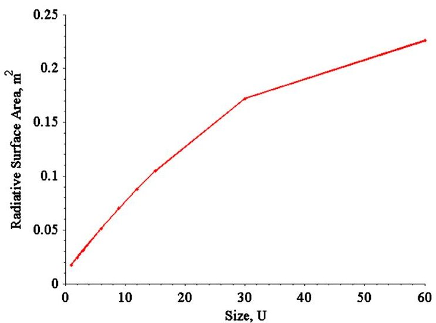

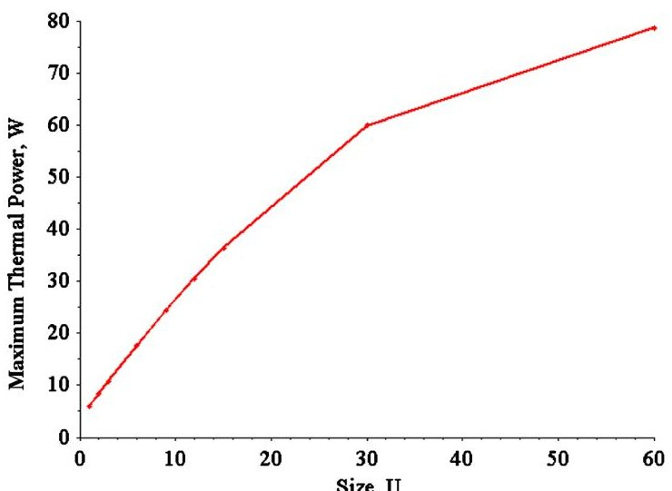

Fig. 2 Scaling for thermal system power dissipation.

<!-- PDF_PAGE: 5 -->

<table border="1"><tr><td>Category</td><td>MEP use</td><td>Subcategories</td><td>Example applications</td></tr><tr><td>Orbit changing(LEO, interplanetary)</td><td>Primary propulsion</td><td>Single transitionsMultiple transitions</td><td>Altitude raising(LEO,GEO,GTO,lunar,etc.)Interplanetary transfers</td></tr><tr><td>Orbit maintenance/proximity operations</td><td>Primary propulsion</td><td>Long lifetimeShort lifetime</td><td>Drag makeup(LEO,other)Controlled hovering/landing near body</td></tr><tr><td>Precision pointing and/orformation flying</td><td>Attitude control andprimary propulsion</td><td>High accuracyLower accuracy</td><td>Reaction wheel replacement(LEO,etc.)Constellation formation/maintenance(LEO,etc.)</td></tr></table>

Table 2 Missions categories and examples studied in paper

Table 3 LEO and deep space orbit transfers studied

<table border="1"><tr><td>Name</td><td>Initial orbit</td><td>Final orbit</td><td>$\Delta V$ range,km/s</td><td>Burn time,days</td><td>Time of flight,days</td></tr><tr><td>Flyover</td><td>See Fig.3b</td><td>Polar,574km</td><td>0.5-0.8</td><td>60</td><td>60</td></tr><tr><td>GTO to lunar flyby</td><td>GTO</td><td>Earth escape</td><td>1.7-3.4</td><td>50-559</td><td>120-735</td></tr><tr><td>LEO to GEO</td><td>Equatorial,a=500km</td><td>GEO</td><td>4.4-5.5</td><td>77-658</td><td>178-917</td></tr><tr><td>ISS to polar</td><td>i=52deg,a=420km</td><td>Polar,a=420km</td><td>6.7-7.6</td><td>82-543</td><td>121-553</td></tr><tr><td>ISS to equatorial</td><td>i=52deg,a=500km</td><td>Equatorial,a=420km</td><td>9.3-11.3</td><td>85-711</td><td>123-735</td></tr><tr><td>Deimos return</td><td>Deimos</td><td>Earth orbit</td><td>5.5-9.6</td><td>18.4-738</td><td>272-756</td></tr><tr><td>Phobos return</td><td>Phobos</td><td>Earth orbit</td><td>6.3-10.4</td><td>22.5-868</td><td>276-886</td></tr></table>

All LEO orbits are circular and GEOs are equatorial.

parameters for the small spacecraft in this study are given in Table 1. The relationships between solar panel mass and power [Eqs. (16-18)] are shown in Fig. 1. Considerably higher power can be generated with deployed solar arrays, due to the ability to deploy a significantly larger solar panel surface area, and point the arrays at the sun (with a gimbal) for optimal power generation. For example, a 3U CubeSat with body-fixed arrays is expected to collect on average of approximately 7.3 W (before margin), whereas with deployable suntracking arrays, it is expected to collect approximately 36 W (an increase by a factor of five). The maximum surface area available for each CubeSat size and the resultant maximum heat load [Eq. (20)] is shown in Fig. 2. The aluminum structure is assumed to weigh 100 g per CubeSat U(10 cm $ \times $ 10 cm $ \times $ 10 cm), or $ M_{s}=100 $ g/U.

For the spacecraft bus, we selected the Blue Canyon Technologies XB1 bus, as it represents the state of the art and is being used for a variety of LEO and interplanetary applications [33]. The XB1 includes most major CubeSat subsystems, including a guidance, navigation, and control system, a command and data handling system, and an electric power system. The active attitude determination and control system (ADCS) is required to achieve the desired thrust vector throughout any orientation. The XB1 ADCS consists of a reaction wheel assembly (RWA), an internal measurement unit, a magnetometer, torque rods, sun sensors, star trackers, and a GPS. The XB1 system is currently developed to operate in LEO, and it is being designed for extended missions in interplanetary locations. Conventional desaturation techniques are not feasible for interplanetary

spacecraft; for example, magnetometers cannot be used for reaction wheel desaturation, as is conventionally done in LEO environments. For missions beyond LEO, reaction wheel saturation is dominated by solar pressure and careful control of solar panel orientation can overcome this challenge. The Blue Canyon Technologies (BCT) bus contains a battery with an energy storage of 25 W $ \cdot $ h. The BCT XB1 system nominally has a mass of about $ M_{b}=1200 $ g, without a RWA. The RWA is sized based on the momentum, which is a function of the CubeSat mass (the RWA mass is a cubic function of spacecraft mass based on a curve fit from BCT wheels). The BCT RWA is not part of the spacecraft for the attitude control missions.

For near-Earth applications, we assume use of an S band or ultra high frequency (UHF) transceiver, which has a mass of 80 g. Existing UHF, S-band, and X-band systems do not currently have the capability to return data at meaningful rates to Earth on small spacecraft form factors. For applications beyond near Earth, such as those that escape Earth orbit and operate in deep space, we assume use of the Iris transponder, which is used for both tracking and navigation [34]. The Iris transponder is a low mass (500 g), volume, and power solution for interplanetary small spacecraft, which communicates to the Deep Space Network on X-band frequencies.

## III. Approach

## A. Goals, Decisions, and Constraints

Space missions generally aim to maximize the capability of science instruments (in number or size); therefore, the main goal in

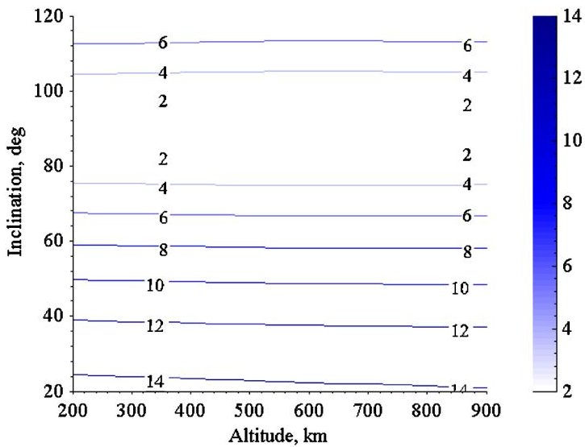

a) All transitions (All $ \Delta V $)

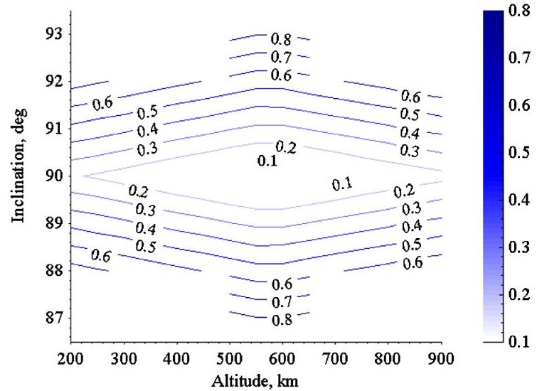

b) All transitions feasible in 60 days $ (\Delta V\leq 0.8 \mathrm{~m / s}) $

Fig. 3 $ \Delta V $ requirements to achieve flyover orbit from a variety of initial LEOs.

<!-- PDF_PAGE: 6 -->

this problem is to maximize the payload mass fraction $ ( M_{p} / M_{i} ) $ where $ M_{p} $ is the payload mass, including all spacecraft components not related to the propulsion system, and $ M_{i} $ is the initial wet spacecraft mass. We also consider solutions that minimize time of flight (TOF) T and the joint goal of maximizing payload mass fraction while minimizing TOF; $ M_{p} / M_{i} / T. $

The main thruster decision variable we consider in this study is $ I_{\mathrm{sp}} $ The reason for this is twofold: First, the $ I_{\mathrm{sp}} $ is a driving system interface parameter, as it is critical in defining the highly coupled trades between the mission optimization (trip time, etc), the power system, and the propulsion system. Second, this parameter is a

substantial driver in the prop system design, as it defines the operating voltage and total propellant throughput required. We also consider the number of thrusters and assume the thruster size is fixed.

There are a variety of technical implications on the thruster design, the operating point, and the mission capabilities related to $ I_{\mathrm{sp}} $ , which is directly proportional to the beam voltage [Eq. (4)]. The maximum feasible $ I_{\mathrm{sp}} $ is expected to be around 7000 s, where lower voltages are preferred from a development perspective, as they reduce the complexity of high-voltage systems. Lower voltages decrease $ I_{\mathrm{sp}} $ and improve flight and burn times, which are preferred from a mission

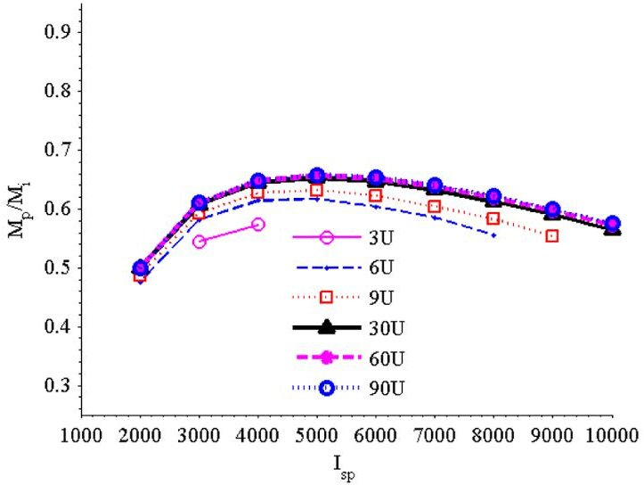

a) LEO flyover （ $ \Delta V=0. 5 $ km/s)

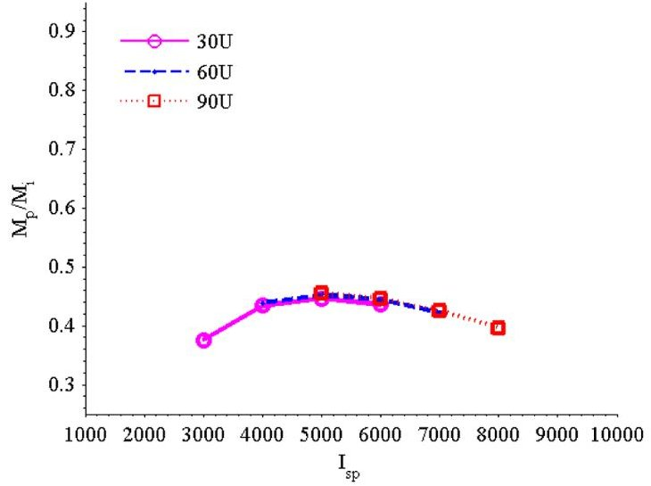

b) LEO flyover $ \left( \Delta V=0. 8 \mathrm{~ k m / s} \right) $

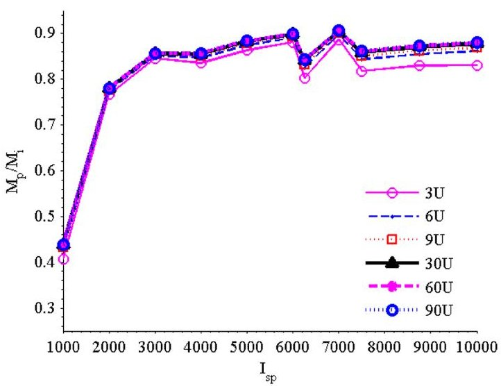

c) LEO GTO to Lunar flyby $ (\Delta V=1. 7-3. 4 \mathrm{~ k m / s}) $

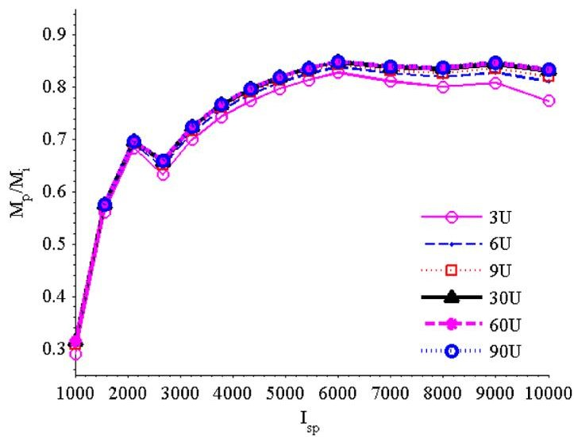

d) LEO to GEO $ \left( \Delta V=4. 4-5. 5 \mathrm{~ k m / s} \right) $

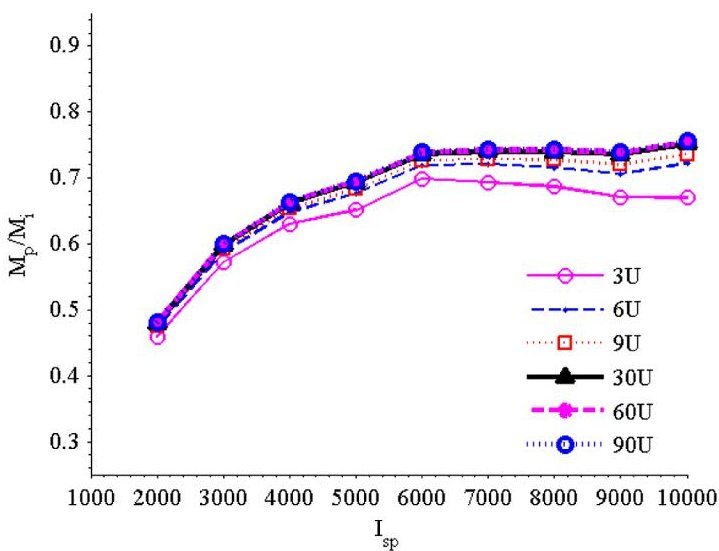

e) LEO ISS to polar ( $ \Delta \mathrm{V}=6. 7-7. 6 \mathrm{~ k m / s} $ )

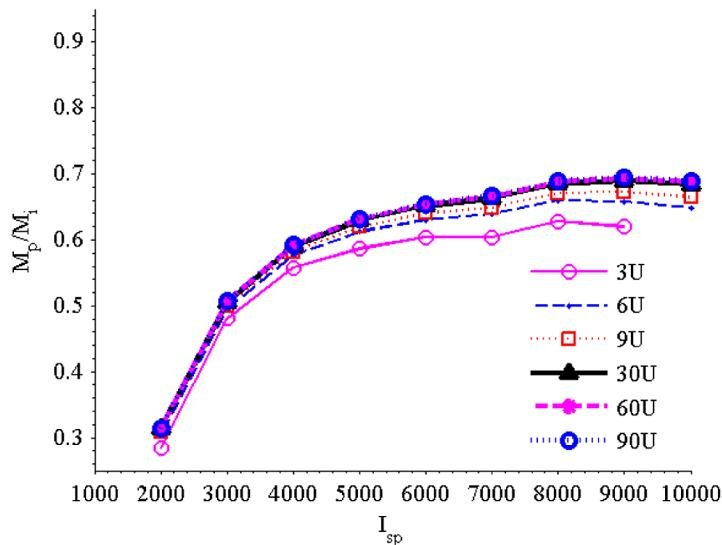

f) LEO ISS to equatorial $ (\Delta V=9.3-11.3\mathrm{km / s}) $

Fig. 4 Optimal $ I_{\mathrm{sp}} $ values that maximize $ M_{p} / M_{i} $ for LEO transfer orbits (GTO, geostationary transfer orbit; GEO, geostationary orbit).

<!-- PDF_PAGE: 7 -->

Table 4 Optimal $ I_{\mathrm{sp}} $ values for maximizing payload mass fraction and percentage of optimal mass fractions for lower $ I_{\mathrm{sp}} $ values

<table border="1"><tr><td>Name</td><td>Optimal $I_{\mathrm{sp}}$ to maximize $M_{p}/M_{i}$</td><td>Percentage of optimal $M_{p}/M_{i}$ ($I_{\mathrm{sp}}=4,000$ s)，%</td><td>Percentage of optimal $M_{p}/M_{i}$ ($I_{\mathrm{sp}}=5,000$ s)，%</td></tr><tr><td>Flyover</td><td>5,000</td><td>96</td><td>100</td></tr><tr><td>GTO to lunar flyby</td><td>7,000</td><td>94</td><td>96</td></tr><tr><td>LEO to GEO</td><td>6,000</td><td>90</td><td>95</td></tr><tr><td>ISS to polar</td><td>10,000</td><td>86</td><td>91</td></tr><tr><td>ISS to equatorial</td><td>9,000</td><td>85</td><td>89</td></tr><tr><td>Deimos return</td><td>7,000</td><td>94</td><td>98</td></tr><tr><td>Phobos return</td><td>7,000</td><td>93</td><td>97</td></tr></table>

Table 5 Optimal $ I_{\mathrm{sp}} $ values (rounded to the nearest thousand) for different objectives for LEO and Mars transfer orbits for 6U spacecraft and larger

<table border="1"><tr><td rowspan="2">Orbit transfer</td><td rowspan="2">$\Delta V$ range,km/s</td><td colspan="3">Optimal $I_{\mathrm{sp}}$</td></tr><tr><td>Maximum $M_{f}/M_{i}$,s</td><td>Maximum $M_{f}/M_{i}/T$,s</td><td>Minimum $T$,s</td></tr><tr><td>Flyover</td><td>0.5-0.8</td><td>5,000</td><td>5,000</td><td>N/A $ ^{a} $</td></tr><tr><td>GTO to lunar flyby</td><td>1.7-3.4</td><td>6,250</td><td>7,000</td><td>7,500</td></tr><tr><td>LEO to GEO</td><td>4.4-5.5</td><td>6,000</td><td>6,000</td><td>6,000</td></tr><tr><td>ISS to polar</td><td>6.7-7.6</td><td>4,000</td><td>4,000</td><td>10,000</td></tr><tr><td>ISS to equatorial</td><td>9.3-11.3</td><td>5,000</td><td>5,000</td><td>90,000</td></tr><tr><td>Deimos return</td><td>5.5-9.6</td><td>5,000</td><td>6,000</td><td>8,000</td></tr><tr><td>Phobos return</td><td>6.3-10.4</td><td>22.5-868</td><td>6,000</td><td>8,000</td></tr></table>

N/A denotes "not applicable."

perspective. The tradeoff between minimizing flight time (low $ I_{\mathrm{sp}} $ ) and maximizing mass fraction (middle to high $ I_{\mathrm{sp}} $ ) will be studied in the paper. The minimum feasible thrust from a single thruster is estimated to be $ T_{\mathrm{min}}=1\ \mu\mathrm{N}. $

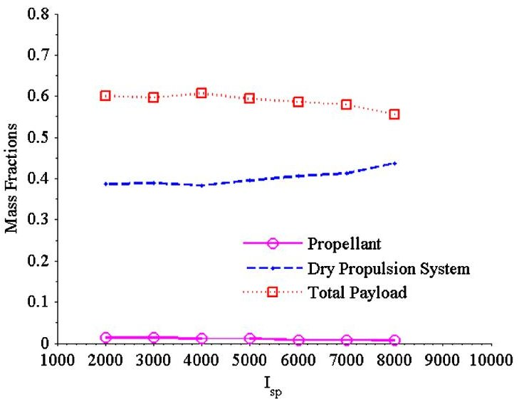

It is generally desired that small spacecraft missions complete their primary objectives as quickly as possible because of their single-string architectures and the uncertainty in operating their components for extended durations. Several of the CubeSats in

a) LEO flyover $ \left( \Delta V=0. 5 \mathrm{~ k m / s} \right) $

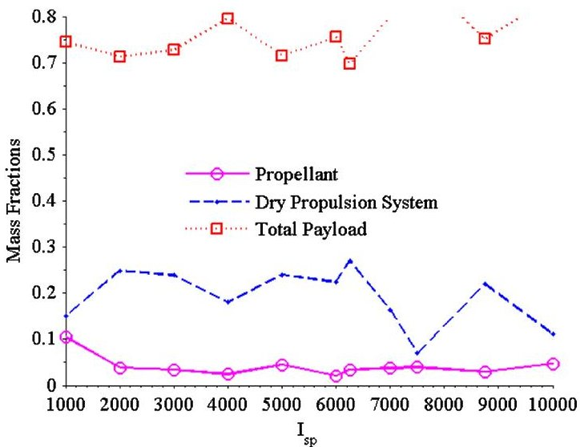

b) LEO GTO to Lunar flyby $ (\Delta V=1. 7-3. 4 \mathrm{~ k m / s}) $

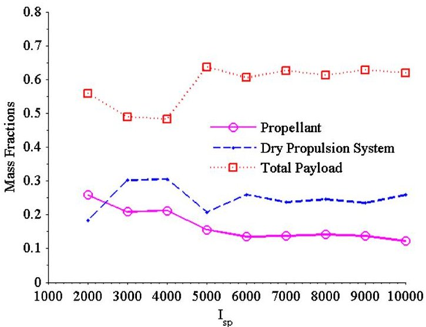

c) LEO ISS to equatorial $ (\Delta V=9.3-11.3\mathrm{km / s}) $

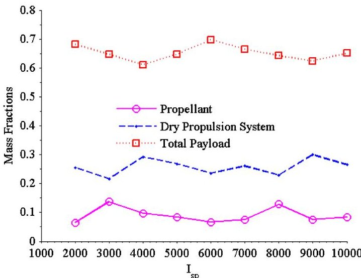

d) Deimos $ \left( \Delta V=4. 6-8. 6 \mathrm{~ k m / s} \right) $

Fig. 5 Mass fractions for 6U CubeSats performing LEO and deep space orbit transfers.

<!-- PDF_PAGE: 8 -->

development are due to operate for less than three years, so this is seen as an upper limit by the community [9-12]. We investigate sensitivities of results to trip times and payload mass fractions to understand this tradeoff.

## B. Solution Space Exploration

The general approach is to perform a solution space exploration. The goal is to determine what $ I_{\mathrm{sp}} $ , number of thrusters, and sizes of

spacecraft maximize the mass payload fraction and achieve the required thrust to accomplish the missions while satisfying mass power, and thermal constraints. We investigate spacecraft sizes ranging from 3 U(10 cm $ \times $ 10 cm $ \times $ 30 cm, $ < $ 6 kg) to ESPA-class spacecraft (180 kg).

For orbit transfer missions, we generate a database of trajectories with variable power to mass ratio, $ I_{\mathrm{sp}} $ , and flight time, and we compute the final and initial mass, thrust duration, and $ \Delta V $ for each

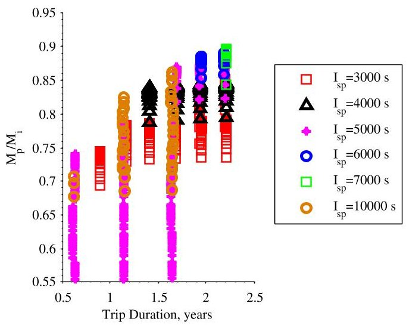

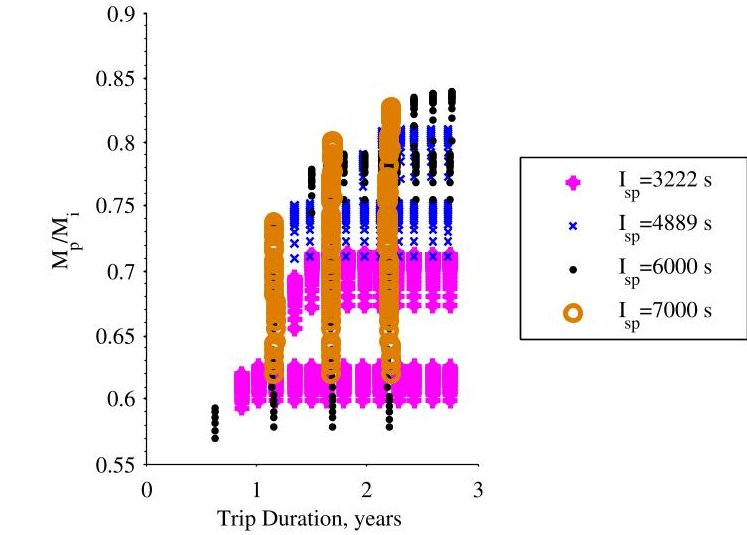

a) LEO GTO to Lunar Flyby $ (\Delta V=1. 7-3. 4 \mathrm{~ k m / s}) $

b) LEO to GEO $ \left( \Delta V=4. 4-5. 5 \mathrm{~ k m / s} \right) $

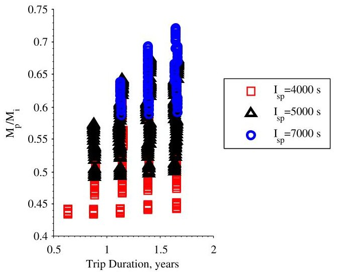

c) LEO ISS to polar $ (\Delta V=6. 7-7. 6 \mathrm{~ k m / s}) $

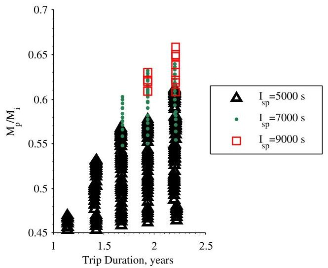

d) LEO ISS to equatorial $ (\Delta V=9.3-11.3\mathrm{km / s}) $

Fig. 6 Pareto fronts showing the tradeoff between mass fraction and transfer time for a 6U CubeSat and different $ I_{\mathrm{sp}} $ values for different objectives for LEO transfer orbits.

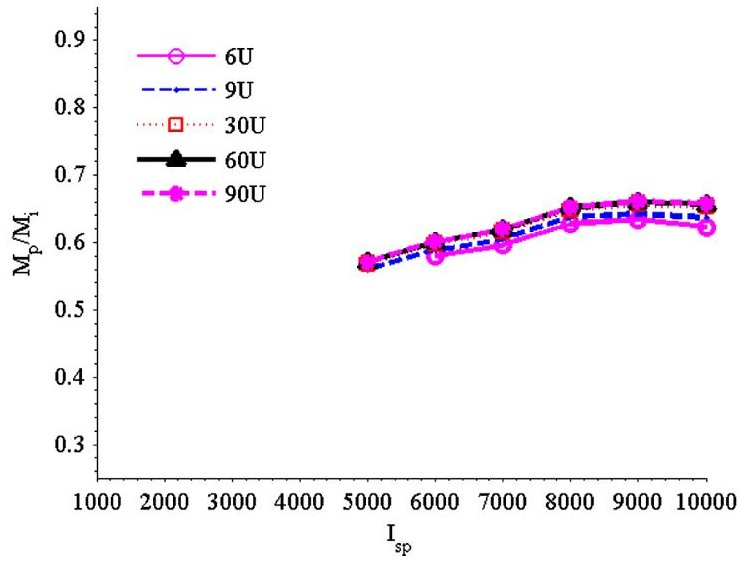

a) 200 days (4800 h)

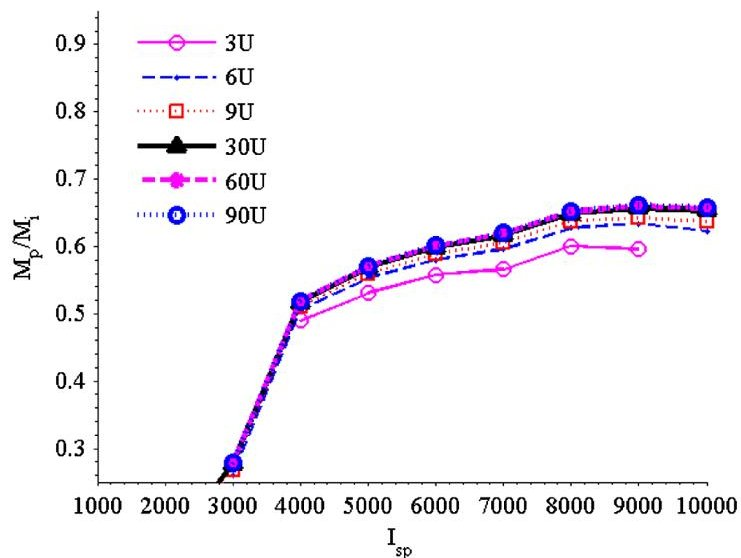

b) 500 days (12,000 h)

Fig. 7 Optimal $ I_{\mathrm{sp}} $ values that maximize $ M_{p} / M_{i} $ for LEO ISS to equatorial transfer orbits for different maximum thruster lifetimes (maximum burn time is 782 days).

<!-- PDF_PAGE: 9 -->

Table 6 Minimum required thruster lifetimes for 6U CubeSat missions (in increments of five days) $ ^{a} $

<table border="1"><tr><td>Name</td><td>Minimum required thruster lifetime</td><td>Minimum desired thruster lifetime</td></tr><tr><td>GTO to lunar flyby</td><td>15 days(360h)</td><td>15 days(360h)</td></tr><tr><td>LEO to GEO</td><td>10 days(240h)</td><td>25 days(600h)</td></tr><tr><td>ISS to polar</td><td>45 days(1080h)</td><td>75 days(1800h)</td></tr><tr><td>ISS to equatorial</td><td>100 days(2400h)</td><td>200 days(4800h)</td></tr><tr><td>Deimos return</td><td>75 days(1800h)</td><td>100 days(2400h)</td></tr><tr><td>Phobos return</td><td>100 days(2400h)</td><td>150 days(3600h)</td></tr></table>

$ ^{a} $Note that this is not the actual flight time of the mission and does not provide the highest payload mass fraction. The required thruster lifetime is the minimum acceptable thrust duration to support a 6U CubeSat mission with $ I_{\mathrm{sp}} \leq 7 0 0 0 $ s (maximum $ I_{\mathrm{sp}} $ ), whereas the desired lifetime is to support a 6U CubeSat mission with $ I_{\mathrm{sp}} \leq 5 0 0 0 $ s (more reasonable).

trajectory. For the orbit maintenance/proximity cases, we generate a database with a range of $ I_{\mathrm{sp}} $ and constant-acceleration values and derive the associated parameters for a given spacecraft mass and mission duration. For the ACS cases, the necessary parameters are derived based on constant or discrete impulses of thrust in the case of bang-bang control. Next, we perform an iteration, and for every dataset described previously, we verify if the solution closes for a range of spacecraft sizes (3-90U) and number of thrusters (1-200 thrusters). First, we compute the total required propulsion system power. Second, we size the solar panels and thermal system to support the mission. At this stage, we must ensure the solar panels and

thermal loads can be accommodated on this size of spacecraft; if not, the solution is infeasible. Third, we compute the total dry mass of the spacecraft and the payload mass. If it is greater than zero, then the solution is feasible. If the solution closes, we compute the payload mass fraction and use the results in future comparative analysis.

## C. Mission Datasets

The families of missions studied we study were selected in an A team study at JPL with subject matter experts, and they are summarized in Tables 2 and 3. They cover a range of missions where MEP may have significant advantages over the current technology or enable small spacecraft to perform missions typically accomplished by larger missions. The orbit changing missions focus on both LEO and deep space applications, and they include a large range of $ \Delta V $ and transfer times. MEP is a promising candidate propulsion system for orbit maintenance and/or proximity operations in both LEO and interplanetary applications because of its ability to provide continuous low thrust levels. Similarly, MEP has the potential to perform both precision and coarse attitude control and enable reaction wheel replacement, which can significantly improve the payload mass fraction on some missions.

Most of the LEO transfer cases are relatively straightforward, and they are described in Table 3 based on their initial and final orbits. The LEO flyover case is targeting a specific mission architecture, where one or more spacecraft repeat their path over the same point on Earth every day. This is accomplished by having the spacecraft in polar 574-km-altitude orbits that enable an integer (15) number of orbits

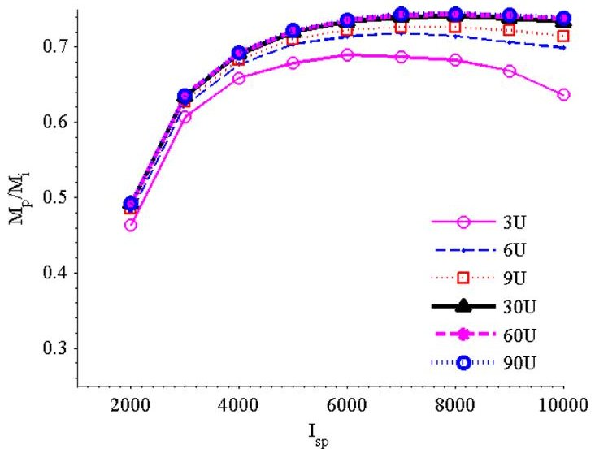

a) Deimos $ \left( \Delta V=5. 5-9. 6 \mathrm{~ k m / s} \right) $

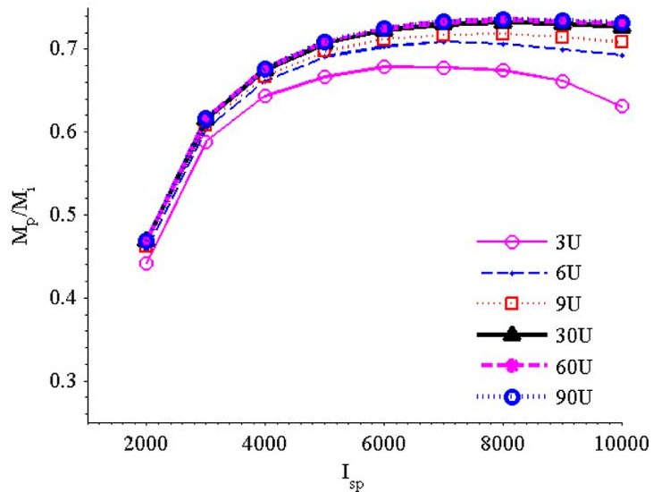

b) Phobos $ (\Delta V=6.3-10.4\mathrm{km / s}) $

Fig. 8 Optimal $ I_{\mathrm{sp}} $ to maximize $ M_{p} / M_{i} $ for Mars transfers to Deimos and Phobos.

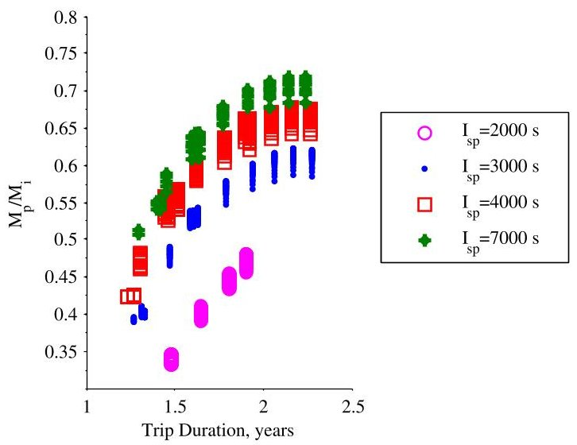

a) Deimos $ \left( \Delta V=5. 5-9. 6 \mathrm{~ k m / s} \right) $

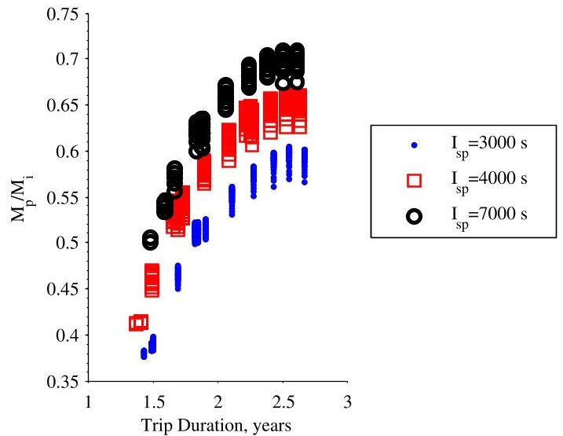

b) Phobos $ \left( \Delta V=6. 3-1 0. 4 \mathrm{~ k m / s} \right) $

Fig. 9 Mass fraction relative to transfer time Pareto front for different $ I_{\mathrm{sp}} $ values for different objectives for Mars transfer orbits.

<!-- PDF_PAGE: 10 -->

per day (a higher or lower integer number of orbits is also feasible but not as reasonable for LEOs). A constellation of spacecraft can achieve the desired number of daily repeats; for example, two spacecraft in orthogonal orbits will achieve four flyovers per day (more orbits increases this number). The distributions of altitudes a and inclinations i of historic orbits launched in to LEO range from 200 to 900 km and 20 to 120 deg. There are a higher number of CubeSats launched into 400-500-km-altitude orbits, International Space Station (ISS) inclinations (51.6 deg), and near-polar inclinations. Transitioning into the flyover orbit is required before the mission can start; therefore, it is desired that this transition occurs within the first 60 days of the mission. The total $ \Delta V $ required to perform both the altitude and inclination changes to achieve the flyover orbit (where the inclination change is performed at the highest altitude to minimize $ \Delta V $ ) starting from a variety of initial orbits in 60 days is shown in Fig. 3. To achieve the flyover orbit in only 60 days, the orbit must be launched into a near-polar orbit; however, it can be at nearly any altitude. We investigate transfers requiring $ \Delta V= $ 0.5-0.8 km/s in the upcoming results.

For the Deimos and Phobos orbit returns, we assume the trajectories begin in the same Mars orbit as Phobos or Deimos and then do a circular spiral to Mars escape. Then, from the same solar orbit as Mars (simplified to circular in ecliptic to average out mission years), the orbit spirals down to a flyby of Earth with a characteristic energy (C3) of about $ 1 0 \mathrm{k m}^{2} / \mathrm{s}^{2} $ . This is followed by an Earth flyby and intermittent thrusting over 1.25 years to reduce the C3 down to $ 2 \mathrm{k m}^{2} / \mathrm{s}^{2} $ so that the moon can capture the spacecraft into Earth orbit.

## IV. Results

## A. Orbit Transfers

In this section, we study the MEP performance metrics described in Sec. III.A for a range of spacecraft performing the missions described in Sec. III.C. We present sensitivities of the results to mission type, spacecraft size, mission duration, and thruster lifetime.

## 1. LEO Orbit Transfers

For the LEO transfer trajectories, the optimal $ I_{\mathrm{sp}} $ values that maximize payload mass fraction are plotted for a range of spacecraft sizes in Fig. 4. In general, lower $ I_{\mathrm{sp}} $ values (4000-5000 s) maximize the payload mass fraction for low $ \Delta V $ missions (e.g., LEO flyover). The mass payload fraction jumps are due to changes in the number of thrusters. There is reduction of sensitivity to $ I_{\mathrm{sp}} $ with increasing $ I_{\mathrm{sp}} $ therefore, lower values still achieve a high fraction of the optimal mass fraction, as in Table 4. For example, for a particular LEO flyover $ (\Delta V=0.5\mathrm{km / s}) $ , when the relative increase in mass fraction is less than 5% , there is no advantage in increasing the $ I_{\mathrm{sp}} $ ; therefore, $ I_{\mathrm{sp}}=3000\mathrm{s} $ is found to be the best solution.

For the small spacecraft studied, propulsion system dry mass (thrusters and solar panels) often dominates the propulsion system mass, with a large mass fraction relative to propellant, which is unlike conventional large spacecraft. This is particularly true for lower $ \Delta V $ and shorter durations; see Fig. 5. We hypothesize this increases the $ I_{\mathrm{sp}} $ values that maximize the payload mass fraction solutions for higher $ \Delta V $ missions because more thrust can be achieved for lower total

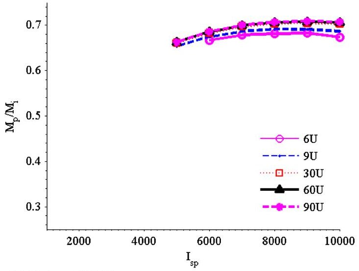

a) 200 days (4800 h)

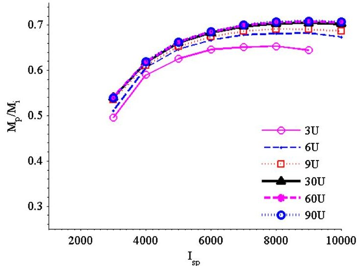

b) 500 days (12,000 h)

Fig.10 Optimal $ I_{\mathrm{sp}} $ values that maximize $ M_{p} / M_{i} $ for Deimos orbit transfer orbits for different maximum thruster lifetimes (maximum burn time is 813 days).

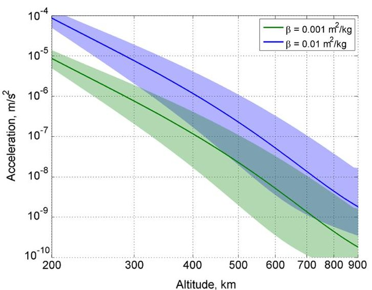

a) Drag makeup

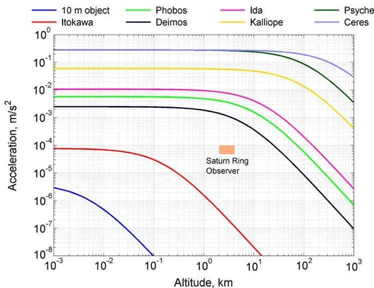

b) Hovering

Fig. 11 Required constant acceleration for drag makeup in LEO (where $ \beta $ is the area in the ram direction to mass ratio) and hovering over a variety of interplanetary bodies.

<!-- PDF_PAGE: 11 -->

thruster mass (thrust scales linearly with $ I_{\mathrm{sp}} $ , and thruster mass is constant for all $ I_{\mathrm{sp}} $ values). Higher $ I_{\mathrm{sp}} $ values result in longer transfer times; however, all transfer times are less than three years, which is the upper bound for small spacecraft missions.

The optimal $ I_{\mathrm{sp}} $ values for the three goals of maximizing mass fraction, maximizing mass fraction over time, and minimizing transfer time are summarized in Table 5. The highest payload mass fractions are achieved for $ I_{\mathrm{sp}}=5000 $ s for the LEO flyover cases $ (\Delta V\leq 0.8\mathrm{km / s}) $ , whereas the optimal $ I_{\mathrm{sp}} $ values increase as the mission $ \Delta V $ increases, up to $ I_{\mathrm{sp}}=9000-10,000 $ s for the ISS to polar and equatorial cases for larger spacecraft ( $ \geq 6 $ U). The optimal $ I_{\mathrm{sp}} $ is the same for all objectives for the flyover cases because they are all constrained to the same time (which is why the time-minimal case is not plotted). However, for the other cases where the orbit transfer times range (see Table 3), there is a growth in the separation between the optimal $ I_{\mathrm{sp}} $ for the different objectives, particularly as the $ \Delta V $ increases.

The Pareto fronts showing the tradeoff between mass fraction and trip duration are given in Fig. 6 (only $ I_{\mathrm{sp}} $ values that appear along the Pareto fronts are shown), where the highest payload mass fractions are correlated with the longest transfer times. Higher $ I_{\mathrm{sp}} $ values only field feasible system-level solutions for longer trip times, and they result in higher payload mass fractions. The payload mass fraction trends are not highly sensitive to an increase in trip time for a given $ I_{\mathrm{sp}} $ which is because the thruster dry mass often dominates the propulsion system mass; see Fig. 5. These plots are useful for extracting maximum feasible payload mass fractions for a given desired transfer time, if constrained for a given mission architecture. Alternatively, these plots are helpful at extracting the minimum possible trip duration given a required payload mass fraction.

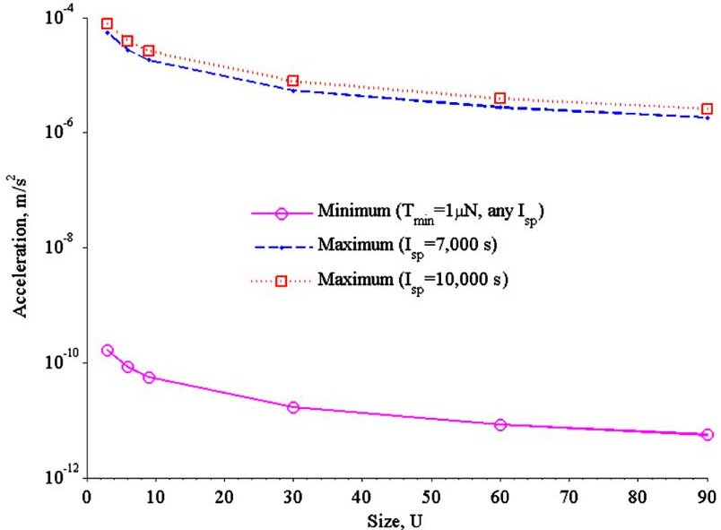

Fig. 12 Feasible accelerations for a single MEP thruster.

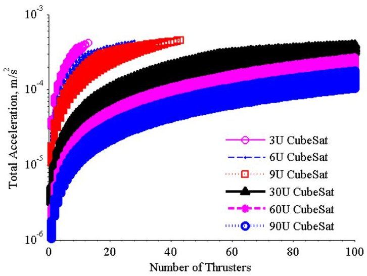

a) Number of thrusters $ ( I_{sp}=7 0 0 0 \mathrm{~ s}) $

Table 7 Maximum feasible accelerations (in millimeters per squared seconds) for different spacecraft sizes and maximum $ I_{\mathrm{sp}} $ values (with a maximum of the equivalent of 500 thrusters)

<table border="1"><tr><td>Maximum $I_{\mathrm{sp}}$</td><td>3U</td><td>6U</td><td>9U</td><td>30U</td><td>60U</td></tr><tr><td>$I_{\mathrm{sp}}=1000\text{s}$</td><td>0.30</td><td>0.43</td><td>0.46</td><td>0.43</td><td>0.21</td></tr><tr><td>$I_{\mathrm{sp}}=2000\text{s}$</td><td>0.48</td><td>0.43</td><td>0.56</td><td>0.56</td><td>0.57</td></tr><tr><td>$I_{\mathrm{sp}}=3000\text{s}$</td><td>0.51</td><td>0.56</td><td>0.56</td><td>0.57</td><td>0.55</td></tr><tr><td>$I_{\mathrm{sp}}=4000\text{s}$</td><td>0.42</td><td>0.44</td><td>0.45</td><td>0.47</td><td>0.47</td></tr><tr><td>$I_{\mathrm{sp}}=7000\text{s}$</td><td>0.42</td><td>0.44</td><td>0.45</td><td>0.47</td><td>0.47</td></tr></table>

The impact of a lifetime constraint on the thruster for the ISS to equatorial (selected as it has the highest $ \Delta V $ requirements) orbit transfer is shown in Fig. 7. The impact of decreased thruster lifetime is generally a reduction in mass fraction with lower maximum lifetimes. The minimum required lifetimes for thrusters for a 6U CubeSat and the various mission architectures are summarized in Table 6. For LEO missions, the shortest feasible lifetimes were achieved for the highest $ I_{\mathrm{sp}} $ values, which is expected, because they generated enough thrust to accomplish the mission goals for a given system power and mass. As the lifetime decreased, test cases with smaller $ I_{\mathrm{sp}} $ values did not solve and there were no feasible solutions for smaller spacecraft (3U, 6U, 9U) because they were not able to support the larger number of required thrusters.

## 2. Deimos and Phobos Orbit Transfer

For the higher $ \Delta V $ Mars transfer cases, maximizing the payload mass fraction is achieved for high $ I_{\mathrm{sp}} $ values $ (I_{\mathrm{sp}}=8000\mathrm{s}) $ particularly as the spacecraft sizes are larger than 6U CubeSats; see Fig. 8. Lower $ I_{\mathrm{sp}} $ values (6000 s) maximize the payload mass fraction for small systems because available power and mass are constrained. For larger spacecraft, higher $ I_{\mathrm{sp}} $ values are preferred because they achieve higher thrust for a given thruster mass, which is important because the thruster mass is a large fraction of the total wet thruster system; see Fig. 5. $ I_{\mathrm{sp}}=6000\mathrm{s} $ provides a compromise between these objectives for all spacecraft sizes. However, a slight reduction in $ I_{\mathrm{sp}} $ still achieves close to the optimal payload mass fraction; see Fig. 5 and Table 4.

The Pareto curves in Fig. 9 demonstrate the tradeoff between payload mass fraction relative to transfer times, which is more significant than for the LEO cases. The Pareto front is dominated by missions with $ I_{\mathrm{sp}}=7 0 0 0 $ s; however, slightly shorter trip durations are achievable with lower $ I_{\mathrm{sp}} $ values. If the Deimos return trip duration is constrained to less than 1.5 years, the payload mass fraction for that mission decreases by less than 20% relative to a mission where mission duration is not constrained (and it is about 2.5 years).

Next, we study the impact on limited thruster lifetimes on the ability and performance for orbit transfer missions. Decreased

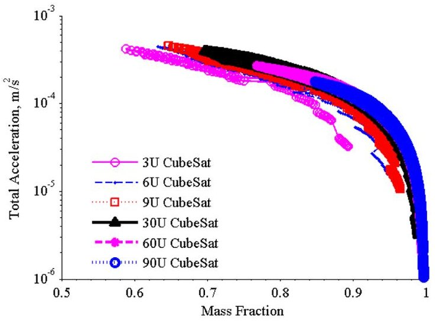

$$
(I _ {s p} = 7 0 0 0 \mathrm {s})
$$

Fig.13 Maximum feasible acceleration ranges as a function of number of thrusters and the resulting mass fractions.

<!-- PDF_PAGE: 12 -->

Table 8 Comparison of MEP relative to existing small spacecraft propulsion technologies

<table border="1"><tr><td>Technology type</td><td>Example technology</td><td>Maximum thrust, μN</td><td>Isp,s</td><td>Total impulse(less than1U),N·s</td><td>Dry mass,g</td></tr><tr><td>Microelectric propulsion</td><td>JPL’s MEP</td><td>200</td><td>4000-7000</td><td>&gt;7000</td><td>380</td></tr><tr><td>Pulsed plasma thrusters</td><td>Clyde Space PPT</td><td>38</td><td>450-600</td><td>40</td><td>280</td></tr><tr><td>Warm-gas thrusters</td><td>VACCO’s thruster</td><td>4.4</td><td>92</td><td>1010</td><td>575</td></tr></table>

thruster lifetimes resulted in the mass fractions decreasing (especially for lower $ I_{\mathrm{sp}} $ values); see Fig. 10 and Table 6. In addition, lower $ I_{\mathrm{sp}} $ and smaller spacecraft are less likely to result in feasible system designs, similar to the LEO cases. For Mars return missions, a thruster lifetime of at least 100 days (2400 h) is desired to ensure good solutions across a range of reasonable $ I_{\mathrm{sp}} $ values and spacecraft sizes.

## B. Orbit Maintenance and Proximity Operations

Next, we investigate a family of missions requiring constant acceleration, such as orbit maintenance (e.g., drag makeup) and proximity operations requiring constant hovering. The constant acceleration is maintained perfectly in the desired vector, which is achieved with the ACS. There are margins in the propellant mass and power to account for unknown inefficiencies. Figure 11 shows the ranges of constant acceleration required to overcome drag effects in LEO and hover at a range of distances above interplanetary bodies. The specific Saturn Ring Observer (SRO) represents an example of a constantacceleration mission concept of interest that has been studied in depth because of its scientific value [35]. The SRO requires an acceleration of 0.05 to $ 0. 1 \mathrm{~ m m} / \mathrm{s}^{2} $ to hover as an altitude of 2 to 3 km above the rings.

The minimum and maximum achievable accelerations with a single MEP thruster with the parameters in Table 1 are shown in Fig. 12. The minimum acceleration is constrained by the minimum thrust level that can be maintained $ ( T_{\mathrm{min}}=1\ \mu\mathrm{N}) $ , and the maximum acceleration is constrained by the maximum achievable beam current of $ I_{b}=10\ \mu\mathrm{A} $ per emitter and the $ I_{\mathrm{sp}} $ . However, with multiple thrusters (or a larger thruster), significantly higher maximum total acceleration values can be achieved, as in Fig. 13 and Table 7. Larger systems are able to accommodate more thrusters but are also heavier, which is why there is a slight decrease in total feasible acceleration with spacecraft size. There is a marginal reduction in payload mass fraction with higher $ I_{\mathrm{sp}} $ systems because fewer thrusters are required to achieve the thrust level.

Comparing these maximum values to the desired mission applications in Fig. 11 show us that all LEO drag missions can be accomplished because the required accelerations are well above the minimum values $ ( a \leq1 0^{-1 0} \mathrm{~ m / s^{2}}) $ and below the maximum values in Table 7. Several of the hovering cases can be accomplished, including hovering over 10 m objects and Itokawa at any altitude,

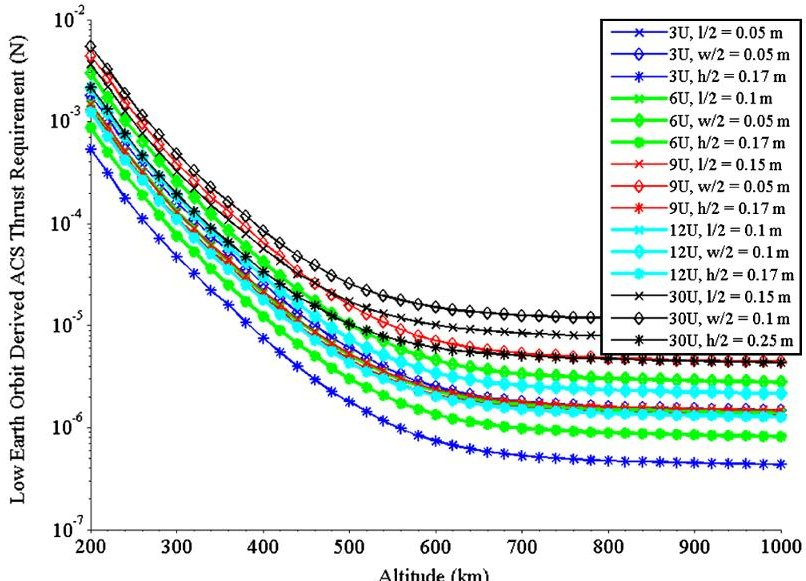

Fig. 14 Total average $ ( 1-\sigma) $ disturbance torques in LEO space environments for small spacecraft.

performing the SRO mission, and hovering over Deimos and Phobos at distances of several hundred meters. However, several missions hovering over larger bodies at close distances are not feasible using this MEP architecture. Overall, the maximum achievable accelerations are achieved for $ I_{\mathrm{sp}} \geq 2 0 0 0-3 0 0 0 $ s, as in Table 7.

## C. Comparison to Other Propulsion Technologies

Next, we briefly compare MEP capabilities relative to other small spacecraft technologies for the mission cases studied. There are several other small spacecraft propulsion systems in development, but this comparison focuses on existing and mature technologies.

Existing technologies considered for orbit transfers or constant acceleration cases are given in Table 8, and they include pulse plasma thruster (PPT) $ ^{**} $ and warm-gas technologies $ ^{\ddagger\ddagger} $ systems (there are also several small spacecraft cold-gas systems that tend to have lower performance characteristics). These alternative technologies provide significantly lower thrust and total impulse than required for significant orbit transfers (by more than an order of magnitude). Even the lowest $ \Delta V $ mission from our examples, the LEO flyover case, of $ I_{\mathrm{sp}}>1 0 0 0 $ s is required to complete the mission in the required 60 days (see Figs. 4a and 4b), which is significantly more total impulse than can be delivered by either alternative technology. The PPT and warm-gas thrusters may be sufficient for overcoming drag or performing hover maneuvers requiring low accelerations, such as drag makeup at high altitudes in LEO or hovering at high altitudes above planetary bodies (see Fig. 11), depending on the spacecraft size. These applications will be significantly limited by the available thrust because it is an order of magnitude or more smaller relative to MEP for these applications. Furthermore, the other technologies will not provide a smooth hover because the acceleration provided will not be constant as the thruster pulses.

MEP has also been suggested as a potential replacement for reaction wheels to provide improved mass fractions. Comparing using MEP for attitude control relative to the conventional approach of reaction wheels is challenging because of the strong dependence on mission profile, including the spacecraft's pointing scheme, inertial properties, and how it interacts with the environmental disturbances. As a representative example, we consider a nadirpointing spacecraft and appropriate scaling laws for momentum accumulation due to disturbance forces. We then use the BCT reaction wheel scaling between mass and momentum to size the RWA mass and compute the required solar panel mass. To size the MEP system, we use the mean disturbance force torque $ (1-\sigma) $ from Fig. 14. The resulting mass fractions for attitude control with the MEP system (including thruster, PPU, supporting boards, propellant, and required solar panels) and conventional reaction wheel approach (including RWA and required solar panels) are compared in Fig. 15. The relative advantages of the MEP system are greatest for low-mass systems (greater than 60%) and drop sharply with an increase in spacecraft mass because the increase in the required reaction wheels plateaus at larger masses and the required MEP dry mass remains approximately constant. Although this example provides some insights, a more rigorous and thorough study should be done for specific mission profiles and spacecraft configurations.

<!-- PDF_PAGE: 13 -->

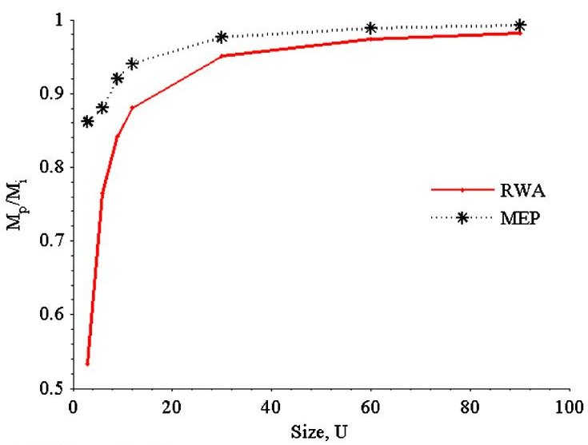

a) RWA and MEP

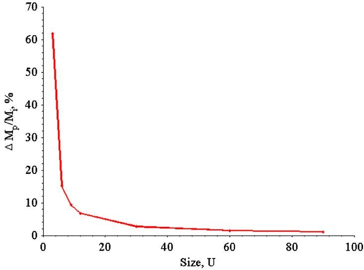

## V. Conclusions

This section summarizes the results, identifies the optimal requirements, and provides recommendations for future microelectric propulsion (MEP) systems to maximize the potential to support upcoming small spacecraft mission opportunities.

Fig.15 Comparison of use of reaction wheel assembly and MEP thrusters for attitude control for nadir-pointing spacecraft in LEO.

b) Difference between RWA and MEP

The implications from the study with respect to the primary decision variable $ I_{\mathrm{sp}} $ are summarized in the following:

1) For the low Earth orbit (LEO) transfer cases, the optimal $ I_{\mathrm{sp}} $ to maximize payload fraction ranges between 5000 and 10,000 s. $ I_{\mathrm{sp}}= $ 5000 s is both technically reasonable (does not require high voltages) and yields payload mass fractions that range from 89% (International Space Station to polar transfer) to 100% (LEO flyover cases) relative to the optimal; see Fig. 5.

2) For the Mars transfer cases, the optimal $ I_{\mathrm{sp}} $ to maximize payload fraction is around 8000 s because of the high $ \Delta V $ requirements and transfer times for these missions, although $ I_{\mathrm{sp}} $ values around 5000 s provide solutions that are 97-98% optimal (likely within the uncertainty of the analysis).

3) For the constant-acceleration cases, the optimal $ I_{\mathrm{sp}} $ to achieve the maximum accelerations is around 3000 s, and the payload mass fractions are not sensitive to $ I_{\mathrm{sp}} $ .

In summary, it was found that medium $ I_{\mathrm{sp}} $ values $ (I_{\mathrm{sp}}=4000\mathrm{s}) $ are optimal for low $ \Delta V $ missions, such as orbit raising and attitude control applications. For high $ \Delta V $ missions (such as inclination changes and Mars missions), higher $ I_{\mathrm{sp}} $ values $ (\geq 7000\mathrm{s}) $ were preferred, despite requiring longer total mission durations. This result is because the main constraint was the ability to generate the required thrust and because of the high ratio of dry thruster mass relative to propellant for MEP systems on small spacecraft.

Overall, $ I_{\mathrm{sp}}=4 0 0 0 $ s is recommended as a target for future MEP development. Although higher $ I_{\mathrm{sp}} $ values are preferred for some of the LEO and deep space orbit transfer cases, $ I_{\mathrm{sp}}=4 0 0 0 $ s is a good compromise because it is technically easier to design and operate (lower voltages) and improves transfer times. Furthermore, $ I_{\mathrm{sp}}= 4 0 0 0 $ s achieves greater than 85% of the payload optimal mass fraction in all orbit transfer cases and is preferred for the constant-acceleration and attitude control cases.

With respect to lifetime goals, it is recommended to develop an MEP thruster that can operate continuously for at least 45 days (1080 h) for LEO applications and 100 days (2400 h) for deep space applications. However, maximizing the thruster lifetime should be targeted, as this will maximize payload mass fractions and improve overall system robustness. A thruster system that can maintain performance throughout a large number of cycles is preferred for high-precision deadband approaches to attitude control.

Finally, it is recommended to develop a propulsion system architecture, including power processing unit (PPU) and supporting boards and systems, that has a high thrust-to-mass ratio to improve payload mass fractions. It was observed that higher $ I_{\mathrm{sp}} $ values often improved payload mass fractions because fewer thrusters were

required to achieve the required thrust level, and the dry propulsion system mass was often a large fraction of the propulsion system, driving overall performance. The PPU architecture should be carefully designed to optimize overall propulsion system mass efficiency.

## Acknowledgments

The authors acknowledge Colleen Marrese-Reading, John Ziemer, Julie Catillo-Rogez, A. J. Mastropietro, and Andrew Gray for their contributions. Part of the research was carried out at the Jet Propulsion Laboratory, California Institute of Technology, under a contract with NASA.

## References

[1] Selva, D., and Krejci, D., "A Survey and Assessment of the Capabilities of Cubesats for Earth Observation," Acta Astronautica, Vol. 74, May-June 2012, pp. 50-68. doi:10.1016/j.actaastro.2011.12.014

[2] Woellert, K., Ehrenfreund, P., Ricco, A. J., and Hertzfeld, H., "Cubesats: Cost-Effective Science and Technology Platforms for Emerging and Developing Nations," Advances in Space Research, Vol. 47, No. 4, 2011, pp. 663-684. doi:10.1016/i.asr.2010.10.009

[3] Baker, D. N., and Pete Worden, S., "The Large Benefits of SmallSatellite Missions," Transactions of the American Geophysical Union, Vol. 89, No. 33, Aug. 2008, pp. 301-302.

[4] Moretto, T., and Robinson, R. M., "Small Satellites for Space Weather Research," Space Weather Journal, Vol. 6, No. 5, May 2008, Paper S05007.

[5] Crowley, G., Fish, C. S., Bust, G. S., Swenson, C., Barjatya, A., and Larsen, M. F., "Dynamic Ionosphere Cubesat Experiment (DICE)," American Geophysical Union (AGU) Fall Meeting, San Francisco, CA, Dec. 2009, p. A6+.

[6] Skrobot, G., "ElaNa—Educational Launch of Nanosatellite: Enhance Education Through Space Flight," Proceedings of the 25th Annual Small Satellite Conference, Logan, UT, Aug. 2011.

[7] Diaz-Aguado, M. F., Ghassemieh, S., Van Outryve, C., Beasley, C., and Schooley, A., "Small Class-D Spacecraft Thermal Design, Test and Analysis—Pharmasat Biological Experiment," Proceedings of the IEEE Aerospace Conference, IEEE Publ., Piscataway, NJ, 2009, pp. 1-9.

[8] Johnson, L., Whorton, M., Heaton, A., Pinson, R., Laue, G., and Adams, C., "Nanosail-D: A Solar Sail Demonstration Mission," Acta Astronautica, Vol. 68, Nos. 5-6, 2011, pp. 571-575; doi:10.1016/j.actaastro.2010.02.008 also Special Issue: Aosta 2009 Symposium. doi:10.1016/j.actaastro.2010.02.008

[9] Sorgenfrei, M., and Lewis, B., "Biosentinel: Enabling Cubesat-Scale Biological Research Beyond Low Earth Orbit," Interplanetary Small Satellite Conference, Pasadena, CA, 2014.

[10] Frick, A., Rogez, J. C., Johnson, L., and Dervan, J., "NEA Scout: A CubeSat Architecture for Near Earth Asteroid (NEA) Exploration," Interplanetary Small Satellite Conference (ISSC), Pasadena, CA, 2014.

<!-- PDF_PAGE: 14 -->

[11] Cohe, B., Banazadeh, P., Hayne, P., and Staehle, R., "Lunar FlashLight: A Cubesat Architecture for Deep Space Exploration," Interplanetary Small Satellite Conference (ISSC), Pasadena, CA, 2014.

[12] Klesh, A., Baker, J., Castillo-Rogez, J., Halatek, L., Murphy, N., Raymond, C., Sherwood, B., Bellardo, J., Cutler, J., and Lightsey, G., "Inspire Interplanetary Nanospacecraft Pathfinder in Relevant Environment," Annual Small Satellite Conference, AIAA Paper 2013-5323, Aug. 2013.

[13] Staehle, R., Blaney, D., Hemmati, H., Jones, D., Klesh, A., Liewer, P., Lazio, J., Wen-Yu Lo, M., Murphy Pantazis Mouroulis, N., Pingree, P. J., Wilson, T., Anderson, B., Channing Chow, C., II., Betts, B., Friedman, L., Puig-Suari, J., Williams, A., and Svitek, T., "Interplanetary Cubesats Opening the Solar System to a Broad Community at Lower Cost," Journal of Small Satellites, Vol. 2, No. 1, 2013, pp. 161-186.

[14] Ketsdever, A. D., and Micci, M. M., Micropropulsion for Small Spacecraft, AIAA, Reston, VA, 2000.

[15] Ridley, A., Forbes, J., Cutler, J., Nicholas, A., Thayer, J., Fuller-Rowell, T., Matsuo, T., Bristow, W., Conde, M., Drob, D., Paxton, L., Chappie, S., Osborn, M., Dobbs, M., and Roth, J. Armada Mission Team, "The Armada Mission: Determining the Dynamic and Spatial Response of the Thermosphere/Ionosphere System to Energy Inputs on Global and Regional Scales," American Geophysical Union (AGU) Fall Meeting, San Francisco, Dec. 2010, p. A7+.

[16] Swenson, C., Larsen, M., Sojka, J., and Fish, C., "CubeSat Constellations for Measurements of High Latitude Energy Input," American Geophysical Union (AGU) Fall Meeting, Paper SM33C-1584, San Francisco, Dec. 2009.

[17] Mueller, J., Hofer, R., and Ziemer, J., "Survey of Propulsion Technologies Applicable to Cubesats," Proceedings of the 57th Joint Army-Navy-NASA-Air Force (JANNAF) Propulsion Meeting, Colorado Springs, CO, 2010.

[18] Rayman, M. D., and Williams, S. N., "Design of the First Interplanetary Solar Electric Propulsion Mission," Journal of Spacecraft and Rockets, Vol. 39, No. 4, 2002, pp. 589-595. doi:10.2514/2.3848

[19] Williams, S. N., and Coverstone-Carroll, V., "Mars Missions Using Solar Electric Propulsion," Journal of Spacecraft and Rockets, Vol. 37, No. 1, 2000, pp. 71-77. doi:10.2514/2.3528

[20] Oh, D. Y., "Evaluation of Solar Electric Propulsion Technologies for Discovery-Class Missions," Journal of Spacecraft and Rockets, Vol. 44, No. 2, 2007, pp. 399-411. doi:10.2514/1.21613

[21] Schwaiger, L. E., Schollenberger, J. M., Jr., Molitor, J. H., and MacPherson, D., "Solar Electric Propulsion Asteroid Belt Mission," Journal of Spacecraft and Rockets, Vol. 8, No. 6, 1971, pp. 612-617. doi:10.2514/3.59700

[22] Wang, J., Brinza, D. E., Young, D. T., Nordholt, J. E., Polk, J. E., Henry, M. D., Goldstein, R., Hanley, J. J., Lawrence, D. J., and Shappirio, M., "Deep Space One Investigations of Ion Propulsion Plasma Environment," Journal of Spacecraft and Rockets, Vol. 37, No. 5, 2000, pp. 545-555. doi:10.2514/2.3608

[23] Snyder, J. S., Randolph, T. M., Hofer, R. R., and Goebel, D. M., "Simplified Ion Thruster Xenon Feed System for NASA Science Missions," 31st International Electric Propulsion Conference, Ann Arbor, MI, 2009.

[24] Marrese-Reading, C. M., Ziemer, J. K., Scharf, D. P., Thompson, P., Martin-Mur, T. J., Mueller, J., and Wirz, R. E., "Mission Enabling and Enhancing Spacecraft Capabilities with Micronewton Electric Propulsion," Proceedings of the IEEE Aerospace Conference, IEEE Publ., Piscataway, NJ, March 2010.

[25] Co, T. C., and Black, J. T., "Responsiveness in Low Orbits Using Electric Propulsion," Journal of Spacecraft and Rockets, Vol. 51, No. 3, 2014, pp. 938-945. doi:10.2514/1.A32405

[26] Randolph, T. M., and Oh, D. Y., "Economic Benefit Analysis of Chemical-Electric Orbit Raising Missions," AIAA International Communication Satellite Systems Conference and Exhibit, AIAA Paper 2002-1980, May 2002.

[27] Kimbrel, S., Oh, D. Y., Randolph, T., and Martinez-Sanchez, M., "Endto-End Optimization of Chemical-Electric Orbit-Raising Missions," Journal of Spacecraft and Rockets, Vol. 41, No. 5, 2004, pp. 831-839. doi:10.2514/1.13096

[28] Spangelo, S., Dalle, D., and Longmier, B., "Small Spacecraft System- Level Design and Optimization for Interplanetary Trajectories," AIAA/ AAS Astrodynamics Specialist Conference, AIAA Paper 2014-4125, 2014.

[29] Blandino, J. J., Rock, B. S., and Demetriou, M. A., "Propulsion Requirements for Drag-Free Operation of Spacecraft in Low Earth Orbit," Journal of Spacecraft and Rockets, Vol. 43, No. 3, 2006, pp. 673-684. doi:10.2514/1.15227

[30] Oh, D., Snyder, J., Goebel, D., Landau, D., and Randolph, T., "Solar Electric Propulsion for Discovery Class Missions," IEPC-124-2013, 33rd International Electric Propulsion Conference, Washington, D.C., 2013.

[31] Griffiths, W. T., "Tailoring Instructions for AIAA S-120-2006 Mass Properties Control for Space Systems," Air Force Space Command, Aerospace Rept. tor-2008(8583)-7560, Rev. a, 2012.

[32] VanHalle, R., "Innovative High Specific Performance (Hawk) Solar Array," Summer CubeSat Workshop, Logan, UT, Aug. 2011.

[33] "XB1: High Performance 1U CubeSat Bus," Blue Canyon Technologies Specification Sheet, Boulder, CO, 2014, http://bluecanyontech.com/up-content/uploads/2015/08/XBI-Data-Sheet-2.0.pdf [retrieved Dec. 2014].

[34] Courtney Duncan, "Low Mass Radio Science Transponder— Navigation Anywhere," iCubeSat Workshop, Boston, May 2012.

[35] Spilker, L., Dudzinski, L., Nicholson, P., and Tiscareno, M., "Saturn Ring Observer," Planetary Science Decadal Survey Mission Concept Study, National Academics, June 2010, www.nasa.gov.

M. Walker Associate Editor