<!-- PDF_PAGE: 1 -->

# Defining the Requirements for the Micro Electric Propulsion Systems for Small Spacecraft Missions

Sara Spangelo, Damon Landau, Shawn Johnson, Nitin Arora, Thomas Randolph Jet Propulsion Laboratory, California Institute of Technology, 4800 Oak Grove Drive, Pasadena, CA 91109

Abstract—Recent technology advancements in Micro Electric Propulsion (MEP) will enable the next generation of small spacecraft to perform trajectory and attitude maneuvers with significant $ \Delta V $ requirements, provide thrust over long mission durations, and replace reaction wheels for attitude control. These advancements will open up the class of mission architectures achievable by small spacecraft to include formation flying, proximity operations, and precision pointing missions in both LEO and interplanetary destinations. The goal of this study is to establish the optimal performance parameters for future MEP technology that are applicable to a broad range of flight demonstration platforms (e.g. dedicated 3-12U CubeSats to ESPA-class spacecraft ), for a variety of applications, including LEO and Earth escape orbit transfers, travel to interplanetary destinations, hover and drag make-up missions, and performing reaction wheel-free attitude control. An integrated systems-level model for propulsion, spacecraft (power, data, telecommunication, thermal management), and orbit and attitude maneuvers is developed to support solution space exploration. MEP system performance parameters are derived that maximize the performance capability subject to realistic system-level constraints in the context of upcoming mission opportunities where MEP is enabling or advantageous relative to other technologies.

## I. INTRODUCTION

CubeSats have evolved from educational tools to a platform for technology demonstrations and are capable of performing high-value science missions [1], [2], [3]. The National Science Foundation has a dedicated program funding nanosatellites to study space weather [4], [5], NASA has a dedicated launching opportunity through their CubeSat Launch Initiative [6], and NASA research centers are also developing a variety of CubeSats for both near-Earth [7], [8] and interplanetary applications [9], [10], [11], [12]. Micropropulsion has been identified as a necessary technology to enable these small spacecraft to maneuver and perform formation flying, create constellations, travel and explore interplanetary destinations [13], [14], and perform attitude control with a lower-mass system (relative to conventional reaction wheel systems). An increasing number of CubeSats are being proposed for constellation applications [15], [16], where propulsion capabilities are required or highly desired for achieving and maintaining the desired orbits. Orbit transfers, particularly to interplanetary destinations, are challenging for low-thrust propulsion systems on small spacecraft because typical high-thrust maneuvers can not be utilized and small spacecraft are extremely mass, volume, and power constrained [17]. Furthermore, typical existing CubeSats do not usually operate at the high power or high voltage levels required to support propulsion systems, nor do they have

solutions for managing the resulting high thermal loads (most existing CubeSats rely on passive thermal control).

Solar electric propulsion (SEP) has been proposed and used on a variety of interplanetary mission architectures on large missions, including optimized trajectories to the Mars surface for scientific exploration, Discovery-class mission applications, and asteroid belt missions [18], [19], [20], [21], [22], [23]. Technology advancements in miniaturized propulsion systems, such as Aerojet Rocketdyne's systems, Busek's thrusters, MIT's ion Electrospray Propulsion System (iEPS), Clyde Space's CubeSat Pulse Plasma Thruster, and JPL's Micro Electrospray Propulsion (MEP) thruster [17], [24], are being developed that satisfy the size, power, thermal, and launch constraints of small spacecraft, including 3U CubeSatclass systems. Recent work has demonstrated the applicability of electric propulsion solutions for optimal time and propellant solutions for operational responsiveness in LEO [25]. Similar systems-level studies have investigated the economic benefits of chemical-electric orbit-raising missions [26], [27] and optimized CubeSat missions with SEP for Earth-escape trajectories [28], which inform our approach.

Most existing electric propulsion systems exceed the mass or volume envelopes for CubeSats, have low efficiency or low thrust, or are designed for precise pointing maneuvers. Emerging Micro Electric Propulsion (MEP) technologies offer the potential to overcome these challenges by providing a high specific impulse and thrust from a miniaturized thruster that satisfies the power, mass, volume, and thermal constraints of small spacecraft. MEP systems use electric power to accelerate propellant to high exhaust velocity to achieve high momentum transfer efficiency and fuel efficiency.

The goal of this paper is to direct the future development of MEP for optimal performance in the context of highly-relevant upcoming small spacecraft mission opportunities. Towards this goal, we perform a broad solution space exploration with different MEP parameters for a variety of realistic examples across multiple mission families and spacecraft sizes (ranging from small 3U CubeSats to ESPA-class systems). First, we develop parametric analytic systems-level integrated models for propulsion, attitude control, power, telecommunication, and thermal, which are key elements in small spacecraft design. The models include appropriate mass, power, and size scaling laws for propulsion, power, and thermal subsystems. Second, we identify upcoming mission architectures where MEP offers specific advantages over alternative technologies;

<!-- PDF_PAGE: 2 -->

including Earth-escape trajectories, trajectories that travel to interplanetary destinations such as Mars-sample return architectures, constant-acceleration missions (including drag makeup missions such as the Gravity Recovery and Climate Experiment (GRACE) [29]), and applications where MEP can replace traditional reaction wheels for precision or coarse attitude control [24]. Third, we explore the solution space by studying different missions with our parametric systems-level models and assessing the sensitivity of performance metrics relative to key MEP parameters. This drives establishing a set of technical specifications for the MEP technology of the future to maximize its performance in the applicable class of missions. These specifications are applicable to any MEP system, regardless of propellant type. Although this work focuses on MEP for small spacecraft form-factor, the models and approach are applicable to other propulsion technologies and larger spacecraft architectures.

## II. MODEL

A systems-level model is essential to capture all interacting dynamics and constraints of this problem, particularly because small spacecraft are highly-constrained and are extremely resource-constrained. The multidisciplinary integrated model consists of analytic representations of the propulsion system, orbital dynamics, energy collection and management system, and thermal management system. In this section we describe the underlying models and scaling for all subsystem components for the thruster, solar panels, thermal system, structure, and bus, which includes the attitude control system, power and data management. In the model we make the following assumptions:

- The PPU, heater, and neutralizer are sized to accommodate the number of active thrusters and power levels. Note that future studies should investigate diverse architectures that consider multiple thrusters sharing a single PPU, although the mass savings are marginal.

- The thrusters generate thrust perfectly in the desired direction (note there are margins assigned to propulsion system mass, power, and time to account for inefficiencies). Attitude control is accomplished by use of on-board reaction wheels in the case of primary propulsion and by the thrusters when they perform attitude control.

- There are no solar eclipses or occultations in the trajectories.

- The solar panels are sized to support continuous thrusting and nominal bus operations.

- The spacecraft volume and mass are constrained by conventional CubeSat form-factors for small spacecraft and extrapolated for larger ones (up to ESPA-class spacecraft).

- The payload system power is ignored, although this is expected to be significantly less than the thruster power.

- Margins are assumed to be 10% for propellant mass thrust time, and thruster power, see Refs. [30], [30].

- Margins are assumed to be 20% for the spacecraft mass and power (other than propulsion system components),

selected because the designs are at the Preliminary Design Review (PDR) level of maturity as the basic configuration is set by CubeSat standards and most of the components exist, see Ref. [31].

- The spacecraft radiator is body-fixed and mounted on the largest external side of the spacecraft structure.

- The spacecraft radiator faces free space, which is the temperature of a black body. The radiator does not have any incident light from the Sun, Earth, Moon, or other planetary bodies.

- The thermal system is 10% of the total system mass.

- Spacecraft volume constraints are neglected as spacecraft mass generally constrains the system for this class of spacecraft (this is an area for future analysis).

- When multiple thrusters are operated simultaneously they each have the same performance as an individual thruster.

- When multiple thrusters are used successively (if required due to lifetime constraints), the performance of each thruster is not dependent on when it is used. Furthermore, it is assumed that the mass increases with the number of thrusters (this neglects mass savings by re-using the same PPU and additional mass that may be required for switching mechanisms).

- Performance degradation of components (solar panels, thrusters, etc.) with time is neglected. These inefficiencies are accounted for in the allocated margins.

## A. Propulsion

NASA's Jet Propulsion Laboratory (JPL) is developing a liquid metal propellant microfabricated MEP thruster that uses Indium as propellant [24]. JPL's MEP thruster uses a capillary-force-driven propellant management system that does not use pressurization, valves, or moving parts. Producing a compact and scalable thruster is pushing the limits of microfabrication techniques. The JPL MEP system is modeled analytically in this section.

The number of emitters, $ n_{e} $ , is a function of the thruster side, s, spacing, sp, and the emitter density, $ d_{e} $ .

$$
n _ {e} = \left(\frac {s}{s p}\right) ^ {2},
$$

$$
d _ {e} = \frac {n _ {e}}{s ^ {2}}.
$$

The mass flow rate, $ \dot{m} $ , is a function of the charge-to-mass ratio, $ Q/M $ , and the current from each emitter, $ I_{e} $ . The exhaust velocity, $ V_{ex} $ , beam voltage, $ V_{b} $ , and thrust, $ T $ , are a function of the specific impulse, $ I_{sp} $ , and beam efficiency, $ \eta_{b} $ .

$$
\dot {m} = I _ {e} / (Q / M),
$$

$$
V _ {e x} = I _ {s p} g,
$$

$$
V _ {b} = \frac {V _ {e x} ^ {2}}{2 \eta_ {b} (Q / M)},
$$

$$
T = \frac {I _ {b} V _ {e x}}{(Q / M)}.
$$

In the JPL MEP system, the beam current is a system constraint. The total beam current, $ I_{b} $ , is a function of $ n_{e} $ and

<!-- PDF_PAGE: 3 -->

the emitter efficiency, $ \eta_{e} $ . The beam power is a function of the beam current and voltage, $ V_{b} $ , and the power into the PPU, takes into account the PPU efficiency, $ \eta_{PPU} $ . The neutralizer efficiency, $ \eta_{n} $ , is a function of the neutralizer voltage, $ V_{n} $ , and the beam efficiency, $ \eta_{b} $ . The neutralizer power, $ P_{n} $ , includes power to run both the beam and neutralizer.

$$
I _ {b} = \eta_ {e} n _ {e} I _ {e},
$$

$$
P _ {b} = I _ {b} V _ {b},
$$

$$
P _ {P P U} = \frac {P _ {b}}{\eta_ {P P U}},
$$

$$
\eta_ {n} = \frac {\eta_ {b}}{V _ {n}},
$$

$$
P _ {n} = \frac {I _ {b}}{\eta_ {n}} + V _ {n} I _ {b}.
$$

The total propulsion system power, $ P_{p} $ , is a function of the propulsion system margin, $ m_{p} $ , number of thrusters, $ N_{t} $ , $ P_{n} $ and the heater power, $ P_{h} $ , which depends on the thruster size. The total system efficiency, $ \eta_{S} $ , is the ratio of the output beam power and input power.

$$
P _ {p} = N _ {t} \left(1 + m _ {p}\right) \left(P _ {P P U} + P _ {n} + P _ {h} (s)\right),
$$

$$
\eta_ {S} = \frac {N _ {t} T V _ {e x}}{2 P _ {p}}.
$$

The total propulsion system mass, $ M_{p} $ , is a function of $ m_{p} $ , the thruster mass, $ M_{T} $ (which includes the heater and neutralizer), and the PPU and board mass, $ M_{PPU} $ , where $ \alpha $ and $ \beta $ are a function of the PPU architecture.

$$
M _ {p} = \left(1 + m _ {p}\right) \left(M _ {T} N _ {t} + M _ {P P U}\right),
$$

$$
M _ {P P U} = \alpha N _ {t} + \beta .
$$

## B. Spacecraft

Next we describe the sizing of the power and mass of the thermal, bus, and structural subsystems, as these drive the system design. The average power consumption of the system, $ P_{s} $ , is based on power and duty cycle values,

$$
P _ {s} = \left(1 + m _ {s}\right) \left(P _ {t} d _ {t} + P _ {b}\right) + P _ {p} d _ {p},
$$

where $ m_{s} $ is the system margin, $ P_{s} $ is the average power collected by the Sun, $ P_{b} $ is the average power consumed by the bus in nominal operations, $ P_{te,i} $ is the power used for telecom operations, and $ d_{p} $ and $ d_{t} $ are the duty cycle fractions for the propulsion and telecom systems, respectively.

The solar panels are sized to ensure average power consumption, $ P_{s} $ , can be collected continuously. For CubeSats with size less than 3U, we assume the solar panels are fixed due to limitations of existing commercial-off-the-shelf (COTS) parts and this is convention in the community. CubeSats of this size often have limited attitude control, so we also assume the required solar panels are on every spacecraft face, such that regardless of orientation the spacecraft can collect the required amount of power. The maximum power that fixed solar panels can generate, $ P_{max,fix} $ , is a function of the spacecraft size, U. The total solar panel mass, $ M_{sp,fix} $ , is a function of the

required total power, where $ \gamma_{fix} $ is the power to mass ratio for fixed panels.

$$
P _ {s} \leq P _ {m a x, f i x} U,
$$

$$
M _ {s p, f i x} = \frac {P _ {s}}{\gamma_ {f i x}}.
$$

For spacecraft with size greater than or equal to 3U, the solar panels can be deployed as deployable COTS parts exist, such as the HAWK and eHAWK panels from MMA [32]. We assume these spacecraft have good attitude control as the bus includes an ACS suite and a gimbal such that they can always point the solar panels for maximal power collection. The maximum power that can be generated is a function of the spacecraft size (due to storage and deployment constraints) and the total mass is a function of the gimbal mass and required power,

$$
P _ {s} \leq P _ {m a x, d e p} U,
$$

$$
M _ {s p, d e p} = m _ {s p, g i m} + \eta_ {s p} \frac {P _ {s}}{\gamma_ {d e p}},
$$

where $ m_{sp,gim} $ is the gimbal mass, $ \gamma_{fix} $ is the solar panel power to mass ratio, and $ \eta_{sp} $ is the solar panel efficiency to account for degradation, off-pointing errors, and other sources of uncertainty. If the system power, $ P_{s} $ , exceeds $ P_{max,fix} $ or $ P_{max,dep} $ , there is no feasible power solution for the system.

The simple thermal model assumes the only heat transfer to the external environment is due to radiation and that the radiator is always facing free space. The total thermal load to the spacecraft is $ P_{th} $ , which includes power from the bus and any thruster power that is not dissipated through the thruster. For a feasible thermal solution, $ P_{th} $ must be greater or equal to the thermal transfer efficiency $ \eta_{th} $ , times the steady-state radiated thermal energy Q,

$$
P _ {t h} \leq \eta_ {t h} Q,
$$

$$
Q = \eta_ {r a d} \epsilon \sigma A _ {r a d} \left(t _ {r a d} ^ {4} - t _ {b} ^ {4}\right),
$$

where $ \eta_{rad} $ is the radiator efficiency, $ \epsilon $ is the radiator material emissivity, $ \sigma $ is the Stefan - Boltzmann constant, $ A_{rad} $ is the radiator area, $ t_{rad} $ is the radiator temperature, and $ t_{fs} $ is the temperature of a perfect black body. If $ P_{th} $ exceeds Q there is no feasible thermal solution for the system.

The total system mass consists of the propulsion system, solar panel, structure, bus, thermal system, and the system margin, $ m_{s} $ , as in Eq. 25. The structure and bus masses, $ M_{s} $ and $ M_{b} $ , depend on the size of the reaction wheels, which are sized for the spacecraft mass. The thermal system mass, $ M_{th} $ accounts for the radiator and heat pipes, and is a fraction of the other subsystem masses, $ f_{th} $

$$
\begin{array}{l} M _ {s} = \left(1 + m _ {s}\right) \left(M _ {s p} + M _ {b} + M _ {s} + M _ {t h}\right) + M _ {p}, \\ M _ {t h} = f _ {t h} \left(M _ {p} / \left(1 + m _ {p}\right) + M _ {s p} + M _ {s} + M _ {b}\right). \\ \end{array}
$$

The system mass must not exceed the maximum allowable mass, which is a function of the maximum density $ D_{max} $ and spacecraft size,

$$
M _ {s} \leq D _ {m a x} U.
$$

<!-- PDF_PAGE: 4 -->

## C. Spacecraft Design and Scaling

To study a range of spacecraft sizes, we consider spacecraft ranging from 3U CubeSats ( $ \leq $ 6 kg) to ESPA-class spacecraft ( $ \leq $ 180 kg). We use the CubeSat form-factor, where a 1U = 10 cm x 10 cm x 10 cm with a mass less than 2 kg as the scaling metric for spacecraft. We use this metric even for spacecraft that exceed the normal CubeSat form-factor, all the way to ESPA-class spacecraft, which we refer to as 90U systems for scaling purposes.

Consistent with the CubeSat design philosophy we've selected Commercial Off-The-Shelf (COTS) components for a low mass and cost design, where many components have flight heritage in LEO. The model parameters for the small spacecraft in this study are given in Table I. The solar panel to mass to power ratios and maximum power values (Eqs. 17-19) are shown in Fig.1. The maximum surface area available for each CubeSat size and the resultant maximum heat load (Eq. 21) is shown in Fig. 2. The Aluminum structure is assumed to weigh 100 grams per CubeSat U (10 cm x 10 cm x 10 cm), or $ M_{s}=100 $ grams/U.

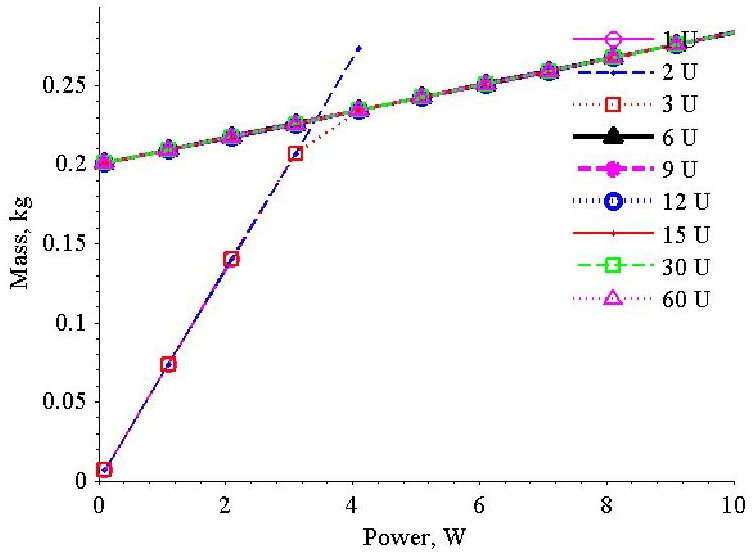

(a) Mass versus Power

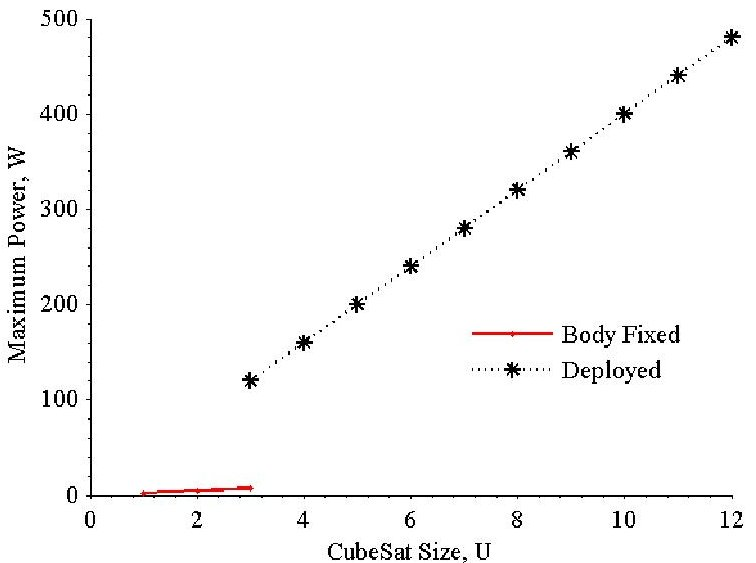

(b) Power versus CubeSat Size

Fig. 1. Scaling for Fixed and Deployed Solar Panels

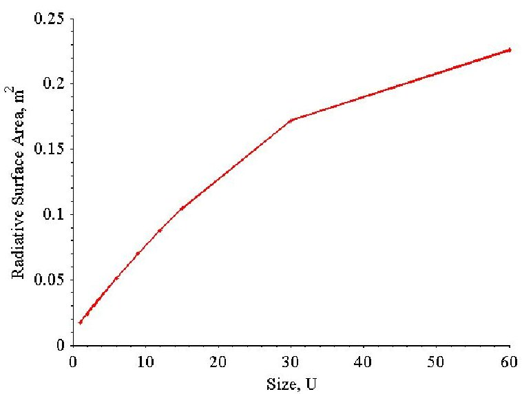

(a) Radiative Area versus Size

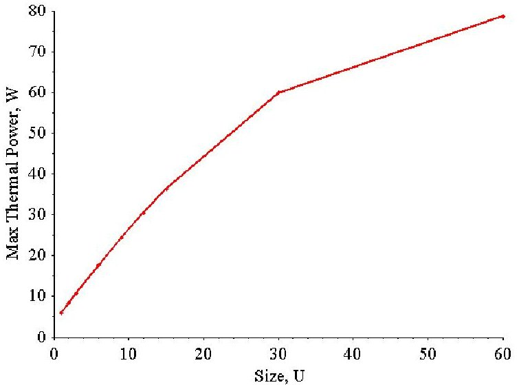

(b) Radiative Power versus Size

Fig. 2. Scaling for Thermal System Power Dissipation

For the spacecraft bus, we selected the Blue Canyon XB1 bus as it represents the state-of-the art and is being utilized for a variety of LEO and interplanetary applications [33]. The XB1 includes most major CubeSat subsystems including a Guidance, Navigation, and Control (GNC) system, Command and Data Handling (CDH) system, and Electric Power System (EPS). The active attitude determination and control system (ADCS) is required to achieve the desired thrust vector throughout any orientation. The XB1 ADCS consists of a reaction wheel assembly (RWA), internal measurement unit, magnetometer, torque rods, sun sensors, star trackers, and GPS. The XB1 system is currently developed to operate in LEO, is being designed for extended missions in interplanetary locations. Conventional de-saturation techniques are not feasible for interplanetary spacecraft, for example magnetometers can not be used for reaction wheel de-saturation as conventionally done in LEO environments. For missions beyond LEO, reaction wheel saturation is dominated by solar pressure and careful control of solar panel orientation can overcome this challenge. The Blue Canyon bus contains a battery with an

<!-- PDF_PAGE: 5 -->

energy storage of 25 Whr. The BCT XB1 system nominally has a mass of about $ M_{b}=1 2 0 0 $ grams, without a RWA. The RWA is sized based on the momentum, which is a function of the CubeSat mass (the RWA mass is a cubic function of spacecraft mass based on a curve fit from BCT wheels). The BCT RWA is not part of the spacecraft for the attitude control missions.

For near-Earth applications, we assume use of an S-Band or UHF transceiver, which has a mass of 80 grams. Existing UHF, S-Band, and X-Band systems do not currently have the capability to return data at meaningful rates to Earth on small spacecraft form-factors. For applications beyond near-Earth, such as those that escape Earth orbit and operate in deep space, we assume use of the IRIS transponder, which is used for both tracking and navigation [34]. The IRIS transponder is a low mass (500 grams), volume, and power solution for interplanetary small spacecraft, which communicates to the Deep Space Network (DSN) on X-Band frequencies.

## III. APPROACH

## A. Goals, Decisions, and Constraints

Space missions generally aim to maximize the capability of science instruments (in number or size), therefore the main goal in this problem is to maximize the payload mass fraction, $ M_{p} / M_{i} $ , where $ M_{p} $ is the payload mass, including all spacecraft components not related to the propulsion system, and $ M_{i} $ is the initial wet spacecraft mass. We also consider solutions that minimize time of flight (TOF), $ T $ , and the joint goal of maximizing payload mass fraction while minimizing TOF, $ M_{p} / M_{i} / T. $

The main thruster decision variable we consider in this study is $ I_{sp} $ . The reason for this is two-fold: First, the Isp is a driving system interface parameter as it is critical in defining the highly coupled trades between the mission optimization (trip time etc), the power system, and the propulsion system. Second, this parameter is a substantial driver in the prop system design as it defines the operating voltage and total propellant throughput required. We also consider the number of thrusters and assume the thruster size is fixed.

There are a variety of technical implications on the thruster design and operating point and on the mission capabilities related to $ I_{sp} $ , which is directly proportional to the beam voltage (Eq. 5). The maximum feasible $ I_{sp} $ is expected to be around 7000 sec, where lower voltages are preferred from a development perspective as they reduce the complexity of highvoltage systems. Lower voltages decrease $ I_{sp} $ , improve flight times, and improve mass fractions. The minimum feasible thrust from a single thruster is estimated to be $ T_{min}=1\mu\mathrm{N} $

It is generally desired that small spacecraft missions complete their primary objectives as quickly as possible because of their single-string architectures and the uncertainty in operating their components for extended durations. Several of the CubeSats in development are due to operate for less than three years, so this is seen as an upper limit by the community [9], [10], [11], [12]. We investigate sensitivities of results to

## B. Solution Space Exploration

The general approach is to perform a solution space exploration. The goal is to determine what $ I_{sp} $ , number of thrusters, and sizes of spacecraft maximize the mass payload fraction, achieve the required thrust to accomplish the missions, while satisfying mass, power, and thermal constraints. We investigate spacecraft sizes ranging from 3U (10 cm x 10 cm x 30 cm, < 6kg) to ESPA-class spacecraft (180 kg).

For orbit transfer missions, we generate a database of trajectories with variable power to mass ratio, $ I_{sp} $ , and flight time, and compute the final and initial mass, thrust duration, and $ \Delta V $ for each trajectory. For the orbit maintenance/proximity cases, we generate a database with a range of $ I_{sp} $ and constant acceleration values and derive the associated parameters for a given spacecraft mass and mission duration. For the ACS cases, the necessary parameters are derived based on constant or discrete impulses of thrust in the case of bang-bang control. Next we perform an iteration, and for every data set described above, we verify if the solution closes for a range of spacecraft sizes (3U-90U) and number of thrusters (1-200 thrusters). First, we compute the total required propulsion system power. Second, we size the solar panels and thermal system to support the mission. At this stage we must ensure the solar panels and thermal loads can be accommodated on this size of spacecraft, if not the solution is infeasible. Third, we compute the total dry mass of the spacecraft and the payload mass. If it is greater than zero than the solution is feasible. If the solution closes we compute the payload mass fraction and use the results in future comparative analysis.

## C. Mission Data Sets

The families of missions studied we study were selected in an A-Team study at JPL with subject matter experts and summarized in Tables II-III. They cover a range of missions where MEP may have significant advantages over the current technology or enable small spacecraft to perform missions typically accomplished by larger missions. The orbit changing missions focus on both LEO and deep space applications and include a large range of $ \Delta V $ and transfer times. MEP is a promising candidate propulsion system for orbit maintenance and/or proximity operations in both LEO and interplanetary applications because of its ability to provide continuous low thrust levels. Similarly, MEP has the potential to perform both precision and coarse attitude control and enable reaction wheel replacement, which can significantly improve the payload mass fraction on some missions.

Most of the LEO orbit transfer cases are relatively straightforward and described in Table III based on their initial and final orbits. The LEO Fly Over case is targeting a specific mission architecture, where one or more spacecraft repeat their path over the same point on Earth every day. This is accomplished by having the spacecraft in polar, 574 km altitude orbits that enables an integer (15) number of orbits

<!-- PDF_PAGE: 6 -->

TABLE I

MODEL PARAMETERS

<table border="1"><tr><td>Parameter</td><td>Symbol</td><td>Value</td><td>Units</td></tr><tr><td>Number of Emitters</td><td>$n_{e}$</td><td>500</td><td>-</td></tr><tr><td>Side of Thruster</td><td>$s$</td><td>11.2</td><td>mm</td></tr><tr><td>Thruster Emitter Spacing</td><td>$sp$</td><td>0.5</td><td>mm</td></tr><tr><td>Charge-to-mass Ratio (Ion Mode)</td><td>$Q/M$</td><td>843000</td><td>C/kg</td></tr><tr><td>Number of Emitters</td><td>$n_{e}$</td><td>500</td><td>-</td></tr><tr><td>Single Extractor Current</td><td>$I_{e}$</td><td>10</td><td>$\mu$ A</td></tr><tr><td>Gravity Constant</td><td>$g$</td><td>9.81</td><td>$m/s^{2}$</td></tr><tr><td>Beam Efficiency</td><td>$\eta_{b}$</td><td>0.8</td><td>-</td></tr><tr><td>Extractor Efficiency</td><td>$\eta_{e}$</td><td>0.8</td><td>-</td></tr><tr><td>PPU Efficiency</td><td>$\eta_{PPU}$</td><td>0.81</td><td>-</td></tr><tr><td>Neutralizer Voltage</td><td>$V_{n}$</td><td>100</td><td>V</td></tr><tr><td>Heater Power(s=11.2mm)</td><td>$P_{h}(s)$</td><td>0.65</td><td>W</td></tr><tr><td>Neutralizer Voltage</td><td>$V_{n}$</td><td>100</td><td>V</td></tr><tr><td>Propulsion System Margin(mass and power)</td><td>$m_{p}$</td><td>0.2</td><td>-</td></tr><tr><td>MEP Thruster Mass</td><td>$M_{T}$</td><td>0.04</td><td>kg/thruster</td></tr><tr><td>Slope Term in PPU Mass Scaling</td><td>$\alpha$</td><td>0.04</td><td>kg/thruster</td></tr><tr><td>Constant Term in PPU Mass Scaling</td><td>$\beta$</td><td>0.06</td><td>kg</td></tr><tr><td>Spacecraft System Margin(mass and power)</td><td>$m_{s}$</td><td>0.1</td><td>-</td></tr><tr><td>Telecommunication Power</td><td>$P_{t}$</td><td>15</td><td>W</td></tr><tr><td>Telecommunication Duty Cycle</td><td>$d_{t}$</td><td>0.17</td><td>-</td></tr><tr><td>Spacecraft Bus Power</td><td>$P_{b}$</td><td>4</td><td>W</td></tr><tr><td>Maximum Solar Panel Power to Volume Ratio for Fixed Panels</td><td>$P_{max,fix}$</td><td>2.6</td><td>W/cm^{3}$</td></tr><tr><td>Maximum Solar Panel Power to Volume Ratio for Deployed Panels</td><td>$P_{max,dep}$</td><td>40</td><td>W/cm^{3}$</td></tr><tr><td>Solar Panel Power to Mass Ratio for Fixed Panels</td><td>$\gamma_{fix}$</td><td>15</td><td>W/kg</td></tr><tr><td>Solar Panel Power to Mass Ratio for Deployed Panels</td><td>$\gamma_{dep}$</td><td>120</td><td>W/kg</td></tr><tr><td>Solar Panel Power Efficiency for Deployed Panels</td><td>$\eta_{sp}$</td><td>0.8</td><td>-</td></tr><tr><td>Solar Panel Gimbal</td><td>$m_{sp,gim}$</td><td>0.2</td><td>kg</td></tr><tr><td>Thermal System Efficiency</td><td>$\eta_{th}$</td><td>0.8</td><td>-</td></tr><tr><td>Radiator Efficiency</td><td>$\eta_{rad}$</td><td>0.8</td><td>-</td></tr><tr><td>Radiator Emissivity</td><td>$\epsilon$</td><td>0.8</td><td>-</td></tr><tr><td>Stephan-Boltzmann Constant</td><td>$\sigma$</td><td>$5.67\cdot10^{-8}$</td><td>W/m^{2}/K^{4}$</td></tr><tr><td>Radiator Temperature</td><td>$t_{rad}$</td><td>313</td><td>K</td></tr><tr><td>Black Body Temperature</td><td>$t_{b}$</td><td>4</td><td>K</td></tr><tr><td>Thermal System Mass Fraction</td><td>$f_{th}$</td><td>0.1</td><td>-</td></tr><tr><td>Maximum System Density</td><td>$D_{max}$</td><td>0.002</td><td>kg/cm^{3}$</td></tr></table>

TABLE II

MISSIONS EXPLORED IN MEP STUDY

<table border="1"><tr><td>Category</td><td>MEP Use</td><td>Sub-categories</td><td>Example Applications</td></tr><tr><td>Orbit Changing(LEO, interplanetary)</td><td>Primary Propulsion</td><td>Single TransitionsMultiple Transitions</td><td>Altitude Raising(LEO,GEO,GTO,lunar,etc.)Interplanetary Transfers</td></tr><tr><td>Orbit Maintenance/Proximity Operations</td><td>Primary Propulsion</td><td>Long LifetimeShort Lifetime</td><td>Drag Make-Up(LEO,other)Controlled hovering/landing near body</td></tr><tr><td>Precision Pointing and/orFormation Flying</td><td>Attitude Control andPrimary Propulsion</td><td>High AccuracyLower Accuracy</td><td>Reaction wheel replacement(LEO,etc.)Constellation formation/maintenance(LEO,etc.)</td></tr></table>

per day (a higher or lower integer number of orbits is also feasible but not as reasonable for LEOs). A constellation of spacecraft can achieve the desired number of daily repeats; for example two spacecraft in orthogonal orbits will achieve four fly overs per day (more orbits increases this number). The distributions of altitudes (a) and inclinations (i) of historic orbits launched in to LEO range from 200-900 km and 20- $ 1 2 0^{\circ} $ . There are a higher number of CubeSats launched into 400-500 km altitude orbits, and ISS inclinations $ (51.6^{\circ}) $ and near polar inclinations. Transitioning into the Fly Over orbit is required before the mission can start, therefore it is desired that this transition occurs within the first sixty days of the mission. The total $ \Delta V $ required to perform both the altitude and inclination changes to achieve the Fly Over orbit (where

the inclination change is performed at the highest altitude to minimize $ \Delta V $ ) starting from a variety of initial orbits in sixty days is shown in Fig. 3. To achieve the Fly Over orbit in only sixty days, the orbit must be launched into a near-polar orbit, however it can be at nearly any altitude. We investigate transfers requiring $ \Delta V=0.5-0.8 $ km/s in the upcoming results.

For the Deimos and Phobos orbit return, we assume the trajectories begin in the same Mars orbit as Phobos or Deimos and then do a circular spiral to Mars escape. Then, from the same solar orbit as Mars (simplified to circular in ecliptic to average out mission years), the orbit spiral downs to a flyby of Earth with a C3 of about 10 $ km^{2} / s^{2} $ . This is followed by an Earth flyby and intermittent thrusting over 1.25 years to reduce

<!-- PDF_PAGE: 7 -->

TABLE III

LEO AND DEEP SPACE ORBIT TRANSFERS STUDIED. ALL LEO ORBITS ARE CIRCULAR AND GEOS ARE EQUATORIAL.

<table border="1"><tr><td>Name</td><td>Initial Orbit</td><td>Final Orbit</td><td>$\Delta V$ range</td><td>Burn Time(days)</td><td>Time of Flight(days)</td></tr><tr><td>Fly Over</td><td>See Fig.3(b)</td><td>Polar,574km</td><td>0.5-0.8km/s</td><td>60</td><td>60</td></tr><tr><td>GTO to Lunar Flyby</td><td>GTO</td><td>Earth Escape</td><td>1.7-3.4km/s</td><td>50-559</td><td>120-735</td></tr><tr><td>LEO to GEO</td><td>Equatorial,a=500km</td><td>GEO</td><td>4.4-5.5km/s</td><td>77-658</td><td>178-917</td></tr><tr><td>ISS to Polar</td><td>$i=52^{\circ},a=420km$</td><td>Polar,a=420km</td><td>6.7-7.6km/s</td><td>82-543</td><td>121-553</td></tr><tr><td>ISS to Equatorial</td><td>$i=52^{\circ},a=500km$</td><td>Equatorial,a=420km</td><td>9.3-11.3km/s</td><td>85-711</td><td>123-735</td></tr><tr><td>Deimos Return</td><td>Deimos</td><td>Earth Orbit</td><td>4.6-8.6km/s</td><td>17-738</td><td>719-1206</td></tr><tr><td>Phobos Return</td><td>Phobos</td><td>Earth Orbit</td><td>5.4-9.4km/s</td><td>21-869</td><td>723-1336</td></tr></table>

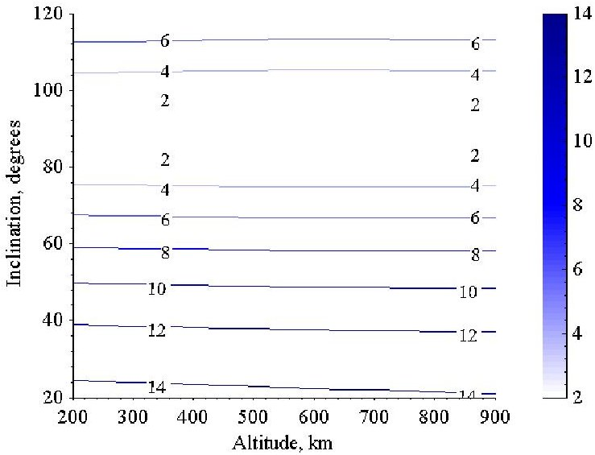

(a) All Transitions (All $ \Delta V $)

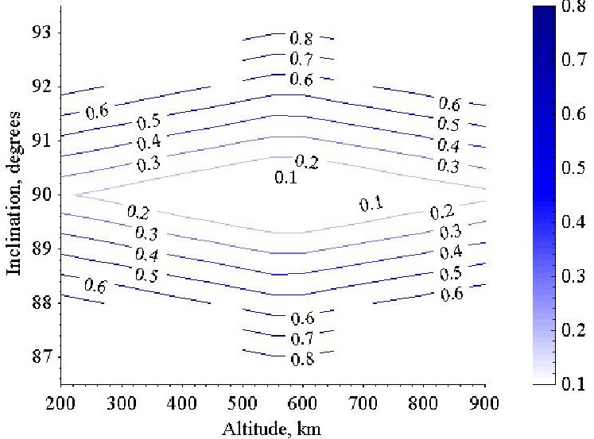

(b) All Transitions Feasible in Sixty Days ( $ \Delta V\leq 0. 8 $ m/sec)

Fig. 3. $ \Delta V $ requirements to achieve Fly Over orbit from a variety of initial LEOs

the C3 down to 2 $ km^{2} / s^{2} $ so that the Moon can capture the spacecraft into Earth orbit.

## IV. RESULTS

## A. Orbit Transfers

In this section we study the MEP performance metrics described in Section III-A for a range of spacecraft performing

the missions described in Section III-C. We present sensitivities of the results to mission type, spacecraft size, mission duration, and thruster lifetime.

1) LEO Orbit Transfers: For the LEO transfer trajectories the optimal $ I_{sp} $ values that maximize payload mass fraction are plotted for a range of spacecraft sizes in Fig. 4. In general lower $ I_{sp} $ values (4000-5000 sec) maximize the payload mass fraction for low $ \Delta V $ missions (e.g. LEO Fly Over). The mass payload fraction jumps are due to changes in the number of thrusters. There's reducing sensitivity to $ I_{sp} $ with increasing $ I_{sp} $ , therefore lower values still achieve a high fraction of the optimal mass fraction, as in Table IV. The relative change in payload mass fraction can be extracted from these plots such that the reader can determine the point where there are diminishing returns for their mission with increase in $ I_{sp} $ . For example, for a particular LEO Fly Over $ (\Delta V=5 \mathrm{~km / sec}) $ when the relative increase in mass fraction is $ < 5\% $ there is advantage in increasing the $ I_{sp} $ , therefore an $ I_{sp}=3000 $ sec is found to be the best solution.

For the small spacecraft studied, propulsion system dry mass (thrusters, PPU, supporting boards, and solar panels) often dominates the propulsion system mass, with a large mass fraction relative to propellant, which is unlike conventional large spacecraft. This is particularly true for lower $ \Delta V $ and shorter durations, see Fig. 5. We hypothesize this increases the $ I_{sp} $ values that maximize the payload mass fraction solutions for higher $ \Delta V $ missions because more thrust can be achieved for lower total thruster mass (thrust scales linearly with $ I_{sp} $ and thruster mass is constant for all $ I_{sp} $ values). Higher $ I_{sp} $ values result in longer transfer times, however all transfer times are less than three years, which is the upper bound for small spacecraft missions.

The optimal $ I_{sp} $ values for three goals; maximizing mass fraction, maximizing mass fraction over time, and minimizing transfer time; are plotted in Fig. 6. The highest payload mass fractions are achieved for $ I_{sp}=5000 $ sec for the LEO Fly Over cases $ (\Delta V\leq0.8\mathrm{km / sec}) $ , while the optimal $ I_{sp} $ values increase as the mission $ \Delta V $ increases, up to $ I_{sp}=9,000-10,000 $ sec for the ISS to Polar and Equatorial cases for larger spacecraft $ (\geq6\mathrm{U}) $ . The optimal $ I_{sp} $ is the same for all objectives for the Fly Over cases because they are all constrained to the same time (which is why the time-minimal case is not plotted). However, for the other cases where the orbit transfer times range (see Table III), there is a growth

<!-- PDF_PAGE: 8 -->

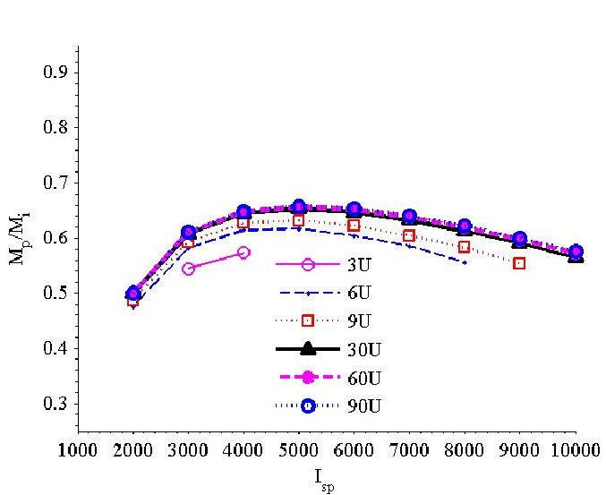

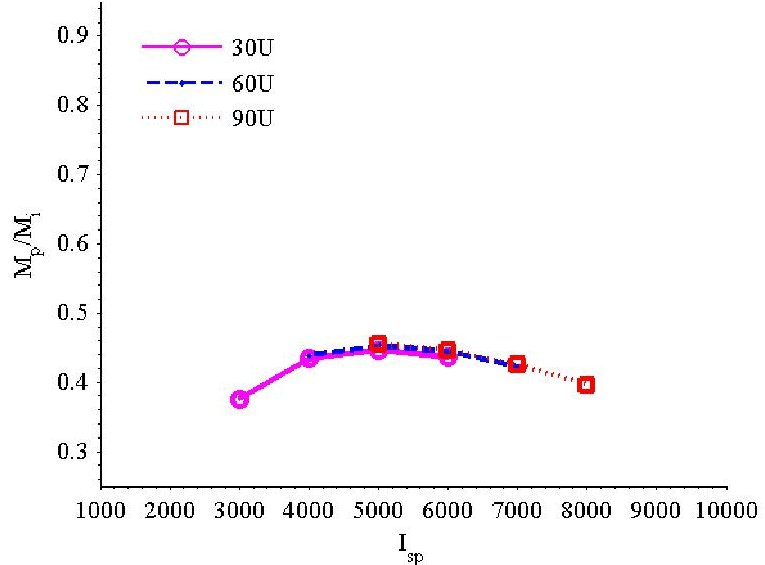

(a) LEO Fly Over $ \left( \Delta V=0. 5 \mathrm{~ k m / s e c} \right) $

(b) LEO Fly Over $ \left( \Delta V=0. 8 \mathrm{~ k m / s e c} \right) $

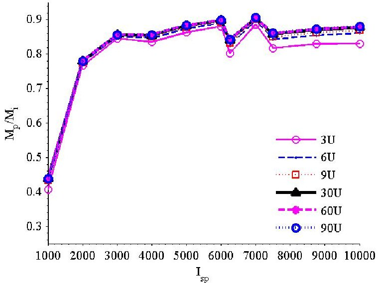

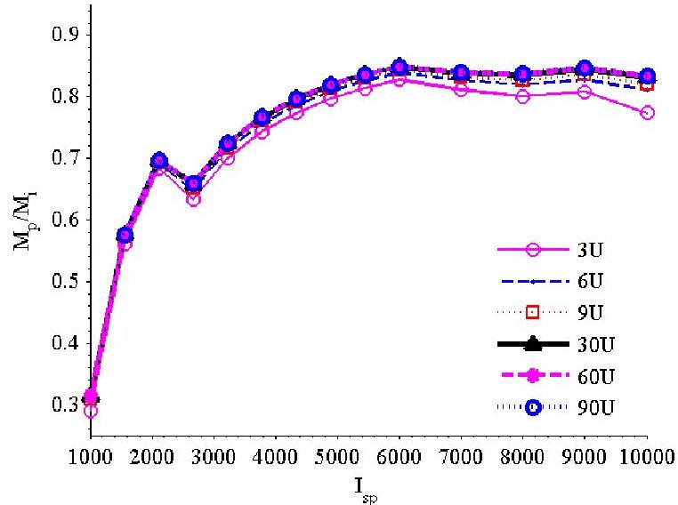

(c) LEO GTO to Lunar Flyby $ \left( \Delta V=1. 7-3. 4 \mathrm{~ k m / s e c} \right) $

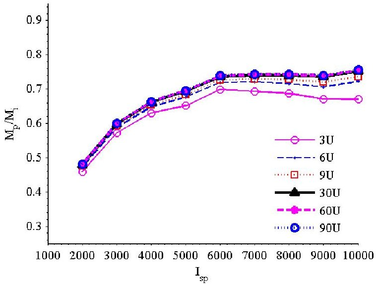

(d) LEO to GEO $ \left( \Delta V=4. 4-5. 5 \mathrm{~ k m / s e c} \right) $

(e) LEO ISS to Polar $ \left( \Delta V=6. 7-7. 6 \mathrm{~ k m / s e c} \right) $

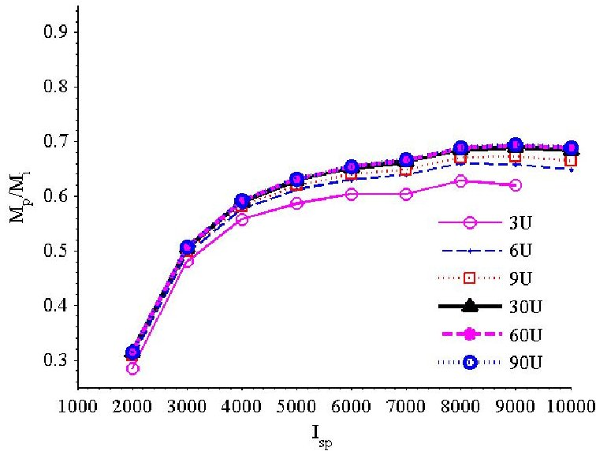

(f) LEO ISS to Equatorial $ \Delta V=9. 3-1 1. 3 $ km/sec)

Fig. 4. Optimal $ I_{sp} $ values that maximize $ M_{p} / M_{i} $ for LEO transfer orbits.

in the separation between the optimal $ I_{sp} $ for the different objectives, particularly as the $ \Delta V $ increases.

2) Deimos and Phobos Orbit Transfer: For the higher $ \Delta V $ Mars transfer cases maximizing the payload mass fraction is

achieved for high $ I_{sp} $ values, particularly as the spacecraft sizes are larger than 6U CubeSats, see Figs. 7-8. Lower $ I_{sp} $ values (6000 sec) maximize the payload mass fraction for small systems because power is constrained. For larger space-

<!-- PDF_PAGE: 9 -->

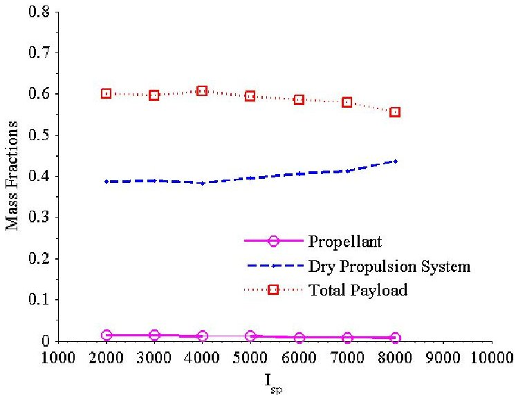

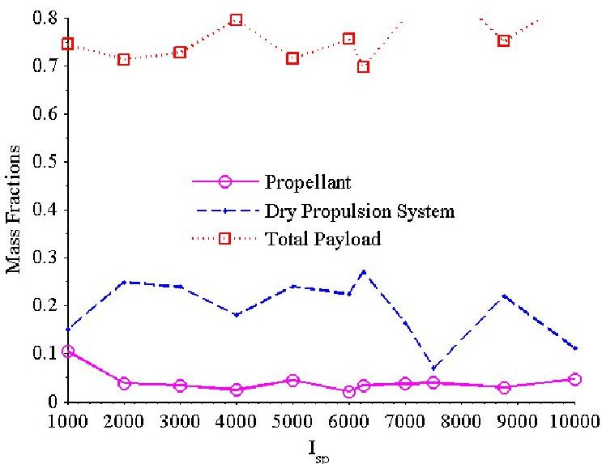

(a) LEO Fly Over $ \left( \Delta V=0. 5 \mathrm{~ k m / s e c} \right) $

(b) LEO GTO to Lunar Flyby $ \left( \Delta V=1. 7-3. 4 \mathrm{~ k m / s e c} \right) $

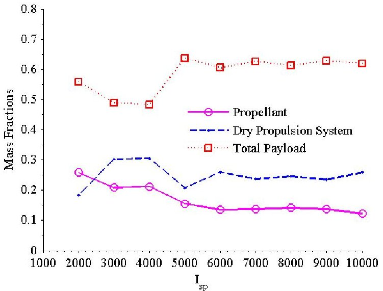

(c) LEO ISS to Equatorial $ \Delta V=9. 3-1 1. 3 $ km/sec)

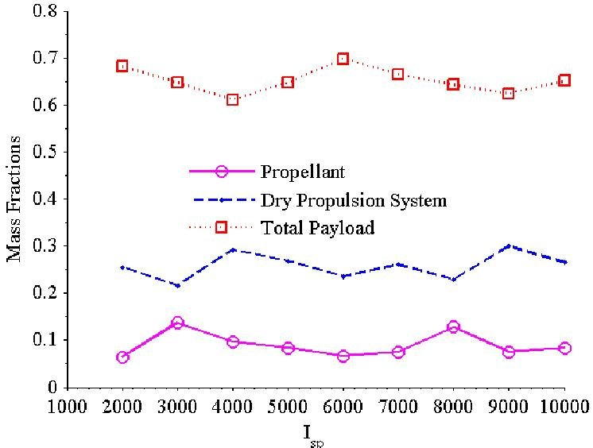

(d) Deimos $ \left( \Delta V=4. 6-8. 6 \mathrm{~ k m / s e c} \right) $

Fig. 5. Mass fractions for 6U CubeSats performing LEO and deep space orbit transfers.

TABLE IV

OPTIMAL $ I_{sp} $ VALUES FOR MAXIMIZING PAYLOAD MASS FRACTION AND PERCENTAGE OF OPTIMAL MASS FRACTIONS FOR LOWER $ I_{sp} $ VALUES

<table border="1"><tr><td>Name</td><td>Optimal $I_{sp}$ to Maximize $M_{p}/M_{i}$</td><td>Percentage of Optimal $M_{p}/M_{i}$ ($I_{sp}=4000$ sec)</td><td>Percentage of Optimal $M_{p}/M_{i}$ ($I_{sp}=5000$ sec)</td></tr><tr><td>Fly Over</td><td>5000</td><td>96%</td><td>100%</td></tr><tr><td>GTO to Lunar Flyby</td><td>7000</td><td>94%</td><td>96%</td></tr><tr><td>LEO to GEO</td><td>6000</td><td>90%</td><td>95%</td></tr><tr><td>ISS to Polar</td><td>10000</td><td>86%</td><td>91%</td></tr><tr><td>ISS to Equatorial</td><td>9000</td><td>85%</td><td>89%</td></tr><tr><td>Deimos Return</td><td>7000</td><td>92%</td><td>96%</td></tr><tr><td>Phobos Return</td><td>7000</td><td>92%</td><td>95%</td></tr></table>

craft, higher $ I_{sp} $ values are preferred because they achieve higher thrust for a given thruster mass, which is important because the thruster mass is a large fraction of the total wet thruster system, see Fig. 5. An $ I_{sp}=7000 $ sec provides a compromise between these objectives for all spacecraft sizes, see Fig. 8. However, a slight reduction in $ I_{sp} $ does not significantly reduce the payload mass fraction, see Fig. IV and Table IV.

## B. Orbit Maintenance and Proximity Operations

Next we investigate a family of missions requiring constant acceleration, such as orbit maintenance (e.g. drag make up) and proximity operations requiring constant hovering. The constant acceleration is maintained perfectly in the desired vector, which is achieved with the attitude control system. There are margins in the propellant mass and power to account for unknown inefficiencies. Fig. 9 shows the ranges of constant acceleration required to overcome drag effects in LEO and

<!-- PDF_PAGE: 10 -->

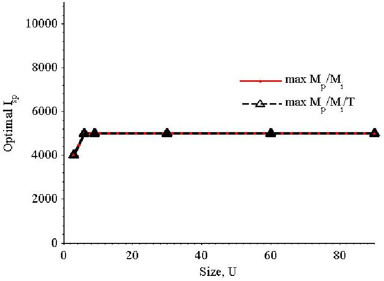

(a) LEO Fly Over $ \left( \Delta V=0. 5 \mathrm{~ k m / s e c} \right) $

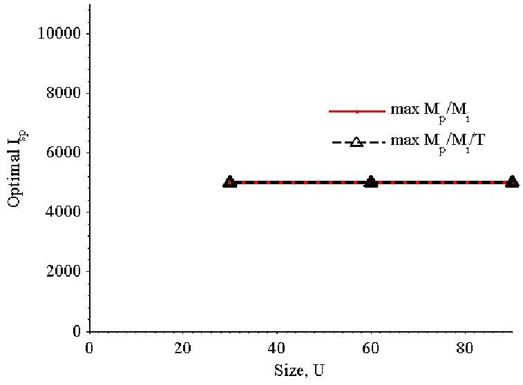

(b) LEO Fly Over $ \left( \Delta V=0. 8 \mathrm{~ k m / s e c} \right) $

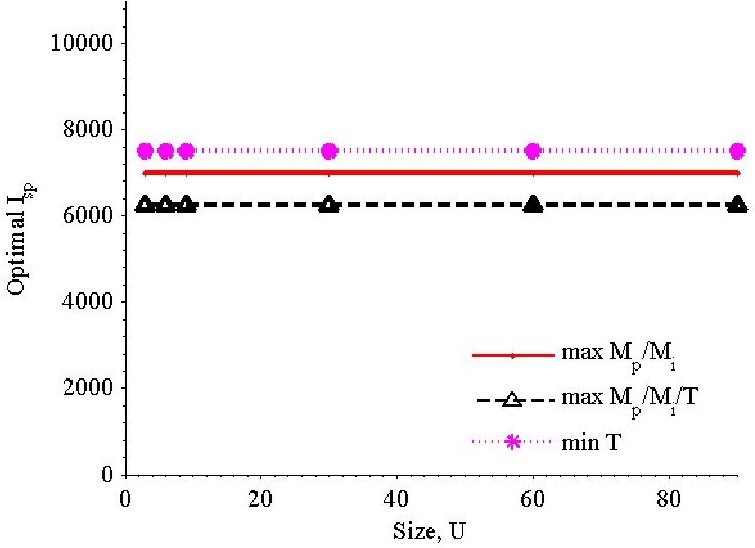

(c) LEO GTO to Lunar Flyby $ \left( \Delta V=1. 7-3. 4 \mathrm{~ k m / s e c} \right) $

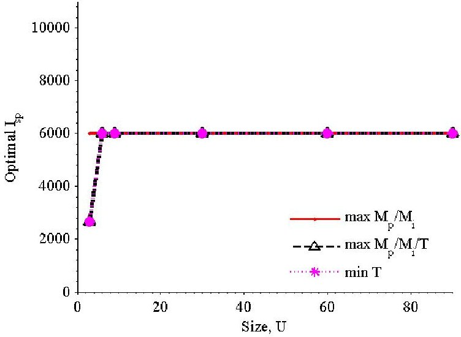

(d) LEO to GEO $ \left( \Delta V=4. 4-5. 5 \mathrm{~ k m / s e c} \right) $

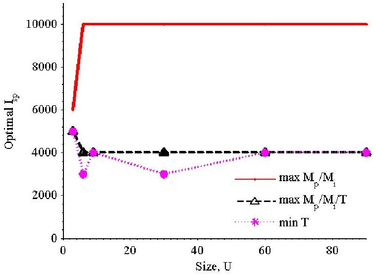

(e) LEO ISS to Polar $ \left( \Delta V=6. 7-7. 6 \mathrm{~ k m / s e c} \right) $

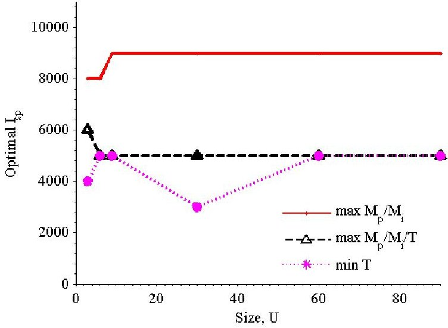

(f) LEO ISS to Equatorial $ \Delta V=9. 3-1 1. 3 \mathrm{~ k m / s e c} $

Fig. 6. Optimal $ I_{sp} $ values for different objectives for LEO transfer orbits

hover at a range of distances above interplanetary bodies. The specific Saturn Ring Observer (SRO) represents an example constant acceleration mission concept of interest that has been studied in depth because of its scientific value [35]. SRO

requires an acceleration of 0.05 to 0.1 mm/s $ ^{2} $ to hover an altitude of 2 to 3 km above the rings.

The minimum and maximum achievable acceleration with a single MEP thruster with the parameters in Table I is shown

<!-- PDF_PAGE: 11 -->

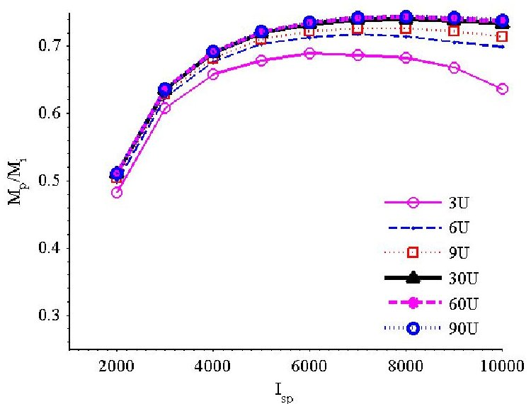

(a) Deimos $ \left( \Delta V=4. 6-8. 6 \mathrm{~ k m / s e c} \right) $

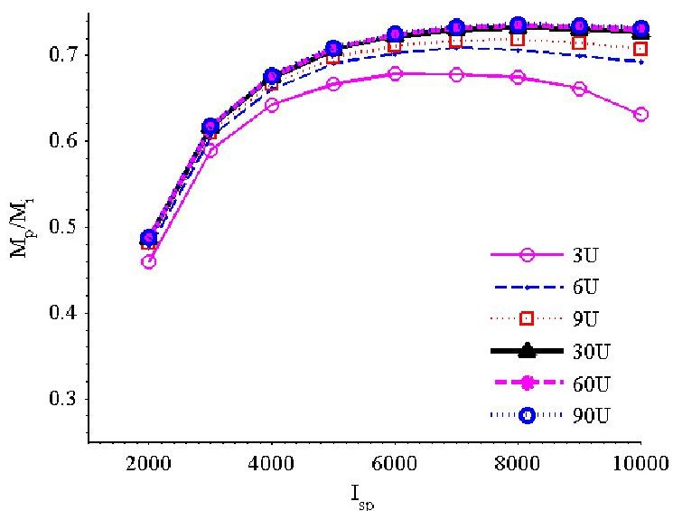

(b) Phobos $ \left( \Delta V=5. 4-9. 4 \mathrm{~ k m / s e c} \right) $

Fig. 7. Optimal $ I_{sp} $ to maximize $ M_{f} / M_{i} $ and relative improvement in mass fraction for Mars transfers to Deimos and Phobos

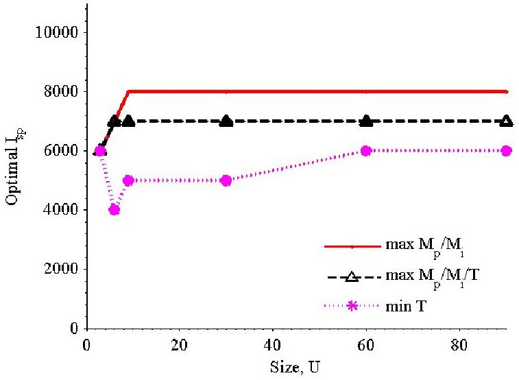

(a) Deimos $ \left( \Delta V=4. 6-8. 6 \mathrm{~ k m / s e c} \right) $

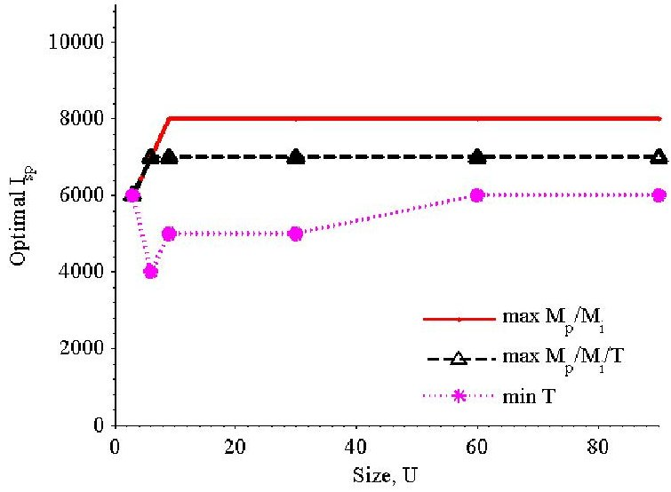

(b) Phobos $ (\Delta V=5.4-9.4\mathrm{km / sec}) $

Fig. 8. Optimal $ I_{sp} $ values for different objectives for Mars transfers to Deimos and Phobos

in Fig. IV-B. The minimum acceleration is constrained by the minimum thrust level that can be maintained, $ T_{min}=1\mu N $ and the maximum acceleration is constrained by the maximum achievable beam current, $ I_{b}=10\mu A $ per emitter, and the $ I_{sp} $ . However, with multiple thrusters (or a larger thruster), significantly higher maximum total acceleration values can be achieved, as in Fig. 11 and Table V. Larger systems are able to accommodate more thrusters, but are also heavier, which is why there's a slight decrease in total feasible acceleration with spacecraft size. There's a marginal reduction in payload mass fraction with higher $ I_{sp} $ systems because fewer thrusters are required to achieve the thrust level.

Comparing these maximum values to the desired mission applications in Fig. 9 show us that all LEO drag missions can be accomplished because the required accelerations are well above the minimum values $ ( a \leq1 0^{-1 0} \mathrm{m} / \mathrm{s}^{2}) $ , and below the maximum values in Table V. Several of the hovering cases

can be accomplished, including hovering over 10 m objects and Itokawa at any altitude, performing the SRO mission, and hovering over Deimos, Phobos at distances of several 100 meters. However, several missions hovering over larger bodies at close distances are not feasible using this MEP architecture. Overall, the maximum achievable accelerations are achieved for $ I_{sp}\geq 2000-3000 $ sec, as in Table V.

## C. Attitude Control

This section addresses using MEP for attitude control, which can enable reaction wheel replacement for formation flying and precision pointing in both LEO and deep space applications. The average net thrust resulting from all external disturbances for different size spacecraft and moment arms in length (l), width (w), and height (h), are given in Fig. 12. The LEO case considers aerodynamic drag, gravity gradient, and solar radiation pressure (SRP), while the deep space

<!-- PDF_PAGE: 12 -->

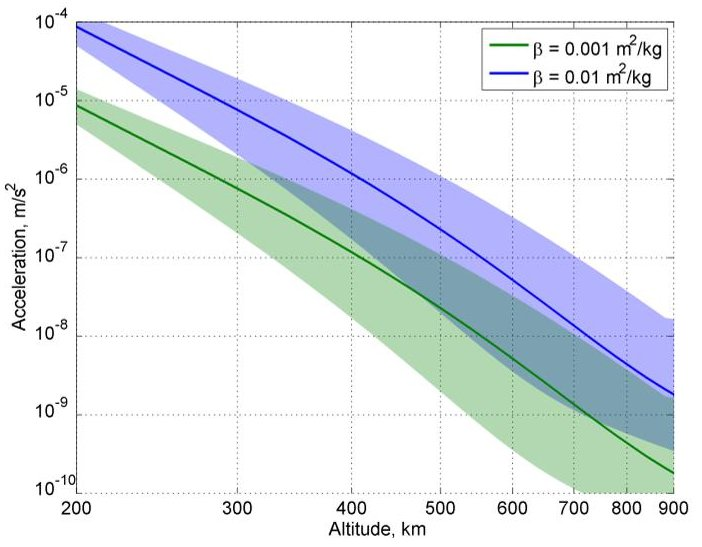

(a) Drag Make-Up

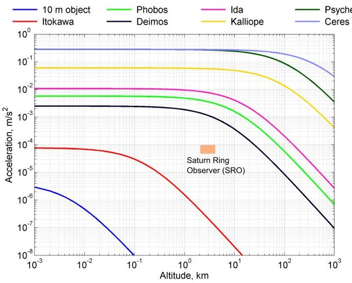

Fig. 9. Required constant acceleration for drag make-up in LEO (where $ \beta $ is the area in the ram direction to mass ratio) and hovering over a variety of interplanetary bodies.

(b) Hovering

TABLE V

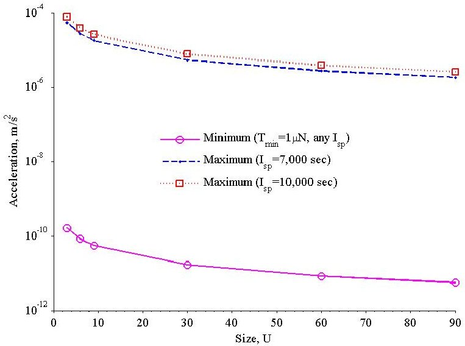

MAXIMUM FEASIBLE ACCELERATIONS （MM/S $ ^{2} $ ）FOR DIFFERENT SPACECRAFT SIZES AND MAXIMUM $ I_{sp} $ VALUES (WITH A MAXIMUM OF THE EQUIVALENT OF 500 THRUSTERS AS DESCRIBED IN THE ASSUMPTIONS SECTION).

Fig. 10. Feasible accelerations for a single MEP thruster.

<table border="1"><tr><td>Maximum $I_{sp}$</td><td>3U</td><td>6U</td><td>9U</td><td>30U</td><td>60U</td></tr><tr><td>$I_{sp}=1000$ sec</td><td>0.30</td><td>0.43</td><td>0.46</td><td>0.43</td><td>0.21</td></tr><tr><td>$I_{sp}=2000$ sec</td><td>0.48</td><td>0.43</td><td>0.56</td><td>0.56</td><td>0.57</td></tr><tr><td>$I_{sp}=3000$ sec</td><td>0.51</td><td>0.56</td><td>0.56</td><td>0.57</td><td>0.55</td></tr><tr><td>$I_{sp}=4000$ sec</td><td>0.42</td><td>0.44</td><td>0.45</td><td>0.47</td><td>0.47</td></tr><tr><td>$I_{sp}=7000$ sec</td><td>0.42</td><td>0.44</td><td>0.45</td><td>0.47</td><td>0.47</td></tr></table>

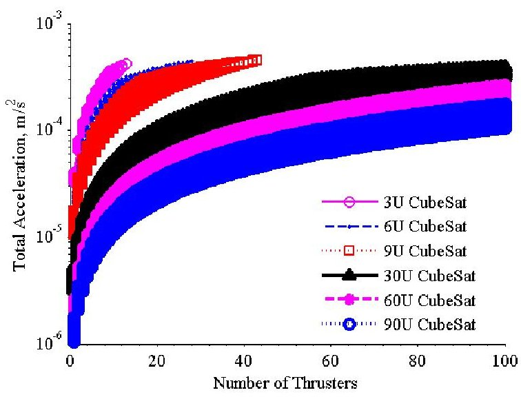

(a) Number of Thrusters $ ( I_{sp}=7 0 0 0 $ sec)

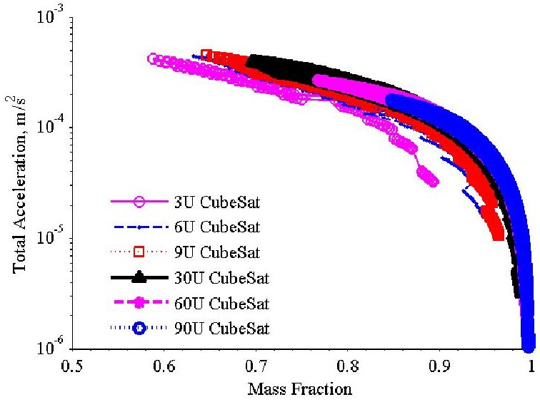

(b) Mass Fraction $ ( I_{sp}=7 0 0 0 $ sec)

Fig. 11. Maximum feasible acceleration ranges as a function of number of thrusters and the resulting mass fractions.

case considers only SRP because it is the dominant external disturbance in deep space when not in close proximity to another body.

SRP is modeled with specularly reflected radiation and a reflectivity factor of 0.6. Aerodynamic torque is modeled with the exponential atmospheric model (Standard Atmosphere 1976) to compute density as a function of altitude above Earths surface, and each surface is modeled as a flat plate.

<!-- PDF_PAGE: 13 -->

Gravity gradient is computed assuming uniform mass distribution, thus the principal inertias are uniformly distributed. The results were generated using analytic formulations for the disturbances torques and randomizing 10,000 cases for each form factor. The coefficient of drag are varied uniformly from 1.8-2.2, the products of inertia are varied uniformly from 0 10% of the minimum principal moment of inertia, and the sun direction, velocity vectors, and nadir directions in the body frame are randomized uniformly to represent any possible attitude using Hypersphere Point Picking [36].

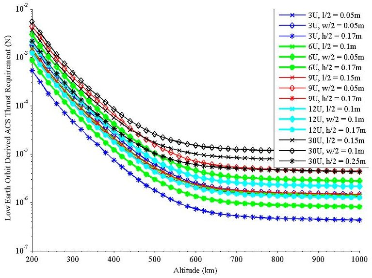

(a) LEO

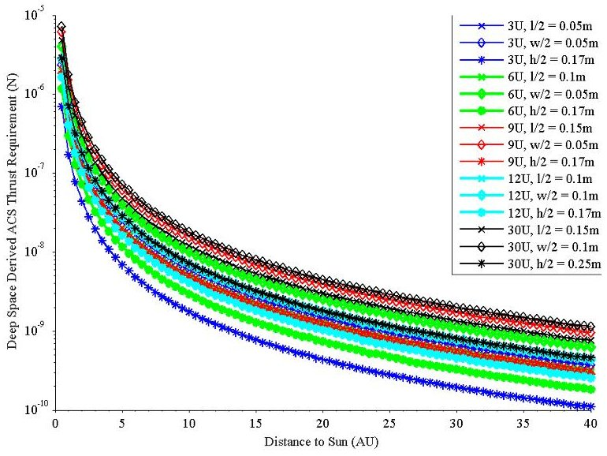

(b) Deep Space

Fig. 12. Total Average $ ( 1-\sigma) $ Disturbance Torques in LEO and Deep Space Environments for Small Spacecraft

The assumptions made in the sizing and analysis of the ACS systems are as follow:

- All center of pressures are located at the projected center of area (flat plate).

- There are no spacecraft deployables (all solar panels are fixed).

the disturbances in that axis.

- The thrusters are coupled in each dimension (i.e. one thruster per side to provide a coupled) torque. Each thruster provides half of the torque required to overcome

- There is an active attitude control system that operates "in the loop" with the thruster system and has sensors to estimate attitude (star trackers, accelerometers, etc.).

- The attitude knowledge of the ACS is about $ 1 0^{-4} $ with the BCT star trackers.

- The mission duration is three years, which is expected to be the maximum duration of a small spacecraft mission.

The approach for attitude control presented in this paper assumes the thrusters are constantly thrusting to overcome the average disturbances. The thrusters are sized to overcome the maximum disturbances (3- $ \sigma $ ) in every direction to maintain attitude controllability, and propellant and power are sized based on the system operation.

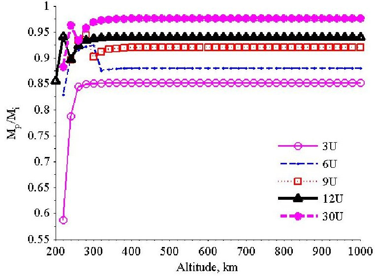

(a) $ I_{sp}=4 0 0 0 $ sec

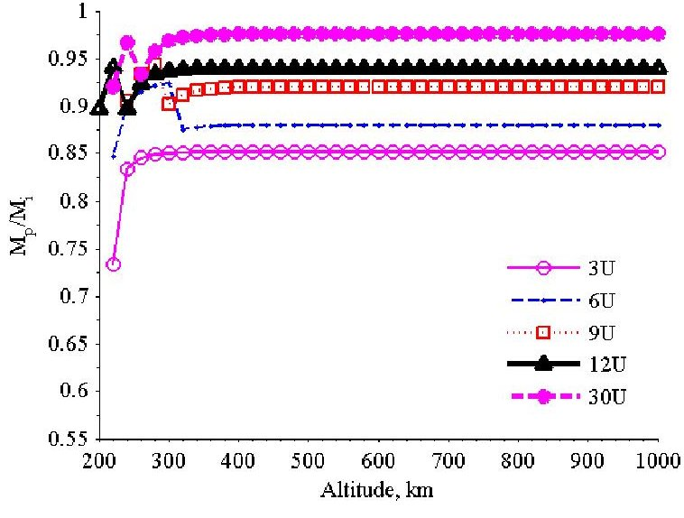

(b) $ I_{sp}=7000 $ sec

Fig. 13. Properties of Solutions with Constant Thrusting Approach for Attitude Control

The general approach for evaluating ACS solutions assuming constant average thrust is:

1) Identify the maximum (3- $ \sigma $ ) thrust experienced for a given spacecraft size and set of conditions in each dimension.

<!-- PDF_PAGE: 14 -->

2) Size the thruster in each axis to accommodate the maximum thrust.

3) Calculate the required propellant mass to support the desired mission duration assuming the mean (1- $ \sigma $ ) thrust occurs constantly.

4) Perform a systems-level analysis (as done for the primary-propulsion cases) to size the power system and resulting total payload mass to ensure the overall system is feasible.

The payload mass fractions for feasible systems-level solutions are shown as a function of altitude for difference spacecraft sizes for the constant thrusting approach for a three year mission in Fig. 13. The payload mass fraction is only sensitive to altitude for altitudes lower than 400 km in LEO, which is expected due to the significantly higher disturbance forces at these altitudes, see Fig. 12(a). A higher $ I_{sp} $ (7000 sec) marginally increases the payload mass fraction relative to a lower $ I_{sp} $ (4000 sec) for lower altitude missions ( $ \leq $ 400 km) as it decreases the required number of thrusters to achieve a certain thrust level. For deep space applications, the solar torque is significantly lower than the disturbances in LEO, as in Fig. 12(b), so will result in solutions similar to the high-altitude LEO cases, where the propulsion system mass is dominated by dry thruster mass (where all cases have at least six thrusters, two in each axis, are required).

For the attitude control approach presented, lower $ I_{sp} $ values are preferred for maximizing mass payload fractions. It may also be advantageous to consider gimbaled thrusters to minimize the number of required thruster. The comparison of MEP thrusters to reaction wheels is provided in the next section. More detailed studies should investigate using MEP thrusters for precision pointing applications and the relative advantages over reaction wheels.

## D. Comparison to Other Propulsion Technologies

Next we briefly compare MEP capabilities relative to other small spacecraft technologies for the mission cases studied. There are several other small spacecraft propulsion systems in development, but this comparison focuses on existing and mature technologies.

Existing technologies considered for orbit transfers or constant acceleration cases are given in Table VI, and include PPT $ ^{1} $ and warm gas technologies $ ^{2} $ systems (there are also several small spacecraft cold gas systems that tend to have lower performance characteristics). These alternative technologies provide significantly lower thrust and total impulse than required for significant orbit transfers (by more than an order of magnitude). Even the lowest $ \Delta V $ mission from our examples, the LEO Fly Over case, an $ I_{sp} > 1 0 0 0 $ sec is required to complete the mission in the required 60 days, see Figs. 4(a)-4(b), with is significantly more total impulse than can be delivered by either alternative technology. The PPT and

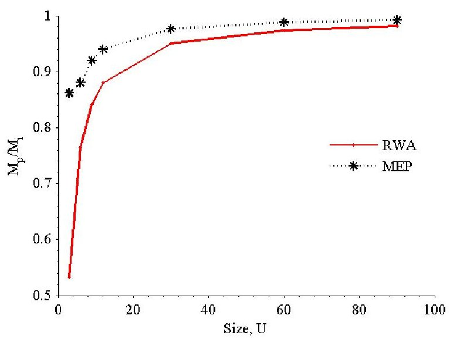

(a) RWA and MEP

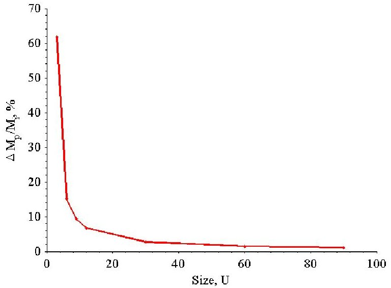

(b) Difference between RWA and MEP

Fig. 14. Comparison of use of reaction wheel assembly (RWA) and MEP thrusters for attitude control for nadir-pointing spacecraft in LEO.

Warm Gas thrusters may be sufficient for overcoming drag or performing hover maneuvers requiring low accelerations, such as drag make-up at high altitudes in LEO or hovering at high altitudes above planetary bodies, see Fig. 9, depending on the spacecraft size. These applications will be significantly limited by the available thrust because it is an order of magnitude or more smaller relative to MEP for these applications. Furthermore, the other technologies will not provide a smooth hover because the acceleration provided is not be constant as the thruster pulses.

MEP has also been suggested as a potential replacement for reaction wheels to provide improved mas fractions, such as in Ref. [37]. Comparing using MEP for attitude control relative to the conventional approach of reaction wheels is challenging because of the strong dependence on mission profile, including the spacecraft's pointing scheme, inertial properties, and how it interacts with the environmental disturbances. As a representative example, we consider a nadir-pointing spacecraft and appropriate scaling laws for momentum accumulation due

<!-- PDF_PAGE: 15 -->

TABLE VI

COMPARISON OF MEP RELATIVE TO EXISTING SMALL SPACECRAFT PROPULSION TECHNOLOGIES

<table border="1"><tr><td>Type</td><td>Example</td><td>Thrust</td><td>$I_{sp}$</td><td>Total Impulse(&lt;1U)</td><td>Dry Mass</td></tr><tr><td>Micro Electric Propulsion (MEP)</td><td>JPL&#x27;s MEP</td><td>200$\mu$N</td><td>4000-7000 sec</td><td>&gt;7000 Ns</td><td>380 g</td></tr><tr><td>Pulsed Plasma Thrusters (PPTs)</td><td>Clyde Space PPT</td><td>38$\mu$N</td><td>450-600 sec</td><td>40 Ns</td><td>280 g</td></tr><tr><td>Warm Gas Thrusters</td><td>VACCO&#x27;s Warm Gas Thruster</td><td>4.4$\mu$N</td><td>92 sec</td><td>1010 Ns</td><td>575 g</td></tr></table>

to disturbance forces $ ^{1} $ . We then use the BCT reaction wheel scaling between mass and momentum to size the RWA mass and compute the required solar panel mass. To size the MEP system, we use the mean disturbance force torque (1- $ \sigma $ ) from Fig. 12(a). The resulting mass fractions for attitude control with the MEP system (including thruster, PPU, supporting boards, propellant, and required solar panels) and conventional reaction wheel approach (include RWA and required solar panels) are compared in Fig. 14. The relative advantages of the MEP system are greatest for low-mass systems ( $ > 60\% $ ） and drop sharply with increase in spacecraft mass because the increase in required reaction wheels plateaus at larger masses and the required MEP dry mass remains approximately constant. Although this example provides some insights, a more rigorous and thorough study should be done for specific mission profiles and spacecraft configurations.

## V. SUMMARY AND RECOMMENDATIONS

This section summarizes the results, identifies the optimal requirements, and provides recommendations for future MEP systems to maximize the potential to support upcoming mission opportunities. MEP was found to be more capable than other existing technologies across broad mission classes, and we have quantified the mission performance at a system-level.

The implications from the study with respect to the primary decision variable, $ I_{sp} $ , are summarized below:

- For the LEO transfer cases the optimal $ I_{sp} $ to maximize payload fraction ranges between 5000-10,000 sec. An $ I_{sp}=5000 $ sec is both technically reasonable (does not require high voltages) and yields payload mass fractions that range from 89% (ISS to Polar Transfer) to 100% (LEO Fly Over cases) relative to the optimal, see Table IV.

- For the Mars transfer cases the optimal $ I_{sp} $ to maximize payload fraction is around 7000 sec because of the high $ \Delta V $ requirements and transfer times for these missions, although $ I_{sp} $ values around 5000 sec provide solutions that are 95-96% optimal (likely within the uncertainty of the analysis).

- For the constant acceleration cases the optimal $ I_{sp} $ to achieve the maximum accelerations is around 3000 sec, and the payload mass fractions are not sensitive to $ I_{sp} $ .

- For the attitude control cases the optimal $ I_{sp} $ for the attitude control cases is approximately 4000 sec because lower deadband errors can be maintained and higher mass fractions achieved.

In summary, we found that medium $ I_{sp} $ values （ $ I_{sp}=4000 $ sec) are optimal for low $ \Delta V $ missions, such as orbit raising and attitude control applications. For high $ \Delta V $ missions (such as inclination changes and Mars missions), higher $ I_{sp} $ values ( $ \geq 7000 $ sec) were preferred, despite requiring longer total mission durations. This result is because the main constraint was the ability to generate the required thrust and because of the high ratio of dry thruster mass relative to propellant for MEP systems on small spacecraft.

Overall, an of $ I_{sp}=4000 $ sec is recommended as a target for future MEP development. Although higher $ I_{sp} $ values are preferred for some of the LEO and deep space orbit transfer cases, an $ I_{sp}=4000 $ sec a good compromise because it is technically easier to design and operate (lower voltages) and improves transfer times. Furthermore, $ I_{sp}=4000 $ sec achieves greater than 85% of the payload mass fraction in all orbit transfer cases and is preferred for the constant acceleration and attitude control cases.

Finally, it is recommended to develop a propulsion system architecture (including PPU and supporting boards and systems) that has a high thrust-to-mass ratio to improve payload mass fractions. We observed that higher $ I_{sp} $ values often improve payload mass fractions because fewer thrusters are required to achieve the required thrust level, and the dry propulsion system mass is often a large fraction of the propulsion system, driving overall performance. The PPU architecture should be carefully designed to optimize overall propulsion system mass efficiency.

## ACKNOWLEDGMENT

The authors acknowledge Colleen Marrese-Reading, John Ziemer, Julie Catillo-Rogez and Andrew Gray for their contributions. Part of the research was carried out at the Jet Propulsion Laboratory, California Institute of Technology, under a contract with the National Aeronautics and Space Administration.

## REFERENCES

[1] D. Selva and D. Krejci, "A survey and assessment of the capabilities of cubesats for earth observation," Acta Astronautica, vol. 74, no. 0, pp. 50-68, 2012. [Online]. Available: http://www.sciencedirect.com/science/article/pii/S0094576511003742

[2] K. Woellert, P. Ehrenfreund, A. J. Ricco, and H. Hertzfeld, "Cubesats: Cost-effective science and technology platforms for emerging and developing nations," Advances in Space Research, vol. 47, no. 4, pp. 663 - 684, 2011. [Online]. Available: http://www.sciencedirect.com/science/article/pii/S0273117710006836

[3] D. N. Baker and S. P. Worden, "The large benefits of Small-Satellite missions," Transactions American Geophysical Union, vol. 89, no. 33, pp. 301+, Aug. 2008.

<!-- PDF_PAGE: 16 -->

[4] T. Moretto and R. M. Robinson, "Small Satellites for Space Weather Research," Space Weather Journal, vol. 6, no. 5, pp. S05007+, May 2008. [Online]. Available: http://dx.doi.org/10.1029/2008SW000392

[5] G. Crowley, C. S. Fish, G. S. Bust, C. Swenson, A. Barjatya, and M. F. Larsen, "Dynamic Ionosphere Cubesat Experiment (DICE)," American Geophysical Union (AGU) Fall Meeting, pp. A6+, Dec. 2009.

[6] G. Skrobot, "ElaNa educational launch of nanosatellite: Enhance education through space flight," in Proceedings of the 25th Annual Small Satellite Conference, August 2011.

[7] M. Diaz-Aguado, S. Ghassemieh, C. Van Outryve, C. Beasley, and A. Schooley, "Small class-D spacecraft thermal design, test and analysis - pharmasat biological experiment," in Proceedings of the IEEE Aerospace Conference, 2009, pp. 1-9.

[8] L. Johnson, M. Whorton, A. Heaton, R. Pinson, G. Laue, and C. Adams, "Nanosail-D: A solar sail demonstration mission," Acta Astronautica, vol. 68, no. 5-6, pp. 571 - 575, 2011, Special Issue: Aosta 2009 Symposium. [Online]. Available: http://www.sciencedirect.com/science/article/B6V1N-4YJ6MT9-1/2/9289abf0ed165cee19ed8021af1633c8

[9] M. Sorgenfrei and B. Lewis, "Biosentinel: Enabling cubesat-scale biological research beyond low earth orbit," in Interplanetary Small Satellite Conference, Pasadena, CA, 2014.

[10] A. Frick, J. C. Rogez, L. Johnson, and J. Dervan, "NEA Scout: A CubeSat Architecture for Near Earth Asteroid (NEA) Exploration," in Interplanetary Small Satellite Conference (ISSC), Pasadena, CA, 2014.

[11] B. C. Payam Banazadeh, Paul Hayne and R. Staehle, "Lunar FlashLight: A cubesat architecture for deep space exploration," Pasadena, CA, 2014.

[12] A. Klesh, J. Baker, J. Castillo-Rogez, L. Halatek, N. Murphy, C. Raymond, B. Sherwood, J. Bellardo, J. Cutler, and G. Lightsey, "Inspire interplanetary nanospacecraft pathfinder in relevant environment," in Proceedings of the Annual Small Satellite Conference, Logan, Utah, August 2013.

[13] R. Staehle, D. Blaney, H. Hemmati, D. Jones, A. Klesh, P. Liewer, J. Lazio, M. W.-Y. Lo, N. M. Pantazis Mouroulis, P. J. Pingree, T. Wilson, B. Anderson, C. C. C. II, B. Betts, L. Friedman, J. Puig-Suari, A. Williams, and T. Svitek, "Interplanetary cubesats opening the solar system to a broad community at lower cost," Journal of Small Satellites, vol. 2, no. 1, 2013.

[14] A. D. Ketsdever and M. M. Micci, Micropropulsion for Small Spacecraft. American Institute of Aeronautics and Astronautics, 2000.

[15] A. Ridley, J. Forbes, J. Cutler, A. Nicholas, J. Thayer, T. Fuller-Rowell, T. Matsuo, W. Bristow, M. Conde, D. Drob, L. Paxton, S. Chappie, M. Osborn, M. Dobbs, J. Roth, and Armada Mission Team, "The Armada mission: Determining the dynamic and spatial response of the thermosphere/ionosphere system to energy inputs on global and regional scales," American Geophysical Union (AGU) Fall Meeting, pp. A7+, Dec. 2010.

[16] C. Swenson, M. Larsen, J. Sojka, and C. Fish, "CubeSat Constellations for Measurements of High Latitude Energy Input," American Geophysical Union (AGU) Fall Meeting, pp. C1584+, Dec. 2009.

[17] H. R. Mueller, J. and J. Ziemer, "Survey of propulsion technologies applicable to cubesats," in Proceedings of the 57th Joint Army-Navy NASA-Air Force (JANNAF) Propulsion Meeting, Colorado Springs, CO, 2010.

[18] M. D. Rayman and S. N. Williams, "Design of the first interplanetary solar electric propulsion mission," Journal of Spacecraft and Rockets, vol. 39, no. 4, pp. 589-595, 2002.

[19] S. N. Williams and V. Coverstone-Carroll, "Mars missions using solar electric propulsion," Journal of Spacecraft and Rockets, vol. 37, no. 1, pp. 71-77, 2000.

[20] D. Y. Oh, "Evaluation of solar electric propulsion technologies for discovery-class missions," Journal of Spacecraft and Rockets, vol. 44, no. 2, pp. 399-411, 2007.

[21] L. E. Schwaiger, J. M. S. Jr., J. H. Molitor, and D. MacPherson, "Solar electric propulsion asteroid belt mission," Journal of Spacecraft and Rockets, vol. 8, no. 6, pp. 612-617, 1971.

[22] J. Wang, D. E. Brinza, D. T. Young, J. E. Nordholt, J. E. Polk, M. D. Henry, R. Goldstein, J. J. Hanley, D. J. Lawrence, and M. Shappirio, "Deep space one investigations of ion propulsion plasma environment," Journal of Spacecraft and Rockets, vol. 37, no. 5, pp. 545-555, 2000.

[23] J. S. Snyder, T. M. Randolph, R. R. Hofer, and D. M. Goebel, "Simplified ion thruster xenon feed system for nasa science missions," in 31st International Electric Propulsion Conference, Ann Arbor, MI, 2009. [Online]. Available: http://richard.hofer.com/pdf/iepc-2009-064.pdf

[24] C. M. Marrese-Reading, J. K. Ziemer, D. P. Scharf, P. T. Tomas J. Martin-Mur, J. Mueller, , and R. E. Wirz, "Mission enabling and enhancing spacecraft capabilities with micronewton electric propulsion," in Proceedings of the IEEE Aerospace Conference, Big Sky, MT, March 2010.

[25] T. C. Co and J. T. Black, "Responsiveness in low orbits using electric propulsion," Journal of Spacecraft and Rockets, vol. 51, no. 3, pp. 938- 945, 2014.

[26] T. M. Randolph and D. Y. Oh, "Economic benefit analysis of chemical electric orbit raising missions," in AIAA International Communication Satellite Systems Conference and Exhibit, Montreal, Quebec, May 2002.

[27] S. K. David Y. Oh, Thomas Randolph and M. Martinez-Sanchez, "End-to-end optimization of chemical-electric orbit-raising missions," Journal of Spacecraft and Rockets, vol. 41, no. 5, pp. 831-839, 2004.

[28] D. D. Sara Spangelo and B. Longmier, "Small spacecraft systemlevel design and optimization for interplanetary trajectories," Journal of Spacecraft and Rockets, Accepted 2014.

[29] J. J. B. Brian St. Rock and M. A. Demetriou, "Propulsion requirements for drag-free operation of spacecraft in low earth orbit," Journal of Spacecraft and Rockets, vol. 43, no. 3, pp. 594-606, 2006.

[30] D. Oh, J. Snyder, D. Goebel, D. Landau, and T. Randolph, "Solar electric propulsion for discovery class missions," in IEPC-124-2013, 33rd International Electric Propulsion Conference., 2013.

[31] W. T. Griffiths, "Tailoring instructions for aiaa s-120-2006 mass properties control for space systems," AEROSPACE REPORT NO. TOR- 2008(8583)-7560 REV A, 2012.

[32] R. VanHalle, "Innovative high specific performance (hawk) solar array," in Summer CubeSat Workshop, Logan, Utah, August 2011.

[33] B. C. T. (BCT), "XB1: High performance 1U Cubesat Bus Specification Sheet," BCT Website, 2014. [Online]. Available: http://bluecanyontech. com/wp-content/uploads/2012/07/BCT-XB1-datasheet-1.2.pdf

[34] C. Duncan, "Low mass radio science transponder navigation anywhere," in iCubeSat Workshop, Boston, MA, May 2012.

[35] L. S. L. D. Phil Nicholson, Matthew Tiscareno, "Saturn ring observer," Planetary Science Decadal Survey Mission Concept Study, June 2010.

[36] R. F. Hicks, J. S. ad Wheeling, "An efficient method for generating uniformly distributed points on the surface of an n-dimensional sphere," Comm. Assoc. Comput. Mach., vol. 2, pp. 13-15, 1959.

[37] C. Marrese-Reading, "Microfluidic electrospray propulsion (mep) thruster proof-of-concept demonstration," in IEPC-2013, 33rd International Electric Propulsion Conference, 2013.