<!-- PDF_PAGE: 1 -->

# Design and Evaluation of Distributed Spacecraft Missions for Multi-Angular Earth Observation

by Sreeja Nag

B.S. Exploration Geophysics, Indian Institute of Technology, Kharagpur, 2009 M.S. Exploration Geophysics, Indian Institute of Technology, Kharagpur, 2009 S.M. Aeronautics and Astronautics, Massachusetts Institute of Technology, 2012 S.M. Technology and Policy, Massachusetts Institute of Technology, 2012

# Submitted to the Department of Aeronautics and Astronautics in Partial Fulfillment of the Requirements for the Degree of Doctor of Philosophy in Aeronautics and Astronautics Engineering

at the Massachusetts Institute of Technology June 2015 $ \textcircled{c} $ 2015 Massachusetts Institute of Technology. All rights reserved.

Department of Aeronautics and Astronautics April 17, 2015

Certified by ___

Olivier L. de Weck

Professor of Aeronautics and Astronautics and Engineering Systems Thesis Supervisor

Certified by ___

David W. Miller

Professor of Aeronautics and Astronautics

Thesis Committee Member

Certified by ___

Kerri L. Cahoy

Assistant Professor of Aeronautics and Astronautics Thesis Committee Member

Certified by ___

Charles K. Gatebe

Senior Research Scientist at NASA Goddard Space Flight Center Thesis Committee Member

Accepted by ___

Paulo Lozano

<!-- PDF_PAGE: 2 -->

<!-- PDF_PAGE: 3 -->

# Design and Evaluation of Distributed Spacecraft Missions for Multi-Angular Earth Observation

by Sreeja Nag

Submitted to the Department of Aeronautics and Astronautics On April 17, 2015 in Partial Fulfillment of the Requirements for the Degree of

Doctor of Philosophy in Aeronautics and Astronautics Engineering

## ABSTRACT

Distributed Spacecraft Missions (DSMs) are gaining momentum in their application to Earth science missions owing to their ability to increase observation sampling in spatial, spectral and temporal dimensions. This thesis identifies a gap in the angular sampling abilities of monolithic spacecraft in Earth observation missions and proposes to use distributed spacecraft to address this gap. The science performance metric is chosen to be Bidirectional Reflectance-Distribution Function (BRDF), which describes the directional and spectral variation of reflectance of an optically thick surface element at any time instant. Airborne instruments are the gold standard for BRDF estimation (e.g. Cloud Absorption Radiometer/CAR). They can collect thousands of reflectance measurements at the same ground spot, but are localized in space and time. Spaceborne platforms estimate BRDF by combining angular measurements over time, made along-track, crosstrack or by autonomous pointing. However, their plane of data acquisition is very restricted with respect to the sun and the target itself might change over time of acquisition. Formations with spectrometer payloads can make multi-spectral reflectance measurements of a ground target, at many zenith and azimuthal angles simultaneously and estimate the angular signature of the surface. Constellations with overlapping ground spots can capture the angular components of global and temporally varying science products.

This work demonstrates the performance impact and feasibility of a BRDF estimation mission using a systems engineering tool (driven by model based systems engineering or MBSE), intricately coupled with a science evaluation tool (driven by observing system simulation experiments or OSSEs). Formations and payload pointing strategies are optimized to maximize angular spread and minimize estimation errors. The effect of angular spread on spatial, spectral and radiometric sampling dimensions is quantified for available spectrometer payloads that fit within the 6U CubeSat standard. Technical feasibility within 6U is verified for attitude determination and control, propulsion, communication and onboard processing modules. DSM architectures are generated and compared to each other and monoliths, in terms of BRDF, albedo, gross primary productivity and total outgoing radiation. Performance is benchmarked with respect to data from previous airborne campaigns (NASA CAR), tower measurements (AMSPEC II) and ideal values from radiative transfer or climate models (UMGLO, COART); and accepted BRDF models.

A formation of 6 small satellites produces lesser average error (21.82%) than larger monoliths (23.2%) over extended time periods, purely in terms of angular sampling benefits. The monolithic albedo error of 3.6% is shown to be outperformed by a formation of 3 satellites (1.86%), when arranged optimally and by a formation of 5 satellites (3.36%) when arranged in any way. An 8-satellite formation pushes albedo errors to 0.67% and reduces gross primary productivity errors from 89.77% (monolithic) to 78.69%.

<!-- PDF_PAGE: 4 -->

Thesis Committee Member: Charles K. Gatebe

Title: Senior Research Scientist at NASA Goddard Space Flight Center

<!-- PDF_PAGE: 5 -->

Everything I am and ever hope to be, I owe to my mother.

<!-- PDF_PAGE: 6 -->

<!-- PDF_PAGE: 7 -->

## Acknowledgements

First and foremost, I want to sincerely thank my advisor, Prof. Olivier de Weck, for consistent belief in my capabilities and for his guidance. I am particularly grateful to him for going out of his way on many occasions to provide unwavering support of my pursuit of unexpected opportunities and ever-evolving interests. His dedication to the topics of his students’ interests, irrespective of whether they align with his personal research goals, is very admirable and deeply appreciated.

The quality of this dissertation would not have been what it currently is without the mentorship and invaluable advice from each of my PhD committee members, readers and advisors, Prof. David Miller, Prof. Kerri Cahoy, Prof. Jeffrey Hoffman and Prof. Dava Newman at MIT; and Dr. Charles Gatebe and Dr. Jacqueline LeMoigne at NASA Goddard Space Flight Center (GSFC). A special mention for Prof. Anantha Chandrakasan for being a very supportive mentor, especially during academically difficult times. I began my PhD research by showing up at GSFC for the summer of 2012. All I knew back then was that I wanted to make an impact in the Earth Sciences with large numbers of small satellites. I had the lucky privilege of meeting Dr. Warren Wiscombe, a senior scientist at GSFC and an MIT alum, who introduced to me to “BRDF” and asked me to go solve the “BRDF problem”. It has been nearly three years and every time I meet Warren, I learn something brand new in earth science.

I am indebted to my Goddard family for the quality of my PhD: To Charles for giving me my GSFC break without ever having met me, for being a mentor whenever I needed and for a comprehensive introduction to Science@NASA; To Shana for sharing her home with me every time I visited for extended periods; To Jacqueline for supporting me at work ever so cherubically, for consistent mentorship and for taking me to my first launch (LADEE at Wallops); To Christine Chiu, Bert Pasquale, Tilak Hewagama, Shahid Aslam, Alexis Lyapustin, Georgi Georgiev, Crystal Schaaf and Miguel Roman for teaching me about algorithms and instruments in spite of their busy schedule; To Thomas Hilker and Forrest Hall for sharing their data and invaluable advice on photosynthetic measurements; To Jonathan Fentzke and Lars Dyrud for introducing me the world of dynamic and next-gen space entrepreneurship.

Very deep thanks to Sangram Ganguly, Steve Hipskind and Chad Frost at NASA Ames Research Center (ARC) for giving me an opportunity to move to the wonderful San Francisco Bay Area. I have loved every bit of being here and hope the adventure continues. Starting life in a new place didn’t feel as difficult as they say out to be, thanks to Abhishek (owner of the Batmobile); Christina (the super mom); Fan, Jan, Jamie and Andres; Anirudh, Moumita, Archi, Annapoorna mashi and everyone else who smoothened my move.

Generous funding for my work and study for my 3 years of PhD pursuit has come from the Schlumberger Faculty for the Future Fellowship, NASA Earth and Space Science Fellowship, MIT Zakhartchenko Fellowship, Zonta Amelia Earhart Fellowship, Draper Laboratory and the NASA InVEST Program, NASA GSFC’s Internal Research and Development (IRAD) Grant, USRA’s GESTAR program at NASA GSFC and BAERI’s ARC-CREST program at NASA ARC. Consistent funding from evaluators and mentors who believed in my projects and me enabled my PhD journey to be a smooth-sailing but intellectually challenging joyride. MIT’s International Students’ Office has been indispensable in my life of infinite paperwork as a green-horned, non-resident alien in the US of A. Marilyn Good and Julie Finn, you should take a bow for the years and years of very appreciated support you have provided to the SSL and SERG.

<!-- PDF_PAGE: 8 -->

Work can never be satisfying through content alone. I got to travel so much during grad school and I could say that alone taught me a universe. While not during my PhD period, I shall always be grateful to Leopold Summerer for hosting me at ESA/ESTEC in summer 2010 and opening doors to many future trips and collaborations with Europe. Colleagues have played an integral part of my educational experience. Thank you, Dani (now Prof. Daniel Selva) for support whenever I called for it, Farah for teaching me boatloads about Aero/Astro as a social environment, Morgan for being my first host at Cambridge and continuing to make me feel at home always, Danielle for introducing me to Charles Gatebe, Sydney for manning SERG and 33-409 almost as long as I did, James for keeping my TPP connections alive, Tom for teaching me tons about the international space tech business, Evan, Maria, Alessandra, Laura, Jillian and Weston for listening to my last-minute review requests, Koki, Narek, Ioana and many other SSLers and SERGers for making my association with the two groups a very memorable one.

Finally, and most importantly, I would like to thank my family and friends for being my rock through the turbulent sea of excitement and the directionless free-fall called Grad School. Big hugs for Diviya and Rachel for being my Cambridge family; Cindy for being the best roommate one can ever hope to find on Craiglist!; Arish for teaching me true feminism and for always believing in me; Sahil for showing me a whole, new world; Mudit for brainstorming about careers; Abhik for sharing "Being not-so Bengali", Sonam, Grace, Morgan, Sheekha, Adity, Nihit, Harshad, Srinath, DC, Sisir, Murthy, Amrit, Vilas for being great company as well as friends in need. My world would be incomplete without Mumu/mommy, Mashoon/aunt, Didoon/grandma and Dadoon/grandpa. I owe the contented solace behind my energy and passion to them.

<!-- PDF_PAGE: 9 -->

## Table of Contents

Acknowledgements...7

Table of Contents...9

Table of Figures...13

Table of Tables...17

Glossary...19

Table of Symbols...21

I. Introduction...23

    I-1. Distributed Spacecraft Missions...23

    I-2. Space-based Earth Observation...23

    I-3. Angular Sampling in Earth Observation...24

II. Problem Statement and Research Objectives...27

    II-1. Problem Statements...27

    II-2. Thesis Scope...27

    II-3. Thesis Objectives...28

    II-4. Thesis Outline...29

III. Literature Review...31

III-1. Gap Analysis in current Multi-Angular Acquisition...31

    III-1.1. BRDF Importance and Applications...31

    III-1.2. BRDF Modeling...34

    III-1.3. Current Multi-Angular Acquisition Methods...37

    III-1.4. Gap Identification #1...40

III-2. Distributed Mission Design Methodologies...40

    III-2.1. Small Satellite Nomenclature...41

    III-2.2. Model-Based Systems Engineering (MBSE)...43

    III-2.3. Observing System Simulation Experiments (OSSE)...43

    III-2.4. Gap Identification #2...44

III-3. Application of DSMs for Multi-Angular Acquisition...44

    III-3.1. Formation Flight Solutions...44

    III-3.2. Constellation Design...48

    III-3.3. Payload Customization...49

    III-3.4. Supporting Small Satellite Technologies...51

    III-3.5. Gap Identification #3...55

III-4. Cost Models for Small Satellite DSMs...56

    III-4.1. Existing Cost Models...56

    III-4.2. Costing multiple copies in DSMs...58

    III-4.3. Launch Cost Modeling...58

    III-4.4. Risk and Uncertainty Assessment...59

    III-4.5. Capturing Complexity...60

    III-4.6. System Dynamics...61

    III-4.7. Gap Identification #4...62

III-5. Chapter Summary...62

IV. Approach and Methodology...65

<!-- PDF_PAGE: 10 -->

IV-1. Overall Approach ... 65

IV-2. Systems Engineering Model (MBSE-driven) ... 66

IV-2.1. Constellation and Formation Flight Design ... 69

IV-2.2. Imaging Modes ... 70

IV-2.3. Payload Customization ... 71

IV-2.4. Cost Model and Results from Development ... 76

IV-3. Science Performance Evaluation Model (OSSE-driven) ... 85

IV-3.1. Radiation Integration and Spherical Harmonics ... 87

IV-3.2. Data from Cloud Absorption Radiometer ... 89

IV-3.3. Data from AMSPEC II - the Automated Multi-angular SPECtro-radiometer ... 92

IV-3.1. Radiative Transfer Model data modulated with CAR data ... 94

IV-3.2. Formations applied to Snow Albedo and Vegetation BRDF ... 95

IV-4. Chapter Summary ... 102

V. Results for Orbit and Observing System Simulation Sensitivity ... 105

V-1. Sensitivity Analysis of Science Models ... 105

V-1.1. Sensitivity to Wavelength ... 106

V-1.2. Sensitivity to BRDF Models ... 107

V-1.3. Sensitivity to Measurement Angular Spread per Surface type ... 110

V-1.4. Dependence on Solar Zenith Angle ... 113

V-1.5. Dependence on Number of Satellites ... 114

V-2. Streamlining the Formation Flight Architectures ... 116

V-3. Impact of Imaging Modes in Formations ... 127

V-3.1. Baseline Formation Comparison (Mode #1) ... 128

V-3.2. Changing the Reference Satellites (Mode #2) ... 131

V-3.3. Impact of Tracking Ground Spots (Mode #3) ... 133

V-4. Streamlining Constellation Architectures ... 138

V-5. Impact of Constellations in measuring Global Radiation ... 143

V-6. Chapter Summary ... 145

VI. Results for Payload and Subsystem Feasibility ... 147

VI-1. Concept of Operations ... 147

VI-2. Imager Payload ... 148

VI-2.1. Spectral Element Options and Customization ... 149

VI-2.2. Modeling Results ... 155

VI-2.3. Payload System Performance ... 163

VI-2.4. Communication System Constraints on Performance ... 170

VI-3. Attitude Determination and Control ... 170

VI-3.1. Overlapping Ground Spots for Co-Pointing ... 172

VI-3.2. Slewing Maneuvers for Co-Pointing ... 175

VI-3.3. Control against Secular Disturbances ... 178

VI-4. Propulsion ... 178

VI-4.1. Distributed Satellite Initialization ... 178

VI-4.2. Maintenance against Relative Secular Disturbances ... 181

VI-4.3. Preliminary Propulsion Budget ... 188

VI-5. Communication ... 189

VI-5.1. Available Ground Stations and Frequency Bands ... 189

<!-- PDF_PAGE: 11 -->

VI-5.2. Viability of Intersatellite Links ...191

VI-6. On-board Processing ...193

VI-7. Chapter Summary ...194

VII. Science Evaluation Results of Distributed Spacecraft ...197

VII-1. Results on NFOV sensors in Formation Flight ...197

VII-1.1. Impact on Albedo ...200

VII-1.2. Impact on Gross Primary Productivity ...210

VII-2. Results on WFOV sensors in Constellations ...212

VII-2.1. Sensitivity to Constellation Orbits and Field of View ...213

VII-2.2. Sensitivity to Anisotropy ...215

VII-2.3. Sensitivity to Science Models (Spherical Harmonics) ...216

VII-2.4. Cost Results ...217

VII-3. Chapter Summary ...217

VIII. Thesis Summary ...219

VIII-1. Thesis Contributions ...219

VIII-2. Thesis Summary ...220

VIII-3. Looking Forward and Upward ...223

IX. References ...225

X. Appendix ...239

X-1. Imager Calibration Methods ...239

X-2. Choosing an Optimization Algorithm ...241

X-3. Angular Requirements for Cloud Pointing ...243

<!-- PDF_PAGE: 12 -->

<!-- PDF_PAGE: 13 -->

## Table of Figures

Figure 1: A DSM making multi-angular, multi-spectral measurements. 25

Figure 2: Snow albedo estimated using only nadir reflectance vs. integration of reflectance. 31

Figure 3: Gross Primary Productivity (GPP) is proportionate to Photosynthetic Efficiency. 32

Figure 4: Missing energy between ocean heat content and ERI observations as shown in [54]. 33

Figure 5: RTLS equations for BRDF. 34

Figure 6: RPV equations for BRDF. 35

Figure 7: Cox-Munk equations for measured ocean reflection. 36

Figure 8: Measurements a single satellite is capable of making. 38

Figure 9: Comparison of angular sampling over one repeat ground track of 6 instruments 39

Figure 10: Small Satellite Nomenclature and examples of Earth Observation Missions. 42

Figure 11: Satellites in co-altitude circular orbits separated by relative inclination and phase. 46

Figure 12: Summary of cost risk assessment methods suitable for spacecraft programs [189] 59

Figure 13: Structural complexity metric introduced and validated in [195] and [107]. 61

Figure 14: Summary of the overall approach to calculate BRDF science performance, technical requirements and cost of different mission architectures. 65

Figure 15: Systems Engineering Model as an N2 diagram. 68

Figure 16: Process Flow Chart for tradespace analysis of DSMs. 69

Figure 17: Levels of models used for formation flight simulation. 70

Figure 18: Angular coverage for any single ground point by Mode #1 through #3. 71

Figure 19: Summary of the modeling approach to design and evaluate hyperspectral snapshot imagers. 72

Figure 20: Wavelength requirements for the imaging spectrometer. 73

Figure 21: Dependency chart of payload system performance metrics and optical system parameters on the design variables. 74

Figure 22: Definition of angular relationships between the satellite, target and Earth’s center. 75

Figure 23: Examples of previous and planned DSMs sorted by their individual spacecraft masses. 77

Figure 24: Scatter plot of previous and planned DSMs by the size of their individual spacecraft masses. 78

Figure 25: Cost to Copy (C2C) factors derived from cost data available within JHU APL. 80

Figure 26: Comparison of costs estimated using RAND Corporation’s analogous cost model and SMAD’s Small Satellite Cost model. 80

Figure 27: Cost estimated per subsystem. 81

Figure 28: Predicted mission cost and development time as a function of relative mission complexity. 82

Figure 29: Cost growth (Y-axis) required to support increasing TRL (X-axis) 85

Figure 30: Summary of science performance evaluation. 86

Figure 31: TOR at every grid point on Earth and Process flow chart for constellation architecture. 87

Figure 32: Spherical Geometry representation of radiance and TOR at the satellite 88

Figure 33: Difference in reference and estimated TOR using 1D spherical harmonics 89

Figure 34: Typical BRDF, at representative wavelengths, of the major Earth surface types. 90

Figure 35: BRDF of water in NASA’s CLAMS campaign, 2001. 91

Figure 36: BRDF of savannah in NASA’s SAFARI campaign, 2000. 91

Figure 37: The view zenith (VZA) relative azimuth (RAA) of the AMSPEC from the DF-49. 92

Figure 38: AMSPEC data at 531 nm from the DF-49 site. 93

Figure 39: BRDF of forest data, synthesized by RTLS inversion on data. 93

Figure 40: Outgoing radiation as simulated by University of Manchester’s UMGLO climate model. 94

<!-- PDF_PAGE: 14 -->

Figure 41: BRDF of Arctic snow. 95

Figure 42: FOE configuration with 9 satellites. 98

Figure 43: BRDF RMS error (left axis) and albedo error (right axis) with respect to CAR data. 99

Figure 44: The best 13 satellite formation configuration and View zenith angle subtended at ground target 100

Figure 45: BRDF RMS error with respect to the CAR data for the formation shown in Figure 44. 100

Figure 46: Measurement angles obtained with formations with increasing number of satellites. 101

Figure 47: BRDF RMS error for Savannah with respect to CAR data. 102

Figure 48: Correlation at p value<0.05 among data collected by CAR at 8 different wavebands. 106

Figure 49: Histograms of BRDF RMS errors over 100 Monte Carlo runs for 4 different land surface types 108

Figure 50: Forward modeled hemispheric reflectance using inverted parameters from the MRPV model on savannah data. 109

Figure 51: Forward modeled hemispheric reflectance of water with the Cox-Munk model 109

Figure 52: Simulated Annealing optimization results for 3-point measurements 110

Figure 53: Simulated Annealing optimization results for 4-point measurements. 113

Figure 54: Simulated Annealing optimization results for 4(left) and 6(right)-point measurements 115

Figure 55: Free Orbit Ellipse simulated using the HCW equations with 12+1 satellites. 116

Figure 56: Curvature corrected FOE trajectories in LVLH frame for changing ellipse inclinations 117

Figure 57: Cross Track Scan (CTS) simulated with 9+1 satellites with differential inclination and phase using the relative analemma model. 118

Figure 58: Free Orbit Ellipse with 3+1 satellites, simulated using the modified HCW equations with J2 and drag 118

Figure 59: View zenith angle subtended at the ground target for the 3 satellite trajectories 119

Figure 60: Cross track scan with 3+1 satellites, 120

Figure 61: Free orbit ellipse with 3+1 satellites, simulated on STK. 121

Figure 62: View zenith angle subtended at the ground target for the 3+1 satellite trajectories in Figure 61. 121

Figure 63: Cross track scan with 3+1 satellites, simulated on STK. 122

Figure 64: Global simulation of formations vs. the MISR instrument with its 9 sensors. 123

Figure 65: Eight available differential RAAN-TA slots, as enumerated in an AGI-STK simulation. 124

Figure 66: Representation of the geometry used to calculate view zenith angle (VZA) and inter-satellite link (ISL) between two spacecraft at altitude h. 124

Figure 67: Dependence of maximum VZA as a function of their differential RAAN and TA. 125

Figure 68: Process Flow for Angular Metric calculation in the LVLH frame 125

Figure 69: View zenith angle and relative azimuth of every satellite in a 4-satellite cluster. 126

Figure 70: View zenith angle and relative azimuth with respect to Sun in a 4-satellite cluster. 126

Figure 71: Variation of the boresight angle of the satellite with the view zenith angle at the ground. 128

Figure 72: BRDF error over time as the 4 satellite formation flies over Southern Africa. 130

Figure 73: Albedo error over time as the 4 satellite formation flies over Southern Africa. 131

Figure 74: BRDF (left) and Albedo (right) error over time as the 4 satellite formation. 132

Figure 75: BRDF (left) and Albedo (right) error over time as the 4 satellite formation (in Config #2). 133

Figure 76: Albedo error over time as the 4 satellite formation using BRDF minimization as the objective for waypoint selection with a simple algorithm. 134

Figure 77: Albedo error over time as the 4 satellite formation flies over the Arctic Circle using BRDF minimization as the objective for waypoint selection with a simple algorithm. 135

Figure 78: Albedo error over time as the 4 satellite formation flies over the Arctic Circle, operating in Mode #3 and using albedo minimization as the objective for waypoint selection. 136

<!-- PDF_PAGE: 15 -->

Figure 79: Albedo error over time as the 4 satellite formation flies over the Arctic Circle, operating in Mode #3 and using BRDF minimization as the objective for waypoint selection with a simple algorithm. 137

Figure 80: Albedo error over time as the 4 satellite formation using albedo minimization as the objective for waypoint selection. [Bottom]. 137

Figure 81: Change in the solar zenith angle as the 4 considered constellations operate for 2 hours. 138

Figure 82: Process Flow for Temporal Metric calculation globally or specific areas. 139

Figure 83: Validation of the VZA, SZA, and RAA calculated by the proposed tool. 140

Figure 84: Results from our temporal trade tool using Revisit time as a metric. 141

Figure 85: Time required to global coverage for Walker constellations with varying number of satellites 142

Figure 86: Percentage of the globe covered for Walker constellations (at 709 km, 98.18°). 142

Figure 87: Simulated Walker constellations at 709 km, 98.18° orbits with 130° FOV instruments. 143

Figure 88: Time to global coverage per constellation architecture at 710 km, 98.18 deg and CERES. 144

Figure 89: Time in hours required to access a grid point for the first time for a constellation 145

Figure 90: Baseline concept of operations for the formation. 147

Figure 91: Pths inside a Fourier-transform, integrated optic spatial heterodyne spectrometer 150

Figure 92: Detailed AOTF system as published in [154]. 153

Figure 93: The layout of the spectra and pre-dispersed PSFs on the detector of an IFS 154

Figure 94: Fabry-Perot Interferometer and multispectral image sensor 155

Figure 95: Radiance at 100 km altitude as provided by the COART model. 156

Figure 96: Proposed wavelength bands for the spectrometer, their corresponding bins and binwidths. 157

Figure 97: Variation of required aperture diameter. 158

Figure 98: Required pixel size on the Focal Plane Array (FPA) a. 159

Figure 99: Dependence of pixel size required to achieve pixel-delimited resolution. 160

Figure 100: Simulated swath for an AOTF spectrometer and a WG spectrometer. 165

Figure 101: Simulated Energy that reaches the optical system of an AOTF spectrometer. 166

Figure 102: Simulated signal-to-noise ratios (SNR) for Waveguide Spectrometers 167

Figure 103: Simulated signal-to-noise ratios (SNR) for Waveguide Spectrometers (left) and Acousto-Optic Tunable Filters (right) as a function of spectral wavebands and ground resolution required. 168

Figure 104: LVLH curves and their projections over one orbit for a 4 satellite formation 171

Figure 105: View zenith (VZA) and azimuth angle (RAA) as sampled by the 4 satellites. 172

Figure 106: Ground spot overlap for the Worst B/L formation. 173

Figure 107: Percentage overlap among the ground spots of 4 satellites in the best and worst config. 174

Figure 108: Normalized histograms of percentage overlap 174

Figure 109: Predicted time period compared to actual time period of 2 satellites. 175

Figure 110: Body angular rate and angular accelerations in the LVLH frame required for each satellite. 177

Figure 111: Time-ΔV trade-off for moving 2 satellites from zero to 5° and 90° apart in RAAN 179

Figure 112: Trade-off between total ΔV and deployment time required to deploy 4 or 8 planes. 180

Figure 113: Trade-off between total ΔV and deployment time required to deploy a 4-sat formation 180

Figure 114: Comparison of propulsion requirements to correct for altitude drops of 1U, 3U and 6U 182

Figure 115: VZA at the reference satellite’s nadir with differential RAAN and inclination 183

Figure 116: True anomaly (TA) spread at the start of a simulation and after a year of the simulation. 184

Figure 117: Earth centric angle between 2 satellites inserted differentially, in space and in time. 185

Figure 118: VZA subtended by one satellite below another satellite when the 2 satellites inserted differentially, in space (blue) and in time (red). 185

<!-- PDF_PAGE: 16 -->

Figure 119: VZA subtended by one satellite below another satellite when the 2 satellites inserted differentially in Brouwer-Lyddane mean, short, true anomaly...186

Figure 120: Correction fuel vs. time required for reducing the divergent true anomaly...187

Figure 121: Ground stations placed on the Deep Space Network locations...190

Figure 122: Slant range between a satellite and a ground station, as a function of satellite altitude,...191

Figure 123: VZA subtended between any pair of satellites vs. the expected decrease in required data rate ...193

Figure 124: Proposed integrated onboard processing unit...194

Figure 125: Average estimation error over time and over all combinations of differential RAAN and TA ...198

Figure 126: Average estimation error over time for increasing satellite number vs. total mission cost...199

Figure 127: Average estimation error over time for increasing satellite number vs. cost per satellite...199

Figure 128: Albedo RMS errors using a 4-sat formation . ...201

Figure 129: Albedo errors for Config #3 4-satellite formation...201

Figure 130: Error in BRDF and albedo when the formations are flown at different altitudes/inclinations compared to MISR...204

Figure 131: Distribution of percentage albedo error over all time steps in 4 hours f ...206

Figure 132: Arrangement of the 3-sat formation (orange) in the 9 given slots (white)...207

Figure 133: Albedo error as a percentage of reference CAR albedo...208

Figure 134: Distribution of % albedo error over a 4-hour simulation for 3, 4, 5 satellite formations...208

Figure 135: Average albedo error over time for increasing satellite number ...209

Figure 136: PRI Error (RMS value) as a function of reflection error...211

Figure 137: Mapping between BRDF-corrected PRI and LUE...212

Figure 138: Norm-1 error of the TOR simulated measurements by an N-satellite Walker constellation...213

Figure 139: Ground spot size (main coverage metric) dependence on altitude and sensor field of view...214

Figure 140: Time to global coverage per constellation architecture...215

Figure 141: Norm-1 error of the TOR simulated by an N-satellite Walker constellation ...216

Figure 142: Norm-1 error of the TOR retrieved from simulated measurements by an N-satellite Walker constellation using a 1D spherical harmonics model...216

Figure 143: Cost to develop the constellation as a function of the number of satellites ...217

<!-- PDF_PAGE: 17 -->

## Table of Tables

Table 1: Comparison of current spaceborne mission instruments ... 38

Table 2: Examples of recent Cubesats for Earth Observation Missions ... 41

Table 3: Typical cost models available for cost of a LEO satellite mission ... 57

Table 4: Inversion of learning curve parameters using data shown in Figure 24 ... 79

Table 5: Cost estimated for a spacecraft based on the Aerospace Corporation's COBRA ... 84

Table 6: Results of the full factorial analysis of N satellites in an FOE configuration ... 97

Table 7: BRDF RMS errors when using 6 satellites in a leader-follower configuration ... 108

Table 8: BRDF and albedo errors associated with the initial and final spreads of 4-point measurements when inverting on CLAMS data for water BRDF at different SZA ... 114

Table 9: BRDF errors associated with the initial and final spreads of 4- and 6- point measurements on the BRDF polar plot when inverting on CLASIC, SAFARI and CLAMS data ... 115

Table 10: RAAN-TA slots for the full factorial enumeration of formation architectures ... 123

Table 11: RAAN and TA for 4 satellites in a formation when arranged in 6 different configurations ... 129

Table 12: Sampling achieved for the best (Config #3) configuration ... 132

Table 13: RAAN and TA for 4 satellites in a formation when arranged in 4 different configurations ... 136

Table 14: Potential wavelength bands and corresponding bins for the proposed spectrometer ... 157

Table 15: Comparison of the spectral components in terms of resource and performance metrics ... 162

Table 16: RAAN and TA for 4 satellites in a formation when arranged in 2 baseline configurations ... 171

Table 17: CubeSat specifications used in simulations with lifetime calculated on AGI STK. ... 182

Table 18: Propulsion budget for initialization and maintenance of the CubeSat baseline formation formation..

188

Table 19: Angular spread obtained by the formation when using satellite #1 (blue), #2 (green), #3 (cyan), #4 (red) as reference when compared to MISR (black) at simulation times: ... 203

Table 20: Averaged BRDF and albedo errors for the 5 formation architectures ... 204

Table 21: Averaged percentages over a 4-hour simulation with 154 RAAN-TA combinations per 2 chief orbits, with variable number N of satellites ... 205

Table 22: Averaged percentages with 154 RAAN-TA combinations with variable number N of satellites ... 205

Table 23: Pearson correlation coefficient between all albedo error percentages ... 210

<!-- PDF_PAGE: 18 -->

<!-- PDF_PAGE: 19 -->

## Glossary

ADCS Attitude Determination and Control Systems

AGI STK Analytical Graphics Inc. Systems/Satellite Tool Kit

AOTF Acousto-Optic Tunable Filters (spectrometer)

ASTER Advanced Spaceborne Thermal Emission and Reflection Radiometer

ATSR Along Track Scanning Radiometer

BRDF Bi-Directional Reflectance Distribution Function

CERES Clouds and Earth's Radiant Energy System

CHRIS Compact High Resolution Imaging Spectrometer

COART Coupled Ocean-Atmosphere Radiative Transfer (RT model)

COBRA Complexity Based Risk Assessment (Aerospace Corporation)

CTS Cross Track Scan (an HCW solution)

DSM Distributed Space Mission

ECEF Earth Centric Earth Fixed (coordinates)

ERBE Earth Radiation Budget Experiment

ERI Earth Radiation Imbalance

FF Formation Flight

FOE Free Orbit Ellipse (an HCW solution)

FPA Focal Plane Array

FPI Fabry Perot Tunable (filter for spectrometer)

GINA Generalized Information Network Analysis

GNC Guidance Navigation and Control (system)

GPP/GEP Gross Primary Productivity/Gross Ecosystem Productivity

GPS Ground Pixel Size

HCW Hill Clohessy Wiltshire

IFS Integral Field Spectrograph

IJK Common term for Geocentric Equatorial Reference frame

ISL Inter-satellite Link (for inter-satellite communication)

LUE Light Use Efficiency

LVLH Local Vertical Local Horizontal (coordinates)

MA-EO Multi Angular Earth Observation

MISR Multi-angle Imaging Spectro-Radiometer

MODIS Moderate-Resolution Imaging Spectroradiometer

MSDO Multi-Objective System Design Optimization

NFOV Narrow Field of View (sensors)

POLDER Polarization and Directionality of Earth's Reflectances

PRI Photosynthetic Reflectance Index

RAAN Right Ascension of the Ascending Node (for any planar orbit)

RAA Relative azimuth angle between sun and view vector (at LVLH ground spot)

RTLS Ross-Thick Li-Sparse (model)

RMS Root Mean Square (error; calculated to represent vector or matrix errors)

RPV Rahman-Pinty-Verstraete

RT Radiative Transfer

<!-- PDF_PAGE: 20 -->

SciEval Science Evaluation Model

SSCM Small Satellite Cost Model (Aerospace Corporation)

SSO Sun Synchronous Orbit

SysEng Systems Engineering Model

SZA Solar zenith angle (at an LVLH round spot)

TA True Anomaly (for position within a planar orbit)

TOR Total Outgoing Radiation

TSI Total Solar Irradiance

VNIR Visible and Near Infrared

VZA View zenith angle (at an LVLH ground spot)

WFOV Wide Field of View (sensors)

WG Wave Guide (spectrometer)

<!-- PDF_PAGE: 21 -->

## Table of Symbols

<table border="1"><tr><td>$\Phi_{R}$</td><td>Differential phase between two satellites in the same orbit</td></tr><tr><td>$\Delta V$</td><td>Change in velocity required for changing orbital elements of a satellite</td></tr><tr><td>a</td><td>Orbit semi-major axis</td></tr><tr><td>b</td><td>Cost learning curve parameter</td></tr><tr><td>D</td><td>Slant distance between satellite and target being imaged</td></tr><tr><td>Da</td><td>Aperture diameter of payload</td></tr><tr><td>dp</td><td>Pixel size on the Focal Plane Array</td></tr><tr><td>e</td><td>Orbit eccentricity</td></tr><tr><td>E</td><td>Energy received at the aperture or focal plane</td></tr><tr><td>F#</td><td>F-stop number of the imaging system</td></tr><tr><td>h</td><td>Altitude of an orbit</td></tr><tr><td>i</td><td>Orbit inclination</td></tr><tr><td>i_R</td><td>Differential inclination between two orbits</td></tr><tr><td>P</td><td>Power received at the aperture or focal plane</td></tr><tr><td>q</td><td>Quaternion vector representing satellite attitude</td></tr><tr><td>Re</td><td>Average radius of the Earth</td></tr><tr><td>ε</td><td>Elevation angle of the satellite look vector</td></tr><tr><td>η</td><td>Off-nadir pointing angle</td></tr><tr><td>λ</td><td>Wavelength of light being imaged OR Earth Centric Angle</td></tr><tr><td>μ</td><td>Gravitational Constant of the Earth</td></tr><tr><td>v</td><td>True anomaly of a satellite in an orbit</td></tr><tr><td>φ</td><td>Reflectance OR full Field of Regard angle</td></tr><tr><td>σ</td><td>Standard deviation or error in measurements</td></tr><tr><td>Ω</td><td>Orbit RAAN/Right ascension of the ascending node</td></tr></table>

<!-- PDF_PAGE: 22 -->

<!-- PDF_PAGE: 23 -->

## I. Introduction

## I-1. Distributed Spacecraft Missions

A Distributed Spacecraft Mission (DSM) is a mission that involves multiple spacecraft to achieve one or more common goals. They are gaining momentum in their application to earth science missions owing to their ability to simultaneously increase observation sampling in spatial, spectral, temporal and angular dimensions. DSMs encompass a diverse family of spacecraft configurations including homogenous constellations such as Global Positioning System (GPS) and Iridium, heterogeneous constellations such as the A-Train, close proximity clusters in active formation flight such as the upcoming Proba-3[1], PRISMA and Edison (EDSN)[2]. Fractionated spacecraft where all physical entities share subsystem functions such as System F6[3] and cellularized systems from old, defunct satellites such as DARPA Phoenix[4] are other categories of DSMs. DSMs may be deployed in a staged fashion[5], reconfigurable while in orbit and replenished when older satellites cause graceful degradation[6]. This allows for scalability and the flexibility to evolve in the mission and puts less pressure on risks and schedule. Technologies to support DSMs have also seen great increase: Proximity operations and formation flight [7,8], orbit initialization and scatter maneuvers [9], high data rate communication links between satellites and with the ground [10], miniaturized thrusters for active control[11] and open-source cluster flight development. While on-orbit demonstrations have been few, the advent of new technologies points to an optimistic future for DSM demonstrations for improved science.

Cost, schedule and risk considerations in monolithic and distributed missions have ushered in an era of small satellites to complement flagship missions in the important field of earth observation and remote sensing[12]. To avoid being cost prohibitive, small satellites will be required to enable DSMs, especially those with large numbers. Nano-satellites (<10kg), now largely enabled by the CubeSat class of satellites, are convenient small satellites to demonstrate better and cheaper performance because they have additional advantages of access to standardized buses and secondary payload launches[13]. Miniaturization of spacecraft components and availability of secondary launches are continuously increasing the capability of small satellites, and paving the way to a future where certain well-defined science goals may be more efficient to achieve by going small and fast, than going the flagship route.

## I-2. Space-based Earth Observation

In earth remote sensing, Distributed Spacecraft Missions or DSMs have been traditionally used to improve sampling in the following four dimensions of an observed image simultaneously - spatial, temporal, spectral and radiometric. Note that the performance in each dimensions is dependent on the performance in another.

Spatial resolution of an image can be increased by using multiple satellites in formation flight to synthesise a long baseline aperture for optical interferometry[14] and synthetic aperture radars. Since the total imaging time is restricted by the DSM's ground speed, there is a trade-off between the number of spatial pixels (swath) and the number of wavebands (spectral range) that can be imaged[15]. DSMs can be used to fractionate the payload and the lower number of wavebands per fraction allows for

Constellations of evenly spaced satellites on repeat track orbits ensuring temporal sampling within a few hours as well as continuous coverage maintenance.

Large spectral range can be achieved for an increased number of wavebands by using multiple payload spectrometers and corresponding focal plane arrays (FPAs) so that different regions of the spectrum

<!-- PDF_PAGE: 24 -->

are mapped on different FPAs. Multiple telescopes may also be used for different regions of spectra so that the aperture diameter is customized to the wavelength of interest to allow better spatial resolution (diffraction limit).

Radiometric resolution is proportional to the time it takes to readout an image on the FPA. High radiometric resolution limits the number of pixels (i.e. swath and global coverage) and wavebands (i.e. spectral range) that can be imaged [15] because it takes more time to read each element. If the spectrum is fractionated and global spatial coverage is achieved using constellations, more radiometric sampling can be achieved without a science cost in a different dimension.

This research focuses on improving sampling in a less studied but critical dimension of an earth observation image - the angular dimension. Earth reflectance depends on wavelength, surface and many angles. Instantaneous angular spread is important in navigation DSMs, for example GPS, where the observer has to be visible to 4 satellites in wide spread to be able to determine his state most accurately. I now proceed to assess the importance and applications for Earth and Atmospheric Science.

## I-3. Angular Sampling in Earth Observation

Angular sampling implies taking images of the same ground spot at multiple 3D angles of solar incidence and reflection simultaneously. The near-simultaneous measurement requirement deems monoliths insufficient for accurate and dense angular sampling [19,20]. Monolithic spacecraft have traditionally approximated the angular samples by combining measurements taken over time with forward-aft (e.g. MISR[18] or Multi-angle Imaging Spectro-Radiometer on the Terra spacecraft) or cross-track swath (e.g. MODIS[19] or Moderate-Resolution Imaging Spectroradiometer on Terra) sensors. However, a single satellite can make measurements only along a restrictive plane with respect to the solar phase and the angular measurements are separated in time by minutes along-track or weeks cross-track. In areas of fast changing surface/cloud conditions especially during the melt season/tropical storms, a few days can make a large difference in reflectance. Near-simultaneous angular sampling can be improved by using a formation or constellation of nano-satellites on a repeating-ground-track orbit[17]. The formation can make multi-spectral measurements of a ground spot at multiple 3D angles at the same time as they pass overhead either using narrow field of view (NFOV) instruments in controlled formation flight (Figure 1a) or wide field of view (WFOV) instruments with overlapping ground spots imaged at different angles (Figure 1b). In this thesis, NFOV refer to sensors with FOV less than $ 3^{\circ} $ while WFOV to those with FOV greater than $ 100^{\circ} $

The widely accepted metric to quantify the angular dependence of remotely sensed reflectance signal is called Bidirectional Reflectance-Distribution Function (BRDF). BRDF of an optically thick body is its reflectance as a function of illumination geometry and viewing geometry, hence carries information about the anisotropy of the surface [20][21], [22]. It is determined by the structural and optical properties of the surface such as shadow casting, multiple scattering, mutual shadowing, transmission, reflection and absorption by surface element facet orientation distribution and density. It depends on four angles as seen in Figure 1c - the solar zenith angle or SZA $ (\Phi_{\mathrm{i}}/$ black), solar azimuth angle $ (\theta_{\mathrm{i}}/$ green), view zenith angle or VZA $ (\Phi_{\mathrm{r}}/$ black) and view azimuth angle $ (\theta_{\mathrm{r}}/$ red) - as well as on the wavelength of light. The azimuth angles are added to provide one azimuth angle relative to the solar position called the relative azimuth angle or RAA. This dissertation assumes prior information about surface topography so that the any ground element can be reduced to a flat surface. The simplifying assumption is to de-scope BRDF complexities that arise from the shape and orientation of the reflecting facet, such as those modeled in computer graphics[23] or orbital debris characterization from the ground[24], and concentrate only on angular retrievals.

<!-- PDF_PAGE: 25 -->

(a)

(b)

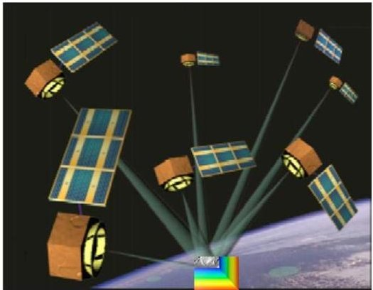

(c)

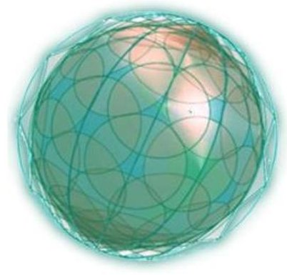

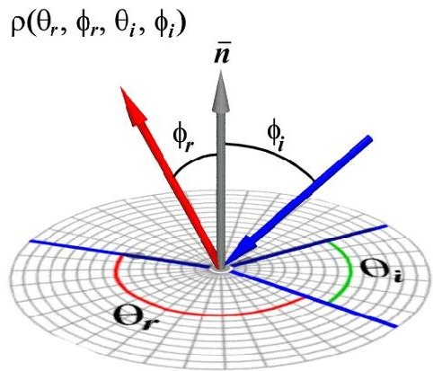

Figure 1: (a) A DSS making multi-angular, multi-spectral measurements by virtue of pointing its NFOVs at the same ground spot, as it orbits the Earth as a single system (adapted from Leonardo BRDF[25]). (b) A DSS making multi-angular, multi-spectral measurements by virtue of their overlapping WFOVs at different angles (from GEOScan[26]). (c) BRDF geometry and angles in terms of two directions - incoming solar irradiance (blue) and outgoing reflected radiance (red), measured at VNIR wavelengths (figure credits: Australian National University).

Since BRDF is a reflectance quantity, it is estimated in the near solar spectrum or VNIR (Visible and near Infrared) with a few tens of nanometers from the UV spectrum. The long wave spectra also show much milder angular dependence than VNIR. Reflectance in the long wave is a function of only view zenith angles (because there is little sunlight past 5 microns). It is a complex convolution of the Earth temperature with the atmosphere/clouds, and more popularly known as limb darkening [27]. While an application of angular long wave radiation is discussed in the thesis, the primary focus is on BRDF. BRDF is used for the derivation of surface albedo[28], calculation of radiative forcing[29], land cover classification[30], cloud detection[25], atmospheric corrections and aerosol optical properties[20]. BRDF estimations have proven to be good indicators of human activity e.g. ship wakes increase reflected sunlight by more than 100% [31]. The concept of using formations for BRDF estimation has been suggested before[25]; however, neither was comprehensive systems engineering used to evaluate technical feasibility nor BRDF models or data used to evaluate additional science impact.

<!-- PDF_PAGE: 26 -->

<!-- PDF_PAGE: 27 -->

# II. Problem Statement and Research Objectives

Multi-Angular Earth Observation (EO) from space is relevant to many scientific applications. However, measurements at multiple simultaneous angles are inadequate using spaceborne sensors and are cost prohibitive for global, frequent coverage using airborne sensors. Distributed Spacecraft Missions (DSMs) - either formation flight or constellations - are a potential method to improve the process of making multiangular measurements. There has never been an effort to develop a quantitative framework that assesses the improvements and serves as a tool to inform architecture decisions for maximizing science performance and minimizing lifecycle costs. In the interest of cost, small satellites, specifically nano-satellites, have been chosen as the spacecraft of interest.

## II-1. Problem Statements

The overall question of this dissertation is: Can distributed space systems be designed, that achieve better angular performance in earth observation at lower costs than monolithic spacecraft for given geo-spatial, spectral and temporal constraints? If so, how can an optimal mission be designed?

The specific problem statements associated with the above question are:

1. Is it technically feasible for a nano-satellite formation or constellation to optimize angular spread and sampling resolution better than current space missions with BRDF products?

2. How does angular spread and sampling affect sampling and spread in other sampling domains: spatial, spectral, temporal and radiometric?

3. How can I select the "Pareto Optimal" formation architectures (maximum angular performance, minimum cost) for a given set of constraints?

Technical feasibility implies the achievement of objectives within currently available technologies for nanosatellites, either commercial-off-the-shelf (COTS) or open sourced and launch availabilities. Mission constraints comprise of spectral/spatial/temporal/radiometric resolution requirements, a pre-decided set of surface types that are to be observed, and specified geophysical applications for each. A surface type is a large naturally occurring community of flora and fauna occupying a major habitat.

## II-2. Thesis Scope

This thesis attempts to inform major engineering decisions about the design of DSMs using tools from systems engineering, BRDF or related science and the nano-satellite development community. The focus has been primarily on the integration of model based systems engineering (MBSE) with Observing System Simulation Experiments (OSSE) to answer the overall research question. Both MBSE and OSSE are widely recognized modular tools in the engineering and science community. While the thesis also contains contributions in developing or improving some individual tools (for example, a modeling tool for large baseline formations), benefits in improving others (for example, improved BRDF models) have only been presented as quantified suggestions and not implementations. Only those subsystems that are unique to and need to be customized for the research objective have been studied. Specific algorithms for optimizing subsystem performance in a nano-satellite have also not been dealt with; instead existing literature to support claims of their existence and applicability has been cited.

<!-- PDF_PAGE: 28 -->

## II-3. Thesis Objectives

The main contribution of this thesis is the identification and quantification of an important gap in the sampling abilities of earth observation missions - angular sampling, proposition of nano-satellite formations in Distributed Spacecraft Missions (formation flight or constellations) to fill this gap and quantifying the performance per unit cost over the mission lifecycle if using the proposed concept.

To answer the research questions, the low level goals are:

1. Develop a comprehensive systems engineering model tightly coupled with a science evaluation model that uses state-of-the-art BRDF data collected during NASA's airborne and satellite campaigns.

2. Explore a tradespace of trajectories for formation flight and orbits for constellations that offer a large angular spread when observing a ground target.

3. Analyze the applicability of available semi-empirical BRDF models to the surface types of interest and radiation models for global heat estimation. Couple them with the results of the astrodynamics analysis to make an Orbit Generation + OSSE tool.

4. Simulate and understand the temporal variation of angular performance and required counter-maintenance of the DSM over lifetime.

5. Calculate the trade-offs between angular spread and the spatial dimension (spatial resolution and swath), radiometric dimension (Signal to Noise Ratio) and spectral dimension (spectral resolution and range) because Earth reflectance depends on all these variables.

6. Confirm that the optimal designs, in terms of orbits, and the high-level designs, in terms of the optical imager payload, are supportable by current technology and achievable within small satellites.

7. Demonstrate improved angular sampling (using BRDF products as metrics) of a medium resolution ground pixel, at any given waveband of interest to the remote sensing community that needs angular signatures, while ensuring that the Signal to Noise Ratio is acceptable enough to compute integrated products with flagship mission measurements.

8. Develop a simple architecture-differentiating lifecycle cost model to size the tradespace of DSM architectures.

9. Find the global mission orbits and payload characteristics that maximize angular performance and minimize cost for two case studies, one with a NFOV payload (FOV less than $ 3^{\circ} $) and one with a WFOV payload (FOV more than $ 100^{\circ} $):

The NFOV study - the primary study - will maximize BRDF performance for the seven major surface types (Snow, Forests, Croplands, Grasslands, Water, Cities and Desert) as the formation flies over each throughout the mission. It will serve to prove enhanced angular measurement capabilities of DSMs compared to current missions. Improved estimation of other geophysical applications such as snow albedo and Gross Primary Productivity will be correlated with improved BRDF.

The WFOV study - the secondary study - will maximize the performance of estimating the radiative heat flux leaving the Earth and therefore the diurnal variation of heat captured by the Earth as a percentage of incoming heat. It will serve to prove that DSMs have enhanced capabilities when the required measurements intricately link angular, spatial and temporal sampling.

<!-- PDF_PAGE: 29 -->

## II-4. Thesis Outline

This thesis will demonstrate a new space solution to multi-angular earth observation and a new methodology proposed to quantify the benefit to cost advantages of the proposed solution with respect to existing space and airborne missions.

Chapter III is a detailed literature review that discusses four gaps: (1) insufficiency of the current measurement making mechanisms (air and space) in estimating global BRDF and its impact on products that depend on angular sampling, (2) current methods for designing DSMs and the lack of a science application-driven design technique, (3) models and tools for formation, payload and subsystem design and a requirement to adapt them for multi-angular applications and (4) available cost models and further cost development for DSMs is needed. The chapter also describes the well-accepted BDRF models to estimate hemispheric reflectance from a few angular samples.

Chapter IV proposes a new methodology to design DSMs driven by science performance by dynamically coupling systems engineering with science evaluation. The subsystems within the engineering model are introduced to make ground for detailed modeling in Chapter V and VI. The cost model development is fully described and a version proposed to use for costing all the architectures in Chapter VII. As part of science evaluation, models for integrating radiance measurements into science products for WFOV sensors are introduced. Since the NFOV models and products were introduced in Chapter III, this chapter continues to describe the data from current space, air and tower missions that it uses. Radiative transfer models are described as fillers of data gaps because no mission has provided global radiation measurements over time. Finally, a few case studies on the engineering-science coupling are presented to explain the full approach.

Chapter V explores the full tradespace of variables in the orbits module in the engineering science and the science evaluation module for NFOV sensors (BRDF), performs sensitivity analysis of those variables with respect to performance, streamlines them to retain only the important ones and sets bounds for their range. While the orbits determine how the satellites will be organized in space, the imaging mode strategies dictate where they will point to make optimal images in coordination. Three imaging modes, given any orbit, are introduced and compared with respect to BRDF estimation of local surface types. The detailed process of generating all architectures for formations and constellations is described and intermediate, application-agnostic metrics discussed in terms of their insufficiency in expressing science performance to the mission designer.

Chapter VI discusses the critical subsystems that need to be customized and their feasibility is confirmed for NFOV formations or WFOV constellations. A 3D imaging payload is shown to be a necessity and modeled preliminarily because one that measures the full wavelength spectrum of interest to the BRDF community has never flown on a nano-satellite before. ADCS is modeled to ensure the ability of the NFOV sensors to co-point at the same spot at the same time, propulsion to ensure formation initialization and maintenance, communication to check feasibility of downloading data collected by the payload using expected ground stations and links and onboard processing to facilitate compression and other secondary functions such as guidance support.

Chapter VII uses the approach detailed in Chapter IV to generate a tradespace of architectures using methods in Chapter V and within the subsystem constraints from Chapter VI. The NFOV formation architectures are compared to each other and to monoliths (MISR on Terra) in terms of their performance in estimating BRDF and its dependent products, over mission lifetime and globally over all surface types. The

<!-- PDF_PAGE: 30 -->

WFOV constellation architectures are compared to each other and to existing monoliths (CERES on Terra, Aqua or TRMM - Tropical Rainfall Measuring Mission) in terms of their performance in calculating the Earth's radiation budget.

Chapter VIII summarizes the insights from this thesis and suggests ideas for future work.

<!-- PDF_PAGE: 31 -->

## III. Literature Review

To frame the design problem, the previous and ongoing work can be summarized into two areas: (1) Reviewing literature in the multi-angular earth observation domain and identifying the existing gap (later called Gap #1) which led to the overall research question ("Can we...?") and first problem statement; (2) Reviewing literature to support the implementation of the proposed approach (using DSMs) and answer the "How?" questions in the problem statement. Since the implementation literature also revealed some required improvements in existing methods for formation design, modeling technologies to support formations and costing DSMs (later called Gap #2, Gap #3 and Gap #4 respectively), they have been listed as additional contributions of this thesis.

## III-1. Gap Analysis in current Multi-Angular Acquisition

## III-1.1. BRDF Importance and Applications

The bidirectional reflectance distribution function (BRDF) describes how radiation is reflected at an optically thick surface. BRDF itself, as a ratio of infinitesimals, is a derivative with instantaneous values of reflected radiance and solar illumination[21]. While it can never be measured directly, real measurements can involve non-zero intervals of above parameters. Accurate BRDF time series at customized spectra and spatial scales can estimate many biophysical phenomena that are currently wrought with errors [32], [33], [34] some of which are described below. While relative importance of the variables depends on the products, inadequate angular sampling of the reflected light causes science errors of 15% to 90% in reflectance products[25].

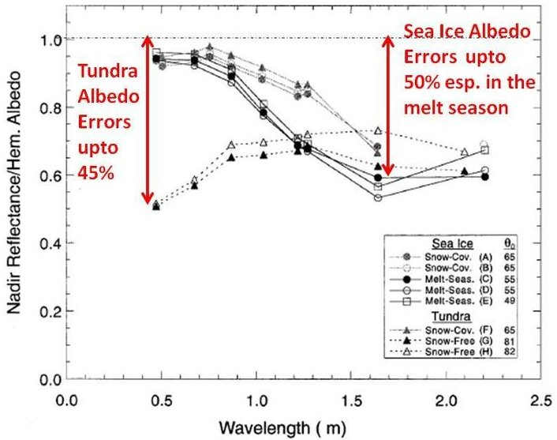

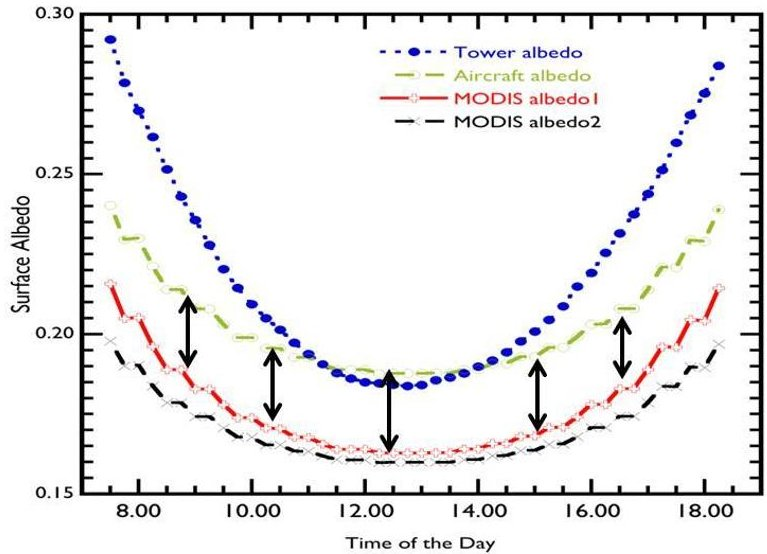

Figure 2: [Left] Snow albedo estimated using only nadir reflectance vs. integration of reflectance measured at thousands of angles by the Cloud Absorption Radiometer (CAR) during the ARMCAS campaign in Alaska, 1998 [35]. The red arrows represent the errors in albedo estimation when offnadir angular measurements are not considered, as dependent on wavelength and nature of the ground target. [Right] Vegetation albedo estimated using tower, aircraft (CAR) and MODIS measurements as dependent on time of the day, integrated over the VNIR spectrum [36]. Black arrows represent the difference between the two (15-20%) , hemispherically and spectrally integrated.

Albedo is the integration of reflectance measured over the full viewing hemisphere at a single or over all solar zenith angles. As early as 1998, the NASA ARMCAS airborne campaign [35] in Alaska measured reflectance at thousands of zenith and azimuth angles using a radiometer that was flown around in circles on

<!-- PDF_PAGE: 32 -->

an airplane and estimated albedo using these measurements. The comparison with nadir reflectance albedo is shown in Figure 2-left and it shows 45%-50% errors depending on the wavelength or geolocation sampled. A more recent but unpublished study [36] (ratified by [37]) shows 15%-20% difference between vegetation albedo estimated using many angles - tower or aircraft (Figure 2-right) and MODIS albedo products. Tower and CAR data contains thousands of angular measurements while MODIS has very restricted number of angles. While spatial and spectral sampling differences also contribute to the error, the main reason can be argued to be angular under-sampling by the Terra monolith that carries MODIS, as will be described later. The Earth's albedo has been an important component of climate studies and the Earth radiation Budget (ERB) since the 1960s [38]. Reference [38] established that Earth's albedo was closer to 0.3 and not 0.4 as was previously thought, but further progress has not been made on albedo uncertainty. A change of 0.01 in albedo corresponds to a 3.4 $ \mathrm{W / m^{2}} $ change in reflected or absorbed sunlight (assuming incoming radiation to be $ 3 4 1. 3 \mathrm{W / m^{2}} $ [39]) which is more than half the Earth Radiation Imbalance (ERI) [40], as will be described later. Aerosol retrievals are also primarily affected due to inadequate scattering angles in polarization data[18],[41] $ - [43] $

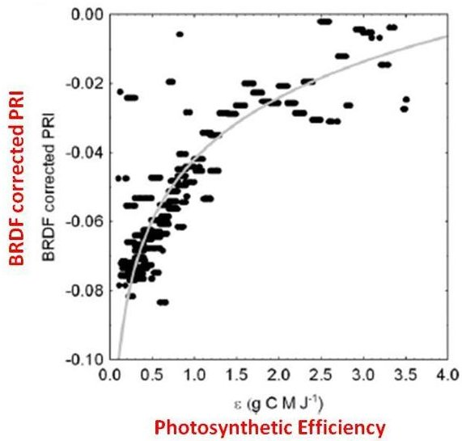

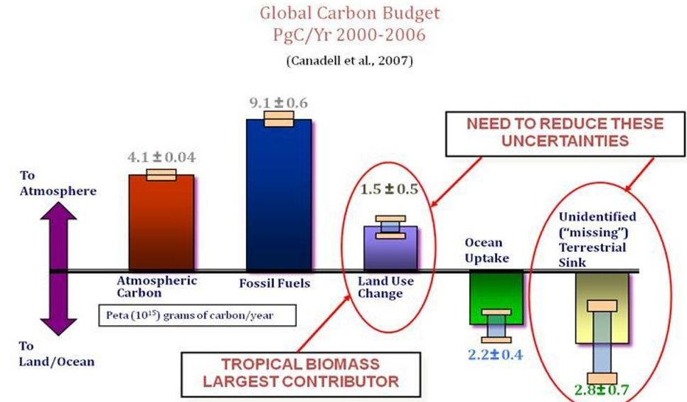

Figure 3: [Left] Gross Primary Productivity (GPP) is proportionate to Photosynthetic Efficiency which is proportionate to BRDF corrected Photosynthetic Refractive Index (PRI). Without BRDF corrections, a correlation would not exist [44]. [Right] Large uncertainties in the global carbon budget in terms of total outgoing carbon vs. total absorbed carbon is greatly attributed to the lack of angular knowledge of outgoing radiation as well as its diurnal variation[40].

Quantifying the extent to which forests and vegetation act as a sink for atmospheric carbon dioxide is imperative to estimate carbon feedbacks of vegetation in response to global climate change [45]. Deforestation and forest degradation accounts for 12% of anthropogenic carbon emissions, which have nearly doubled in the past 30 years[46]. Vegetation analysis is adversely affected by under-sampling on the principal plane and hotspots[47]. Current Gross Primary Productivity (GPP) estimates show uncertainties up to 40% in the terrestrial carbon uptake [48]. This is known as the missing carbon problem over land, as highlighted with red ellipses in Figure 3-right. GPP is the product of photosynthetic efficiency $ (\varepsilon) $ also called light use efficiency (LUE) - and photosynthetically active radiation (APAR) absorbed by the plant. In recent studies, it has been shown that measurements of vegetation reflectance at multiple angles can be used to estimate changes in protective leaf pigments as a function of shadow fraction [49]. These protective leaf pigments (xanthophylls), regulate light use efficiency in leaves: Under conditions where factors other than light are limiting the photosynthetic processes, excess radiation energy is dumped as heat, a process which strongly depends on incident solar radiation. This downregulation canbe measured by means of the Photosynthetic Reflectance

<!-- PDF_PAGE: 33 -->

Index (PRI), a normalized difference index that is sensitive to the xanthophyll absorption at 531nm Photosynthetic efficiency is proportional to the differential of PRI with respect to the shadow fraction [4],[5]. This differential can be estimated from the BRDF of PRI. There is no correlation between non-BRDF PRI and efficiency and the smooth curve shown in Figure 3-left would have been an uncorrelated clutter instead.

Recent studies have also shown an overestimation of the greening of Amazon forests during the dry season due to seasonal artifacts in MODIS' sun-sensor geometry[51]. Using denser, space-based angular sampling (CHRIS instrument on the PROBA spacecraft) reduces GPP uncertainties to 10%[49], showing a 75% improvement in carbon cycle calculations. However PROBA is not designed to measure GPP and does not provide the temporal resolution and global coverage required to do so.

Earth Radiation Imbalance (ERI), which is the difference between the Total Solar Irradiance divided by 4 (TSI/4) and Total Outgoing Radiation (TOR), is estimated to be 0.9 W/m $ ^{2} $ by current climate models (annual average) with an uncertainty between -2 and $ +7 $ W/m $ ^{2} $ [52], [53]. In fact, there is uncertainty even about the uncertainty. Models, and observations pin it at 0.5 W/m $ ^{2} $ [40], [54] while oceanographers estimate it between 0.4 and 0.7 W/m $ ^{2} $ [39]. Since climate change results from a less than 1% ERI and TSI is estimated at 341.3 W/m $ ^{2} $ [39] with 0.03% accuracy, there is great scientific need to improve the estimation accuracies of TOR. If the Earth had no internal processes such as winds and clouds, the ERI would be radiated out by Plank's Law; however the presence of these phenomena causes radiative forcing and possible entrapment of heat. Reference [55] and [54] have shown that the Earth's energy budget is not closed which means that there is a large portion of ERI that is not being absorbed as heat by the oceans (blue region in Figure 4). This heat is analogous to the previous discussion on missing carbon and only better measurements can help trace the source of uncertainty. Traditional assumptions ignore short time scale radiative forcing (<1 month) such as the diurnal cycle and the intra-seasonal time scales such as the Madden Julien oscillations, but scientists have argued that forcing in one scale can influence long term climate. For example, the net flux measured by the CERES instrument [56] on Terra and Aqua in morning and afternoon SSO respectively has been monotonically increasing over the years [52]. Thus, nonlinear analysis of ERI time record with high temporal sampling without assuming Gaussian distributions is needed [57].

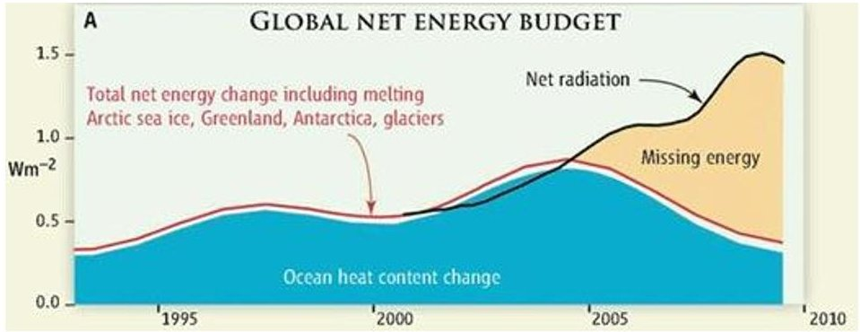

Figure 4: Missing energy between ocean heat content and ERI observations as shown in [54]

NOAA specified accuracy for future ERB measurements is $ 1. 7 \mathrm{~W} / \mathrm{m}^{2} $ for longwave and $ 1 \mathrm{~W} / \mathrm{m}^{2} $ for shortwave, with radiometric stability of $ 0. 3 \mathrm{~W} / \mathrm{m}^{2} $ . Up to 90% of the errors in the computation of atmospheric radiative forcing, which is a key assessor of climate change, is attributed to the lack of good angular description of reflected solar flux[58]. Previous studies have also suggested the use of the quadrature sampling technique by multiple satellites to improve BRDF and reduce errors in radiative forcing estimation [25], [59]. Accuracy of BRDF estimation is therefore a representative metric of the 'goodness' of angular sampling. The GeoScan

<!-- PDF_PAGE: 34 -->

mission with the ERIS instrument proposed to be mounted on 66 Iridium satellites had shown that the NOAA requirements are exceeded by a factor of 2 with 2 hour temporal resolution [26].

## III-1.2. BRDF Modeling

BRDF models are used to estimate reflectance values at all combinations of view zenith, solar zenith and relative azimuth angle and are a function of those angles and multiple parameters (will be described later). These models may be classified in a number of ways [60], such as those based upon the treatment of the optics and others being physical or empirical. Physical models rely upon first-principle physics of electromagnetic energy and material interactions, and require inputs such as surface roughness parameters and the complex index of refraction. Empirical models rely solely upon measured BRDF values, while semi-empirical models incorporate some measured data but may have significant elements of physics-based principles. For this study, semi-empirical models will be used to model BRDF as a function of 4 angles and wavelength. The most popular ones for BRDF estimation in Earth science are the Ross-Thick Li-Sparse (RTLS) model [37], [61] [62], Rahman-Pinty- Verstraete (RPV) model [63], [64], modified RPV to remove the non-linear terms in the RPV model and Cox-Munk model (CM) [31], [65]. RPV models have been applied for BRDF retrievals using MISR data, RTLS for MODIS data and CM for directional ocean reflectance[66].

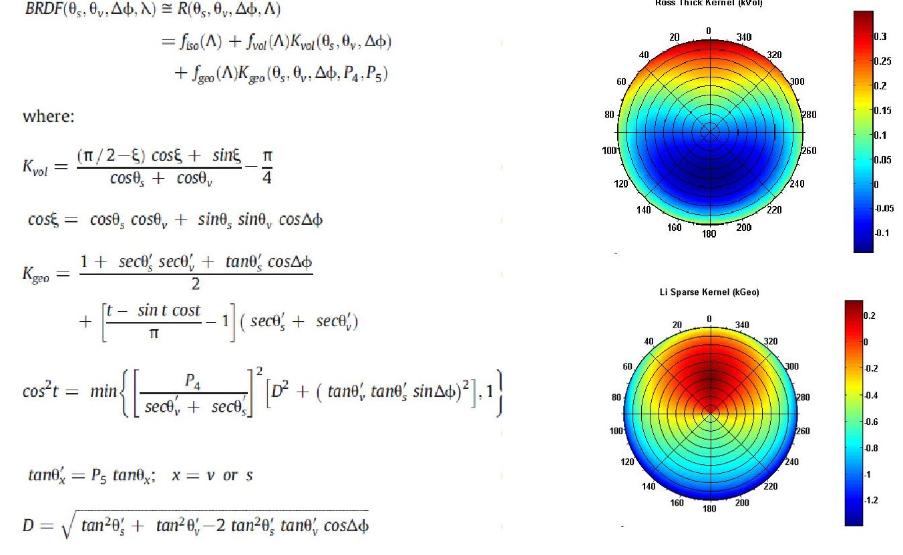

Figure 5: [Left] The RTLS equations for BRDF[62] - Equation 1, as a 3-parameter linear function of two kernels, $ \mathrm{K}_{\mathrm{v o l}} $ and $ \mathrm{K}_{\mathrm{g e o}} $ . [Right] The kernels as a non-linear function of view zenith angle (plot radius, contoured every 10 deg) and relative azimuth angle to the sun (plot polar azimuth) at a solar zenith angle of $ 28^{\circ} $ . The kernels in this figure and the next are wavelength independent.

The RTLS model is the most linear of the three. Represented by equations in Figure 5, it a linear sum of 2 kernels, dependent on the 3 BRDF angles, and a simple inversion of 3 parameters is required. The parameter (or kernel weight) $ f_{\mathrm{iso}} $ is the isotropic scattering component and equivalent to a nadir-view (MZA $ \theta_{\mathrm{v}}=0 $ ), zenith-sun (SZA $ \theta_{\mathrm{s}}=0 $ ) reflectance retrieval. Parameter $ f_{\mathrm{geo}} $ is the coefficient of the LiSparse-Reciprocal geometric scattering kernel $ \mathrm{K}_{\mathrm{geo}} $ , derived for a sparse ensemble of surfaces casting shadows on a Lambertian

<!-- PDF_PAGE: 35 -->

background[62]. Parameter fvol( $ \Lambda $ ) is the coefficient for the RossThick volume scattering kernel $ \mathrm{K}_{\mathrm{v o l}} $ , so called for its assumption of a dense leaf canopy). $ \Delta\Phi $ is the relative azimuth angle (RAA) and $ \xi $ is the scattering (or phase) angle between sun and view directions.

The RPV formulation splits a BRF field into a scalar amplitude component and the associated angular field describing the anisotropy of the surface that is represented in Figure 6. In the equations, $ \Phi_{\mathrm{r}}=\mathrm{RAA}, $ $ \theta_{0}= $ SZA and $ \theta=\mathrm{MZA} $ or the zenith angle of the directional vectors at a target on the surface pointing to the Sun and to the detector, respectively. Parameter k is the modified version of the Minnaert's function that controls the bowl or bell shape of the BRDF field. The parameter $ \Theta $ establishes the degree of forward versus backward scattering, depending on its sign, following the Henyey-Greenstein formulation and the parameter $ \varrho_{\mathrm{c}} $ accounts for the hotspot effect especially significant in the backscattering region[67]. The RPV model can be linearized by modeling BRDF in its logarithmic form and approximating the $ \mathrm{F_{H G}}(\mathrm{g};\Theta) $ term as $ \mathrm{F(b)}=\exp(-\mathrm{b}^{*}\cos(\mathrm{g})) $ [64], where $ \cos(\mathrm{g})=\cos(\gamma) $ in Figure 6. The linear equation then reduces to $ \log(\mathrm{B R D F})=\mathrm{k}^{*}\mathrm{M}_{-}\mathrm{kernel}-\mathrm{b}^{*}\gamma_{-}\mathrm{kernal}+ \mathrm{H}_{-}\mathrm{kernel} $ . Since the H kernel (=f[ $ \varrho, $ G_kernel]) cannot be linearized, an iterative approach is employed to invert for the parameters k and b, for an initial $ \varrho $ , which is then updated after every iteration. The M, G and $ \gamma $ or g kernels are plotted in Figure 6, and a modified RPV (MRPV) inversion requires the estimation of parameters $ \varrho, $ k and b.

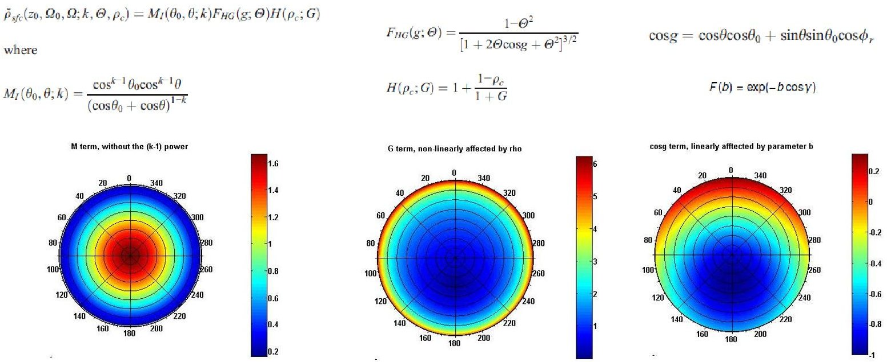

Figure 6: [Top] The RPV equations for BRDF [67] - Equation 2, as a 3-parameter non-linear function of 3 kernels, M, F and H. The MRPV model is expressed as logarithmic BRDF and $ \mathrm{F_{H G}}(\mathrm{g}; \Theta) $ approximated as $ \mathrm{F(b)}=\exp(-\mathrm{b}^{*} \cos(\mathrm{g})) $ [64]. [Bottom] The kernels as a non-linear function of view zenith angle (plot radius, contoured every 10 deg) and relative azimuth angle to the sun (plot polar azimuth) at a solar zenith angle of $ 28^{\circ} $

The Cox-Munk model is the most non-linear among the mentioned 3 models and simulates the reflectance of the wind-ruffled ocean surface outside the glitter. The solution of the radiative transfer equation at the flight level z can be represented as I(z, $ \mu r $ , $ \Phi r $ ) As shown in Figure 7-left, I(z, $ \mu r $ , $ \Phi r $ ). separates the direct surface reflected term R from the sky and path terms which are the diffuse (atmospherically scattered) radiance at altitude z that has undergone interactions with the ocean. $ \tau 0 $ represents the aerosol optical depth. $ \tau 0 $ - $ \tau(z) $ can be assumed to be 0 because it represents the depth above the airplane and will be negligible for spaceborne

<!-- PDF_PAGE: 36 -->

measurements. In Figure 7's equations, $ \mu\mathrm{r}=\cos(\mathrm{MZA}\mathrm{or}\theta), $ $ \mu=\cos(\mathrm{SZA}\mathrm{or}\theta_{\mathrm{i}}) $ and $ \Phi\mathrm{r}=\mathrm{RAA}. $ The direct surface term is a product of the Fresnel reflectance $ \left(\mathrm{R}^{\mathrm{Fr}}\right) $ , the probability density function of slope distribution (P) and the bidirectional shadowing factor (S). P is dependent on the orientation of the normal to the wave facet with respect to the z axis $ (\mu_{\mathrm{n}}=\cos\beta) $ , S is defined as the conditional probability of occurrence of an event that the wave facet with surface normal 'n' contributes to the reflection of light. $ \mathrm{R}^{\mathrm{Fr}} $ is only dependent on water refraction (assumed m = 1.4) and SZA (dependence plotted in Figure 7-right bottom). Both P and S depend non-linearly on the mean square slope, which linearly grows with the wind speed v. The linear dependency has been modeled in a variety of ways and dimensions since Cox-Munk's original[65], [68] and the simplest formulation is used in this thesis (Figure 7).

The CM model thus models the sea surface as a perfectly reflecting mirror which is oriented in a particular direction (hence, the slope) depending on the wind speed. The slope probability as a function of speed, VZA, RAA at SZA = 28 deg captures the glint accurately (Figure 7-right top) and its intensity is toned by the flat S surface. The parameters for non-linear inversion are wind speed (v), aerosol optical depth $ (\tau0) $ and the path radiances. The latter is dependent on the first two variables through the full radiative transfer model, but will be assumed constant in this work[66].

$$
\begin{array}{l} I (z; \mu_ {r}, \varphi_ {r}) = F _ {0} \mu_ {0} R \left(\mu_ {0}, \mu_ {r}, \Delta \varphi_ {0}\right) e ^ {- \frac {\tau_ {0}}{\mu_ {0}}} e ^ {- \frac {\tau_ {0} - \tau (z)}{| \mu_ {r} |}} \\ + I _ {\mathrm {s k y}} (z; R) + I _ {\mathrm {p a t h}} (z), \\ R \left(\mu^ {\prime}, \mu , \varphi - \varphi^ {\prime}\right) = \frac {1}{4 \mu \mu_ {n}} R ^ {F r} (\chi) P \left(\mu_ {n}\right) S \left(\mu^ {\prime}, \mu\right) \\ R ^ {F r} = \frac {1}{2} \left\{r _ {\parallel} ^ {2} + r _ {\perp} ^ {2} \right\}, r _ {\parallel} = \frac {\sqrt {m ^ {2} - \sin^ {2} \theta_ {i}} - m ^ {2} \cos \theta_ {i}}{\sqrt {m ^ {2} - \sin^ {2} \theta_ {i}} + m ^ {2} \cos \theta_ {i}}, r _ {\perp} = \frac {\cos \theta_ {i} - \sqrt {m ^ {2} - \sin^ {2} \theta_ {i}}}{\cos \theta_ {i} + \sqrt {m ^ {2} - \sin^ {2} \theta_ {i}}}. \\ P \left(\mu_ {n}\right) = \frac {1}{\pi \sigma^ {2} \mu_ {n} ^ {3}} \exp \left(- \frac {1 - \mu_ {n} ^ {2}}{\sigma^ {2} \mu_ {n} ^ {2}}\right). \\ \sigma^ {2} = 0. 0 0 5 3 4 v. \\ \cos 2 \omega = \cos \theta_ {0} \cos \theta - \sin \theta_ {0} \sin \theta \cos (\Delta \phi), \\ \cos \beta = \frac {\cos \theta + \cos \theta_ {0}}{2 \cos \omega}, \\ S \left(\mu^ {\prime}, \mu\right) = \frac {1}{1 + F (g) + F \left(g ^ {\prime}\right)}, \\ F (g) = \frac {1}{2} \left[ \frac {\exp \left(- g ^ {2}\right)}{g \sqrt {\pi}} - \frac {2}{\sqrt {\pi}} \int_ {g} ^ {\infty} \exp \left(- t ^ {2}\right) d t \right] = \frac {\exp \left(- g ^ {2}\right)}{2 g \sqrt {\pi}} - \frac {1}{2} + \Phi (\sqrt {2} g), \\ \Phi (\sqrt {2} g) = \frac {1}{\sqrt {2 \pi}} \int_ {0} ^ {\sqrt {2} g} \exp \left(- \frac {z ^ {2}}{2}\right) d z - \mathrm {p r o b a b i l i t y i n t e g r a l f o r t h e n o r m a l d i s t r i b u t i o n (t a b u l a t e d f u n c t i c)} \\ \end{array}
$$

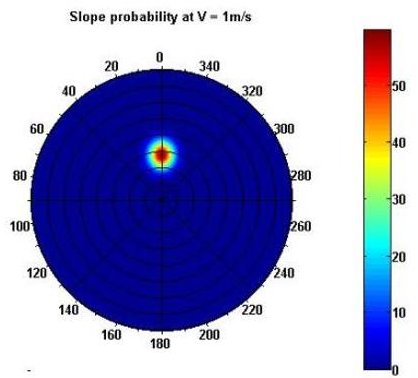

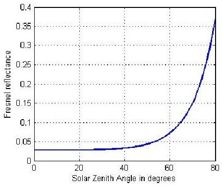

Figure 7: [Left] The Cox-Munk equations for measured ocean reflection [66], [68], [69] - Equation 3, as a simplified 3-parameter non-linear function BRDF and sky/path radiance. The BRDF model is a product of 3 kernels R, P and S, where $ \mu_{\mathrm{n}}=\cos \beta $ [Right top] Slope probability (P) as a non-linear function of view zenith angle (plot radius, contoured every 10 deg) and relative azimuth angle to the sun (plot polar azimuth) at a solar zenith angle of $ 28^{\circ} $ ,wind speed = 1m/s. [Right top] Fresnel kernel (R) as a function of solar zenith.

<!-- PDF_PAGE: 37 -->

The current models are functions of 3-7 parameters only because reflectance measurements that could invert for more complex models have not been available so far. Models with more parameters can help characterize more complex reflectance dependency on angles and surface types, if they exist. Enabling multiangular measurements can pave the path to better models, which can then be used to design even better measurement solutions, starting a positively reinforcing innovation loop in the field of multi-angle remote sensing. Models can be expanded in many ways. For example, BRDF using computer graphics may be done with more than 10 variables [70] $ - $ [72] for temporally and spatially varying phenomena. Compressed sensing theory suggests the use of spherical harmonics (SH) to theoretically model radiation leaving a sphere [73], [74] and the measurements are suggested to be the convolution of the images formed using independent sources. Reconstruction can be done by incorporating prior information if available. Spherical harmonics based reconstruction has been used for evaluating the geopotential of the Earth in the GRACE mission [75], [76]. The GRACE mission bears a qualitative similarity to the ERB mission, in that it represents a mathematical field, the geopotential, on the surface of a sphere [77]. Since the SH model provides a way to synthesize the complete distribution on the entire sphere from a discrete sample on a sphere, the method has been proposed for radiation leaving the Earth[77]. This dissertation assumes prior information about surface topography so that the any ground element can be reduced to a flat surface.

## III-1.3. Current Multi-Angular Acquisition Methods

Current multi-angular missions, NFOV or WFOV, have fallen short of making simultaneous multiangular measurements limited by their geometry of acquisition. This problem was recognized in context of efficient radiative forcing measurements in the year 2000 and formation flight clusters were proposed to mitigate it (Leonardo-BRDF [25], [59]). However, the study was not conducted from a BRDF science performance or systems engineering standpoint, narrow fields of view were not considered and results were not drawn from or compared to existing missions. The study however fuelled the idea of exploring the concept of DSMs for BRDF in systematic and comprehensive detail including technology, payload support and cost estimation.

Airborne instruments measure local, angular reflectances and estimate BRDF very accurately because they are able to fly around a ground spot taking thousands of angular measurements. The golden standard for BRDF specific missions has been on the airborne side in the form of the Cloud Absorption Radiometer (CAR) [20] instrument which was developed at NASA Goddard Space Flight Center (GSFC). CAR has 14 channels of bandwidth 6-40 nm between 335 and 2344 nm. It is designed to scan from $ 5^{\circ} $ before zenith to $ 5^{\circ} $ past nadir, corresponding to a total scan range of $ 190^{\circ} $ . It has an instantaneous FOV (iFOV) of $ 1^{\circ} $ and makes up to 114600 directional measurements of radiance at every $ 1^{\circ} $ , per channel at a spatial resolution of 10-270 m[20]. The CAR is flown on an airborne platform (e.g. Convair CV-580 and C-131A) [78] [20] and makes measurements at a ~600m altitude. The measurements show very good correlation with laboratory measurements of BRDF using a goniometric setup [79]. Airborne and lab measurements match within 0.03 at 870 nm and 0.1 at 470 nm, over all viewing angles for Savannah vegetation[79]. As part of its angular coverage, CAR can sample BRDF in the principal plane (PP) i.e. the plane containing the sun and the normal from the target [62], which is needed for determining subpixel level vegetation structure and other land remote sensing products. Vegetation canopies often exhibit a pronounced peak called the hotspot on the PP and the amplitude and width of this feature is used to determine the biophysical parameters of the vegetation [80]. However, air campaigns are sparse and concentrate only on specific local regions. It is extremely expensive, if not impossible, to scale up airborne measurements globally or repeat them temporally with equal frequency. Space based observation is critical for those purposes.

<!-- PDF_PAGE: 38 -->

Spacecraft can only approximate BRDF to varying degrees of accuracy. Figure 8 shows what monolithic spacecraft are able to measure, in blue, versus what is required near-simultaneously to estimate BRDF, in red. Some monoliths make all measurements over the same pass (left) while others combine measurements over several overpasses (right). Since most of these spacecraft are in sun-synchronous orbits, their orbits are very restricted with respect to the Sun and their 3D angular coverage is also limited. The sensors that combine multiple overpasses (right) are even more at risk of inaccuracy because they combine measurements taken over more than two weeks. For fast changing environment such as tall tropical clouds and melting snow, the target itself changes over this time.

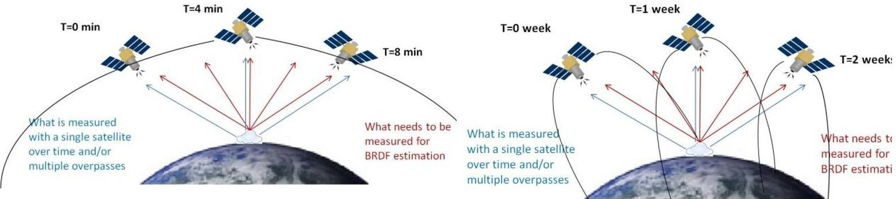

Figure 8: Measurements a single satellite is capable of making, in blue, versus multiple angular sampling measurements in red. 'T', ranging over a few minutes for fwd-aft sensors in the top panel or over a few weeks for cross-track sensors in the bottom panel, represents nominal time differences that a LEO satellite takes to make the given measurements.

Table 1: Comparison of current spaceborne mission instruments with BRDF products (rows) in terms of science metrics (columns) in all dimensions relevant to reflectance. Red highlights indicate sparse measurements for BRDF estimation, grey row represents the CAR specifications as comparison, last column indicates the instrument life. Number of angles are near simultaneous angular measurements of the same ground spot and RGT is the repeat ground track period.

<table border="1"><tr><td>BRDF-related MeasurementsCurrentInstruments</td><td>Numberof angles</td><td>Ground PixelSize in kmXkm</td><td>Revisit Time(anyview)in days</td><td>SpectralRangeinμm</td><td>#ofspectralbands</td><td>Year of firstOperation</td></tr><tr><td>$^{1}$MODIS</td><td>1</td><td>0.25 to 1</td><td>~2(16dayRGT)</td><td>0.4-14.4</td><td>36</td><td>1999</td></tr><tr><td>$^{1}$POLDER</td><td>12</td><td>6X7</td><td>~2(16dayRGT)</td><td>0.42-0.9</td><td>9</td><td>2009</td></tr><tr><td>$^{1}$CERES</td><td>1</td><td>10 to 20</td><td>~2(16dayRGT)</td><td>0.3-12</td><td>3</td><td>1997</td></tr><tr><td>$^{2}$MISR</td><td>9</td><td>0.275 to 1.1</td><td>9(16dayRGT)</td><td>0.44-0.87</td><td>4</td><td>1999</td></tr><tr><td>$^{2}$ATSR</td><td>2</td><td>1 to 2</td><td>3-4</td><td>0.55-12</td><td>7</td><td>1995</td></tr><tr><td>$^{2}$ASTER</td><td>2</td><td>0.015 to 0.09</td><td>~2(16dayRGT)</td><td>0.52-11.65</td><td>14</td><td>1999</td></tr><tr><td>$^{3}$CHRIS</td><td>5-15</td><td>0.017 to 0.5</td><td>As per command</td><td>0.415-1.05</td><td>18-63</td><td>2001</td></tr><tr><td>Airborne CAR</td><td>&gt;10,000</td><td>0.01-0.27</td><td>N/A</td><td>0.34-2.3</td><td>14</td><td>1983</td></tr></table>

Current spaceborne instruments, as shown in Table 1, estimate BRDF by making multi-angular measurements owing to their large cross track swath (e.g. MODIS[19] or Moderate-Resolution Imaging Spectroradiometer, POLDER[81] or Polarization and Directionality of Earth's Reflectances, CERES[56] or Clouds and Earth's Radiant Energy System) - combined as Figure 8-right, multiple forward and aft sensors with or without scanning abilities (e.g. MISR[18] or Multi-angle Imaging Spectro-Radiometer, ATSR[82] or Along Track Scanning Radiometer, ASTER[83] or Advanced Spaceborne Thermal Emission and Reflection

<!-- PDF_PAGE: 39 -->

Radiometer) - combined as Figure 8-left, or autonomous maneuverability to point at specific ground targets that they have been commanded to observe (e.g. CHRIS[84] or Compact High Resolution Imaging Spectrometer). The CERES radiometers are present on Terra, Aqua and Tropical Rainfall Measuring Mission (TRMM) with a resolution of 20 km in the first two and 10 km in the latter and have only 3 bands [85]. Since they are primarily an improvement to the ERBE instruments instead of providing traditional BRDF products, they are more applicable to the WFOV broadband cases. Other than CHRIS (which does not provide global or repeatable coverage), MISR (with only 2D coverage) and POLDER (with very coarse spatial resolution), none of the instruments provide full 3D angular coverage within a short time frame. Those that do provide angular coverage pay in terms of sampling resolution in at least one of the other four dimensions, e.g. temporal for CHRIS, spatial for POLDER and spectral for MISR (marked with red colors in Table 1).

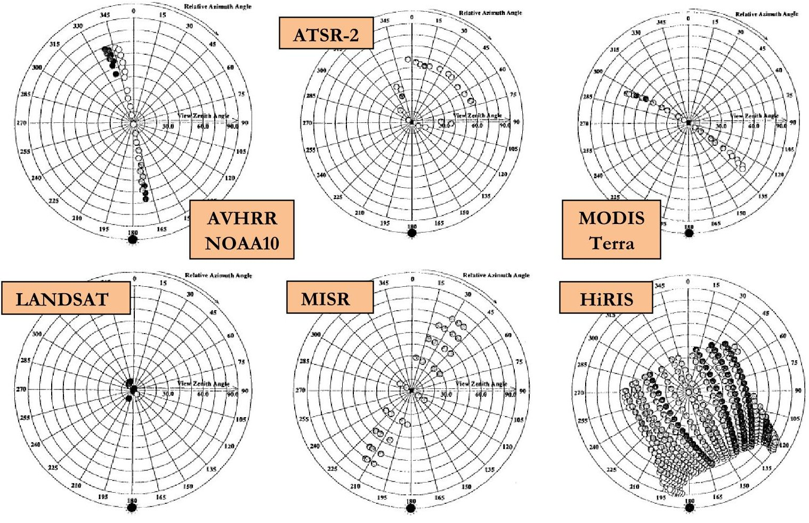

Figure 9: Comparison of angular sampling over one repeat ground track of 6 instruments for the same location (except Landsat). The sun is at $ 1 8 0^{\circ} $ azimuth and the shade of the spots indicate the solar zenith angle (from [80]). Radius represents the view zenith angle and the polar azimuth, the relative azimuth with respect to the Sun.

Barnsley et. al. [80] have simulated BRDF polar plots for measurements by 9 instruments over one repeat cycle (e.g. 16 days for Terra-MODIS) around spring time at a location of coordinates (50N,0), except for LANDSAT whose target location was (16N,0). Six of the simulations are shown in Figure 9. LANDSAT (Land Satellite) has no angular coverage beyond near nadir. Both MODIS and AVHRR (Advanced Very High Resolution Radiometer) have large zenith coverage over restricted azimuth because of their large cross track scan capability. ATSR-2 has two sensors with cross track scanning for both, one pointing nadir and one pointing forward, and hence shows zenith spreads in some zenith and some azimuth spread. MODIS and MISR show near perpendicular angular samples because they are both on the same spacecraft Terra as a cross track and

<!-- PDF_PAGE: 40 -->

along track instrument respectively. The last instrument plotted called HiRISE is no longer a part of NASA Earth Observation System (launch canceled) but has been included to show its excellent BRDF potential. The POLDER instrument was launched onboard the ADEOS-1 platform in 1996, after the paper [80] was written. The spatial matrix makes it possible to observe, at a given time, a bi-dimensional field of view albeit at a very coarse resolution of 6-7 km [81], [86], [87]. There is a large overlap of successive snapshots acquired every 20 seconds. As a consequence, a given Earth target is observed from up to 14 different directions as the satellite overflies the surface synthesized over a month's time, and so has an angular coverage very similar to HiRISE shown in Figure 9. CHRIS by virtue of the autonomous maneuverability of the PROBA platform can combine the best of all the above but requires weeks to months of notice if a particular target needs to be commanded to observe.

## III-1.4. Gap Identification #1

Angular sampling of ground spots is clearly an important measurement requirement which has diverse applications in albedo, carbon budget and climate change. There is also clearly a gap in the angular sampling capabilities of current monolithic missions - air and space especially when requirements for other sampling dimensions are set. DSMs as formation flight (with NFOV payloads being maneuvered to point at the same spot at the same time) or constellations (with WFOV payloads whose ground spots overlap) are potential ways to increase the 3D sampling in making measurements. NFOV refer to sensors with FOV less than $ 3^{\circ} $ while WFOV to those with FOV greater than $ 100^{\circ} $ . DSMs can be cost efficient as nano-satellites, by using the 6U CubeSat standard and the associated rideshare opportunities [13]. The CubeSat standard is considered a bus constraint, the measurement requirements in the spatial, spectral and temporal dimesions are driven by the state-of-the-art instruments (CAR, MISR) and the angular requirements are driven by maximizing angular spread (CAR being the best possible spread).

Having identified a potential solution, a comprehensive tool is needed to evaluate the idea in terms of science and cost, compare different DSM architectures with each other and to existing monoliths in terms of science performance and cost. The science performance is especially complicated by the close interaction of many sampling dimensions and the unavailability of an objective metric to judge angular spread in itself. A tightly coupling between the possible angular spread and its subsequent science value will be required. The identified gap can then be filled by the proposed concept by evaluating and maturing it systematically [88].

## III-2. Distributed Mission Design Methodologies

Previous research on distributed satellite missions [89], [90] shows that almost all satellite systems are involved in information collection and dissemination and can be treated as modular information processing centers. The Generalized Information Network Analysis (GINA) [89] adopted communications theory and proposed to measure system performance in terms of four quality of service metrics: isolation, integrity, rate, and availability. Isolation is the ability of a system to isolate and distinguish information signals from different sources within the field of view. Integrity is a measure of the quality of the information being transferred. Rate is a measure of the speed at which the system transfers information between the sources and sinks in the network. Availability is a measure of the instantaneous probability that information is being transferred through the network between all of the sources and sinks. The three system level metrics proposed were capability, performance, and lifecycle cost; where capability was the probability that the system would maintain performance over a pre-determined threshold over the mission lifetime (constraint). The goal of GINA [89] was to maximize performance and minimize lifecycle cost, later adapted by Reference [90] as a multi-objective optimization problem.

<!-- PDF_PAGE: 41 -->

Mission design methods have also included using fuzzy expert logic to make architectural decisions on distributing instruments on multi-platform systems[91] by formulating the problem as a combinatorial optimization to select instruments, assign them to satellites and schedule them over the mission; machine learning methods like neural nets for cost estimation[92] and applying Object-Process Methodology (OPM) to organize and prioritize critical decisions in fractionating planetary rovers[93]. Constellation mission design has been attacked as a multi-objective optimization problem for communication payloads[5] and with a value-centric approach[94], payload notwithstanding.

## III-2.1. Small Satellite Nomenclature

Before discussing distributed missions of small satellites and the associated methods, it is important to to delineate the scope of 'small satellites' that this work intends to address.

In Europe, the need for standardization of small satellite nomenclature was first captured in an IAA review paper [96]. ESA defined small (350-700 kg), mini (80-350 kg) and micro (50-80 kg) satellites while EADS Astrium defined miniXL (1000-13000 kg), mini (400-700 kg) and micro (100-200 kg) satellites. The review discussed other small and large satellite nomenclatures, their typical revisit times, ground sample distances and Earth observation applications. In the US, the National Academy of Sciences published a report in 2000 [97] defining the core observational needs (required measurements, data continuity, etc.), payload characteristics and buses. Size nomenclature, however, was not assessed. The first size based classification was made in 1991 by Sweeting [98] and refined further by Kramer et al in 2008 [12] into nano, micro, mini, small and large. Konecny [99], later reviewed by Xue et al [5], extended the range of mini-satellites from 100 to 1000 kg and removed the medium 500-1000 kg satellite class.. Almost 50% nanosatellites (<10 kg), investigated in 2010 [100] had a CubeSat form factor while others were spherical, rectangular or cylindrical.

Table 2: Examples of recent Cubesats for Earth Observation Missions

<table border="1"><tr><td>Cubesat Type</td><td>Mass(kg)</td><td>Volume(cmXcmXcm)</td><td>Examples</td></tr><tr><td>1U</td><td>1.33</td><td>10X10X10</td><td>CanX-1, CanX-ArduSAT, PhoneSAT, Compass-1</td></tr><tr><td>2U</td><td>2</td><td>10x10x20</td><td>ION,CubeSTAR,QB50 constellation</td></tr><tr><td>3U</td><td>3.99</td><td>10x10x30</td><td>QuakeSat,geneSat-1,O/OREOS,CanX-2,Aalto-1,ExoplanetSat,MicroMAS</td></tr><tr><td>6U(dev)</td><td>13</td><td>10x20x30</td><td>ChipCube,SOCRATES,SuperNova</td></tr><tr><td>12U(dev)</td><td>24</td><td>N/A</td><td>N/A</td></tr></table>

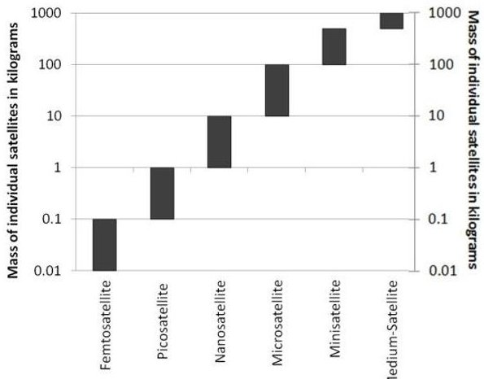

The late 1990's brought in the CubeSat era in the space industry. While most earlier CubeSats were used for technology demonstration and educational outreach [101], they have found increasing use in scientifically significant Earth observation missions over the last decade. Nano-satellites such as the SPHERES have been used simultaneously for science, engineering testing, algorithm testing [102] as well as outreach [103]. Cubesats with scientifically relevant payloads leading to the discovery of important results in Earth science have also been flown [12], [95]. All CubeSats to date have been launched as secondary payloads by the P-POD launcher. NASA funds a few dozen every year through the NASA and the Launch Services Program [13] (ELaNa). Satellites over 100 kg use the ESPA (EELV Secondary Payload Adapter) ring to fit inside large launch vehicles and are also launched as the secondary payload. NASA funds a few launches of this

<!-- PDF_PAGE: 42 -->

class of satellites every year through the University Nanosatellite Program (UNP). QB50, a constellation of 50 2U CubeSats, is scheduled for a dedicated launch in 2015 using the Russian Shtil 2.1 and will be the first primary CubeSat payload launched. Reference [101] has looked at monolithic CubeSat technologies for Earth observation while Reference [104] plotted the typical altitude-inclination options available for secondary CubeSat launches. As expected, maximum opportunity is seen between 400-800 km and inclinations corresponding to the International Space Station or Sun Synchronous orbits.

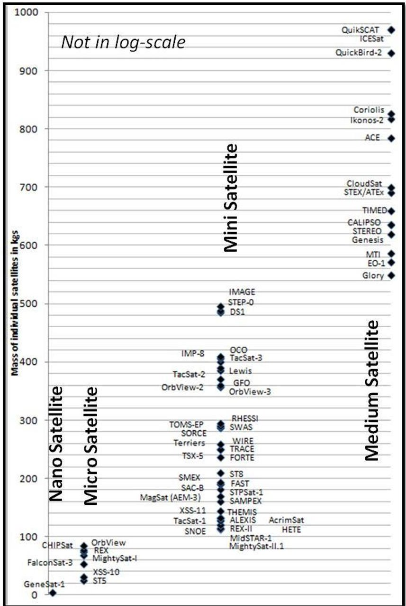

Figure 10: Small Satellite Nomenclature (top panel) and examples[12], [95] of Earth Observation Missions (bottom panel) grouped into vertical columns based on their size-based classification

Figure 10 - left panel - defines the small satellite nomenclature to be used in this work and for the models developed in this research. The nano-satellite class (1-10kg) is the home for currently active CubeSats, 1U being 1 kg up to 3U being 3 kg. As larger CubeSats are developed, such as 6U at 10-12 kg or 12U and 27U, the CubeSat standard will be pushing the bounds of nano-satellites into the microsatellite category. Figure 10 right panel - shows the examples of small satellite missions, as reviewed in [12] up to 2008, categorized into the above defined classes as vertical columns arranged by mass of their satellites. While mini-satellites dominate the space, over the last four years, nano-satellites have increased greatly in numbers owing to the CubeSat form, launch opportunities, low poer electronics and inexpesive communication solutions on amateur bands.

<!-- PDF_PAGE: 43 -->

## III-2.2. Model-Based Systems Engineering (MBSE)

Since DSM design and operation is a function of a much larger number of variables than its monolithic counterparts, it is imperative to understand the trade-offs and interdependencies among the variables early in the design stage. Model-Based Systems Engineering (MBSE) is a useful tool for pre-Phase A DSM design that has been used for many large missions in the past and has recently demonstrated success in small satellite design[105][106] in trading conflicting design variables. It is a focus of working groups under the International Council on Systems Engineering (INCOSE) and the developed tools have been applied to existing missions such as RAX[105] and PHOENIX[107]. Specifically, the Space Systems Working Group (SSWG) has developed an MBSE-based CubeSat model. These existing tools for monolithic spacecraft and other space design can be and have been adapted for distributed space systems as well.

Since MBSE is an accepted framework for modular mission design, software tools to design different modules for a space-based earth observation system have been available in the past. The space logistics and interplanetary transportation industry used the MIT-developed SpaceNET, a modular and open source tool[108]. The CubeSat standard and associated documentation provides a guiding standard to develop and deploy up to a 3U (4 kg) spacecraft[109]. Individual components of space system design can be combined from different software. For example, orbit design can be done using NASA GSFC's GMAT (General Mission Analysis Tool) or NASA JSC's Copernicus tool. Spacecraft operations can be aided by NASA JPL's Activity Plan Generator (Automated Scheduling and Planning Environment (ASPEN) or Maestro tools. Specific interfaces for risk and science return for Saturn and Mars missions are also available. Tools for specific science data analysis such as USGS's Integrated Software for Imagers and Spectrometers (ISIS) and ESA's Rosetta Science Planning tool can be modified for some mission design. Cost/risk associated with distributed launches, staged deployment and reconfigurable constellations, all of which allow flexible design with increased costs, have been studied at MIT[5].

## III-2.3. Observing System Simulation Experiments (OSSE)

Observing system simulation experiments (OSSE) have been traditionally used to quantify the impact of observations from future observation systems such as satellite instruments or ground-based networks on data products such as weather forecasts, by mimicking the process of data assimilation. In atmospheric applications, real imperfect observations are drawn from the real atmosphere (data or model) to produce estimates of global atmospheric states at sequences of time. For land applications, simulated land surface states are propagated through the sensor measurement and retrieval process to investigate and constrain expected levels of retrieval error. The goal is to validate science return for proposed instruments and therefore the instrument design. The historical development of OSSEs from simple equations to supercomputing models have been documented in literature [110] and they have been used for designing CLARREO[111], HyspIRI[112] and the Hydros Radiometer[113].

OSSEs are very important for effective DSM design in earth science, because the quantitative gaps of flagship missions can only be established in the language that the science leads of the big missions understand. For example, the measurement solution that this work proposes from MA-EO is intended to complement current flagship and Decadal Survey missions, by alleviating some sampling requirements that could cause creeps. The Earth Science Decadal Survey[114], [115] asked for "Synergies of complementary measurements...cost-effective replacement of individual sensors... moving away from a single parameter and sensor-centric approach toward a systems approach that ties observations together to study processes vital to understanding Earth-system feedbacks" when proposing 15 instruments for the next decade[114]. Eight years later, only 3 of those are in formulation, causing the Survey's Mid-Term assessment to stress on complementary solutions like hosted payloads and formation flight[115].

<!-- PDF_PAGE: 44 -->

## III-2.4. Gap Identification #2

While MBSE and OSSEs have been developed in detail individually, no published effort has integrated them and used their synthesis as a coupled tool to design more optimal missions whose science goals are quantitatively defined. Architectures can be generated by varying the design variables in the MBSE model and assessing its effect on data assimilation and science products using OSSEs for an extended period within mission lifetime. Since there is 'ideal angular spreads', (outputs of optimization algorithms applied to BRDF reference data) are impossibly expensive to maintain against astrodynamics, maintainble orbits are propagated and those that minimize BRDF errors chosen. The coupled technique simultaneously addresses the current gap in MBSE which lacks science evaluation and the current gap in OSSEs which evaluates only point designs. Typical OSSEs are very resource-intensive, and will need to be simplified significantly for rapid architecture prototyping. To account for the inherent stochasticity in natural systems and their measurements, the sensitivity of the simplified OSSE to intrinsic variances due to topographic errors, BRDF model inversion errors, radiometric measurement errors and limited sampling in the spectral, spatial, temporal, and angular need to be quantified.

## III-3. Application of DSMs for Multi-Angular Acquisition

The GINA formulation, introduced in Section III-2, can be applied to DSMs for multi-angular measurements in the following manner: Isolation encompasses spatial, spectral and angular resolution or the ability to make out signals between different angles, geo spatial ground pixels and spectral bands. Integrity refers to the signal to noise ratio or adequate radiometric sampling, rate to the BRDF polar plots per unit time (as those seen in Figure 9) and availability is the ability of the satellite to acquire, process and download data. GINA also does not consider complexity and risk which this thesis will address. The angular sampling part of isolation will be enabled by formation flight and/or constellations (literature reviewed in Section III-3.1 and III-3.2), the spectral and spatial part of Isolation as well as Integrity by the payload instrument (Section III-3.3) and the Rate and Availability aspect by technical capabilities of the critical subsystems (Section III-3.4). After the review, I will summarize the gaps in existing systems engineering literature in their applicability to multi-angular imaging.

## III-3.1. Formation Flight Solutions

BRDF estimation needs formation flight (FF) orbits so that the satellites can fly in predictable relative geometries and allow analysis of angular coverage at the Local Vertical Local Horizontal (LVLH) ground target , as the satellites fly overhead. While a tight formation or close proximity is not essential, the satellites must maximize angular spread and be able to image the same ground spot near-simultaneously. FF has been analyzed at several levels of fidelity, focusing on understanding and manipulating the relative motion of satellites in the LVLH frame. LVLH or the orbital frame travels with the reference spacecraft but rotates based on the spacecraft's orbital characteristics[116]. It assumes that the Earth rotates under the frame, while the satellites observe the part of the Earth directly below it at any instant of time.

The linearized Hill, Clohessy and Wiltshire equations, simplified to be known as the Hill's equations[117], [118] describe relative motion between any two spacecraft in a formation, and can be extended to multiple spacecraft. In this framework, one satellite is assumed to be traveling in a circular Keplerian orbit while the others are perturbed from this orbit by a small quantity. From the HCW Equations[117], [118], 3D accelerations for any satellite with respect to the origin centered at the first satellite, X axis pointing radially toward the earth and Y axis in the direction of motion, is given by Equation 4. The additional orbit perturbations over and above these accelerations are (1) J2 effects due to non-spherical Earth (typically $ 2. 4 \mathrm{X} 1 0^{-6} \mathrm{m} / \mathrm{s}^{2} $ in LEO, (2) differential acceleration being 4 orders smaller for a 1000m separation), (3) third body perturbations

<!-- PDF_PAGE: 45 -->

due to differential force by the Sun and Moon on the spacecraft (typically 3.6-4.3 X $ 1 0^{-5} $ m/s $ ^{2} $ in LEO, (4) differential acceleration being 5 orders smaller), solar radiation pressure (typically 1.7X $ 1 0^{-1 0} $ m/s $ ^{2} $ in LEO) and (5) atmospheric drag due to small differences in the spacecraft shape and ballistic coefficient and atmospheric properties (typically 3.2X $ 1 0^{-9} $ m/s $ ^{2} $ in LEO). These accelerations need $ \Delta V $ corrections - addressed in Chapter VI.

$$
a _ {x} = \ddot {x} - 3 n ^ {2} x - 2 n \dot {y}
$$

$$
a _ {y} = \ddot {y} + 2 n \dot {x}
$$

$$
a _ {z} = \ddot {z} + n ^ {2} z
$$

Equation 4

By setting the acceleration terms in Equation 4 to zero, one obtains the closed solutions to the Hill's equations or relative geometries which do not need any active control to maintain. The analytical solution takes the following form [119] with 6 initial conditions:

$$
\begin{array}{l} x (t) = \frac {\dot {x} _ {0}}{n} \sin n t - \frac {3 x _ {0} + 2 \dot {y} _ {0}}{n} \cos n t + 4 x _ {0} + \frac {2 \dot {y} _ {0}}{n} \\ y (t) = \frac {2 \dot {x} _ {0}}{n} \cos n t + \frac {6 x _ {0} + 4 \dot {y} _ {0}}{n} \sin n t - \left(6 n x _ {0} + 3 \dot {y} _ {0}\right) \dot {t} - \frac {2 \dot {x} _ {0}}{n} + y _ {0} \\ z (t) = \frac {z _ {0}}{n} \sin n t + z _ {0} \cos n t \\ \end{array}
$$

Equation 5

It can be seen that the x (zenith to nadir) and y (along track) motions are coupled but the cross track/z motion is decoupled from both elliptical motion. To avoid secular growth in relative motion, one can set the secular term to zero $ ( 6 n x_{0}+3 y_{0}=0 ) $ in the second equation of Equation 5. The other 5 initial conditions may be tweaked to produce the kind of relative motion desired. For example the offset in y $ ( y_{0} ) $ can be tweaked to produce an in-plane formation of a train of satellites like the A-Train [120]. The HCW equations have some closed solutions which can be used to make multi-angular BRDF measurements by formation flight without the need of active control to maintain relative configuration in the presence of perturbing natural disturbances. These are the string of pearls (SOP) where the satellites remain in a string in the along-track direction separated by a constant distance, say S km, cross track scan (CTS) which is essentially the SOP configuration extended to include oscillations in the Z direction of any amplitude and phase desired and the free orbit ellipse (FOE) where all the satellites arranged in elliptical rings around the LVLH origin. The FOE configuration allows us to achieve both circular rings (at an angle of $ \pm 2 6. 5 6 5^{\circ} $ to the horizontal) as well as elliptical rings that have circular projections on the ground/x=0 plane (at an angle of $ \pm 3 0^{\circ} $ to the horizontal) [119].

Formation analysis using HCW models have been successfully demonstrated in the TechSat 21 mission[121], [122] and later in the MotherCube mission, by leveraging curvilinear orbit theory[123]. Since BRDF estimation requires very large inter-satellite zenith angles, very large inter-satellite distances are required which violate the assumptions of the HCW equations, even with curvilinear corrections. HCW does not account for Earth's curvature and when propagated over a large time, the non-linear dynamics and perturbations introduce large errors. Thus, while HCW solutions are a good approximation for trade studies, a higher level of fidelity is required. Dual Spiral equations [6] provide relative equations of motion that analytically factor in the curvature of the Earth. They represent the motion of a point about a secondary axis which in turn rotates about a primary axis. $ \mathrm{P}(\Delta \alpha ,\delta) $ represents the motion of the point in angles with respect to the primary axis, $ \varrho_{2} $ the angular radii of the point P from the secondary axis, $ (\alpha_{2},\delta_{2}) $ the pole of the secondary axis with respect to the primary axis and $ \omega $ , the rotation rate of the secondary axis.

<!-- PDF_PAGE: 46 -->

$$
\begin{array}{l} \delta = 9 0 - a \cos \left[ \sin \delta_ {2} \cos \rho_ {2} + \cos \delta_ {2} \sin \rho_ {2} \cos \omega t \right] \\ \Delta \alpha = a \cos 2 \left[ \frac {\cos \rho_ {2} - \sin \delta_ {2} \sin \delta}{\cos \delta_ {2} \cos \delta} \right] \\ \end{array}
$$

Equation 6

Under the assumption of the primary and secondary axis being mutually perpendicular at all times and $ \omega $ representing the rotation of the Earth, the dual spiral equations reduce to the relative analemma equations. The equations describe large-scale relative motion of co-altitude satellites in circular orbits using two key parameters, relative inclination $ \left( \mathrm{i}_{\mathrm{R}} \right) $ i.e. the angle at which the orbits of the two satellites intersect, and the relative phase $ \left( \varphi_{\mathrm{R}} \right) $ i.e. the angular separation between them when one passes through the others' place[6]. $ \varphi_{\mathrm{R}} $ can never be ~zero for this configuration otherwise there will be a collision. Relative inclination $ \left( \mathrm{i}_{\mathrm{R}} \right) $ and relative phase $ \left( \varphi_{\mathrm{R}} \right) $ are given by the following:

$$
\cos i _ {R} = \cos i _ {1} \cos i _ {2} + \sin i _ {1} \sin i _ {2} \cos \Delta N
$$

$$
\Phi_ {R} = \left(T _ {2} - T _ {1}\right) n + \Delta \Phi
$$

$$
\Delta \Phi = \Phi_ {2} + \Phi_ {R} - \Phi_ {1}
$$

$$
\cos \Phi_ {1} = \frac {\cos i _ {2} - \cos i _ {1} \cos i _ {R}}{\sin i _ {R} \sin i _ {2}}
$$

$$
\cos \Phi_ {1} = \frac {\cos i _ {2} - \cos i _ {1} \cos i _ {R}}{\sin i _ {R} \sin i _ {2}}
$$

Equation 7

where $ \Delta N $ is the angular separation along the equator of the two ascending nodes as shown in Figure 11a, T2-T1 is the time between the satellites crossing their respective ascending nodes, n is the angular motion of either satellite at their altitude and $ \Delta \Phi $ is an intermediate variable (Figure 11b) representing a difference in arc length from where the two orbits intersect to their respective ascending nodes.

(a)

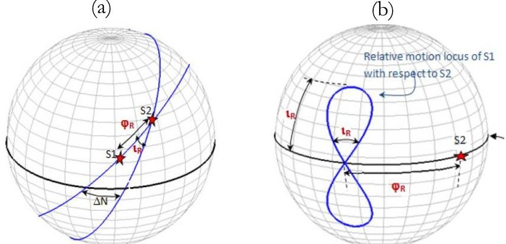

Figure 11: (a) Two satellites in co-altitude circular orbits separated by relative inclination $ \left( \mathrm{i}_{\mathrm{R}} \right) $ and phase differences $ \left( \varphi_{\mathrm{R}} \right) $ . (b) Relative motion of satellite 2 (S2) as seen from S1 (orbital plane marked by right arrow) in an earth centered coordinate system, full sky geometry.

For circular co-altitude orbits, the relative motion of any satellite with respect to another is an analemma or a figure of "8" motion as seen in Figure 11b, central figure. Here, S2 is the base satellite and the analemma is the motion of S1 as seen by S2. Half height of the analemma is given by the relative inclination $ ( i_{R} ) $ and the distance along the orbital plane equator from the baseline satellite by the relative phase $ (\Phi_{R}) $ . Parametric equations for the analemma in the inertial earth-centric frame are given by Equation 8, where $ \alpha $ is the azimuth of S2 at the earth's center about the point where it crosses the orbital plane of S1 and $ \delta $ is the elevation of S2 above the same point. When the satellites are in the same orbital plane, the analemma reduces to a point offset from the base satellite by an amount equal to the spacing between the two satellites. The

<!-- PDF_PAGE: 47 -->

analemma trajectories indicate their usefulness for capturing both SOP and CTS configurations by including the curvature of the Earth analytically.

$$
\sin \delta = \sin i _ {R} \sin n t
$$

$$
\alpha = n t - \operatorname {a t a n} \left(\cos \mathrm {i} _ {\mathrm {R}} \tan n t\right)
$$

Equation 8

For any pair of satellites separated in RAAN $ (\Delta\Omega) $ and true anomaly $ \Delta\mathrm{m} $ , the maximum $ (\lambda_{max}) $ and minimum $ (\lambda_{min}) $ earth angle $ (\lambda) $ can be found from [124]:

$$
\cos \lambda_ {\max } = \cos^ {2} \left(\Delta f / 2\right) \cos \beta - \sin^ {2} \left(\Delta f / 2\right)
$$

$$
\cos \lambda_ {\min } = \cos^ {2} \left(\Delta f / 2\right) - \sin^ {2} \left(\Delta f / 2\right) \cos \beta
$$

$$
\cos \beta = \cos^ {2} \mathrm {i} + \sin^ {2} \mathrm {i} \cos \Delta \Omega
$$

$$
\Delta \mathrm {f} = \Delta \mathrm {m} - 2 \tan^ {- 1} \left[ - \tan \left(\Delta \Omega / 2\right) \cos \mathrm {i} \right]
$$

Equation 9

Higher fidelity models account for perturbations such as atmospheric drag, solar radiation pressure, non-spherical earth and third body effects that accumulate over several orbits and need to be corrected for periodically. The modified HCW equations introduce the effects of J2 perturbations due to the oblate shape of the Earth [125], and have an analytical form Equation 10) with parameters described in [125]. When both J2 and atmospheric drag effects [126] are accounted for, the state matrix assumes a 7x7 form, which is a modified version of the 6x6 dynamic state matrix, and is required to be solved numerically to compute relative satellite trajectories [126].

$$
x = x _ {0} \operatorname {C o s} (\sqrt {1 - s} n t) + \frac {\sqrt {1 - s}}{2 \sqrt {1 + s}} y _ {0} \operatorname {S i n} (\sqrt {1 - s} n t)
$$

$$
y = - \frac {2 \sqrt {1 + s}}{\sqrt {1 - s}} x _ {0} \operatorname {S i n} (\sqrt {1 - s} n t) + y _ {0} \operatorname {C o s} (\sqrt {1 - s} n t)
$$

$$
z = A (t) \left(\frac {z _ {0}}{A (0)} \cos (B (t) t) + \frac {\left(\frac {\hat {z} _ {0}}{n \sqrt {1 + 3 s}}\right)}{A (0)} \sin (B (t) t)\right)
$$

$$
\dot {x} _ {0} = \frac {n y _ {0}}{2} \frac {(1 - s)}{\sqrt {1 + s}} \quad \dot {y} _ {0} = - 2 n x _ {0} \sqrt {1 + s}
$$

$$
s = \frac {3 J _ {2} R _ {n} ^ {2}}{8 r _ {r e f} ^ {2}} \left(1 + 3 \cos 2 i _ {r e f}\right)
$$

$$
A (t) = r _ {r e f} \Phi (t)
$$

$$
B (t) = n \sqrt {1 + s} - \frac {\Delta \gamma}{t}
$$

Equation 10

For the highest level of fidelity, orbit modeling and propagation software such as Analytical Graphics Inc. Systems Tool Kit's (AGI-STK[127]) High Precision Orbit Propagator (HPOP) is available. Full orbit propagation can be performed for all the satellites in the formation and the solutions mapped into the LVLH frame with respect to a reference satellite. Closed formation flight trajectories are formed when satellites are in orbits whose five Keplerian elements differ by a small amount or differentially. The relationships between the HCW coefficients in some simplified cases and the differential Keplerian elements is given by the COWPOKE equations or "Cluster Orbits with Perturbations of Keplerian Elements" [128]. The semi major axis is an exception because it corresponds to orbit energy, differing of which will break the formation. For circular LEO orbits, the HCW and differential Keplerian elements are related as Equation 10.

When multiple satellites have the same Keplerian elements except separated by a small, differential true anomaly or TA, the resultant relative motion is the string of pearls (SOP). When multiple satellites have the same Keplerian elements except separated by a small, differential TA as well as inclination or RAAN, the

<!-- PDF_PAGE: 48 -->

resultant relative motion is the cross track scan (CTS). Finally, if satellites have different TA, inclination or RAAN as well as perigee or eccentricity, the resultant relative motion is the free orbit ellipse (FOE). In a similar vein, studies have also derived the relationship between dimensions of symmetric geometries in space (for example, side of a diamond or the length of an ellipse) and the differential Keplerian elements to generate diamond and rotating formations [129]. Since HCW and modified HCW frames serve the same purpose and have the same formulation, these will not be considered in current methodology.

$$
\begin{array}{l} A _ {0} = - a \delta e \\ B _ {0} = a \sqrt {\delta i ^ {2} + \sin^ {2} i \delta \Omega^ {2}} \\ x (t) = A _ {0} \cos (n t + \alpha) \\ \alpha = 0 \\ y (t) = - 2 A _ {0} \sin (n t + \alpha) + y _ {o f f} \\ \beta = \omega - \theta_ {z} \\ z (t) = B _ {0} \cos (n t + \beta) \\ y _ {o f f} = a \left(\delta \omega + \delta M + \cos i \delta \Omega\right) \\ \end{array}
$$

Equation 11

Literature to guide the selection of the chief orbit or the orbit of the reference satellite is reviewed because previous studies have shown up large differences in delta-V requirements if formations are referenced on critically inclined orbits (CIO) in comparison to sun synchronous orbits (SSO) [59]. The main cause of maintenance requirement in formations is due to J2 perturbations (and much less due to differential drag). J2 invariant orbits are designed to have osculating elements such that the difference in mean orbit element drifts is zero to avoid secular growth [130]. The combinations of elements set to equal zero depends on the nature of the orbit - polar vs. non-polar - and have differed by publication - [130] vs. [59]. Reference [131] identifies and proves (through simulation) two additional J2 invariant inclinations other than the critical ones. Therefore, $ 63.4^{\circ} $ $ 116.6^{\circ} $ as well as $ 49^{\circ} $ $ 131^{\circ} $ can all be used to generate CIOs.

Global temporal sampling via constellations has been studied in the past [132] [133]. Only relevant literature to achieve multi-angle coverage will be focused upon here. WFOV constellations for MA-EO are most applicable to estimate the Earth's radiation budget (ERB). Sun-synchronous orbits are not suitable for this application because they miss the extreme of the systematic diurnal variations. Walker constellations have been studied recently [132][133] to be among the most efficient configurations for wide area continuous coverage. They rely on symmetric geometry and circular orbits to describe a constellation in only three variables corresponding to the number of planes, the number of satellites in each plane, and an inter-plane phasing parameter. References [124] and [134] have optimized Walker constellations to minimize global and regional revisit time respectively, and published the optimal number of planes, satellites and phasing for a given sensor field of view.

## III-3.2. Constellation Design

The utility of constellations for multi-angular observation is two-fold:

1. For global and/or more frequent coverage for NFOV payloads in formations, as clustellations.

2. For capturing angular signatures at overlapping ground spots, by using WFOV payloads as constellations.

Continuous and complete global coverage is also provided by the Streets of Coverage pattern [135], with excess coverage at the poles [133]. Flower constellations [136], [137] provide a more generalized framework for relative orbits and coverage than Walker constellations. The flower satellites have identical altitude, inclination and eccentricity - like Walker, - and are modeled similarly with the addition of another three integer parameters. The authors prove that they can project any symmetrical shape onto the Earth Centered Earth Fixed (ECEF) just by varying the defining parameters [138], can make it rotating frame independent and

<!-- PDF_PAGE: 49 -->

make the configuration compatible with J2 invariant orbits because altitude-inclination are free design variables. They have been applied theoretically to Earth Observation [139], among others such as communication and navigation. Recent work at MIT[104] has also shown the utility of ad-hoc constellations, put together entirely from secondary launches, which are capable of generating acceptable global coverage.

Geostationary orbits have not been studied because of the compromise in spatial resolution for NFOV payloads, whose requirements are in the sub-km scale, and the inability to image the poles when using WFOV payloads for TOR estimation over the entire globe. TOR uncertainty at high latitudes, attributed to factors such as snow albedo, is a big component of overall TOR uncertainty and polar satellites in LEO or MEO are essential to alleviate it. Eccentric orbits have not been studied because they yield formations that are unstable under disturbances and require costly maintenance[135][133].

## III-3.3. Payload Customization

DSMs can make multi-spectral measurements of a ground spot at multiple 3D angles at the same time as they pass overhead either using NFOV instruments in controlled formation flight (Figure 1-left) or WFOV instruments with overlapping ground spots imaged at different angles flight (Figure 1-right). While the broadband RAVAN radiometer developed by JHU Applied Physics Lab[140] can be used as a representative WFOV payload, small VNIR imaging spectrometers are required to be customized as the NFOV payload to measure multi-angular, narrow-band reflectance. NFOV payload modeling entails many trades. For example, the signal strength and ground sample distance drops as the satellite points toward off-nadir or is at a higher altitude, image overlap reduces with increasing pointing and position error and signal strength varies over the CAR spectrum.

The pointing requirements for a mission with NFOV instruments are relatively strict because all the satellites have to point their NFOV payload toward the same ground spot at the same time for the multi-angle image to be correctly registered. If push broom sensors are used, only a single row of pixels will be available in the zenith angular direction and an error equal to the instantaneous field of view (iFOV) would lead to the loss of one angular measurement. For example, if the iFOV is $ 0.1^{\circ} $ , then a satellite's zenith error of $ 0.1^{\circ} $ will cause that satellite to miss the common ground target. This pointing risk may be avoided by the use of hyperspectral snapshot imaging (HSI) which produces 2D spatial images with a single exposure at selected and numerous wavelength bands. HSI is also required if constellations of WFOV satellites are flown such that multi-angle images of any ground spot are generated by co-registering the 3D images from all the satellites in view of the spot because circular or rectangular spots increase the area and instances of overlap. The WFOV approach is a constellation approach to the POLDER instrument and coarsens the spatial resolution of the measurements.

3D imaging or hyperspectral snapshot imaging (HSI) can be defined as taking 2D spatial images, where each pixel's spectral content is also captured (1D spectral). Nanosatellite spectrometers and HIS imagers have been developed individually, but have been combined only in the last 2 years and have not flown yet. For example, Space Dynamics Lab is developing OPAL, a snapshot hyperspectral instrument with very high spectral resolution and tradeoffs with respect to bandwidth and horizontal sampling[141], however it covers only the visible spectrum. Existing spectral imagers for BRDF estimation have traditionally been very large. MODIS is 228.7 kg and MISR is 148 kg. CHRIS is the lightest instrument among the ones listed in Section IB, at 14 kg. Therefore, significant amount of development needs to be done to reduce the mass of a multi-spectral imager. The radiometric precision, image quality and signal to noise ratios (SNR) of the small satellite images are not expected to be similar to the heritage instruments such as MODIS and MISR; however, the images are required to have SNR enough to distinguish signals captured by different satellites at different 3D angles so that co-

<!-- PDF_PAGE: 50 -->

registration provides an accurate relative multi-angle image. These observations may then be complemented with high quality data from heritage missions thus providing a data dimension (angular) that has never been captured before.

Hyperspectral snapshot imagers make measurements as a 3D data cube, as required, but have never been demonstrated on nano-satellites. Theoretically popular methods for imaging are (1) computerized tomography to calculate the 3D input (x,y, $ \lambda $ ) from the 2D output image on the Focal Plane Array (FPA) at multiple diffraction orders[142], [143]; (2) image slicers made of appropriately aligned mirrors and grisms to slice the 2D spatial image into a 1D vector and then disperse it spectrally[144]; (3) multiple apertures at the input lens[145] followed by a dispersive or a spectral element such as a Fabry-Perot filter array[146] and (4) birefringent interferometers for spectral filtering by two-beam interference followed by spatial/spectral demultiplexing by passing the light through a Wollaston prism[147]. Tomographic approaches suffer from typical problems of inverse solutions, image slicers need cryogenic temperatures (although the modern version of the Bowen slicer has demonstrated otherwise). Fiber optic reformatters are preferred at visible and NIR wavelengths[148], and multiple apertures severely restrict the spatial FOV and thus ground resolution. Many hyperspectral technologies have been based on the concept of wavelength tunable filters[149]. Liquid Crystal Tunable Filters (LCTF) have been used in several Hyperspectral Imager Systems (HIS). A Lyot-Ohman type LCTF which consists of a stack of polarizers and tunable retardation (birefringent) liquid crystal plates has been used in many hyperspectral imaging instruments in the VNIR wavelength range. Liquid crystals however are limited by the relaxation time of the crystal - in the range of 40-60 ms[149] - which is much too slow for many applications that require fast switching of pass band wavelength to accommodate all wavebands within the available integration time. A quicker alternative is the Bragg Tunable Filter[150] (BTF). A volume Bragg Grating or Volume Phase Hologram (VPH) contains material in which the index of diffraction varies periodically. The orientation of the modulation structure with respect to the incoming light determines whether the grating is reflective or transmissive.

The four designs for snapshot imagers identified as payload candidates for the multi-angle nanosatellite formations are: waveguide spectrometers[151], Acousto-optic tunable filters (AOTF)[152] $ - [154] $ integral field spectrograph (IFS)[144] and electronically actuated Fabry-Perot Interferometers[155],[156]. The designs and trades have been discussed in detail in Section VI-2. Hyperspectral imaging cubes by nano-satellite payloads are also possible using the traditional Sagnac spatial heterodyne interferometers[141]. While this technology has not been discussed in further in this thesis, the methods to evaluate and compare it are similar to those used for waveguide spectrometers. Past ERB radiometers in LEO, apart from CERES, have included ERBE (first with active cavity on 3 satellites) [157] and ScaRaB (non-SSO)[158]. However, none of the payloads have been suited to package within small satellites.

In the past six years starting with SwissCube[159] in 2009, nano-satellites payloads have gone beyond technology and educational demonstrations and attempted to make scientific contributions in Earth Remote Sensing. hyperspectral microwave radiometer developed by MIT/LL[160] using a high frequency passive radio receiver. VNIR hyperspectrometers for small satellites have been successfully demonstrated in Japan "Taiki"[161] using a Ritchey-Chretien telescope and COTS-obtained CCD image arrays. Aalto-1 is a 400g spectral imager based on a tunable MEMS or piezo-actuated Fabry-Perot Interferometer developed by Aalto University in Finland. Far-IR radiometers based on microbolometers using many options of materials have been developed and tested[162]·[163]. CanX-2 carries an atmospheric spectrometer, Cloud CubeSat a VNIR camera and a polarimeter, and QuakeSat a ULF signal sensor[164]. All these successful small satellite scientific projects have paved the path for the miniaturization of telescopes as well as visible-to -infrared detectors using

<!-- PDF_PAGE: 51 -->

CCD or CMOS arrays, SWIR or FIR thermal detectors, usage of dichroic filters or gratings to disperse the different wavelengths of incident light, and on-orbit calibration techniques using infrared lasers/illumination lamps/natural sources. Therefore, while development of HSI for the BRDF nano-satellites is a clear challenge, there are past resources that can aid and inform the process.

## III-3.4. Supporting Small Satellite Technologies

This section will review literature on technologies that can potentially support the critical subsystems of a nano-satellite in a multi-angle DSM. The intent is to assess the state-of-art with the goal of using them as is or with minor customizations in the performance analysis model. As will be defined in Section IV-2, the mission bus requirements are set to: mass less than 20 kg; physical dimensions within a 6U bus; and average power less than 40W, so as to adhere to the expected (albeit optimistic) $ \sim 6 $ U CubeSat standards. Existing CubeSat capabilities in attitude control, onboard processing, communication and propulsion will be discussed below.

For the formation and LVLH motion to be intact, the differential orbital elements among all the satellites in the formation must be maintained within error margins. In Low Earth Orbit (LEO), the major disturbances to be accounted for are atmospheric drag and J2 effects due to a non-spherical Earth. If these disturbances act on the different satellite orbits differently, it may cause the orbits to drift apart and eventually break the formation. Atmospheric drag causes the semi major axis and eccentricity of the orbit, and therefore orbit velocity and period, to change. For a near-circular orbit, SMA and velocity change per orbit is:

$$
\begin{array}{l} \Delta a = - 2 \pi \left(C _ {\mathrm {D}} A / \mathrm {m}\right) \rho a ^ {2} \\ \Delta V = \pi \left(C _ {\mathrm {D}} A / \mathrm {m}\right) \rho a V \\ \end{array}
$$

Equation 12

where $ ( C_{D} A / m) $ represents the ballistic coefficient of the spacecraft, $ \rho $ the atmospheric density of the atmosphere at any given altitude, and a and V the baseline semi-major axis and velocity of the satellite respectively. If satellites in the same formation have different ballistic coefficients or are at different altitudes, it will cause their orbits to decay in different ways.

Corrections, if needed, can be provided by propulsion systems aimed at raising the altitude back periodically, either by continuously providing the $ \Delta V $ lost or using Hohmann transfer every few weeks to correct for the $ \Delta a $ . When the required altitude(h) is known, Equation 13 shows the required $ \Delta V $ where $ r_{2} $ is (h+Re), $ r_{1} $ is (h+Re- $ \Delta a $ ) and $ \mu $ is the Earth's gravitational constant. If drag or J2 effects change the eccentricity of the orbit, the $ \Delta V $ required to correct it will also be calculated by Equation 13[165]. The burn will be performed at the perigee, which is assumed to be at (h+Re) to lower the apogee to $ r_{2}=(\mathrm{h}+\mathrm{Re}) $ and thus circularize the orbit. If the perigee is not at the required altitude, a Hohmann burn will be required to correct that as well. These equations will also be used to calculate the propulsion required to initialize the formations and constellations.

$$
\Delta V = \Delta V _ {1} + \Delta V _ {2}
$$

$$
\Delta V _ {1} = \sqrt {\frac {\mu}{r _ {1}}} \left(\sqrt {\frac {2 r _ {2}}{r _ {1} + r _ {2}}} - 1\right)
$$

$$
\Delta V _ {2} = \sqrt {\frac {\mu}{r _ {2}}} \left(1 - \sqrt {\frac {2 r _ {1}}{r _ {1} + r _ {2}}}\right)
$$

<!-- PDF_PAGE: 52 -->

J2 effects cause a satellite's right ascension of ascending node (RAAN) to rotate by the amount given in Equation 14 (in degrees per day). Corrections need a large $ \Delta V $ because they effectively imply a plane change at orbital velocities[165]. Equatorial orbits need less fuel for the plane change than polar orbits. Alternatively, missions are designed to account for or even take advantage of the rotation (e.g. sun-synchronicity). J2 also causes rotation of the argument of perigee, however since this thesis looks at only those solutions with circular orbits, those equations have not been modeled.

$$
\begin{array}{l} \Delta \Omega = - 1. 5 \mathrm {n J} _ {2} (\mathrm {R e} / \mathrm {a}) ^ {2} (\cos \mathrm {i}) \left(1 - \mathrm {e} ^ {2}\right) ^ {- 2} \\ \cos \Delta \theta = (\cos i) ^ {2} + (\sin i) ^ {2} \cos \Delta \Omega \\ \Delta V = 2 V \sin \Delta \theta / 2 \\ \end{array}
$$

Equation 14

The above equations are valid only for impulsive propulsion such are chemical or cold gas propulsion. Electric propulsion provides an alternative solution. Its high specific velocity (Isp) and low thrust require longer times and larger $ \Delta\mathrm{V} $ , however, they may correspond to lower fuel mass at the cost of power. When using electric propulsion, the required $ \Delta\mathrm{V} $ for plane changes or altitude changes is calculated using the Edelbaum equations[166], [167], simplified for this dissertation application in Equation 15. V1 and V2 are the initial and final orbital velocities, and $ \Delta\Omega $ is the required plane change.

$$
\begin{array}{l} \vartheta = \tan^ {- 1} \left[ \frac {\sin \left(\frac {\pi}{2} \Delta \Omega\right)}{V 1 / V 2 - \cos \left(\frac {\pi}{2} \Delta \Omega\right)} \right] \\ \Delta V = V 1 * \cos \vartheta - V 1 * \frac {\sin \vartheta}{\tan \left(\frac {\pi}{2} \Delta \Omega + \vartheta\right)} \\ \end{array}
$$

Equation 15

The time to complete the maneuver is then calculated from the $ \Delta\mathrm{V} $ , depending on the input power to the thruster (P) and efficiency ( $ \varepsilon $ ) - from Equation 16. Mf and Mi are the final (wet) and initial masses of the spacecraft from the standard rocket equation.

$$
\begin{array}{l} \mathbf {T} = 2 * \varepsilon * \mathbf {P} / _ {\mathbf {g} * \mathbf {I s p}} \\ \mathrm {M f} = \mathrm {M i} * \exp \left[ \frac {\Delta \mathrm {V}}{\mathrm {g} * \mathrm {I s p}} \right] \\ \end{array}
$$

$$
\mathrm {t i m e} = \Delta \mathrm {V} * \mathrm {M f} / \mathrm {T}
$$

Equation 16

COTS propulsion modules available for nano-satellites could be cold gas thrusters [168] or electrospray thrusters [11] (which are not yet ready for flight. The CanX-2 mission has successfully flown a 0.05N, Isp 45s cold gas thruster developed by Vacco Space [169]. Surrey Space has flown a 450 g, 0.01N, Isp 69s butane cold gas system developed by Polyflex Aerospace Ltd on SNAP-1, a 6.5 kg small satellite, which performed proximity operations on orbit [170]. AustinSat's 3D-printed 1U supports 6DOF thrusters with $ \Delta V $ of 40 m/s, minimum impulse bit of 0.125 mNs and flight heritage on STS-116 MEPSI. The propulsion tank is scalable linearly up to 3U, thus up to 120 m/s of $ \Delta V $ can be made available $ ^{1} $

The formation's imaging modes are supported by the attitude determination and control systems (ADCS), housed under the GNC (guidance navigation and control) module in the Systems Engineering model (Figure 15). Depending on the mode, the satellites will need to constantly change their attitude, as defined in

<!-- PDF_PAGE: 53 -->

their body-fixed reference system, in order to point their payload toward the ground target, as defined in the geocentric equatorial reference system (IJK)[116]. An intermediate reference frame, called the orbital or LVLH frame, is a useful transition between the above two. The orientation of a satellite in the LVLH frame is defined by a 4D vector called a quaternion, which maps the satellite attitude in the body frame to its attitude in the LVLH frame. It consists of a three-element hyper-imaginary vector part and a single-element scalar part: $ \bar{q}= $ $ q_{1}\hat{i}+q_{2}\hat{j}+q_{3}\hat{k}+q_{4} $ , where the quantities $ \hat{i},\hat{j},\hat{k} $ follow a set of rules analogous to the single-dimension imaginary number $ i=\sqrt{-1} $ , and similar in form to the rules for forming cross products. The real coefficients of the quaternion components may be expressed in vector notation as $ q=[q_{1}q_{2}q_{3}q_{4}]^{T} $ . Given a rigid-body rotation of angle $ \theta $ about the axis, $ \hat{n} $ , expressed in some reference frame, the resulting orientation given by unit vector of the body may be characterized as Equation 17. Thus, the inverse of a quaternion may be found simply by changing the sign on the vector part.

$$
q = \left[ \begin{array}{l} q \\ q _ {4} \end{array} \right] = \left[ \begin{array}{l} \hat {n} \sin \left(\frac {\theta}{2}\right) \\ \cos \left(\frac {\theta}{2}\right) \end{array} \right] = \left[ q _ {1} q _ {2} q _ {3} q _ {4} \right] ^ {\mathrm {T}}
$$

Equation 17

Equation 17 can be used to calculate required attitude states, given an imaging mode and formation satellite states, as will be shown in Section VI-3. A separate set of quaternions for orienting the satellites from the LVLH reference to the inertial IJK frame is needed to ensure any extra control that continuous Earth pointing may require. Up to an additional $ 0. 0 6^{\circ} $ per second of slewing per satellite, also known as the yaw-pitch maneuver, is needed for continuously orienting the HCW or LVLH frame's X axis toward the Earth Center (IJK).

Given the required nadir angle $ \eta $ and azimuth angle $ \Phi $ attitude, attitude errors $ \Delta\Phi $ in azimuth and $ \Delta\eta $ in nadir), position errors $ \Delta I $ in-track or IT, $ \Delta C $ cross-track or CT, Rs radial or R), earth radius Re and orbit altitude h, the magnitude of mapping error in the respective directions can be calculated by the following equations[135] in kilometers:

$$
\mathrm {A z i m u t h E r r o r} = \Delta \Phi^ {*} \mathrm {D} ^ {*} \sin \eta
$$

$$
\mathrm {N a d i r e r r o r} = \Delta \Phi^ {*} \mathrm {D} / \sin \varepsilon
$$

$$
\mathrm {I T} \mathrm {e r r o r} = \Delta \mathrm {I} \frac {\mathrm {R e}}{\mathrm {R e} + \mathrm {h}} \cos \mathrm {a s i n} (\sin \lambda \sin \phi)
$$

$$
\mathrm {C T} \mathrm {e r r o r} = \Delta \mathrm {C} \frac {\mathrm {R e}}{\mathrm {R e} + \mathrm {h}} \cos \mathrm {a s i n} (\sin \lambda \cos \phi)
$$

$$
R e r o r = \Delta R s ^ {*} \sin \eta / \sin \varepsilon
$$

Equation 18

Elevation of any satellite ( $ \varepsilon $ ), Earth central angle ( $ \lambda $ ), length (Lf) and breadth (Wf) of an elliptical footprint due to an angular conical beam of width FOV can be obtained from basic geometry[135].

$$
\begin{array}{l} \mathrm {L f} = \mathrm {D} \sin \mathrm {F O V} / \sin \varepsilon \\ \mathrm {W f} = \mathrm {D} \sin \mathrm {F O V} \\ \lambda = 9 0 ^ {\circ} - \eta - \varepsilon \\ \varepsilon = \cos^ {- 1} \frac {\sin (\eta)}{\sin (\rho)} \\ \rho = \sin^ {- 1} \frac {\mathrm {R e}}{\mathrm {R e} + b} \\ \end{array}
$$

Equation 19

Previous work on precise pointing control in a hardware-in-the-loop (HWIL) simulation was studied. Tests reviewed included the SPHERES Program, GNC system and development via MicroMAS [171] and

<!-- PDF_PAGE: 54 -->

ExoplanetSat [172], and DSS metric evaluation via the Terrestrial Planet Finder (TPF) program and DARPA System F6, in a bid to develop state-of-art algorithms for MA-EO formation fight. The reaction wheel stage of ExoplanetSat, both in simulation and HWIL verification on MIT's spherical air bearing testbed, has shown pointing precision at LEO within 40 arcsec [172] or $ 0.011^{\circ} $ . An additional fine pointing stage is expected to increase the pointing precision ten times. MicroMAS's concept of operations (ConOps) have also been tested on the same testbed and the air bearing was able to closely track the commanded angular orientation[173], verifying the existing HWIL control simulation. Blue Canyon's XACT system $ ^{2} $ with star trackers and 3-axis reaction wheels claims to provide up to $ 0.001^{0} $ of pointing determination and $ 0.01^{0} $ of control. While XACT has never flown, MIT's Hardware in Loop (HWIL) lab testing[172] has shown up to $ 0.011^{0} $ of control. In space, CubeSats have demonstrated between $ 0.5^{\circ} $ (University of Toronto's BRITE[174]) and $ 1^{\circ} $ (CanX series[175]) of control with sun sensors and magnetometers. BRITE 10 arcsec of determination. The ADCS design of the MiRaTA satellite[176] captures the current state-of-the-art in terms of cubeSat attitude control actuators for 3-axis stabilization (reaction wheels, magnetic torquers), attitude determination sensors (sun sensors, earth horizon sensors, inertial measurement devices, magnetometers, star trackers) and all-in-one ADCS solutions.

A large number of satellites in a formation performing 3D imaging is expected to generate a large amount of data. The data needs to be processed onboard, compressed and/or down-linked. The communication module has not been explored with link budget equations, since standard CubeSat parts and heritage LEO data rates can be utilized, which is assumed to be sufficient in terms of the link budget, atmospheric conditions and CubeSat hardware.

NASA Jet Propulsion Laboratory has demonstrated a 50 Mbps downlink from the International Space Station (OPALS) over 148 seconds[177]. The Aerospace Corporation is currently building a 3U CubeSat (OCSD) to demonstrate the same optical downlink rate of up to 50 Mbps from LEO [178]. MIT has laboratorytested a CubeSat optical transmitter that can achieve at least 10 Mbps, supported by a fine steering ADCS capable of 3 errors better than $ 0.012^{\circ} $ [179]. NASA JPL's ISARA mission is a technology demonstration of a practical, low cost Ka-band High Gain Antenna (HGA) on a 3U CubeSat that will enable 100 Mbps downlink data with minimal impact on spacecraft mass, volume, cost and power requirements[180]. Expected to launch in 2016, the supporting hardware - reflectarray antenna for the CubeSat and a Ka-Band beacon transmitter has already been tested. The above effort in addition to JPL's 0.5m Ka-band parabolic deployable antenna (KaPDA) development effort[181] and commercial manufacturers show higher bandwidths in the near future.

High-data rate laser communication comm has beam divergence exiting the telescope of $ \sim0.02 $ $ 0.1^{\circ}[178] $ , and nanosat ADCS systems are usually not equipped to provide determination and control to match those beamwidths for downlink with minimal pointing loss. However, the mission proposed in this thesis already has medium pointing requirements and mission science (SNR and ConOps) would only benefit from better pointing. In the lack of precise enough pointing for lasercomm, Ka band or X band communication thus provides an alternative to retrieve high volumes of data from the nano-sat formations.

Downlinking can also be alternatively achieved by having a high capacity downlink on one leader satellite and have all the others transmit their data to it through intersatellite links (ISL). NASA ARC's Edison program (expected launch in 2015) plans to demonstrate ISL and the above downlink strategy among 8 1.5U CubeSats [2]. There is a trade-off between direct downlink from all satellites and inter-sat data transfer has been briefly analyzed. For any pair of satellites separated in RAAN $ \left( \Delta\Omega\right) $ and true anomaly $ \Delta\mathrm{m} $ , the maximum $ \left( \lambda_{max}\right) $

<!-- PDF_PAGE: 55 -->

and minimum $ \left( \lambda_{min}\right) $ earth angle $ \left( \lambda\right) $ can be found from [124] and Equation 9, from which intersatellite distances can be computed for all time instances to analyze the trade-off.

The onboard processing unit is primarily used to reduce data onboard before downlink. An example of a standardized COTS unit for onboard processing is NASA GSFC's SpaceCube Mini - a modular processing unit. The design uses SpaceCube 1 that flew on the Hubble Servicing Mission and the ISS MISSE7 experiment[182]. SpaceCube Mini was used within the Intelligent Payload Experiment (IPEX), a CubeSat that launched in December 2013, thus raising is TRL7[183]. It has demonstrated high fidelity operations models and hyperspectral image processing, both of which are required for BRDF DSM. SpaceCube 2.0's SAR Nadir Altimetry application has shown a 6:1 reduction in downlink data by moving first stage ground operations onboard, to make formation science data manageable. Other alternatives include Space Dynamics Laboratory's PEARL system that uses the LEON3 chip, supports Linux, VxWorks and RTEMS as operating systems (OS) and is TRL $ ^{9} $ , Aeroflex's UT-699 microprocessor which has the same specs as PEARL but is TRL $ ^{6} $ , Space Micro Inc.'s Proton 200K running on the Texas Instruments DSP with a DSP-BIOS or Proton 400K running on the Freescale chip and a Linux OS both at TRL $ ^{8} $ and Bruhnspace's BAP e2000 family of modules that utilize the ARM Cortex-M3 cheip and the Linux/RTEMS OS, at TRL $ ^{7} $ .

## III-3.5. Gap Identification #3

There are many framework to assess formation flight in the LVLH frame as discussed in Section III- 3.1, but they are all valid for small distances ( $ < 50 $ km) beyond which the linearization breaks down because of Earth's curvature effects and associated gravity. Curvature and gravity can be corrected for by using non-linear HCW equations - for example non-linear instead of linearized gravity gradient, which include the effects of J2 and atmospheric drag. Alternatively, solutions from the linear models can be numerically corrected for the Earth's curvature. Since higher fidelity models for global orbit propagation are very computationally intensive when creating LVLH formations, a process to streamline the design variable space is important. There exists a gap in modeling of formations with large baselines in the LVLH frame. Development of such models can help constrain the variable space for global simulations and make for more efficient software.

A full payload model is needed to understand trade-offs between the different sampling dimensions (spatial, spectral, radiometeric) and angular dimension constrained by state-of-art or available COTS technologies. As concluded, multi-angle DSMs will need hyperspectral or multispectral snapshot imagers to allow for maximum overlap among the ground spots of the different satellites. Since HSI for nano-satellites has never been developed, a systems-based approach in designing them and evaluating their feasibility in context of the sampling trade-offs and mission requirements is essential. This thesis will present a high-level payload design, paving a way for detailed, Phase B-level optics design for validation.

A modular systems engineering model coupled with existing state-of-art and COTS technologies (like in Section III-2.4) is needed to evaluate the DSM architectures. The technical support requirements, predicted by the engineering model, can be searched for from such a library or database to assess technical feasibility as well as calculate associated costs. Ideal capabilities include easy updating of the library as new vendors or

<!-- PDF_PAGE: 56 -->

components become available, automated software to check if current capabilities can support the architectures in the tradespace and automated software that will iterate on suggesting downsized requirements if the proposed ones cannot be met. This dissertation will address the above process manually, with recommendations to enable an efficient, automated system. Only the critical subsystems identified in Section III-3.4 have been sized in terms of the metrics and inputs identified in Figure 15. Mass, volume and power sizing of all the subsystems in the satellites or full spacecraft packaging has not been performed.

## III-4. Cost Models for Small Satellite DSMs

## III-4.1. Existing Cost Models

Formal cost modeling in the Phase A stage of the mission lifecycle was started by JPL after the formation of Team X more than 10 years ago [184], [185]. Their model included costs through all phases of the mission using data from 60 TeamX mission studies for model prediction and validation [184], [185]. The payload model was exhaustive [186] and the spacecraft model was based on the cost per subsystem as a function of the weight of that subsystem. Wrappers as a percentage of the total cost of spacecraft and instrument development were used for the following Work Breakdown Structures (WBS): program management, outreach, systems engineering, assurance testing, launch vehicle and integration, etc. The statistical tools that JPL used for cost model included: (1) Regressive fitting of polynomials (log or linear); (2) Residual analysis to find if there were correlations between residual cost and other variables that were not captured (e.g. design life) or if the distributions were normal, variances significantly different from the original population (using F or chi2 tests); (3) Model Validation where in the analysts kept 30% of the data aside for testing purposes and asked if the model predicted and actual populations differ with more than 95% confidence (T and chi2 tests); (4) Monte Carlo simulations to check the model output against probability of predictions, confidence intervals and possible forecast errors.

The RAND Corporation did an extensive survey of small satellite missions with the intent to derive a cost model through analogy. They used 12 NASA missions and Clementine [187] and evaluated total mission cost (or TMC) from conception to data analysis. Costs were collected and analyzed by phase (design, development, test, launch, operations) and spacecraft subsystems and labor rate assumed to be $132k/professional year. They found the average NASA small satellite mission to cost $145 million, take 3 years to develop and have a dry mass of 407 kg which accounted for 41% of the TMC. Technical specifications considered in [187] -[191] were design life, apogee, inclination, contractors #, instrument mass, propellant mass, dry bus mass, total wet mass, spacecraft volume, launch vehicle, upper stage, bus pointing accuracy, bus pointing knowledge, stabilization type, thrusters #, fuel type, thermal system mass, power system mass, solar array material, array area, array efficiency, Beginning-Of-Life (BOL) power, End-Of-Life (EOL) power, system power density, battery type, downlink Data Rate (DR), communication band, transmitter power, central processor Million Instructions Per Second (MIPS), memory, harness pinouts, and Source Lines of Code (SLOC). Finally, a factor of complexity was calculated through a discrete scale [187], [189] cost per kg of the spacecraft was normalized using this factor and regression analysis, where S/C Cost (in $ K) = 64.37*m*FC+ 9095 [187]. Complexity was accounted for quantitatively (vs. JPL which only used a binary variable). Complexity parameters considered included Technology Readiness Level (TRL), mission type, design life, spacecraft density, instrument mass fraction, bus pointing, solar array and power system efficiency, DR, proc, SLOC, memory.

<!-- PDF_PAGE: 57 -->

The typical problems that RAND uncovered with respect to spacecraft costing [188] were data limited by small sample sets because large scale production in spacecraft manufacturing does not exist, and by suppliers rarely making internal efficiency optimizations because delivering highly integrated payload requires very specific designs therefore no minimal generalizations and diverse stakeholders for every mission is possible. Expert opinion proved superior to formal estimation in 33% cases (15 total), inferior in 33% and no difference in the last 33%. Unmitigated technical risk was identified as the biggest factor in cost overruns [188], cases studied being SBIRS and GPS, and the risks were primarily attributed to inadequate systems engineering, aggressive adoption of commercial standards for military applications, lack of process controls at contractors or their lack of domain knowledge and reduction in acquisition workforce due to budget cuts. In spite of the above problems, some projects did have risk assessment for each WBS but were limited by the following problems [188]:

- Little data availability (e.g. inadequate reviews of contractor work)

- Credibility (e.g. inadequate experience, judgment, independence)

- Limitations in risk quantification (e.g. analysts assumed 17% cost growth when historical data showed 50% growth and led to 250% in reality, expert subjectivity, erroneous cost-probability distributions for 'risks', random functions were used for probability distributions)

- Unavailability of methods for large cost growth (e.g. risk is defined as variance of prediction so low prediction implies low risk without any validation of such an assumption)

The RAND study of Air Force Missions found that most mission costs grew over their lifetimes. A metric called Cost Growth Factor or CGF was defined as the ratio of the final cost to the estimated costs using Milestone II estimates [189] where CGF < 1 represented under runs and CGF > 1 represented overruns. Uncertainties and cost growth [189] were identified to be caused by new technology, economic conditions or rare events after accounting for funding category, inflation, timeline/milestones and other such correlations. Recommendations included using many validation methods and having a consistent tracking method in place.

<table border="1"><tr><td>Model</td><td>Scope</td></tr><tr><td>Unmanned Space Vehicle Cost Model</td><td>USAF/NASA/commercial satellite/comm payloads</td></tr><tr><td>Passive Sensor Cost Model</td><td>Space Sensor components</td></tr><tr><td>NASA/Air Force Cost Model</td><td>USAF/NASA, Earth/interplanetary/manned satellites, instruments, launch vehicles, engines&#x27;</td></tr><tr><td>Small Satellite Cost Model</td><td>Spacecraft&lt;1000kg, Earth/interplanetary</td></tr><tr><td>PRICE</td><td>Commercial and general purpose</td></tr><tr><td>SEER</td><td>Commercial and general purpose</td></tr></table>

Table 3: Typical cost models available for pricing the development and operation cost of a LEO satellite mission [188]

There are several cost models available for costing satellites in low Earth orbit (LEO), as identified in Table 3 [91]. The major methods are categorized under top town estimations or parametric models, bottom up estimations or component models, analogy based estimations from historical missions and expert judgment. Specifically for Earth observation missions from LEO, instrument cost is a parametric function of mass, power and data rate. Bus cost is the sum of costs from different subsystems which is a parametric function of the subsystem mass. Integration, assurance and test (IAT) and systems engineering (SE) costs are a function of satellite mass (recurring) or satellite cost (non-recurring) while operations cost is a function of lifetime and spacecraft cost as obtained from the NASA Spacecraft Operations Cost model [135]. Operations cost of small

<!-- PDF_PAGE: 58 -->

satellites is 8% of TMC and 20% of bus cost, which ismuch more than large satellites where operations is 7% of bus cost [192]. Program overhead includes recurring and non-recurring [91] costs with respective cost estimating relationships (CER) errors of 39% and 36% (lower for small satellites). Overall overhead is 8.9% and 9.3% of bus cost for small and large S/C respectively [187], [192].

Schedule slippage (RSS) as percentage of total development time is a function of the TRL of the least mature component [91], [193], which in turn can map to cost overrun as a percentage of TMC [25]. Programmatic risks can be defined as a function of sum of all TRLs below a threshold or to make them architecturally distinct [91]. Launch risks are significantly lower if distributed launch is used, therefore making a stronger case for DSMs with staged launches. Launch risks can be quantified either through a concave risk aversion curve or through the concept of entropy [91], [194]. Accounting for net present value and cost spreading improves the above cost estimates.

## III-4.2. Costing multiple copies in DSMs

Cost modeling has been done and published publicly for a few planned DSMs, for example, GEOScan [26], TechSat 21 [89], [90], DARPA Phoenix [107].

The GEOScan (66 instruments of <5kg each for Iridium NEXT) mission proposed to minimize cost using standard John Hopkins University Applied Physics Lab (JHU APL) business practices and a streamlined management approach. Their studies initially assumed a cost copy factor of 35% [185], [186],[195] performed regression analysis on JUNO JEDI, Van Allen Probes RBSPICE and STEREO and validated a cost copy factor of 30-40% for their engineering practices.

The Generalized Information Network Analysis (GINA) tool was developed at MIT and applied to TechSat 21 [89] to evaluate performance and cost of a DSM. Complexity was not considered aside from the number of spacecraft. The authors characterized capabilities of a DSM as a function of information isolation, rate, integrity and availability and performance as the probability that system satisfies requirements in terms of capability and used Markov states and integrate on lifecycle cost as a sum of baseline cost and failure compensation cost. The cost model captured program slip and adaptability metrics (e.g., changing configuration for the same mission, i.e., elasticity, or adapting for different mission goals, i.e., flexibility) could be added. The GINA model was combined with multi objective optimization to select the most suited architecture for any specific mission [90]. For example, in the Terrestrial Planet Finder case study, the trade was between acquiring a certain number of images and the cost as characterized by the GINA model.

The Phoenix program assessment [107] performed by JPL and Aurora Flight Sciences uses a complexity based cost model to estimate development costs ([194], [196]); it uses parametric equations for programmatic cost estimation and the usual 85% NASA learning curve estimate to calculate the cost of making many copies of the same spacecraft.

## III-4.3. Launch Cost Modeling

Modeling launch costs for multiple spacecraft is difficult because of the complexity of choosing between single and staged launches and/or primary and secondary launches. TransCostSystems in Germany [197] used "cost engineering" applied to Launch Vehicles (LV) and minimized development and operations cost rather than the traditional approach of maximizing performance and minimizing weight. LV cost models demonstrated included PRICE-H, TRASIM, TRANSCOST and it was found that all CERs compute costs to be 15-25% higher than ideal cost. Cost was calculated as a function of payload capacity, engine technology, number of engine qualification tests, engines per stage, maintenance and refurbishment. Lower weight did not

<!-- PDF_PAGE: 59 -->

immediately mean lower cost. For example, thrusters were found to last longer if operated at 5-8% below maximum thrust therefore eliciting a trade between lifetime performance and deployment cost. Similarly, there was an automated optimizer to tap into different technologies to minimize cost.

## III-4.4. Risk and Uncertainty Assessment

The RAND reports ([188],[189]) discussed in the previous sections highlight the critical impact of risk on cost, and further literature is reviewed to summarize available methods and statistically derived quantities quantify estimating uncertainty [189]. The studies concluded that uncertainty about technical and programmatic inputs need to be quantified. Expert opinion has biases stemming from information availability, representativeness, anchoring, adjustment and overconfidence. There may also be conflicts of interest or the process may be over-rushed. Cause-effect relationships can be quantified using Markov trees. Risks should be defined, understood and evolved with an evolving system. Recommendations [189] on risk assessment included the use of multiple independent experts, asking experts to provide, at a minimum, upper, lower and most-likely values for cost elements under consideration, fitting a triangle distribution to these three numbers and using the upper/lower values to bound 90 percent of the probability; eliciting other percentiles to avoid bias and providing feedback to the expert in an iterative, documented process.

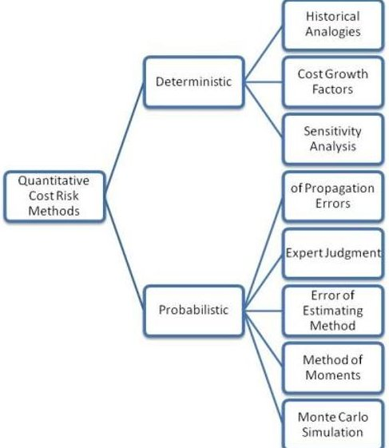

Figure 12: Summary of cost risk assessment methods suitable for spacecraft programs [190]

Cost Risk methodologies [190] include qualitative and quantitative methods as shown in Figure 12. The following cautions apply to data collection and analysis methods mentioned in the figure. Historical analogies need credible data from similar projects which are hard to find and susceptible to large time scales. CGF may be data-based but it does not capture layers of influence that caused the growth. Sensitivity analysis needs exact CERs, however, if the range of variation is not known a priori, select hazards should be identified. Probabilistic outputs as distribution functions instead of a deterministic point estimate should be encouraged. Error propagation is easy when CERs are linear, but complex relationships including precision of input and accuracy of computers need to be considered for probabilistic outputs.

Subject matter experts are capable of estimating cost and uncertainty and are very flexible, but they may have bias, so careful iterative conduction and documentation is required. Different methods shown in Figure 12 should be combined to avoid bias creeping in due to the use of only one method. A method of moments is easy for normal distributions - means, variances add. For other distributions, percentiles are hard to calculate. For such cases, Monte Carlo (MC) finds integrals and sums of random variables which are too complex for closed-form equations. MC methods may add and propagate variables, different distributions

<!-- PDF_PAGE: 60 -->

(Weibull, lognormal, triangular) can be used, expert opinion can be included, correlations captured and interpreted numerically. It is a computationally expensive method and saved only for very high fidelity calculations.

Overall, methods to evaluate uncertainty are suggested in the RAND Cost Uncertainty Report for the USAF Weapon Systems [190]:

- Benefit-cost analysis (but benefits/risks difficult to quantify)

- Expert judgment (use Delphi method but experts can disagree)

- Fault tree analysis (for complex, correlated risks with specific hazards considered and cost risks rolled back into the WBS)

- Focus groups/one-on-one interviews (for individual behaviors, communication error warning esp. among decision makers)

- Root cause analysis or FMEA (examine the consequences of failures or risk and chains of them and make recommendations. Can also introduce the control system approach of STAMP)

- Behavior modeling (cognitive processes of humans in the loop)

- Data-based methods (tornado plots, regression analysis)

- Integrated assessment (precision, validity, bias, dominos, records so that credibility of methods can be validated)

Technical, economic, cost and schedule risks should be considered [190] and the method will depend on the program and potential risks i.e. scenario driven analysis. There should be a preference for the more complex methods (probabilistic or sensitivity) because they can be tailored to the program. Historical analysis should be used in cases characterized by little time or information or as a supplement. Monte Carlo is not always the best because it lacks transparency, is subject to implementation errors and requires significant data and time.

Value centric risk assessment (or VCRM) was first mentioned in the context of the DARPA F6 Program in [3], [94], [198] for value centric design in academia and industry. Risk types considered were: technical (e.g. low TRL of a new component being deployed, a polymer battery), cost (e.g. outsourcing not working out due to export control), and programmatic (e.g., the launch vehicle not ready). Risk management mechanisms suggested were: take, avoid, and mitigate. VCRM was given a stronger quantitative framework when applied to the DARPA F6 Phase 2 [199]. The report quantifies probabilistic impact of individual risk items on project value using Value-at-Risk-Gain (VARG) curves. They recap the traditional approach of VCRM (Identify, Analyze, Plan, Track, Control) and typical Tools (Layers of Risk Model based on influence on the risk, Risk Matrix). The management plan tracks the risks over time to ensure a "burndown path". This model addresses the shortcomings of the traditional model where the impact on mission value is not quantified, and coupling and decoupling of risks not available. Risks are identified from and coupled to the uncertainty source, and probability of occurrence is available from a Markov Model S+ state transition matrix where robustness and adaptability measures can also be coded. Risk Impact is computed by turning input knobs (individual and coupled), VARG, probability and impact computed over lifetime (like Monte Carlo methods).

## III-4.5. Capturing Complexity

Since all risk reports caution against technical and programmatic risks and small satellites pack state of the art technologies into a small form, it is important to quantify complexity of small satellite DSMs and map this complexity to cost and risk. Typical spacecraft complexities discussed in the literature fall into three categories:

<!-- PDF_PAGE: 61 -->

- Aerospace Corporation has a very evolved method of quantifying component complexity relative to existing flight components and claims it to be a better metric of mission "cost" than dollars ([200], [201])

- Technical uncertainties can be factored into component complexities as a function of TRL as demonstrated in the DARPA META program [194]

- Structural complexity ([194], [196])

- Complexity arising from complex dependencies within the system

- Can be calculated from the design structure matrix of the system, captures emergent behavior and influences development cost of the system

- Dynamic complexity ([194], [196])

- Representative of operational complexity during different mission stages

- Each mission mode can be quantified in state space and the probability of success of each mode calculated

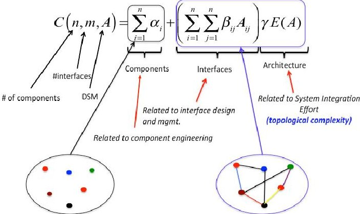

Figure 13, Equation 20: Structural complexity metric introduced and validated in [196] and [107]

Studies have tried to capture the cost of complex cooperation and technology development. For example, a recent paper [202] formulated a data supported method of capturing international cooperation related complexity using cyclometric complexity where CGF = 0.917+0.0575 $ ^{*} $ CyclometricNumber and CyclometricNumber = f(nodes, edges, outputs). As small satellites are always pushing the boundaries of technology, it is very probable that some small satellite component values will fall out of range available from past missions. In such a case, cost models of TRL transition [203] should be incorporated. Although TRL transition correlates to the spending, it does not follow traditional 80-20 rule. Structural complexity can be quantified using a simple framework shown in Figure 13 ([196],[107]) and can be empirically used to calculate the impact on development costs. Eventually, the idea is to calculate the impact on cost of all the above complexities; however, such a mapping currently exists for only component and structural levels.

## III-4.6. System Dynamics

System Dynamics is a well-established field that draws inspiration from basic feedback control principles to create simulation models [204]. SD constructs (stocks, flows, causal loops, time delays, feedback interactions) enable investigators to describe and potentially predict complex system performance, which would otherwise be impossible through analytical methods. SD is argued to be superior for DSM modeling in comparison with other modeling tools such as discrete event simulation like VARG or Monte Carlo methods. This is because it is a robust, discrete time simulation that allows simultaneous simulation of quantitative and qualitative parameters, captures latencies and delays, captures non-linear processes through simple causal structures and physically explains complex feedback interactions based on these simple structures [204], [205].

<!-- PDF_PAGE: 62 -->

The component interactions in the SD model (e.g. causal relationships) can be quantified using known parametric or physics-based equations obtained from the literature review and captured insights above.

## III-4.7. Gap Identification #4

Costing small satellite DSMs is challenging because of the following, as deduced from the literature review:

- There is no standard cost-to-copy database or learning curve model established for multiple satellites. NASA prescribes an 85% learning curve [206] which will be investigated in this dissertation. To calculate cost to copy, cost data of an in-house DSM mission before and after CDR (Critical Design Review) will be needed [195]. For example, the second copy of SwissCube [159] or SwissCube-2 is expected to be 45- 60% of the original Swiss-Cube, depending on spares and assuming a new workforce. Regression analysis on other missions (especially NASA missions) will provide more insight.

- Standard models including the Small Satellite Cost Model or SSCM [207] (parametric costs) and the RAND Models [187] (analogical costs) range from at least 20 kg to 500 kg of satellite mass. There is a large class of small satellites including the CubeSat standard that falls out of range for both such traditional models. In the absence of openly available WBS data on small satellites, the available cost models cannot be improved to get more precise CERs for small satellites. However, snatches of data available from online [208] and GSFC released sources can at most let us check the validity of the CER estimates for small satellites.

- Constellations especially formation flying missions have more programmatic overhead and need more ground station support for orbit maintenance. This translates to operations cost more than what parametric percentages estimate. Lifecycle risk modeling using techniques such as Monte Carlo and VARG is possible from a theoretical standpoint but model fidelity is questionable without risk-cost data for validation. A physics-based system dynamics model may be needed.

There is therefore a need to assess the applicability of current cost models to small satellite DSMs and to formulate reliable cost model components to fill up the existing gaps. The improved cost model should efficiently differentiate between costs of the different architectures for designing a DSM toward a particular Earth observation goal, and so serve as a tool to understand the cost impact of increased performance. Such a cost tool is paramount for DSM design owing to the large number of variables involved compared to traditional spacecraft design (e.g. number of satellites, inter-satellite distances), and is a necessary component of value centric system design [198].

## III-5. Chapter Summary

The four gaps identified in this chapter after a thorough literature review led to the problem statement and the low-level research questions in Chapter II.

First, undersampling in the angular domain is an earth observation gap. DSMs can complement measurements made by current monolithic instruments to fill this gap for better estimation of BRDF and dependent products.

Second, designing an appropriate DSM that will complement current measurement-making capabilities will need the development of a comprehensive systems engineering model tightly coupled with a science evaluation model. Such a model will leverage development in MBSE literature as well as OSSE literature. The OSSE must be validated using state-of-the-art BRDF data collected during NASA's airborne and satellite campaigns as well as accepted BRDF models in the community.

<!-- PDF_PAGE: 63 -->

Third, there is a lack of formation flight models for large-baseline clusters and a streamlined process to constrain the variable space is needed. The process will explore and select trajectories that offer a large angular spread when observing a ground target. Such models should be scalable to include metrics from other sampling dimensions - spatial, spectral, temporal and radiometric. The effect of the chief orbit of the reference satellite for formation flight cases must be well understood so that secondary launches can be selected in an informed way. A 3D imaging payload will be needed for MA-EO DSMs and a model of the same is needed to confirm that such a payload is feasible within nano-sat constraints. The payload model should quantify trade-offs between angular spread and the spatial dimension (spatial resolution and swath), radiometric dimension (Signal to Noise Ratio) and spectral dimension (spectral resolution and range) because Earth reflectance depends on all these variables. The systems engineering model should also consider if designs that are optimal in terms of orbits and payloads are supportable by current technology and achievable within small satellites.

Fourth, cost models for DSMs lack reliable data for satellites less than 20 kg, multiple costing curves and operational expenses related to tracking and monitoring many satellites simultaneously. A simple architecture differentiating lifecycle cost model to size the tradespace of DSM architectures is needed.

The second, third and fourth gaps need to be addressed in this dissertation in order to solve the first gap identified in this literature review. In other words, assessing the value multi-angular imaging with DSMs and building tools for that assessment (problem statement #2 and #3 in Section II-1 and Gap #2-4 in Section III-2, III-3, III-4) is essential to confirming that multi-angular imaging measurements will benefit for distributed missions compared to monoliths (problem statement #1 in Section II-1 and Gap #1 in Section III-1). The comprehensive methodology has been described in Chapter IV. The tools will assess the performance and costs of the DSM over lifetime and thus find global mission orbits that maximize performance and minimize cost for two case studies, one with a NFOV payload (primary study) and one with a WFOV payload (secondary study) - Chapter V and VII. Feasible payload characteristics and supporting technologies will be discussed in Chapter VI.

<!-- PDF_PAGE: 64 -->

<!-- PDF_PAGE: 65 -->

## IV. Approach and Methodology

Having identified an possible, important gap in the angular sampling abilities of earth observation missions and proposed the use of DSMs to fill this gap, the major effort in this thesis is to answer quantitatively if this solution is possible; and if so, what would be the value gained per dollar spent. For this purpose, a coupled, Systems Engineering (MBSE) model integrated with traditional BRDF Estimation models (OSSE) has been developed. The integrated model can explore the tradespace of DSM architectures to compare them against monoliths, driven by both science goals and technology constraints, and help choose the Pareto optimal designs between these two options.

The model is comprehensively presented in the following sections as a series of components, and each component is validated using simulation examples and experimental data. The different components, in part or together, will be highlighted as well as the problem statements described in Section II-1 and the thesis objectives as stated in Section II-3 addressed. Although the model has been developed for angular EO purposes, its modular nature allows convenient modification for other applications that require thorough, quantitative, and science-driven systems design and technology choices. This coupled model, and the development of its internal methods, is one of the main thesis contributions.

## IV-1. Overall Approach

The tightly-coupled systems engineering and science evaluation model is graphically described in Figure 14.

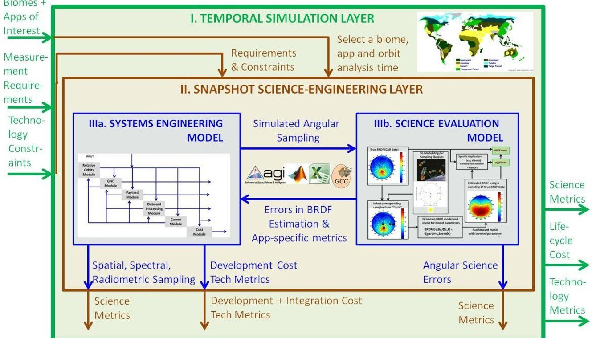

Figure 14: Summary of the overall approach to calculate BRDF science performance, technical requirements and cost of different mission architectures. There are three layers of analysis.

An architecture is a design with unique values for all design variables, as will be described in Section IV-2. The full system will take measurement requirements (e.g. angular and spatial sampling), technology constraints (e.g. maximum mass, highest altitude) and major surface types (e.g. vegetation, deserts) as input and produce three outputs per architecture: science metrics (e.g. BRDF error), lifecycle cost and extent to which technology constraints were met. Surface types are large naturally occurring communities of flora and fauna

<!-- PDF_PAGE: 66 -->

occupying major habitat. They have very different BRDF and therefore may need different formation designs to capture their BRDF, hence, prioritizing them is essential to decide a global formation design. The overall model has three layers. The model described in Box II (brown layer) iterates over the two models described in boxes IIIa and IIIB, such that it (a) simulates measurements for every architecture via the Systems Engineering model; and (b) evaluates the science performance metrics for each architecture via the Science Evaluation model driven by an OSSE at every instant of time. The simulated measurements allow the approximation of BRDF via models. Since BRDF is only a theoretical quantity, it serves as an input to a physics model used to compute products like albedo. Science performance metrics represent performance in angular, spectral, spatial and temporal domains. For example, the angular error terms - detailed in Section IV-3 - are calculated as the difference between (a) simulated BRDFand dependent product errors, and, (b) reference data from air, space campaigns, and simulations. Finally, the outer layer (Box I in green) is responsible for repeating this process over multiple orbits spanning the mission lifetime.

The model's utility is to find formation designs that maximize science performance and minimize cost (outputs of Box I) among those architectures which fit the input constraints. Research Question #1 will be answered by comparing the most optimal outputs of Box IIIb to existing monolithic performance, and checking that the technical support and costs from Box IIIa are achievable within nanosats. Research Question #2 will be explained entirely by the systems engineering model in Section IV-2. Research Question #3 will be answered by trading the outputs of Box I, i.e. science and technology metrics against lifecycle cost to find the Pareto optimal architectures that are generated by varying all the internal variables. The constraints are given by the input to Box I.

## IV-2. Systems Engineering Model (MBSE-driven)

This section describes the systems engineering (SysEng) model shown in the left blue Box IIIa in the innermost layer in Figure 14. The SysEng model is driven by the MBSE framework, which treats different spacecraft or DSM subsystems as modules that can be replaced depending on mission goals and scope. The MBSE framework is assumed to be agnostic to formal systems languages such as SysML or established tools such as Simulink. The SysEng model contains the following modules - shown in Figure 15 - as a design structure matrix (DSM) or an N2 diagram: formation geometry (and global orbits), payload, guidance, navigation and control systems (GNC), onboard processing and communication, propulsion and cost. These subsystem modules have been identified as critical for the MA-EO mission and need special customization. For example, power has been left out because there are no special power requirements over the 6U CubeSat standard. The vertical arrows represent the inputs, and horizontal arrows the outputs, from the subsystems.

The SysEng model will take BRDF measurement requirements and 6U CubeSat/nano-satellite bus requirements as inputs (as identified in the previous section), use them as constraints to generate hundreds of formation architectures, and output the following three types of metrics shown in Figure 15: (a) science performance in green (e.g. Signal-to-Noise Ratio or SNR), (b) technology supportability in black, and (c) resource measures in red (e.g. cost). The orbits/modes and payload module are the architecture generators; GNC (guidance, navigation and control with GPS and ADCS), onboard processing, communication and propulsion modules are the architecture evaluators; and the cost module is the architecture sizer. The model also enables optimization within the individual modules to maximize metric values.

<!-- PDF_PAGE: 67 -->

The mission measurement goals are derived from the science goals and the specifications of current, successful space borne instruments (specifically MISR) and airborne instruments (specifically CAR). Measurement zenith angles up to $ 8 0^{\circ} $ , measurement azimuth up to $ 3 6 0^{\circ} $ , and solar zenith angles up to $ 8 0^{\circ} $ are ideal for the full angular spread. The different strategies for payload pointing for a given set of orbits, to maximize performance, are represented by different imaging modes, as described in Section IV-2.2 and V- 3[209]. While the orbits module determines how the satellites will be organized in space, the imaging modes dictate where they will point to make optimal images in coordination.

Spectral requirements, derived from the CAR[20] instrument, are 14 wavebands with spectral resolution varying from 10-40 nm and over the spectral range of 350 and 2300 nm. These spectral specifications are expected to represent those needed by the solar reflectance community, and can be modified easily to add new bands or descope existing ones. The payload can be a spectrometer (NFOV) or a radiometer (WFOV), and will be analyzed in detail in Section IV-2.3 and VI-2[15].

A medium spatial resolution of $ < 500 $ m is considered as an initial requirement. The 500 m resolution condition has been imposed for imaging at the longest wavelength (2300nm), which corresponds to a resolution of 188m at MISR's highest band (865nm). Since MISR's resolution at 865 nm is 275m, the finer resolution requirement allows for combining data products from the proposed mission with MISR's data products. The approach allows this requirement to be customizable, and it will be seen in Section VI-2.3 that spatial resolutions coarser than 500m are preferable to improve swath for more coverage and for allowing more integration time per image, thus more SNR.

The altitude range requirements used are 400 km to 800 km (LEO) because that range corresponds to the most common shared rides available with primary payloads[104]. If all the nano-satellites can be launched as the primary payload itself, then the orbit constraints may be removed. The given LEO range has been found to be a sweet spot for payload operations (Section VI-2.3) and maintenance against atmospheric drag (Section VI-4.2). The bus requirements are set to: mass less than 20 kg; physical dimensions within a 6U bus; and average power less than 40W, so as to adhere to the expected (albeit optimistic) $ \sim 6 $ U CubeSat standards. This thesis does not size all the spacecraft subsystems to ensure that it fits into a 6U standard. Full spacecraft packaging is assigned to future work in Phase B, and if the packaging solution finds 6U to be infeasible, the spacecraft structure can be expanded to the 12U standard.

As seen in Figure 15, the relative orbits module will check a full tradespace of constellations or formation flight architectures (output from STK) that satisfy either the input constraints, or the measurement requirements. Since there are hundreds of thousands of possibilities, the variable space based on sensitivity studies in Sections IV-2.1, V-1, V-2 and V-4 has been streamlined. Additional inputs may include specific orbit requirements for coverage and revisit or launch availability. Imaging modes are defined as different strategies for payload pointing, given a set of orbits, as will be describe in Section IV-2.2. The payload module includes a full physics-based exploration to find the optical requirements based on external (mission or other module) requirements, use them to design dispersive spectrometers that will fit within a 20 kg spacecraft, and evaluate their spectral, spatial and radiometric performance. The field of view and spatial resolution provided by the payload will drive the attitude determination and control bits required in the GNC module. The slew rate of payload pointing required for all the geometry solutions and imaging modes will drive the GNC module to find required angular momentum and torque capacity of the ADCS system to achieve payload pointing. If inter-sat communication is used, the GNC sensors and range will constrain the inter-satellite distances in the formation module through a feedback loop. The onboard processing section takes in the raw images from the payload and position information from the GNC module and performs hyperspectral processing to compress the image. Furthermore, it accurately registers the image that can then be overlaid later with processed images from other

<!-- PDF_PAGE: 68 -->

satellites in the formation obtained at the same ground spot at different angles. Next, the communication section transmits the processed images down to the Earth at the next downlink opportunity as a function of the range and elevation to ground station (as obtained from GNC). The processed image can be used to further enhance the spacecraft's state knowledge. Limited by available data rate and available ground stations, the processing and communication system set a limit in terms of the amount of data that can be downlinked, which in turn sets a limit (feedback loop) on the data collection rate of the payload. The propulsion module will initialize the DSM and perform station-keeping such as canceling disturbing forces and dumping ADCS momentum. If maintenance within current capability is not possible for an architecture's orbits, that particular architecture will be discarded. The cost module is used to cost every architecture including its complexity and risks to estimate trade-offs against the science performance of that architecture.

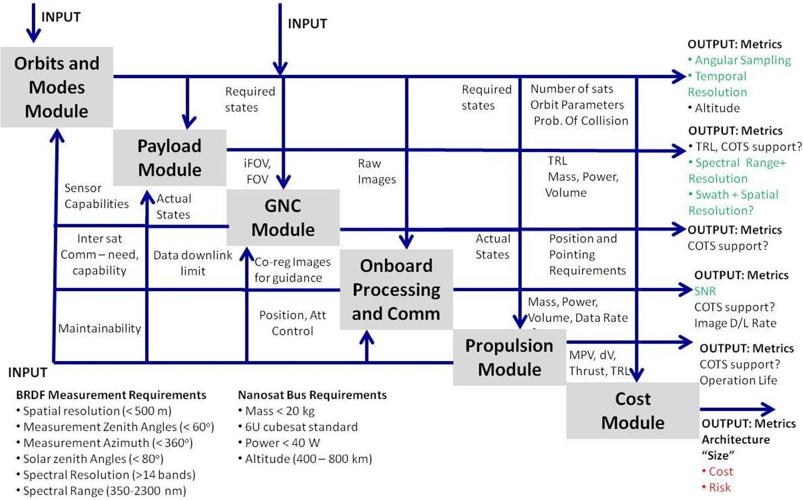

Figure 15: Systems Engineering Model as an N2 diagram such that the boxes represent the critical modules that drive the technology feasibility study and design of formation architectures to support the science; the vertical arrows represent inputs; and the horizontal arrows represent outputs. Green outputs indicate science performance or serve as inputs into the BRDF science evaluation box in Figure 14; red outputs indicate cost; black outputs indicate technical performance.

Many DSM architectures are generated by running the SE model for different subsystem variables within the measurement requirements. Technical feasibility of these architectures is determined by the output values in black shown in the right side of Figure 15: signal to noise ratio (SNR), COTS supportable GNC/payload/communication/processing, technology readiness level (TRL) and image downloading rate. Science performance of these architectures is determined by the output values in green: angular spread, spectral range and resolution, spatial resolution, and swath and temporal resolution. Of these, angular spread serves as the input into the Science Evaluation model (Box IIIb in Figure 14), because it cannot be evaluated in absolute terms like the other metrics. Only architectures with the values permitted by the technology constraints and measurement requirements (Input to Box I in Figure 14) will be considered. For example, technologies required

<!-- PDF_PAGE: 69 -->

by the GNC module (e.g. star tracker accuracies) will be checked if they are COTS supported, or if whether the downlink channels for the required data rates can be obtained. If not, either the relevant architectures are discarded, or the measurement requirements are relaxed (e.g. payload collection rate reduced).

To answer Research Question #2, the science performance outputs achieved above, will be compared to each other for different architectures. Since all five sampling dimensions are inter-dependent, a high performance in one (e.g. angular) will require compromise on another (e.g. swath). In the case of monoliths, this is an absolute compromise. However, for DSMs, the compromised dimension (e.g. swath) can be made up by adding more clusters as a clustellation and increasing global coverage and increased cost. Therefore, for DSMs, the ultimate trade is against lifecycle cost and risk the red outputs in Figure 15. This thesis does not claim to trade all dimensions against each other and provide an optimal architecture. Such an effort would need an OSSE with all the dimensional variables or interviews with scientists. However, it does quantify a few metrics representative of performance in each dimension and the inter-relations between all of them, so that a mission designer is able to increase the DSM size to optimize for additional cost.

The cost output of the SE model is used with the angular science outputs from the Science Evaluation model to find the Pareto Optimal architectures, to address Research Question #3. The major modules of the SE model will now be described in Sections IV-2.1 through IV-2.4.

## IV-2.1. Constellation and Formation Flight Design

Constellations can be the spatial configuration of a DSM in two scenarios: One, when WFOV payloads are used and the angular spread at any given ground spot is obtained from overlapping measurements at different angles made by different satellites in a constellation; Two, when NFOV payloads are used and multiple formations are deployed in a clustellation [90] to increase the temporal resolution of observation. Only the first application will be focused on for the thesis. The second can be implemented by simply adding more satellites to the constellation as identical formations. Coverage, as well as the rate of coverage, will increase as a function of the satellite number as demonstrated in Sections V-4 and V-5. Figure 16 represents how constellations and their variables in the global, ECEF frame (left Box I) and/or formation flight geometries and their variables in the LVLH frame (right Box III) affect the angular and temporal performance metrics in the center (Box II). Box II's parameters are the outputs from the SysEng model in Figure 15, and the resultant angular metrics serve as inputs into the Science Evaluation model (Box IIIb in Figure 14).

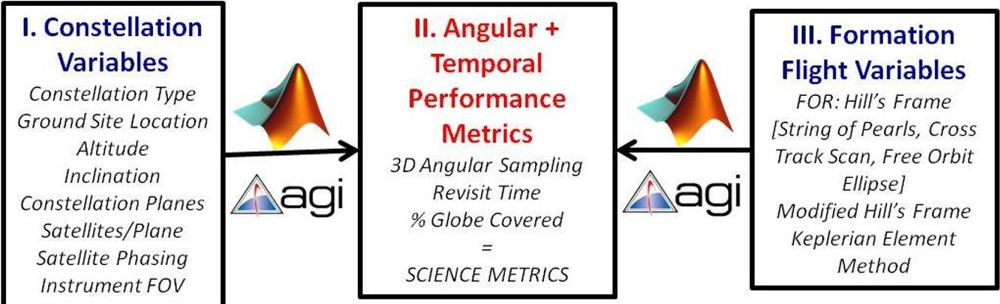

Figure 16: Process Flow Chart for tradespace analysis of DSMs with respect to constellation and formation orbits. Box I - constellation variables (or clustellations in the global frame), Box III - formation flight geometries and their variables (in the LVLH frame), Box II - standard performance metrics.

There are some formation imaging modes which use the constellation analysis software because they are optimized using performance at the ECEF ground spots (not in LVLH), which will be described in the next

<!-- PDF_PAGE: 70 -->

section. A full tradespace of constellations are propagated in AGI's STK and for each ground spot of interest and every instant of time, the coverage and coverage angle from every satellite is recorded. Therefore, every ground spot (classified into one of the seven major surface types) has an angular spread at every time point as a function of the satellites that can "see" it, forming the output metric.

The FF frameworks and variables have been discussed in the literature review and the model will concentrate on customizing them for MA-EO and filling up Gap #2. Traditional and state-of-the-art frameworks can be customized to model the relative trajectories of the FF clusters so as to capture the angular spreads they are able to achieve. The formation flight literature from Section III-3.1 [17], [210] has been arranged into three levels of frameworks of increasing model fidelity and decreasing computational ease of exploration shown in Figure 17. These are: (a) Hill's Equations corrected for Earth's curvature (using the dual spiral equations or numerical corrections), (b) modified Hill's equations with J2, and (c) drag and global orbit modeling using differential Keplerian elements. Each level's trades are analyzed in detail to streamline and inform the selection of variables in the next (higher fidelity) level. The research questions are eventually answered by the architectures generated by the global orbit propagation frame (STK). However the streamlining exercise helps control the explosion of design variable combinations in a computationally expensive environment.

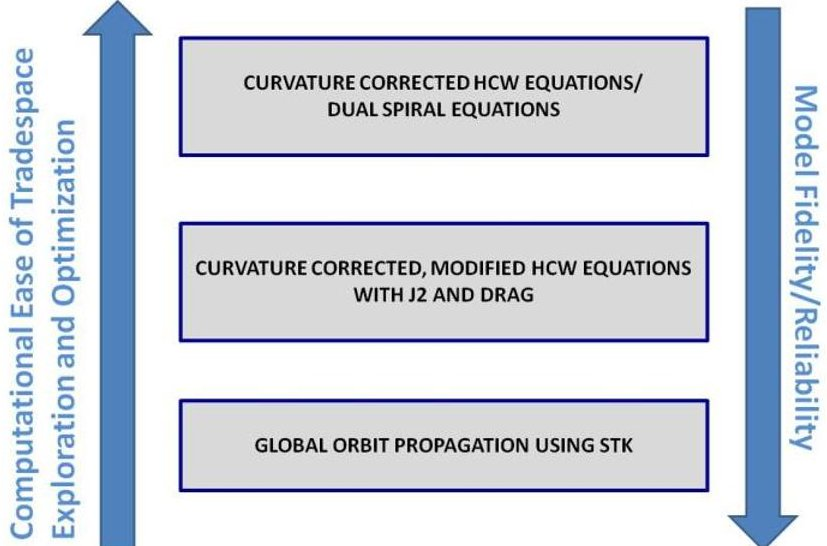

Figure 17: Levels of models used for formation flight simulation as a function of fidelity and computational ease of tradespace exploration.

## IV-2.2. Imaging Modes

While formation flight and constellation designs determine the orbit arrangement of the satellites, the imaging modes determine where and when the payloads will point. Three major modes of payload operation (Figure 18) are proposed, whose performance is a function of dwell time per target, spatial coverage the mission designer is willing to forego, autonomy of the system and the control abilities of the individual satellites in the formation. The mode used serves as a variable in architecture generation. For all the cases, precise attitude determination and control systems (ADCS), delta V corrections and statistical performance analysis are needed for the co-pointing requirement and support feasibility of the same is demonstrated in Section VI-3 and VI-4.

## MODE #1: Reference constant, Nadir pointing

One satellite in the formation is the designated leader and always points to the nadir. The other satellites in the formation point their payloads to the ground spot directly nadir to the leader satellite. Point measurements of the BRDF plane is obtained with the number of points equal to the number of satellites in the formation. This mode allows for continuous imaging of the ground track, but it needs uniform attitude control.

<!-- PDF_PAGE: 71 -->

## MODE #2: Reference changing, Nadir pointing

Like Mode #1, there is one leader satellite in the formation which points nadir while the others follow its ground track by autonomous slewing. However, in this mode, the leader satellite changes over the course of the orbit so as to optimize the angular coverage of the BRDF plane. This allows for improved performance and continuous imaging of the ground track, but needs maximum torque authority in the ADCS when the reference changes from one to another satellite multiple times in one orbit.

## MODE #3: Ground reference, Slew and Stare

All satellites point to the same ground target as they approach over the horizon and recede into the horizon of their instrument fields of view. Line measurements of the BRDF plane are obtained such that the number of curves (great circles) equal to the number of satellites in the formation. Dwelling at the same ground spot on for more time and at more angles allows more angular coverage to be obtained, but at the cost of continuous coverage of the ground track because the formation has to forgo other ground spots in the time it stares at one.

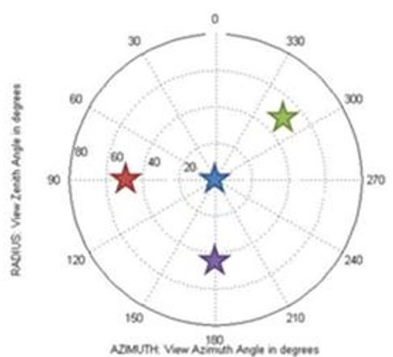

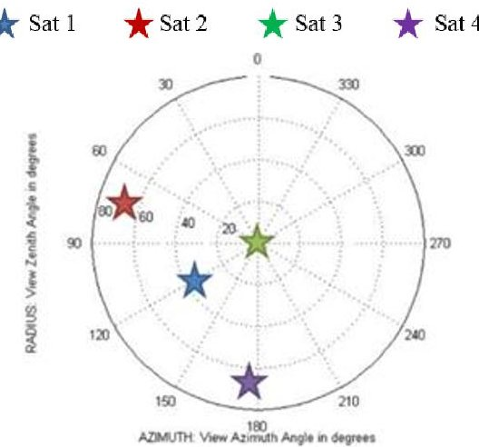

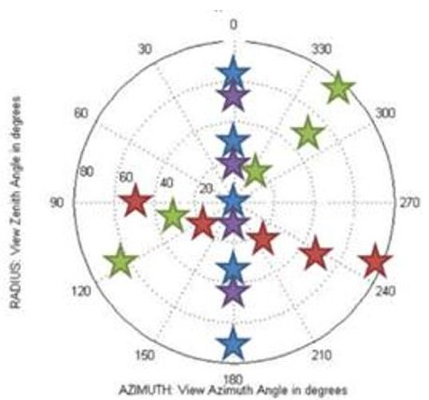

Figure 18: Angular coverage for any single ground point by Mode #1 through #3 using four satellites whose measurements are marked in red, blue, purple and green. In Mode #1 (left), the blue satellite is the reference and images the point nadir to it. In Mode #2 (center), the reference satellite changes over the course of the orbit. The shown snapshot corresponds to the green satellite as reference. In Mode #3 (right), all satellites stare at the same ground point and provide an arc of measurements.

## IV-2.3. Payload Customization

High-level customization of the payload is important to not only identify the COTS components and technology feasibility of the instrument, but also to quantify metrics in the spatial and spectral sampling dimensions. The associated trade study identifies basic optics, dispersive/diffraction elements, their parameters, and compares the identified choices both qualitatively and quantitatively using several system performance metrics. Detailed imager designing is included as PhaseB-level future work. As seen in the outputs of Figure 14, the metrics are (a) spectral range and resolution, and (b) spatial resolution and swath, both of which are dependent on, and influenced by, sampling in the other dimensions. Figure 19 shows the payload tradespace exploration model that will be used to calculate the dependence of the spatial and spectral metrics on the measurement requirements and technology constraints (inputs of Figure 14) as well as on angular metrics (from the OSSE in Section IV-3). The dependence of temporal metrics, specifically spacecraft revisit and time to coverage, on the spatial metrics from this payload model and angular metrics from the OSSE are summarized in Section V-4b and V-5. The outputs of the payload model answer Research Question #2 because the payload represents the interaction and trade-offs between all sampling dimensions [15].

<!-- PDF_PAGE: 72 -->

A system tradespace exploration model is used to estimate the dependence of the payload system requirements (Box II in Figure 19) and the system performance metrics (Box III) on the external system requirements (Box I) and on the spectral element design (Box IV). The external system requirements are obtained from either BRDF science requirements derived from heritage airborne missions[20] (e.g. wavelengths, number of bands, ground pixel length), from the formation geometry model (e.g. altitude, boresight angles) or from capabilities of nanosatellite technology (e.g. avalaible lenses, iFOV, attitude pointing errors). Four spectral element types have been proposed, along with a CCD array of Silicon and InGaAs diodes, as the detectors for snapshot imaging. They will be compared to each other not only in terms of standalone performance and resources, but also on their influence on payload performance metrics. The system trades provide acceptable ranges of payload system requirements, which will subsequently be used to design a miniaturized spectrometer that fits inside a nanosat bus. It will be shown that HSI most optimally mitigates the risks of system attitude errors. The performance metrics will provide simple numbers to compare the different payload architectures.

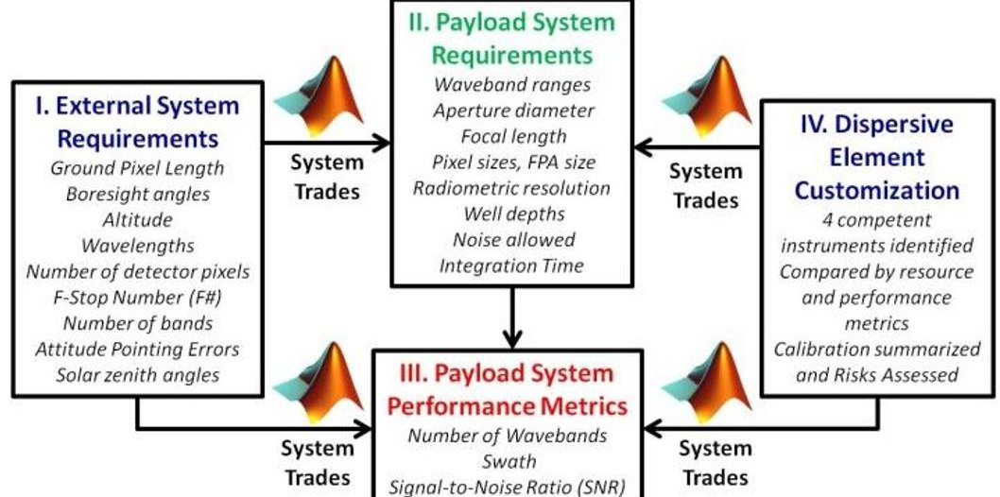

Figure 19: Summary of the modeling approach to design and evaluate hyperspectral snapshot imagers for nano-satellite formations performing multi-angular earth observation. The model allows tradespace analysis of the spectrometer payload on the satellites in the DSM formation to map the effect of changing external requirements (Box I) and available dispersive technologies (Box IV) on the optical system (Box II) and performance metrics (Box III)

The step-by-step process of the model proposed in Figure 19 to customize an imaging hyperspectrometer as a homogeneous payload for a formation of nanosatellites that perform multi-angle Earth observation is briefly described as: First, the mission level goals are listed as derived from science requirements and technology constraints. Next, the measurement requirements will be mapped to the optical system requirements and then to system performance metrics via functional (technical performance checks) and form mapping (nanosat bus fitting checks). Finally, four unique spectral components applicable for HSI are identified and customized. Calibration methods for the proposed instruments, both pre-flight and in-flight especially inter-satellite across the DSM, have been listed in the Appendix X-2. Detailed Phase B analysis of the optical train proposed in this thesis will be needed. The payload packaging problem in terms of computing the exact mass, volume and thermal numbers (only high level design) are also assigned to future work.

<!-- PDF_PAGE: 73 -->

## IV-2.3.1. Measurement Goals and External System Requirements

The requirements for the mission are derived from current, successful spaceborne instruments, and airborne instruments (Figure 15). The exact geometric requirements for the payload module come from the orbit module of the SE model, driven by spaceborne heritage requirements, and the spectral requirements from the CAR instrument. Since the current instrument being designed is a spectrometer, not a radiometer, the band numbers and widths will be dependent on parameters such as detector types, prevention of spectral aliasing and radiometric range. CAR values will be used as reference (Figure 20). Among payload csystem constraints, F-Stop number (F#) is limited to under 5.0, which is reasonable for a nanosatellite. The payload is required to fit within a 6U CubseSat bus (Figure 15) Measurements will be collected only during daylight because the mission is in the VNIR (near solar) spectrum and the tradespace exploration goal is to maximize swath to increase the overlap of ground spots of all satellites in the formation and maximize signal to noise ratio (SNR) for improved quality of images.

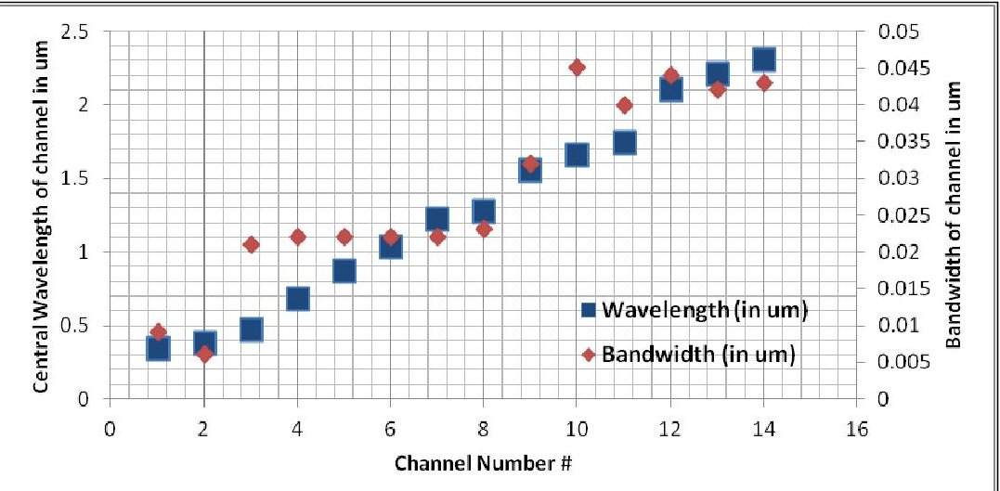

Figure 20: Wavelength requirements for the imaging spectrometer based on the Cloud Absorption Radiometer airborne instrument at NASA GSFC[20]

IV-2.3.2. System level Optics Modeling and Payload System Requirements

The high level payload evaluation model has been shown in Figure 21. The design variables are obtained from external requirements and available, appropriate spectral components (Figure 19). The green variables highlight the simulated optical system requirements and the red parameters the simulated performance metrics to benchmark the different payload system architectures. Each arrow represents a quantitative relationship between connecting variables and parameters as enumerated below. For example, swath is a function of FPA size, slant height, detector pixels # and attitude pointing errors. Interesting trades around the key variables will be described and baseline values chosen after studying the trades.

It will be seen in Section VI-2.2 that it is more efficient to divide the spectral range of BRDF interest into sub ranges or bands - of width $ \Delta\lambda $ in Equation 21. Each band is spectroscopically characterized by multiple bins with nearly uniform width （ $ \delta\lambda $ in Equation 21) corresponding to spectral resolution. The number of bins in a band is given by R:

$$
R = \frac {\Delta \lambda}{\delta \lambda} = \frac {B a n d W a v e l e n g t h _ {U p p e r B o u n d} - B a n d W a v e l e n g t h _ {L o w e r B o u n d}}{B i n _ {w i d t h}}
$$

<!-- PDF_PAGE: 74 -->

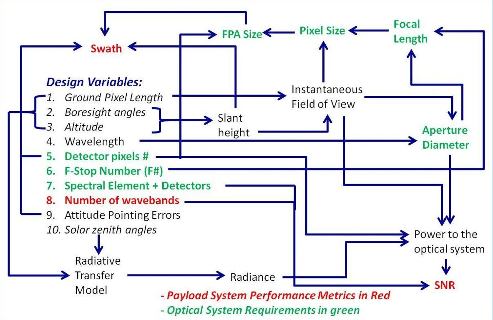

Figure 21: Dependency chart of payload system performance metrics (red, analogous to Figure 19) and optical system parameters (green, analogous to Figure 19) on the design variables, which includes external system requirements, customized spectral components (also in Figure 19) and the FPA detectors. Each arrow represents an equation, enumerated in the supporting text.

The required instantaneous field of view (iFOV) capable of mapping to a given ground pixel size (gps) depends on the boresight angles $ \eta $ altitude (H), as shown by Equation 22 [135]. D is the slant distance between the sensor and the ground pixel, $ \lambda $ is the Earth central angle (different from spectral $ \lambda $ in Equation 21), $ \varepsilon $ is the elevation angle and $ \rho $ is the boresight angle at the horizon all angular variables are shown in Figure 22. Length of earth's radial vector to the satellite is Re.

$$
\mathrm {i F O V} (\mathrm {g p s}, \mathrm {H}, \eta) = \sin^ {- 1} \left(\frac {\mathrm {g p s}}{\mathrm {D} (\mathrm {H}, \eta)}\right)
$$

$$
\mathrm {D} (\mathrm {a l t}, \eta) = \mathrm {H} \quad \eta = 0
$$

$$
\mathrm {D} (\mathrm {a l t}, \eta) = \mathrm {R e} * \frac {\sin (\lambda)}{\sin (\eta)} \quad \eta \neq 0
$$

$$
\lambda = 9 0 - \eta - \varepsilon
$$

$$
\varepsilon = \cos^ {- 1} \frac {\sin (\eta)}{\sin (\rho)}
$$

$$
\rho = \sin^ {- 1} \frac {\mathrm {R e}}{\mathrm {R e} + \mathrm {H}}
$$

Equation 22

The pixel size required to capture at least one ground resolution element will be given by Equation 23 and depends on the same variables as iFOV depends on. A pixel size can be selected depending on the altitude, angle and ground resolution needed $ \overline{{{dp}}} $ in Equation 24) - for diffraction limited imaging - and the swath achieved by the instrument can then be calculated as a function of its focal length (f) and number of pixels per side of the focal plane array (npix)-Equation 24.

<!-- PDF_PAGE: 75 -->

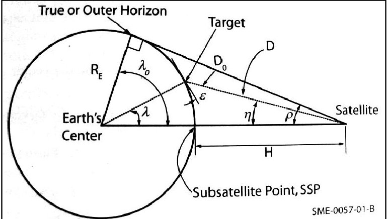

Figure 22: Definition of angular relationships between the satellite, target and Earth's center[135]

$$
\mathrm {d p} (\mathrm {g p s}, \mathrm {H}, \eta) = \mathrm {i F O V} (\mathrm {g p s}, \mathrm {H}, \eta) * \mathrm {f}
$$

$$
\mathrm {s w a t h} = \frac {\mathrm {D} (\mathrm {H} , \eta)}{\mathrm {f}} * \mathrm {n p i x} * \overline {{\mathrm {d p}}}
$$

Equation 24

The total power received on the FPA can be calculated by the following equation derived from first principles - conversion of FOV to steradians and multiplying by the angle as well as the aperture surface area:

$$
\mathrm {P} (\lambda , \eta , \mathrm {h}, \mathrm {S Z A}) = \mathrm {L} (\lambda , \eta , \mathrm {S Z A}) * \mathrm {B W} (\lambda) * \left(\pi * \mathrm {D a} * \sin \left(\frac {\mathrm {F O V}}{2}\right)\right) ^ {2}
$$

Equation 25

Where FOV = the full field of view achievable using the entire focal plane array as calculated similar to Equation 22, Da = aperture diameter, BW $ \lambda $ is the width of the spectral bin at $ \lambda $ and L $ \lambda, \eta, S Z A $ (the bin integrated radiance) is obtained from radiation transfer models. This power, multiplied by the optical transmission of the spectrometer, reaches the detectors on the FPA and is integrated over the exposure time. While instrument optical efficiency varies with the spectrometer type, a fixed value of 0.5 has been used in our calculations. Energy received at the aperture is the integration of power received over the exposure or integration time of one image (intTime)-Equation 26. Energy received can be mapped to photon number by Planck's Law (Equation 27) where c = speed of light, $ \lambda $ = wavelength of the image and h = Planck's constant. Integration time available depends on the dwell time of the sensor on any ground pixel (gps) for any given altitude (alt) and on the spectrometer/spectral element type used as will be seen in Equation 39 and Equation 40.

$ \mathrm{E}=\mathrm{P}(\lambda ,\eta ,\mathrm{h},\mathrm{SZA})* $ intTime(totalPixels,nbands,tuningTime,readoutTime,spatialPixels,gps,alt)

$$
S = \frac {\mathrm {E} \lambda}{\mathrm {h c}}
$$

Equation 27

The noise components depend on the detectors selected, signal received and stray light. For CCD detectors, it is given by the CCD equation [211] - Equation 28-where $ \mathrm{N}_{*} $ is the total number of signal photons (requirement 9 in the previous section). The major contributors of noise are readout noise $ \left(\mathrm{N}_{R}=\mathrm{photons}\right) $ generated when no light shines on the detectors), dark current noise $ \left(\mathrm{N}_{D}=\mathrm{photoelectric}\right) $ effect electrons generated by the heat produced by the system or thermal noise that cannot be distinguished from electrons generated by photons) and random sky noise $ \left(\mathrm{N}_{S}=\mathrm{photons}\right) $ from background or sky). All the noise factors scale linearly with the number of pixels imaged. Readout noise is assumed to be $ 5\mathrm{e}^{-} $ (for 16 bit A/D at 1 MBPS readout), dark current $ 12.5\mathrm{e}^{-}/\mathrm{pixel}/\mathrm{s} $ [212] and random noise at the detector $ \sim 300 $ electrons [213].

<!-- PDF_PAGE: 76 -->

$$
\frac {S}{N} = \frac {N _ {*}}{\sqrt {N _ {*} + n _ {\mathrm {p i x}} \left(N _ {\mathrm {S}} + N _ {\mathrm {D}} + N _ {\mathrm {R}} ^ {2}\right)}}
$$

Equation 28

Signal to Noise Ratio (SNR), given by Equation 28, is considered the main determinant of multi-angle image quality in this study. Heritage instruments typically have an SNR requirement over 100; for example, SNR of 200 for the airborne AVIRIS instrument [214] and 250 for CHRIS [84]. On the other hand, an SNR of as low as 5-10 has in the past provided useful data when used with the correct algorithms[215] and MODIS considers upto 5% uncertainty in its data as acceptable. For the scope of this thesis, it is important to verify that the SNRs are acceptable but it is more important to quantify how the external variables and spectral components in Figure 19 impact the SNR relative to each other because they impact the relative rank of the formation architectures. Therefore, SNR 20 is taken as a soft requirement and the exact calculation of SNR is assumed to not be required for architecture-differentiating decisions in Phase A. Modeled SNR is sensitive to:

- Quantum efficiency (QE) which is the ratio of incoming photons to those photons actually detected by the CCD and is between 0.5-0.9 in the operational range of the CCD[155]. A constant worst-case value of 0.5 was used in this thesis' simulations, and Phase B analysis will need to compute which wavelengths are affected most. For AOTFs, the short wavelength response of the camera is limited by the AOTF tuning element and its long wavelength response by loss in quantum efficiency of CCD FPA.

- Charge transfer efficiency (CTE) which describes the level of accuracy that the charge stored in each pixel can be transferred from one pixel to another in the readout process and is assumed to be 0.99 at worst. Well depth computations have not been performed for the high-level payload study.

## IV-2.4. Cost Model and Results from Development

This section will describe the development of the DSM cost model, which will be used in Chapter VII, by putting together open-source and easily available data sets and models. From the literature review, the following insights for improving cost models for small satellite DSMs have been gathered:

A. To calculate the cost to copy, cost data of an in-house DSM mission before and after CDR (Critical Design Review) will be needed. For example, the second copy of SwissCube [159] or SwissCube-2 is expected to be 45-60% of the original Swiss-Cube, depending on spares and assuming a new workforce. Regression analysis on other missions (especially NASA missions) will provide more insight.

B. In the absence of openly available Work Breakdown Structure data on small satellites, the available cost models cannot be improved to get more precise CERs for small satellites. Snatches of data available from online [208] and GSFC released sources can at most let us check the validity of the CER estimates for small satellites.

C. Lifecycle risk modeling using techniques such as Monte Carlo and VARG is possible from a theoretical standpoint, but model fidelity is questionable without adequate risk-cost data for validation.

Data from past and current DSMs can be used to inform cost models which may then be applied to predict new mission costs. A list of 60 DSMs have been compiled - introduced in Section IV-2.4.1 - which can be used as reference modes to calibrate the SD model.

## IV-2.4.1. Collection of Data from Past Missions

The NASA GSFC Distributed Spacecraft Missions Group [216] gathered data from 59 DSMs - past, operational and planned - from publicly available sources. They spanned over many architectures such as

<!-- PDF_PAGE: 77 -->

constellations, clusters, formation flying, virtual telescopes, etc. and over a wide range of applications including science, commercial communications, defense and technology demonstrations. The data was sorted based on type of mission, spacecraft configuration, number of spacecraft, lifespan, cost, etc. so that insights could be drawn on DSMs. Figure 23 shows DSMs from this study grouped in vertical columns by the mass-based satellite classes defined in Figure 10's top panel. The average masses of the individual spacecraft determine the position on the Y-axis of the data point.

Unfortunately, cost data from public sources was not available for all the missions and WBS elements were not available at all. Reference [208] reported schedule slips and cost overruns for many of the above missions, especially those without fixed price contracts. Annual contracts were often re-negotiated for every year for every contractor leading intractable cost data collection issues as well as an incalculable creep. To avoid getting into unreliable details, only the total cost of the mission as it stands today was used.

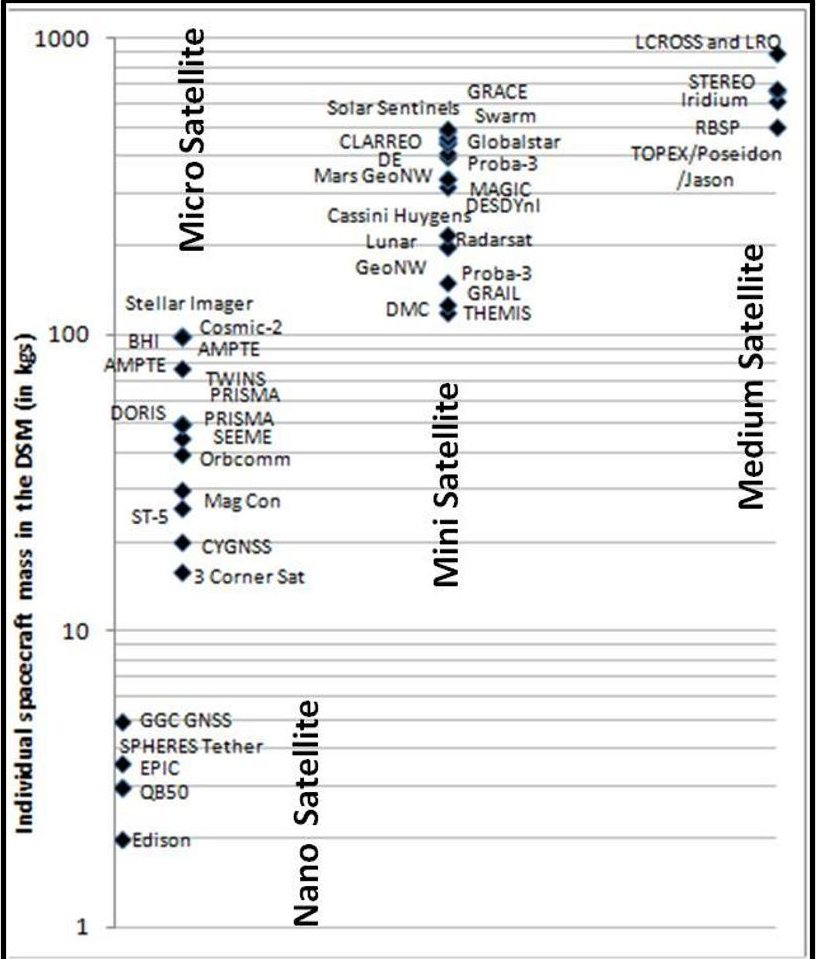

Figure 23: Examples of previous and planned DSMs sorted by their individual spacecraft masses (average when not homogeneous), grouped by the small spacecraft class defined in Figure 10

Note that although the data has been primarily sorted by mass for regression analysis (for simplicity), small satellite mission costs are primarily driven by technology. For example, 20Mbit/s X-band transmitters by Axelspace in Japan at 1 kg mass cost $300,000 because the cost is driven up by shrinking a very high tech instrument into a small form. Cost, thus, is impacted by the high tech and the small size. This implies that for a sufficiently advanced Earth observation mission, the benefits of cheaply launching a lower mass may be outweighed by fitting the technology into the lower mass. Cost models should be able to capture the conflicting effects of both variables to select the right monolithic architecture, or, if appropriate, DSM architecture. Insights from analyzing the data from 59 DSMs and estimating costs using available cost models are presented in Section IV-2.4.2.

<!-- PDF_PAGE: 78 -->

IV-2.4.2. Regression Analysis of Past Mission Data

For regression analysis, the DSMs from Figure 23 are revisited. Twenty of the fifty nine studied DSMs, masses notwithstanding, have two homogeneous or heterogeneous spacecraft. The Earth observation missions or ones with science payload clearly show a decreasing mass with increasing numbers. The navigation and communication missions costing billions of dollars are the ones on the top right.

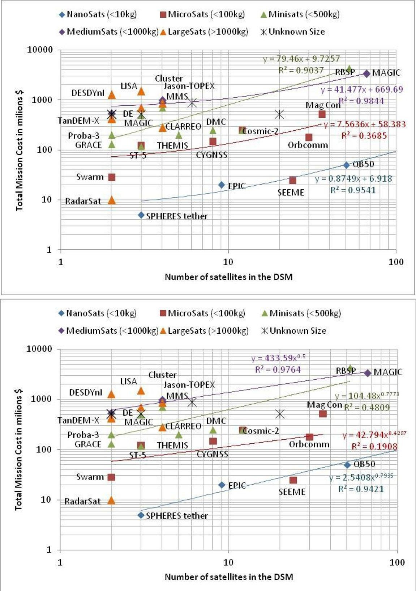

Figure 24: Scatter plot of previous and planned DSMs by the size of their individual spacecraft masses (average when not homogeneous) and number of physical entities in the DSM, grouped (in color) by the small spacecraft class defined in Figure 10. Linear (top) and exponential (bottom) regression curves for each size-based group shown

<!-- PDF_PAGE: 79 -->

Thirty five of the fifty nine missions for which cost and mass data was available have been scatter plotted in Figure 24. The colors correspond to the size based classes of the DSM satellites. For each class, linear (top) and exponential (bottom) curves are fit to the cost vs. number of satellites data spread. Under the assumption that the classes represent similar sizes and the same organizational framework developed and operated all the missions, linear curves represent non-recurring costs and exponential curves represent recurring costs. Nanosatellites and medium satellites are the only classes that show a high correlation for both types of fits, possibly owing to similar modus operandi of DSM development over the available data set. This also helps establish consistent data for the nano-satellite class. The scatter plot in Figure 24 was also sorted in terms of types of orbits, spatial relationship between the satellites, functional category, etc.; however none of those groupings produced a correlation coefficient higher than the size based sorting. Hence, the latter was used for further regression analysis. While Figure 24 assumes the entire cost to be either non-recurring (top) or recurring (bottom), reality is a combination of the two where:

$$
\mathrm {T M C} = \mathrm {N R E} + \mathrm {R E}
$$

$$
\mathrm {N R E} = \mathrm {N R E} _ {0} * \mathrm {N}
$$

$$
\mathrm {R E} = \mathrm {R E} _ {0} * \mathrm {N} ^ {\log_ {2} \mathrm {b}}
$$

Equation 29

Non-recurring costs are one-time expenses and therefore do not follow the economies of scale. Recurring costs alleviated from having more units because learning reduces further costs. For example, ground system costs are considered entirely non-recurring costs while launch costs or integration and testing costs are entirely recurring costs [135]. Other WBS costs are a combination of both. Non-linear least squares regression was then used with the TMC data to find $ \mathrm{R E}_{0} $ (theoretical first unit - TFU - recurring cost), $ \mathrm{N R E}_{0} $ (TFU non-recurring cost) and b (learning curve factor). The results for each mass-based class of satellites have been listed in Table 4, right panel. The learning parameter is 0.77 for nano-satellites and 0.79 for medium satellites, which is lower than the NASA prescribed value of 0.85 [206]. Under the assumption of $ \mathrm{T M C}=\mathrm{R E} $ , linear least squares regression may be used and the results are listed in the left panel. It is only under this assumption that the NASA prescribed learning factor of 0.85 or more is obtained. The analysis shows that the prescription possibly overestimates the cost of making multiple copies of a spacecraft.

Table 4: Inversion of learning curve parameters using data shown in Figure 24 [Left] Linear inversion performed assuming only recurring costs, [Right] Non-linear inversion performed assuming sum of recurring and non-recurring costs

<table border="1"><tr><td>Satellite Class</td><td>Learning‘b&#x27;</td><td>RE0 $$$ million</td></tr><tr><td>Nanosat(&lt;10kg)</td><td>0.86</td><td>2.54</td></tr><tr><td>Microsat(&lt;100kg)</td><td>0.67</td><td>42.79</td></tr><tr><td>Minisat(&lt;500kg)</td><td>0.93</td><td>97</td></tr><tr><td>MedSat(&lt;1000kg)</td><td>0.94</td><td>110</td></tr></table>

<table border="1"><tr><td>Satellite Class</td><td>Learning‘b&#x27;</td><td>RE0$$ million</td><td>NRE0$$ million</td></tr><tr><td>Nanosat(&lt;10kg)</td><td>0.77</td><td>4.27</td><td>0</td></tr><tr><td>Microsat(&lt;100kg)</td><td>0.56</td><td>28.5</td><td>7.93</td></tr><tr><td>Minisat(&lt;500kg)</td><td>0.33</td><td>164.04</td><td>81.68</td></tr><tr><td>MedSat(&lt;1000kg)</td><td>0.69</td><td>464.78</td><td>0</td></tr></table>

IV-2.4.3. Learning Curve Calculations from Cost to Copy Factors

JHU APL published results of their analyses to find the cost to copy multiple copies of a spacecraft or instrument in 2013 [195]. APL has developed and manufactured the JEDI (N=3), RBSPICE (N=2), STEREO (N=2) and Van Allen Probes (N=2). They published the cost to copy (C2C) to be 28%, 45%, 41% and 36% respectively [195]. This implies that it cost APL 28% of the first unit of JEDI to build the second or third unit. It can be seen that C2C decreases with decreasing N. Assuming that JEDI and RBSPICE were all copies of

<!-- PDF_PAGE: 80 -->

each other [195], the C2C for 2, 3 and 5 units was plotted in Figure 25 [195]. Assuming an initial learning curve factor (b=85%) , the learning equation in Figure 25 is fit, the estimated learning parameter is b = 66.2% . This value will be used for costing multiple spacecraft in the next section, based on traditional models to estimate the cost of the first unit. In comparison, literature on aircraft production shows implied learning rates between 18% and 30% , depending on the units considered, after accounting for experience and productivity shocks[217].

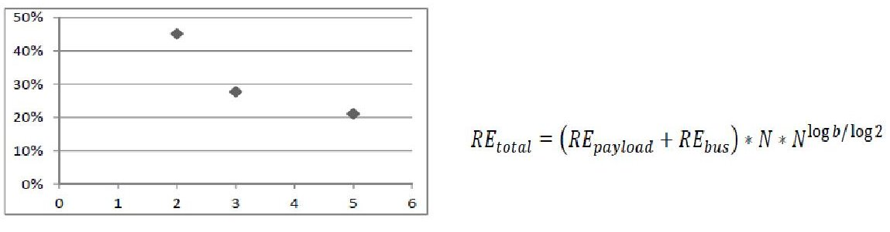

Figure 1: Instrument CtoC Factors vs. Total Number of Instruments

Figure 25: Cost to Copy (C2C) factors derived from cost data available within JHU Applied Physics Lab for instruments developed within their facility [195]

## IV-2.4.4. Applicability of Small Satellite Cost Models

This section discusses the application of traditional cost models, specifically the SSCM [218] and the RAND models [187], [191] to small satellite masses. Project reserves in keeping with the percentages of WBS elements that are used in NASA GSFC have also been included. A learning curve parameter of 0.662 from the previous section has been used and has been applied to only the recurring fractions of the TFU cost. Recurring fractions are obtained from reference [218], for example ground station support is 0 and IAT is 1.

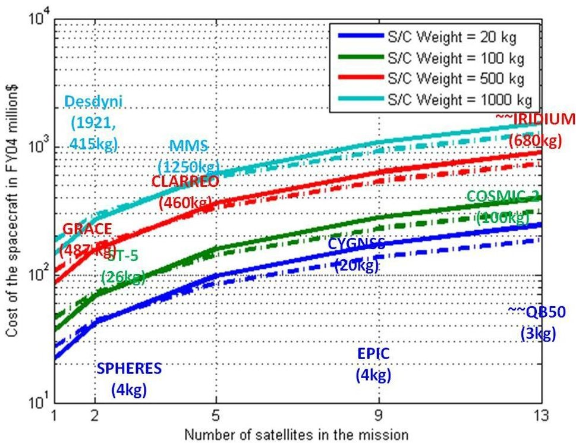

Figure 26: Comparison of costs estimated using RAND Corporation's analogous cost model applied to known S/C and instrument costs [184], [188] - dashed lines, SMAD's Small Satellite Cost model [207] - solid lines with data from real missions - text colored by the closest modeled spacecraft weights

<!-- PDF_PAGE: 81 -->

Figure 26 compares the total mission cost minus launch costs of a 1,2,5,9 and 13 satellite DSM using the SSCM (solid lines) and RAND models (dashed lines). In both cases, SMAD's parametric CERs are used to estimate bus and instrument cost as a function of mass, lifetime and data rate. All other values were model specific. No complexity, launch costs or extra ground operations costs were considered over the regular operations. Software costs were a function of lines of code only, which were very difficult to estimate; eventually values analogous to the MIT SPHERES satellites were used ([219], [220]) as currently functional on the International Space Station. (RAND, [187] and [191]). The coefficient of cost estimated in ground operations in the SSCM model is double that in RAND. Since ground operations have been assumed to be entirely non-recurring, the learning economies of scale do not apply. As a result, the cost predicted by SSCM is lower for few satellites but overshoots the RAND estimates for more satellites. Interviews with experts at NASA GSFC revealed that ground operations are more complex and cost more for DSMs than monoliths so the SSCM model seems intuitively more representative.

A few candidate DSMs from Figure 24 have been highlighted on Figure 26 in the same color as the closest modeled spacecraft weight. While most of the data falls very close to the predictions, many precautions should be made. The GRACE mission was an international cooperation between USA and Europe and the cost here only includes the USA section. DESDynI's two physical entities are so different that they could be two different missions rather than the same DSM, therefore no gain from the learning curve. DESDynI (Deformation, Ecosystem, Structure and Dynamics of Ice) has now been transitioned into the NASA-ISRO SAR mission. CYGNSS and CLARREO are not yet operational so the cost cited is expected cost, and therefore not real data. Finally, since none of the models are applicable to model <20 kg spacecraft, the nano-satellites in Figure 26 do not have a curve to fit them. Again, total cost data is very hard to find, e.g. QB50's cost project does not include the internal costs incurred by the universities building the individual satellites.

The SSCM model was then used to calculate the total cost of developing and manufacturing only the first small satellite of mass 10 kg (example mass) and other specifications listed under 'Inputs' in Figure 27. The cost calculated for every subsystem and the total cost of $15.08 million in FY 2010 is therefore a function of technical variables like power and pointing and not just mass.

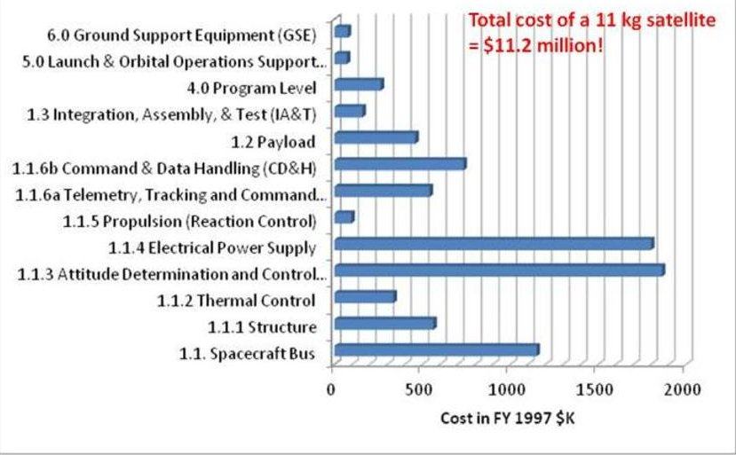

<table border="1"><tr><td colspan="3">INPUTS</td></tr><tr><td>Day Power Required</td><td>10.0</td><td>W</td></tr><tr><td>EOL Array Power</td><td>10.0</td><td>W</td></tr><tr><td>Total COMMS Power</td><td>1.8</td><td>W</td></tr><tr><td>Total Payload Power</td><td>5.0</td><td>W</td></tr><tr><td>Total Power System Mass</td><td>2.0</td><td>kg</td></tr><tr><td>Array Area</td><td>0.5</td><td>m^2</td></tr><tr><td>Bus Mass</td><td>4.0</td><td>kg</td></tr><tr><td>Pointing Accuracy</td><td>0.0</td><td>deg</td></tr><tr><td>Telemetry/Comand Data Rate</td><td>9600.0</td><td>bps</td></tr><tr><td>Propulsion System Mass</td><td>2</td><td>kg</td></tr><tr><td>Comand Data Handling Mass</td><td>1</td><td>kg</td></tr><tr><td></td><td></td><td></td></tr><tr><td></td><td></td><td></td></tr><tr><td colspan="3">FIRST UNIT Cost Estimate</td></tr><tr><td></td><td>FY&#x27;97 $M</td><td>FY&#x27;10 $M</td></tr><tr><td>EOL Power, Pointing Accuracy CER</td><td>$ 51.09</td><td>$ 67.95</td></tr><tr><td>TT&amp;C/CDS Mass, Payload Power CER</td><td>$ 1.40</td><td>$ 1.86</td></tr><tr><td>Downlink Rate, Power, Propulsion CER</td><td>$ 5.55</td><td>$ 7.39</td></tr><tr><td>Bus Mass, Pointing Accuracy CER</td><td>$ 1.30</td><td>$ 1.73</td></tr><tr><td>Array Area/ACS Type CER</td><td>$ 7.59</td><td>$ 10.09</td></tr><tr><td>Power Subsystem Mass CER</td><td>$ 1.08</td><td>$ 1.43</td></tr><tr><td>Average (Millions):</td><td>$ 11.33</td><td>$ 15.08</td></tr></table>

Figure 27: Cost estimated per subsystem (bar chart on left) of one spacecraft by the Aerospace Corporation's Small Satellite Cost Model (SSCM) based on inputs for a candidate nano-satellite mission (excel spreadsheet)

<!-- PDF_PAGE: 82 -->

To check the sensitivity of technology used to the cost, some of the input parameters are varied and its effect on cost in FY97 $million. Changing the data rate from 10 kbps to 10 MBps to 1 GBps resulted in a cost of $11.35, $11.4 and $11.45 million respectively. Since COTS products will be used to support the communication link, these cost estimates imply that there will be only a $100,000 difference in deploying a radio transmitter (10 kbps) or deploying an optical transmitter (1 GBps) on the 10 kg nano-satellite. While previous proposals have certainly supported the availability for laser technologies [10], the optical demonstrations that are currently being developed by DLR in Germany and the Aerospace Corporation in the US [178] clearly demonstrate that the cost of optical technology is more than that. Similarly, changing the pointing accuracy from 0.1, 0.01 to 0.001 degrees resulted in the cost increasing from FY97 $ 6.45, 11.33 and 22.21 million respectively. The technology to support 0.1 degrees (sun sensors) is different from that to support 0.001 degrees (star trackers). However, current COTS quotations (e.g. Blue Canyon technologies XACT) show that it costs $100,000 for a nanosat star tracker system. Integration may cost a few additional thousands but estimating it to $18 million more sounds a bit too much. Apart from inputs possibly being out of range for SSCM data set, another major reason for this disparity is that the inputs of the cost model are independent, while in reality, values of the subsystems (e.g. telemetry) to support very high values of other subsystems (e.g. data handling) are intricately dependent.

The SSCM sensitivity study above highlights the need to have cost models that are more sensitive to different technologies, their associated complexities and internally couple them. Complexity and risk assessment has been proposed by the Aerospace Corporation in the form of their COBRA model. The COBRA model was used in our next study, where the methodology and data sets are detailed in [200], [201], [221]). The data set relative to which complexities are calculated included 120 DoD and NASA missions from after FY89, excluded launch delays or failures and projects with heavy international cooperation. Complexity drivers include (Table 5 column 1) subsystem technical parameters (e.g. mass, power, performance, technology choices) and programmatic factors (e.g., heritage, level of redundancy, foreign partnership). Forty such parameters are considered that are either continuous (e.g. mass, power), and represent a range of values bounded by a minimum and maximum - column #2 and #3 in Table 5, or discrete, such as propulsion type (none, cold gas, monopropellant, bipropellant or ion engine) that represent a finite number of choices.

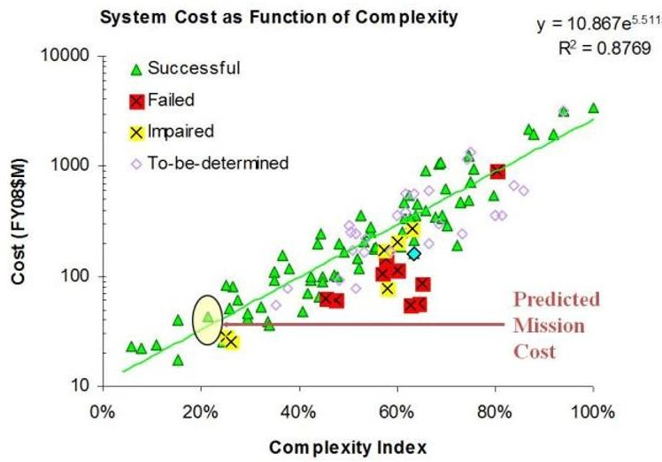

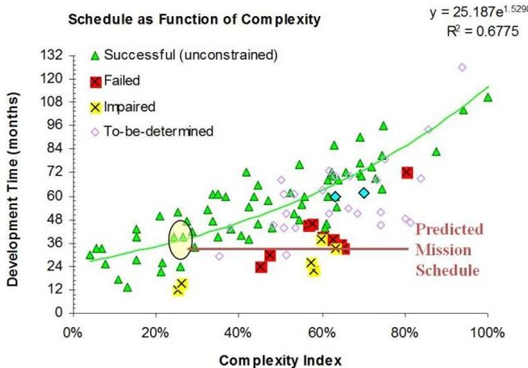

Figure 28: Predicted mission cost and development time as a function of relative mission complexity with respect to other missions evaluated by the Aerospace Corporation [200], [201], [221]. Mission complexity is a function of component complexities as calculated in Table 5. The candidate mission is a LEO satellite measuring passive Earth reflectance as part of a DSM

<!-- PDF_PAGE: 83 -->

For two of the example nanosat case studies, the factors corresponding to spacecraft complexity, as originally proposed, are listed in Table 5 along with the minimum and maximum value that the component takes within their data set. The column 'data' represents the technical input parameters from a candidate nanosatellite which will be a part of a DSM that is tasked to measure the Earth's reflectance at different 3D angles from the same ground spot as it formation flies in LEO ([15],[17],[222]). For each factor, the complexity of the nanosat is calculated as a percentage of where the data point corresponding to the nanosat lies with respect to the data points for all the other space missions considered. For discrete data, the discrete rank of the data is assessed and then converted into a percentage. The average complexity of the nanosat missions are calculated to be 17.09% and 15.26% respectively.

The map between complexity percentile and required mission cost and development time for successful missions (green triangles) is shown in Figure 28 using a green trend line. The missions plotted are among the 120 studied missions and equations are mentioned within the figure. COBRA's developers argue that if missions are attempted cheaper than or faster than this model predicts, then there is a large probability of failure as highlighted by the red and yellow crosses on Figure 28. Using the above model, the estimated cost for an example nano-satellite (10 kg) mission is $27.884 million and the estimated development time is 32.717 months - Table 5 [Left]. Completely removing the payload subtracted less than 7% of the mission cost. The high cost is in keeping with the intuition expressed in the data collection section that the cost of LEO small satellites are driven more by technology than mass, so the utility of shrinking the satellite should be critically assessed and avoided if the mission technology is very state of art. In such cases, micro satellites would win the performance to cost ratio battle. Indeed, if the mass, power, data storage and other such constraints were reduced (or more resources allocated) as seen in Table 5 [Right], the complexity of the mission reduced by 2% and the cost dropped by nearly $3 million.

A sensitivity analysis for the COBRA model was run by varying the $ \Delta V $ and pointing accuracy required by the example 10 kg satellite. It does a great job in predicting the increase in costs from 1 degree to 0.1 or 0.01 degree, by estimating a $ 200,000-250,000 increase. It overshoots the COTS quotations as expected (to account for integration) and is certainly better than the SSCM estimate of $ 18 million more. When the required delta V is increased from none to 40 m/s to 80 m/s to 120 m/s, the respective costs are estimated to be FY97 $ 27.88,27.9, and 27.93 million. Quotations from a 3D cold gas propulsion system printing company called AustinSat revealed that their 1U propulsion unit capable of providing 40 m/s of delta V costs $ 100,000 with 6DOF thrusters included and would scale almost linearly as more 1U units are added for 40 m/s of more delta V. The COTS system therefore costs more than what the COBRA model predicts. This observation held true even when propulsion system mass was manually added to the total mass. The model can thus be improved and made more suitable for COTS-supported small satellites if COTS data and figures were included in the data set to calculate complexity. Since we did not have access to the data set (only the published Figure 28), no quantitative changes could be made.

Small satellites are always pushing the boundaries of technology. It is very probable that some of its component values will fall out of range available from past missions. In such a case, cost models of TRL transition such as the one shown in Figure 29 [203] should be incorporated into the COBRA model for the relevant factors. Although TRL transition correlates to the spending, it does not follow traditional 80-20 rule. The COBRA model also does not capture the structural complexity of a small, tightly packed satellite which has been theoretically shown to drive development costs. Structural complexity can be quantified using a simple framework shown in Figure 13([196], [107]) and can be easily introduced in the COBRA model via a new factor

<!-- PDF_PAGE: 84 -->

and recalculating the data fit. Capturing the above development costs is imperative for small satellites whose costs are driven more by technology than by mass. The proposed changes could not be made because of lack of access to the data set. Lastly, since many small satellite missions are collaborations between many organizations, the COBRA model could be improved by adding a foreign partnership complexity factor that captures the number of collaborators, not just the nationality. For example, a recent paper [202] formulated a data supported method of capturing international cooperation related complexity using cyclometric complexity where CGF = 0.917+0.0575 $ ^{*} $ CyclometricNumber and CyclometricNumber = f(nodes, edges, outputs).

Table 5: Cost estimated for a spacecraft as a function of the relative complexity of its components with respect to components used in previous missions, based on the Aerospace Corporation's Complexity Based Risk Assessment (COBRA) model. Inputs ('Data' in Column 3) are from 2 examples of nanosatellite missions

<table border="1"><tr><td>Factor</td><td>Min</td><td>Max</td><td>Data</td><td>Complex%</td></tr><tr><td>Payload Mass</td><td>0</td><td>6065</td><td>5</td><td>0.082440231</td></tr><tr><td>Payload Avg Power</td><td>0</td><td>6000</td><td>5</td><td>0.083333333</td></tr><tr><td>Payload Peak Power</td><td>0</td><td>13025</td><td>10</td><td>0.076775432</td></tr><tr><td>Payload DR</td><td>0</td><td>304538</td><td>2.34E+05</td><td>76.7063552</td></tr><tr><td># Payload</td><td>0</td><td>23</td><td>1</td><td>4.347826087</td></tr><tr><td>Data Volume</td><td>0</td><td>21168000</td><td>10091520</td><td>47.67346939</td></tr><tr><td>Foreign Partnership</td><td>0</td><td>5</td><td>5</td><td>100</td></tr><tr><td>Design Life</td><td>0</td><td>240</td><td>2</td><td>0.833333333</td></tr><tr><td>Launch Margin</td><td>0</td><td>2</td><td>0</td><td>0</td></tr><tr><td>Launch Mass</td><td>17</td><td>18189</td><td>13</td><td>-0.022011886</td></tr><tr><td>Sat Mass</td><td>17</td><td>16329</td><td>13</td><td>-0.024521824</td></tr><tr><td>Bus dry mass</td><td>15</td><td>10264</td><td>6</td><td>-0.087813445</td></tr><tr><td>SIC heritage</td><td>0</td><td>100</td><td>0</td><td>0</td></tr><tr><td>Radiation</td><td>0</td><td>600</td><td>0</td><td>0</td></tr><tr><td>Redundancy</td><td>0</td><td>100</td><td>0</td><td>0</td></tr><tr><td>Orbit</td><td>0</td><td>5</td><td>1</td><td>20</td></tr><tr><td>BDL Power</td><td>12</td><td>12500</td><td>15</td><td>0.024023062</td></tr><tr><td>Orbit Ave Power</td><td>3</td><td>5342</td><td>7</td><td>0.074920397</td></tr><tr><td>EDL Power</td><td>3</td><td>9960</td><td>3</td><td>0</td></tr><tr><td>Solar Array Area</td><td>0</td><td>175</td><td>0.01</td><td>0.005714286</td></tr><tr><td>Solar Cell Type</td><td>0</td><td>4</td><td>1</td><td>25</td></tr><tr><td>Battery Type</td><td>0</td><td>4</td><td>1</td><td>25</td></tr><tr><td>Battery Capacity</td><td>1</td><td>1222</td><td>10</td><td>0.737100737</td></tr><tr><td># Articulated Struct</td><td>0</td><td>13</td><td>0</td><td>0</td></tr><tr><td># Deployed Structures</td><td>0</td><td>22</td><td>0</td><td>0</td></tr><tr><td>Solar Array config</td><td>0</td><td>3</td><td>0</td><td>0</td></tr><tr><td>Structures</td><td>0</td><td>3</td><td>0</td><td>0</td></tr><tr><td>ADCS type</td><td>0</td><td>6</td><td>3</td><td>50</td></tr><tr><td>Pointing Accuracy</td><td>1.90E-06</td><td>20</td><td>0.01</td><td>0.049990505</td></tr><tr><td>Pointing Knowledge</td><td>1.90E-06</td><td>20</td><td>0.005</td><td>0.024990502</td></tr><tr><td>Slew Rate</td><td>0</td><td>36</td><td>1.00E-03</td><td>0.002777778</td></tr><tr><td># Thrusters</td><td>0</td><td>38</td><td>12</td><td>31.57894737</td></tr><tr><td>Propulsion Type</td><td>0</td><td>5</td><td>1</td><td>20</td></tr><tr><td>Delta V</td><td>0</td><td>5845</td><td>120</td><td>2.053036784</td></tr><tr><td>Comm Band</td><td>0</td><td>6</td><td>6</td><td>100</td></tr><tr><td>Downlink DR</td><td>1</td><td>1460926</td><td>1200000</td><td>82.13967178</td></tr><tr><td>Uplink DR</td><td>0</td><td>40000</td><td>1.00E+03</td><td>2.5</td></tr><tr><td>Transmitter Power</td><td>1</td><td>519</td><td>30</td><td>5.598455598</td></tr><tr><td>Central Proc</td><td>0</td><td>1600</td><td>1000</td><td>62.5</td></tr><tr><td>Software Code</td><td>2</td><td>1496</td><td>30</td><td>1.87416332</td></tr><tr><td>Flight SW Reuse</td><td>0</td><td>90</td><td>25</td><td>27.77777778</td></tr><tr><td>Data Storage</td><td>0</td><td>3.00E+06</td><td>1.50E+06</td><td>50</td></tr><tr><td>Thermal Type</td><td>0</td><td>4</td><td>0</td><td>0</td></tr><tr><td></td><td></td><td></td><td></td><td></td></tr><tr><td></td><td></td><td></td><td>Average</td><td>17.13048269</td></tr><tr><td></td><td></td><td></td><td>Cost</td><td>27.93251927</td></tr><tr><td></td><td></td><td></td><td>DevTime</td><td>32.73320849</td></tr></table>

<table border="1"><tr><td>Factor</td><td>Min</td><td>Max</td><td>Data</td><td>Complex%</td></tr><tr><td>Payload Mass</td><td>0</td><td>6065</td><td>5</td><td>0.082440231</td></tr><tr><td>Payload Avg Power</td><td>0</td><td>6000</td><td>5</td><td>0.083333333</td></tr><tr><td>Payload Peak Power</td><td>0</td><td>13025</td><td>10</td><td>0.076775432</td></tr><tr><td>Payload DR</td><td>0</td><td>304538</td><td>2.34E+05</td><td>76.7063552</td></tr><tr><td># Payload</td><td>0</td><td>23</td><td>1</td><td>4.347826087</td></tr><tr><td>Data Volume</td><td>0</td><td>21168000</td><td>4500000</td><td>21.2585034</td></tr><tr><td>Foreign Partnership</td><td>0</td><td>5</td><td>5</td><td>100</td></tr><tr><td>Design Life</td><td>0</td><td>240</td><td>1</td><td>0.416666667</td></tr><tr><td>Launch Margin</td><td>0</td><td>2</td><td>0</td><td>0</td></tr><tr><td>Launch Mass</td><td>17</td><td>18189</td><td>17</td><td>0</td></tr><tr><td>Sat Mass</td><td>17</td><td>16329</td><td>17</td><td>0</td></tr><tr><td>Bus dry mass</td><td>15</td><td>10264</td><td>10</td><td>-0.048785247</td></tr><tr><td>SIC heritage</td><td>0</td><td>100</td><td>0</td><td>0</td></tr><tr><td>Radiation</td><td>0</td><td>600</td><td>0</td><td>0</td></tr><tr><td>Redundancy</td><td>0</td><td>100</td><td>0</td><td>0</td></tr><tr><td>Orbit</td><td>0</td><td>5</td><td>1</td><td>20</td></tr><tr><td>BOL Power</td><td>12</td><td>12500</td><td>30</td><td>0.144138373</td></tr><tr><td>Orbit Ave Power</td><td>3</td><td>5342</td><td>20</td><td>0.318411688</td></tr><tr><td>EOL Power</td><td>3</td><td>9960</td><td>3</td><td>0</td></tr><tr><td>Solar Array Area</td><td>0</td><td>175</td><td>0.01</td><td>0.005714286</td></tr><tr><td>Solar Cell Type</td><td>0</td><td>4</td><td>1</td><td>25</td></tr><tr><td>Battery Type</td><td>0</td><td>4</td><td>1</td><td>25</td></tr><tr><td>Battery Capacity</td><td>1</td><td>1222</td><td>40</td><td>3.194103194</td></tr><tr><td># Articulated Struct</td><td>0</td><td>13</td><td>0</td><td>0</td></tr><tr><td># Deployed Structures</td><td>0</td><td>22</td><td>0</td><td>0</td></tr><tr><td>Solar Array config</td><td>0</td><td>3</td><td>0</td><td>0</td></tr><tr><td>Structures</td><td>0</td><td>3</td><td>0</td><td>0</td></tr><tr><td>ADCS type</td><td>0</td><td>6</td><td>4</td><td>66.66666667</td></tr><tr><td>Pointing Accuracy</td><td>1.90E-06</td><td>20</td><td>0.01</td><td>0.049990505</td></tr><tr><td>Pointing Knowledge</td><td>1.90E-06</td><td>20</td><td>0.005</td><td>0.024990502</td></tr><tr><td>Slew Rate</td><td>0</td><td>36</td><td>2.00E+00</td><td>5.555555556</td></tr><tr><td>#Thrusters</td><td>0</td><td>38</td><td>12</td><td>31.57894737</td></tr><tr><td>Propulsion Type</td><td>0</td><td>5</td><td>1</td><td>20</td></tr><tr><td>Delta V</td><td>0</td><td>5845</td><td>40</td><td>0.684345595</td></tr><tr><td>Comm Band</td><td>0</td><td>6</td><td>7</td><td>116.66666667</td></tr><tr><td>Downlink DR</td><td>1</td><td>1460926</td><td>120000</td><td>8.213905574</td></tr><tr><td>Uplink DR</td><td>0</td><td>40000</td><td>1.00E+03</td><td>2.5</td></tr><tr><td>Transmitter Power</td><td>1</td><td>519</td><td>30</td><td>5.598455598</td></tr><tr><td>Central Proc</td><td>0</td><td>1600</td><td>1000</td><td>62.5</td></tr><tr><td>Software Code</td><td>2</td><td>1496</td><td>30</td><td>1.87416332</td></tr><tr><td>Flight SW Reuse</td><td>0</td><td>90</td><td>25</td><td>27.77777778</td></tr><tr><td>Data Storage</td><td>0</td><td>3.00E+06</td><td>9.00E+05</td><td>30</td></tr><tr><td>Thermal Type</td><td>0</td><td>4</td><td>0</td><td>0</td></tr><tr><td></td><td></td><td></td><td></td><td></td></tr><tr><td></td><td></td><td></td><td>Average</td><td>15.2622546</td></tr><tr><td></td><td></td><td></td><td>Cost</td><td>25.19973617</td></tr><tr><td></td><td></td><td></td><td>DevTime</td><td>31.81093057</td></tr></table>

<!-- PDF_PAGE: 85 -->

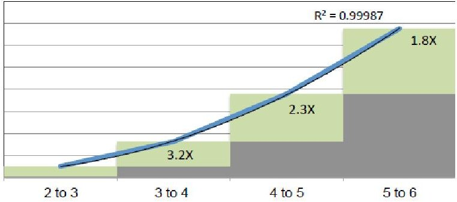

Figure 29: Cost growth (Y-axis) required to support increasing TRL (X-axis) for any component as published in [203]

In spite of not being able to implement the proposed changes in the small satellite (single) cost models, the COBRA model will be used to calculate the TFU cost for the MA-EO formation in Chapter 7 due to better sensitivity analysis than SSCM. The cost value derived in Table 5 [Right] will be used because the subsystem are the closest to those derived in Chapter VI. Since we need a reliable metric of architecture differentiating cost, the TFU cost is far less important than cost as a function of DSM variables such as satellite number and orbital spread. Also, since a 3D imager payload (Section VI-2) with supporting subsystems for slew maneuvers, imaging modes, coordinated downlink and propulsive maintenance (Section VI-3, VI-4, VI-5) has never been flown in a coordinated manner within a nanosat, the cost of the first unit is hard to reliably estimate based on past mission data only. Design decisions should therefore not emphasize overtly on the cost of single satellite and instead predict the differential value of adding more, once more detailed studies establish a single unit cost. The learning curve parameter derived and validated in Section IV-2.4.2 and 0 will be used as cost to scale up a DSM. Ground station and operations costs, even if underdeveloped, are assumed to be captured within the "learning" and with 40% of total mission cost as recurring (validated in Figure 26). A critical component of future work is to improve planning and scheduling operations of DSMs and quantify its associated costs (problem 'C' in the costing model). Differential costs for changing subsystem variables will be calculated from vendors and component providers' numbers cited earlier in this section, when performing sensitivity studies on COBRA and SSCM.

## IV-3. Science Performance Evaluation Model (OSSE-driven)

Angular performance in the model is computed in the innermost layer (right Box IIIb) in Figure 14 and the detailed version is shown in Figure 30. The inputs to the Figure 30 model are the solar zenith, measurement zenith and relative azimuth angle of all satellites in a formation at any given instant of time, which comes from the systems engineering model, and the surface type of interest, which is an external requirement.

Performance in all other sampling dimensions comes from the SysEng model in Section IV-2 temporal metrics from the orbits module, spatial metrics from the orbits and payload module and spectral metrics from the payload module. If a single metric encompassing some or more of the other sampling dimensions, appropriate OSSEs can be selected and plugged in just as the angular OSSE plug-in. Alternatively, mission design decisions can rely on interviews with scientists to prioritize the conflicting sampling metrics, given a quantification of their dependencies (also shown in Section IV-2.3, VI-2 and V-4).

For NFOV sensors in formation flight, the OSSE model is summarized as follows: Reference BRDF is a set of reflectance values of the surface type of interest measured by CAR at all angles. The BRDF pattern is very dependent on the wavelength and surface type. Therefore, reference BRDF to be used depends on the

<!-- PDF_PAGE: 86 -->

geographic area that the formation is expected to fly over and the application of interest/data products of interest (depends on wavelength) as seen in Figure 34. A sample of these values that corresponds to the view zenith and azimuth angles of the formation's satellites is selected from the "Reference BRDF" and used as data to invert a BRDF model and estimate the model parameters. These parameters are then used to run the forward model and calculate reflectance at all angles. The difference between this estimated reflectance and the reference CAR reflectance is called the "BRDF error" and is represented as a Root Mean Square value (RMS). BRDF can be used to calculate geophysical variables such as albedo and GPP. The difference between these variables calculated from the CAR reflectance values vs. the forward model estimated values is called the "App Error", e.g. albedo error. BRDF errors and App errors at any instant of time are the outputs from the science performance evaluation model and determine the goodness of the input formation design and corresponding angular spread. By calculating the error over time for a full tradespace of formation architectures or designs helps us judge them based on an intricately coupled science metric. The error obtained is a sum of the model error, linear inversion errors and sampling error due to architecture; where the first two are assumed to be negligible.

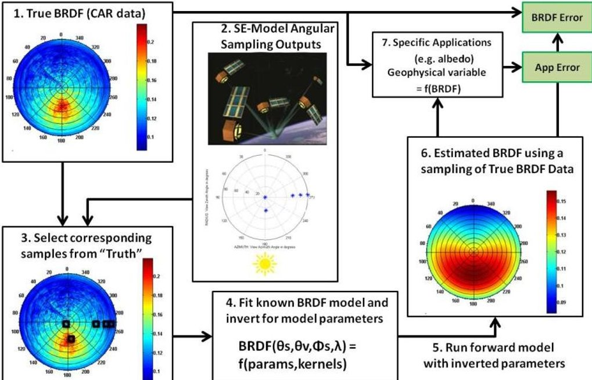

Figure 30: Summary of science performance evaluation (from the innermost blue box named 'Science Evaluation Model' in Figure 14. The model combines angular output from the formation architectures in the SE model with the BRDF science evaluation model. The metrics of performance are BRDF Error and Application Error, marked in green boxes.

WFOV sensors arranged as constellation, on the other hand, need reference data all over the globe and over time, thus cannot use only CAR data (not available, being airborne). Instead, High resolution radiative transfer (RT) model called the University of Manchester Global Climate Model (UMGLO $ ^{7} $ ) is simulated to output radiation at different times, geographic locations and wavelengths - Figure 40. UMGLO model results, modulated with CAR data for angular differentiation (described in Section IV-3.1), are assumed to be the truth. The corresponding OSSE-driven SciEval model is shown in Figure 31. The SysModel outputs simulated measurements per architecture (Box2), which serve as the input to the "OSSE". These measurements determine the subset of the reference TOR (Box1) that the constellation's sensors can 'see'. Samples of the reference TOR are selected accordingly (Box3) and a model is fit on the samples to estimate model parameters (Box 4). The

<!-- PDF_PAGE: 87 -->

next section discusses the potential models, especially the spherical harmonics model, which can be used for this purpose. The inverted model parameters are used to determine TOR globally, over time (Box 6) and compared to the truth (Box 1) to give an objective measure of goodness of the architecture with respect to the UMGLO model truth (Box1). The Pareto optimal architectures are then selected as a function of the two objective metrics: performance error and cost.

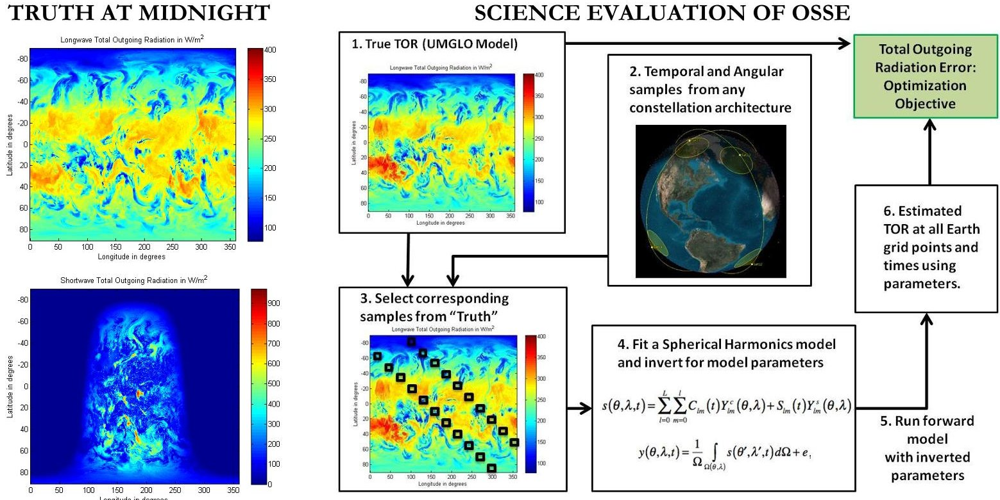

Figure 31: [Left] TOR at every grid point on Earth at 00:00 on August 29, 2010, as generated by the modified UMGLO model for longwave (top) and shortwave (bottom) radiation. Such data is available and used as truth at 3 hour intervals. [Right] Process flow chart for evaluating the 'goodness' of any constellation architecture (Box 2) in terms of the objective of minimizing the TOR error (green box).

The major drivers or influencers on BRDF errors that need to be investigated are - formation flight (FF) or constellation variables to get a tradespace of angular spread [17], [210] and surface type and temporal behavior of the formation or constellation. In the following sections, the radiation data assimilation and spherical harmonics methodology for WFOV sensors, data to use as truth for science performance validation followed by case studies demonstrating the NFOV formations and science evaluation model are presented.

## IV-3.1. Radiation Integration and Spherical Harmonics

The models used in NFOV sensors have been described in great detail in Section III-1.2 and their sensitivity analysis performed in Section V-1.2 to select the appropriate one for the different Earth surface types. For WFOV sensors, the critical measurement estimating step is the integration of the radiance "seen" by the instrument over its FOV. Assuming the instrument aperture to be a polygon of area dA, as seen in Figure 32 (left), the total flux reaching it is the integration of the infinitesimal cones of radiance coming from multiple, radiating grid points on the Earth (in the $ \Omega $ direction). The area of each element of the Earth grid can be calculated from its equivalent spherical polygons and thus subtends a calculable angle $ \delta \omega $ at the aperture. Alternatively, $ \delta \omega $ may be converted into $ (\theta, \varphi) $ coordinates as seen in Figure 32 (right). Total flux (hemispheric) is then given by the radiance integration of $ \delta \omega $ over FOV:

<!-- PDF_PAGE: 88 -->

$$
F l u x = \int_ {2 \pi} R a d i a n c e (\Omega) c o s (\theta) d \omega = \int_ {0} ^ {2 \pi} \int_ {0} ^ {\pi / 2} R a d i a n c e (\theta , \varphi) c o s (\theta) s i n (\theta) d \theta d \phi
$$

Equation 30

The main purpose of a science model is to estimate the measurements at all points in space and time, given a sample set of measurements at a subset of those space-time points. In the spherical (SH) harmonics model, total outgoing radiation or TOR $ \mathrm{(s(\theta,\lambda,t)} $ - in Equation 31) is expressed at the satellite altitude, location in latitude/longitude and time using a truncated SH model. The basis functions are $ Y_{lm}^{c}(\theta,\lambda)= P_{lm}(\cos\theta)\cos(\mathrm{m}\lambda), $ $ Y_{lm}^{s}(\theta,\lambda)=P_{lm}(\cos\theta)\sin(\mathrm{m}\lambda), $ where $ P_{lm}(\cos\theta) $ is the associated Lengendre polynomial, $ \theta $ and $ \lambda $ are latitude and longitude respectively. The onboard radiometer will measure the spatially averaged TOR (instead of in situ TOR) over the instrument field-of-view and yield a spatially integrated measurement $ y(\theta,\lambda,t) $ in Equation 31 with some e as measurement noise.

$$
s (\theta , \lambda , t) = \sum_ {l = 0} ^ {L} \sum_ {m = 0} ^ {l} C _ {l m} (t) Y _ {l m} ^ {c} (\theta , \lambda) + S _ {l m} (t) Y _ {l m} ^ {s} (\theta , \lambda).
$$

$$
y \left(\theta , \lambda , t\right) = \frac {1}{\Omega} \int_ {\Omega \left(\theta , \lambda\right)} s \left(\theta^ {\prime}, \lambda^ {\prime}, t\right) d \Omega + e
$$

$$
y (\theta , \lambda , t) = \sum_ {l = 0} ^ {L} \sum_ {m = 0} ^ {l} \left[ \bar {C} _ {l m} \bar {Y} _ {l m} ^ {c} (\theta , \lambda) + \bar {S} _ {l m} \bar {Y} _ {l m} ^ {s} (\theta , \lambda) \right] + e
$$

Equation 31

Combining the two equations gives the simulated measurements, $ y (\theta ,\lambda ,t) $ , as a function of the basis functions whose coefficients can be solved for if a sufficient number of satellite measurements of flux are available and the satellite position $ (\theta ,\lambda) $ is known. Measurement integration methods, science models and truth data will depend on the application under consideration. Both the methodology and the software tool are modular enough to allow easy swapping of case studies. The two sets of harmonic coefficients, C/S and $ \bar{C} / \bar{S} $ are related by the Pellican cap parameter, $ \beta $ in Equation 32, which acts as a smoothening filter over the reference data[223]. Larger FOVs will result in smoother measured fluxes because harmonics from neighboring points will affect the measurements.

$$
\begin{array}{l} \left\{ \begin{array}{l} \bar {C} \\ \bar {S} \end{array} \right\} = \beta_ {l} \left\{ \begin{array}{l} C \\ S \end{array} \right\} \\ \beta_ {l} = \frac {1}{1 - \cos F O V} \frac {1}{l + 1} \left[ P _ {l - 1} (\cos F O V) - \cos F O V P _ {l} (\cos F O V) \right] \\ \beta_ {1} = \frac {1}{2} \left[ \sin F O V \cot \frac {F O V}{2} \right] \quad \beta_ {0} = 1 \\ \end{array}
$$

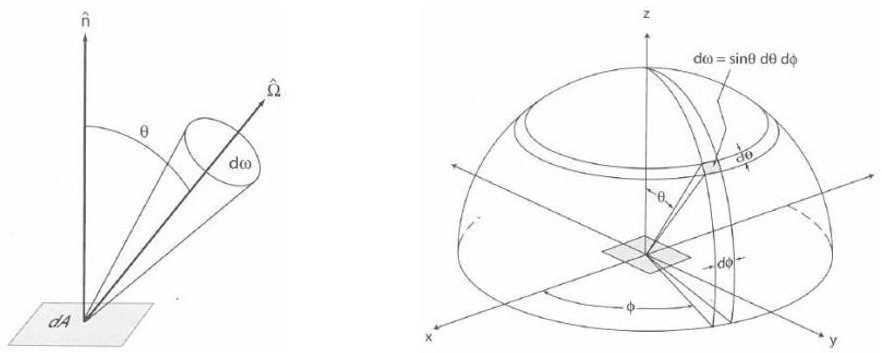

Figure 32: Spherical Geometry representation of radiance and TOR at the satellite

The averaged coefficients can be inverted from measurements and the reference coefficients estimated from them analytically. Flux at any latitude and longitude on the sphere can then be calculated from the reference coefficients. Figure 33 shows the difference in reference TOR at the Equator and estimated TOR

<!-- PDF_PAGE: 89 -->

using the above method in 1D for varying FOV and for different density of measurements. Denser measurements result in lesser errors. Measurements at 24 deg apart i.e. 15 near-simultaneous measurements result in $ < 1 \mathrm{W} / \mathrm{m}^{2} $ of difference from the truth, which is the NOAA prescribed accuracy for shortwave retrievals. When measurements are not well spread, errors soar even if their numbers are large. Figure 33's right most bars show 48 measurements simulated over 24 deg of the Equator resulting in the maximum error. Therefore, it is not just the measurement and satellite numbers, but also the spread and arrangement that are very crucial. Higher FOVs reduce error for uniform spread because of more overlap and ability to capture angular variation of the reference data but increase error for clustered spread.

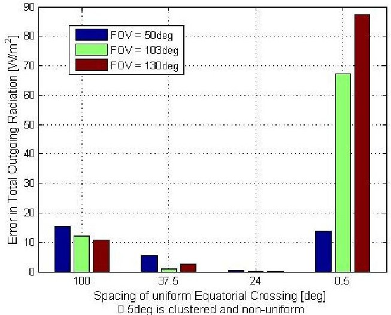

Figure 33: Difference in reference and estimated TOR using 1D spherical harmonics for equally spaced measurements along the Equator (left 3 sets) and clustered measurements over $ 2 4^{\circ} $ (right set), i.e. 3, 9, 15 uniform and 48 clustered measurements.

TOR is assumed to be static over three hours, validated by climate science models. The spatial resolution of the proposed SH model is the Earth circumference divided by the number of SH terms in the expansion - "l" in Equation 31. Therefore, more model parameters and more satellites are required for more spatial resolution (e.g. 100 for a 400 km resolution). Measurements are very high look angles/nadir angles are also noisier (high e), so just increasing the field of view per satellite is not sufficient. Increasing FOV also averages out the truth and misses angular dependence of radiance, requiring more satellites and more overlap to converge to the reference flux. This creates a strong case for constellations.

## IV-3.2. Data from Cloud Absorption Radiometer

Airborne or tower data of multi-angular reflectance serve as "truth" for the science evaluation model. For some OSSEs such as those for estimating total outgoing radiation globally, exhaustive measurements are not available hence, radiative transfer model simulations are used to fill up the gaps[224]. Local BRDF data from airborne campaigns of the Cloud Absorption Radiometer (CAR) on platforms such as NASA P-3B is used as "truth"[20]. The CAR has an IFOV of $ 1^{\circ} $ and is designed to have a zenith to nadir scan range of $ 190^{\circ} $ By flying it around a ground spot in circles and at different heights, radiance measurements are obtained at every degree of reflectance zenith (up to $ 80^{\circ} $ due to a $ 5^{\circ} $ elevation cutoff) and azimuth angle for state-of-art BRDF estimation[20]. By repeating measurements at different times of the day, reflectance at different solar zenith angles may also be available but it is not as exhaustive as the measurement angles.

CAR data for all seven major Earth surface types are available. Figure 34 shows the global distribution of the major surface types, as extracted from GLCF which draws from MODIS data. The grid points are 5 deg apart at the Equator and distance-adjusted for higher latitudes. For each surface type, the inset polar plots show

<!-- PDF_PAGE: 90 -->

the reflectance (in colors) normalized at the top of the atmosphere as a function of measurement zenith (plot radius) and azimuth with respect to the Sun (polar azimuth). Both the shape and the intensity values of these plots are very different, indicating the importance of local but angular data collection as well as global and temporal assessment of this data.

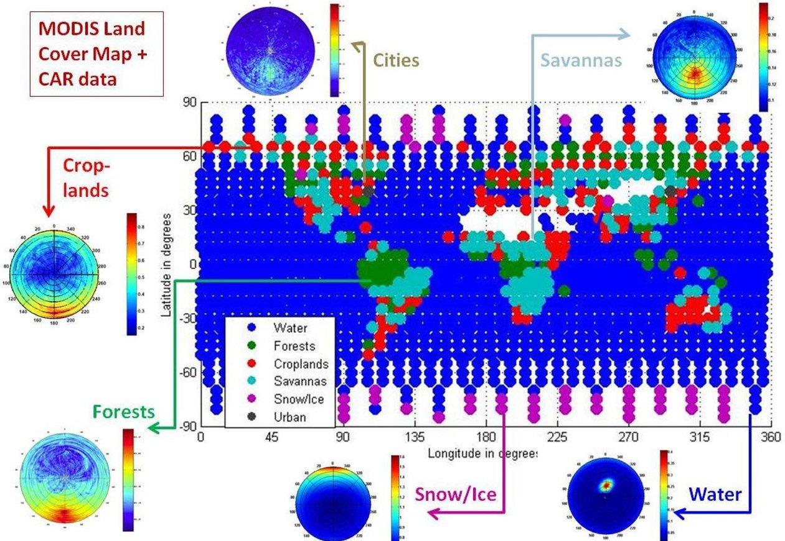

Figure 34: Typical BRDF, at representative wavelengths, of the major Earth surface types, geographically sorted using the MODIS land cover type. The white gaps indicate deserts.

NASA CLAMS campaign (2001) data has been used for water BRDF truth[66]. CLAMS was centered at the Chesapeake Lighthouse sea platform 20 km east of Virginia Beach, at which NASA and NOAA make continuous, long-term measurements of radiation, meteorology, and ocean waves. The inset in Figure 34 shows the data at SZA = 20 deg. Three other data sets at SZA = 16 deg, 30 deg and 44 deg have been shown in more detail in Figure 35. Quite obviously, water BRDF is characterized by a reflectance peak for the sun glint or specular reflectance when MZA equals SZA when looking at the Sun (RAA=0). While angular reflectance around the sun glint gives valuable information about wind speeds and aerosols, the regions far from the sun glint are significant for the ocean color community[66]. Satellite formations can be optimally arranged to measure or avoid the sun glint depending on the application of interest. Reflectance at 472 nm has been plotted and used, because the blue band (among CAR's available bands) is the most representative for water studies.

Data collected during the SAFARI campaign (2000) is used for Savannah vegetation[20]. SAFARI collected BRDF for a variety of natural surfaces and ecosystems in southern Africa including savannah, salt pans and clouds. The savannah is characterized by a distinct backscattering peak in the principal plane (RAA=180deg) called the hot spot, around the angular point where SZA=MZA. The hotspot region is very useful for land and aerosol scientists to quantify photosynthetic productivity, glory effect on water clouds, etc. The inset in Figure 34 shows the data collected over Skukuza, the hottest and most arid region in the Kruger National Park, at $ \mathrm{S Z A}=2 8^{\circ} $ . The vegetation at Skukuza is dominated by knob thorn trees and leadwood[20].

<!-- PDF_PAGE: 91 -->

The polar plot is expanded in Figure 36 to show the hotspot in more detail and compare it to savannah data at $ \mathrm{S Z A}=6 7^{\circ} $ as collected from Maun in Botswana, a region dominated by medium-sized multi-stemmed mopane trees[20]. Both plots show reflectance at the near infrared (682 nm) band. In the absence of the green band in CAR, the NIR band has the best representation of vegetation BRDF.

Water reflectance at SZA $ 1 6^{\circ} $

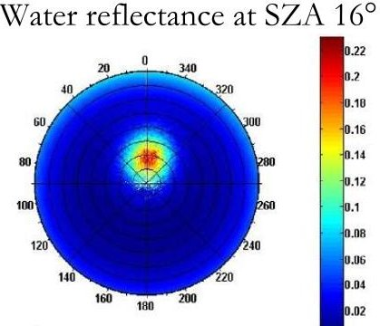

Water reflectance at SZA $ 3 0^{\circ} $

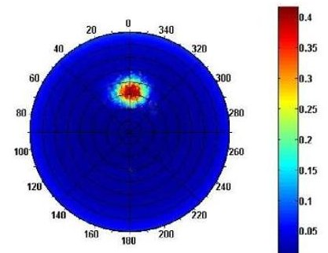

Water reflectance at SZA $ 4 4^{\circ} $

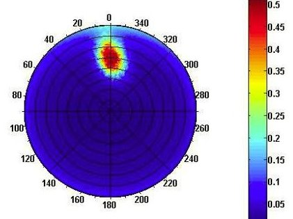

Figure 35: BRDF of water (color bar) as collected off Virginia Beach by the CAR instrument in NASA's CLAMS campaign, 2001. Reflectance at solar zenith angle of $ 1 6^{\circ} $ $ 3 0^{\circ} $ and $ 4 4^{\circ} $ (left to right) is shown. The radial striations for all the data plots are $ 1 0^{\circ} $ in View Zenith Angle (VZA).

Savannah reflectance at SZA $ 2 8^{\circ} $

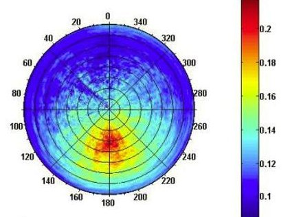

Savannah reflectance at SZA $ 6 7^{\circ} $

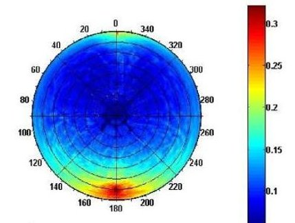

Snow reflectance at SZA 66°

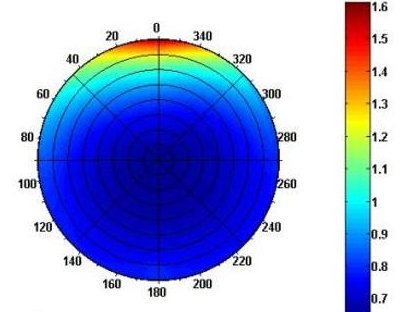

Figure 36: BRDF of savannah (left, middle) as collected over Maun, Botswana (left) and Skukuza, South Africa (middle) by the CAR instrument in NASA's SAFARI campaign, 2000. Reflectance shown is at solar zenith angle $ 2 8^{\circ} $ and $ 6 7^{\circ} $ respectively. BRDF of snow (right) over Alaska during the ARCTAS campaign in 2008 is shown for solar zenith angle $ 6 6^{\circ} $

Snow measurements are obtained from the ARCTAS campaign (2008)[28], in Barrow, Alaska, over the Elson Lagoon. The P-3B carried a payload, including the CAR and AATS instruments, designed to study aerosols and the radiation environment in the Arctic. Figure 36 (rightmost) shows the BRDF signature at the near infrared band of 1036 nm, the chosen band for snow because of its minimal obstruction due to cloud cover and aerosols. The SZA is $ 6 6^{\circ} $ and the specular reflectance direction shows the distinct sun glint, which is characteristic of snow, however much more diffused than the one seen over water. The BRDF signatures of forests and croplands (Figure 34) are very similar to the ones over savannah, being vegetation. The insets show the BRDF signature at 870 nm for forests, collected in the Eco3D Campaign over Wallops, Virginia in 2011, and for croplands, collected in the CLASIC Campaign in Ponca City, Oklahoma in 2007. The band was chosen because the BRDF anisotropy was observed to be the most pronounced among the NIR bands and it is required to be captured by the formation flight solution. Urban reflectance data is represented by the INTEX-B campaign that focused on the long-range transport of pollution, global atmospheric photochemistry, and the effects of aerosols and clouds on radiation and climate. The plotted data is from phase 1 of the study, performed in Mexico from March 1-20, 2006.

<!-- PDF_PAGE: 92 -->

BRDF signature over deserts is assumed to be a Lambertian so only one satellite is sufficient to measure it. The satellite positions over time step from the systems engineering model inform which surface type lies under the formation, and the appropriate "truth" is used in the OSSE. The global grid sampling is coarser than the NFOV ground spot, hence, only one surface type per time step is processed. The position of the monolithic spacecraft such as Terra (also called EOS AM-1) or PARASOL (Polarization & Anisotropy of Reflectances for Atmospheric Sciences coupled with Observations from a Lidar) is obtained from their Two Line Elements (TLE), data based within AGI STK. Exact orbital states for formations of individual satellites can be used to determine angular spread, which is then evaluated in the OSSE. Note that the radial striations for all the data plots (Figure 35 and Figure 36) are 10 degrees in VZA.

## IV-3.3. Data from AMSPEC II - the Automated Multi-angular SPECtro-radiometer

Canopy reflectance measurements from an automated, multi-angular, spectro-radiometer platform called AMSPEC[225] is available for some forested regions. These measurements are used for obtaining "truth" at the 531 nm band, which the CAR does not possess, which is necessary for LUE calculations. AMSPEC is a tower based instrument which can adjust its look angle between 40-70 $ ^{\circ} $ and scan up to $ 330^{\circ} $ of azimuth (after which the tower gets in the way). As an automated instrument, it can collect data all day hence has more solar illumination angle coverage.

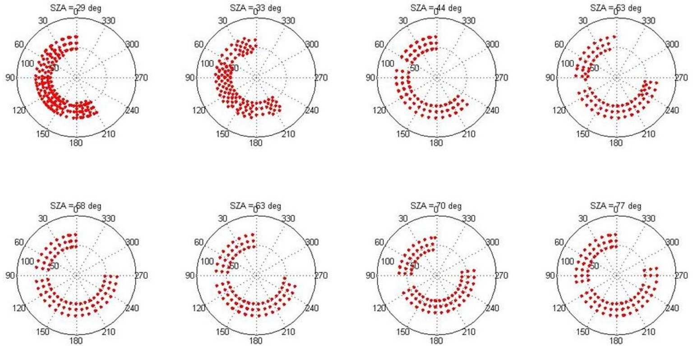

Figure 37: The view zenith (VZA) and relative azimuth (RAA) of the AMSPEC measurements from the DF-49 site, binned by measurements taken every $ 7^{\circ} $ of solar zenith (SZA). Radius indicates the VZA and polar azimuth the RAA of the measurement with respect to the Sun.

AMSPEC data has been validated to be very closely correlated to the CAR data, and can be used to fill up solar zenith gaps in vegetated or forested regions, if required[226]. This thesis uses data from a site called "DF-49", a 61-year old, second-growth coniferous forest located on Vancouver Island, British Columbia, Canada, at 300 m above sea level (49 $ ^{\circ} $ 52'7" N, 125 $ ^{\circ} $ 20'6" W). The stand consists of 80% Douglas fir, 17% western red cedar and 3% western hemlock and is among the most productive forest types in Canada. The stand density is 1100 stems $ \mathrm{ha}^{-1} $ , with tree height ranging between 30 and 35 m. The site is located within the dry maritime Coastal Western Hemlock bio-geoclimatic subzone (mean annual temperature $ \approx $ 8.5 $ ^{\circ} $ C), which is

<!-- PDF_PAGE: 93 -->

characterized by cool summers and mild winters with occasional drought during late summer. The leaf area index (LAI) is $ 7.3 \mathrm{~m}^{2} \mathrm{~m}^{-2} $ [227].

Figure 38: AMSPEC data at 531 nm from the DF-49 site as a function of VZA and RAA, for measurements collected at SZA = 25 $ ^{\circ} $ (left) and $ 4 0^{\circ} $ (center). [Right] VZA and RAA of all AMSPEC measurements at the DF-49 site, irrespective of the SZA, collected of a one day period.

Since the AMSPEC instrument is mounted on a tower and scans the surrounding canopy by changing its look direction, its angular spread is not as extensive or regular as the CAR instrument. Figure 37 shows measurement angular spread collected by AMSPEC over a one day span, binned every 7 $ ^{\circ} $ of solar zenith angle. The gap in the top, right quadrant is due to the views being obstructed by the tower on which the instrument is mounted. The view zenith range is from $ \sim 4 0^{\circ}-6 0^{\circ} $ because the instrument cannot look straight down from the tower as CAR can do from an airplane. AMSPEC reflectances are binned over short periods of time so that the BRDF values not only capture the directional effect seen in all VNIR wavelengths but also the physiological effect during the xanthophyll cycle, which is more active in sunlit leaves than shaded ones. The reflectance values at 1 $ ^{\circ} $ intervals of VZA and RAA for are shown in Figure 38, at a morning hour in August 2006 when the leaves are sunlit. The edge of the hotspot and the full hotspot itself is clearly seen in the left and center panels respectively. All AMSPEC measurements from DF-49 are shown in Figure 38-right, and it is clear that this data alone cannot be used as truth because its angular spread is not enough to pick any angle that the architectural outputs of the SysEng model produces.

Figure 39: BRDF of forest data, synthesized by RTLS inversion on data collected over the DF-49 forest site by the AMSPEC instrument in 2006-2009, at the [left] 531 nm and [right] 570 nm band. The calculated PRI (always negative) is shown in the right most panel. Note the difference in color scales over the three panels.

The approach adopted is thus, to invert an RTLS model on all the AMSPEC measurements at the 531 nm band (all VZA, RAA, SZA: Figure 38-right) and calculate the 3 RTLS coefficients. These coefficients are then used to calculate reflectance at all VZA and RAA angles, and this reflectance used as the truth for the

<!-- PDF_PAGE: 94 -->

xanthophyll sensitive band. The same can be repeated for a xanthophyll insensitive band (red band chosen because of its overlap with one of CAR's bands). The BRDF obtained by inverting for and then forward modeling the RTLS parameters is shown in Figure 39 for both bands. The synthetic data shows >0.92 coefficient of correlation with CAR's red band data, validating the applicability of the approach for using sparse, angular data sets as OSSE truth. The PRI calculated from both synthesized data sets is also shown.

## IV-3.1. Radiative Transfer Model data modulated with CAR data

As mentioned earlier in Section IV, for applications that need temporally varying and global truth data, CAR data is not available because it is airborne and limited spatially and temporally. The ERB case study requires TOR globally and bi- or tri-hourly. Since such measurements have never been obtained, a global climate model is used along with a radiative transfer model to generate the TOR at every $ 0.3516^{\circ} $ of longitude and $ 0.2344^{\circ} $ of latitude, every three hours through August 29, 2010 (arbitrarily selected). The Met Office global forecast model[228] (UMGLO) is used to generate the TOR truth data. The global TOR values at short and long wave at two (of eight) times of the day for nadir view is shown in Figure 40. Assuming the UMGLO radiation field to be isotropic, radiance is equal in all directions of the hemisphere.

$$
R a d i a n c e = F l u x / \pi
$$

Equation 33

Figure 40: Outgoing radiation in $ \mathrm{W / m^{2}} $ at the top of the atmosphere （h=100km）for long wave (top) and shortwave (bottom) radiation at 00:00 (left) and 12:00 (right) on August 30, 2010 as simulated by University of Manchester's UMGLO climate model for all the latitudes and longitudes to serve as isotropic "truth" data.

<!-- PDF_PAGE: 95 -->

In practice, however, earth reflectance in the solar spectrum is anisotropic and is quantified by the BRDF. Thus, solar reflectance can be represented as BRDF $ (\theta ,\Phi ,\varphi ,\lambda) $ , or the reflectance at a given solar zenith angle , measurement zenith angle $ \theta $ , relative azimuth between the two directions $ \varphi $ , at a wavelength $ \lambda $ .

$$
R a d i a n c e = B R D F (\theta , \theta , \varphi , \lambda) * F l u x
$$

Figure 41: BRDF of Arctic snow[28], as an example. Blue curve-broadband reflectance of snow measured by CAR, normalized at the top of the atmosphere (TOA) measured in the vertical plane containing the sun and target. Polar plot- broadband reflectance of snow at all measurement zenith angles $ \theta= $ radius) and relative azimuth with respect to the Sun $ \Phi= $ polar azimuth). Solar zenith $ \theta=6 7^{\circ}. $

BRDF values for eight of the major surface types of the Earth are available from airborne campaigns and have been used to quantify the anisotropy of the radiation field output from the UMGLO model (Figure 34). Data from the Cloud Absorption Radiometer (CAR) instrument[20], developed at NASA Goddard Space Flight Center (GSFC), quantifies reflectance at all 4 BRDF variables, $ \theta, \Phi, \varphi, \lambda $ at an instrument FOV of $ 1^{\circ} $ and over 14 bands from 335 to 2344 nm. Since this section focuses on broadband, wide FOV measurements, CAR measurements can be averaged to provide the same. For example, Figure 41 shows the reflectance or BRDF of Arctic snow as an example (averaged over all wavelengths but constant solar zenith) for varying measurement zenith and azimuth. Measured flux over snow when BRDF is accounted for is 45%-50% higher than when only nadir reflectance is considered. Since a large amount of TOR is reflected off the polar ice, BRDF considerations are important to estimate the truth correctly.

## IV-3.2. Formations applied to Snow Albedo and Vegetation BRDF

The coupling between the MBSE model and the OSSE model for BRDF estimation using NFOV formations will be explained via 3 short case studies. In the first case study, the Free Orbit Ellipse (FOE) configuration in the curvature corrected HCW frame is plugged to the science evaluation model for estimating snow BRDF and albedo. An FOE inclined at $ 2 1^{\circ} $ with LVLH-X=0 plane was chosen based on previous studies that showed the possibility of large but consistent angular spread with such a configuration [17], [210]. A full tradespace enumeration of every possible way N satellites could orient on an FOE leads to tens of millions of architectures which are not efficient to explore because most of them are redundant and significantly underperforming. Since previous studies showed the necessity of a large angular spread, the satellites on the

<!-- PDF_PAGE: 96 -->

FOE are forced into architectures with equal satellites per ring, equal azimuthal spacing in each ring and constrained to a maximum of 6 rings and 8 azimuthal slots. 5,9 and 13 satellites were chosen for the study where 1 satellite was always forced to point nadir for reference reflectance measurements to benchmark the others against.

A detailed, variable streamlining process in Section V-2 and V-3 showed that the HCW-FOE formations need differential inclinations and eccentricities which are impossibly expensive to maintain within nanosats (Section VI-4). However, the physical representation of the angular spreads is better visualized using HCW-FOE formations as opposed to the maintainable HCW-CTS formations. Further, the sensitivity of errors to the spread or number of satellites and its evolution in time is more pronounced in such orbits. This HCW-FOE study thus shows the intricate mapping between formation orbits (both static and over time) in LVLH to the measurement spreads on the ground to the BRDF estimation errors when the ground signatures are different (snow vs. vegetation), and effectively explains the MBSE+OSSE coupled model. The full tradespace analysis in Chapter VII will use global simulations of the highest fidelity with maintainable orbits.

The results of the full factorial study are shown in Table 6 as the best and worst configuration for 5,9, 13 satellites as judged by the BRDF error they produce with respect to the reference CAR data in Figure 34. The first column of figures shows the LVLH position of the satellites in FOE configuration at the instant of time which recorded minimum (top rows, best case) or maximum (bottom rows, worst case) errors. The second column shows the resultant measurement zenith and relative azimuth achieved by all satellites in each formation by pointing their sensor to the ground spot directly below the LVLH origin (which always contains the reference satellite). Since global parameters are not considered in this frame of analysis, the sun is assumed to always be in the orbit plane of the reference satellite or the LVLH-Z=0 plane. In reality, the solar azimuth changes a lot causing the measurement azimuth to change a lot (unless the orbit is sun synchronous).

The worst errors are found when all the measurements are bunched up at near-nadir look angles i.e. negligible zenith range (red dots in second figure column). Errors are even worse when the measurement angles have no azimuthal spread and more so when they are asymmetrically concentrated on one side of the BRDF polar plot. For example, the worst case error with 5 satellites is more than an order of magnitude more than the worst case error with 9 satellites. Architecturally, this disparity was possible because the 6 ring maxima prevented 9 satellites from lining up on one side. Errors almost the same as the maximum (<1% difference) in the N = 9 and 13 satellites case showed measurement angles line up in a straight line as seen in Figure 42. This configuration bears a strong resemblance to MISR's measurement spread except more constrained in the maximum zenith angle. MISR's BRDF error (calculated in the same way as Figure 30) is halfway between this maximum error and minimum error which translates to half an order of magnitude in albedo errors. This implies that having a large zenith range mitigates some error caused by the lack of azimuthal spread but cannot reduce it beyond a certain value. The least errors (blue dots in second figure column) for snow albedo and BRDF are always achieved by both zenith range (so that the sun glint at low sun conditions is captured) and azimuthal spread (so that the symmetry in the BRDF plot is captured). Large differences in look angles for identical satellites causes a huge elongation of swath, however this is a problem at MISR (with look angles varying from 0 to $ 7 0^{\circ} $ ) also has to deal with.

The best and worst BRDF RMS and albedo errors from the full factorial results in Table 6 are summarized as a function of the number of satellites in Figure 43. Worst case errors drop significantly from 5 to 9 satellites, as explained by the fact that all 4 satellites bunched up in the same direction from the Sun which 9 and 13 satellites could not do. The worst case error drop between 9 to 13 satellites and the overall best case

<!-- PDF_PAGE: 97 -->

error drop is <0.3% , indicating nearly no gain in increasing satellite numbers. Since BRDF error is the sum of sampling error, model error and model inversion error and the RTLS model is not a 'perfect' representation of earth reflectance (only 3 parameters), it may not be sufficient to capture the improving errors due to increasing spread because of its own coarseness. Since the inversion error is <0.5% or negligible, assuming a perfect model meant that almost entire error is a metric of sampling optimality.

Availability of new spreads creates a scientific incentive to create better models such as those in computer graphics [70], [71] or compressed imaging which uses a spherical harmonics representation of reflectance [73]. Comparing the worst configurations for 9,13 satellites and best configurations for 5,9,13 satellites also reveals $ \sim 40\% $ difference in BRDF errors but very little absolute improvement. On the other hand, the worst case improvement from 5 satellites is $ 400\% $ . This shows that if satellites are uniformly spread out in rings/zenith and azimuth as the full factorial study was forced to do (except in the 5 satellite case), there is leeway where even the worst is only $ \sim 0.001 $ worse than the best in albedo. This inference is critical because the satellites will spin around in the ellipse and the best configuration will distort periodically [17], [210] but can never get worse than the worst due to orbital dynamics alone, no perturbations considered.

Table 6: Results of the full factorial analysis of N satellites in an FOE configuration at $ 2 1^{\circ} $ with X=0 plane, equally distributed in a flexible number of rings over equally spaced azimuth per ring. One satellite is always forced to point nadir as the reference satellite to make baseline reflectance measurements. In the BRDF polar plots, radius = view zenith angle, polar azimuth = relative azimuth with respect to the Sun.

<table border="1"><tr><td></td><td></td><td></td><td>Formation Configuration in the LVLH frame with trajectories from the HCW equations</td><td>Instantaneous Measurement Angles for the geometry shown</td><td>Estimated BRDF using parameters inverted on measurement samples shown</td></tr><tr><td rowspan="2">N=5 satellites</td><td>Minimum Error Case</td><td>RMS error=0.0582
Albedo error=0.0059</td><td>Cross Track(HCW-Z)inkm
Along Track(HCW-Y)inkm</td><td>0
30
60
90
120
150
180</td><td>Estimated BRDF using parameters inverted on measurement samples shown</td></tr><tr><td>RMS error=0.4884
Albedo error=0.4</td><td>Cross Track(HCW-Z)inkm
Along Track(HCW-Y)inkm</td><td>0
30
60
90
120
150
180</td><td>Estimated BRDF using parameters inverted on measurement samples shown</td></tr></table>

<!-- PDF_PAGE: 98 -->

<table border="1"><tr><td colspan="2">N=13 satellites</td><td colspan="2">N=9 satellites</td></tr><tr><td>Maximum Error Case</td><td>Minimum Error Case</td><td>Maximum Error Case</td><td>Minimum Error Case</td></tr><tr><td>RMS error=0.087
Albedo error=0.0306</td><td>RMS error=0.0570
Albedo error=0.0024</td><td>RMS error=0.0875
Albedo error=0.03</td><td>RMS error=0.0571
Albedo error=0.0034</td></tr><tr><td>Nadir-Zenith(HCW-X)inkm
Cross Track(HCW-Z)inkm
Along Track(HCW-Y)inkm</td><td>Nadir-Zenith(HCW-X)inkm
Cross Track(HCW-Z)inkm
Along Track(HCW-Y)inkm</td><td>Nadir-Zenith(HCW-X)inkm
Cross Track(HCW-Z)inkm
Along Track(HCW-Y)inkm</td><td>Nadir-Zenith(HCW-X)inkm
Cross Track(HCW-Z)inkm
Along Track(HCW-Y)inkm</td></tr><tr><td>Nadir-Zenith(HCW-X)inkm
Cross Track(HCW-Z)inkm
Along Track(HCW-Y)inkm</td><td>Nadir-Zenith(HCW-X)inkm
Cross Track(HCW-Z)inkm
Along Track(HCW-Y)inkm</td><td>Nadir-Zenith(HCW-X)inkm
Cross Track(HCW-Z)inkm
Along Track(HCW-Y)inkm</td><td>Nadir-Zenith(HCW-X)inkm
Cross Track(HCW-Z)inkm
Along Track(HCW-Y)inkm</td></tr></table>

Figure 42: [Left] FOE configuration with 9 satellites with an RMS error of 0.087 (among the highest) with respect to reference BRDF. This measurement configuration is very similar to that of MISR on the Terra spacecraft with 9 sensors. However, it is very constrained in zenith angle range ([Right] shows the angular coverage in view zenith and azimuth), which MISR is not.

<!-- PDF_PAGE: 99 -->

Figure 43: BRDF RMS error (left axis) and albedo error (right axis) with respect to CAR data for the best (green, left) and worst (red, right) configurations as a function of number of satellites in the informed full factorial simulation in Table 6.

In the second case study, the modified HCW equation solutions, with J2 and atmospheric drag included and curvature corrected, are plugged into the science evaluation model for estimating snow BRDF and albedo [229]. To draw from the first case study, the number of satellites and HCW initial parameters were set in order to re-create the best configuration with 13 satellites - Table 6, $ 5^{\mathrm{th}} $ row in this high fidelity frame. The trajectories were propagated for 15 orbits (~1 day) and shown in Figure 44-top. Six satellites each spin around the inner (red) and outer (blue) ring at equal spacing. Drag and J2 causes the rings to tumble about the cross axis as well as drift along track. The view zenith angle subtended at the ground target (orange star) by the first satellite on each ring is plotted in Figure 44-bottom. A small increase the angle subtended (trending at $ \sim2^{\circ} $ ) is seen over 15 orbits. The drift is characteristic of an differential inclination driven FOE. Arctic snow sampling needs maximum angular spread and coverage at the poles, hence differential inclination (not RAAN) will be needed.

This calculation and plot assumes that the formation always flies over snow for an entire day which is not realistic. However, the exercise is useful to evaluate the effect of error over time and inform decisions to phase the satellites so that the configuration over snow corresponds to minimum error. When the angular spread achieved by the above formation is plugged into the science evaluation model for snow BRDF, RMS errors can be calculated for each instant of time and plotted over 1-15 orbits. Figure 45 shows a small linear trend downward because of the slight increase in zenith angles subtended at the ground target which increases the closeness to sampling the sun glint. Too much drift would cause the formation to go over the horizon with respect to the reference satellite which would kill the simultaneous sampling capability of the formation. Formation maintenance strategies such as changing the reference satellite and/or commanding the other satellites to point at the ground track of the reference satellite instead of directly below it (assuming a few minutes time separation in making measurements is acceptable) and/or active propulsion can be adopted to recover angular sampling capabilities in the event of too much drift.

Figure 45 also shows a distinct oscillatory pattern of the BRDF RMS errors with 6 oscillations per orbit (short term) and 1 oscillation per orbit (long term). The insets in Figure 45 show the measurement angles corresponding to select crests and troughs. The presence of 6 satellites per ring ensures a wide azimuthal coverage and taps into the different quarters of the BRDF polar plot in spite of the orbital dynamics causing the satellites to rotate about the center. The patterns seem to indicate that crests correspond to maximum sampling along principal plane (0-180 line/plane, contains the sun) while the troughs correspond to the times when the satellites have all rotated out of the principal plane. If the formation is expected to encounter snow

<!-- PDF_PAGE: 100 -->

in $ \mathrm{X}\% $ of its orbit, the satellites should be phased such that the first or last $ \mathrm{X}\% $ of the orbit (least error) seen in Figure 11 corresponds to the flight over snow.

Figure 44: [Left] The best 13 satellite formation configuration in Table 6 propagated over 1 day including J2 and atmospheric drag effects; trajectories of the inner (red) and outer (blue) ring shown in LVLH frame. Orange star represents the ground target at (0,0,-altitude) in LVLH frame. [Right] View zenith angle subtended at ground target for one satellite in the inner (red) and outer (ring). The graphs for the other 10 satellites are phase shifted versions.

Figure 45's insets show the advantage that formations with equally spaced satellites (in azimuth) have on sampling specific angles. The measurement spread remains almost the same over orbits because as one satellite rotates out of a given view zenith and relative azimuth angle, another one moves in to fill its space. Thus, if the formation is designed such that some combination of angles is captured, equal azimuths will ensure that they are always captured - with more efficiency as number of satellites increases. This is all the more useful when changing solar azimuth angles are taken into account because the satellites rotate even faster because of it. Drift does cause some degradation in the view zenith angle and mitigation methods have been discussed earlier in this section. Sun and drift caused dynamics are best assessed in the global STK frame, which is the highest level of frameworks used.

Figure 45: BRDF RMS error with respect to the CAR data for the formation shown in Figure 44 when propagated for 1 orbit (left) and 15 orbits (right). Insets show the measurement angles achieved at specific points in time marked.

In the third case study, the Free Orbit Ellipse (FOE) configuration in the curvature corrected HCW frame is plugged to the science evaluation model for estimating vegetation BRDF in Southern Africa [229]. The study is essentially the same as the first case study except for a very different surface type, with the intent of

<!-- PDF_PAGE: 101 -->

understanding the difference between the results caused by changing surface types. A full factorial analysis is done with the same variables and constraints as the first case study. Results are presented in Figure 46 for best (blue, left) and worst (red, right) error configurations using 4, 5, 9 and 13 satellites. The respective errors are noted on the first column as e = [minimum RMS error, maximum RMS error]. Figure 47 shows the dependence of these errors on the number of satellites.

<table border="1"><tr><td></td><td>N=4 satellitesE=[0.0135,0.0831]</td><td>N=5 satellitesE=[0.0135,0.0763]</td><td>N=9 satellitesE=[0.0135,0.0266]</td><td>N=13 satellitesE=[0.0135,0.0192]</td></tr><tr><td>Least Error Config</td><td></td><td></td><td></td><td></td></tr><tr><td>Most Error Config</td><td></td><td></td><td></td><td></td></tr></table>

Figure 46: Measurement angles obtained with formations with increasing number of satellites (columns) that gave the minimum (blue, column 1) and maximum (red, column 2) RMS error with respect to reference BRDF of savannah vegetation measured by CAR, where E = [min Error, max Error]. In the polar plots, radius = view zenith angle, polar azimuth = relative azimuth with respect to the Sun.

As earlier, the worst errors occur when all the satellites are bunched toward near nadir i.e. N = 4 or 5 satellites, second (red) column in Figure 46. These configurations fail to capture the azimuthal variation of BRDF and, more importantly, the hotspot as seen in Figure 34 which is the peak reflection on the principal plane that occurs at view zenith angle equal to solar zenith angle with the sun behind the sensors. Worst case errors show a big drop between 5 to 9 satellites since the 9 satellites are forced to symmetrically arrange themselves on either side of nadir. While the worst case still occurs due to lack of azimuthal coverage, errors are improved because of the ability to capture the hotspot. Note the similarity to MISR's configuration except at much restricted zenith range, as before. The worst case in 13 satellites captures the full zenith variation of BRDF but not the hotspot at all, hence only a slight improvement in errors (red curve in Figure 47). The best case errors are seen (blue dots in Figure 46) when at least a part of the hotspot is captured, measurements are made in the upper hemisphere to capture the anti-hotspot and the zenith variation of BRDF is sampled.

The best case error for one time instant does not seem to depend on the number of satellites at all, when Savannah truth is used (green curve in Figure 47). For example, the best configuration in the 4 and 5 satellite case exploit the symmetry of the left and right hemisphere and achieve the same errors as the 9,13 satellites with full zenith and azimuthal spread. However, propagated over the whole orbit, the latter will do much better because the azimuthal sampling will compensate for the formation rotating about the nadir. The

<!-- PDF_PAGE: 102 -->

4 satellite case will be demonstrated in the STK frame to show its drawback over time. The saturation could also be attributed to model errors, and better models can be tested instead of RTLS to assess the difference.

Figure 47: BRDF RMS error for Savannah with respect to CAR data for the best (green) and worst (red) configurations as a function of number of satellites in the simulation from Figure 46.

The vegetation results are not extremely different from the snow results except a critical one: Snow needs more azimuthal sampling than vegetation. Vegetation produces the same and least error with a straight line sampling across the BRDF polar plot (N=4 satellites, blue dots in Figure 46) snow produces near maximum and never minimum errors in such a configuration (N=9 satellites, red dots in Figure 42). Vegetation errors shoot up when the sampling is not available for top and bottom hemispheres. This difference explains why the MISR sensor which its 9 forward aft sensors does better for vegetation than for snow, except when the measurements align perpendicular to principal plane. Full simulations in Chapter VII will show the comparison of monolithic MISR's errors with all formation configurations and over many orbits, which accounts for measurements moving around the BRDF polar space. These results also agree very closely with an simulated annealing and genetic algorithm optimization to find the best and worst sampling points for vegetation and snow for 5,9,13 satellites.

## IV-4. Chapter Summary

This chapter introduces two models: (a) a coupled systems engineering model (MBSE-driven); and (b) the science evaluation model (OSSE-driven), to evaluate the optimal distributed mission architectures for BRDF estimation. The SysEng model comprises architecture generating modules which are orbits, imaging modes and payload; architecture validating modules which are critical subsystems including ADCS, GNC, communication, onboard processing and propulsion; and architecture sizing modules which are the subsystem modules and costing. While the orbits module determines how the satellites will be organized in space, the imaging mode strategies dictate where they will point to make optimal images in coordination. The payload module builds on prior literature (Chapter III) and a comprehensive framework to put together existing methods to model a multi-angular, multi-spectral imaging payload is proposed.

Three major problems with current cost and risk models exist that limit their direct application to estimating the costs of DSMs. These are (a) the absence of reliable learning curve factors, (b) small satellite (<20 kg) costing tools and (c) operations costing. An extensive data set of 53 DSMs (open-source information only) from NASA GSFC and five instruments from JHU APL is used to calculate learning curve parameters and understanding how numbers impact cost-to-copy. Existing models and methodologies that may be applicable in part to DSMs have been identified in Chapter III via a literature survey and some appropriate

<!-- PDF_PAGE: 103 -->

methods (SSCM, RAND and COBRA) and applied them to estimate the cost of small satellites and DSMs using them. A 66.2% learning parameter when used with SSCM or RAND models were found to match well with existing mission costs. However, the complexity-based COBRA model suggested three times more cost for the same single satellite than the SSCM did, when applied to the MA-EO payload and subsystems. Due to the lack of a reliable single satellite cost model, the COBRA estimate will be used as TFU and the derived learning parameter used for mission cost as a function of satellite number. The TFU assumption is justified because (1) the thesis problem statements need architecture differentiating cost, thus cost as a function of DSM variables such as satellite number and orbital spread is more important; (2) the satellite is a new integration of existing technologies, thus hard to reliably estimate based on past mission data only even with a reliable cost model. In addition to obtaining a simple architecture-differentiating lifecycle cost model, the costing exercise helps to identify valuable insights on the use of existing models and suggest changes in existing models especially in terms of accounting for TRL, complexity and operating (planning/scheduling ground support) costs.

The OSSEs for the NFOV payloads in formations vs. the WFOV payloads in constellations are structured differently and have been described. The formations are evaluated in the LVLH frame and use local airborne data (CAR instrument) as truth, depending on the surface type under them. BRDF models used in the OSSEs have been extensively described in Chapter III. Tower data from the AMSPEC instrument is used to obtain reference reflectance at bands non-existent in the CAR, for photosynthetic products. The constellations are evaluated in the ECEF frame and use a radiative transfer model run along with airborne data for angular differentials as truth. The proposed method to integrate flux over the instrument field of view and fitting spherical harmonics over the simulated measurements is described. Finally, a fractional tradespace of low fidelity formations (HCW-FOE) were coupled to the NFOV OSSE to demonstrate science evaluation over some selected surface types of interest. Number of satellites and how they are arranged influences the BDRF estimation error for both vegetation and snow. Chapter V will show how these low fidelity models streamline the bounds for the design variables which can then be inputted into a high fidelity model, whose results for BRDF estimation and dependent products will be showcased in Chapter VII.

<!-- PDF_PAGE: 104 -->

<!-- PDF_PAGE: 105 -->

## V. Results for Orbit and Observing System Simulation Sensitivity

Chapter II highlighted the systems engineering model and its outputs - angular spread, temporal resolution (revisit time) and coverage for all the DSM architectures. The angular spread from SysEng, with or without temporal characteristics, serves as the input to the science evaluation model to assess angular science performance required for answer the research questions. There is lack of open-source, orbital analysis software for understanding the complex design trades for Distributed Spacecraft Missions (DSM), both constellations and more pertinently formation flight. There is especially lack of software that can be modularly plugged into OSSEs once a science goal has been identified. This chapter starts with assessing the science evaluation OSSE models and the truth data, in terms of sensitivity to the typical architecture variables, to confirm that they can differentiate between architectures generated by varying the orbits (and payload variables). It then leverages the reviewed literature in Section III-3.1 and III-3.2 and builds an orbital architecture generating tool, for formations in the LVLH frame and constellations in the ECEF frame.

The formation models are grouped into three levels of increasing fidelity. The simpler models are used to understand the impact of design variables on the output and used to streamline their bounds, to prevent variable explosion when the computationally expensive, complex models are run. The angular output not only depends on the architecture of the orbits, but also on how the satellites point at their common target. The three imaging modes or pointing strategies proposed in Chapter IV Section IV-2.2 are compared in terms of their angular coverage (at the cost of spatial coverage) and its impact on BRDF estimation for a few surface types vegetation and snow. Constellation architectures and their angular output are inputted into the ERB problem to show the preliminary utility of the tool.

This chapter also identifies the key architectural variables for formations and constellations as well as the key variables in the OSSE models, by a thorough sensitivity analysis and streamlining process. Intermediate metrics (angular, spatial and temporal) dependent on the identified variables are quantified. However, they are found insufficient to decide mission designs because of the sheer volume of application-agnostic, metric-data over space, time and choices. The requirement of an OSSE to pull together the conflicting metrics and help make an application-specific design choice is highlighted.

## V-1. Sensitivity Analysis of Science Models

BRDF estimation is a complex problem that depends on many variables - wavelength, surface type, number of measurements, VZA, RAA and SZA spread of the measurements. To simplify the OSSE as much as possible, BRDF dependence on these variables is analyzed in the context of BRDF estimation from spaceborne formation flight. This is done to uniquely and exhaustively map the impact of changing the engineering design variables. A similar effort will then be performed in Section V-2 and V-4 on the systems engineering side of the model to streamline the variable space so that only the sensitive variables are captured[230].

For any given truth (constant surface type and SZA) and any given number of satellites, unconstrained optimization is used to find the best and worst angular sampling on the VZA-RAA polar plot. Obviously, the astrodynamics and systems engineering constraints will not allow a perfect spread, however, the analysis can inform what to aim for and what to avoid. Heuristic optimization routines, specifically simulated annealing, have been found to be the best for the purpose and will be used from MATLAB's Optimization Toolbox for optimization within the OSSE. Appendix X-1 compares the performance of simulated annealing with other optimization routines such as genetic algorithms, swarm optimization and pattern search. After constraining

<!-- PDF_PAGE: 106 -->

the key design variables in the OSSE, the SysEng Model's outputs (satellite states and corresponding angular coverage) can be evaluated in terms of BRDF estimation uncertainty. The reduced-variable OSSE is applied to a baseline formation architecture to demonstrate the evaluation process.

## V-1.1. Sensitivity to Wavelength

The CAR data are available at all angles for 8 wavebands, with the band width in parenthesis: #1 = 0.340 $ \mu m $ (0.009 $ \mu m $), #2 = 0.381 $ \mu m $ (0.006 $ \mu m $), #3 = 0.472 $ \mu m $ (0.021 $ \mu m $), #4 = 0.682 $ \mu m $ (0.022 $ \mu m $), #5 = 0.870 $ \mu m $ (0.022 $ \mu m $), #6 = 1.036 $ \mu m $ (0.022 $ \mu m $), #7 = 1.219 $ \mu m $ (0.022 $ \mu m $) and #8 = 1.273 $ \mu m $ (0.023 $ \mu m $). The 6 other wavebands, collected using the CAR's filter wheel, have not been used in this study. If the angular dependence is very different per waveband, then a different measurement spread will be optimal for different wavebands, in spite of looking at the same surface or ground spot. This will entail fractionating the instrument or flying instruments that measure different parts of the spectrum on different physical entities - adding more complexity to the mission. On the other hand, if the angular dependence per waveband is similar, then the formation geometry can be optimized for any band and optimal performance at the other bands expected. The BRDF data as a function of VZA and RAA per surface type (thus per SZA) were cross-correlated among all pairs of wavebands and results from the least correlated 4 surface types plotted in Figure 48. Only significant correlations (p<0.05) have been considered.

Figure 48: Correlation at p value<0.05 among data collected by CAR at 8 different wavebands, taken two at a time, for 4 of the 7 major surface types.

Snow and croplands show very high correlation among all band pairs and the minimum Pearson coefficient $ \left(r^{2}\right) $ is 0.83 and 0.67, respectively. The red and NIR bands (#4 and higher), our spectral region of

<!-- PDF_PAGE: 107 -->

interest in snow and vegetation, show very high correlation. Water shows significantly high correlation among all band-pairs except between the UV and NIR bands (#1 and #2) because the sun glint is very weak in the UV bands. Water leaving radiance in the absence of glint can be well approximated by the same formation geometry that estimates glint or radiance, hence, the low coefficients in UV do not pose a design change requirement in angular acquisition. Savannahs show low correlation between the blue/UV and red/NIR bands. This is because the vegetation hotspot is much stronger in the red or NIR bands than in blue or UV; band #3 and below have less pronounced anisotropy than the others. As before, a formation that can captures the pronounced anisotropy apparent in the red bands should be able to capture the weak hotspot, if at all present, for less vegetated regions in the visible bands. Furthermore, the data we use does not include atmospheric correction. Atmospheric aerosols have more significant effect in the UV and VIS bands than others, which could be the reasons for divergence in anisotropy. Bands with pronounced signatures and least aerosol effects are therefore best selections for formation geometry optimization.

The wavelength analysis indicates that it is sufficient for the OSSE to use only one but representative waveband for the process of selecting and evaluating the formation because the optimal angular sampling at one representative band implies optimal sampling at any other band of interest. Payload fractionation is also not required. In keeping with the above results, the representative band for water was selected to be #3 because the water leaving radiance and glint is best seen at blue; for vegetated regions (savannah, forests, croplands) we use #5 because the hotspot is most pronounced and for snow we use #6 because of minimal aerosol effects while keeping the pronounced glint. Data at the selected wavelengths are plotted in Figure 34.

## V-1.2. Sensitivity to BRDF Models

One among the available BRDF models has to be chosen to extrapolate reflectance at a few angles to the full hemispherical reflectance (BRDF) over any surface type. For any given surface type and 'perfect' angular spread (Box 1 and 2 in Figure 30), the goodness of a model can be judged by the RMS error of BRDF estimation (green box in Figure 30) and by its inversion residual. The inversion residuals have to be significantly lower than the RMS errors for the evaluation method to be used at all, so that the RMS errors can be attributed to model or angular sampling imperfections rather than mathematical aberrations.

RTLS, when inverting for its 3 parameters, has residual norms $ < 0.05\% $ of the data reflectance values. The residuals are completely independent of the initial conditions, being a perfectly linear model, and have very little dependence on the angular spread. MRPV or modified RPV has slightly higher residuals and they are very sensitive to initial conditions. The CM model inversion, being the most non linear, is very sensitive to the initial conditions. It converges to very inconsistent parameters (e.g. wind speed) for different initial conditions but equally diverse angular spreads. To mitigate this instability, the true CM parameters for the OSSE data sets in this study, as inverted using the full radiative transfer SHARM code[66], are used as the initial conditions. Running the SHARM code along with CM is outside the scope of this study because we want to concentrate on the effect of angular spreads and SHARM would only introduce more uncertainties to the error calculations.

RMS errors after inversion are harder to compare because the perfect angular spread is not known or unique. For each of the 4 land surface types with pronounced angular signatures, 100 Monte Carlo runs were simulated with numbers of satellites between 3 and 8 randomly selected and with random (absolutely unconstrained) angular spreads with those satellites. The RMS error in BRDF estimation (green box in Figure 30) obtained from the MC runs are plotted in Figure 49, when the model used is RTLS (left) or MRPV (right). The distributions are mostly right-tailed, indicating that randomly well-spread angular spreads (unfortunately impossible to achieve astrodynamically) minimize errors. RTLS performs marginally better than MRPV. MRPV

<!-- PDF_PAGE: 108 -->

does well for some surface types and initial conditions. For example, Figure 50 shows the reconstructed BRDF from 9 satellites (in a random astrodynamic, hence constrained) configuration when the MRPV (left) vs. RTLS (middle) model is used. The data set on which the models are fitted/inverted is the Savannah vegetation in Figure 36-left at $ SZA=28^{\circ} $ . The shape of the reconstruction is better for MRPV however the values are closer for RTLS, thus leveling it out in terms of RMS errors. When a similar reconstruction is attempted using snow data, RTLS performs better in terms of shape and intensity and the reconstructed BRDF shown in Figure 50- right. BRDF>1 is due to normalization of aircraft collected data at the top of the atmosphere, and in keeping with the reference data in Figure 36-right.

The RTLS Model: Histogram of BRDF RMS errors over 100 Monte Carlo Runs

The MRPV Model: Histogram of BRDF RMS errors over 100 Monte Carlo Runs

Figure 49: Histograms of BRDF RMS errors (X-axis) over 100 Monte Carlo runs for four different land surface types when using the (a) RTLS or (b) modified RPV model as the model of choice in Box 4 of Figure 30. The X-axis has not been normalized to the same scale because the data is not as well visualized due to the difference in absolute values of error among different surfaces.

Above analysis led to the selection of RTLS as the land BRDF model on our OSSE. Additional reasons in favor of RTLS include its independence of initial conditions, linear form, lower residuals, NASA heritage in generating BRDF products and proven merit in snow [28] and vegetation [62].

<table border="1"><tr><td>Solar Zenith Angle</td><td>RMS Error(RTLS)</td><td>RMS Error(CM)</td><td>CM Initial Conditions</td></tr><tr><td>16°</td><td>0.02</td><td>0.02</td><td>V=6.14m/s,AOD=0.43</td></tr><tr><td>20°</td><td>0.05</td><td>0.02</td><td>V=1.58m/s,AOD=0.19</td></tr><tr><td>30°</td><td>0.04</td><td>0.02</td><td>V=1.08m/s,AOD=0.05</td></tr><tr><td>44°</td><td>0.05</td><td>0.04</td><td>V=2.88m/s,AOD=0.13</td></tr></table>

Table 7: BRDF RMS errors when using measurements simulated by 6 satellites in a leader-follower configuration flying over water with variable SZA and using the RTLS vs. the CM model with initial wind speed (V) and aerosol optical depth (AOD) as listed, and an initial sky radiance algorithmically calculated.

The RTLS model when applied to water data gives very high errors compared to land data. The CM model, by virtue of its slope distribution of mirrors approach and dependence on wind speed, has traditionally been more suited to model water radiance[31], [66]. Measurements by a string of 6 satellites in the A-Train

<!-- PDF_PAGE: 109 -->

configuration at a random solar azimuth angle and four solar zenith angles corresponding to the CLAMS water data in Figure 35 and Figure 34-inset were simulated. The RTLS and CM models were used on these data sets to invert for their respective parameters and the RMS errors between the forward model results and reference data listed in Table 7. The CM model performs better for most SZA angles compared to the RTLS, as expected, and will be used as the model in Box 4 of Figure 30 whenever the simulated formation in Box 2 is expected to fly over water. For all other surface type types, RTLS will be used.

MRPV model for Savannah:

RTLS model for Savannah:

RTLS model for Snow:

Figure 50: Forward modeled hemispheric reflectance (in color using color bar as scale) using inverted parameters from the [left] MRPV model on savannah data at SZA = 28 deg, [middle] RTLS model on savannah data at SZA = 28 deg, [right] RTLS model on snow data at SZA = 66 deg. Compare to truth in Figure 36-left and right.

Figure 51: Forward modeled hemispheric reflectance of water with the Cox-Munk model [Left] using inverted parameters when the model is fit to water BRDF data at $ \mathrm{S Z A}=3 0^{\circ} $; [Right] using wind speed of 5 m/s and no sky radiance or aerosol depth. Compare to truth in Figure 35-middle

The CM model's initial parameters, as mentioned before, are selected from the published values in [66], either from full SHARM inversions or measurements at the campaign site. The initial wind speed and aerosol optical depth per data set (sorted by SZA) are listed in Table 7. The initial sky radiance has been calculated by subtracting the BRDF term (first term in the intensity equation in Figure 7) calculated using the other initial parameters from the reference CAR BRDF. Figure 51-left shows the BRDF reconstructed from 6 measurements in a string of pearls configuration, like A-Train, using the CM model with the appropriate initial parameters applied to CLAMS data set for $ \mathrm{S Z A}=3 0^{\circ} $ (Figure 35-middle). The reconstruction is accurate in terms of shape and intensity of the anisotropy, with inverted wind speeds $ \sim1 $ m/s. In contrast, when wind speeds of 5 m/s and no aerosols or sky radiance were used, the BDRF signature is shown in Figure 51-right. Radiance from water decreases with increasing wind speed[42][31], decreasing aerosol concentration and

<!-- PDF_PAGE: 110 -->

increasing sky radiance. Wind speeds also spread out the sun glint size and for higher SZA angles (>=50 $ ^{\circ} $ ) diffuse it along the principal plane toward the horizon.

## V-1.3. Sensitivity to Measurement Angular Spread per Surface type

With the wavelength and BRDF model to use per surface type decided, the next step is to estimate the optimal measurement spread in the VZA-RAA plane for a given SZA, satellite number and surface type. Heuristic optimization has been used for the purpose, specifically unconstrained simulated annealing. These optimal spreads are practically not precisely possible to achieve or maintain because any measurement configuration in space is constrained by possible orbits and dynamically changes as the satellites move relative to each other. However, these optimal spreads can inform us of what the ideal measurement should be. BRDF estimation dependence on SZA (decoupled due to reference data constraints) and satellite number will be analyzed in the subsequent sections.

Our approach is to optimize the position of N points on the polar plot of BRDF data (constant SZA), i.e. Box 3 in Figure 30 such that BRDF error is minimized, i.e. green box in Figure 30. N points correspond to the measurements taken by a formation of N satellites. The problem is very non-linear because the objective function BRDF error depends non-linearly on the variable space N-fold VZA, N-fold RAA, both for RTLS and CM models. The CM models are even more complex because their inversion process is non-linear as well.

MATLAB-based simulated annealing (SA) was selected as the algorithm of choice after testing the available options[231] on the snow data set with N=5 measurements (results in Appendix X-1). Gradient search algorithms or other local methods fail to optimize the space. Pattern search optimization, local but applicable to functions that are not continuous or differentiable, converges to an acceptable but non-optimal solution. Evolutionary algorithms perform equally well in the task, however with differing speeds and efficiency. They use mechanisms inspired by biological evolution (reproduction, mutation, recombination, and selection) such as in genetic algorithms or GA, or making of materials (heating and controlled cooling of a material to increase the size of crystals and reduce defects) such as in SA or biological search (aiming at food or avoiding threats) such as in swarm optimization. Candidate solutions to the optimization problem play the role of individuals in a population, and the fitness function determines the quality of the solutions. Evolution of the population then takes place after the repeated application of the above operators. Genetic algorithms do equally well as simulated annealing but takes four times more time. Simulated annealing, self-coded with a customized perturbation function and cooling schedule, does as well as the MATLAB based algorithm, but needs less iterations before converging to the same objective function or fitness value. When swarm optimization was applied to the problem, it performed as efficiently as SA, and can be used instead.

Figure 52: Simulated Annealing optimization results for 3-point measurements on the BRDF polar plot when inverting on data from the following surface types from top to bottom - water, croplands, savannahs, snow. The right column shows the convergence history of RMS errors from the initial to final spread. The radial striations for all angular spread plots are $ 2 0^{\circ} $ in View Zenith Angle (VZA).

<!-- PDF_PAGE: 111 -->

<!-- PDF_PAGE: 112 -->

The SA algorithm included selecting an initial system temperature, initial spread and cooling schedule. We automated our temperature to abs $ \mathrm{-E_{0}}/\log(0.99) $ where $ \mathrm{E_{0}} $ is the BRDF error corresponding to the initial spread and selected a linear cooling schedule to allow for more time to converge. The objective function is the system energy (BRDF error), which needs to be minimized. At every temperature drop the angular spread is perturbed, new system energy calculated and the spread re-arranged again; as the cooling continues. The temperature step was set to 0.9 and allowed for up to 5 re-arrangements per step. The tolerance limit per rearrangement was set at 1e-4 and the maximum of rearrangements to 100. Figure 52 shows the results of SA optimization on a N=3 point spread on the VZA-RAA plain for four different land surface types. The initial spread is a string of pearls/leader-follower/A-Train configuration with a random solar azimuth angle (red in all plots). The final spread, irrespective of its shape, always moves away from the initial spread indicating that the initial configuration is non-optimal. Additionally, the initial configuration is the same as that obtained by all monoliths such as MISR and MODIS. The right-hand column shows the convergence history of the RMS errors (system energy or the objective function) from the initial spread to the final spread. Each history has one panel for the last re-arrangement (bottom) and the best-performing re-arrangement (top) per iteration.

Unlike gradient-based methods in a convex design space, heuristics are not guaranteed to find the reference global optimal solution in a single objective problem. However, they should find many good solutions[231]. Since we are trying to look for better spreads than those monoliths provide in a global space, heuristics is our best alternative since they are good at dealing with local optima without getting stuck while searching for the global optimum. Convergence is confirmed because there is not much improvement in errors when the iterations were increased from 100 to 200. Figure 52 makes it obvious that the error improvement over the straight line spread is not equally significant for all surface types. The savannahs show the least error after convergence (0.013 or a 3.5% improvement), followed by water (0.022 or a 5% improvement) and croplands (0.054 or an 18.5% improvement), and finally snow (0.061 or a 20% improvement). Water has the lowest absolute value because the wavelength of the reference data used in the OSSE is lower than that of savannah, which is lower than croplands, and which is lower than snow. Hence, water (snow) data is expected to have the lowest (highest) absolute radiance. The cropland improvement is due to the initial spread being perpendicular to the principal plane, therefore missing the hotspot anisotropy entirely. The optimal spread pushes the sampling toward the hotspot $ \mathrm{RAA}=1 8 0^{\circ} $ $ \mathrm{VZA}=6 8^{\circ} $ as in Figure 34 inset). The snow improvement similarly can be attributed to initial sampling missing the forward glint peak, which the optimal spread is able to capture $ \mathrm{RAA}=0 $ $ \mathrm{VZA}=6 6^{\circ} $ as in Figure 36-right). This analysis demonstrates the importance of having a formation because monoliths are not always able to sample the top and bottom hemisphere of the BRDF polar plot due to the changing solar azimuth. During these time periods, higher than optimal BRDF errors are recorded. By spreading satellites over many azimuths, this under-sampling can be improved. In fact, even when the A-Train spread was able to sample both hemispheres (savannah and water in Figure 52), spreading the measurements over the azimuth improved the errors by a few percentages.

The optimization results of forests resemble that of croplands because of similar anisotropy and wavebands (Figure 34-inset). Urban or city data has a very weak hotspot signature in the NIR bands and a very random angular signature in the visible bands due to high reflection off buildings, concrete and glass. Due to flat and random BRDF/anisotropy plots of cities and deserts respectively, their formation optimization results are not as unique or customizable thus have not been shown. Note that all radial striations for angular spread plots are $ 2 0^{\circ} $ in VZA, through the end of Section V-1.

<!-- PDF_PAGE: 113 -->

## V-1.4. Dependence on Solar Zenith Angle

The previous section demonstrated the estimation benefit in spreading out angular measurements over zenith and azimuth for all the CAR datasets. CAR data has one solar zenith (SZA) per data set for most surface types. For data sets where multiple SZA are available, the effect of changing SZA is analyzed, to confirm the impact of its absence in some surface types. If BRDF estimation errors are sensitive to the CAR data's SZA, in spite of perfect SZA knowledge inputted into the models, then our current data will need to be supplemented with other BRDF data sources over and above CAR. For example, tower measurements from the AMSPEC instrument, which takes measurements at hundreds of SZA, can be used[22],[33]. Figure 36 shows the SZA dependence of land reflectance, primarily the position of the hotspot, and Figure 35 SZA dependence of water reflectance, primarily the position of the sun glint.

The positions of 4 points (corresponding to 4 unconstrained satellites) were optimized on the VZA-RAA polar plane for minimum BRDF error when selected from and fitted to water data from the CLAMS campaign. As before, these optimal spreads are impossible to maintain in a dynamic space orbit, and are only used to inform how the perfect spread changes as the solar illumination angle changes. Figure 53 shows the resultant spreads from the optimization and Table 8 the corresponding BRDF errors. As expected, the optimal spreads move away from the initial A-train-like spread with a random solar azimuth because BRDF estimation is improved, to different extents for the different surface type, by azimuthal coverage. The improvement observed $ \sim0.01 $ in absolute but ranges from 13-28% in the relative scale. Repeating the simulation using Savannah data at two SZAs shows similar significant improvement in error by more azimuthal spread but negligible error difference between the two data sets.

Figure 53: Simulated Annealing optimization results for 4-point measurements on the BRDF polar plot when inverting on CLAMS data for water BRDF at SZA $ = 1 0^{\circ} $ $ 2 0^{\circ} $ $ 3 0^{\circ} $ and $ 4 4^{\circ} $ .

Albedo (black sky for single SZA) is defined as the integration of all hemispheric reflectance or BRDF, and is an example of a BRDF dependent application. Table 8's albedo error is thus one of the "App Errors" in the green box of Figure 30. Optimizing BRDF spreads improves albedo errors, however the optimal BRDF

<!-- PDF_PAGE: 114 -->

spread does not correspond to the optimal albedo spread. When designing a mission, the objective function priorities must be decided so that they can be optimized accordingly.

<table border="1"><tr><td>Solar Zenith Angle</td><td>Initial RMS Error</td><td>Final RMS Error</td><td>Initial albedo Error</td><td>Final albedo error</td></tr><tr><td>16°</td><td>0.0218</td><td>0.0172</td><td>0.00031</td><td>0.001</td></tr><tr><td>20°</td><td>0.0303</td><td>0.0218</td><td>0.0131</td><td>0.0015</td></tr><tr><td>30°</td><td>0.0277</td><td>0.024</td><td>0.0095</td><td>0.0063</td></tr><tr><td>44°</td><td>0.0491</td><td>0.0373</td><td>0.0153</td><td>0.00056</td></tr></table>

Table 8: BRDF and albedo errors associated with the initial and final spreads of 4-point measurements on the BRDF polar plot when inverting on CLAMS data for water BRDF at different SZA

Neither the final VZA-RAA spreads nor their corresponding BRDF errors show a pattern with changing reference data as SZA changes (Figure 35). A slight dependence can be gauged by the fact that the maximum VZA of the measurements increases as SZA increases, perhaps to be closer to the vicinity of the glint or hotspot. However, these spreads are in no way unique because similar low errors are possible by spreading out the 4 points in the different ways that capture more azimuth than zenith.

The key take-away is that the optimal angular spreads are not very sensitive to the SZA for the same surface type, when the SZA is known. While we acknowledge Helmholtz reciprocity and that optimal VZA is theoretically dependent on SZA, having precise knowledge of the SZA relaxes the stringency on the optimal VZA. Non-uniqueness of solutions is a shortcoming of heuristic optimization and its associated perturbation function to make different generations of variables. Nonetheless, heuristics does inform us that as long as angular measurements are available and well-spread on both hemispheres of the BRDF polar plot, the BRDF models are able to reconstruct the reference data with similar accuracy because they are able to predict the shape and size of the hotspot/ glint based on the slopes around these features. A mission that produces greater coverage of the angular space can help improve these models and more accurate BRDF can be reconstructed using sub-optimal data. Given our BRDF models, CAR data classified using the MODIS land cover map, is deemed sufficient as reference data for our OSSE.

## V-1.5. Dependence on Number of Satellites

Previous studies have shown that BRDF RMS errors (estimation accuracy) does not depend on the number of measurements or satellites[222], for more than 3 measurements and if the measurements are arranged optimally for land. This is expected because RTLS is a linear model with 3 parameters and should be uniquely invertible for non-redundant data (hence the value of the spread). Since all the spreads shown in Section V-1.2 through V-1.5 are optimal, more than 3 measurement points can be assumed redundant, leading to error plateaus due to an overdetermined system with rank 3. More complex models with more variables will improve estimation further. Availability of more angular spread data will help develop such models. The CM model for water, due its non-linearity, is expected to show improved results with more data points on the VZA-RAA plane when good initial conditions are not available (realistic scenario). In this study, due to the true initial conditions, those effects are not seen.

Figure 54 shows the optimal spread for 4 (left column) and 6 (right column) measurement points on the VZA-RAA plot, SZA notwithstanding, when optimized for BRDF data over croplands, savannah and water. The corresponding errors are shown in Table 9. The convergence histories are similar to those in Figure 52. The error improvement from 4 to 6 measurements is negligible compared to the improvement from initial

<!-- PDF_PAGE: 115 -->

to final spread, i.e. from azimuthal spread of the measurements, and comparable to the performance error due to position and attitude noise typical of small spacecraft. Figure 54 further shows that while optimization for N=4 spreads the measurement points around the polar plot when started off as a straight line (A-train or monolithic arrangement), the final spread does not improve much from N=4 to N=6. More points end up clustering at similar positions on the plot. While this can be numerically prevented by constraining the degrees of separation in the variables during optimization, it still indicates that similar low errors are possible with lower number of measurements, given currently selected models.

<table border="1"><tr><td></td><td colspan="2">N=4</td><td colspan="2">N=6</td></tr><tr><td>Surface type</td><td>Initial RMS Error</td><td>Final RMS Error</td><td>Initial RMS Error</td><td>Final RMS Error</td></tr><tr><td>Croplands</td><td>0.0773</td><td>0.0606</td><td>0.203</td><td>0.054</td></tr><tr><td>Savannah</td><td>0.019</td><td>0.014</td><td>0.026</td><td>0.013</td></tr><tr><td>Water</td><td>0.0277</td><td>0.024</td><td>0.0281</td><td>0.021</td></tr></table>

Table 9: BRDF errors associated with the initial and final spreads of 4- and 6- point measurements on the BRDF polar plot when inverting on CLASIC, SAFARI and CLAMS data for 3 different surface types.

Figure 54: Simulated Annealing optimization results for 4(left) and 6(right)-point measurements on the BRDF polar plot when inverting on croplands, savannah and water data (from top to bottom). Plots can be compared to Figure 52 for 3- point optimal spreads for the same surface types.

<!-- PDF_PAGE: 116 -->

In spite of the negligible dependence of estimation errors on number of measurements, number of satellites is retained as a key variable in the OSSE for two reasons. One, the optimal spreads are impossible to maintain or achieve in the dynamic, orbital environment. While N = 3 satellites may be sufficient for acceptable errors in the static, unconstrained frame, increasing the number of satellites increases the chances that one of the optimal spreads will be achieved in spite of the relative motion of the satellites and the disturbing forces (e.g. atmospheric drag) over their lifetimes[222], [230], [232], [233]. Two, the simple models (RTLS, MRPV, and CM) were designed to reconstruct BRDF from a couple of measurements that monolithic sensors are capable of providing. Better angular spread of measurements may not improve static BRDF estimation when used with the described models but will certainly help the final products when radiative transfer models are used as well as pave the way for the design of more complex models such as those used in the fields of computer graphics and gravity estimation. This will help scientists understand the anisotropy of the observed surfaces.

## V-2. Streamlining the Formation Flight Architectures

All analysis in this section has been discussed in the Local Vertical Local Horizontal (LVLH) frame centered at the reference satellite at a 500 km altitude. The first level is the linearized Hill Clohessy Wiltshire Equations (Equation 4) which are numerically corrected to account for Earth's curvature at very large intersatellite distances by transforming from Cartesian to curvilinear coordinates. This method has been demonstrated in the formation analysis of the MotherCube mission[123]. The HCW solution that gave the most angular diversity at the ground target was the Free Orbit Ellipse (FOE) configuration demonstrated in Figure 55 with 12 satellites +1 looking nadir. The tradespace variables are the ring radius of the ellipses, their shape and their inclination with respect to the chief orbit. Figure 56 shows the trajectories (top) and the angles they subtend on the ground (bottom) when the initial x and z positions of the satellites are varied to give different orientations to the chief orbit. Relative azimuth and solar zenith angles are not plotted for simplicity. The red and green curves correspond to ellipses that project circles on the ground and are circles respectively. Since the trajectories represent the movement of each satellite over an orbit and the surface type/ground spot below the formation changes throughout, the mission designer can choose the optimal orientation based on the type of angular spread per surface type they want. The COWPOKE equations say this implies tweaking the differential eccentricity, RAAN (Equation 11).

Figure 55: Free Orbit Ellipse simulated using the HCW equations with 12+1 satellites and numerically corrected for Earth curvature. Satellite trajectories are in LVLH and the orange star is at the origin's nadir.

The cross-track scan (CTS) and string of pearls (SOP) solutions were achieved using the dual spiral equations (Equation 6) simplified into the relative analemma equations (Equation 7, Equation 8). These

<!-- PDF_PAGE: 117 -->

solutions analytically accounts for the earth's curvature, azimuthal variation is not as easy to achieve as the FOE solution. The analemma equations can be customized for BRDF-related relative motion by transforming the parametric equations (Equation 8) from inertial earth centric coordinates to LVLH coordinates using the knowledge that the chief orbit is at a distance of $ \left( \mathrm{R}_{\mathrm{E}}+\mathrm{h}\right) $ from the center of the earth, h being the orbital altitude and $ \mathrm{R}_{\mathrm{E}} $ , the radius of the earth. The transformation is given by Equation 35. It represents the motion of the k'th satellite, located at a phase separation of $ \Phi_{k} $ （= $ \Phi_{R} $ in Figure 11) in the LVLH/HCW frame as seen by a base satellite that may be real or virtual, always located at the origin of the HCW frame.

$$
\begin{array}{l} x _ {k} (t) = \left(\mathrm {R} _ {\mathrm {E}} + h\right) \left[ \cos \left(\Phi_ {k} + \alpha (t)\right) \sin \left(\frac {\pi}{2} - \delta (t)\right) - 1 \right] \\ y _ {k} (t) = \left(\mathrm {R} _ {\mathrm {E}} + h\right) \left[ \sin \left(\Phi_ {k} + \alpha (t)\right) \sin \left(\frac {\pi}{2} - \delta (t)\right) \right] \\ z _ {k} (t) = \left(\mathrm {R} _ {\mathrm {E}} + h\right) \left[ \cos \left(\frac {\pi}{2} - \delta (t)\right) \right] \\ \end{array}
$$

Equation 35

A 9 satellite and 1 reference satellite case in the CTS configuration (axes not equal) is shown in Figure 57-left, trajectories in blue and their projections on the perpendicular planes in red. The differential inclination and phases may be varied to get a large option of angular spreads over one orbit, as seen in Figure 11-right. The three curves toward the bottom correspond to those with negligible differential phase (middle trajectories in Figure 57-left). The six curves at the top of Figure 11-right are the analemmas that flank the central one (analemma size increases with differential inclination). Maximum azimuthal coverage is obtained when the satellites go toward the extremes of the analemmas twice every orbit. Each satellite will have a unique analemma without any overlapping phase with another, to prevent collisions at the highest latitude, unlike FOE where multiple satellites can share an ellipse. Verifying with the COWPOKE equations Equation 11) for circular orbits, the only variable that can vary azimuthal spread, given phase, is differential inclination.

Figure 56: [Left] Curvature corrected FOE trajectories in LVLH frame for changing ellipse inclinations to chief orbit (x0/z0 ratio); [Right] View zenith angle subtended by a satellite at the ground spot directly below the LVLH origin for the FOE configurations shown.

The SOP configuration provides the same angular coverage as a monolithic satellite with many forward aft sensors (e.g. MISR) and provides limited azimuthal coverage, hence has not been explored in much detail. It can be simulated using the analemma equations but with no differential inclination. Since the HCW and dual spiral level of analysis does not account for perturbations, the trajectories for every orbit are exactly the same. The second level of analysis introduces the effects of J2 perturbations due to the oblate shape of the Earth

<!-- PDF_PAGE: 118 -->

[125] (Equation 10) and then atmospheric drag effects [126]. Figure 58 shows the trajectories of 3 satellites in different colors with different ring sizes, simulated by maximum X-intercepts (Modified HCW[126]). The orange star is the ground target directly below the reference satellite (marked). Initial X and Z positions and velocities can be varied in keeping with the HCW equations to get a large tradespace of trajectories corresponding to the HCW variables of ring sizes, shapes and orientations.

Figure 57: [Left] Cross Track Scan (CTS) simulated with 9+1 satellites with differential inclination and phase using the relative analemma model. Satellite trajectories are in LVLH and the orange star is at the origin's nadir. [Right] Variation of the view zenith angle subtended by a satellite at the ground target directly below the LVLH origin for the 9 satellites in the left figure.

Figure 58: Free Orbit Ellipse with 3+1 satellites, simulated using the modified HCW equations with J2 and drag [126]) with appropriate initial conditions), propagated for 1 day. The satellite trajectories are in LVLH and the orange star represents the LVLH reference nadir.

The expected tumbling effect of free-orbit ellipses about the cross track axis due to J2 effects is clearly seen in Figure 58. Additionally, there is a slight drift in the along-track direction due to atmospheric drag (negligible at 500 km altitude). The corresponding view zenith angles for all three rings, simulated at three different orientations, are seen in Figure 59. Increasing the initial differential radial separation (X) leads to a larger ellipse and increases the angle subtended at nadir. The ellipses that make a $ 4 5^{\circ} $ or higher angle with the LVLH horizontal display two crests per orbit. The crests correspond to the two extreme positions in the along-track direction. They are symmetric at the beginning and lopsided after a day due to J2 tumbling in that direction. The zenith angle minima corresponds to the higher altitude side of the ellipse and the trough between the crests

<!-- PDF_PAGE: 119 -->

the lower altitude side. As the initial X-Z position ratios are varied to increase the inclination angle of the ellipse, the double crests become single because the ellipse tends toward a horizontal circle. In terms of the angular output, lower ellipse inclinations are useful when a large variation of view zenith angle is needed over the orbit, for example, to follow the variation of the solar zenith angle and precisely estimate specular reflection or hotspots. Higher ellipse inclinations provide an approximately constant view zenith. Relative azimuth with respect to the sun will show the same variation for all ellipses, because they share the same plane.

Figure 59: View zenith angle subtended at the ground target directly below the LVLH origin for the 3 satellite trajectories in Figure 58 (corresponding colors). The different line types correspond to different inclinations of the FOE with the LVLH horizontal plane containing the chief orbit (only one in Figure 58)

To introduce azimuthal variation, an eccentric chief orbit is required with differential Keplerian[128]. The corresponding equations (also COWPOKE) are more complex than Equation 11 and have not been analyzed in this work. Parallel literature[209], [233] has shown that slightly eccentric orbits are beneficial in compensating for the drift in the along track direction and aid in keeping the formation together after 7-8 months of operation. It would be valuable to find the optimal chief and differential eccentricity that would allow a good azimuthal spread via free orbit ellipses as well as be beneficial to maintain. This analysis has been assigned to future work, alongside determining optimal chief orbits for the formations discussed in this dissertation. The 7x7 state transition matrix can be initialized with a finite Y and Z position, in order to simulate cross track scans that account for J2 and drag effects. As before, a constant atmospheric density of $ 0. 0 2 \mathrm{k g / m^{2}} $ and a 6U CubeSat form factor for the satellites was assumed. Figure 60-left shows 3+1 simulated trajectories, propagated for 1 day, where the reference satellite is at (0,0,0) directly above the orange star. The pattern corresponds exactly to Figure 57, except plotted on equal axes to differential between the extent of radial and along track drift due to drag and J2. The latter is farther, however it does not affect the formation because the relative spatial and angular spread between the satellites does not change much in a day. Global simulations using STK will show how these drifts are hugely affected by the differential Keplerian elements used to achieve the initial conditions. External constraints like surface type and latitude of interest determine the range of some variables for the angular trades. For example, differential inclination (RAAN) produces maximum separation

<!-- PDF_PAGE: 120 -->

at the poles (equator). FOE and CTS should be created by either one depending on target latitude where maximum angular spread is desired.

The third and last framework of models uses AGI's Satellite Tool Kit to initialize and propagate individual satellite orbits (High Precision Orbital Propagator or HPOP) and then calculates their relative trajectories with respect to a reference satellite. SOP, CTS and FOE configurations of varying shapes, sizes and orientations can be created by varying the differential Keplerian elements of the satellite orbits. For example, verified by COWPOKE[128], when multiple satellites have the same Keplerian elements except separated by a small, differential true anomaly or TA, the resultant relative motion is the string of pearls (SOP). When multiple satellites have the same Keplerian elements except separated by a small, differential TA as well as inclination or RAAN, the resultant relative motion is the cross track scan (CTS). Finally, if satellites have different TA, inclination or RAAN as well as perigee or eccentricity, the resultant relative motion is the free orbit ellipse (FOE). Figure 60-right shows the trajectories of 3+1 satellites with differential inclinations and TA, propagated on STK for 1 day. The drift associated with the formation to achieve hundreds of kilometers of baseline and angular spread (like Figure 57) is significant. Different inclinations cause the J2 forces on each satellite to be different causing the RAAN to rotate differently. A 20 $ ^{\circ} $ view zenith angle spread takes less than 3 months to break up [233] because increasing RAAN differential causes the angular spread at the poles to decrease and equator to increase and eventually the latter is too large for the satellites to see each other. Figure 60-right shows a drift not only in the along-track direction (as seen in Figure 60) but also in the radial direction, indicative of the formation breaking (similar to semi major axis difference).

Figure 60: Cross track scan with 3+1 satellites, [Left] simulated using the modified HCW equations with J2 and drag [126]) with appropriate initial conditions), and [Right] on STK using differential TA and inclination. Satellite trajectories are in LVLH, propagated for 1 day, and the orange star represents the LVLH reference nadir

When free orbit ellipses are simulated on STK using differential inclination, with TA and eccentricity, propagated for a day and plotted in the LVLH frame, a significant along track drift and tumbling effect is seen (Figure 61). This observation can be attributed to increasing RAAN spread due to the very different inclinations required to achieve the large baselines. The full extent of this drift is not seen in the modified HCW level of analysis. The loss of symmetry in the two-crests-per-orbit pattern for VZA is much faster in this model (Figure 62) than Figure 59. This is because there is no way to distinguish between LVLH-Z (cross track) due to inclination vs. RAAN. In reality, both have significant contribution, as is apparent from the COWPOKE

<!-- PDF_PAGE: 121 -->

equation for $ \mathrm{B}_{0} $ (Equation 11)), and can be used for design. The modified HCW analysis is thus used as an informative step in streamlining the maximum prescribed baseline for maintainable formations, but the exact numbers and the ways to achieve those baselines are not relied upon.

Figure 61: Free orbit ellipse with 3+1 satellites, simulated on STK using differential RAAN, TA and inclination, propagated for 1 day and satellite trajectories exported and plotted in the LVLH frame. The orange star represents the LVLH reference nadir.

Figure 62: View zenith angle subtended at the ground target directly below the LVLH origin for the 3+1 satellite trajectories in Figure 61.

As indicated by the COWPOKE equation for $ \mathrm{B}_{0} $ (Equation 11)), cross track scans can be simulated using differential RAAN and TA. 3+1 satellites were propagated for 1 day on STK and the relative trajectories plotted in Figure 63. It is immediately apparent that compared to Figure 60-right the drift in all directions is far less even with hundreds of kilometers of baseline and hence great angular spread on the ground. When the free orbit ellipse is simulated using differential RAAN instead of inclination, similar improvement in drift is seen (Figure 63-right). Some tumbling effect is seen as expected, in keeping with Figure 58. Going forward, only differential RAAN and TA (up to $ 6^{\circ} $ ) will be used to achieve formation spreads. $ 6^{\circ} $ shows manageable drift, and sufficient angular spread, as will be shown in the next section. Since such formations will provide no

<!-- PDF_PAGE: 122 -->

azimuthal spread at the poles. Different imaging modes (strategies to point the payload) will be used to achieve angular coverage at the poles, as described in other literature[209].

BRDF has three major angles of interest, as mentioned before. Only view zenith angles have been shown in this work so far. Solar zenith angles for the formation and the relative azimuth angle with respect to the sun for every satellite in the formation have been analyzed but not presented for brevity. It is essential to note that those angles are equally important, and all three angles, i.e. 2N+1 angles for an N-satellite formation per instant of time, serve as outputs from the orbits module and inputs into the science evaluation module.

Figure 63: [Left] Cross track scan with 3+1 satellites, simulated on STK using differential RAAN and TA. [Right] Free orbit ellipse with 3+1 satellites, simulated on STK using differential RAAN, TA and eccentricity. Satellite trajectories were propagated for 1 day then exported and plotted in the LVLH frame. The orange star represents the LVLH reference nadir.

To demonstrate angular spread in the global frame, three candidate formations with 9 satellites each (to match MISR's sensor numbers) were simulated in STK to image a specific spot on earth [0, -103.729] at a repeat period of 16 days and compared to the measurement spread of the same ground spot by MISR. Unlike 9 free-flyers, MISR has 9 cameras, one looking nadir and 4 each looking forward and aft at viewing angles of $ 2 6. 1^{\circ} $ $ 4 5. 6^{\circ} $ $ 6 0. 0^{\circ} $ and $ 7 0. 5^{\circ} $ . It can obtain 9 angular measurements on any ground spot in 10 minutes and its relative azimuth with respect to the sun at any given time is obtained from Terra's TLE database within AGI STK. The overall arrangement is seen in Figure 64-left. One of the three formations was in the SOP configuration (black) where in all Keplerian elements except the true anomaly were the same. The two other formations were in different FOE configurations (blue and green), simulated by perturbing differential RAAN, eccentricity and TA only. There was an approximate $ 6 0^{\circ} $ RAAN differential between the chief orbit of MISR and any of the formations. Due to MISR's large swath, it has a total of ~1800s of access to the ground spot while the formations have only 1.4s in 16 days.

The simulated angular measurements of the target are plotted on a BRDF polar plot for the time instant when the reference satellite is directly overhead the target (Figure 64-right). The radius shows the view zenith angle and the polar azimuth the relative azimuth angle with respect to the sun, for a constant solar zenith. Since MISR has fixed sensors, the measurement zenith angles for a direct overpass (pink asterisks in Figure 64-bottom) are pre-determined and the relative solar azimuth is the angle between the velocity and sun vector measured in the satellite HCW X=0 plane. These measurements for a single overpass can be easily replicated by an SOP formation (black asterisks in Figure 64-bottom). Improvement in angular performance is clearly

<!-- PDF_PAGE: 123 -->

demonstrated in both the FOE formations because a large and diverse azimuthal and zenith spread on the BRDF plot is possible. Different architectures of different combinations of number of satellites,d their differential Keplerian elements output such a spread at every instant of time and these angular-temporal spreads serve as inputs to be evaluated in terms of how well they capture the 'true' BRDF in Figure 34[209], [222].

MATLAB-based software has been developed to automate formation architecture generation on AGI's STK, angular report creation for each architecture and angular metric calculation as a post-processing step, with the option to evaluate as is or pass into a science evaluation model. Architectures are generated by permuting allowable combinations of design variables - number of satellites, chief orbit altitude, inclination and differential RAAN and TA and the reference satellite among them.

Figure 64: [Left] Global simulation of formations (green dots as different architectures) vs. the MISR instrument with its 9 sensors (pink) [Right] BRDF polar plot for simulated measurements made by three 9-satellite formations in SOP (black) and 2 different FOE configurations (green, blue) and the MISR instrument using 9 sensors (pink) of the same geographic location shown in (a). STK was used to calculate the instantaneous view zenith (radius) and view relative azimuth (azimuth) angles. The solar zenith angle is $ \sim 8 9^{\circ} $

To prevent variable space explosion and in keeping with the previous streamlining analysis, the number of satellites is limited between 3 and 8. Three satellites is the minimum required for the BRDF OSSE models and eight corresponds to NASA ARC's Edison Demonstration[2], currently the highest number of commissioned satellites in any DSM. Since studies[218,216] have shown that the only differential Keplerian elements maintainable using small sat technology are RAAN and TA, only they will be considered LVLH variables. For any given number of satellites (say, N), N-1 RAAN-TA differential combinations are picked from the 8 available $ \mathrm{(^{8}C_{N-1})} $ in Table 10. These 8 slots have been selected as the corners of an approximate $ \pm 5^{\circ} $ square in RAAN and TA, with the reference satellite in the center and no common TAs to avoid collisions, as shown in Figure 65. Thus for a given altitude-inclination combination, there are a total of 1254 RAAN-TA combinations for 3 to 8 satellites.

Table 10: RAAN-TA (in deg) slots for the full factorial enumeration of formation architectures

<table border="1"><tr><td>RAAN</td><td>0</td><td>-5</td><td>5</td><td>0</td><td>-5</td><td>5</td><td>5</td><td>-5</td></tr><tr><td>TA</td><td>-5</td><td>-6</td><td>-4</td><td>5</td><td>6</td><td>4</td><td>-1</td><td>1</td></tr></table>

<!-- PDF_PAGE: 124 -->

Figure 65: Eight available differential RAAN-TA slots (exact values in Table 10) arranged around the reference satellite (+1), as enumerated in an AGI-STK simulation.

The VZA subtended at the ground for a given RAAN-TA spread will differ by orbit altitude, as demonstrated in Figure 66. The same spread obviously results in lower VZA for higher altitudes so a larger spread is required to maintain the same VZA. Instantaneous VZA is calculated as the angle subtended under one satellite by another, $ \lambda $ is the angle subtended at the Earth center by both satellites and ISL (inter-satellite link) is the straight line distance between them. From geometry and the trigonometric sine law, VZA, h and ISL are found to be related as:

$$
\sin x \cot V Z A + \cos x = h / I S L
$$

$$
I S L * \sin x = (R e + h) * \sin \lambda
$$

$$
I S L = 2 * \tan \lambda / 2
$$

Equation 36

If the satellites in question are not in the same orbit, the great arc joining them at their common altitude is used for the calculations. Relative azimuth angle (RAA) with respect to the sun will be calculated depending on the instantaneous orientation of this great arc plane with respect to the Sun. For a given altitude and inclination, the maximum VZA per orbit can be calculated from Figure 66 and Equation 36. The trade-off between required differential RAAN and TA for two popular secondary launch orbits is shown in Figure 67. The bounds are chosen for the maximum RAAN-TA differential between any two satellites in Table 10's slots and the crosses indicate the differential of all those slots with respect to a satellite at zero RAAN and TA (marked '1' in Figure 65). Charts for minimum VZA look the same, however are $ 2^{\circ} $ lower.

Figure 66: Representation of the geometry used to calculate view zenith angle (VZA) and intersatellite link (ISL) between two spacecraft at altitude h.

<!-- PDF_PAGE: 125 -->

It is obvious from the figures that the crosses, or the same RAAN-TA spread, cluster around VZA $ \sim $ 50 $ ^{\circ} $ for the ISS orbit but VZA $ \sim $ 35 $ ^{\circ} $ for the LandSat orbit. Therefore for a fair comparison across chief orbit variables, the RAAN-TA spreads in Table 10 are scaled such that they average a maximum VZA of 45 $ ^{\circ} $ at the ground spot below Sat #1 in Figure 66. Very precise differential RAAN-TA are not required because observing system simulations within the science evaluation model have shown thata full RAA spread and up to 45 $ ^{\circ} $ of VZA improves science error to saturation [13],[47]. More importantly, orbit maintenance within arc-seconds of control is very expensive or impossible within CubeSat technologies[233]. Figure 68 captures the software process flow. MATLAB-driven STK generates customized reports (some listed in the middle column of Figure 68) which are named in keeping with the design variables for easy post-processing. The ones in red boxes contain the measurement zenith and relative azimuth with respect to the satellite's momentum vector, correspond to a 650 km altitude, 4 satellites, RAAN-TA combination #1 and the reference sat number (the one looking nadir). Each report (.csv) contains view (zenith / azimuth or solar with respect to 2 perpendicular axes) angles of every satellite with respect to the reference. These reports are post-processed to output the 3 angles of interest (VZA, SZA, RAA) at every instant of time in the LVLH frame.

Figure 67: Dependence of maximum VZA subtended by one satellite under another as a function of their differential RAAN and TA, for secondary launches in the ISS (top) and Landsat orbit (bottom). Crosses mark the differential RAAN-TA of all 8 slots in Table 10 with respect to a satellite at RAAN=0, TA=0.

Figure 68: Process Flow for Angular Metric calculation in the LVLH frame using different formation flight architectures, pre-defined by design variables

<!-- PDF_PAGE: 126 -->

Relative Azimuth angle of each sat in the 4-sat cluster

Relative Azimuth angle of each sat in the 4-sat cluster

Figure 69: VZA (top) and RAA wrt Sun (bottom) of every satellite in a 4-satellite cluster in configured as one architecture - legend - when each is used as reference (grouped by color) and MISR (black). Bottom panels show the VZA- RAA spread on a polar plot for t=50min for MISR (black) and cluster with Sat#1 (blue) and #3 (green) as reference.

Figure 70: View zenith angle or VZA (top) and relative azimuth or RAA with respect to Sun (bottom) of every satellite in a 4-satellite cluster configured in another architecture when each is used as reference (grouped by color) and MISR (black).

<!-- PDF_PAGE: 127 -->

Formations are used to increase sampling in the spatial and angular dimension. A 4-satellite formation with a circular chief orbit at 650 km, $ 51. 6^{\circ} $ inclination is considered, corresponding to an easily available secondary payload launch. If the 3 non-chief satellites were to have one of the differential RAAN-TA slots in Table 10, 56 architectures are possible. The angular outputs (VZA, RAA only) of two of those architectures are plotted in Figure 69 and Figure 70. The TAAN-TA combinations are mentioned in the legend. A 4-hour simulation in LVLH allows for >2 orbits and all-surface type sampling. For formation maintenance analysis, >1 year simulations are required. The black lines correspond to MISR's 9 cameras. The MISR instrument is onboard the Terra monolithic spacecraft. Since it has 4 forward and back cameras at the same boresight angle, there are four, unique and constant VZA and two RAA. For any relative orbit architecture, any of the satellites could act as a reference and point straight down while the others point to the spot below it. The colors in Figure 69/Figure 70 represent the VZA and RAA of each satellite in the formation when a different one acts as reference. Figure 69/Figure 70-top does not show 4 VZA curves per color because of overlaps due to symmetry in differential Keplerian elements. For example, the VZA curve for sat#3 with sat#1 as reference (one of the blue curves) will be the same as the VZA curve for sat#1 with sat#3 as reference (one of the cyan curves). Moreover, if the differential RAAN and TA of 2 satellites are symmetric, for example Sat#3 and #4 in Figure 70, it results in more overlaps.

The solar zenith (SZA) for all architectures is nearly the same, because the satellites are fairly close and traverse nearly the same ground track with respect to the sun in the sky. The solar azimuth is very different, which contributes to the very complex RAA plots. Obviously, it is quantitatively impossible to judge the better architecture among the Figure 69/25 (or thousands more) looking at (2N+1) angle curves per architecture and N-times more if different reference satellites are considered. While polar plots (Figure 69-bottom panels) offer better representation of the angular spread at any instant of time, each N-sat architecture has N of these spreads for every time instant and solar zenith. The panels also show how different the spread is when a different reference is used for the same architecture. The only way to evaluate these angular spreads is thus to feed them into an OSSE which calculates the BRDF-error (or error in relevant products like albedo) per time step. The coupled MBSE+OSSE model is thus an indispensable judge to distinguish architectures based on science performance of their angular sampling. While NFOV formation angular outputs can be analyzed in the LVLH frame above, the WFOV angular outputs are best analyzed in the ECEF frame using constellation software.

## V-3. Impact of Imaging Modes in Formations

The results in this section will show the effect of selecting imaging modes for the satellites on the BRDF and albedo estimation errors for a few formation architectures with only four satellites. The chief orbits, formation architectures and number of satellites will be varied in Chapter VII using the optimal imaging mode. A formation of only 4 satellites has been presented in this section in spite of the knowledge that at least 6 satellites are needed to outperform monoliths globally and over lifetime (Chapter VII). The angular spread variation and impact on BRDF errors, driven by global orbits just like Section IV-3.2 was driven by HCW orbits, are far better observable using the smaller numbers of satellites than larger. An 8-sat formation results in an obviously larger angular spread. The difference between its RAAN-TA combinations, and moreover, the benefit of better imaging modes, is less pronounced than in a 3-sat formation. This section serves to demonstrate the benefit over monoliths that formations, even with as low as 4 satellites, have over monoliths, if well arranged in orbits and strategically pointed.

First, a low inclination chief orbit will be considered for comparing some baseline formations with different combinations of differential elements. The analysis period is limited to a fraction of an orbit and the

<!-- PDF_PAGE: 128 -->

surface type viewed assumed to be constant (Savannah). The performance of the baseline formations are compared in terms of their albedo error (calculations follow the model in Section IV-3) and all are assumed to operate in Mode #1. Second, the "best performing" of the baseline formations is selected (only orbits) and Mode #2 analyzed on it. Each satellite in the formation is used as reference and the effect on albedo estimation error calculated, and then minimized. Third, the best few baseline formations are analyzed under Mode #3 after having identified a few waypoints to be tracked and viewed by all the satellites. Since the analysis period is less than 20 minutes, all waypoints are assumed to be on the same surface type (Savannah). The value of Mode #3 for viewing the poles given the baseline formation configuration as well as for operations over mission lifetime is identified and shown.

In Chapter VII Section VII-1.1, the best performing formation with the best performing reference satellites (selected dynamically) from this section will be simulated over one orbit and then one day to compare its performance with that expected from monolithic MISR. A full tradespace of formations over many chief orbits and over the full range of RAAN-TA combinations will be evaluated globally and temporally in a similar fashion. MISR has nine cameras on the same spacecraft Terra, four pointing aft, four pointing forward and one pointing nadir. The boresight angles of pointing to make 9 simultaneous measurements in the along-track direction are: $ 0^{\circ},+\! / 2 6. 1^{\circ},\pm 4 5. 6^{\circ},\pm 6 0. 0^{\circ} $ and $ \pm 7 0. 5^{\circ}. $ Note that the actual zenith angle of view on the ground is slightly higher than these values because of the earth's curvature. Figure 71 shows the dependence of the view zenith on the boresight angle per altitude. Since Terra operates at a 710 km altitude (average), MISR is able to prove up to 80 deg of view zeniths i.e. is able to cover the horizon till $ 1 0^{\circ} $ of elevation. Its relative azimuth with respect to the sun at any given time is obtained from Terra's TLE database within AGI STK. CHRIS could be an excellent monolithic comparison because of its ability to obtain 15 angles over a few hours, but it does not produce global data for a fair comparison.

Figure 71: Variation of the boresight angle of the satellite (less) with the view zenith angle at the ground (more) for different altitudes

## V-3.1. Baseline Formation Comparison (Mode #1)

A baseline case with four satellites in formation flight is considered, for estimating the BRDF and albedo of savannah vegetation as the formation flies over Southern Africa[222]. The reference orbit was chosen at a 650 km altitude at $ 51. 6^{\circ} $ inclination to correspond to typical launch availabilities at near ISS orientations. The slewing capability of the satellites and their fixed payloads was limited to $ \pm 60^{\circ} $ . Fractional factorial analysis comprised of 6 formation configurations where 4 of the 6 orbital elements were the same across all satellites:

<!-- PDF_PAGE: 129 -->

SMA = 6378+650 km, $ \mathrm{i}=5 1. 6^{\circ} $ $ \omega=0 $ $ \mathrm{e}=0 $ , and the RAAN and TA were perturbed by small amounts as listed in Table 11.

All formations (using their initial osculating elements) and the MISR sensor (using TLEs from an online database) are simulated on STK starting October 13, 2013. A 20-minute time window when the formation flies over southern Africa was identified on the same when the solar zenith angle is $ \sim 3 0^{\circ} $ , to match with the reference CAR data available for Savannah vegetation (Figure 34). MISR's Africa-crossing time window is about an hour ahead of the formation's time window - selected in order to minimize solar illumination differences for Terra's orbit and the formation's chief orbit.

The performance of the above 6 formations is compared over a 20 minute simulation - Figure 72. Figure 73 shows the same simulation and architectures as Figure 72, and instead, compares the albedo errors among the formation configurations and MISR. Albedo is a less rigorous metric, thus shows lower errors, because it is a single value, compared to BRDF which is reflectance in 80*360 angular directions. Errors in directional reflectance can counter each other when hemispherically integrated to calculate albedo. BRDF error, on the other hand, is expressed as a root mean square value of error at every angular direction so it adds up the absolute error in all directions.

A low albedo error of 0.001 corresponds to $ 3 4 1 \mathrm{~ W / m^{2}} \times0. 0 0 1=0. 3 4 \mathrm{~ W / m^{2}} $ of uncertainty in the total outgoing radiation, assuming that the albedo measured by the CAR airborne instrument is the absolute truth. The NOAA prescribed accuracy of the Earth radiation budget is $ 0. 3 \mathrm{~ W / m^{2}} $ and current estimates are orders of magnitude off. Reduction in the albedo error will improve such science estimates by a significant amount. To put the numbers in further perspective, the low of 0.001 and high of 0.013 in Figure 8 correspond to albedo errors of 1% and 10% respectively in comparison with the truth. The albedo error correlates well with the BRDF error, which is calculated as a root mean square (RMS) quantity over all view zenith and relative azimuth angles. The BRDF error ranges from 10% to 19% corresponding to 1% (0.001) to 10% (0.013) of albedo error. The shape of the curves for albedo and RMS BRDF, as performance metrics, is somewhat the same overall and the same configurations emerge as the better/worse performers. However, there are small differences at every time step and these differences are decisive in choosing which of the metrics is more important, especially in Mode #3 operations discussed in Section V-3.3

Table 11: RAAN and TA, in the form of osculating Keplerian elements, for 4 satellites in a formation when arranged in 6 different configurations as part of a reduced full factorial case study. The other Keplerian elements are the same for all satellites, SMA = 6378+650 km, $ \mathrm{i}=5 1. 6^{\circ} $ $ \omega=0 $ $ \mathrm{e}=0. $

<table border="1"><tr><td></td><td>Sat #1</td><td>Sat #2</td><td>Sat #3</td><td>Sat #4</td></tr><tr><td>Config #1</td><td>0::0</td><td>0::-5</td><td>-5::-1</td><td>-5::-6</td></tr><tr><td>Config #2</td><td>0::0</td><td>0::-5</td><td>-5::-1</td><td>5::-4</td></tr><tr><td>Config #3</td><td>0::0</td><td>0::-5</td><td>-5::-6</td><td>5::-4</td></tr><tr><td>Config #4</td><td>0::0</td><td>0::-5</td><td>-5::-3</td><td>5::-4</td></tr><tr><td>Config #5</td><td>0::0</td><td>0::-5</td><td>-5::-3</td><td>3::-3</td></tr><tr><td>Config #6</td><td>0::0</td><td>0::-3</td><td>-3::0</td><td>-3::-3</td></tr></table>

The best performing cluster in terms of albedo or BRDF is Configuration #3 (red) and the worst performing is Configuration #1 (green), corresponding to a three plane and a two plane arrangement respectively. The comparison is based on average error over 20 minutes. Each column in the table in Figure 72 represents a snapshot in time in the beginning, middle and end of the simulation respectively. The stars on the

<!-- PDF_PAGE: 130 -->

polar plot for each snapshot correspond to the view zenith angle (radius of the plot) and relative azimuth with respect to the sun (polar azimuth of the plot) of the near simultaneous measurements. The formation thus has 4 stars each because 4 satellites make near simultaneous measurements and MISR has 9 stars because of its 9 cameras. Over the period of the simulation, the angular coverage spread by either formation or MISR rotates around the polar plot (changes azimuth) with some changes in the view zenith because the sun's position with respect to the spacecraft changes. One full rotation is expected over one orbit. Configuration #3 manages to cover both the top and bottom hemisphere of the angular plane for most of the simulation and thus performs the best. Configuration #2 covers only a very localized part of the top or bottom hemisphere at any time and thus performs the worst. MISR covers the zenith spread uniformly but the line of measurements rotates around the polar plot. It samples both top and bottom hemispheres, albeit only on one azimuth, except for the dozen minutes when it is oriented perpendicular to the principal plane; thus has low errors except at the end of the simulation.

Initial Time

Middle Time

Final Time

Figure 72: [Left] BRDF error over time as the 4 satellite formation (in different configurations) flies over Southern Africa, assuming reference BRDF to be as shown in Figure 34-savannah all through. The black stars represent simulated albedo errors by MISR (from TLE data), half an hour before in time. [Right] Sampling achieved on the BRDF polar plot for the best (Config #3) and worst (Config #2) configuration and MISR, as averaged over 22 minutes. Initial time represents when the formation or Terra began crossing Southern Africa northward bound (0 min into simulation) and final time represents when it completed crossing Africa (20 min into simulation).

Sampling the upper and lower hemispheres at all times, in the very least, and covering a good spread of zenith and azimuth within them is essential because of the nature of the angular reflectance truth seen in Figure 34 and the capabilities of the science models described in Section III-1.2 Chapter III. The rise of errors for both MISR and Configuration #3 correspond to the time in the simulation when the hemispheres were inadequately sampled. The rise is not as much for BRDF errors but is a lot (double % increase) for albedo errors.

<!-- PDF_PAGE: 131 -->

Figure 73: Albedo error over time as the 4 satellite formation (in different configurations) flies over Southern Africa. The plot simulates exactly the same architectures as Figure 72, except shows BRDF error as the performance metric.

## V-3.2. Changing the Reference Satellites (Mode #2)

The baseline configurations compared in the last section operated in Mode #1 i.e. used the same reference satellite for the entire simulation. The satellite pointed nadir while other satellites pointed to its nadir. Changing the reference satellite in any formation configuration changes the nature of the angular spread obtained at any ground spot (polar plot). Image Mode #2 allows for changing the reference satellite over the simulation and orbit, and thus providing more flexibility to the obtainable angular spread for the same number of satellites.

The best performing formation of the 6 formations operating in Mode #1 (previous section) is selected. If the first satellite is operated as reference for the full time, angular spread would correspond to the row named "Config #3" in Figure 72-right. If the fourth satellite is operated as reference for the full time, the angular spread would correspond to Table 2. The difference in spreads is apparent. More significantly, the first vs. the fourth satellite used as reference cover the bottom and top hemispheres at complementary times.

The Configuration #3 formation is simulated over 20 minutes with a different one of 4 satellites as reference, and the corresponding albedo estimation error curves shown in Figure 74. Using the first satellite as reference minimizes the error in the first ~ten minutes while using the fourth satellite does the same in the second ~ten minutes. In the unavailability of angular samples in both hemispheres, the science models seem to be able to reconstruct the BRDF and albedo better if measurements of vegetation reflection are available in the lower angular hemisphere (the hotspot region than in the upper hemispheres). This can be verified from the angular spread available at the temporal snapshots indicated by the black arrows in Figure 74. The first two panels (blue spots :: blue curve) correspond to spreads available using the first satellite as reference and the last panel is the spread when the fourth satellite is used as reference (red spots :: red curve). The minimum of the curves (first blue then red) thus gives the achievable error by Imaging Mode #2 using the formation Config #3. The dip at 10 minutes is due to the second satellite's performance (green), which may be ignored to avoid moving to a new reference satellite only for a couple of minutes. If sharp ADCS is allowed, sharp changes in reference and lower errors are possible too.

<!-- PDF_PAGE: 132 -->

Figure 74: BRDF (left) and Albedo (right) error over time as the 4 satellite formation (in Config #3) per satellite used as reference all through flies over Southern Africa, assuming reference BRDF to be as shown in Figure 34. The black line is the minima of all the curves and shows achievable error by varying the reference to get the spread pointed out. The black stars represent simulated BRDF or albedo errors by MISR (from TLE data), half an hour before in time. The spreads corresponding to the minima are shown to the right.

This approach allows more optimal performance than the monolithic MISR for the last few minutes of the simulation and similar performance as MISR in the first half, in spite of having half the resources (4 sensors instead of 9). Imaging mode #2 is applied to Configuration #1 of the baseline cases (Table 11), which has provided the penultimate worst case errors when operated under Mode #1. Figure 75 shows the albedo estimation errors when each of the 4 satellites in Configuration #1 is used as reference throughout the simulation. As before, the minima of the curves - black curve in Figure 75 - is the achievable error when the reference satellite is changed from #2 (green) to #4 (red) to #1 (blue) to #2 (green).

Table 12: Sampling achieved on the BRDF polar plot for the best (Config #3) configuration using the fourth satellite as reference. Initial time represents when the formation or Terra began crossing Southern Africa northward bound (0 min into simulation) and final time represents when it completed crossing Africa (20 min into simulation).

<!-- PDF_PAGE: 133 -->

Figure 75: BRDF (left) and Albedo (right) error over time as the 4 satellite formation (in Config #2) per satellite used as reference all through flies over Southern Africa, assuming reference BRDF to be as shown in Figure 34. The black line is the minima of all the curves and shows achievable error by varying the reference to get the spread pointed out.

This analysis shows that even if satellites cannot be launched into the exactly optimal relative orbits or, due to disturbances over mission lifetime, drift to suboptimal orbits, Mode #2 can drive down the error significantly and, over a few minutes, even do better than the 9-sensor monolithic spacecraft (black line vs. Black asterisks in Figure 75). The most critical driving technology for success is fine ADCS capabilities for pointing determination and control (Section VI-3). As will be described in Section VI-1, the optimal switching time between reference satellites will be determined on the ground, based on satellite states propagated for the next 3-4 days and the expected surface types below them. The decisions will then be uplinked to all the satellites at the next opportunity. While the above analysis is performed for BRDF and albedo products of the savannahs, the same technique is extendable to other surface types and other geophysical products dependent on BRDF

## V-3.3. Impact of Tracking Ground Spots (Mode #3)

Imaging mode #3 is expected to reduce the estimation errors further because more angular measurements are available per ground spot by virtue of all satellites tracking it as they fly over from horizon to horizon. For example, formation configurations #1 to #3 from Table 11 were considered and the 20 minute simulation of Africa repeated, this time from the ground spot perspective. For every point on the grid $ ( 5^{\circ}\times 5^{\circ} $ considered), the satellites in view and their corresponding times and angles were computed.

Since the satellites are commanded to track any ground spot, the measurement spread on the angular plane for any spot comprises of all the angles over all the times that all the satellites see that spot. All such measurement spreads were obtained and the albedo and RMS BRDF error with respect to the truth were calculated. The ground spots (or waypoints from UAV literature) were then sorted in terms increasing error and observation time. The lowest error ground spots, which had at least 2 minutes of observation time, were selected, and preference was given to spots which could offer continuous minimum error. This algorithm for waypoint selection is a very crude one and, if the mission designer were to go with Mode #3 operations, a more

<!-- PDF_PAGE: 134 -->

advanced one will be required along with a closer look at the technical feasibility of ADCS for continuously switching waypoints.

Figure 76: [Left] Albedo error over time as the 4 satellite formation (in selected configurations) flies over Southern Africa, operating in Mode #3 and using BRDF minimization as the objective for waypoint selection with a simple algorithm. [Right] Sampling achieved, on the BRDF polar plot for the same colored configurations, when the formation tracked the ground spot corresponding to that pointed with arrows in the left figure.

The results of the described algorithm for a 20 minute simulation over Africa are shown in Figure 76. Configurations #1 to #3 were selected from the baseline cases (Table 1) and compared with respect to performance, when operated in Mode #3. The waypoints were selected by picking those with minimum BRDF RMS error. It was found that BRDF errors correlated well with albedo errors for this observation period and surface type, hence the lowest BRDF errors corresponded to the lowest albedo errors for the most part. The platforms seen in the plot represent the time periods when the cluster is tracking the same spot hence the same error applies. The ground spots corresponding to the minimum albedo error have been marked with arrows of similar color in Figure 76-left and the angular spreads achieved at those spots shown in Figure 76-right. It is apparent that using Mode #3 increases the spread significantly and drops the minimum possible and maximum allowable error by an order of magnitude - compare Figure 76 against Figure 74. Since Configuration #1 (blue) has two planes in the formation with different RAAN, the spread shows two arcs. Configuration #2 and #3 have three planes so three distinct arcs can be seen.

Differential true anomaly does not affect the angular spread in Mode #3 at all, for obvious reasons. The angular spread covers both the hemispheres, however this oversampling in the angular spread comes at the cost of spatial coverage. Figure 76 shows 2-3 plateaus over 20 minutes, i.e. only 2-3 ground spots could be sampled in all of Africa. In reality, since Africa has more surface type diversity than just the Savannahs, we will need more than a couple of ground spots to characterize the albedo and BRDF of the continent effectively. Therefore, the waypoint selection algorithm will also need scientists' input on the allowable angular-spatial trade-off over and above the ADCS capabilities.

<!-- PDF_PAGE: 135 -->

Figure 77: [Left] Albedo error over time as the 4 satellite formation (in selected configurations) flies over the Arctic Circle, operating in Mode #3 and using BRDF minimization as the objective for waypoint selection with a simple algorithm. Reference BRDF is assumed to be that of snow/ice in Figure 34. [Right] Sampling achieved, on the BRDF polar plot for the same colored configurations, when the formation tracked the ground spot corresponding to that pointed with arrows.

Aside of decreasing albedo errors in the Savannahs further, Mode #3 is also a more efficient method to estimate the albedo of snow/ice within the Arctic and Antarctic Circles. As proven earlier[233], the only maintainable differential elements are RAAN and TA (miniscule eccentricity will be explored in the future). Such a formation will essentially resemble a string of pearls configuration at the poles because RAAN offers maximum cross track spread at the Equator and none at the poles. The angular spread and corresponding error will be the same as MISR for a 9 satellite formation. To introduce some azimuthal coverage, Mode #3 can be used so that a few ground spots at the poles can be tracked with more angular spread. Figure 77 shows the results of the 15 minute simulation when the previously selected 3 configurations of the 4-satellite formation flew over the Arctic Circle. The chief orbit inclination was changed to $ 9 0^{\circ} $ because the ISS inclination does not reach the poles, but the altitude kept the same at 650 km. As before, the ground spots were selected by picking those with minimum BRDF RMS error. Unlike the Savannah case, the plateaus with minimum BRDF (indicated with arrows of the same color in Figure 77-left) are not the same as the plateaus with minimum albedo (the lowest plateaus in Figure 77-Left). The angular spread at the ground spots corresponding to the pointed out plateaus (minimum BRDF) can be seen in Figure 77-right. The measurement spread is not as good as over Africa - compare to Figure 12 - but better than just a line as would be expected in Mode 1 or 2. The spread across the 3 configurations is also very similar because cross-track spread is almost zero for all, so the RAAN spreads are similarly bunched up. Looking closely, two lines can be made out for Config #1 (blue) and three for the others (red, green).

When the ground spots were selected by picking those with minimum albedo error, instead of BRDF RMS error, the results are plotted in Figure 78. The minimum albedo spread (Figure 78-inset) clearly shows that albedo errors are minimized when the angular coverage is maximized in the top hemisphere while BRDF RMS errors are minimized when the same is true for the bottom hemisphere. The nature of angular reflectance of snow (Figure 34) shows that the most energy (sun glint) is released opposite to the direction of the Sun. The major contribution to albedo thus comes from the angular upper hemisphere and needs to be sampled with more priority. Since BRDF RMS weights all the angular directions equally, the lower reflections may be more

<!-- PDF_PAGE: 136 -->

or equally significant. Therefore, the waypoint selection algorithm in Mode #3 will also need scientists' input on the priority of products along with allowable angular-spatial trade-off and ADCS capabilities.

Figure 78: Albedo error over time as the 4 satellite formation (in selected configurations) flies over the Arctic Circle, operating in Mode #3 and using albedo minimization as the objective for waypoint selection. The inset indicates the sampling achieved on the BRDF polar plot when the Formation Config #3 (red) tracks the ground spot corresponding to the minimum albedo error.

To improve the angular spread at the poles, the RAAN spread may be increased as one would see in a Walker constellation. Four such constellations were simulated with varying RAAN and TA spread, correspondingly named in Table 13, and the results shown in Figure 79. As seen before, the minimum BRDF selection does not give minimum albedo. As a result, this waypoint selection method does not show any improvement in albedo errors due to increasing the differential Keplerian spread. When the ground spots were selected by picking those with minimum albedo error, instead of BRDF RMS error, the results are plotted in Figure 80. A four-fold drop in the maximum albedo error is seen when waypoints are selected as such. The bottom panel also shows the angular spread for the ground spots which provide least albedo error. As seen, there is not much difference between the angular spreads and corresponding albedo errors for the different configurations because the Walker design provides enough coverage over all hemispheres (left, right, top, bottom) for an equally efficient retrieval. The slightly high errors are seen for the TA spread i.e. the long string of pearls configuration, indicating that RAAN spreads are preferable if albedo error reduction is the aim. The minor differences in spread obtained from differential RAAN are not urgent beyond that, given the current science models.

Table 13: RAAN and TA, in the form of osculating Keplerian elements, for 4 satellites in a formation when arranged in 4 different configurations for studying the effect of increased RAAN/TA spread on polar albedo estimation. The other Keplerian elements are the same for all satellites, SMA = 6378+650 km $ i=000 $ $ o=0 $

<table border="1"><tr><td></td><td>Sat #1</td><td>Sat #2</td><td>Sat #3</td><td>Sat #4</td></tr><tr><td>R Spread Max</td><td>0::0</td><td>45::1</td><td>90::2</td><td>135::3</td></tr><tr><td>R Spread Min</td><td>0::0</td><td>45::1</td><td>22.5:-1</td><td>67.6:-2</td></tr><tr><td>R Spread Med</td><td>0::0</td><td>45::1</td><td>90::2</td><td>22.5:-1</td></tr><tr><td>T Spread Max</td><td>0::0</td><td>0::90</td><td>0::180</td><td>0::270</td></tr></table>

<!-- PDF_PAGE: 137 -->

While the large RAAN- TA spreads as seen in constellations are great for snow albedo retrievals, they will result in broken formations at all lower latitudes. For Africa and all lower latitudes, $ > 5-8^{\circ} $ RAAN or TA spread will not allow simultaneous angles to be imaged. For global BRDF and albedo retrievals, errors seen in Figure 78 for snow have to be acceptable or, alternatively, a constellation of clusters or a clustellation can be deployed. Each formation can then retrieve albedo for the lower latitude areas while satellites from different formations, spread in RAAN and TA as in a constellation, would retrieve albedo for the polar regions. Such coordinated activity leading to flexible functionality demonstrates the value of a DSM.

Figure 79: Albedo error over time as the 4 satellite formation (in Table 13's configurations) flies over the Arctic Circle, operating in Mode #3 and using BRDF minimization as the objective for waypoint selection with a simple algorithm. Arrows show the plateaus with minimum BRDF, not necessarily minimum albedo.

Figure 80: [Top] Albedo error over time as the 4 satellite formation Table 13's configurations) flies over the Arctic Circle, operating in Mode #3 and using albedo minimization as the objective for waypoint selection. [Bottom] Sampling achieved, on the BRDF polar plot for the same colored configurations, when the formation tracked the ground spot corresponding to least error.

The BRDF truth (Figure 34) is available only for one solar zenith angle (SZA) for most surface types. However, over the 15-20 minute period in all the considered simulations, the SZA changes by over $ 3 0^{\circ} $ . For example, the SZA at the imaged ground spots is plotted in Figure 81 as a function of the 4 considered constellations in the snow albedo case. The constellation with TA spread revisits the poles every 20 minutes

<!-- PDF_PAGE: 138 -->

because it has 4 satellites at a $ 90^{\circ} $ TA spread. The constellations with RAAN spread but minimal TA spread revisit the poles every 1.5 hours, as expected. Figure 81 shows that polar visit by either configuration lasts $ \sim15 $ minutes and the SZA changes from $ \sim60^{\circ} $ to $ \sim90^{\circ} $ . The colourful splatter around the 20 min mark indicates the time in the simulation when all the configurations cross the poles and is the time period when the analysis in Figure 79 and Figure 80 is performed.

The large change in SZA is meant to demonstrate that the truth data over the 15-20 minute simulations is not absolutely representative. The results are expected to hold true nonetheless, because only the hotspot or glint location is expected to change with SZA and angular sampling or around the hotspot is sufficient for the science models to reconstruct similarly. The goal of this exercise is to note that one should not over-interpret the sub decimal error improvements in the results because the truth itself is not accurate to the fourth significant digit. Even if sufficient SZA-based data is available, ACDS and technical uncertainties in CubeSat systems would outshine the tiny science error improvements.

Figure 81: Change in the solar zenith angle at the ground spot as the 4 considered constellations operate for 2 hours. Only the scatter points around 20 minutes of simulation time is relevant and corresponding results plotted in Figure 79, Figure 80.

Simulating a formation of satellites over a full mission lifetime will not only include the formation dynamics (cyclic over an orbit) and its effect on performance as shown in this section but also the effect of orbit degradation due to perturbations, manual operations such as changing the reference satellite and reorienting the others, maintenance and lifecycle cost. Eventually, the goal is to compare lifetime performance vs. cost to answer Research Question #1. Lifetime maintenance will be discussed in Chapter VI and science performance over an orbit and then lifetime in Chapter VII.

## V-4. Streamlining Constellation Architectures

When the DSM being analyzed is constellations, the analytical framework illustrated on the left side of Figure 16 is used. Spatial coverage and sampling in the global ECEF frame, not the LVLH frame, are orbital outputs when given inputs from the payload module (for pixel sizes and spectrometer type). Parameters such as the grid size on the earth (default: $ 5^{\circ} $ x $ 5^{\circ} $ in both latitude and longitude) and time sampling (default: 1 minute) can be defined. Using these requirements, automatic scripts on MATLAB drive STK to generate multiple architectures on STK by permuting the orbit design variables. For example, three architectures are

<!-- PDF_PAGE: 139 -->

pictured in Figure 82's left column. MATLAB-driven STK then commands each architecture definition to generate a full access report as a .cvaa file, some of which are seen in Figure 82's second column.

Figure 82: Process Flow for Temporal Metric calculation globally or specific areas or latitudes of interest (ECEF frame) using different constellation architectures, pre-defined by design variables.

Each access report is a detailed text file - Figure 82 third column - containing the time period (from when to when) at which every grid point is accessed by every sensor. These .cvaa files (per architecture) are post-processed to provide customized temporal metrics such as revisit time, time for first access, number of accesses, time for global coverage, etc. for every grid point and the globe. Science metrics dependent on such temporal metrics can easily be calculated by plugging in the science evaluation module, modeled after an OSSE. Since the analysis is global and over mission lifetime, the metrics calculated are spatial and temporal. A separate script is also available for analyzing specific grid points in the same way as above, thus saving the computational resources required for full global analysis. For any target location or ground station, a text access report is automatically generated by MATLAB-commanded STK and automatically repeated for multiple architectures. Each generates an access report, which can be post-processed to generate customized metrics as described above. The reports are named as before, however with different design variables. For example, the first one is a 1 plane, 1 satellite design at a 400 km altitude/ $ 6 0^{\circ} $ inclination, a $ 1 5^{\circ} $ instrument field of view for latitude coverage below $ 4 0^{\circ} $ .

STK, without the parallel processing license and dozens of available cores, was found to be inefficient for architecture studies using customized angular metrics. For example, the following angles are required to be calculated at every grid point and time instant for every architecture: MZA for each satellite (angle between the satellite vector at the ground spot and the zenith; $ < 90^{\circ} $ ), SZA (angle between the sun vector at the ground spot and the zenith; $ < 90^{\circ} $ for solar spectrum) and RAA (angle on the horizontal between the satellite vector projection and sun vector projection at the ground spot; $ < 360^{\circ} $ ). The number of calculated angles is the product of the number of ground points (1651 by default), number of satellites, number of angles (3 by default), number of architectures and number of time steps. STK calculates all of them using a tool called Grid Inspector which loops over the number of points, satellites and angles, and re-calculates access for all loops, therefore taking 5 days to compute only 1 angle for a 64 satellite constellation. Comparison of the angular results between STK and our tool are shown in Figure 83.

<!-- PDF_PAGE: 140 -->

Figure 83: Validation of the VZA, SZA, and RAA calculated by the proposed tool (blue) at every grid point and time instant those calculated by STK-GI (red). The top panel shows one angle as seen by a single satellite at every minute for a day while the bottom panels show all three angles over a 22 minute period, for better visualization. Average error <5 deg is negligible for a grid resolution of $ 5^{\circ} $ time resolution of 1 min, satellite ground velocity of 7.3 km/s.

To improve efficiency, our tool uses STK only for temporal and spatial analysis, and contains a standalone module for customized metric calculations such as angular outputs. The algorithm is as follows: (1) The High Precision Orbit Propagator (HPOP) using the Jacchia-Roberts Atmospheric Model with up to J4 terms is used to propagate the all satellite orbits in every architecture and the resultant states per time step saved as text files. (2) The access reports for all architectures - as seen in Figure 82 - are saved for exact global coverage. (3) The grid point information is saved. The above three outputs from STK are then post-processed to calculate the required hundreds of thousands of angles offline. The results are validated against those calculated by STK's Grid Inspector for one satellite propagated over one day. A reasonably good fit is seen for all grid points and all times with less than $ 5^{\circ} $ of average error. This error is less than half the angular resolution available by a grid and time resolution of $ 5^{\circ} $ and 1 min, for a satellite ground velocity of 7.3 km/s, hence considered negligible. All sampled angles, their dependent metrics or any other customized metrics dependent on global or temporal coverage, will be calculated in the above way. The orbits in our study are limited to LEO (the tool is unrestrictive). All other variables are set based on the case study. For example, in an ERB application, an FOV of $ 130^{\circ} $ and a maximum of 64 satellites were simulated[224].

<!-- PDF_PAGE: 141 -->

Figure 84: Results from our temporal trade tool using Revisit time as a metric. [Left] Maximum revisit time over all grid points as a function of payload FOV and number of satellites in a Walker constellation at 709 km altitude, $ 9 8. 1 8^{\circ} $ inclination. The thick black line indicates at least a 24 hour revisit for any point and the black circles indicate the designs for which global revisit time is shown on the right. [Right] Average revisit time at every grid point, calculated over a 16 day period, for a 1 (top) and 16 (bottom) satellite constellation.

Constellations to improve angular sampling has been demonstrated in Reference[224] and shown in Figure 1-right. Constellations of individual satellites or formations (clustellations) improve sampling in the temporal dimension. A Walker constellation with varying number of satellites and FOVs are simulated for a constant altitude of 709 km and inclination of 98.18 deg., in keeping with the orbit of the A-Train and EOS satellites. Plane-Sat arrangement is not considered because it does not affect revisit time as long as uniformly arranged. Only latitudes below $ 7 0^{\circ} $ are considered. Figure 84 shows the maximum revisit time provided by all the architectures. A monolithic spacecraft with $ 1 5^{\circ} $ FOV (e.g. Landsat) provides a 350 hour revisit - black circle on Figure 84's left and full global map on Figure 84's right top. The results show that at least 14 such satellites are required for a daily revisit (Figure 84 black line) and 16 satellites for a daily repeat (analytical calculation). Doubling the FOV to $ 3 0^{\circ} $ allows the same revisit in about quarter the satellites (4 satellites). The right panel also shows that revisits are far more frequent at higher latitudes than lower ones for polar constellations.

While revisit time does not depend on constellation arrangement, metrics such as time required for full global coverage does. Figure 85 shows the time taken for the last grid point on the globe is accessed by different constellation architectures. The results from our tool show that global coverage is faster if the same number of satellites is arranged in more planes. In fact, lesser number of satellites (e.g. 8 satellites in red vs. 12 satellites in grey) can achieve coverage faster if arranged in more planes. The trade-off however is in terms of cost because launching into 8 planes requires 7 plane changes (each costing a bulk of fuel) or needs 8 times the number of

<!-- PDF_PAGE: 142 -->

launches than launching into 1 plane. The increased performance and cost saved in developing 4 extra satellites can be compared against the cost of launching into 8 instead of 1 plane for the optimal design decision.

Figure 85: Time required to global coverage for Walker constellations (at 709 km, $ 98.18^{\circ} $ ) with varying number of satellites and their planar arrangement. Walker Delta constellations, on an average, show lesser time than Walker Star.

Figure 86: Percentage of the globe covered with respect to time for Walker constellations (at 709 km, $ 98.18^{\circ} $ ) with 8 satellites arranged in different planes (colors) and in Delta (continuous line) or Star (dotted line) arrangements.

The 8 satellite arrangement can be further analyzed by plotting the timeline of global access (until 100% is accessed) - Figure 86(bottom). Walker Delta arrangements are seen to be better than Walker Star in time to global access and all curves are compared to the monolithic counterpart in the same orbit. The monolithic spacecraft takes 14 days for full global access as seen earlier and is shown with a black line, called 'Landsat' because it is an existing spacecraft in the same orbit with a 16-day repeat cycle. Figure 86's curves are very useful in deciding which design to choose depending on the integration time available over measurements and the coverage flexibility. For example, if a 2 day integration time is available, then the 8 plane constellation is equivalent to having continuous global coverage and there is no value in adding more satellites. Better angular output using WFOV sensor constellations and its utility in reducing uncertainties in the Earth's Radiation Budget has also been demonstrated using this tool[224]. It can be used to select a design, given a required temporal resolution, spatial or angular coverage.

<!-- PDF_PAGE: 143 -->

There are many other constellation types that can be analyzed using similar metrics and associated OSSEs, which can be incorporated into the presented software tool. Moreover, as many secondary payload launch opportunities become available, multiple satellites are flown piggy-back on subsequent launches with very different orbital parameters. The presented tool can help answer critical questions about the performance trade-offs associated with such ad-hoc constellations[104], especially with regard to science trade-offs.

## V-5. Impact of Constellations in measuring Global Radiation

The proposed MBSE-OSSE coupled methodology and software tool is applied to the ERB constellation design case study. Initial results for a simple case with fixed altitude, inclination and FOV will be shown in this section. The altitude and inclination is chosen to be the same as Terra and Aqua (709 km, 98.18 $ ^{\circ} $ ), because they house the CERES instrument - 2 copies - which has contributed significantly to the Earth Radiation Budget Experiment (ERBE) in the past decade. Since a lot of Earth Observation satellites such as LANDSAT are in the same altitude-inclination combination, commercial launches to the same will also be readily available. FOV is chosen to be $ 130^{\circ} $ (for initial studies) in keeping with the ERB CubeSat radiometer design, briefed in Section VI-2.

The SysEng model was automated to generate 16 architectures with increasing number of satellites from 1 to 64 satellites arranged in different ways as constellations with maximum 8 planes and equal satellites per plane. Near full and continuous global coverage is achieved using 32 satellites arranged in 4 planes with 8 satellites per plane as seen in Figure 87(b). When 32 satellites are arranged differently Figure 87(c), coverage is not continuous. The 64 satellite case allows a significantly overlapped coverage - Figure 87(d).

(a) 16 satellites = 4 planes X 4 satellites/plane

(c) 32 satellites = 8 planes X 4 satellites/plane

(b) 32 satellites = 4 planes X 8 satellites/plane

(d) 64 satellites = 8 planes X 8 satellites/plane

Figure 87: Examples of simulated Walker constellations at 709 km, $ 98.18^{\circ} $ orbits with $ 130^{\circ} $ Field Of View (FOV) instruments.

Since TOR is assumed to be static over 3 hours, an important result is to assess the grid points accessed and the extent of global coverage over a 3 hour time period. The OSSE tool is used to output and plot this information in Figure 88. Each colored curve represents a different architecture and shows the percentage of

<!-- PDF_PAGE: 144 -->

global coverage as a function of propagated time. All architectures with 8 satellites or more cover the full globe in less than three hours. The four satellite case (red) takes a little over 3 hours to do the same. The 64 satellite case (golden) is not seen on the chart because it provides near continuous coverage so global access takes only a few minutes.

Figure 88's results imply that for a 3 hour static TOR, any constellation with more than 8 satellites provides global and overlapping coverage. If TOR was assumed dynamic by the minute, overlapping coverage would require more than 32 satellites. Since measured TOR is averaged over the instrument FOV, more overlap decreases estimation error. It also shows the rate of global coverage for the CERES instrument on Terra and Aqua (both given by the blue curve because they are monoliths) and the CERES instrument on the TRMM satellite (black curve). CERES has two modes of operation-a cross track scan which scans from limb to limb and an azimuthal scan. Clearly, monolithic coverage cannot capture less than 10-hour variations of TOR and have imprecise estimations at 24 hours as well because of the lack of overlapping observations.

Since TRMM is on a 350 km/35 $ ^{\circ} $ orbit, the maximum globe covered even after 24 hours is only 80% (65% within 10 hours) because it cannot access latitudes greater than 55 deg. Therefore, it is even more inaccurate for ERG global estimation. Each of the architectures described above are then quantified in terms of the time required by them to access every grid point on the Earth, as shown in Figure 89. In agreement with Figure 88, 32 satellites give continuous coverage.

Since the chosen orbit 709 km/98.18 $ ^{\circ} $ inclination is a 16 day repeat track orbit, an N satellite, evenly distributed constellation will result in an effective 16/N day repeat track. Therefore, every point will be revisited at exactly the same angle once a day in a 16 satellite constellation. The revisit interval, of course, will be much more frequent ( $ \sim $ 5 hours) due to the wide FOV of the instrument. The tradespace analysis tool has can easily output the average revisit times over the grid as well as individual revisit times per grid point, just as the previously demonstrated metric (time for global coverage). The modular framework allows more customized metrics to be easily incorporated.

Figure 88: Time to global coverage per constellation architecture at 710 km, 98.18 deg and CERES

<!-- PDF_PAGE: 145 -->

Figure 89: Time in hours required to access a grid point for the first time for a constellation at Altitude709 km, Inclination 98.18 $ ^{\circ} $ , FOV 130 $ ^{\circ} $ and varying number of satellites. 32 satellites give continuous coverage, and reaches zero time at all points (all blue). The wide FOV swath is clearly visible.

As seen with the NFOV formations before, spatio-temporal-angular metrics splattered over the globe and in time causes an information overload for the mission designer and a holistic evaluation tool is needed that will provide physical, science-based interpretation of these metrics. An appropriate OSSE fills this much-needed gap. Chapter VII will use the OSSE developed in Sections IV-3.1 (derived from IV-3 and IV-1) to compare a tradespace of constellation architectures using science-driven metrics instead of the intermediate, application-agnostic metrics introduced in this section.

## V-6. Chapter Summary

A rigorous study is performed to understand the dependence of BRDF estimation uncertainty (RMS errors and errors in BRDF applications like albedo) on the key OSSE variables: wavelength of reflected light, BRDF models, solar zenith angle, surface type, measurement angular spread in terms of zenith angle and azimuth angle with respect to the sun and number of satellites. The RTLS model is found to be more consistent than MRPV for the purpose of this study due to its independence on initial conditions. Very precise initial conditions for the CM model are defined to prevent local trapping in its inherently non-linear inversion. Heuristic optimization (simulated annealing) is used to find the most optimal angular spreads, for specific values of OSSE variables. The insensitive variables such as wavelength and solar zenith are excluded from the design space for future tradespace generation. The study highlights the importance of even, azimuthal sampling in the VZA RAA plane to reduce BRDF uncertainties but discounts the necessity of strict angular sampling requirements given the constraints of the current BRDF models. Angular spread is dependent on surface type and number of satellites but a well-spread sampling gave similar results over the full variable range. However, orbit constraints do not allow perfectly well-spread sampling. This inference is also certain to change when complex models with integrated radiative transfer will be used to obtain the eventual ground products.

A framework and relevant software has been developed to analyze the full tradespace of LEO formations (in the LVLH frame over all Earth surface types) and constellations (in the ECEF frame) so that NFOV and WFOV sensors, respectively, can provide angular coverage of all/any point on Earth. The orbit design process can be streamlined and variables more bounded along the way, owing to the availability of low fidelity and low complexity models such as corrected HCW equations up to high precision STK models with J2 and drag. All software is written on MATLAB, STK or Excel and is completely automated in terms of architecture generation and evaluation. The formation models are arranged in increasing order of fidelity and computational requirements, and serve as a method to streamline the design variables as the models get more complex. The highest fidelity models are coded in MATLAB-driven STK and can generate thousands of

<!-- PDF_PAGE: 146 -->

architectures permuted from the streamlined variables. The output per architecture is the angular spread for every LVLH point at every instant of time, which serves as inputs into a science evaluation model to determine how much the spread reduces BDRF uncertainties. The constellation software is capable of generating angular, spatial and temporal metrics, because the analysis is in the global, ECEF frame. As with formations, constellation architectures can be selected either by comparing the intermediate metrics like angular spread or revisit rate or, better, by passing it into OSSEs to compare science-based uncertainties.

The concept of imaging modes enables the satellites in the formation to point their payload in customized ways by controlling their attitude using, say reaction wheels. Three modes have been analyzed in this chapter. Changing the reference satellite dynamically (Mode #2) for one of the baseline orbits shows BRDF errors comparable to or better than monolithic spacecraft. The same approach provides lower albedo errors than monoliths the time periods when the monolithic sensors are perpendicular to the principal plane, but overall, is approximately equally good. Tracking pre-selected waypoints with all the satellites (Mode #3) reduces the albedo errors further by providing more views and angles and can even facilitate 3D imaging and video making from space. Error reduction in the savannahs has been demonstrated, however this mode requires additional algorithms to select which ground spot to look and for how long. A very simple algorithm has been used in this thesis which sorted the waypoints by retrieval errors and preferred those that had more imaging time. Mode #3 also allows imaging of the poles where the baseline formations reduce to a string of pearls. Cross-track angular spread at the poles requires a perigee and inclination differential[128] which are impossible to maintain using CubeSat capabilities[233]. Mode #3 increases the spread at the poles with RAAN/TA differentials alone and demonstrates further increase if clustellations are used. This mode of imaging is also very useful when the formation nearly breaks apart after a year of operations without maintenance.

There is quantitative dependence between angular and temporal sampling and spatial, spectral and radiometric resolution (introduced and not discussed). Section VI-2 will discuss this dependence for specific spectrometers and radiometers in the context of multi-angular remote sensing[15][224]. Application-specific OSSEs are used to convert these conflicting metrics associated with architectures generated from many conflicting variables into product uncertainties which can then be used to make mission design choices. The full system simulations will be demonstrated in Chapter VII, using some simplifying assumptions for individual subsystems mentioned in Chapter VI, to prevent information overload and variable explosions.

<!-- PDF_PAGE: 147 -->

## VI. Results for Payload and Subsystem Feasibility

The systems engineering model in discussed in Chapter IV (Figure 15) shows the critical instruments required on each small satellite of the distributed mission for BRDF estimation. The payload model is proposed as a multi-spectral imager (2D spatial and 1D spectral) so that the ground spot overlap among all the satellites can be maximized, as explained in Section III-3.3. This chapter will describe the selected multi-spectral imagers and demonstrate its applicability to multi-angular imaging. The critical subsystems identified are: ADCS and GNC, communication, onboard processing and propulsion. Known modeling procedures (pre-phase A level only) are used for the mentioned critical subsystems to show that the architectures generated by the payload and orbits are feasible. Feasibility will be established for a few but representative baseline architectures and extrapolations will be drawn for the others. This chapter also identifies those subsystem-level performance and cost metrics that are dependent on the architectural design variables, streamlined in Section V-2 for formations or Section V-4 for constellations. Such metrics are called architecture-differentiating because they impact the cost or risk (red in Figure 15) and play a role in the final cluster design choice. The concept of operations, which ties together the critical subsystems, is described first.

## VI-1. Concept of Operations

Activities of the formation for multi-angular measurements is expected to follow the concept of operations (ConOps) shown in Figure 90. Since BRDF is relevant only in VNIR, the science operations are scheduled for the day only. Inter-satellite calibration will be performed both in the day and night. Absolute, inflight calibration strategies have been discussed in Reference [15] and include using white diffuser plates and vicarious calibration, especially over desert surface types. Downlinking data and state of health packets is expected to occur only during the night, and whenever ground station contact can be established (expected every ~3 orbits). Occasional (expected every 3-4 days) overpasses will also be used to inform all the satellites about the current and predicted positions of the others, required pointing and slew profiles and the reference satellite assignment for the different imaging modes. Orbit maintenance will be performed only at night, and can be as infrequent as monthly, to counter Earth harmonic effects.

Figure 90: Baseline concept of operations for the formation. BRDF is a solar spectrum product, hence day operations

The extent of autonomy in operations is another influential component in ConOps. The simple algorithms described for Mode #2 and #3[209] need ground station commands to be issued to the satellites

<!-- PDF_PAGE: 148 -->

every 3-4 days (calculations in Section VI-3), depending on the surface types that the formation is expected to fly over the next day. The ground station contact could be reduced to once every couple weeks or more, but will need either one of these two improvements in hardware: (a) More precise control over the path of the satellites, so that satellite states can be well predicted over larger time frames. While this is state of art for big satellites, CubeSat are not there yet; (b) Inter-satellite communication and better on-board processing, so that the satellites can run the algorithms on their own, communicate their decisions to each other and work in tandem. A ground check can validate these autonomous decisions every couple of weeks. On-board processing demos such as SpaceCube Mini[235] (GSFC) or HIMARC[236] (ARC) are likely to increase the TRL of option (b) over the next year, and make it viable for reliable spaceflight. Processing will be discussed in Section VI-6. However, inter-satellite communications over hundreds of kilometers for the BRDF mission remains a challenge, as will be described in the Communication section.

The same J2 uncertainty that can potentially break the formation is likely to disrupt constellation architectures as well. This relaxes the initialization requirements because it is not practical to spend too much $ \Delta V $ or time deploying the satellites per plane to $ 5^{0} $ accuracy when the differential true anomaly can fall from $ 5^{0} $ to $ 20^{0} $ over a year. Attitude control or determination for constellations is not as precise a requirement as in formations, because WFOV sensors [140][224] have coarse spatial resolution. The ConOps for a WFOV constellation for angular measurements is different from formations because science operations will be performed in the day and night. Data will be down linked and combined at ground stations[224]. Constellation architectures are relevant to scaling up the formation clusters as clustellations as well. Repeat track orbits cannot be sustained in either formations or constellations without propulsion, due to J2 effects, and even revisit capability is lost in less than a week. Dense and inexpensive constellations are therefore the only way to revisit the same spot on the Earth and do so globally.

Atmospheric drag is insignificant above 500 km of altitude. This allows continued operations but also needs a plan for de-orbiting the formation or constellation. Some candidate mechanisms that are currently being developed or have been demonstrated include the dragnet de-orbit system, from MMA Design LLC, NASA ARC's NanoSail (3U unit), AEOLDOS from ClydeSpace (0.4U unit). Balloon methods, instead of sail methods, such as the 24 inch diameter AeroCube may also be used.

The subsystem requirements and angular calculations in this chapter assume that the satellites co-point to a location on the Earth's surface. At many occasions (almost 50%) the ground is not visible in the VNIR spectrum due to cloud cover, and it may be worthwhile to re-point the spacecraft such that they image clouds. BRDF of ice-clouds is very essential for identifying its crystal structure and its effect on the energy budget [237]. Estimation of ice-clouds is one of the most important missing pieces in climate studies[111] and using the BRDF formation for the purpose will be a re-investment of science time. Commands to perform cloud imaging can be uplinked to the satellites a few hours in advance, depending on the predictability of cloud cover locations, and the formation can switch operations to imaging 10-50 km above the ground surface instead of ground imaging. Appendix X-3 shows that images with cloud cover are not useful unless the satellite pointing is slightly modified to estimate cloud BRDF.

## VI-2. Imager Payload

The satellite payloads will be Visible and Near Infra-Red (VNIR) snapshot imagers as BRDF is estimated at near solar wavelengths. Leveraging the theory in Sections III-3.3 and IV-2.3, this section concentrates on the payload modeling, which is the key driver for the spatial, spectral, and radiometric sampling of the BRDF function thus enabling multi-angle remote sensing applications to earth science. The technical

<!-- PDF_PAGE: 149 -->

feasibility of developing a payload using commercial-off-the-shelf components and existing spectrometer technologies that can achieve BRDF science has been evaluated and a potential baseline for an NFOV instrument proposed. The payload performance is found to be dependent only on altitude (among the streamlined variables identified in Section V-2 and V-4) and the performance dependence quantified in the following sections. Since NFOV formations are evaluated only on angular output, the altitude-influenced swath and its impact on global coverage has been discussed through partial simulations in Chapter V but incorporating it into the Pareto optimal formation choices in Chapter VII has been excluded from this thesis.

The payload for the WFOV radiometer has not been discussed here because an existing design for ERB measurements is available to use as a theoretical first unit. Johns Hopkins University's Applied Physics Lab (JHU APL) is currently developing a CubeSat radiometer called RAVAN (Radiometer Assessment using Vertically Aligned Nanotubes), due for flight demonstration in 2015. RAVAN is a low cost, compact, NIST standard instrument that uses vertically aligned carbon nanotube (VACNT) absorbers and has a flux resolution better than $ 0. 3 \mathrm{~ W / m^{2}} $ , as required by the ERI. It will be a wide field of view $ (\mathrm{FOV}\sim1 3 0^{\circ}) $ , broadband radiometer. A constellation of RAVANs will potentially provide a dense sampling of TOR and capture its global and temporal (especially the diurnal cycles) variation. Initial results have simulated the performance of such radiometers on the 66 Iridium NEXT satellites and shown its success using 66 satellites[26]. Dependencies on integration time (2 hours vs. 3 hours) of the flux played a critical role in the results as did the number of satellites. Chapter VII will build on the streamlined constellation variables from Section V-4 and V-5.

## VI-2.1. Spectral Element Options and Customization

Heritage spectrometers have traditionally been based on prisms, diffraction gratings, filters, heterodyne mixers, and interferometers (Fabry-Perot, Fourier transform). Slit based dispersive devices (i.e., prisms, gratings) are best applicable for imaging a vector of spatial elements multi-spectrally. Grating spectrometers employ a push-broom method in time to build a 2D image; the dispersive nature of a grating device limits use in HSI because one dimension is consumed by the dispersed spectrum [238]. Hence the need to adapt other spectrometer designs in HSI. A review of contemporary literature, summarized in Section III-3.3, revealed four possible HSI designs appropriate for nanosatellites with potential use in earth remote sensing. Their applicability to BRDF specific system requirements is discussed through Section VI-2.2 and VI-2.3.

## VI-2.1.1. Waveguide Spectrometers

In bulk optics, Fourier-transform spectrometer (FTS) devices offer throughput advantages compared to dispersive devices, but they typically involve mechanical modulation of the optical path. Spatial heterodyne spectrometers (SHS) are a static implementation of the classic Michelson interferometer. In one method, the two Michelson mirrors are replaced by diffraction gratings that result in a spatially distributed interferogram. The second method adopts waveguide structures implemented as Mach-Zehnder interferometers (MZI). The waveguide based spectrometers have seen recent popularity due to their compactness and the concept of a "Spectrometer on a Chip." In this instance, multiple waveguide based MZI structures with varying path delays respond to the spectral characteristics of the incident light. Thus, these photonics light-wave circuit (PLC) structures are the basis of the interference phenomenon that result in the observed interferogram[151]. Advantages of PLC waveguides include miniaturization of spectrometers, exclusion of moving parts, internal vibration suppression, low power requirements, shock resistance and easy radiation-hardening[239][240]. The radiation from every spatial pixel in the FOV is delivered to an FTS chip or a unique chip in an ensemble. The waveguide spectrometers can be of 2 types:

<!-- PDF_PAGE: 150 -->

i. FTS type based on PLC technologies: MEMS based FTS systems with a miniature-moving mirror are now commercially available. However, these are functionally identical to the traditional Michelson Interferometer. In this section, waveguide PLC designs implemented as MZI structures are focused upon. The incident light illuminates an ensemble of PLC strands. Each strand divides into two arms, and is recombined. The path length difference in the arms is controlled to simulate MZI function in the strand. The MZI structures in the ensemble have varying path differences to simulate phase delay in a mechanically modulated Michelson interferometer (Figure 91 - left panel). The recombined beams in each MZI interfere at the detector commensurate with the path difference. Thus, the spatially organized MZI structures and detectors measure an interferogram which forms a Fourier transform pair with the original spectrum. The spectral information is encoded in the interferogram samples, and a Fourier transform returns the original spectrum [241]. Equation 37 shows that the relationship between the input and output power of a waveguide FTS in the limit of a discrete cosine transform [241], where $ \overline{s}=s-s_{\mathrm{min}} $ is the modified wave number, $ s $ the wavenumber, $ s_{\mathrm{min}} $ the minimum detected wavenumber, N the number of waveguide strands, $ \Delta x $ the maximum optical path delay desired (function of propagation efficiency and waveguide length) and $ x_{i} $ is the effective optical path length delay. Calibration errors can also be calculated from the inverse relation of Equation 8 using linear regression applied to interferogram points for a matrix of path delays.

Figure 91: The left panel shows the paths inside a Fourier-transform, integrated optic spatial heterodyne spectrometer on a Si-based waveguide[240]. Light enters the waveguides on the left and produces an interferogram on the detector array on the right. Fourier transform of the interferogram gives the original spectral distribution. The right panel shows the schematic view of the Addressable Photonics Cube (APC) within the Spectrometer on a Chip in (A) and its components in (B)[239]. The components include a dome with apertures to let light in from different directions(1), fiber-optic couplers(2), Spectrometer on a Chip modules (3), 2D detector array (4), FPGA (5). (C) shows the Spectrometer on a Chip components - the waveguides.

$$
p ^ {i n} (\bar {\sigma}) = \frac {\Delta x}{N} p ^ {i n} + 2 \frac {\Delta x}{N} \sum_ {i = 1} ^ {N} W \left(x _ {i}\right) F \left(x _ {i}\right) \cos 2 \pi \bar {\sigma} x _ {i}
$$

Equation 37

ii. Grating type based on PLC arrays: In traditional grating devices, the focal plane field is the result of multi-beam interference of the diffracted beams. Implementation of the dispersion principle using waveguide involves Fresnel [242] or Fraunhofer [243] limits for diffraction fringes and form the class of AWG devices. In conventional grating spectrometers, wavelength resolution can be improved by reducing the slit width

<!-- PDF_PAGE: 151 -->

leading to a reduction in optical throughput. The interference approach using waveguides decouples the relation between input slit and resolution and thus allows more throughput per resolution bin than traditional gratings [244]. The design for a SHS device using two interleaved AWG devices is in recent literature[243]. Monochromatic light produces sinusoidal fringes of period d $ \lambda $ while an arbitrary input spectral density $ \mathrm{B}(\lambda) $ will produce an interference pattern $ \mathrm{I(x)} $ where x is the position along the interference pattern as given in Equation 38.

$$
I (x) = \int_ {0} ^ {\infty} B (\lambda) \left[ 1 + \cos \frac {2 \pi}{d (\lambda)} x \right] d \lambda
$$

Equation 38

The interleaved arrays produce two wave fronts that propagate and mutually interfere in the slab waveguide yielding wavelength-dependent fringes. This is due to the different dispersion of the arrays which makes the wave fronts intersect at different angles for different wavelengths thus forming wavelength-dependent fringe patterns as shown in Figure 91-left. In general the input spectrum is related to the fringe pattern via Fourier transform since any input signal can be decomposed into its monochromatic constituents. This interleaved AWG arrangement allows using a wider input waveguide width compared to a standard AWG of similar spectral performance.

The FTS type has significant advantages over the grating type - they have large optical throughput for the same spectral resolution because of the lower probability and intensity of 'crosstalk' between the different waveguides [245], ability to calibrate theoretically for ideal path delay and through simulations for non-ideal delay [241] and ability to correct interferometric defects in the post processing phase [240]. The main performance criteria are spectral range and resolution, optical crosstalk, optical loss and polarization wavelength dependence. Visible and near-infrared devices have been reported by researchers[244], [245]. NASA GSFC is currently developing the mid-infrared waveguide FTS for multi-angular radiance measurements (Figure 91, right) and is expected to have a compact design $ ^{8} $

If the length differences of the waveguides vary linearly from 0 to $ \mathrm{L}_{\mathrm{m a x}} $ , the number of waveguides needed is given by Equation 39 where $ \Delta \lambda $ is the spectral range of the spectrometer, $ \delta \lambda $ is the spectral resolution and R is the number of wavelength bin elements as defined in Equation 40. For a FTS type device, $ \mathrm{L}_{\mathrm{m a x}} $ is a function of resolution, central wave number, efficiency, number of waveguides needed[244] (Equation 40).

$$
N = 2 \frac {\Delta \lambda}{\delta \lambda} = 2 R
$$

Equation 39

$$
L _ {m a x} = \frac {R}{k _ {0}} \frac {2 \pi}{n _ {e f f}}
$$

Equation 40

While FT spectrometers without moving parts (also in the SHS class) have been developed and flight-tested for UV (SHIMMER [246] launched in 2007) and IR wavelengths (SHOW [247] not launched yet), the development of the equivalent on PLC technologies is less than 5 years old. Hence, its TRL is estimated to be between 5 and 6. One of the biggest constraints in the development cycle is to develop methods to eliminate crosstalk between adjacent waveguides which is estimated to increase with decreasing bandwidth [244].

<!-- PDF_PAGE: 152 -->

While transmission bandwidth and the ability to fabricate the optical circuits are important considerations for PLC, references [240], [248], [249] have successfully solved the fabrication problem. Practical implement of the theoretical concepts in the UV/VIS spectral region do involve significant technical hurdles and trades. For an assessment, let us consider two aspects as reasonable guides: (1) published results from a silica waveguide based Fourier transform spectrometer operating in the 1.5 $ \mu\mathrm{m} $ spectral range; and (2) UV/Vis fiber material properties and technologies. For example, Reference [4] discuss losses in a waveguide-based spectrometer as $ \sim0.02 $ dB/cm. The 0.18 numerical aperture of the waveguides result in a system etendue of 1.5 $ \square $ 10-4 mm2 sr. Without coupling losses, this etendue corresponds to a 5" beam on a 50 cm telescope aperture - reasonable in terms of coupling radiation from free space optical systems observing extended sources. The use of photonic lanterns to couple into the waveguide is also discussed in [4]. For comparison, silica core single mode infrared fibers have comparable numerical apertures (e.g., ThorLabs 1260-1650 nm spectral range single mode fibers with 10-5 dB/cm). Although the waveguide implementation has substantially higher loss rates, the physical paths (effective optical path is increased by the index-of-refraction) of the waveguides are small and the total losses are sufficiently small for practical use in spectrometers. The waveguide dimensions do impose a cutoff wavelength and do present constraints on practical operational bandwidths. A possible solution is to multiple devices. Such devices can incorporate substrates appropriate for the spectral band. The PLC spectrometers are an active area of research and one can expect substantial improvements in understanding in terms of implementation techniques. The researchers for the NIR devices did not report mode instability issues.

So far, the PLC technique has not been implemented as Fourier devices in the UV/Vis spectral regions, however, fiber substrates in the UV/Vis have comparable numerical apertures and linear losses. Although classic (free space) Fourier transform devices are most commonly employed in the infrared, it is conceivable the PLC technologies can be used as the basis for path length modulation. Technical complications involve path length control of the waveguides in order to satisfy Nyquist criteria. However, this is comparable to control of mirror position in the mechanical modulation of classic FTS systems.

Optical throughput is affected by aperture size, waveguide size and loss. Since the proposed mission requires medium spectral resolution, very long path differences are not needed and there are mitigations strategies to reduce transmission loss effects. The alternative technology being considered for the spectrometer are dielectric (solid core) WGs inscribed in IR transmissive devices (e.g., Chalcogenides) using Femtosecond lasers. We are working with Heriot-Watt University on this aspect. These structures low-loss properties in single-mode (6 $ \mu\mathrm{m} $ core) and may indeed be the better alternative. While Etendue (Area $ ^{*} $ Solid_Angle) matching is an issue with fibers/waveguides, beam transforming optics can be used to mitigate such geometric losses.

## VI-2.1.2. Acousto-Optic Tunable Filter Spectrometers

Acousto-optic tunable filters (AOTF) offer a mechanism to filter broadband incident light by achieving the spectral decomposition in time due to its high spectral agility, and therefore allows HSI. An AOTF device[152]----[154] can switch from one spectral range to another in the time that it takes an acoustic wave to traverse a solid state crystal (typically tens of microseconds). An acousto-optic cell----marked in the top panel to the left of the CCD detector in Figure 92- is a transparent birefringent crystal excited by a radio frequency transducer. Acoustic waves propagate inside the crystal and create regular spatial variations of the refractive index. Under phase-matching conditions, light of a particular linear polarization and wavelength incident on the crystal at a very specific angle is diffracted by the moving grating produced by the acoustic wave. The

<!-- PDF_PAGE: 153 -->

conditions favoring diffraction are only satisfied for a particular spectral frequency at a particular incident angle and a particular driving frequency. By controlling the transducer frequency, the spectral frequency diffracted can be selected. Controlling the transducer power allows control of the amount of light diffracted. Typical transducer power is on the order of 3-4 W[152] $ - [154] $ ,[250]. While higher transducer power increases the amount of diffracted light, it also degrades spectral resolution by increasing side lobes of the center frequency. Although a number of birefringent materials have been used for AOTF devices, $ \mathrm{T e O_{2}} $ is a frequent choice due to its high acousto-optic figure of merit and good transmission in the visible and infrared (350 nm -5000 mm). Other materials include TAS which is transparent to 11 $ \mu\mathrm{m} $ , and quartz which is transparent in the UV.

Figure 92: Detailed AOTF system as published in [154]. It shows the AOTF cell in the center and its interfaces with the front end optics and back end avionics [251]

AOTFs can be used for HSI in the following manner: Tune to the first desired band, image a 2D spatial matrix at that band, register photons over the integration time period, read out from the CCD and repeat the process for the next wavelength band until all wavebands are exhausted. While this restricts the integration times as will be seen in trades presented in the next section, AOTFs offer the advantage that only two spectral components are needed for the entire spectral range. This is because the ranges depend only on the detectors used at the end of the AOTF cell - Silicon or InGaAs. This is in contrast to waveguides where the range has to be divided into 4 wavebands to account for the free spectral range. The AOTF spectrometer has two units - Optical which consists of fore optics, AOTF crystal, imaging optics and the camera as seen in Figure 92. The Electronic unit controls the AOTF, Camera, power supply, etc. The spectrometer mass is as low as 4-5 kg [149]. AOTFs have significant heritage since they were used recently on the the Mars Express [252], the Venus Express [253] and also to probe Titan's atmosphere back in 1999[250]. The TRL of this spectrometer design can thus be estimated at 8-9.

$ \mathrm{T e O_{2}} $ has a transmission of $ \sim 8 0 $ - 90% (wavelength dependent). Assuming a typical diffraction efficiency of $ \sim 80\% $ , the filtered light is $ \sim 70\% $ of the incident light. Since the AOTF's are polarization devices, transmission of the unpolarized light entering the aperture is reduced to about 35% of the 100% incident light. Total transmittance is theoretically $ \sim 21\% $ . Reference [254] cited 20% total transmittance and 35% transmittance for polarized light for the AOTF used in the SPICAM spectrometer on Mars Express mission.

<!-- PDF_PAGE: 154 -->

VI-2.1.3. Integral Field Spectrograph

An integral field spectrograph (IFS) is a 3-D-type device that can gather spectra at every spatial element in its field of view. Although IFS-type instruments are used primarily in ground-based observatories, including the Keck Observatory in Hawaii, the technology has been demonstrated in spaceflight through the TIGER program using lenslets [144] and through the ARGUS program using optical fibers which connected the hexagonal aperture to a single vector imager [148]. IFS using lenslets is currently being used in the development of the CHARIS instrument to look for exoplanets on small satellites, thus is the chosen approach between lenslets and fiber optics.

Figure 93: The layout of the spectra and pre-dispersed PSFs on the detector of an IFS as published for the CHARIS instrument [255]

An IFS simultaneously obtains spatial and spectral information over the field of view by dispersing the entire image on the detector using lenslets to sample the image plane [255]. Each lenslet samples a piece of the image and focuses it to a point spread function (PSF). Each PSF is dispersed and then imaged by the multiple detector elements as seen in Figure 93. This allows the IFS to measure two spatial and one spectral dimension simultaneously by mapping all 3 dimensions onto the 2D detector plane, by spreading the spectrum over multiple spatial pixels. IFS offers the advantage of low mass and volume as well as a medium TRL (5-6) for the technology and low TRL (3-4) for the same in small satellites, especially for non-astrophysical observations. The disadvantage is that each dispersed spectrum for a spatial pixel may take up to 35 detector pixels in length and 6 pixels in width (focused by a lenslet element)[255] causing a significant reduction in the number of pixels available for spatial imaging. Additional beam resizing will be needed to focus the image on the larger pixel than that required from the trade-space analysis in Section VI-2.2, hence more volume. Finally, processing required to deconvolve the spectral and spatial data from the same detector array may be complicated.

## VI-2.1.4. Electronically Actuated Fabry Perot Inteferometers

The traditional Fabry-Perot Interferometer[149] (FPI) has been used as a tunable filter since its invention. In the concept of using an FPI as a hyperspectral imager, light from the object is collimated by the front optics and the collimated beam is directed to the FPI cavity and order sorting filter. This combination passes only one narrow wavelength band determined by the air gap value and the selected FPI order filter. The focusing optics focuses the light transmitted through the FPI to an object image at one narrow wavelength band. It is obvious that the light beam through the FPI is not totally collimated and that this will have an effect on the spectral resolution of the instrument. When low orders of the FPI (1-4) are used, the spectral resolution is not dominated by the collimation level of the optical beam as far as the incident angle is below $ 5^{\circ} $

<!-- PDF_PAGE: 155 -->

The air gap value of the FPI and hence the order of FPI can be scanned from 0 to tens of micrometers by Piezo actuators and the images are recorded as a function of air gap width[256]. For each pixel, there is a signal as function of the air gap value containing the information of the spectrum of the light entering the FPI. The spectra of the studied light can be retrieved from the measured signal using a dedicated Fourier transform based algorithm. This concept has been used for the development of the primary payload of the Aalto-1 CubeSat developed by the Technical Research Centre of Finland[155], [156]. They measure the RGB image data at the air gap value range and intervals derived from the spectral range and sampling requirements. For a selected air gap value the signals of the B-, G- and R-pixels are given by the theoretical spectral responses or transmittances integrated over the waveband. COTS multispectral sensors for the UV and VNIR ranges can easily be obtained from Ocean Optics Inc. and Silios Technologies. The total operating range is 400-1100 nm and spectral sampling below 1 nm is possible for a stability of 0.1 nm. Time required to change the wavelength band is less than 2 ms, F# < 4.0 is supported along with a full FOV up to $ 2 0^{\circ} $ . The entire instrument fits within a 110 mm X 75 mm X 55 mm envelope, weighs less than 350 g and consumes an average of 3W. Cubesat compatibility has been demonstrated on orbit because the instrument flew on the Aalto-1 satellite launched in 2014.

Figure 94: Fabry-Perot Interferometer and multispectral image sensor based hyperspectral imager optical concept and block diagram of a control and data acquisition electronics as published in Saari et. al.[155]

## VI-2.2. Modeling Results

This section presents results of the model processes proposed in the previous section. First, the mapping from measurement requirements to the optical system requirements to the system evaluation is presented. The different spectral components are evaluated relative to each other. Finally, all the mission parameters constants, constraints and variables will be traded to identify some baseline architectures for the hyperspectral instrument within acceptable ranges of the performance metrics.

## VI-2.2.1. Radiative Transfer Modeling

Signal to noise ratio (SNR) is one of the most important metrics for determining the performance of the optical system. It is calculated by integrating the radiance at a given altitude over the area of the aperture and integrative time (dependent on the ground velocity). Radiance can be estimated using an atmospheric radiative transfer model e.g., SBDART from the UCSB (Santa Barbara DISTORT Atmospheric Radiative Transfer Model) or COART (Coupled Ocean-Atmosphere Radiative Transfer) from NASA Langley, or available datasets from existing missions, examples being MODIS, MISR, POLDER. The Coupled Ocean Atmosphere Radiative Transfer (COART) model [257], a publicly distributed software for radiative transfer by

<!-- PDF_PAGE: 156 -->

NASA, was used to calculate the radiance in $ \mathrm{W / m^{2} / s r / \mu m} $ at an altitude of 100 km (after which atmospheric effects are negligible) for different solar zenith angles (SZA), sensor boresight angle $ (\eta) $ and wavelength of radiation $ (\lambda) $ . This radiance can be integrated over the aperture area, wavelength bin width and solid angle of the field of view (FOV) to calculate the power received by the optical system. SNR is a function of this received power and is dependent on the spectrometer type.

Figure 95: Radiance at 100 km altitude as provided by the COART model for atmospheric radiative transfer for varying sensor boresight angles and radiation wavelength, for solar zenith angles of $ 0^{\circ} $ and $ 80^{\circ} $ . The units of the colorbar are $ \mathrm{W / m^{2} / s r / \mu m} $ .

Figure 95 shows the COART model radiances as log10 for SZA = 0°, 40°, 80°. The maximum and monotonically increasing variation is seen for the visible (400-700 nm) and NIR (700-1400 nm). There is a drop in radiance in the UV and SWIR regions. Increasing SZA angles leads to more outward radiance because the earth radiates more during sunset than noon. The boresight angle dependence is very little compared to dependence on wavelength and SZA, however, it becomes more significant with higher SZA. It is important to note that the COART model has been developed to match available sensor data. Since hardly any missions have successfully sampled the boresight angular variation of radiance, the variation with respect to angles may be underrepresented in these charts. The numbers are intended only for nominal calculations of expected SNR to design the payload. Since there is nothing significant to affect the radiation transfer above 100 km, the radiance measured at 100km can be assumed to be the same at LEO altitudes $ ^{9} $ . The COART model results show the range of variation of radiance dependent on the time of the day as well as the atmospheric transmission windows. This knowledge helped determine the wavelength band limits in the spectrometer so that the measurements are within the radiometric range of the detectors for those bands.

## VI-2.2.2. Functional Mapping of System Goals to System Requirements

The relationships in Figure 21 and Equation 22 through Equation 28 can be used to map some of the measurement goals to optical system requirements (green) and metrics (red).

Selection of the wavelength bands for the spectrometer depends on the following criteria: (1) Free spectral range of the central wavelength (spacing in optical wavelength between two successive reflected intensity maxima) to prevent spectral aliasing, (2) spectral range of detectors available and (3) radiometric range

<!-- PDF_PAGE: 157 -->

of detectors available. To prevent the overlap of one dispersive order of a wavelength with the lower order of a higher wavelength, each band is restricted to span an octave[238]. This condition is applicable for since two of the spectral components (interferometric devices) studied in Section VI-2.1. Silicon detectors work best between 350 nm to 1000 nm while InGa, InAr or GaAs detectors work best for the NIR to short wave IR range of 1000 nm-2500 nm [258]. InGaAs is picked as the detector of choice because it has high D $ ^{*} $ (detectivity), low dark current, and responds to spectral range upto $ 2.3\mu m $ for cooling possible within CubeSats ensuring that a major portion of the instrument's mass and power budget is not consumed by the focal plane cooler. CanX-2 has demonstrated Peltier cooling on a CubeSat for up to $ 1.7\mu m $ [169]. Uncooled microbolmeters, like the one demonstrated on the COPPER mission[259], provide alternatives starting at short wave IR ranges. Thus, while COTS systems are available upto $ \sim 1.7\mu m $ , custom technology will be required beyond that. Detailed payload design in Phase B is required to size the power, volume and thermal resources required to support the cooling technology. All detector FPAs have been modeled in the same way assuming that it will not affect the relative trade-off between swath, SNR and spectral bands possible between the different formation architectures because the relative swath, noise characteristics, SNR, etc. among the satellites in the formation will remain the same.

Table 14: Potential wavelength bands and corresponding bins for the proposed spectrometer

<table border="1"><tr><td>Band#</td><td>Wavelength lower bound(nm)</td><td>Wavelength upper bound(nm)</td><td>Central Wavelength(nm)</td><td>Binwidth(nm)</td><td>Number of Bins</td></tr><tr><td>1</td><td>350</td><td>650</td><td>500</td><td>10</td><td>30</td></tr><tr><td>2</td><td>650</td><td>950</td><td>800</td><td>20</td><td>15</td></tr><tr><td>3</td><td>950</td><td>1700</td><td>1325</td><td>30</td><td>25</td></tr><tr><td>4</td><td>1700</td><td>2300</td><td>2000</td><td>40</td><td>15</td></tr></table>

Figure 96: Proposed wavelength bands for the spectrometer, their corresponding bins and binwidths. The boxes show the central wavelength and resolution $ \left( \mathrm{R}=\Delta \lambda /\delta \lambda\right) $ for the 4 bands. The inset shows the proposed design for producing 4 wavelength bands for input into 4 spectral components, achievable in a small volume of $ [1^{\prime \prime}\mathrm{x}0.5^{\prime \prime}\mathrm{x}0.5^{\prime \prime}] $

<!-- PDF_PAGE: 158 -->

Optimizing all the requirements gave the following band distribution - listed in Table 14 and shown schematically in Figure 96. Four wavelength bands are proposed. Incoming light into the telescope will split into these four bands using dichroics as shown in Figure 96's inset. For f/1.5, splitting light four ways is very hard to achieve without additional optics for collimating and refocusing, and a longer focal length (f/8) or a dual system with two bands each is more recommended for a CubeSat. The bounds and central wavelength of the bands are shown in Table 14. Binwidth within the individual bands monotonically increases with wavelength. Figure 96 thus shows that longer wavelengths have more spread out spectral bins. Binwidths have been chosen with reference to the CAR instrument (Figure 20) and to compensate for the drop in radiance energy with increasing wavelength and thus operate within acceptable radiometric range. The number of bins (R) to be imaged can be calculated from Equation 21 where the variables are listed in Table 14. Due to cooling system TRLs, COTS systems are available only for the first three bands. Since the one-octave-per-band criteria is applicable to only interferometric devices, four bands are required for only WG and FPIs as spectral components. AOTFs and IFS can have two bands that combine the first and last two in Figure 96. Signal photons received at the FPA are reduced by a factor depending on the number if splits by the dichroics.

IFOV required for a given ground pixel size (gps) clearly decreases with increasing altitude and this is more pronounced at larger nadir angles due to large increases in the slant distance with increasing altitude. IFOV required for a given nadir angle increases by relaxing the resolution requirement (gps), more so for vertical viewing than tangential. Given the wavelength of radiation and iFOV, the diffraction limited aperture diameter can be calculated. For an F# of 1.5 (derived from heritage instruments with BRDF products) focal length and then, for one detector pixel per ground resolution element at the highest wavelength, the required pixel size can be calculated. For a selected and constant aperture diameter, the diffraction limited spot size for lower wavelengths will be much smaller than higher ones. Therefore, the diffraction limited pixel size calculated from near-IR will allow only pixel-limited imaging at UV wavelengths, for the same aperture diameter. For different wavelength bands, it is possible to calculate the pixel size from the F# for finer sampling of those bands. The F# has also been varied to show its dependence on the focal length and pixel-size. The number of detector pixels requirement constrains the swath and the focal plane array size.

Figure 97: Variation of required aperture diameter (as log10) at altitudes = 500km, and 800 km over boresight angle to the ground pixel and ground resolution. The corresponding required focal length and the slant distances for the boresight angles are contoured. The best design is on the bottom left corner of the right panel.

<!-- PDF_PAGE: 159 -->

Assuming the highest wavelength to be 2300 nm, Figure 97 shows the variation of the required aperture diameter (plotted as log10 to exaggerate the variation for larger ground pixels) and focal length (contoured in bold black) for diffraction limited imaging at altitudes of 500 km and 800 km. Slant distances to the ground pixel (D) have been contoured in plain black. The highest focal lengths and diameters are needed for highest angles, slant distances and resolutions (tightest iFOV requirements) which are the Pareto utopia points. Thus for Pareto optimal performance at 500 m spatial resolution (NFOV), the diameter can be base lined at $ 1 0^{0. 7}= $ 7 cm and the focal length = 10.5 cm for a constant F# of 1.5- which are all feasible within nanosatellite or 6U cubesat size constraints. The diameter can be increased if the energy simulated through this aperture and thus SNR do not meet the measurement requirements. Square FPAs have been assumed to prevent additional ADCS constraints on aligning an elliptical image on a rectangular FPA. For WFOV payloads, the spatial resolution constraints should be much higher to allow for much larger ground footprints, therefore the required aperture diameter can be smaller for diffraction limited imaging.

Figure 98: Required pixel size on the Focal Plane Array (FPA) as a function of slant distance (function of altitude, boresight angle and elevation) and ground resolution. The oscillatory characteristic is due to the dependence on elevation. The best design is on the bottom right corner of the left panel.

Assuming the baseline diameter of 7 cm, focal length of 10.5 cm and one pixel on the FPA per ground resolution element, the required pixel size can be calculated as a function of boresight angle, altitude and ground resolution. Combining the first 2 variables into one, Figure 98 - left panel - shows the required pixel size as a function of slant distance (function of altitude, boresight angle and elevation) and ground resolution. The right panel shows the dependency of slant distance on elevation angle, therefore causing the oscillatory characteristic of the graph with sharp transitions. Figure 98 shows that the smallest pixels are needed for highest angles, slant distances and resolutions (tightest iFOV requirements) which are the Pareto utopia points. For Pareto optimal performance, the pixel size can be base lined at 20 $ \mu\mathrm{m} $ for one pixel per ground pixel for diffraction limited imaging at 2300 nm. Since the diffraction limited spot size decreases with wavelength, as given by Equation 41, more resolution is achievable (for the same aperture diameter of 7 cm) on the FPA than 20 $ \mu\mathrm{m} $ if the pixel size is made smaller for smaller wavelengths. Imaging at low wavelengths can be less pixel size constrained by using different pixel sizes for the VIS and IR bands, given that their FPAs will be different. However, that will cause different swath, assuming the same lens design and FOV for both. Under the current assumption of equal pixel

<!-- PDF_PAGE: 160 -->

size, the longer wavelengths are diffraction limited, the shorter ones pixel limited and the swath achieved at both the same. The diffraction limited pixel being smaller than the actual physical pixel reduces blurring and cross talk. Equation 41 is a product of diffraction limited iFOV and focal length.

$$
d p = 1. 2 2 * \lambda * F \#
$$

Equation 41

The pixel sizes required to operate at the respective diffraction limits of the central wavelengths of the four potential instrument bands (500 nm, 800 nm, 1370 nm, 2050 nm) are calculated from Equation 41 and relaxed to be 1 $ \mu m $ , 1.5 $ \mu m $ , 3 $ \mu m $ and 4 $ \mu m $ . Thus, while 20 $ \mu m $ is the maximum pixel size that will fit the Rayleigh resolution criteria for the longest wavelengths, 1 $ \mu m $ , 1.5 $ \mu m $ , 3 $ \mu m $ and 4 $ \mu m $ are the minimum pixel sizes for pixel delimited imaging. Overfilling detector pixels is always considered good practice in optics design. Also, since pixel limited imaging comes at the cost of swath size, which is already very narrow, it is not preferred for extended object earth observation. For WFOV payloads, large swath and thus large FOV and FPA are required (Equation 24). This implies coarser ground resolution than NFOV (Equation 23) payloads, unless a very large number of pixels are used.

Figure 99: Dependence of pixel size required to achieve pixel-delimited resolution and focal length on F# for an aperture diameter of 7 cm.

Figure 99 shows that varying the F# number or the lens speed of the camera changes the required focal length (marked in magenta) and the required pixel size to resolve up to the diffraction limit of every wavelength range/band (marked in all other colors). An F# of 1.5, as assumed in the previous trades, needs a focal length of 10.5 cm which is achievable in 6U cubesats. While a faster lens and a longer focal length can be more ideal for the later assumed FOV of $ 1.15^{\circ} $ (Section VI-2.3), freeform optics[260] are capable of imaging as low as 340 nm given a $ 2^{\circ} $ FOV and Paul-Baker telecopes in a multiple-mirror format have been shown to achieve excellent image quality over $ 1^{\circ} $ FOV with an f/1 primary and f/2 final focal ratio[261]. As per detailed analysis in future work or Phase B, one may increase the focal length or change other optics specifications (like number of apertures, FPAs, intermediate lens), without critically affecting the relative trade-offs between the spatial and spectral components. One hopes that PhaseB will validate the designs are feasible within 6U, and if not, a 12U bus may be considered. Longer focal lengths and higher F# (F #3-#7 is typical with cubesats $ ^{10} $ ) can

<!-- PDF_PAGE: 161 -->

be possible using a teleconverter or a telephoto lens that reduces the physical focal length $ ^{11} $ so that the system fits within a CubeSat volume. Aside of engineering complexity, the trade-off is that the detector pixel sizes need to be even tighter to maintain the same resolution.

## VI-2.2.3. Spectral Element Modeling

For waveguide spectrometers, given the spectral ranges in Figure 96 and Equation 39, the total number of waveguides needed will be $ 2 * 8 5=1 7 0 $ which has been demonstrated in the laboratory and published in literature [244], [245]. For a 6 $ \mu m $ pitch of the waveguides [244], the chip breadth will be $ \sim 1 2 $ mm (6 $ \mu m $ pitch times 200 waveguides). The length of the chip needed would be given by $ L_{\mathrm{m a x}} $ in Equation 40[244] where R is the resolution, $ k_{0} $ is the wavenumber and $ n_{e f f} $ is the mode effective index. For the wavelength resolutions and central wavelengths proposed in our spectrometer's 4 band ranges, the corresponding $ L_{\mathrm{m a x}} $ for the ranges are 18.75 mm, 15 mm, 47.95 mm and 33.3 mm. Thus, the length of the chip for the 4 wavelength ranges should be at least $ L_{\mathrm{m a x}} $ . The thickness of the chip is the length of a waveguide and the glass required to etch it (cradle size), less than a 1 mm. Each chip is therefore estimated to be $ \sim 1 2 $ mm X [18.75 mm, 15 mm, 47.95 mm, 33.3 mm] x 1 mm. For 1600 spatial pixels, 1600 chips will be needed which will occupy a volume of less than 10 cubic cm or the size of one cube in a Cubesat. This compact volume is possible because the Mach Zehnder waveguide strands can be interleaved to reduce the collective volume by 2-3 times compared to the simple stacked layout [245]. Technical challenges involved in fabricating such path differences may be relaxed with the use of high refractive index materials as substrates. Thus, the assumptions represent upper limits for the length dimensions. If a separate dispersive unit is needed for each wavelength band, then 4 such cubes will be required, causing this design to be a pretty large by nanosatellite standards. The electronics associated with the operations weigh less than 0.7 kg and the chips are less than a milligram, easily achievable within nanosatellite mass constraints. This design can be used for HSI because each spatial pixel has its own chip, thus the arrangement of the pixels as a vector or matrix is not crucial.

For Integral Field Spectrographs, a spatial range of $ 1 0 0 0 \times1 0 0 0 $ pixels (a typical nanosatellite imaging baseline) will require $ 3 5 0 0 0 \times 6 0 0 0 = 2 1 0 $ million pixels. If the required number of spatial pixels are downscaled to 50X50 or 107X107, as will be feasible with an AOTF or WG spectrometers respectively given 1000X1000 FPA pixels (proven in Section VI-2.3), the required FPA pixels for IFS is 525,000 and 2.4 million respectively. The FPA will have to be a rectangle of aspect ratio 35:6 so that a regular-sided spatial image can be mapped onto it. For example, a $ 1 0 7 \times1 0 7 $ pixel spatial image will need $ (1 0 7 \times 3 5) \times(1 0 7 \times 6) $ actual pixels. The number of pixels, while higher than the other options, is possible to achieve with current FPAs. Additionally, $ (1 0 7 \times 3 5) $ or 3745 pixels on the long side may need commercial FPAs to be stitched together and some extra testing. Given the CHARIS available detector pitch of 18 $ \mu m $ (or our selected detector size as 20 $ \mu m $), the FPA will measure at least 6.7 $ \mathrm{c m} \times1. 1 $ cm. Since the aperture diameter has been selected at 7 cm, a similar sized FPA will run into lens curvature errors, and will need to increase the aperture diameter or increase focal lengths. IFS systems will therefore need additional trades against aberrations, including chromatic aberrations, for the fast optical system proposed. Alternatively, one will have to settle for much fewer spatial pixels on the IFS FPA than is available for AOTFs or WGs. Aberrations have not been addressed in the thesis scope because the optics train and FPA is expected to be the same for all spectral components (but IFS) and the reank results in Sections VI-2.2.3 and VI-2.3 are not expected to change.

The modeling of AOTFs and FPIs will be discussed in detail in Section VI-2.3 because both image the spectrum temporally and hence affect both SNR and swath size. The spectral element designs identified in

<!-- PDF_PAGE: 162 -->

Section 2 are now summarized in Table 15 in terms of their relative fit within nanosatellite resource constraints and the relative performance with respect to standard spectrometer parameters. All four can fit within the mass, volume and power requirements of small satellites, as enumerated in the previous section. Since they are low compared to traditional designs - the table shows their relative rank among each other.

Table 15: Comparison of the selected spectral components in terms of resource and performance metrics. The colors indicate whether the parameter evaluation is good (green), acceptable (yellow) or bad (red) compared to the other three instruments considered.

<table border="1"><tr><td>Spectrometer Types in terms of Spectral components:</td><td>Waveguide Spectrometers[245]</td><td>Acousto-Optic Tuning Filters[153]</td><td>Integral Field Spectrographs[255]</td><td>Tunable Fabry-Perot Interferometers[155]</td></tr><tr><td colspan="5">Spectral Element Resource Metrics:</td></tr><tr><td>Mass</td><td>Medium</td><td>Low</td><td>Medium</td><td>Low</td></tr><tr><td>Volume</td><td>Medium</td><td>Medium</td><td>Medium</td><td>Medium</td></tr><tr><td>Power</td><td>Low</td><td>High</td><td>Low</td><td>High</td></tr><tr><td>TRL</td><td>Low</td><td>High</td><td>Low</td><td>Medium</td></tr><tr><td colspan="4">Spectral Element Performance Metrics:</td><td></td></tr><tr><td>Required Num of pixels</td><td>Medium</td><td>Low</td><td>High</td><td>Low</td></tr><tr><td>Susceptible to aberrations</td><td>Medium</td><td>Low</td><td>High</td><td>Low</td></tr><tr><td>Resolution per aperture</td><td>High</td><td>Medium</td><td>High</td><td>Medium</td></tr><tr><td>Optical Throughput</td><td>Medium</td><td>Medium</td><td>High</td><td>Low</td></tr><tr><td>Polarization Measurement</td><td>Medium</td><td>High</td><td>Low</td><td>Low</td></tr><tr><td>Spectral Range</td><td>Medium</td><td>Low</td><td>High</td><td>Medium</td></tr></table>

The spectral element performance metrics to compare waveguide spectrometers to the three other designs introduced in Section VI-2.1 are:

- Required number of pixels to achieve the same spatial and spectral coverage and resolution: IFS samples 3D onto a 2D array thus needs more pixels, as explained in the above paragraphs. AOTFs and FPIs sample the spectral dimension in time and therefore do away with the requirement of more pixels and varied spectral components to account for bands (with different bins)

- Susceptibility to spatial and spectral aberrations: Waveguide FTS and FT-FPI spectrometers rely on the Fourier transform of the spectrum, aberrations can be compensated for mathematically [241]. FT-FPI has the additional advantage of time domain imaging. IFS runs the risk of overlap of the spatial and spectral components if the lenslet focuses erroneously hence leads to higher aberrations if not deconvolved correctly.

- Achievable resolution for the same aperture diameter: AOTFs have been demonstrated in space with a field stop of 1-2 cm for the AO cell however the cell can be connected to a large aperture telescope (>2 m used for imaging Titan [250]). On the flip side, the more the ratio of apertures, the more the required focusing optics or beam resizing required to maintain the resolution. Aalto-1's FPI similarly supports a 15-20 mm aperture which needs to be resized to increase the diffraction limit[156].

- Optical throughput of the full system: It is expected to be high for waveguide spectrometers with well prevented crosstalk, even compared to large traditional spectrometers, because they use total internal reflection with

<!-- PDF_PAGE: 163 -->

minimal loss of energy between the filters and the FPA. To account for the need of beam transforming optics for better etendue matching, WG throughput is limited to medium. Lenslets in IFS have high throughput without the need of extra optics. AOTFs and FPIs have lower throughput in comparison, because of the inherent diffractions or reflections (transmission = 0.1-0.3[156]), respectively, required to isolate the different wavebands.

- Possibility of measuring the Stokes' vector or polarization state from the incident light: Since AOTFs use the birefringent crystals, the index of refraction of the "ordinary" axis differs from that of the "extraordinary" axis. By imaging 2 diffraction orders (-1 and +1), it is possible to calculate polarization with some addition to system size. IFS also has the possibility to expand to include polarization [262] capabilities but for a much higher addition of pixel numbers than waveguides. FPIs have not demonstrated polarization capabilities yet.

- Possible spectral range within the UVNIR spectrum: AOTF crystals are made of $ \mathrm{T e O_{2}} $ which, for practical applications, is transparent above 350 nm. The CAR airborne instrument has a band of interest at 340 nm which cannot be sampled using AOTFs, unless a bandpass filter is applied for the UV range and quartz is used as the crystal. This in turn requires more transducer power. FPIs in Aalto-1 have a maximum range of up to 1100nm. PLCs are at TRL 5-6 for NIR and MIR ranges of the spectrum, however their rank is limited to 'medium' because of lack of laboratory demonstration for the Visible and UV region. IFS, for a very high number of pixels, has flexibility in operations in any part of the VNIR spectrum. CHARIS (IFS) can operate in the near infrared $ (\lambda=0.9-2.5\mu m) $ - of varying spectral resolution of R=14,33,and 65 - hence listed as high range

One specific design out of the above three is hard to select from the parametric study since the metrics evaluated in Table 15 cannot be compared to each other using numerical weights (apples to oranges problem). Assuming equal weight and a score of [1, 0.5, 0] for every [green, yellow, red] box, normalized averages show that AOTFs emerge at the top with a 65% score followed by waveguides at 55% and FPIs and IFS tied at 50%. Waveguide spectrometers, given 2-3 years of development time and subsequent increase in their TRL, will catch up with AOTFs as an equal candidate. FPIs, have medium TRL sailing on Aalto-1's success, however will still be below AOTF's consistent success in flight heritage. Both AOTFs and FPIs need active power for tuning the spectrometer and are spectrally constrained without increasing power further. Given the current status, AOTFs are concluded to be qualitatively appropriate for the mission. The next section will compare the top 2 designs quantitatively and show that WG designs outperform AOTFs in expected performance. FPIs have also been compared when appropriate, because of their similar operation characteristics with AOTFs. IFS has been descoped for conciseness but will be modeled for future work.

## VI-2.3. Payload System Performance

This section discusses the payload system performance metrics - swath and signal to noise rations (SNR) as they vary with the selected design variables and calculated optical system parameters for NFOV payloads. The number of pixels on the square FPA is considered to be at a maximum of 2000 pixels per side. Previous nanosatellite missions have used from 1024 to 2048 pixels per side[155] and COTS FPAs of up to $ 1 2 6 0 \times1 2 6 0 $ pixels with InGaAs detectors with spectral range up to wavelengths of 2.6 $ \mu m $ have been documented in the literature [263]. Assuming that custom detectors with programmable CubeSat coolers[169] are present for the $ > 1. 7 \mu m $ region, passive cooling COTS systems are assumed sufficient to meet the spectral requirements of the mission. The baseline case will be $ 1 0 0 0 \times1 0 0 0 $ pixels to simulate the most stringent requirements, unless other requirements push the number down further. This corresponds to an FPA side of

<!-- PDF_PAGE: 164 -->

1 cm, which is achievable within nanosatellite optics (as is 2 cm for 2000 pixels). The true swath for a formation of satellites imaging a common ground target is actually the overlap of individual swaths of the satellites. Therefore, the true swath is a percentage of the individual swaths, dependent on the attitude control errors of the satellites - as shown in Figure 21. The swath is wavelength independent and ground resolution independent because a constant pixel size suited for diffraction limited imaging (20 $ \mu\mathrm{m} $ ) was assumed.

Whiskbroom scanners have not been considered for mission trades because they have mechanisms that increase the risk of failure. They have rotating elements that may disturb the attitude control system, which is critical for correct payload pointing. For push broom sensors, the "swath" in the along track direction is only one ground pixel size (gps) wide. Thus, for a mission that requires images that capture simultaneous angular data, push broom scanners have the disadvantage of being extremely susceptible to attitude control errors in the nadir direction. A nadir pointing error of $ \Delta\eta $ results in a mapping error on the ground of $ \Delta\eta^{*}D / \sin \varepsilon $ , where D is the slant distance to the ground and $ \varepsilon $ the elevation angle. This means that even when the payload is pointed vertically downward, an angular error equal to the iFOV will cause the payload's ground pixel to completely miss overlapping with ground pixels of the other satellites in the formation. As the nadir pointing angle increases and elevation angle decreases, the mapping error gets worse and at $ 60^{\circ} $ nadir pointing angle, an error of less than a fifth of iFOV causes a complete miss. An azimuthal pointing error of $ \Delta\varphi $ results in a mapping error on the ground of $ \Delta\varphi^{*}D^{*} \sin \eta $ where D is the slant distance to the ground and $ \eta $ the nadir pointing angle. However, since the cross track swath is multiple orders higher than the along track swath, probability of entirely missing the overlap is much lower. To overcome the above risks, HSI is a better choice than push broom imaging. In other words, with 1000 available FPA pixels, it is less risky to image a $ 20\times 50 $ spatial spot than a $ 1000\times 1 $ spatial vector.

For a given number of pixels on the FPA, the swath variation is shown in Figure 100. The corresponding imager FOV, clockwise from the top left is $ 0. 5 7^{\circ}, $ $ 1. 1 5^{\circ}, $ $ 2. 2 9^{\circ}, $ $ 1. 1 5^{\circ}. $ Swath increases with altitude and with increased look angle. As expected, the maximum swath corresponds to near horizon viewing at the maximum satellite-target slant distance. The swath patterns for the FPI and AOTF type of spectrometer are nearly identical but very different from the WG spectrometer. This is because the WGs image all the spectral bands of the 2D ground target at the same time onto the FPA while AOTFs/FPIs, being tuning filters, image the 2D target one band at a time, temporally. The actual number of spatial pixels available to the WG type, given a number of wavebands (nbands), is calculated in Equation 42. On the other hand, AOTFs are time constrained because each waveband has to be tuned into, imaged, integrated and read out within the time that the satellite flies to the next ground pixel so that image co-registration is not affected. The spatial pixels available for a given ground pixel size (gps), number of wavebands (nbands), readout time per pixel per image (readoutTime) and tuning time per waveband (tuningTime) is given by Equation 43. Equation 42 and Equation 43 demonstrate the different relationships between spatial and spectral ranges for the different spectral element types and therefore different effects on payload performance.

$$
s p a t i a l P i x e l s W G = f l o o r \left[ \sqrt {\frac {t o t a l P i x e l s}{n b a n d s}} \right]
$$

$$
\mathrm {i n t T i m e} + \mathrm {n b a n d s} * [ \mathrm {r e a d o u t T i m e} * \mathrm {s p a t i a l P i x e l s A O T F} + \mathrm {t u n i n g T i m e} ] < \frac {g p s}{V _ {g}}
$$

<!-- PDF_PAGE: 165 -->

Figure 100: Simulated swath for an AOTF spectrometer (top row) and a WG spectrometer (bottom row) for a lower (left) and higher (right) number of pixels on the FPA-number marked on top-for varying boresight angles with respect to nadir and altitude. The total number of pixels on the WG EPA is shared between 86 spectral bands and actual spatial pixels, which is $ 1 0 7^{2} $ and $ 2 1 5^{2} $

FPA is shared between 86 spectral bands and actual spatial pixels, which is $ 1 0 7^{2} $ and $ 2 1 5^{2} $ respectively. All the pixels on the AOTF FPA are available for spatial imaging because the spectral signal is extracted temporally. However, the total number of pixels for the AOTF spectrometer is severely restricted to allow for imaging and readout of all 14 (minimum requirement) spectral bands.

At a typical rate of 1 megapixel per second, derived to maintain typical output circuit noise to below 5 electrons of noise equivalent signal for a 16 bit A/D, the readout time per pixel is $ 1 0^{-6} \mathrm{s} $ and the tuning time per waveband is $ 1 0 \times1 0^{-6} \mathrm{s} $ for AOTFs and $ 2 \times1 0^{-3} \mathrm{s} $ for FPIs. For a ground speed of 7.2 km/s $ V_{g}= $ function(altitude)), ground resolution of 500 m and 86 wavebands to be imaged, the maximum number spatial pixels available is $ 2 8 \times2 8 $ for a non-zero integration time. $ 2 8 \times2 8 $ pixels map to a swath between 5 and 12 km. If the number of required wavebands is reduced to 14 (minimum measurement requirement from the CAR instrument in Figure 20), at most $ 7 0 \times7 0 $ spatial pixels are available, mapping to a swath up to $ \sim 3 0 \mathrm{k m} $ This demonstrates a clear trade-off between spatial and spectral range. The pixel numbers chosen for the AOTF trade in Figure 100 were therefore chosen as $ 5 0 \times5 0 $ $ 6 0 \times6 0 $ and $ 7 0 \times7 0 $ (corresponding the an FOV of $ 1. 1 5^{\circ} $ for 14 wavebands only to allow for enough range both spatially and spectrally.

<!-- PDF_PAGE: 166 -->

Equation 43, when slightly modified, is applicable to WG spectrometers to calculate readout rates as well. However, it is required only once per exposure since all wavebands are imaged simultaneously, therefore eliminating any dependence on number of wavebands or tuning time seen in Equation 43. For tradespace analysis, the number of FPA pixels per side are assumed to be 1000, 1500 and 2000. Since WGs will image the the 86 waveband spectrum on the FPA simultaneously, the three representative FPA pixel numbers translate to $ 1 0 7 \times1 0 7 $ (corresponding to an FOV of $ 1. 1 5^{\circ} $), $ 1 6 2 \times1 6 2 $ and $ 2 1 5 \times2 1 5 $ spatial pixels respectively. All spatial images are assumed to be regular shaped to reduce the constraints on the ADCS system which will otherwise need to control the roll about the payload pointing axis so that the great axis of the ground spot ellipse is imaged on the FPA long side.

The above analysis (changing pixel number and FPA size) does not take into account any change in lens design, which is usually tightly coupled with FPA size. The same optics (7 cm diameter lens, 10.5 cm focal length) are modeled for changing pixel number and assume that the lens format can be internally optimized to capture all the light for a selected FOV and project it onto a selected FPA size equally efficiently. The lens design will, thus, let a larger FPA capture a bigger image. Since the changing lens design does not affect swath significantly enough to change the architectural trades, a simplifying assumption of constant, non-baffled optics is made. The lens diameter is an order of magnitude bigger than any of the considered FPA sizes, so lens curvature is assumed equally insignificant for all the FPA sizes.

Figure 101: Simulated Energy that reaches the optical system of an AOTF spectrometer with 60X60 pixels as a function of wavelength and solar zenith angle for a nadir looking satellite at 500 km (left) and as a function of nadir/boresight pointing angle for a wavelength of 1010 nm at noontime. Contours mark the slant distance between the satellite and the ground target.

Total energy received by a 60X60 pixel FPA of the AOTF spectrometer is shown in Figure 101 and depends on the wavelength of light, solar zenith angle, altitude and nadir look angle. Equation 25 and Equation 26 have been used to map radiance to energy, integrated over the binwidths shown in Table 14. The tuning time for an AOTF is less than 10 $ \mu s $ (FPIs take $ < 2 $ ms) so the time taken to tune to 14 spectral bands is $ < 1 $ ms. This tuning time is negligible compared to CCD readout time. CCD readout accounts for most of the image integration time and restricts the signal photons, assuming sequential readount and integration. The total signal is further restricted by the maximum number of spatial pixels that can be imaged in this limited time along with all 14

<!-- PDF_PAGE: 167 -->

bands. A monotonic decrease in energy is seen in the visible range of light alone over nearly an order while about half an order of magnitude decrease is seen for a full range of change in the solar illumination angle. The power values at 1010 nm are chosen (from Figure 101's left panel) to demonstrate the variation of power with respect to altitude and boresight angle in Figure 101's right panel. The dependence on altitude is negligible compared to angles because COART's calculated radiance is barely affected by altitude above 100 km and slant height, and therefore FOV varies far more due to look angle than orbit altitude. The minimal dependence on altitude will be seen in all charts that are a function of signal received.

SNR dependence for nadir pointing on wavelength and SZA

SNR dependence at nadir pointing on wavelength and SZA

Figure 102: Simulated signal-to-noise ratios (SNR) for Waveguide Spectrometers with 1000X1000 FPA pixels (left) and AOTF spectrometers with 60X60 FPA pixels (right) as a function of nadir/boresight pointing angle for a wavelength of 1010 nm at noontime (top row) and as a function of wavelength and solar zenith angle, nadir viewing at a 500 km altitude. Quantum efficiency is assumed 0.5, charge transfer efficiency 0.99 and optical transmission 0.5 (all worst case values). Contours mark the slant distance between the satellite and the ground target.

Simulated SNRs, calculated using Equation 28 and the associated noise values, for Waveguide and AOTF Spectrometers are shown in Figure 102. The former performs twice as well as the latter primarily due to larger number of spatial pixels and more integration time to accumulate signal photons. Both instruments show SNR>100 for all altitudes and view and solar zenith angles up until 1790 nm. The couple of hundred nanometers above 1790 nm correspond to the atmospheric block window, therefore the signal is very low but

<!-- PDF_PAGE: 168 -->

returns to SNR>100 in the atmospheric window region again. WGs image 86 bands in Figure 102 while AOTFs image only 14. AOTFs have a unique advantage in their tuning flexibility, that is, not all wavelengths need to be imaged like in a traditional spectrometer (e.g. waveguide FTS). The RF transducer can easily be programmed to skip the atmospheric block window during spectral imaging which can save a significant fraction of the dwell time. This allows us to image more spatial pixels for greater integration times, therefore improving SNR. It is this tuning advantage that allows AOTFs to meet the minimum spectral requirements of BRDF science, as derived from the CAR instrument, without having to image the entire spectrum. However, if a spectrum is a mandatory BRDF application requirement, then WG spectrometers have a definite advantage both in swath covered and SNR.

To conclude this section, a trade-off between swath, SNR and number of image-able wavebands is quantified. These three payload system performance metrics identified in Table 15 and Figure 100 are compared for the WG and AOTF spectrometers for a wavelength of 1010 nm, nadir viewing during noon from an altitude of 800 km. SNR (color bar) and swath (contours) are plotted in Figure 103 against the required number of wavebands to be spectrally imaged and the required ground resolution of the spatial images. While the time accounted for exposure, integration or readout depends on the type of imager and its logistics, complex readount architectures have not been explored within this thesis scope because they are expected to affect all the satellites in the formation in the same way.

Figure 103: Simulated signal-to-noise ratios (SNR) for Waveguide Spectrometers (left) and Acousto- Optic Tunable Filters (right) as a function of spectral wavebands and ground resolution required to be imaged for a nadir looking satellite at 500 km, wavelength of 1010 nm, solar incidence at noon and FOV limited to $ 1. 1 5^{\circ} $ . The contours represent the achievable swath (thick black) and the effective number of spatial pixels available on the FPA (thin black), which is calculated dynamically to maximize swath while allowing at least 5% integration time for a given scenario.

For waveguide spectrometers (Figure 103 left panel), the number of spatial pixels available simply depends on the number of wavebands required (Equation 42), and that influences the swath imaged by a constant factor. The integration time available depends on the ground pixel size to dwell over, number of wavebands to image before integrating and number of pixels to read out after exposure (Equation 43). Therefore, SNR depends on all the above variables. The total number of pixels on the FPA are assumed to be $ 1 0 0 0 \times1 0 0 0 $ (FOV $ 1. 1 5^{\circ} $ ), therefore increasing wavebands decreases the number of spatial pixels available for

<!-- PDF_PAGE: 169 -->

imaging, which decreases the readout time required and increases the available integration time and therefore SNR.

For AOTF spectrometers (Figure 103 right panel), the number of spatial pixels depends on all the variables considered (Equation 43) such that at least 5% of the total imaging time available is devoted as integration time while also maximizing spatial pixels. The FOV is limited to $ 1. 1 5^{\circ} $ . SNR is then dependent on the available integration time (IT in Equation 43) which influences SNR. The quantum jumps in the SNR chart are due to the constraint on spatial pixels to be integers only. The overall trend shows increased SNR with increased ground resolution required, as with WGs. However, by Equation 43, integration time and thus SNR increases (above at least 5% of the dwelling time) with decreasing wave numbers and ground resolution. The increase is only up to the point where an extra spatial pixel can be fit in at which point the integration time quantum drops to 5% of the dwell time again. This causes the edge like pattern seen in the graph. Care must be taken to choose the number of spatial pixels carefully to avoid the design falling into an integration time minima.

It can clearly be seen that AOTFs achieve less than the SNR and swath of WGs for the same number of wavebands. However, WGs have to image the spectrum continuously while AOTFs have the advantage of discontinuous spectral imaging and can meet the spectral requirements with lesser number of wavebands as well. Additionally, unless the hyperspectrum presents a significant science advantage, Section VI-5 shows that WG spectrometers generate more data than is currently feasible to downlink. Progress in high bandwidth technologies will remove that disadvantage. Therefore, both are down-selected as potential candidates for the BRDF formation payload.

At the required GSD of 500m, SNR is >500 for the nadir-pointing satellite using WG spectrometers at 1010 nm and >350 for the same satellite, same wavelength, but using AOTFs (Figure 103). Figure 102 (left column, top row) shows a factor of 5 drop in SNR of WG spectrometers when the imager is pointed nadir vs. at a $ 6 0^{\circ} $ tilt angle, which means that the achievable SNR using a WG spectrometer is at least $ \sim 5 0 0 / 5=\sim 1 0 0 $ when it is not behaving as the chief satellite because maximum tilt is set to $ 6 0^{\circ} $ in the orbit subsystem simulations. Figure 102 (left column, bottom row) shows a factor of 2 drop in SNR from the 1010 nm band to the highest required wavelength of 2300 nm, when atmospheric windows are correctly selected. The worst simulated SNR - at off-nadir viewing - is 100 for WG in VNIR and 50 in Mid-IR. The numbers for AOTFs are lower (70 and 35 respectively), but there is room for improvement if one increases the integration time for the imager. The requirement of SNR 20 is met using the proposed spectral components and high-level optics.

The charts for FPIs are very similar to the AOTF, and the values within the same order of magnitude. The slight differences are attributed to the fact that the waveband switching time is 2 ms (compare to the tuning time of 10 $ \mu s $ for AOTFs). Therefore, the number of spatial pixels allowed for FPI imaging is slightly lesser than for AOTFs. For example, a maximum of 55 spatial pixels would be image-able for an FPA of 2000X2000 pixels, which corresponds to a maximum achievable swath of 20 km, instead of 30 km (corresponding to Figure 100 top row). The SNRs are not affected much, and in fact, FPIs have higher SNR than AOTFs by 5-10 points. Overall, the performance of FPIs and AOTFs is similar with respect to the three metrics considered. The waveband number, ground resolution, wavelength and view geometry will be dictated by the geosciences application of multi-angle remote sensing. Nonetheless, SNR > 100 has been demonstrated to be achievable using available technologies within nanosatellite constraints for most ranges of the above variables. Imager calibration has been discussed in detail in Appendix X-2.

<!-- PDF_PAGE: 170 -->

## VI-2.4. Communication System Constraints on Performance

The communication system (Section VI-5) sets a limit on the rate of data collection by the payload. If one image is generated every 500 m, or the ground pixel size of the most-tilted satellite, the along-track space will be oversampled, however the amount of data generated will be more than an order of magnitude greater than current downlink capacity. Therefore, in the interest of data downlink, an image is assumed to be taken per swath width of the reference satellite. As will be seen in Section VI-3.1 and Figure 106, the multi-angular BRDF image is given by the extent to which the ground spot of the reference satellite overlaps with the ground spots of all the others. AOTFs can thus take an image every 5 km and WG spectrometers an image every 10 km (assuming a 1000 X 1000 pixel FPA on a baseline orbit from Figure 100), in order to image the satellite ground track completely. The lowered duty cycle could translate to more readout time for AOTFs and they could sample more spatial pixels per spectral band. However, allowing more time than it takes to cross one ground pixel (500 m) will cause the effective spatial resolution, currently derived from diffraction-limited optics, to be reduced. On the other hand, constraining integration time to the ground pixel size of the nadir-pointing, reference satellite restricts SNR and swath, but does not improve resolution because the effective resolution of the BRDF image will be that of its most tilted satellite. AOTF integration time is thus maintained at the time to travel 500 m, irrespective of payload duty cycle or how frequently images are taken.

## VI-3. Attitude Determination and Control

Attitude control is of great importance for all modes because of the co-pointing requirement for near simultaneous measurement at the same ground spot, at every instant and over mission lifetime. Attitude determination and control have been treated as an integrated unit because determination is expected to aid control, and is not of science-critical use in itself except during vicarious calibration. Pointing stability over each second is treated very briefly and detailed jitter analysis will need to be performed in later Phase B design analysis. One second integration time for attitude stability analysis is considered sufficient because an image is expected to be generated every 7-10 km (baseline swath of the reference satellite at lowest altitude - Figure 100), depending on if AOTFs or waveguide spectral imagers are used, and the orbital velocity is $ \sim 7.3 $ km/s.

To increase overlap of ground spots, multi-spectral snapshot imagers for 2D spatial imaging can be used. The control feasibility of such a system on nanosatellites has been demonstrated in simulations[15] using currently available spectral components like tunable filters and waveguides. For a $ 1 0 2 4 \times1 0 2 4 $ pixel CCD focal plane and a ground sampling of 500 m, pointing accuracy of $ 0. 0 3^{\circ} $ is needed to stay within one pixel of error, which is possible using BCT's XACT (Section III-3.4). This section will show the deterioration in image size with increasing pointing errors and demonstrate that acceptable performance is possible even with the ADCS control uncertainty of $ 0. 5^{\circ} $ (based on flight heritage presented in Section III-3.4). Position errors up to 2 km have been considered, which have been demonstrated using GPS and CubeSat orbit determination software (e.g. RAX[264]). The impact of attitude errors, caused due to errors in determinimation and control in both attitude and position, have been computed.

Attitude analysis on the 4-satellite baseline configurations is performed in the LVLH frame, by adapting the analemma equations[230], and later mapped to the IJK frame. The equations represent the movement of satellites with respect to a chosen reference satellite, when the only difference between their orbits is differential RAAN and TA (Section V-2). They are used for baseline analysis because they have been shown to provide required science performance by using appropriate imaging modes in Section V-3. The best and worst

<!-- PDF_PAGE: 171 -->

configurations of 4 satellites each from the baseline analysis in Section V-3.1 are plotted in Figure 104 and their Keplerian elements listed in Table 16.

Table 16: RAAN and TA in deg, in the form of osculating Keplerian elements, for 4 satellites in a formation when arranged in 2 baseline (B/L) configurations [23],[25]. The other Keplerian elements are the same for all satellites, a = 6378+650 km, i = 51.6 $ ^{\circ} $ , $ \omega=0 $ , e=0.

<table border="1"><tr><td>Worst B/L</td><td>0::0</td><td>0::-5</td><td>-5::-1</td><td>5::-4</td></tr><tr><td>Best B/L</td><td>0::0</td><td>0::-5</td><td>-5::-6</td><td>5::-4</td></tr></table>

Figure 104: LVLH curves (blue) and their projections (red) over one orbit for a 4 satellite formation with Table 16's configuration (left: Best, right: Worst), where LVLH patters are calculated by the analemma equations - Equation 35). The reference satellite, at the blue star, looks nadir.

Figure 104 shows the relative motion in the LVLH frame of Satellites 2,3,4 with respect to the base satellite (blue star at origin) in two baseline configurations from Section V-3.1, recounted again in Table 16. These configurations correspond to maximum (worst) and minimum (best) errors, in terms of science evaluation, assuming Mode #1 operations. The orbits of all satellites in both configurations, except Satellite #3, are the same. Differential RAAN $ \left( \Omega_{\mathrm{R}} \right) $ causes the cross-track motion while differential TA $ \left( \theta_{k} \right) $ causes a constant offset. Better performance is seen from more offset and more cross-track coverage. The dynamic measurement zenith (left) and azimuth (right) angle subtended at the ground target by each satellite is seen in Figure 105 for the best (continuous line) and worst performing (triangular markers) baseline configurations with 4 satellites each. Each plot should thus have $ 4 * 2=8 $ curves for the angles subtended by 4 satellites in 2 different configurations. However, since 3 of 4 satellites have the same orbit, their curves in Figure 105 are overlapped. Only Satellite #3 (blue) shows different curves.

All angles are measurable because of the assumed $ \pm 6 0^{\circ} $ slewing ability for the XACT and other commercial systems. Large VZA provided by satellite 3 and the symmetric azimuthal coverage achieved by satellite 3 and 4 in best case configuration causes the configuration to perform better than the worst case configuration. These nadir and azimuth angle outputs per satellite per time step are used as inputs for analyzing the effects of attitude control error and slew requirements. The influence on angular requirements when the satellites point at clouds instead of the ground is shown in Appendix X-3. Further analysis assumes only ground imaging, however cloud imaging slew rates (faster) and area of overlaps (prone to more error) can easily be

<!-- PDF_PAGE: 172 -->

calculated in the same method as described. Angular requirements will be derived from the plots in Appendix X-3 instead of Figure 105.

Figure 105: [Left] View zenith (VZA) and [Right] azimuth angle (RAA) at the ground target under the reference satellite as sampled by the 4 satellites (different colors), in the best (continuous line) and worst (triangular markers) case baseline configurations. All angles are in LVLH frame.

The VZA and RAA curves for each satellite in any formation configuration serve as angular requirements. The RAA curves will be added to the solar azimuth bias, depending on the orientation (beta angle) of the chief orbit, to obtain the IJK RAA requirement. They inform the quaternion that maps the spacecraft body frame (containing a fixed payload) to the LVLH frame. Additional control is needed for every satellite to point toward the Earth, or for making sure that the LVLH-X axis remains pointing toward the Earth center. Since this additional control for yaw-pitch maneuvering is an order of magnitude more than the required control for LVLH co-pointing, it has been decoupled to emphasize the impact of formation architecture on the latter.

## VI-3.1. Overlapping Ground Spots for Co-Pointing

The ability to control the formation such that all satellites co-point to the same ground spot simultaneously, irrespective of orbit or imaging mode, is a critical enabler of mission science. The overlapping ground spots of all satellites in the formation produce a multi-angular image. Assuming conical fields of view (FOV), the ground spot of the nadir-looking satellite will be circular with a radius of h $ ^{*} $ tan(FOV/2). The ground spot of all other satellites will be ellipses whose heel-toes are oriented in the azimuthal direction, and size given by Equation 19. The full circle or ellipse is assumed to fit within the square (with sharp or rounded corners) FPA such that the shown ground spot overlap corresponds to the overlap of the processed images. A square FPA was assumed (in keeping with Section VI-2) to reduce the constraints on the ADCS system. A rectangular FPA can improve the percentage of FPA pixels used to image an ellipse, however we will need to control the roll about the payload pointing axis so that the great axis of the ground spot ellipse is imaged on the FPA long side.

The circle and ellipses will change shape, orientation and position depending on attitude and position errors. Assuming the attitude error in the nadir and azimuth direction are $ \Delta \eta $ and $ \Delta \Phi $ , the pointing error in the nadir direction is the same while that in the azimuthal direction is scaled $ (\Delta\Phi^{*} \sin \eta) $ . The projected ellipse orientation rotates by the latter amount due to these errors. Assuming errors of $ \Delta I $ , $ \Delta C $ and $ \Delta R $ in the in-track,

<!-- PDF_PAGE: 173 -->

cross-track and radial directions, the resulting mapping errors are given by Equation 18 and Equation 19. A new nadir angle per satellite, per time step can be found by adding the pointing error to the ideal, and the ground projection ellipse length and width recalculated from Equation 19. The center of the ellipse shifts from the LVLH center by an amount given by Equation 44 and the errors are calculated from Equation 18.

Figure 106: Ground spot overlap for the Worst B/L formation in Table 16, ideally (left) and with a $ 1^{\circ} $ attitude error and 4 km position error (right) for all satellites. The projects are for one instant of time, 67% into the orbital period. Flat Earth assumed.

$$
\alpha = \mathrm {I T} \operatorname {e r r} + \mathrm {N a d i r} \operatorname {e r r} * \cos \Phi + \mathrm {A z i m} \operatorname {e r r} * \sin \Phi
$$

$$
\beta = \mathrm {C T} \mathrm {e r r o r} + \mathrm {N a d i r} \mathrm {e r r} * \cos \Phi - \mathrm {A z i m} \mathrm {e r r} * \sin \Phi
$$

Equation 44

The ideal overlap of ground spots for the 4-sat worst baseline formation in Table 16 at the $ 65^{\mathrm{th}} $ minute, or 67% onto its orbit, is seen in Figure 106-left. A flat earth is assumed, for simplicity and because Earth curvature introduces little difference in the overlap results for a reference satellite with a $ < 20 $ km ground spot. The overlap between the ground spots is a perfect circle that covers 100% of the ground pixels of the reference or leader satellite. Assuming $ 1^{\circ} $ of attitude error (demonstrated on CanX[175]) and 2 km of position error (demonstrated on RAX[264]), the erroneous overlap between the ground spot at the same time is shown in Figure 106-right. The shifted spots reduce the overlap to 73% of the ground pixels of the leader satellite. A constant position error shows no effect on ground spot overlap (affected only by relative changes). Random and different position errors per satellite cause a ground overlap change, but effects of $ < 2 $ km position errors are small compared to $ < 1^{\circ} $ attitude errors. Further, it is far cheaper to reduce that position error than the attitude error on CubeSats. The effect of increasing constant attitude error on all satellites on the percentage overlap of their ground spots over a full orbit is shown in Figure 107, for both formation configurations in Table 16. The best baseline formation is less affected by the attitude error. Less than 1 degree errors result in better than 50% overlap, irrespective of configuration. If attitude control like BRITE[174] is possible, overlaps are better than 90%, indicating successful co-pointing. When attitude errors are modeled as Gaussian distributions instead of a constant bias (Figure 108), a $ 1\sigma $ error of $ 0.5^{\circ} $ when inputted into 100 Monte Carlo (MC) runs result in $ \sim 30\% $ instances of the ground spot overlap greater than 98% and negligible instances of less than 60% overlap. Since multi-angular images and BRDF need co-pointing, greater than $ 1^{\circ} $ errors will generate large amounts of useless data due to less than 50% ground spot overlaps.

<!-- PDF_PAGE: 174 -->

Figure 107: Percentage overlap among the ground spots of 4 satellites in the best (diamonds) and worst (circles) B/L configuration in Table 16. Position (2km for all) and attitude errors (by color) are assumed as a constant bias. Flat Earth assumed.

Figure 108: Normalized histograms of percentage overlap of the worst B/L formation produced from 100 Monte Carlo (MC) runs as a function of varying attitude error input (inset), represented as a Gaussian with zero mean and varying standard deviation (per color).

ADCS is the most critical enabler of the imaging modes, or to point the payloads coherently[209]. Mode #1 requires the same satellite to point downward and the others to point below the leader satellite. Mode #2 is similar, however the leader satellite dynamically changes, as determined by the ground stations by maximizing expected science. Mode #3 requires all satellites to track a few, pre-decided spots as they approach and disappear over the horizon. The imaging modes introduce more pointing error, and thus overlap error, in the system because of differences in the predicted positions of the satellites, as communicated in the last command cycle and their actual positions. The predicted positions and associated commands for who will be the reference satellite dictates how each satellite will slew to point at which ground spot.

<!-- PDF_PAGE: 175 -->

Figure 109: Predicted time period (black) compared to actual time period of 2 satellites that are $ 1 0^{\circ} $ apart in true anomaly, but in the same orbit of 650 km, $ 51.6^{\circ} $ and no RAAN or eccentricity.

A nominal relative position error of $ \pm2 $ km causes a $ \pm0. 0 7^{\circ} $ error in pointing (Equation 18), which creeps up to $ \pm0. 5^{\circ} $ for a $ \pm1 5 $ km error. Current GPS systems easily provide within 2 km error[264]. Current propagation software such as STK's HPOP demonstrates that when satellites, that were initially separated up to $ 1 0^{\circ} $ in true anomaly, are propagated over a year, the time period between predictions and actual values are off by up to 3 seconds within a matter of 7 days (Figure 109). Eccentricity induced in a perfectly circular orbit, as will be explained in Section VI-4, is the cause of these time period mismatches. RAAN differentials between satellites do not show this large a time period change. A 3 second time error roughly corresponds to a 15 km distance error, so Figure 109 can be used to prove that 15 km error accumulates in a week. Propagation error (15 km) added to determination error (2 km) adds up over a week and leads to $ > 0. 5^{\circ} $ pointing error over and above what the ADCS systems can achieve (best case, $ 0. 5^{\circ} $ ) for imaging mode operations. Therefore, to keep pointing errors $ < 1^{\circ} $ and ground spot overlaps $ > 70\% $ , commands for the reference satellite sequence, waypoint sequence and satellites states should be sent to the formation every 3-4 days. To reduce the frequency of commands, better autonomous processing and intersat communication, or better position control and orbit prediction capability is needed.

## VI-3.2. Slewing Maneuvers for Co-Pointing

To evaluate slewing abilities of the baseline formations, the instrument sensor for all the satellites is assumed to be located on the $ - X $ face of the local body frame. When a satellite is at the origin of the LVLH frame and pointing at nadir, the X-axis of the satellite and the X-axis of the LVLH frame (radial, pointing downward) are perfectly aligned. This position along with the corresponding Y and Z axes aligned is the normal quaternion for any of the satellites i.e. $ [ 0 0 0 1 ]^{T} $ . It is also nominal imaging mode for a satellite at the LVLH origin. Non-reference satellites have to tilt their line of sight (LOS) and therefore reorient from the normal quaternion in order to point their sensors on the X-face to the ground below the reference satellite. If the satellite is located at an azimuth $ \varphi $ on the X=0 plane from the Y-axis and subtends an bore sight viewing angle $ \psi $ at the LVLH nadir, then the new quaternion, as expressed in Equation 17 with respect to the normal quaternion, is given by $ \hat{n} $ in Equation 45. The algorithm is essentially $ [ 0 1 0 ] $ rotated about the X-axis by $ (\varphi-9 0^{\circ}) $ , and then $ \psi $ about $ \hat{n} $ . Additional calculations will be needed if the roll about the payload pointing direction needs to be controlled, such as in the case of a rectangular FPA

<!-- PDF_PAGE: 176 -->

$$
\hat {n} = \left[ \begin{array}{c c c} 1 & 0 & 0 \\ 0 & \cos (\Phi - 9 0) & - \sin (\Phi - 9 0) \\ 0 & \sin (\Phi - 9 0) & \cos (\Phi - 9 0) \end{array} \right] \left[ \begin{array}{l} 0 \\ 1 \\ 0 \end{array} \right]
$$

$$
\hat {n} = \left[ \begin{array}{c} 0 \\ \sin (\Phi) \\ - \cos (\Phi) \end{array} \right]
$$

Equation 45

The instantaneous quaternion for any satellite at an azimuth of $ \varphi $ (from +Y or along-track direction) and at a bore sight angle of $ \psi $ from the LVLH nadir at any point of time in the formation orbit can be given by Equation 46. This quaternion represents rotation from the body frame to the LVLH frame. An additional set of standard quaternions[116] are applied to rotate the LVLH frame such that its X-axis (HCW-X) is continuously pointed to the Earth Center.

$$
q = \left[ \begin{array}{l} q \\ q _ {4} \end{array} \right] = \left[ \begin{array}{c} \hat {n} \sin \left(\frac {\psi}{2}\right) \\ \cos \left(\frac {\psi}{2}\right) \end{array} \right] = \left[ 0 \sin (\Phi) \sin \left(\frac {\psi}{2}\right) - \cos (\Phi) \sin \left(\frac {\psi}{2}\right) \cos \left(\frac {\psi}{2}\right) \right] ^ {T}
$$

Equation 46

The quaternion associated with the body X axis of the satellite is zero without any loss of generality because the X-axis corresponds to the line of sight of the satellite sensor. The orientation about that axis is not of interest with respect to payload pointing. In the future, as the solar panel or radiator orientation for the power or thermal systems respectively are designed, $ q_{1} $ will also be of interest and may need to be controlled. The required body angular rate, $ \omega $ , can be found by differentiating the required quaternions in time (numerical first difference methods employed) and using Equation 47 to solve for $ \omega $ . The quaternion components are defined in Equation 17.

$$
\dot {q} = \frac {1}{2} \left[ \begin{array}{c} \operatorname {s k e w} (q) \dot {+} q _ {4} I \\ - q ^ {\mathrm {T}} \end{array} \right] \omega = Q (q) \omega
$$

$$
\text {W h e r e} \quad \operatorname {s k e w} (q) = \left[ \begin{array}{c c c} 0 & - q _ {3} & - q _ {2} \\ q _ {3} & 0 & - q _ {1} \\ - q _ {2} & q _ {1} & 0 \end{array} \right]
$$

Equation 47

The body angular rate and accelerations required for 4 satellites in any of the baseline configurations can be calculated using first differences followed by the method above. The results for one orbit for a baseline formation configurations (both best and worst from Table 16) are shown in Figure 110. The formation has four satellites with 3 different RAANs, maximum $ 5^{\circ} $ separation. Since they have only differential RAAN and TA, maximum variation is especially seen in the cross-track direction (triangular markers). While Figure 110 plots the variation over one orbit, the best 65% of the horizontal axes can be selected (by setting initial conditions appropriately) for science operations because BRDF imaging is expected to occur only during orbit day.

The reference satellite (black) and satellite with a TA offset (green) do not need any ADCS control in the LVLH frame (ignoring disturbing torques) because they point at the same LVLH spot at all times. Therefore, they are just a dot in Figure 104 and a flat line at zero in Figure 110. However, a continuous slew $ 0. 0 6^{\circ} $ per orbit is required for the reference (black) satellite, so that it continuously points at the Earth as it flies around the orbit. Similarly, all other satellites need additional slew (a maximum of $ 0. 0 6^{\circ} / \mathrm{s} $ ) to remain Earthpointed. Since the angular slew requirements for Earth pointing are 2 orders of magnitude greater than the angular requirements of co-pointing in the LVLH frame, the former has not been added in Figure 110. The left

<!-- PDF_PAGE: 177 -->

plot, instead, demonstrates the accuracy to which we need to control the LVLH slew and how it is dependent on formation architecture. If yaw-pitch slew were to be added to the left plot, the body pitch (dotted) lines will show a bias equal to the angular rate (mean motion = 0.06 $ ^{\circ} $ /s) of the orbit for the black curves and equal to part of the bias for the other curves. Negligible change is seen in the right plot, even with yaw-pitch control added, because the Earth pointing slew is a smooth one at constant angular rate.

Figure 110: Body angular rates (left) and angular accelerations (right) in the LVLH frame required for each satellite in the best B/L configuration to point its payload consistently at the reference satellite's nadir point. The satellites are marked in different colors and $ \omega_{\mathrm{x}} $ (body pitch - dotted), $ \omega_{\mathrm{y}} $ (body roll - triangular markers), $ \omega_{\mathrm{z}} $ (body yaw - regular) in line types.

Assuming a 6U CubeSat with specifications from Table 17, commercially available reaction wheels are capable of supporting the required slew rate for all the satellites. For example, MAI-400 manufactured by Maryland Aerospace Inc. has a momentum storage capacity of 11.8 mNms and a torque authority of 0.625 mNm[170]. Multiplying the maximum angular acceleration in Figure 110 with a 6U moment of inertia (MoI = 0.4 kg-m $ ^{2} $ ) gives a maximum required torque authority of 6e-6 mNm along any axis. Payload pointing requires <0.001% of the reaction wheel torque and a significant amount is available for cancelling disturbing torques. The maximum required momentum storage capacity can be calculated from the required body rate differences, summing them and multiplying by 6U MoI. For the rates found in Figure 110 added to the Earth-pointing rate, the maximum momentum storage needed, at over any orbit, is 0.8 mNms. Assuming cyclic momentum, as is apparent from the figure, continuous payload operations are possible using MAI-400 without any momentum dumping. MAI-400's torque bit is quoted at 0.005 mN, which translates to coarser angular acceleration requirements than required in Figure 110-right. Blue Canyon's XACT system shows simulated pointing stability of 0.4 arcsec (0.00011 $ ^{\circ} $ ) over 1-second intervals. The XACT appears to be more suited for stable pointing for the proposed formation, but detailed jitter analysis is required, as a function of the spacecraft structure and wheel speed, to select the optimal hardware and control software.

While all the slew analysis above is performed for Imaging Mode#1, it is applicable to Mode#2 with an additional slew to change the reference satellite every ~10 minutes. Similarly, Mode #3 is also feasible because a similar amount of slew is required every ~10 minutes, as each satellite switches from tracking one waypoint to another. MAI-400's torque authority allows enough slew to reorient the payload from pointing at

<!-- PDF_PAGE: 178 -->

the ground spot below one leader satellite to another. Since the temporal resolution of the simulations is one minute, a reorientation within that time span shows no effect on performance. Assuming a maximum of $ \pm 6 0^{0} $ slew to change reference satellites (Mode #2) or waypoints (Mode #3), a 2 $ ^{\circ} $ /s of slewing is needed. Such a slew will accumulate 13.9 mNms of stored momentum and need a torque of 0.465 mN. Since the former exceeds MAI-400's capacity, higher capacity reaction wheels will be needed for the imaging mode slew maneuvers. Blue Canyon's Model #RWp100 at 300 g, <2 W, 4 mNm of torque and 100 mNms of capacity is an ideal candidate.

## VI-3.3. Control against Secular Disturbances

Previous analysis shows that 6U reaction wheels have plenty of authority to compensate[265], even if orbital disturbances are accounted for on standardized bus, including external (atmospheric drag, magnetic torque, solar radiation pressure and gravity gradient) and internal (reaction wheel imbalance, propellant slosh, solar panel flex mode) disturbances. Reference[265]'s authors claim that the momentum accumulated over one orbit using torques from the worst possible case in the ARAPAIMA mission can be dumped with their three-axis thrusters with a single orbital maneuvering thruster. Simulations for the baseline scenario (650 km, $ 51.6^{\circ} $ ) and a residual magnetic moment (RMM) of $ 0.1 \mathrm{~A m}^{2} $ , agree with the torque values, however the momentum exceeds MAI-400's storage capacity. Instead, when an RMM of $ 0.01 \mathrm{~A m}^{2} $ is used, in keeping with simulations and referred tests in [266], 2.8 mNms of momentum is found to accumulate per orbit.

Assuming all accumulated momentum to be secular and required to be dumped, MAI-400 needs to be de-saturated every 6 hours. Magnetic torquers can be used for desaturation as will be done in the MicroMAS mission whose momentum storage requirements are greater than the currently presented mission[116]. Alternatively, if thrusters are to be used, for MOI = 0.4 kg $ - m^{2} $ and a 20 cm moment arm between two thrusters per degree of freedom (12 DOF in all), each desaturation maneuver will need a $ \Delta V $ of 0.0295 m/s. The annual budget then translates to 43 m/s for each wheel, which is a lot for cold gas thrusters but can be handled with electrospray propulsion because of the low thrust requirement. Dumping 11.8 mNms translates to an impulse requirement of 0.118 N-s, which can be fulfilled by thrusting 200 $ \mu $ N thrusters for 10 minutes during the eclipse, non-science operations phase.

## VI-4. Propulsion

Science evaluation models have shown equal or, at times, better performance using the baseline 4- satellite formation with only differential RAAN and TA with the simplest imaging mode, when compared to monoliths. The architectures were generated by the orbit and payload module of SysEng (Figure 15). The propulsion module calculates the $ \Delta V $ to initialize and maintain formations and constellations, and evaluates COTS capabilities to support the same[170]. The process and feasibility of some baseline designs are described in this section. The propulsion subsystem is found to be dependent on all architecture variables - altitude, inclination, RAAN-TA combination and number of satellites - in terms of initialization of the formation and maintenance against differential J2 and drag. The architecture differentiating cost, as calculated in this section once feasibility has been established, will be used in Chapter VII to choose between the "best performing" architectures determined by the science evaluation OSSE model.

## VI-4.1. Distributed Satellite Initialization

Constellations or formations can be initialized, both in terms of differential RAAN and TA, either using separate hosted payload launches[104], propulsion from the carrier launch vehicle (LV) such as Orbital

<!-- PDF_PAGE: 179 -->

Sciences Corporation's Pegasus rocket $ ^{12} $ , propulsive from a propulsive adapter such as Spaceflight Inc's SHEPRA[267] or the spacecraft's internal propulsion (cold gas or electric). LV propulsion is difficult to negotiate unless the constellation is the primary payload. The SHERPA can be used as the propulsion provider in case a secondary launch is selected and one does not want to use spacecraft fuel. It is very difficult to initialize constellations with multiple RAAN planes because of the plane changes involved, which are very expensive. A possible strategy to reduce resource expense is to deploy planar groups of satellites followed by satellite deployment within the same plane.

Figure 111: Time- $ \Delta V $ trade-off for moving 2 satellites from zero to $ 5^{\circ} $ (left) and $ 90^{\circ} $ (right) apart in RAAN as a function of differential altitude and inclination, using chemical propulsion. The colors are time in days and the contours are $ \Delta V $ in m/s.

To minimize the requirements imposed on LVs for achieving a large RAAN spread, a possible strategy is to launch the satellites into a differentially different altitude and inclination than the chief orbit, wait for precession to correct it to the target RAANs and, if required, use onboard propulsion to correct the differentials. The differential deployments can be done using LV fuel, a propulsive adapter or spacecraft fuel. Trades include the science time lost as opportunity cost, $ \Delta V $ for the LV to initialize and $ \Delta V $ for the satellites to correct themselves. For example, Figure 111-left shows the time and $ \Delta V $ required to move two satellites apart by $ 5^{\circ} $ when they are launched into $ 6 5 0 \mathrm{k m}+\Delta a $ and $ 5 1. 6^{\circ}+\Delta i $ . The separation is inspired from the baseline formations in Table 16. Very clearly, time required increases and fuel required decreases (by different amounts) with decreasing $ \Delta a $ and $ \Delta i $ . It has also been found that time increases by increasing chief altitude and inclination, far more due to the latter. It remains a design engineer's choice whether she would like to spend 20 days and 220 m/s or 140 days and 20 m/s to initialize the 2-sat formation. Quite obviously, the resource requirements to initialize a uniform constellation are much more because the RAAN separations are up to $ 9 0^{\circ} $ as seen in Figure 111-right. A brute force of $ 9 0^{\circ} $ plane change would take $ \sim 1 0 $ km/s compared to the 55 m/s and $ \sim 6 0 0 $ days shown in the Figure 111-right.

Another possible strategy for planar separation is to launch into a plane with a slightly different inclination than the desired, wait for J2 to precess each plane to each required RAAN and perform a $ \Delta V $ to change the inclination when they do. This method uses less than half as much fuel as a brute-force plane change would for deploying at all RAANs, and can be optimized further by separating groups of satellites into different launches. Greater the difference between the injection and desired inclinations causes faster precession,

<!-- PDF_PAGE: 180 -->

however, needs more fuel for changing the planes. Figure 112-left shows the planar deployment into 4 and 8 planes for the ISS orbit (400 km, $ 51. 6^{\circ} $ ), where the planes are equally spaced as in a Walker constellation. If the $ \Delta V $ comes from the launch vehicle, it will have to sequentially deploy each satellite group at each RAAN plane. It is obvious from the figure that for a 4-plane constellation, if one wants to be fully deployed within a year, an initial launch at $ \sim 4 5^{\circ} $ or $ \sim 5 8^{\circ} $ inclination is needed along with $ \sim 3. 5 $ km/s of $ \Delta V $ （ $ < 1 $ km/s per plane). The fuel expense is much more than the previous strategy because of the lack of differential inclination. All constellation architectures in the generation process have been capped off at a maximum of 8 planes to keep the expenditure for initialization realistic.

Figure 112: Trade-off between total $ \Delta\mathrm{V} $ and deployment time required to deploy [Left] a carrier into 4 or 8 equally spaced planes, as a function of initial launch inclination, where the ISS orbit (400 km, $ 51.6^{\circ} $ ) used as reference; [Right] 4 or 8 equally spaced satellites in the same plane, Time is a function of the phasing orbit.

Figure 113: Trade-off between total $ \Delta\mathrm{V} $ and deployment time required to deploy a 4-plane/4-sat formation, as a function of initial launch inclination, for operations at the Landsat orbit.

The fuel requirements for achieving large RAAN spreads, strategy notwithstanding, can be traded against the cost to purchase multiple launches, the time in between them (including schedule slips for secondary launches) and performance loss or gain due to sequential launches being at different altitudes and inclinations.

<!-- PDF_PAGE: 181 -->

The mission designer may then make a choice to go with separate launches vs. LV or satellite-driven propulsion that comes with its own science opportunity and fuel cost.

Electric propulsion was found to be less suitable than chemical propulsion for the above RAAN changes, when spacecraft fuel is used in either case. This is attributed to the greater required $ \Delta\mathrm{V} $ (due to low-thrust maneuvers in Equation 15) and, more importantly, the long duration associated with those maneuvers due to nanosats' power constraints (Equation 16). Assuming a maximum power of 50 W at 60% efficiency, the available thrust is 0.0061 N. A $ 5^{\circ} $ plane change will then take $ \Delta\mathrm{V}\sim1 $ km/s and 32.5 days. Figure 111 (left) shows that the same plane change is possible in the same time ( $ \sim30 $ days) for as low as 100 m/s. $ \Delta\mathrm{V}\sim1 $ km/s in electric propulsion with Isp = 1000s corresponds to 1.67 kg of fuel while $ \Delta\mathrm{V}\sim100 $ m/s in cold gas or chemical propulsion with Isp = 65 s or 150s corresponds to 2.5 kg or 1 kg of fuel respectively. Electric maneuvers prove to be less optimal even in terms of mass to orbit for plane changes, owing to the large $ \Delta\mathrm{V} $ needed.

A possible strategy for satellite deployment in the same plane to achieve TA spread, is to use atmospheric drag manoeuvres as proposed by the CYGNSS mission[268], or use $ \Delta V $ burns to enter and exit an appropriate phasing orbit to spread out the TA of the satellites. CYGNSS proposes to launch its single plane, 8 satellite constellation within 200-350 days by deploying its solar panels strategically to manipulate drag. In the propulsive approach (using spacecraft fuel), a range of 30 to 200 phasing orbits have been analyzed. The greater the size of the orbit, the faster is the TA deployment because of faster differential phase change between the satellites being separated. However, more $ \Delta V $ is needed to achieve larger phasing orbits via Hohmann transfers. Figure 112-right shows the deployment of 4 or 8 satellites, equally spaced in the same plane for two extreme LEO altitudes. The altitude dependence is insignificant compared to the time or $ \Delta V $ required for the size of phasing orbits. While the required $ \Delta V $ is lesser than for planar deployment, LV fuel cannot be used for this purpose. The satellites themselves have to carry the required capability. For a 4-sat constellation, each satellite must have 10 m/s available to deploy within 20 days. Commercial cold gas propulsion systems, as detailed in Section III-3.4, can support such requirements. For example, AustinSat's 1U system (scalable linearly up to 3U), supports 6DOF thrusters with $ \Delta V $ of 40 m/s. If mission fuel for orbit maintenance against J2 and drag and fuel is a sparse resource, the CYGNSS approach may be used.

Initialization of a formation is less expensive or difficult than constellations, because the differential Keplerian elements are lesser in magnitude. With the availability of several imaging modes and ADCS to support them, a degree of error in initialization can be compensated for during operations. Figure 113 shows the planar deployment of a formation where with $ 5^{\circ} $ differential RAAN among each plane-pair for the LandSat orbit (710 km, $ 98.18^{0} $ ). Landsat's curves are asymmetric because retrograde orbits allow faster precession while prograde, polar orbits precess slowly compared to their equatorial counterparts. Initial launch inclination has been restricted to $ 2.5^{\circ} $ from the final to keep the $ \Delta V $ requirements realistic and achievable using LV deployers. Similarly, formations can be initialized from Iridium at $ \sim120 $ m/s per satellite at a little over 4 months; and from Landsat with slightly more fuel but within less time. For these commercially popular orbits, multiple launches are also an option. Satellite deployment in the same plane for a formation is also cheaper because the maximum TA differential is $ 5^{\circ} $ . Deploying 4 satellites takes an absolute maximum of 26 days and 3 m/s or 7 days and 9 m/s in total, trade-offs applicable as before.

## VI-4.2. Maintenance against Relative Secular Disturbances

Since all the baseline formation configurations have only differing RAAN and TA, the only major disturbance forcing the formations apart is differential drag from Equation 12) and unpredictable J2 due to the

<!-- PDF_PAGE: 182 -->

spherical harmonics of Earth's gravity. The satellites may experience different atmospheric densities at different times. Periodic disturbances due to solar radiation pressure and third body effects in the LVLH frame at the same altitude (LEO) and inclination have been assumed negligible.

Table 17: CubeSat specifications used in simulations with lifetime calculated on AGI STK.

<table border="1"><tr><td>Cube-Sat</td><td>Mass</td><td>Moment of inertia</td><td>Solar exposed area</td><td>Simulated lifetime at</td></tr><tr><td>1U</td><td>1kg</td><td>0.02kg-m2</td><td>0.0141m2</td><td>261 days</td></tr><tr><td>3U</td><td>4kg</td><td>0.23kg-m2</td><td>0.04m2</td><td>277 days</td></tr><tr><td>6U</td><td>13kg</td><td>0.4kg-m2</td><td>0.09m2</td><td>331 days</td></tr></table>

Figure 114: [Left] Comparison of propulsion requirements to correct for altitude drops of 1U, 3U and 6U CubeSat when launched into a 350 km orbit (higher bars) or a 425 km orbit (lower bars), as simulated using Equation 12) - blue bars - or using AGI STK to find $ \Delta a $ followed by a Hohmann Transfer every two weeks - red bars. [Right] Annual $ \Delta V $ as colors required to hold 6U altitude as a function of atmosphere-exposed area and injection altitude, calculated using Equation 12).

The $ \Delta V $ required to correct for altitude drops at different CubeSat sizes, assuming a theoretical density values[135], is plotted in Figure 114-left. The white horizontal lines indicate the $ \Delta V $ required to maintain the altitude at 425 km and is obviously much less compared to the full bars required at 350 km (upper and lower bounds of ISS altitude). The blue bars are the calculated $ \Delta V $ simulated using Equation (3). The red bars are simulated using AGI's STK software to find $ \Delta a $ , followed by a Hohmann Transfer simulation to correct for the altitude drop every two weeks. The two methods produce similar results for sizes 3U and more. The large 1U difference does not influence our results because the considered spacecraft in this mission are much larger. The fully analytical method was used to calculate the annual $ \Delta V $ budget for a trade space of injection altitudes and satellite sizes. Figure 114 and Table 17 show that precise altitude control for a 6U CubeSat needs $ \Delta V<15 \mathrm{m / s} $ in a year at 500 km. AustinSat's system can support these requirements. Our baseline study at 650 km needs $ \Delta V<10 \mathrm{m / s} $ in a year for altitude maintenance and, in fact, angular coverage is acceptably maintained over a year even with no corrections, as demonstrated in this section.

The view zenith angles (VZA) subtended at the ground target shows little variation over the period of a year due to the above differential drag or J2, for the baseline formation in Table 16. VZA can be calculated

<!-- PDF_PAGE: 183 -->

from Figure 66 and Equation 36, when the satellites are separated along-track due to differential TA, or crosstrack due to differential RAAN (maximum at equator) or inclination (maximum at highest latitude covered). The change in maximum VZA per orbit is less than $ 1^{\circ} $ when differential RAAN or TA is $ 3^{\circ} $ (Figure 115-left, bottom) or $ 5^{\circ} $ (Figure 115-left, top). Science impact analysis in Section V-1.3 has shown that $ < 5^{\circ} $ of VZA difference does not affect BRDF estimation errors significantly. VZAs obtained from differential RAAN deteriorated less than those from differential TA because the drag effects and J2 effects counter each other for this specific baseline. All the VZAs are measured at the Equator because they are zero at the poles for differential RAAN.

Figure 115: VZA at the reference satellite's nadir as subtended by a non-reference satellite with differential RAAN [Left] and inclination [Right]. [Left] Angular coverage is more for more differential TA or RAAN (top), same for TA and RAAN (blue and red respectively). The rate of change remains the same. [Right] Angular coverage is more for more differential inclination (bottom) but cannot be sustained at the poles (red) and, without maintenance, angular coverage at the Equator (blue) increases till the satellites no longer see each other.

When differential inclination, instead of RAAN, is used to obtain the cross-track VZA, the deterioration in angular spread without propulsive corrections is significantly more (Figure 115-right). Further, more differential inclination than RAAN is required to obtain the same maximum cross-track VZA. $ 0. 2^{\circ} $ $ (2^{\circ}) $ of differential inclination can attain only $ 5^{\circ} $ $ (20^{\circ}) $ measurement angle initially at the highest latitudes as seen in Figure 115-left top (bottom) and these angles collapse to zero in less than a month due to differential J2 effects. J2 due to different inclinations causes the satellite's orbits to rotate and increase differential RAAN. This increases the cross-track VZA at the Equator linearly, and after a point, the satellites lose sight of each other causing the saturation in the curve. J2 also changes the eccentricity and argument of perigee, however this is insignificant for circular orbits. The next section discusses the J2 effects on all Keplerian elements when eccentricity is induced in circular orbits, propagated over time.

Although differential inclination is the only way to attain cross-track angles at the poles, J2 effects do not allow these angles to be sustained without propulsion. Not only is the angular spread pushed to the Equator,

<!-- PDF_PAGE: 184 -->

this spread is not stable either. Maintenance of such a formation is very expensive because 650 km orbits with inclination differences of $ 0. 2^{\circ} $ and $ 2^{\circ} $ cause RAANs to increase daily by $ 0. 0 0 9 8^{\circ} $ and $ 0. 0 9 9 1^{\circ} $ respectively and $ \Delta V $ required to correct these rotations is 0.584 m/s and 5.909 m/s respectively (Equation 14). Differential inclination and, by the same, large differential eccentricity is impossible to maintain using current nanosatellite technology.

The only differential Keplerian elements considered for the baseline formation were RAAN and TA because single orbits with the same inclination and shape were expected to be easier to maintain with little or no propulsion. Propagating different orbits with varying differential RAAN and TA using the High Precision Propagator (HPOP) on STK showed that, over a year, differential RAAN does not break the formation but differential TA does because of higher harmonic effects (J2, J3, J4) that are unpredictable using simple gravity models. Higher order spherical harmonics of gravity are needed to better predict these uncertainties, and even then the real environment is expected to present new surprises. The satellites drift in differential TA is because globally-varying gravity changes eccentricity of the orbit of each satellite by different amounts. Gravity harmonics rotate the argument of perigee as a function of eccentricity, thus the perigee of each satellite's orbit is caused to rotate differently. This translates to an irregular phase difference in the orbits' time period and thus changes the differential TA (Figure 109).

Figure 116: True anomaly (TA) spread at the start of a simulation (left) and after a year of the simulation (right) for 8 satellites with different diff. TA and RAAN.

To analyse the extent of co-planar drifts, 8 6U CubeSat with up to $ 2 0^{\circ} $ of TA differential were propagated on STK for 1 year using the HPOP propagator or Astrogator. The initial and final position of the satellites is visually represented in Figure 116. While all 8 satellites can be seen clustered together on the left, they have drifted far apart on the right. The semi major axis (650 km) drops by $ \sim 2 0 $ m and the inclination increases by $ \sim 0.1^{\circ} $ for all. When a satellite (Sat #2) trails another (Sat #1) by $ 5^{\circ} $ in the same plane at the beginning of the simulation, the trail increases to more than $ 2 0^{\circ} $ after a year. This happens due to their eccentricity increasing from 0 to 0.01 and 0.02 respectively, and perigees going from 0 to $ 1 4 3^{\circ} $ and $ 9 5^{\circ} $ respectively. If the trailing TA is increased to $ 2 0^{\circ} $ at the beginning (Sat #3), it increases to more than $ 8 0^{\circ} $ by the end, at which point it loses the definition of a close formation. If a satellite were to lead another satellite by $ 5^{\circ} $ as in Sat #6 $ (2 0^{\circ} $ as in Sat #7) to start with, HPOP shows that it falls behind by $ 1 7^{\circ} $ $ (>1 0 0^{\circ}) $ toward the end. If two satellites are separated only in RAAN (by $ 1 0^{\circ} $ as in Sat #8), the RAAN and TA differential reduces by $ < 1^{\circ} $ It is surprisingly easier to maintain different planes at the same inclination than a string of satellites in the same plane.

<!-- PDF_PAGE: 185 -->

Figure 117: Earth centric angle (analogous to TA) between 2 satellites inserted differentially, in space (blue) and in time (red), on the same orbit with respect to a reference satellite at 650 km, $ 5 1. 6^{0} $ RAAN/TA/e=0. The orbits were propagated using NASA ARC's LightForce propagator (left) and using AGI STK's HPOP or Astrogator propagator (right).

Figure 118: View Zenith Angle (VZA) subtended by one satellite on the ground below another satellite when the 2 satellites inserted differentially, in space (blue) and in time (red), on the same orbit with respect to a reference satellite, as in Figure 117. The orbits were propagated using NASA ARC's LightForce propagator (left) and using AGI STK's HPOP or Astrogator propagator (right).

To analyze the TA drift over time as a function of initial conditions or propagator used and its impact on maintenance resources, a few satellites, inserted differently and propagated differently were simulated. At a 650 km, $ 5 1. 6^{\circ} $ orbit (base lined), a satellite is expected to move $ 5^{\circ} $ in 81.2 seconds. If a satellite (say, Sat 2) is inserted lagging a reference satellite (say, Sat 1) by $ 5^{\circ} $ and if a satellite (say, Sat 3) is inserted 81.2 seconds after a reference satellite, then all three satellites should behave similarly if gravity was uniform. However, in reality, they behave very differently. Not only do Sat 1 and Sat 2 diverge due to going over different regions of the Earth at different times (as pointed out before), Sat 2 and Sat 3 diverge with respect to Sat 1 in different ways. Since Sat 3 is inserted 81.2 seconds later in the earth rotating frame, it is inserted at a different point on the

<!-- PDF_PAGE: 186 -->

earth fixed frame and therefore experiences slightly different gravity harmonics compared to Sat 1. These slight differences cause different relative trajectories, when propagated over a year, irrespective of the propagator used. In fact, the relative trajectories are different for different propagators and initial conditions as well. Figure 117 compares the mean anomaly between Sat 2 and Sat 1 (blue) and Sat 3 and Sat 1 (red), using AGI STK's High Precision Orbital Propagator (HPOP) and using NASA Ames' in-house orbital propagator[269]. Mean anomaly has been calculated as the angle subtended at the centre of the Earth by the two satellites. Simply subtracting the mean anomaly of the satellites results in erroneous results, because STK calculates mean anomalies from the satellite's position and velocity vectors. The HPOP causes these vectors to vary a lot instantaneously, depending on the satellite's position over the fixed Earth. The corresponding view zenith angles (VZA) of Sat 2 or Sat 3 subtended under Sat 1, as calculated from Equation 36, is shown in Figure 118.

Figure 119: View Zenith Angle (VZA) subtended by one satellite on the ground below another satellite when the 2 satellites inserted differentially in Brouwer-Lyddane mean, short, true anomaly of $ 5^{0} $ trailing (blue) and $ 5^{0} $ leading (red) a reference satellite, as in Figure 117. The orbits were propagated using AGI STK's HPOP or Astrogator propagator.

The HPOP predicts no change in the differential TA between reference satellite and one inserted 81.2 seconds after it (Sat 3); but predicts that the differential TA will increase from $ 5^{\circ} $ to $ 40^{\circ} $ in a year if the satellite is inserted trailing the reference satellite (Sat 2). The Ames propagator predicts that very little change in the differential TA between Sat 1 and 3 will be seen for the first 5 months, followed by a decrease the differential as Sat 3 approaches Sat 1, followed by a linear increase as Sat 1 continues to fall behind. For Sat 2 with respect to 1, it predicts the same rate of increase in differential TA as HPOP predicted. However, 6 months into the mission, the differential TA stops increasing and starts decreasing instead. The difference in behaviour can be attributed to different ways of modelling spacecraft propagation over the WG84 model of the Earth as well as the cumulative effect of being introduced at different locations on the earth, even if initially very small. When the satellites in the STK HPOP simulation are introduced as Brouwer-Lyddane mean, short elements instead of osculating, Keplerian elements, the same initial conditions result in different relative behavior. Figure 119 shows the differential anomaly between Sat 2 (blue) with respect to the baseline satellite, when both were inserted within $ 5^{\circ} $ of each other in the same orbital plane as before, but this time as mean elements. Unlike Figure 117, Sat 2 does not fall back from trailing Sat 1 from $ 5^{\circ} $ to $ 40^{\circ} $ . Instead, it catches up with Sat 1, resulting in a virtual collision after a year. If it is inserted $ 5^{\circ} $ leading Sat 1 (and called Sat 4 in Figure 119), it falls back linearly, virtually collides with Sat 1 after 8 months and then increasingly trails Sat 1.

<!-- PDF_PAGE: 187 -->

Propulsive manoeuvres will be needed to correct for drifting relative TA for two reasons. First, too much diverging drift - for example, assuming the HPOP scenario in blue from Figure 117 - will break the formation. Second, too much converging drift - for example, assuming the HPOP scenario in red from Figure 119 or the Ames propagator scenario in red from Figure 117 - will cause the risk of inter-satellite collisions. The amount of maneuvers is also unpredictable because the TA drift depends on how the satellites in the formation are inserted and different propagators have predicted different behaviour for the same initial conditions. Assuming the worst case scenario assuming HPOP to be true (Sat 2 in Figure 117), $ 3 5^{\circ} $ of TA drift needs to be corrected in one year. For the worst case scenario assuming the Ames propagation to be true (Sat 2-Ames propagated in Figure 117), $ 1 4^{\circ} $ of TA drift needs to be corrected. TA corrections are possible using a phasing orbit, similar to the differential TA initialization demonstrated in Section VI-4.1. There is a trade-off between required $ \Delta V $ and time, depending on the size of the phasing orbit as seen in Figure 120.

While Figure 120 shows the cumulative resources required for annual corrections, in reality, maintenance against random disturbances will need to be performed monthly, especially to mitigate collision risks. Assuming the availability of 1-5 days per month for these corrections, the fuel needed per satellite is as low as 0.4-1.8 m/s. In the worst case scenario where maintenance is restricted to only 1 day per year, <35 m/s of cold gas fuel is needed (Figure 120-red) which is available in a <1U box provided by AustinSat.

Figure 120: Correction fuel vs. time required for reducing the divergent true anomaly (calculated equal to earth centric angle in Figure 117) between any pair of satellites in the same orbit at 650 km, $ 51.6^{0} $ . The trade-off is achieved by varying the size of the phasing orbit.

Since there is no predictability in determining the behaviour of differential TA over a long time span, formation missions should incorporate flexibility and accept that stringent relative positioning will come at high costs. Long-term position uncertainty in the absence of any maintenance highlights the importance of multiple imaging modes to compensate. Using satellite position information, as known a few days in advance, to decide the ordering of reference satellites and then slewing to implement it (Mode #2) introduces a much-needed system flexibility. One year into the mission without any maintenance, when every satellite may not see the others, waypoints can be decided a couple of orbits in advance and all satellites commanded to look at them when they pass within its view (Mode #3). Waypoints can be selected based on the expected position of the satellites that provides an expected angular spread within an acceptable time period. As before, ground control

<!-- PDF_PAGE: 188 -->

can optimize the angular spread and select waypoints with least expected albedo or BRDF RMS error, depending on the surface types the formation is expected to go over.

Introducing some eccentricity (0.03) into the chief orbit reduces the true anomaly fall-back because the J2 induced eccentricity is an order of magnitude less than the designed eccentricity. This has been theoretically suggested in previous literature[6], [135] and is demonstrated in the behaviour of sats #4 and #5 with respect to #1 in Figure 116. The trailing satellite still falls back, but because its eccentricity causes its period to be smaller than the leading satellite, the fall-back gets made up. This will however, introduce a collision avoidance risk if a leading satellite (by virtue of its higher true anomaly or eccentricity) falls behind another one, in the same orbital plane. Collision predictability and propulsive avoidance (as before) will therefore be an important operational concern. Trading the differential eccentricities along with the RAAN and TA is a crucial consideration from both the science performance and maintenance standpoint, thus providing another design variable for our future work. Adding eccentricity to the orbit will cause J2 to rotate its argument of perigee, and science performance will be a function of the resultant.

## VI-4.3. Preliminary Propulsion Budget

The propulsion budget, for initialization and maintenance for the baseline (best) configuration in Table 16 can be summarized in Table 18. The budget is presented for chemical/cold gas propulsion, and electric propulsion usage has been identified when appropriate. As explained before, the initialization budget is dependent on the RAAN-TA spread and fuel-time trade off. Chemical propulsion (either LV fuel such as Pegasus, propulsive adapter such as SHERPA[267] or spacecraft cold gas) is certainly the most efficient technology for initialization. The maintenance budget is dependent on altitude and spherical harmonics of gravity, assuming only RAAN-TA spread. Both electric and chemical propulsion are considered feasible for maintenance. Wheel desaturation has been shown feasible with magnetorquers, thus is optional in this section. Similar budgets can be prepared for other formations or constellations based on trade-offs discussed on this section. Detailed analysis on required thrust profiles and de-orbiting budgets will be discussed in a future publication.

Table 18: Propulsion budget per satellite for initialization and maintenance of the CubeSat baseline formation formation in Table 16. The leader sat takes no time or fuel to initialize.

<table border="1"><tr><td>ΔV</td><td>Time</td><td>Comments</td></tr><tr><td colspan="3">Initialization</td></tr><tr><td>10 to 220m/s</td><td>200 to 20 days</td><td>Trade-off between fuel-time for 2 sats separated in RAAN</td></tr><tr><td>1 to 3m/s</td><td>26 to 7 days</td><td>Trade-off between fuel-time for 3 sats separated in TA</td></tr><tr><td colspan="3">Maintenance against atmospheric drag(per month)</td></tr><tr><td>0 to 4m/s</td><td>~1 hour</td><td>From 500km to 400km(electric feasible)</td></tr><tr><td colspan="3">Maintenance against unpredictableJ2(per month)</td></tr><tr><td>0.4 to 1.8m/s</td><td>1 to 5 days</td><td>To correct induced eccentricity(electric feasible)</td></tr><tr><td colspan="3">Reaction wheel desaturation(per month)</td></tr><tr><td>&lt;11m/s</td><td>10 minutes</td><td>Total for all3 wheels(electric feasible)</td></tr></table>

<!-- PDF_PAGE: 189 -->

## VI-5. Communication

A formation of nanosatellites collecting hyperspectral or even multi-spectral reflectance measurements with reasonable radiometric precision will generate more data than most current nanosatellite missions. Using the payload baseline design from Section VI-2.2[15], data generated by AOTF and WG spectrometers are compared and current communication methods to downlink data assessed. The data generated by the instruments can be be reduced by reducing the payload collection rate or instrument duty cycle as seen in the feedback loop of Figure 15 and also discussed in Section VI-2.4.

Since WG spectrometers are hyperspectral instruments, images at 12-bit resolution are collected) for 86 wavebands imaged on its $ 1 0 0 0 \times 1 0 0 0 $ FPA only during orbit-day ( $ \sim 6 5 \% $ of the orbit A radiometric resolution of 12 bits per pixel is considered sufficient, as provided by BRDF scientists from current, state-of-art BRDF instruments[20], [28] and indicated by the reflectance improvement demonstrated in the OSSE model [270]. The radiometric resolution has not been optimized for SNR bin compression. If an image is generated every 1 km, or every two ground pixels, it translates to $ \sim 3 0 0 $ GBits of lossless, uncompressed data by one satellite in one orbit. This needs to be downloaded to relieve data and flash memory management needs on the nanosatellite. This orbital data may can be further compressed depending on the science requirements, but increased by using error correcting codes (FEC), depending on the error requirements. Assuming a 6:1 compression ratio (from SpaceCube, Section VI-6) and 1:2 increase due to FEC, about $ \sim 1 0 0 $ Gbits of data is needs to be down linked during every orbit. While the total amount of data down linked to Earth depends on the achievable data rate (link budget), number of ground stations available per pass, and the duration of each pass, 100 Gbits is too much for any combination of state-of-art. If an image is generated every 10 km, or the baseline swath of the reference satellite at lowest altitude (explained in Section VI-2.4 and Figure 100), 10 Gbits of data is generated per orbit.

Since AOTF spectrometers are multi-spectral instruments that will image one band at a time, 14 bands are imaged every 500 m (largest pixel size at baseline orbit) at 12-bit resolution for 65% of the orbit. In keeping with Section VI-2.4, an image is generated every 7 km (baseline swath of the reference satellite at lowest altitude - Figure 100) where each image has $ 7 0 \times 7 0 $ spatial pixels and 14 bands, constrained by imaging time and not FPA size. This translates to 3 Gbits of data per orbit which is less than a third generated by WG spectrometers. Currently available 128 GB flash cards suggest that more than 100 orbits of data can be stored on-board until the next downlink becomes available or to support validation of received data on the ground before discarding it on orbit.

## VI-5.1. Available Ground Stations and Frequency Bands

An average ground station allows a conservative 3 minute window for downlink with elevation restrictions to $ > 2 5^{\circ} $ [177], and more than 10 minutes with elevation restrictions to $ > 5^{\circ} $ [135]. These downlinks are also often duty-cycled or interspersed with commands and acknowledgments, with additional time required for link acquisition. Therefore, a conservative downlink time requirement of 3 minutes per orbit is assumed. Approximately a 55 Mbps downlink rate is estimated to be needed to downlink 10 Gbits of data in 3 minutes using one ground station per orbit. For the AOTF design, a 16 Mbps link is required. As a simplifying assumption, the data rate does not assume margins for headers and satellite health packets because it is very small compared to the bulk of science data.

Current nanosatellite state of the art links are on the order of 1 Mbps[170]. This suggests that either a large number of ground stations are needed, or that advanced technologies using higher rate miniaturized radios (X band or higher) or nanosatellite optical communications are necessary. X-band, Ka band and laser-comm

<!-- PDF_PAGE: 190 -->

solutions achieve their higher rates using a narrower, higher-gain beam, which need additional pointing capability and orbit determination capability. The mission is already expected to have high pointing capabilities due to the co-pointing requirement enforced by science (Section VI-3), therefore aside of beam defocussing, no additional capability is required to enable very directional communication. X band capabilities go from 50 Mbps within 0.5 kg/10 W/TRL 6 by Syrlinks, France $ ^{13} $ to 400 Mbps within 4 kg/75 W/TRL 9 by L3 Cincinnati Electronics $ ^{14} $ . Ground stations for small satellites are entering the commercial market and networks worldwide will be available for leasing in the near future [271]. CubeSats are currently entering the market for Ka-band downlinks, for example JPL's ISARA and KaPDA described in Section III-3.4.

Figure 121: [Top] Ground stations placed on the Deep Space Network locations, with a $ 2 5^{\circ} $ elevation circle around each [Bottom] Accesses to each ground station shown on the day's timeline.

Any architecture generating data greater than the amount mentioned above, due to taking more images than estimated or because the compression is not as high, would require ~Gbps downlinks which may be best served by laser communication. Examples of successful demonstrations are JPL's OPALS and Aerospace Corporation's OCSD, as discussed in Section III-3.4. While downlink can be performed at night when there is lower noise contributions from scattered light and scintillation, lasercomm remains vulnerable to bad local weather and limited number of available optical receivers. Optical communication may be the ultimate solution for retrieving Gbits of data from the nanosatellites, if technology overcomes the listed concerns.

The above frequency band requirements have been assessed assuming the availability of a 3 minute, 55 Mbps (WG) or 16 Mbps (AOTF) downlink in every orbit. In reality, such an assumption may not be feasible because of the uneven distribution of ground station networks. AGI STK's HPOP propagator was used to simulate a baseline satellite at 650 km, 51.6 $ ^{\circ} $ at one minute time steps and calculated its access (at or above 25 $ ^{\circ} $ elevation) to ground stations placed at the locations of the Deep Space Network (DSN)- Goldstone Deep Space Communications Complex (35 $ ^{\circ} $ 25'36"N, 116 $ ^{\circ} $ 53'24"W) outside Barstow, California; Madrid Deep Space Communication Complex (40 $ ^{\circ} $ 25'53"N 4 $ ^{\circ} $ 14'53"W), west of Madrid in Spain; Canberra Deep Space Communication Complex (CDSCC) in the Australian Capital Territory (35 $ ^{\circ} $ 24'05"S 148 $ ^{\circ} $ 58'54"E). The ground stations and the corresponding access times for the satellite are shown in Figure 121. The satellite has 59 one-

<!-- PDF_PAGE: 191 -->

minute accesses with either of the stations at varying range distances or slant heights as seen in Figure 122 right. Since a 650 km high satellite completes 15 orbits per day, the STK analysis confirms the availability of 3 minutes available per orbit, even if the data is not downlinked every orbit.

Figure 122: [Left] Slant range between a satellite and a ground station, as a function of satellite altitude, assuming a direct overpass. [Right] Scatter plot of the 59 times a satellite accessed any one of the DSN ground stations over the period of 24 hours, at an elevation more than $ 2 5^{0} $ , and the corresponding range as simulated on AGI STK.

While the DSN is not optimal for LEO constellations due to frequency limitations and usage constraints, it has been used only as an example in this section. The real links will be performed using NASA's Near Earth Network $ ^{15} $ (NEN) where in NASA owns 6 ground stations and contractually uses 10 others. The NEN also provides tracking, telemetry and command services and supports the S and X bands.

Currently supported data bandwidths, CubeSat hardware and available ground stations make it obvious that data generated by AOTFs can be downlinked far more easily than data by WG spectrometers. AOTFs can either use X-band links with 3 NEN ground stations or S-band links with 6 or more NEN stations. ISS inclination orbits, two of which are used in the orbits trade studies in Chapter VII are faced with a significant disadvantage because they are covered by less than 50% of the NEN stations. WG spectrometers, on the other hand, need a laser communication link (50 Mbps max) or a futuristic Ka-band link with a couple of ground stations, or current S and X links with more than a dozen ground stations. Improving data rates not only depends on the improving bandwidth but developing faster A/D converters for the SDR radio boards that will sample data and providing the power to support the same. AOTFs are thus far more supportable in terms of communication than WG spectrometers. The next section describes using ISLs as another approach to downlink more data than data links and ground stations can support.

## VI-5.2. Viability of Intersatellite Links

Providing a high capacity downlink on one leader satellite and having all the others transmit their data to it through intersatellite links (ISL) was considered as an architectural alternative. NASA ARC's EDSN program (expected launch in 2015) plans to demonstrate ISL and the using-one-captain strategy among 8 1.5U

<!-- PDF_PAGE: 192 -->

CubeSats [2]. ISL may be a big improvement in our mission, if technically feasible using smaller antennas and inter-sat pointing knowledge and control, because of several reasons. First, it avoids atmospheric losses because all links in our tradespace are at a height more than 500 km for a 650 km orbit. For any pair of satellites, the distance between them is calculated using Equation 34 and Figure 66. The maximum possible earth angle constraint is then calculated using a minimum ISL height $ \left( \mathrm{h_{g}} \right) $ of 500 km in Equation 48 below. All the satellites in a 650 km orbit are found to establish an ISL at $ > 500 $ km as long as they subtend a maximum earth angle of $ 23^{\circ} $ (true 100% of the time for all 36 pairs of potential RAAN-TA combinations in Figure 65). Second, BRDF data at different angles has redundancy among themselves, so combining the images centrally before downlink will increase the compression ratio and decrease the total data needed to be down linked. Third, ISL consolidation of data avoids the need for every satellite to acquire and maintain a link with every ground station. 3X15 or 45 minutes of downlink for every satellite in the cluster, especially for large numbers, creates a high demand for ground station time and support, increasing costs. Sometimes access times between a ground station and two satellites may overlap, causing less available time for both. Competition for access can be reduced and the saved costs can justify investing in ISL.

$$
\cos \frac {\lambda_ {c}}{2} = \frac {R e + h _ {g}}{R e + h}
$$

Equation 48

The proposed BRDF formation needs large angular spreads, which results in very long ISL baselines. However, since direct downlinks are mostly over large slant distances, ISLs may not necessarily be at a big disadvantage. Figure 122-left shows the dependence of distance to ground stations from a satellite, assuming it will pass directly over the station. A link equal to the satellite's altitude is available only for a couple of seconds and the average link range is $ \sim 1. 5 $ times that. The link range is further increased if the satellites do not pass directly overhead the ground station. All overpasses by a 650 km satellite over 3 ground stations have been simulated in Figure 122-right, discussed before. The average range is 1127 km over all 59 minutes, which is even higher than the average range between the 800 km high satellite flying directly overhead.e

In order to compare the data link distances between ISL and direct downlink, a formation of 9 satellites was considered. The satellites were base lined to fly at a 650 km, $ 51. 6^{\circ} $ orbit with a differential RAAN and TA (in LVLH frame) corresponding to Figure 65[209], [230]. All the architectures, per chief orbit, are generated are placing N satellites into one of these 9 slots, hence a study of ISL between these satellites can be considered exhaustive. 36 pairs are possible among the 9 satellites, all of which trace a relative analemma[230] with respect to the other as seen in Figure 104. Figure 123 [Inset] shows the maximum and minimum ISL separations between each pair (per row) over one orbit. Maximum separations are expected to occur at the equator and minimum at the highest latitude of coverage.

While angular imaging is best done at the maximum distance or angles apart, communication is most efficient at the minimum distance apart. Data transfer between satellites should thus be performed at the highest latitudes when the satellites are eclipsed from the sun, so that it does not take any time from science operations. The square of the ratio of the slant distance to a ground station and the intersatellite distance can be used a metric for ISL data rates as compared to those achieved with direct downlink (link equation [135]). This simplifying assumption compares the two approaches only in terms of data rate, and ignores the atmospheric advantage and antenna size disadvantage of ISLs. Figure 123 - blue - shows the trade-off between maximum, achievable VZA between any pair of satellites and the number of times the pair's ISL (at minimum separation) exceeds a direct downlink rate. Figure 123 - red - plots the corresponding minimum ISL ranges. For example, if the intersatellite distance is 368 km, corresponding to a satellite pair separated in TA by $ 3^{\circ} $ on a 650 km orbit,

<!-- PDF_PAGE: 193 -->

the ISL data-rate required would be 9.65 times more than transmitting to ground. However, the maximum VZA the satellites can achieve is only $ 3 0^{\circ} $ . Since the blue vertical line represents equal data rates using ISL or downlink, satellite pairs to the right of the blue vertical line have faster ISL data rates than downlink rates. The ground slant distance is assumed to be the squared average of the distances in Figure 122-right.

Figure 123: [Main] View Zenith angle (VZA) subtended between any pair of satellites vs. the expected decrease in required data rate if the two satellites were to transmit data via ISL instead of down linking to Earth. Satellite pairs to the right of the blue vertical line have faster ISL data rates

than downlink rates. Right/red axis shows the minimum inter-sat distances between the corresponding pairs. [Inset] Minimum vs. maximum inter-sat distances between the satellite pairs.

Formation architectures containing only satellite pairs with ratio >1 are likely to benefit from ISL. Architectures with mostly such pairs may also be identified and a strategy combining ISL and multiple downlinks used. Science evaluation results in Chapter VII will inform if such architectures are among the higher performers (OSSE metrics are better than simple maximum VZA). The benefit to cost ratio of incorporating ISL in such architectures can be explored in future work.

## VI-6. On-board Processing

Each satellite in the mission would benefit from on-board processing to perform mission science because it may need to process its own state, the states of all other satellites in the formation and point its payload to the ground accordingly. Current state-of-the-art ISL limits the exchange of satellite states in space, therefore mission operations decisions are proposed to be ground-based. Determination of which mode the formation will operate in (Section IV-2.2), which satellite will act as reference at any given instance of time for Mode #2 operations and which ground points will be targeted for Mode #3 operations, will be determined on the ground, by minimizing BRDF estimation errors (in simulation) retrieved by the formation as a function of the surface type the formation is expected to fly over. The corresponding quaternion profiles for each satellite will be computed and all this state information will be uploaded to all the satellites every 3-4 days as determined in the ConOps (Section VI-1). Onboard processing is therefore proposed to be used primarily for data reduction and guidance, as will be described in the next paragraphs.

The on-board processing unit will take raw images from the payload module, process them for the communication downlink and also transfer them to GNC module as guidance information. One standardized COTS unit which fits the subsystem interdependencies and requirements in Figure 15 is NASA GSFC's SpaceCube Mini - an on-board, modular processing unit. It has been described in the literature review and has

<!-- PDF_PAGE: 194 -->

shown a 6:1 reduction in downlink data by moving first stage ground operations on-board, to make formation science data manageable. The design also includes one expansion slot to add in an optional user I/O card, thus making it easily integrable with the developed GNC software at MIT and any other mission unique I/O software.

The proposed processing module, shown in Figure 124, combines the capabilities of the GNC and processing module to aid both. The green sections indicate existing capabilities that will be leveraged and the red sections indicate development required during the build phase of this mission. Each individual section and the interface integrations have been tagged with logos to demonstrate the expected prime contributor, given that GSFC owns SpaceCube while MIT owns the DSM algorithms. The approach uses the position and attitude data estimated from the GNC module's GPS and star sensors to provide an initial guess for image co-registration. On-board image processing can not only compress the collected data and prepare it for downlink; they can also transmit the processed, sharpened image back to GNC. The GNC module can use this extra information for guidance, integrated with the estimator and controller modules (TRL 5) with heritage from the ExoplanetSat or MicroMAS studies[172]. The guidance algorithms thus leverage hyperspectral image processing algorithms from NASA Goddard Spaceflight Centre (GSFC) which can easily be coded into their SpaceCube platform.

Figure 124: Proposed integrated onboard processing unit for formation GNC and multi-spectral image processing. Green indicates existing capability and Red indicates that to be developed and/or integrated. Logos represent MIT or NASA-housed technology.

Future work includes testing these GNC algorithms on the high fidelity models of software, actuators, satellite dynamics and space environment that include natural disturbances, processing time, control bandwidths, actuator and sensor error propagations, latency, discretization, quantization and saturation. Onboard data processing serves to reduce the amount of data for downlink and aids the communication module. The above GNC-processing integrated product can, if needed, be made generalizable to formations with different mission goals and can allow for customization in terms of functionality, autonomy, number of spacecraft, satellite size, etc.

## VI-7. Chapter Summary

This chapter models a 3D imager (2D spatial, 1D spectral imager) that can be used as the payload on each satellite of the BRDF-estimating formation. External system requirements to design a payload for each small sat have been quantified (for example, ground sample distance or GSD of 500 m) and payload system requirements as well as performance metrics calculated. Baseline optical parameters for NFOV payloads (diameter of 7 cm, focal length of 10.5 cm, pixel size of 20 $ \mu\mathrm{m} $ , field of view of $ 1.15^{\circ} $ ）and technologies (HSI) are shown to lie within state-of-art and commercially affordable. The spectral components shortlisted were WG Spectrometers, AOTFs, electronically actuated FPIs and IFS. Qualitative evaluation favored AOTFs primarily because of their light weight, small size and flight heritage (TRL>6). However, quantitative analysis showed that WG spectrometers perform better in terms of achievable swath (10-90 km) and SNR (>100) for 86

<!-- PDF_PAGE: 195 -->

wavebands, but will be more expensive and need much more development. The different trade-offs between spatial and spectral range for the tuning versus waveguide spectrometers have been clearly quantified. AOTFs and FPIs (alike), being tunable filters, have the advantage of discontinuous spectral imaging and therefore can outperform WGs if only ~14 wavebands are needed or the atmospheric absorption bands need to be avoided. The time to take one image is restricted to the time the spacecraft takes to travel over 500 m (GSD of the most nadir pointing satellite). The AOTFs take an image every 5 km and the WGs every 10 km, corresponding to the swath width of their reference satellite from a 600 km altitude.

FPIs have also been compared when appropriate, because of their similar operation characteristics with AOTFs. IFS has been descoped for conciseness but will be modeled for future work. The better choice, both in payload design and calibration ultimately depends on the geosciences application within multi-angle imaging and the priorities of the listed metrics. The 3D imager impacts system performance in terms of swath, thus coverage, spectral and radiometric quality. Future work is required for better understanding of internal tradeoffs such as aberrations, optics speed, number of lenses, cooling strategy, etc. and external disturbances such as temperature, jitter, atmospheric effects, etc. in determining the optimal payload system.

This chapter also demonstrates technical feasibility of the formation orbits and imaging modes proposed in Chapter V, in terms of the supporting subsystems that will be critical to such a mission. Only the critical subsystems that need to be customized for this mission - ADCS, propulsion, onboard processing, communication and Con-Ops - have been discussed. Power, GPS and other such COTS modules have been de-scoped.

ADCS system analysis showed that the ground spot overlap for satellite attitude errors of $ 0. 5^{\circ} $ and $ 1^{\circ} $ is 90-100% and 60-85% (respectively) of the perfect ground spot overlap if there had been no determination or control errors. Position errors up to 2 km were assumed. Such GNC errors are achievable with current nanosat technologies. Commercial reaction wheels are shown to support the slew rates required to point the satellites at $ < 0. 0 3 \% $ of maximum torque and no required momentum dumping because of cyclic motion. Pointing stability and jitter analysis has not been performed for a selected spacecraft form and will need to be performed in Phase B studies. When worst-case disturbing forces were considered, momentum dumping every 6 hours using electric thrusters are shown feasible and can be considered an alternative to continuous dumping using magnetic torquers.

Propulsion is needed for initialization, maintenance, de-orbiting and possibly desaturating reaction wheels. Initialization can be performed using separate hosted launches, launch vehicle fuel, propulsive adapters or spacecraft fuel (chemical or electric). Requirements to initialize satellites with RAAN-differential varies from $ \Delta \mathrm{V}=1 0 \mathrm{m / s} $ with 200 deployment days to $ \Delta \mathrm{V}=2 2 0 \mathrm{m / s} $ with 20 days. The TA differential is easier to achieve. A sweet spot between 1 m/s and 26 days to 3 m/s and 7 days can be chosen. Less than 10 m/s/year of maintenance $ \Delta \mathrm{V} $ is required for altitudes greater than 500 km. Initialization $ \Delta \mathrm{V} $ is identified as a cost-differentiator among the architectures generated by varying the orbit variables (Section V-2) and will be used in Chapter VII to calculate costs.

GSFC's SpaceCube Mini has been proposed as the onboard processing module, which can serve the dual purpose of compressing data to downlink as well as using processed images for co-registration to inform the onboard navigation system.

The baseline mission is expected to generate 10 Gbits of data per orbit, if WG spectrometers are used, and 3 Gbits, if AOTFs are used. AOTFs can either use X-band links with 3 NEN ground stations or S-band links with 6 or more NEN stations. WG spectrometers, on the other hand, need a laser communication link (50 Mbps max) or a futuristic Ka-band link with a couple of ground stations, or current S and X links with more than a dozen ground stations. Sufficiency of ground passes and associated downlink times using the DSN

<!-- PDF_PAGE: 196 -->

or NEN network has been shown using an STK simulation. Inter-satellite communication links (ISL) can be used to consolidate the data from all satellites in the formation in one satellite, compressed and down linked together. ISL is shown to provide better data rates than downlinks for some formation configurations and satellite pairs. It offers the advantage of reduced data to downlink, less competition for ground stations, no atmospheric loss; but adds cost of technology development and small antennas. The presence of ISL, number of ground stations and the downlink band can be considered additional variables in the architecture generation process which will impact the retrievable data and coverage, thus performance and cost of the different architectures.

While spatial coverage as a function of swath and constellation architectures has been quantified in Section V-4, it will be decoupled from angular and spectral coverage when identifying Pareto optimal formations in Chapter VII. As a result, the payload and communication variables have not been considered architecture-differentiating within the scope of this thesis and have used to justify feasibility. Stringing together the conflicts between spatial, angular, spectral and radiometric performance into a holistic, architecture-differentiating simulation by drawing from the individual simulations as well as inter-dependencies quantified in this thesis is a ripe area for future work.

<!-- PDF_PAGE: 197 -->

## VII. Science Evaluation Results of Distributed Spacecraft

The partial system simulations for the OSSE model, formation orbits or imaging modes module or constellation models in Chapter V, filtered out key variables in the MBSE+OSSE. This provided a manageable number of architectures to be simulated for the full tradespace evaluation. In the SysEng model, the formation variables are the following: number of satellites, altitude and inclination of chief orbits, the differential RAAN and TA among the satellites, their three options of imaging modes, a-priori surface type information that the formation is expected to go over and the temporal dimension of the simulation. Key variables in the Sci Eval are the BRDF models and their parameters, satellite number and their measurement angular spread in terms of zenith and azimuth views. Wavelength and solar zenith were excluded due to their low influence on estimation errors. Given the chosen models, Chapter VI confirmed that the architectures generated by the full range of those variables can be supported by current technologies and identified any technology variables that could differentiate the architectures in terms of performance and cost (for example, initialization propulsion and ISL communication).

This chapter will leverage the refined variable and model space from the partial simulations above. Two global case studies will be performed to answer Research Question #3 by using the insights gained from the literature review in Chapter III and by applying an approach in Chapter IV. Both studies have the same objective of finding the Pareto Optimal architectures (orbits, satellites, payload) by maximizing scientific performance and minimizing cost. They will be simulated on the MATLAB-STK platform by propagating an informed tradespace of global orbits and calculating their LVLH or ECEF geometries to find angular and spatial spread at instantaneous ground targets, over a mission lifetime.

The first study is the primary one because it captures the pure impact of angular measurements in earth science. Inter-dependence of this angular sampling with other sampling dimensions (spatial, spectral, temporal) has been quantified in Section IV-2.3, VI-2 and V-4. The measurement solution is comprised of formations in formation flight carrying identical NFOV payloads (baselined at a FOV of $ 1.15^{\circ} $ from Section VI-2.3). The science goal is to maximize local BRDF performance for seven major surface types (Snow, Forests, Croplands, Grasslands, Water, Cities and Desert) as compared to CAR data for those surface types as the formation flies over each throughout the mission. As BRDF errors are minimized, the corresponding improvement of the estimation of geophysical parameters, specifically global NFOV albedo and GPP, will be presented.

The second study is the secondary one because it captures the impact on angular measurements when it is intricately coupled with spatial and temporal sampling within the OSSE itself. The measurement solution comprises of a satellite constellation carrying identical WFOV payloads (baselined at $ 1 3 0^{\circ} $ from Section V- 5). The science goal is to maximize the performance of estimating total outgoing radiation globally and every few hours. The diurnal variation of heat captured by the Earth is the percentage of incoming heat. Errors are calculated against Radiative Transfer model outputs. The estimation improvements will be used to calculate the reduction in uncertainties of the global carbon budget.

## VII-1. Results on NFOV sensors in Formation Flight

Having demonstrated formation success for localized periods of time over two very different surface types in Section V-3, the next goal is to run a global simulation over extended periods of time. For this purpose,

<!-- PDF_PAGE: 198 -->

angular measurements were simulated for a full day (>15 orbits) with BRDF and its dependent products (albedo and GPP) retrieved at every instant, depending on the surface type seen by the formation at that particular instant. Imaging Mode #2 was used as the mode of choice for most simulations because Section V-3 found it to produce the least estimation errors without compromising spatial coverage. Section VI-3 found that it is supportable using current ACDS technologies without significant cost. DSMs were found to outperform monoliths at many individual instances of time in terms of BRDF estimation error (calculated as described in Section IV-3) using as little as 3 satellites deployed at any chief orbit. Section VII-1.1 will show the dependence of errors on time, number of satellites, how they are arranged and chief orbit. Figure 125 shows how both the maximum and minimum estimation error drop with the number of satellites when averaged over time. The errors represent the worst and best manner of arranging any given N number of satellites in a given orbit in terms of differential Keplerian elements. In comparison, the monolithic error percentage averages 23.2% for BRDF and 3.6% for albedo estimations.

Sections V-2 and VI-4.2 have shown that the only differential Keplerian elements maintainable using small sat technology are right ascension of the ascending node (RAAN) and true anomaly (TA)[230]·[233]. For any given number of satellites (say, N), N-1 RAAN-TA differential combinations are picked from the 8 available $ \left(^{8}C_{N-1}\right) $ in Table 10. These 8 slots have been selected as the corners of a $ \pm 5^{\circ} $ square in RAAN and TA, with the reference satellite in the center and no common TAs to avoid collisions, as shown in Figure 65. For a given altitude-inclination combination, there are a total of 1254 RAAN-TA combinations for 3 to 8 satellites, all of which will be explored and compared. Therefore, the Keplerian architectures in this section are similar to the configurations in Figure 72 in Section V-3.1, except that it considers a full tradespace of RAAN-TA configurations instead of just six.

Figure 125: Average estimation error over time and over all combinations of differential RAAN and TA for increasing satellite number at a 650 km, $ 51. 6^{\circ} $ orbit. MISR error is 3.6% for albedo, 23.2% for BRDF estimation, calculated in the same way as the formations.

When all Mode #2 cumulative errors associated with all the RAAN-TA combinations (instead of only min or max) are plotted against total cost of the N satellite mission, a Pareto frontier for value-cost trade-off can be traced as seen in Figure 126. The utopia point is at the lower, left corner. Monolithic BRDF error is at 23.2%. Its cost is not plotted because MISR is only one of 5 in instruments on the Terra spacecraft, estimated to cost well over a billion dollars. MISR's individual cost can neither be singled out nor estimated reliably and is definitely out of the figure's cost axis, hence omitted. CHRIS on PROBA has more angular coverage than

<!-- PDF_PAGE: 199 -->

MISR and was touted as a low cost mission by ESA, but it does not have repeatable coverage. Figure 126 shows that 6 satellites, arranged optimally, can make angular measurements that estimate BRDF better than MISR can. To improve the error further at more cost, one can add additional satellites. The zoomed-in inset shows 3 distinct groups in cost for the 6-sat architecture spread, corresponding to the number of planes the satellites are arranged in. Since plane changes cost fuel and 2+ changes are required to get 6 satellites into 3 planes, the three cost groups correspond to 3, 4 and 5 satellites undergoing a plane change from the reference plane.

Figure 126: Average estimation error over time for increasing satellite number at a 650 km, $ 51. 6^{\circ} $ orbit vs. total mission cost. Each circle represents a combination of differential RAAN and TA. The horizontal black line represents MISR's estimation error, its cost not plotted because Terra > $1B.

Figure 127: Average estimation error over time for increasing satellite number at a 650 km, $ 5 1. 6^{\circ} $ orbit vs. cost per satellite. Each circle represents a combination of differential RAAN and TA. The RAAN- TA spreads for the 3 Pareto optimal architectures with 6 satellites are shown as insets.

<!-- PDF_PAGE: 200 -->

The mission designer or scientist can choose the architecture with the lowest error in any of the three groups so that the architectures are non-dominated in terms of the performance/cost metrics. While an extra satellite changing planes costs up to $500,000 more, the designer can choose to take it for improving estimation errors by up to 0.5% - both choices being Pareto optimal. Other than for costs or advantages not accounted for in the calculations, there is no incentive to choose the 6-sat architectures which intersect with MISR's black error curve because we can improve BRDF errors by a further 1%, as informed by the coupled MBSE-OSSE model, at nearly no additional cost. When the costs are plotted as mission cost divided by satellite number or instead as cost per satellite, the tradespace is as shown in Figure 127. The cost per satellite decreases for a larger DSM causing the horizontal flip in the pattern. The utopia point, in terms of differential BRDF gain per dollar spent, is represented by the cyan architecture at the leftmost bottom of the plot. The inset clearly shows the RAAN-TA spreads for the Pareto optimal architectures using 6 satellites, all of which outperform the monolithic architecture. As explained before, the 3 to 5 satellites are seen to have switched to the left or right plane from the reference plane to initialize the formation.

The impact of RAAN-TA spreads is not obvious from the above analysis because the 56 ways to arrange 5+1 satellites in 8+1 slots cannot achieve diverse coverage. More diversity of coverage is seen when a lower number of satellites are arranged into those 8+1 slots. That is also why the spread of errors (over the Y axis) for N=3 satellites is far more than the spread for N=8 satellites in Figure 126 and Figure 127. The following sections will demonstrate the impact of arranging the same number of satellites in formations for albedo and BRDF; chief orbits since they had not been varied yet; and satellite number in terms of histograms of errors over time. Most simulations use 5 or lesser satellites to demonstrate angular spreads (and how they impact BRDF or dependent errors) that Pareto optimal configurations are able to achieve even if (if at all) they do not outperform the monolith globally.

## VII-1.1. Impact on Albedo

Albedo is the hemispheric integration of BRDF over all view zenith and azimuth angles, for a single solar illumination direction (black sky albedo) or all illumination directions (white sky albedo). Since CAR data is available mostly for only one SZA, all analysis in this section has been performed in terms of black sky albedo. The the value of using Imaging Mode #2, when compared to using Mode #1 for each of the component satellites, is shown for global albedo estimation of surface types over several orbits.

To demonstrate Imaging Mode #2's effectiveness, only Config #3 in Table 11 is simulated, but with each of the 4 satellites as the reference. Config #3 is selected as the baseline formation due to its optimum performance among the formations when operated in Mode #1 and its MISR-like performance when operated in Mode #2. Figure 128-left shows the BRDF RMS errors for the full day simulation - the blue curve indicates the minimum of all the 4 error curves when each of the 4 formation satellites are used as reference and the black stars indicate MISR's expected error. The breaks in the curves along the X-axis are because BRDF and albedo can only be retrieved for near solar wavelengths. The simulation enforces an SZA $ < 80^{\circ} $ condition for all the angular measurements, causing a set of 15 discrete measurement periods for 15 orbits. Note that the results evaluate the mission concept which will be bettered if operated in Mode #3, and worsened if operated in Mode #1, unless more than 4 satellites are used and more architectures of differential RAAN/TA considered. The errors are plotted as absolutes to correlate albedo errors with total outgoing radiation errors (Section IV.I). The section of the orbit for both formations and MISR are selected such that they fly over similar sections of Africa. Later, for cross comparison, the same errors are plotted as percentages because the surface types that MISR or the formation flies over are not co-located due to their different time periods, and normalization is needed to

<!-- PDF_PAGE: 201 -->

prevent the brighter surface types (e.g. snow) from appearing disproportionately erroneous. With appropriate coordination for sampling the angular plane, the formation performs equally well or better even with as low as 4 satellites (in terms of angular BRDF estimation) as a monolithic spacecraft with twice as many sensors.

x $ 1 0^{-3} $

Figure 128: Albedo RMS errors using a 4-sat formation (only the minimum value from Figure 129) and MISR for a 1 day simulation (left) and a 1 orbit simulation (right). The bars at the bottom show the surface type number in gray scale from 1 to 7 as seen by the formation at any given time instant where 1=water, 2=forest, 3=croplands, 4=grasslands, 5=snow/ice, 6=desert, 7=cities. Surface types on the right are 1,3,4,1,3 respectively.

Figure 129: Albedo errors for Config #3 4-satellite formation in Table 11 operated in Mode #2 and MISR for a 1 one orbit simulation. The black curve represents the measurement error - minimum of the colored curves using different satellites as reference - by the formation and the black asterisks as expected from MISR (compare to only blue curve and asterisks in Figure 128).

Zooming into one of the fifteen simulation orbits in Figure 128-left allows us to understand how the error varies in the hourly time scale. The results from the first orbit (5% of the day) are shown in Figure 128- right. Since MISR leads the formation by half an hour and achieves daylight earlier, the MISR error curve (black asterisks) is slightly shifted in phase compared to the formation (blue). They do not see exactly the same surface types; hence the water-caused highs slightly differ in shape among the two curves. The bars below the

<!-- PDF_PAGE: 202 -->

charts indicate the surface type below the chief satellite in grey scale. The simulation only 'images' when all 4 satellites are in sunlight to avoid discretely high errors as the model may not converge due to lack of sufficient angular samples, hence, the slight gap in the curve in Figure 129-right. The errors seen over croplands and savannah (zoom into x=0.63 to 0.64 in Figure 129-right) are somewhat less than those over snow or water. Water errors are typically 35-40% compared to CAR BRDF truth for both, the formation and MISR, while land errors are typically between 15-25% - in keeping with localized results in previous literature[226]. Errors over the desert are zero because it is assumed isotropic. A measurement at any one angle is sufficient to exactly characterize this field exactly. Figure 129 shows the albedo errors for one orbit in the simulation when each of the 4 satellites behave as references. The minimum of all the colored curves is the thick black curve, which represents the BRDF estimation error of the formation operating in Mode #2. The black curve in Figure 129 is the same as the blue curve in Figure 128-right. It is obvious that the black curve and the asterisks (MISR errors) are overlaid. The albedo range shown in Figure 129 corresponds to a BRDF range of 0.015 to 0.07. This image also indicates how much the error is expected to shoot up for a 4-sat formation if the wrong satellite acts as reference or the reference-baton is incorrectly passed due to mistakes in ground or autonomous decision making. The next section will compare the errors as histograms for variable numbers of satellites, differential Keplerian combinations and chief orbits.

The BRDF error for MISR and the formation in Mode #2, when averaged over the full simulated day, is 0.0216 and 0.0189, respectively. When the albedo error is used as the objective, the average values over a day are 0.0034 and 0.0036, respectively. While BRDF RMS errors of MISR are comparable to or less than the simulated baseline formation, MISR outperforms the baseline 4-sat formation in terms of albedo. The results are obviously better if more than 4 satellites are used or more architectures of differential RAAN/TA considered as will be seen in Figure 135. The intent to use 4 satellites in a previously studied configuration (Section V-3) in spite of its lower average performance to MISR, was to understand how angular spread variation, driven by global orbits just like Section IV-3.2 was driven by HCW orbits, affects BRDF errors. It must be acknowledged that, given current models, MISR's angular geometry is good for retrieving albedo at most times except when the sensors start lining up nearly perpendicular to the principal plane. Small satellite formations thus serve as an excellent complement to flagship missions by filling up the sampling gaps and can provide better data to build better models. The results have proven to be better if Imaging Mode #3 is used where in the satellites track a few pre-selected points as they approach and disappear over the horizon (Section V-3.3).

Some snapshots in time have been analyzed to capture the instants when the formation does as well as or better than MISR. Table 19 shows the angular spreads of the formation, using selected satellites as reference and color-coded to match Figure 129, and MISR for 3 instance of time in the simulation. At 1114 minutes or 77.3% of the simulation, the red formation (with sat4 as reference) does better than the cyan formation (sat3 as reference) because it covers both hemispheres, but does not cover as much zenith spread as MISR. Red's BRDF error (0.1) is half that of cyan (0.2), while MISR's is half of red's (0.05). At 37 minutes or 2.57% of the simulation, the green formation does better than blue (albedo error of 0.007 vs. 0.0142) because of covering both hemispheres and the hotspot region while flying over the savannas. The zenith spread causes MISR's error to be better by nearly an order. At 154 minutes or 10.6% of the simulation, blue formation's RMS error (better than red, since it is imaging the less favorable hemisphere for land) is 0.005 which is almost equal to that of an optimal spread obtained previously with simulated annealing. The key take-away is that formation design irrespective of the satellite number - must aim toward continuously sampling both angular hemispheres evenly, so that the complementary data can improve BRDF estimation by current flagship missions.

<!-- PDF_PAGE: 203 -->

Table 19: Angular spread at the targeted ground spot obtained by the formation when using satellite #1 (blue), #2 (green), #3 (cyan), #4 (red) as reference when compared to MISR (black) at simulation times: 1114 minutes, 37 minutes and 154 minutes

Time#1:1114min

Time#2:37min

Time#3:154min

The architecture variables considered for a full factorial study are: number of satellites, chief orbit altitude and inclination and the relative RAAN-TA of the satellites with respect to a reference. Chief orbits are chosen among the representative ones with easily available commercial launches i.e. Landsat orbit (710 km/98.2 deg), Iridium orbit (790 km/86.4 $ ^{\circ} $ ), ISS orbit (425 km/51.6 $ ^{\circ} $ ), ISS raised orbit (650 km/51.6 $ ^{\circ} $ ) and a popular secondary SSO orbit (600 km/97.787 $ ^{\circ} $ ) as offered by Spaceflight Services Inc $ ^{16} $ . To prevent variable space explosion and in keeping with the previous streamlining analysis, the number of satellites is limited between 3 and 8. RAAN-TA combinations have been explained earlier and all further simulations use only Mode #2. Three satellites is the minimum required for the BRDF OSSE models and eight corresponds to NASA ARC's Edison Demonstration, currently the highest number of commissioned satellites in any DSM.

## VII-1.1.1. Chief Orbit Dependence

A 4-satellite formation with the RAAN-TA combinations from Config #3 in Table 11 was simulated on STK HPOP for a full day for the 5 different chief orbits (different altitude-inclination combination) mentioned above. As before, there are four error curves per formation architecture, each representing the BRDF estimation error when each of the four satellites acts as reference. The minima, per time instant, of those four curves are the estimations the formation is expected to make when its chief satellite is changed dynamically. The measurement curves are plotted in Figure 130, colored per chief orbit. The curves are out of phase because the periods of the orbit are different and the satellites go into and out of the sun lit areas at different times. MISR's error has been plotted in black. There are several occasions when some or all formation architectures outperform MISR such as at 40-50 minutes for BRDF and at 50, 60 minutes for albedo.

Comparing average errors over a 4 hour simulation, the formation in the Landsat orbit performed the best (green curve in Figure 130), both in absolute BRDF RMS errors and in percentage of the true BRDF. The baseline formation's chief orbit (green curve in Figure 130) does the better than the others when compared in terms of albedo error, both absolute and in percentage. Table 20 shows that there is no analytical trend between the formation's orbit or MISR's orbit and BRDF errors. Their average improvement is centered on $ \sim 25\% $ in BRDF. Albedo errors show more variability and MISR slightly outperforms the base lined 4-sat formation as far as time-averaged percentages are concerned. However, it is critical to note that the value of formations is also in its ability to get more accurate BRDF estimation when MISR's geometry cannot than its average error over time. There are more optimal arrangements of the same number of satellites and any arrangement of higher numbers of satellites that result in better average errors than MISR (Figure 135). However, the chosen 4-sat

<!-- PDF_PAGE: 204 -->

formation proves the errors' insensitivity to chief orbit for as low as 4 satellites and that a formation with even a few satellites can make better measurements at many occasions than monoliths can.

Figure 130: Error in BRDF (left) and albedo (right) when the formations are flown at different altitudes/inclinations compared to MISR. Corresponding to the shown percentages, absolute BRDF error ranges from 0 to 0.07 and absolute albedo error from 0 to 0.042.

Table 20: Averaged BRDF and albedo errors for the 5 formation architectures (with varying altitude/inclination of orbit) and MISR over 4 hours of simulation

<table border="1"><tr><td>Chief Orbit Altitude/Inclination</td><td>Absolute RMS Error</td><td>Percentage RMS Error</td><td>Absolute Albedo Error</td><td>Percentage Albedo Error</td></tr><tr><td>Formation(600km/51.6°)</td><td>0.0211</td><td>28.44%</td><td>0.0021</td><td>2.38%</td></tr><tr><td>Formation(710km/98.2°)</td><td>0.0264</td><td>24.94%</td><td>0.004</td><td>3.79%</td></tr><tr><td>Formation(790km/86.4°)</td><td>0.0197</td><td>27.91%</td><td>0.0025</td><td>3.99%</td></tr><tr><td>Formation(600km/97.79°)</td><td>0.0264</td><td>26.44%</td><td>0.0049</td><td>5.57%</td></tr><tr><td>Formation(425km/98.2°)</td><td>0.0278</td><td>26.90%</td><td>0.0052</td><td>5.8%</td></tr><tr><td>MISR(710km/98.2°)</td><td>0.024</td><td>23.28%</td><td>0.0065</td><td>3.61%</td></tr></table>

VII-1.1.2. Satellite Number Dependence

Observing system simulations have shown that if measurements were placed optimally on the angular plane, then given the current BRDF models, the RMS error for BRDF or albedo does not depend on the number of satellites as long as a minimum of three are available[270]. In the astrodynamically constrained space environment with limited maintenance capabilities of cubesats, larger numbers of satellites help to counter the lack of optimality in angular arrangement as seen in the Pareto frontier from Figure 125 and Figure 126.

A total of 154 $ \left(^{8} \mathrm{C}_{2}+^{8} \mathrm{C}_{3}+^{8} \mathrm{C}_{4}\right) $ RAAN-TA combinations were simulated for a 3,4,5 satellite formation respectively for two chief orbits, one with ISS attributes (650 km/51.6 $ ^{\circ} $ ) and another with LandSat attributes $ (710 \mathrm{~km}/98.2^{\circ}) $ . Since Mode #2 operations are assumed, there was actually $ 3^{*} \mathrm{C}_{2}+4^{*} \mathrm{C}_{3}+5^{*} \mathrm{C}_{4}=658 $ architectures simulated, with each satellite in the formation acting as reference. Each architecture was simulated over 4 hours or 240 time steps of a minute each and the BRDF and albedo error at every step calculated. The average of both errors as percentages over the full time duration for the RAAN-TA architectures with minimum

<!-- PDF_PAGE: 205 -->

and maximum BRDF and albedo (i.e. 2X4=8 numbers per chief orbit and sat numbers) is summarized in Table 21.

Table 21: Averaged percentages over a 4-hour simulation with 154 RAAN-TA combinations per 2 chief orbits - ISS (650 km/51.6 $ ^{\circ} $ ) and LS (710 km/98.2 $ ^{\circ} $ ) - with variable number N of satellites. The numbers are for RAAN-TA architectures (columns) with minimum and maximum BRDF and albedo (rows).

<table border="1"><tr><td rowspan="3"></td><td rowspan="3">When sorted by:</td><td colspan="4">N=3</td><td colspan="4">N=4</td><td colspan="4">N=5</td></tr><tr><td colspan="2">BRDF</td><td colspan="2">Albedo</td><td colspan="2">BRDF</td><td colspan="2">Albedo</td><td colspan="2">BRDF</td><td colspan="2">Albedo</td></tr><tr><td>Min</td><td>Max</td><td>Min</td><td>Max</td><td>Min</td><td>Max</td><td>Min</td><td>Max</td><td>Min</td><td>Max</td><td>Min</td><td>Max</td></tr><tr><td rowspan="2">ISS</td><td>BRDF</td><td>26.50</td><td>36.60</td><td>2.21</td><td>6.76</td><td>24.39</td><td>28.18</td><td>1.58</td><td>5.53</td><td>23.62</td><td>26.58</td><td>1.811</td><td>3.32</td></tr><tr><td>Albedo</td><td>26.78</td><td>29.21</td><td>1.86</td><td>8.87</td><td>24.98</td><td>27.79</td><td>1.31</td><td>7.41</td><td>24.78</td><td>26.37</td><td>1.06</td><td>6.19</td></tr><tr><td rowspan="2">LandSat</td><td>BRDF</td><td>22.51</td><td>25.84</td><td>4.77</td><td>6.01</td><td>21.07</td><td>24.31</td><td>2.55</td><td>5.22</td><td>19.51</td><td>22.65</td><td>2.58</td><td>3.36</td></tr><tr><td>Albedo</td><td>23.47</td><td>25.84</td><td>1.90</td><td>6.01</td><td>21.69</td><td>24.31</td><td>1.63</td><td>5.23</td><td>19.82</td><td>21.39</td><td>0.95</td><td>4.58</td></tr></table>

Table 22: Averaged percentages over a 4-hour simulation with 154 RAAN-TA combinations for only ISS chief orbit with variable number N of satellites. The numbers are for RAAN-TA architectures (columns) with minimum and maximum BRDF and albedo (rows).

<table border="1"><tr><td rowspan="3"></td><td rowspan="3">When sorted by:</td><td colspan="4">N=6</td><td colspan="4">N=7</td><td colspan="4">N=8</td></tr><tr><td colspan="2">BRDF</td><td colspan="2">Albedo</td><td colspan="2">BRDF</td><td colspan="2">Albedo</td><td colspan="2">BRDF</td><td colspan="2">Albedo</td></tr><tr><td>Min</td><td>Max</td><td>Min</td><td>Max</td><td>Min</td><td>Max</td><td>Min</td><td>Max</td><td>Min</td><td>Max</td><td>Min</td><td>Max</td></tr><tr><td>ISS</td><td>BRDF</td><td>21.83</td><td>25.26</td><td>1.12</td><td>1.29</td><td>21.2</td><td>23.60</td><td>1.04</td><td>3.71</td><td>21.05</td><td>23.4</td><td>0.67</td><td>1.56</td></tr></table>

Since Mode #2 requires a-priori choice of the satellite that will act as the reference pointing nadir, the BRDF or albedo or GPP errors per potential reference satellite have to be sorted for every time instant to find that which provides the minima. Least BRDF is likely to occur when the reference satellite is sorted by BRDF, least albedo when sorted by albedo and so on. Unfortunately, since only one sorting algorithm can be used at a time, it was important to check the least and maximum estimation errors for the products that were not used for sorting. For example as seen in the first row of numbers, the minimum time-averaged BRDF error over all RAAN-TA combinations for a 3,4,5 sat formation in ISS orbit is 26.5% , 24.39% and 23.62% respectively and its associated albedo error (not necessarily minimum as well) is 2.21% , 1.58% and 1.81% respectively. The same can be said about the maximum time-averaged BRDF error from the same row. Similarly, from the second row of numbers, it can be seen that the minimum time-averaged albedo error among all formations of a 3,4,5 sat formation in ISS orbit is 1.86% , 1.31% and 1.06% respectively and the associated BRDF error (again, not necessarily minimum) is 26.67% , 24.98% and 24.78%. Architectures with maximum albedo error and their associated BRDF error can be seen in the same second row, and the entire process repeated for the Landsat or any other chief orbit.

<!-- PDF_PAGE: 206 -->

Table 22 shows the improved errors for both albedo and BRDF (BRDF sorted only) for higher number of satellites. $ 6^{* 8} \mathrm{C}_{5}+7^{* 8} \mathrm{C}_{6}+8^{* 8} \mathrm{C}_{7}=596 $ more architectures with varying reference satellite, leading to 92 more Mode #2 architectures were simulated over 4 hours for this purpose. While monolithic BRDF performance (23.2%) is overcome well using 6 satellites, arranged optimally, the same feat can be achieved using 8 satellites arranged in any way. In the event of non-ideal initialization or maintenance of the formation and as long as they are spread in RAAN and TA, an 8-sat formation will outperform the monolithic configuration thus making a very strong case for flexibility and scalability of DSM operations. More interestingly, the minimum albedo error percentage over all RAAN-TA architectures for any number of satellites is better than MISR's error percentage of 3.6%. The minimum percentages for 3 to 8 satellites for the ISS orbit from Table 21 and Table 22 is 1.86%, 1.31%, 1.06%, 1.12%, 1.04% and 0.67%, respectively. The ability to outperform monoliths for albedo with less satellites than those needed for BRDF can be attributed to the fact that albedo is a single value for any given spot. On the other hand, BRDF RMS error sums up the error for 360 X 80 = 28,800 different values of reflectance in different VZA and RAA directions, therefore leaving more room for error compared to the truth.

Figure 131: Distribution of percentage albedo error over all time steps in 4 hours for all RAAN-TA combinations with variable number of satellites operating in Imaging Mode #2.

Table 21 and Table 22 clearly demonstrate that maximum and minimum, BRDF RMS and albedo errors decrease with increasing number of satellites, irrespective of the chief orbit. While max/min BRDF error does not correspond to max/min albedo errors every time, the architectures that represent one can be considered representative of the other (from trends). As seen in the previous section, there is not much consistent difference in the errors between the two chief orbits, making a very strong case for science performance irrespective of the nature of the secondary launch opportunity details. Instead of taking the mean across all time steps for RAAN-TA architectures selected based on maximum/minimum means, if the errors in terms of their normalized occurrences in time and architecture-space is plotted, Figure 131 shows that, although all errors are positive due to the RMS calculation, the histogram is normal. The mean of such a distribution can be considered a representative value for formation performance globally and over all time. Figure 131 also shows that increasing the number of satellites in a formation moves the bulk of the error values to the left and decreases the higher errors. The same trend is seen for all 5 representative chief orbits, irrespective of the RAAN-TA formation.

<!-- PDF_PAGE: 207 -->

As before, Figure 131's histogram is plotted for Imaging Mode #2 operations assuming that the reference satellite dynamically changes. If the same histogram is plotted for Imaging Mode #1 operations, where every satellite acts as reference for the entire time thus resulting in thousands more architectures, the shape is the same. However, the error percentage on the X axis extends up to 200% because of the lack of optimal formation geometry. This shows that increasing the satellite number decreases albedo errors, even in sub-optimal operations where the reference satellite failed to swap due to ADCS errors or J2-caused drift, and is a great method to ensure incrementally better science with more and graceful degradation with less.

## VII-1.1.3. Differential Keplerian Dependence

Any N-satellite formation with a specific chief orbit can be arranged in formation in dozens to hundreds of ways with only RAAN-TA differential variation with respect to the chief satellite. This section analyses the effect of those formations on the BRDF or albedo error. It is difficult to predict a consistent trend in formation arrangement that will minimize errors; however it is safe to say that more angular spread rarely results in high errors. More satellites, by definition, improve angular spread by virtue of having a well spread out 9 slots so the formations N>5 are not as easy to tell apart. Figure 132 shows the differential RAAN-TA arrangement for some formations corresponding to some minimum and maximum errors in 3,4,5 satellites. It is obvious that maximum errors correspond to straight lines or limited azimuthal coverage (Figure 132-left) and minimum errors to maximum spread such as Y-shapes for 4 satellites (Figure 132-center) or X-shapes for 5 satellites (Figure 132-right). When more slots are allowed, as has been seen in previous literature[222], the worst architectures tend to bunch up in zenith and azimuth while the best spread out. Furthermore, since this formation geometry with respect to the reference keeps changing dynamically depending on which satellite acts as reference, it is hard to predict which design will be more optimal and more sensitive to small changes, without the OSSSE-plugin that calculates dynamic albedo errors given a known BRDF model.

Figure 132: [Left] Arrangement of the 3-sat formation (orange) in the 9 given slots (white) corresponding to maximum BRDF and albedo errors in Table 21 (also highlighted in orange) when sorted by BRDF in either chief orbit. [Center] 4-sat formation arrangement (orange) for minimum errors, when sorted by albedo, in either orbit. [Right] 5-sat formation arrangement (orange) for minimum errors when sorted by BRDF. The orbit of Sat#1 is the chief orbit, flanked by two others with $ \Delta\Omega=5\mathrm{deg} $ on its sides.

There are many RAAN-TA combinations that do significantly worse than others in spite of Mode #2 operations and, although they are hard to identify visually without an OSSE, must be avoided. Figure 133 shows the error curves over 93 minutes (one orbit only) for all RAAN-TA differential combinations with 3 (left) and 5 (right) satellites for a chief orbit at 650 km, ISS inclination. The messy nature of the plots is due to 28/70 curves for 28/70 possible methods to arrange 2+1/4+1 satellites into 8+1 slots. The thick black line indicates the RAAN-TA architecture whose mean albedo error over a 4 hour period is the minimum and the black asterisks indicate the albedo error due to MISR's measurements in a similar time period, calculated in the same way. While MISR does extremely well for $ \sim 50\% $ of the orbit, as expected because of its nine sensors wellspread in the zenith direction, it is outperformed by the 3 and 5 satellite formation for the section of the orbit

<!-- PDF_PAGE: 208 -->

when its sensors become perpendicular to the principal plane causing major angular features to be undersampled. The errors are plotted as percentages to prevent biases caused due to sampling potentially different surface types due to being at different orbits.

Figure 133: Albedo error as a percentage of reference CAR albedo over one orbit when a 3 (left) and 5 (right) satellite formation is simulated for a full factorial of differential RAAN-TA formation architectures with a chief orbit of 650 km/51.6 $ ^{\circ} $ . 0-18% albedo error (left) corresponds to 0 to 0.025 absolute albedo error.

Figure 134: Distribution of % albedo error over a 4-hour simulation for 3,4,5 satellite formations arranged in the RAAN-TA combination that results in the minimum (left) and maximum (right) mean albedo error. The chief orbit of 650 km/51.6 $ ^{\circ} $ . The same pattern seen when the Landsat orbit is used as chief orbit.

The RAAN-TA architectures corresponding to the minimum and maximum mean albedo error are plotted in Figure 134 as a histogram distribution of errors over the 4 hour simulation for 3,4 and 5 satellites in a 650 km/51.6 $ ^{\circ} $ orbit. For example, the red and blue bars in Figure 134-right correspond to the thick black lines in Figure 133-left and right respectively. The distributions are not distinctively normal like Figure 131 where all the RAAN-TA combinations were plotted because the best or worst formations consistently do well

<!-- PDF_PAGE: 209 -->

or badly through the entire simulation. As before but with lesser significance, increasing the number of satellites pushes the error distribution lower. The effect is not as obvious as in Figure 131 indicating that if it is possible to initialize and maintain the most optimal RAAN-TA configuration, then increasing the number of satellites is not as beneficial - as also seen with previous studies[270]. Differential RAAN-TA arrangement is more significant a variable than satellite number, but its significance is reduced because it is difficult to maintain an optimal configuration with exact precision using nanosat technologies.

Figure 135: Average albedo error over time for increasing satellite number at a 650 km, $ 51. 6^{\circ} $ orbit vs mission cost for satellite development only. Each circle represents a combination of differential RAAN and TA. The horizontal black line represents MISR's albedo error of 3.6%. Insets correspond to the satellite arrangement with the lowest error using 3 (red) and 4 (blue) satellites.

A Pareto tradespace between albedo estimation error and cost of satellites (without considering the small maintenance costs) similar to the BRDF study is plotted in Figure 135. There are architecture options in all satellite numbers that outperform MISR's error percentage. Albedo is a less rigorous metric because it is one error term compared to BRDF, which is the root mean square value of the error term at every angular direction. Thus, BRDF needs at least 6 satellites to outperform MISR while albedo gets by with 3. This is an critical finding in case a formation is initialized or maintained non-ideally. The best arrangements using 3 and 4 satellites is shown in Figure 135's insets. While Figure 132's best arrangements were good angular spreads and intuitively seemed that they should provide the least error, Figure 135's insets show lower errors using other arrangements. This demonstrates the value of having an OSSE plugin, especially when choosing between complex orbits and imaging modes. The maximum error over all RAAN-TA architectures decreases with satellite number. A formation of 7 to 8 satellites outperforms MISR's errors, irrespective of how they are arranged.

The simulations to calculate all the temporal errors for the different architectures are very time-consuming. A four hour truth simulation takes a few seconds per time step and satellite, and consists of less than 3 daytime orbits. It is important to understand if the performance of an architecture over one daytime orbit (i.e. one of 15 continuous curves in Figure 128-left) is correlated to its performance in subsequent orbits especially when the metric is percentage error with respect to surface type truth. If so, the OSSE can be run only for one orbit, reducing computation time to less than a third of the current. Table 23 shows the correlation

<!-- PDF_PAGE: 210 -->

between the measurements taken over three day time orbits for all architectures - RAAN-TA combinations, chief orbits, reference satellites and satellite numbers - to understand the mean predictability among orbits across all variables. The maximum correlation is between the first two orbits, indicating that two fully simulated orbits perform very similar to one another for the same architecture. The minimum correlation is between the third orbit and any other because the full ~90 minutes is not available. Therefore, our 4 orbit analysis in this section can be considered representative of performance over a lifetime of orbits. For future work, only one orbit's simulation is sufficient to assess performance as long as both land and water surface types are well represented.

Table 23: Pearson correlation coefficient between all albedo error percentages for the 3 daytime orbits in a 4-hour simulation of 3,4 and 5 satellite formations in all possible RAAN-TA combinations and 5 chief orbits. The orbits are in chronological order since the start of the simulation and the third orbit is only half-simulated causing low correlation. All correlations are significant (p<0.01).

<table border="1"><tr><td>Orbit#</td><td>#1</td><td>#2</td><td>#3</td></tr><tr><td>#1</td><td>1</td><td>0.86</td><td>0.49</td></tr><tr><td>#2</td><td>0.86</td><td>1</td><td>0.62</td></tr><tr><td>#3</td><td>0.49</td><td>0.62</td><td>1</td></tr></table>

## VII-1.2. Impact on Gross Primary Productivity

Errors in BRDF estimation map into errors in GPP estimation because GPP is the product of light use efficiency (LUE) and active incident radiation on vegetation (APAR). APAR is very well estimated using current missions, as described in Section III-1.1, because total incoming radiation to the Earth is a well measured quantity in space and time. LUE can be correlated well with BRDF-corrected PRI (Figure 3-left[225]) where PRI is expressed as the normalized difference of reflectance between a xanthophyll-insensitive reference band and the 531 nm band[272]. Since reflectances have large angular dependence, it is easy to see how errors in reflectance measurements in either or both bands can impact their normalized difference. Inaccurate PRI leads to inaccurate LUE and therefore inaccurate GPP.

$$
P R I = \frac {\rho_ {5 3 1 n m} - \rho_ {5 7 0 n m}}{\rho_ {5 3 1 n m} + \rho_ {5 7 0 n m}}
$$

Equation 49

The reflectances in Equation 49 can be expressed in the RTLS model[272], a method chosen from the sensitivity performed in Section V-1.2. Since the CAR data set does not contain the 531 nm band, reflectance derived from the AMSPEC II instrument is used as truth, as detailed in Section IV-3.3, for both xanthophyllsensitive (531 nm) and reference (570 nm) bands. The reflectance has been recorded over one hour in August 2006, time-restricted to capture the xanthophyll cycle. First-Order, Second Moment (FOSM) propagation of uncertainty for nonlinear functions is used to statistically map the uncertainty of reflectance in either spectral band to the uncertainty of PRI. By definition of FOSM, the variance of a dependent function is a function of the variances of its variables and its partial differential with respect to them. PRI variance can therefore be represented as a function of the reflectance variance at the 531nm and 570nm bands.

$$
\sigma_ {P R I} ^ {2} = \left(\frac {\partial P R I}{\partial \rho_ {5 3 1 n m}} \bigg | _ {m e a n \left(\rho_ {5 3 1 n m}\right)}\right) ^ {2} \sigma_ {\rho_ {5 3 1 n m}} ^ {2} + \left(\frac {\partial P R I}{\partial \rho_ {6 8 2 n m}} \bigg | _ {m e a n \left(\rho_ {6 8 2 n m}\right)}\right) ^ {2} \sigma_ {\rho_ {6 8 2 n m}} ^ {2}
$$

<!-- PDF_PAGE: 211 -->

Figure 136: [Left] PRI Error (RMS value) as a function of reflection error (as %) in the xanthophyll sensitive vs. insensitive bands, calculated using first order second moment analysis of uncertainty. [Right] 'Reference' PRI copied from Figure 38-right, as comparison, with a calculated mean of -0.05.

Uncertainties in the reflectance values of the two bands are assumed between 21% and 31% for every angular direction from the RMS errors over all possible formation architectures (Figure 126). Angular directional error per wavelength are highly correlated, as seen in Section V-1.1. Since large reflectance errors for a particular angular sampling at a particular wavelength correlates with large errors for any other wavelength, given the same angular sampling, BRDF RMS error percentages are well representative of error per angular direction (VZA-RAA combination). Figure 136 shows how errors in the 522 nm or 570 nm bands (bound between 20% and 30%) map to PRI errors using FOSM, expressed as an RMS value.

Reference PRI is assumed at -0.05 (with sign), from Section IV-3.3, and its directional dependence shown in Figure 136-right. While PRI errors increase with either band's errors, a 21% error in both bands causes a 38% error in PRI (~0.018 from Figure 136-left's color map) and a 31% error in the bands causes a 58% error in PRI. Unlike albedo, the error percentage of RMS PRI as a dependent BRDF product is more than the error percentage of RMS BRDF itself. This can be attributed to the additive nature of PRI with respect to reflectance or BRDF (Equation 49), where every angular value is added to another, in contrast to albedo which integrates all the angular values. Errors can also be attributed to variations in the xanthophyll cycle which would alter the reflectance at 531nm over time, sometimes even over a few minutes sometimes.

PRI may be mapped to LUE using data from Reference [225], only if its angular signature has been accounted for. The authors in [225] have shown that the data between PRI, without accounting for BRDF effects, and LUE is randomly scattered. Figure 137 shows their data plotted as LUE vs. absolute PRI (otherwise all negative) and an orange logarithmic trend-line calculated. The blue cross represents BRDF-corrected reference PRI (= -0.05) and its corresponding LUE (= 0.8). The grey panels are the region on the PRI axis corresponding to -38% to -58% error (on the left of the cross) and +38% to 58% from reference PRI, which in turn came from the 21-31% in the reflectance bands. Due to the non-linearity of the PRI-LUE curve, errors in PRI map to even more errors in LUE. Errors around lower values of PRI (left) produce large LUE errors, compared to errors about the higher values of PRI (right). A -38% to -58% error in PRI (about 0.05) maps to +78.69% to 143.38% error in LUE. On the other hand, a +38% to +58% error in PRI results in -54.22% to -76.71% LUE errors.

<!-- PDF_PAGE: 212 -->

Figure 137: Mapping between BRDF-corrected PRI and LUE (also called photosynthetic efficiency) obtained from the dataset in Figure 3-left[225], with a fitted logarithmic trend-line. "Reference PRI" from Figure 136-right is marked by a blue cross. Transparent grey panels mark the range of positive/negative PRI errors from Figure 136-left; grey dashes mark the corresponding LUE errors.

The PRI RMS error, when estimated using monolithic measurements, is 42% compared to the reference RMS PRI of 0.05 with an error of 23.2% (from BRDF RMS error in Section VII-1 and Figure 126). If this error is positive/negative, the corresponding LUE is 0.328/1.518 which is -58.98%/+89.77% different from the reference LUE derived from reference data in Figure 137. In comparison, as discussed in the previous paragraph, the best case formation architecture with 8 satellites produces a 38% error in RMS PRI, which maps to a -54.22%/78.69% error in photosynthetic efficiency (LUE). Further, since LUE linearly maps to GPP for a statistically determinate APAR, the percentage of error improvement between a monolith and the best formation will be reflected in GPP improvement as well. The full tradespace of architectures, such as that for the BRDF and albedo case study, was not evaluated again, because the above analysis is deemed sufficient to establish the impact of reflectance and BRDF errors on GPP estimation. Given the modular nature of architecture evaluation using OSSEs, the mapping algorithm of {BRDF to PRI to LUE to GPP} can be plugged in the same way as {BRDF to albedo} and a Pareto tradespace like the one in Figure 135 plotted.

## VII-2. Results on WFOV sensors in Constellations

This section describes the impact of DSM measurements on ERB, which is an integral product of sampling in all the dimensions mentioned in this thesis angular, spatial, temporal and spectral. Clustellations, as an effective method to improve global coverage and temporal revisit of BDRF estimation, have not been discussed in this section because mapping between design variables and spatio-temporal metrics (Figure 16 in Section IV-2.1) is the same as that for constellations. These spatio-temporal metrics have been quantified in Section V-4 and V-5. They can be decoupled from the angular sampling metrics in the NFOV case study's OSSE, and a detailed quantification of their inter-dependence is discussed in Section VI-2.3 and VI-2.2. The ERB case study has an OSSE that inherently couples the angular metrics with the spatio-temporal metrics. The science impact of using constellations for ERB estimation, as evaluated using that OSSE, is discussed in the next few paragraphs.

As initiated in Section V-4 and V-5, a tradespace of design variables (left box in Figure 16) was used to generate many constellation architectures. For every architecture, an associated report containing the access time and angle (VZA, RAA, SZA) of every satellite to every global grid point was saved. The access reports

<!-- PDF_PAGE: 213 -->

and angles to all the grid points for every satellite in every constellation were post-processed using the method in Figure 31 to calculate the corresponding errors with respect to the truth. For each satellite, the radiance (assumed isotropic in this section) from every grid point in its field of view was averaged to find simulated measurement of flux. Such measurements were then integrated over the 3 hour static window and the satellites using a simple averaging model, and norm-1 calculated against truth.

Figure 138: Norm-1 error of the TOR simulated measurements by an N-satellite Walker constellation (710 km) with respect to UMGLO mean flux, averaged globally and over one day. The horizontal black line indicates the NOAA required accuracy for ERB estimation.

The results for longwave and shortwave radiation, when isotropic truth from the original UMGLO model is used, are shown in Figure 138. Multiple scatter points for any N number of satellites is seen in Figure 138 because N satellites can be arranged in different ways in a uniform constellation. For example, there are 4 ways to arrange 8 satellites. The more even distributions offer more coverage and overlap and therefore provide slightly smaller errors. Both short and long wave errors show significant improvement up to 16 satellites and then saturate. This could be because more than 8 satellites provide global coverage every 3 hours (Figure 88) and, in the absence of unpredictable angular dependencies in the truth, full coverage is sufficient for radiance estimations. None of the errors reach the NOAA prescribed accuracy of 1 W/m $ ^{2} $ and 1.7 W/m $ ^{2} $ accuracy in short and longwave respectively; however, they improve over monolithic retrievals by up to 50%. Longwave results in larger errors because it contributes to more global heat leaving the Earth because it is independent of sun conditions.

The science evaluation model is run for the CERES instrument （144 $ ^{\circ} $ FOV) on the TRMM satellite （35 $ ^{\circ} $ inclination). As expected from Figure 88 (24 hours for 80% coverage and 10 hours for 65% coverage), the corresponding flux errors with respect to the UMGLO model are: 15.37 W/m $ ^{2} $ for shortwave radiation and 34.31 W/m $ ^{2} $ for longwave radiation. As small as a two satellite constellation with RAVAN radiometers in a near-polar orbit is able to improve those estimations five times as seen in Figure 138. This demonstrates the need for a high inclination orbit for the ERB mission and the effectiveness of constellations at those inclinations.

## VII-2.1. Sensitivity to Constellation Orbits and Field of View

The developed software tool adhering to the coupled MBSE and OSSE methodology allows easy understanding of the science impact when one variable is changed. Coverage is primarily dependent on the

<!-- PDF_PAGE: 214 -->

ground spot in Earth degrees as plotted in Figure 139-left. The minimum allowable inclination for global coverage is 90 minus the ground spot. In the CERES example above, a 5 fold increase in TOR error was seen when the inclination was changed from $ 9 8. 1 8^{\circ} $ to $ 3 5^{\circ} $ because the latter is not enough for global coverage at CERES ground spot. Considering commercial launches, the constellation is best launched into the Terra $ (9 8. 1 8^{\circ}) $ or the Iridium inclination $ (8 6. 4^{\circ}). $

Figure 139: [Left] Ground spot size (main coverage metric) dependence on altitude and sensor field of view; [Right] 64 satellite (8 plane X 8 satellites) Walker constellation at 500 km, $ 98.18^{\circ} $ orbits with 130deg FOV instruments.

Figure 139-left shows that for a given ground spot and thus coverage, only one of altitude and FOV can be independently varied for non-redundant trades. The metric dependence on altitude for fixed FOV will be discussed, but the insights are equally applicable for dependence on FOV for fixed altitude. Figure 139-right shows the same constellation architecture as Figure 87(c) at a lower altitude of 500 km. The lower coverage is apparent. At 500 km, simulations show that 8 planes with 16 satellites per plane i.e. 128 satellites are required for continuous, global coverage. At 710 km, the same could be achieved with half the number of satellites assuming a 3 hour static TOR relaxes the satellite requirement by a margin. Figure 140-left shows that the rate of global coverage curves have become significantly less steep compared to Figure 88. At 500 km, 16 satellites (red, 4 satellites in 4 planes) are required to achieve global coverage every three hours, almost twice the number required earlier. This clearly shows that a 200 km drop in constellation altitude requires twice the resources to achieve the same technical goals.

The SciEval model outputs the TOR errors for the architectures generated above. Figure 140-right shows a 1-2 fold increase in the TOR errors with respect to the UMGLO model compared to Figure 138. In other words, the same number of resources at a 200 km drop in altitude resulted in less than double errors. While the technical result above (double satellites for same coverage) is very informative, it is the TOR error values that speak more about the science impact on the mission. More satellites were not simulated because 16 satellites provide continuous coverage assuming 3-hour static TOR and, as seen before, the isotropic errors are expected to saturate even for more measurements. The SciEval model also shows that increasing the satellite numbers would likely not improve the errors at 500 km using the simple averaging model so doubling resources may not halve the error and that there are constellation arrangements which can produce lower errors with lower numbers of satellites.

<!-- PDF_PAGE: 215 -->

Figure 140: [Left] Time to global coverage per constellation architecture at 500 km, $ 9 8. 1 8^{\circ} $ and $ 1 3 0^{\circ} $ FOV; [Right] Norm-1 error of the TOR simulated measurements by an N-satellite Walker constellation (500 km) with respect to UMGLO mean flux, averaged globally and over one day.

If altitude is raised, coverage will improve unless the ground spot already equals the Earth disc. Even so, the TOR errors need not improve because the simulated measurements will now include more grid points and more ground spot overlaps will be necessary to resolve them. It is such conflicting effects that demonstrate the indispensability of a coupled OSSE tool with the MBSE tool. Further, increasing the altitude more than 710 km will cause the Earth limb and beyond to be visible within the FOV. This will cause the radiometer to be plagued by significant solar noise (sunblips) when the sun is in its FOV. Signal to noise ratio during such events will be low and the measurements may not be useful.

## VII-2.2. Sensitivity to Anisotropy

The Earth radiation field is not isotropic, as assumed in the previous sections. The output flux of the UMGLO model is combined with the BRDF measurements made by the CAR during different NASA airborne campaigns using Figure 34 to generate an anisotropic truth field globally. Since CAR data is local and static, all grid points were sorted into land cover type from NASA's MODIS database and flux per grid point corrected using CAR reflectance for the appropriate surface type (details in Section IV-3). Only shortwave radiation is considered because BRDF is valid only in the near solar spectrum. Long wave radiation has much milder angular dependence, especially for broadband applications (Limb darkening is seen in only few wavelengths).

Using an anisotropic data as truth, 25 architectures with satellite numbers from 1 through 64 were analyzed as before. Figure 141 shows the results of the analysis. Absolute errors nearly triple when compared to the isotropic results from Figure 138, because the architectures are unable to capture the unpredictable angular variation of reference flux. However, the errors show continuous improvement even at 64 satellites because more ground spot overlap captures the angular dependence better. This validates the expectation that an anisotropic radiation field would require more satellites to achieve the same performance than isotropic radiation field because the angular variation of data needs to be captured along with the spatial and temporal variation.

<!-- PDF_PAGE: 216 -->

Figure 141: Norm-1 error of the TOR simulated by an N-satellite Walker constellation (710 km) with respect to UMGLO mean flux, corrected for anisotropy using the CAR airborne data set over MODIS land cover retrieved surface types.

## VII-2.3. Sensitivity to Science Models (Spherical Harmonics)

When the SH model is used to model the spatio-temporal spread of TOR and simulated measurements used to estimate its coefficients, the errors compared to truth improve significantly. Averaging over FOV and over a satellite's ground track over represent flux from ground points seen more than others, and do not necessarily show improved errors with improved FOV overlap. Using SH eliminates these biases by assuming and resolving flux as a functional representation, which is open to improvement using wavelets and other approaches. The model has been described and validated in Section IV-3.1.

Figure 142: Norm-1 error of the TOR retrieved from simulated measurements by an N-satellite Walker constellation (710 km) using a 1D spherical harmonics model at the Equator and anisotropic TOR from UMGLO, corrected with CAR data.

Figure 142 shows that the saturated errors in Figure 138 and the increased errors due to anisotropy in Figure 141 can be improved significantly when SH is introduced. Not only are 50-80% improvement in errors seen compared to monoliths, the absolute errors are very close to NOAA allowed uncertainties. While only the

<!-- PDF_PAGE: 217 -->

1D model at the Equator has been used so far, since equatorial coverage and overlap is the worst, these values may be assumed to be representative. Development of the 2D model for global radiation SH is still underway.

## VII-2.4. Cost Results

The cost model for the WFOV constellations is the same as that described in Section IV-2.4 except that the cost of the RAVAN cubesat is used as the TFU cost. The described cost to copy assessment is used to calculate the cost of developing 1 through 64 satellites. The model is very simplistic in that it assumes that integration, launch and operations cost will scale up from RAVAN costs just as spacecraft development costs will. A learning curve parameter of 0.662, as computed for APL's business practices, is applied instead of the suggested 0.85 in the NASA Cost Engineering Handbook[206]. The results of the cost analysis are shown in Figure 143. Recurring costs per subsystem are currently not available, therefore an average recurring cost fraction is assumed to be between 40% and 60% of the total cost. Assuming a low 40% of the mission to be recurring, the entire cost of the 64-satellite constellation fits within a typical Earth Venture Mission class budget and is able to achieve the required science goals. Lower number of satellites can also be easily evaluated in terms of the ratio of cost (Figure 143) to benefit (Figure 141 or Figure 142).

Figure 143: Cost to develop the constellation as a function of the number of satellites and recurring cost as a function of total cost.

## VII-3. Chapter Summary

This chapter discusses the results of global, extended time simulations of NFOV formations in formation flight as well as WFOV $ (130^{\circ} $ FOV) constellations. The formations are used to demonstrate improved estimation of BRDF and its dependent products, albedo and GPP, compared to monoliths purely as a function of angular sampling. The trade-offs between sampling in angular versus other dimensions for NFOV sensors has been discussed in Section VI-2. The WFOV constellations serve as a secondary case study to demonstrate improved estimation of TOR and ERB as a function of intricately coupled angular, spatial and temporal sampling.

For the NFOV (1.15 $ ^{\circ} $ FOV) case study, a representative tradespace of satellite number, differential RAAN/TA combinations and chief orbits were enumerated using a MATLAB and STK based software[230] and BRDF estimation errors over different Earth surface types calculated for a 4 hour simulation period. The estimation errors are most sensitive to the imaging mode, followed by number of satellites and formation shape

<!-- PDF_PAGE: 218 -->

(RAAN-TA combination) and least sensitive to the chief orbits. Given the initialization and maintenance constraints of small satellites, position uncertainty and formation deterioration, mission control over satellite number is more than the exact RAAN-TA combination. While a formation of as few as 4 satellites can outperform monoliths in terms of angular sampling and resultant BRDF estimation for certain instances of time in orbit, a formation of 6 satellites produces lesser average error (21.82%) than monoliths (23.2%) over extended time periods. For a quantifiable extra cost (~$30 million), an 8 satellite formation reduces the error to 21%. Albedo estimation errors are lesser than BRDF RMS errors because only a single number per measurement is evaluated, whereas BRDF has an error term per angular direction. The monolithic albedo error of 3.6% is shown to be outperformed by a formation of 3 satellites (1.86%), when arranged optimally and by a formation of 5 satellites (3.36%) when arranged in any way, when Imaging Mode #2 operations are performed using BRDF as the objective. An 8-satellite formation is capable of pushing albedo errors to 0.67%. Photosynthetic efficiency (LUE) and GPP errors are much more than BRDF RMS errors because of the nonlinear dependence of LUE on PRI and the susceptibility of PRI to reflectance errors at 2 wavelengths, for every angular direction. The 23.3% BRDF error for monoliths in both wavebands translates to -58.98% or +89.77% in GPP at a 42% PRI error (depending on its sign). An optimally arranged formation architecture with 8 satellites, in comparison, maps to a -54.22% or 78.69% of GPP error due to a 38% PRI error.

A secondary case study on WFOV constellations applied to an Earth Radiation Budget Experiment (ERBE) has demonstrated constellation design sensitivity to some key variables. Altitude and FOV are inherently coupled variables because they affect the ground spot together, which in turn restricts the minimum inclination for global coverage. Drawing from many results in Section V-4 and V-5, it is evident that an 8-sat Walker constellation at 710 km can cover the globe within 3 hours using a $ 1 3 0^{\circ} $ FOV sensor. Assuming isotropic TOR (only UMGLO output every 3 hours), the shortwave and longwave errors saturate at $ \sim4 $ W/m $ ^{2} $ and $ \sim9 $ W/m $ ^{2} $ respectively after 8 satellites. When anisotropy is added using CAR datasets with the MODIS land cover map, the errors continue to decrease as more than 8 satellites are added because the extra overlap contributes to better estimation of the angular signature of TOR. However, a 64-sat Walker constellation manages up to $ 8 \mathrm{~W / m^{2}} $ of error. Longwave radiation (non-solar) depends very little on angles. If the 1D SH model described in Section IV-3.1 is used to integrate flux at the Equator, a 64 satellite constellation produces $ 5 \mathrm{~W / m^{2}} $ or $ 1.5 \mathrm{~W / m^{2}} $ for long or short wave radiation. While these values are higher than the NOAA-prescribed accuracy of $ 1.7 \mathrm{~W / m^{2}} $ or $ 1 \mathrm{~W / m^{2}} $ , the 2D model can be expected to improve the results since coverage at the Equator is the worst.

Future work includes using a very detailed 2D Spherical harmonics for flux estimation, as described in the methodology, and a full factorial study varying more design variables to assess its effect on ERB accuracy. A higher fidelity cost model with high resolution dependence on maintenance and launch costs also needs to be developed to better evaluate Pareto optimality. The full architecture enumeration and comparison of WFOV sensors, just like the NFOV study, can lead to the selection of the global Pareto optimal architectures, which can serve as candidates for a possible flight mission.

<!-- PDF_PAGE: 219 -->

## VIII. Thesis Summary

## VIII-1. Thesis Contributions

This thesis has demonstrated the feasibility of a distributed spacecraft solution to multi-angular earth observation, as well as a methodology to quantify the benefit-to-cost advantages of the proposed solution with reference to existing space and airborne missions. The proposed formations and constellations have been shown to improve angular sampling (using BRDF products as metrics) of a medium resolution ground pixel, at any given waveband of interest to the remote sensing community that needs angular signatures, while ensuring that the Signal to Noise Ratio is acceptable enough to compute integrated products with flagship mission measurements.

A more granular description of the contributions is as follows:

- Identification of an important gap in the sampling abilities of EO missions and instruments - angular sampling - and identification of the impact of improved angular sampling on critical science problems such as carbon budget and climate change. Specific products used are BRDF, albedo, gross primary productivity and total outgoing radiation. The work also proposes to use nanosatellite formations in formation flight or nano-satellite constellations to perform improved angular sampling from space.

- Formulation of a comprehensive framework to assess the feasibility of adopting DSMs for multiangular earth observation (MA-EO) applications in terms of science performance, technical feasibility and cost over the system's lifecycle. This gives the ability to compare architectures against each other, as well as existing monolithic missions, in terms of angular sampling and associated earth science. Accepted models within each subsystem can validate technical feasibility of each proposed architecture.

- Development of a systems engineering model (driven by MBSE) tightly coupled with a science evaluation model (driven by OSSEs). The systems engineering model is divided into architecture generation, architecture evaluation, and architecture sizing components; the subsystems can be modularly chosen under each of them. The science evaluation model uses data from existing missions as truth, and calculates the errors of simulated data with respect to that truth to select the best performing architectures.

- Development of orbit models in the LVLH frame for long-baseline formations, and a methodology to streamline the associated design variables into an applicable few that can subsequently be used to generate architectures. The orbit models also include three proposed imaging modes or strategies of payload pointing, and a framework to evaluate them on the parameters of of science performance and technical support required.

- Development of a high-level, physics-based payload model for multi-angular earth observation to understand the trade-offs between angular sampling and sampling in other dimensions: spatial, spectral, radiometric and temporal. Since the proposed formations will need a 3D imager, appropriate spectral components for the purpose were identified and their spatial, spectral, and radiometric performance was preliminarily quantified. Swath is mapped to temporal resolution.

- Development of a cost model for small satellite DSMs that can be applied to MA-EO to allow mapping of the variation of performance and cost with time for any of the traded architectures, under external constraints such as geography or surface type type and measurement requirements. Expected learning

<!-- PDF_PAGE: 220 -->

curve parameters were computed from a comprehensive database of current and planned DSMs as well as cost to copy numbers published in literature.

- Case-study specific recommendations for designing formations carrying NFOV payloads to estimate global BRDF and its dependent products such as albedo and GPP; or constellations carrying WFOV payloads to estimate the global TOR. The proposed method can be applied to many other multiangular products and can even be modified for other earth science remote sensing applications

## VIII-2. Thesis Summary

Literature review (Chapter III) of multi-angle remote sensing of the Earth led to identification of the following gaps: DSMs can complement measurements made by current monolithic instruments for better angular sampling and estimation of BRDF and dependent products. Designing an appropriate DSM will need the development of a comprehensive, systems-engineering based model, tightly-coupled with a science evaluation model, that leverage MBSE and OSSE methodologies. For instance, the BRDF models compared and used in the thesis are adapted from versions published in literature. There is a lack of models for formation flight for large-baseline formations as well as 3D imaging payloads to maximize ground spot overlap for all copointing satellites. Cost models for DSMs lack reliable data for satellites that are less than 20 kg and have multiple costing curves and DSM operational expenses.

The approach (Chapter IV) used to design multi-angular DSMs deploys MBSE-driven systems engineering models coupled with with OSSE-driven science evaluation models The SysEng model comprises architecture generating modules which are orbits, imaging modes and payload; architecture validating modules which are critical subsystems including ADCS, GNC, communication, onboard processing and propulsion; and architecture sizing modules which are the subsystem modules and costing. While the orbits module determines how the satellites will be organized in space, the imaging mode strategies dictate where they will point to take optimal images in coordination. The payload module puts together existing methods to simulate a multi-angular, multi-spectral imaging payload. I propose a simple architecture-differentiating lifecycle cost model constrained by a costing exercise that additionally provided valuable insights into the use of existing models, and suggested changes in terms of accounting for TRL, complexity and operating (planning/scheduling ground support) costs.

The OSSEs for the NFOV payloads in formations vs. the WFOV payloads in constellations are structured differently and have been described in Chapter IV. The formations are evaluated in the LVLH frame and use local airborne data (CAR instrument) as truth, depending on the surface type under them. Tower data from the AMSPEC instrument is used to obtain reference reflectance at bands that do not exist in the CAR, for photosynthetic products. The constellations are evaluated in the ECEF frame and use a radiative transfer model computed using airborne data for angular differentials as truth. A method has been proposed to integrate flux over the instrument's field of view and the fitting spherical harmonics over the simulated measurements. A fractional tradespace of low fidelity formations (HCW-FOE) were coupled to the NFOV OSSE to demonstrate science evaluation over some selected surface types of interest. The number of satellites, and their arrangement, influences the BDRF estimation error for both vegetation and snow.

A rigorous study (Chapter V) is performed to understand the dependence of BRDF estimation uncertainty on the key OSSE variables: wavelength of reflected light, BRDF models, solar zenith angle, surface type, measurement angular spread in terms of zenith angle, and azimuth angle with respect to the sun, and the number of satellites. The RTLS model was found to be more consistent than MRPV for the purpose of this

<!-- PDF_PAGE: 221 -->

dissertation due to its independence from initial conditions. BRDF performance was found insensitive to wavelength and solar zenith angle when RTLS was used. Heuristic optimization (simulated annealing) was used to find the most optimal angular spreads, for specific values of OSSE variables. Performance was most sensitive to the VZA-RAA spread of the measurements and did not depend on the number of measurements, if the most optimal spread was possible (in reality it is impossible, given dynamic orbit constraints). Performance is also likely to be more sensitive when complex models with integrated radiative transfer are used to obtain the eventual ground products.

A framework, and attendant software, has been developed to analyze the full tradespace of LEO formations (in the LVLH frame over all Earth surface types) and constellations (in the ECEF frame) so that NFOV and WFOV sensors, respectively, can provide angular coverage of all/any point on Earth, as described in Chapter V. Only RAAN and TA differentials among different satellites in a formation were found to be maintainable. The exercise of streamlining the formation variable space using low fidelity models (and adding complexity incrementally) limited the design space to chief altitude, chief inclination, number of satellites, RAAN differentials, TA differentials, and the reference satellite. The concept of imaging modes enables the satellites in the formation to point their payload in customized ways by controlling their attitude using reaction wheels. Three modes have proposed in the thesis. Changing the reference satellite (called Imaging Mode #2 in Section V-3), or the satellite looking down, shows BRDF errors comparable to or better than monolithic spacecraft. Tracking pre-selected waypoints with all the satellites (Mode #3) reduces the albedo and BRDF errors further by providing more views and angles and can even facilitate 3D imaging and video making from space. Mode #3 requires additional algorithms to select which ground spot to look at and for how long, but allows imaging of the poles where the baseline formations reduce to a string of pearls and for long duration operations without maintenance. The tradespace generation mapping constellation design metrics (altitude, inclination, FOV, phasing, constellation type, number of planes, satellites per plane, ground station locations) to temporal and spatial metrics has been described for global and/or more frequent coverage for NFOV payloads in formations as clustellations, and for global coverage for WFOV payloads as constellations, which thereby provides angular coverage. Only the trades in the second will be presented for conciseness.

A 3D imager (2D spatial, 1D spectral imager) that can be used as payload on each satellite of the BRDF-estimating formation is modeled in Chapter VI. External system requirements to design a payload for each small sat have been quantified and payload system requirements as well as performance metrics calculated. Baseline optical parameters for NFOV payloads (diameter of 7 cm, focal length of 10.5 cm, pixel size of 20 $ \mu m $ , field of view of $ 1.15^{\circ} $ ）and technologies (HSI) are shown to lie within state-of-art and commercially affordable. The spectral components shortlisted were WG Spectrometers, AOTFs, Electronically actuated FPIs, and IFS. Qualitative evaluation favored AOTFs primarily because of their low weight, small size, and flight heritage (TRL>6). However, quantitative analysis showed that WG spectrometers perform better in terms of achievable swath (10-90 km) and SNR (>100) for 86 wavebands, but will be more expensive and need much more development. The different trade-offs between spatial and spectral range for the tuning versus waveguide spectrometers have been clearly quantified. AOTFs and FPIs (alike), being tunable filters, have the advantage of discontinuous spectral imaging and therefore can outperform WGs if only $ \sim14 $ wavebands are needed or the atmospheric absorption bands need to be avoided. The time to take one image is restricted to the time the spacecraft takes to travel over 500 m (GSD of the most nadir pointing satellite). The AOTFs take an image every 5 km and the WGs every 10 km, corresponding to the swath width of their reference satellite from a 600 km altitude. The different trade-offs between spatial and spectral range for the tuning versus waveguide spectrometers have been clearly quantified.

<!-- PDF_PAGE: 222 -->

In terms of subsystem capability to support an MA-EO mission, ADCS system analysis showed that the ground spot overlap for satellite attitude errors of 0.5 $ ^{\circ} $ and 1 $ ^{\circ} $ is 90-100% and 60-85% (respectively) of the perfect ground spot overlap if there are no determination or control errors. Position errors up to 2 km were assumed. Such GNC errors are achievable with current nanosat technologies. Commercial reaction wheels are shown to support the slew rates required to point the satellites at $ < 0.03 \% $ of maximum torque and no required momentum dumping because of cyclic motion. Pointing stability and jitter analysis has not been performed for a given spacecraft form and will be performed in future Phase B work. Requirements to initialize satellites with RAAN-differential varies from $ \Delta V=10 $ m/s with 200 deployment days to $ \Delta V=220 $ m/s with 20 days. The TA differential is easier to achieve. A sweet spot between 1 m/s and 26 days to 3 m/s and 7 days can be chosen. Less than 10 m/s/year of maintenance $ \Delta V $ is required for altitudes greater than 500 km. Initialization $ \Delta V $ is identified as a cost-differentiator among the architectures generated by varying the orbit variables.

The baseline mission is expected to generate 10 Gbits of data per orbit, if WG spectrometers are used, and 3 Gbits, if AOTFs are used. AOTFs can either use X-band links with 3 NEN ground stations or S-band links with 6 or more NEN stations. WG spectrometers, on the other hand, need a laser communication link (50 Mbps max) or a futuristic Ka-band link with a couple of ground stations, or current S and X links with more than a dozen ground stations. Sufficiency of ground passes and associated downlink times using the DSN or NEN network has been shown using an STK simulation. GSFC's SpaceCube Mini has been proposed as the onboard processing module, which can serve the dual purpose of compressing data to downlink as well as using processed images for co-registration to inform the onboard navigation system.

The case-study specific recommendations for NFOV formations and WFOV constellations were provided after running full, global simulations (Chapter VII) using the approach, software framework and technical feasibility results from above.

While a formation cluster of as few as 4 satellites can outperform monoliths in terms of angular sampling and resultant BRDF estimation for localized instances, a formation of 6 satellites produces lesser average error (21.82%) compared to monoliths (23.2%) over extended time periods. An 8 satellite formation reduces the error to 21% at some additional cost. Albedo estimation errors are lesser than BRDF RMS errors because only a single number per measurement is evaluated, while BRDF has an error term per angular direction. The monolithic albedo error of 3.6% is shown to be outperformed by a formation of 3 satellites (1.86%), when arranged optimally and by a formation of 5 satellites (3.36%) when arranged in any way, when Imaging Mode #2 operations are performed using BRDF as the objective. An 8-satellite formation is capable of pushing albedo errors to 0.67%. Photosynthetic efficiency (LUE) and GPP errors are much more than BRDF RMS errors because of the non-linear dependence of LUE on PRI and the susceptibility of PRI to reflectance errors at 2 wavelengths, at every angular direction. The 23.3% BRDF error for monoliths in both wavebands translates to -58.98% or +89.77% in GPP at a 42% PRI error (depending on its sign). An optimally arranged formation architecture with 8 satellites, in comparison, maps to a -54.22% or 78.69% of GPP error due to a 38% PRI error.

WFOV sensors with a $ 1 3 0^{\circ} $ FOV arranged as an 8-sat Walker constellation at 710 km can cover the globe within 3 hours. Assuming isotropic TOR (only UMGLO output every 3 hours), the shortwave and longwave error saturate at $ \sim4 $ W/m $ ^{2} $ and $ \sim9 $ W/m $ ^{2} $ respectively after 8 satellites have been added to the constellation. When anisotropy is added using CAR datasets with the MODIS land cover map, the errors continue to decrease as more than 8 satellites are added because the extra overlap contributes to better

<!-- PDF_PAGE: 223 -->

estimation of the angular signature of TOR. However, a 64-sat Walker constellation manages up to 8 W/m $ ^{2} $ of error. Longwave radiation (non-solar) depends very little on angles. If the 1D SH model is used to integrate flux at the Equator, a 64-satellite constellation produces 5 W/m $ ^{2} $ or 1.5 W/m $ ^{2} $ for long or short wave radiation. While these values are higher than the NOAA-prescribed accuracy of 1.7 W/m $ ^{2} $ or 1 W/m $ ^{2} $ , the 2D model can be expected to improve the results since coverage at the Equator is the worst.

The NFOV study takes primacy because it studies the science performance and cost dependence on angular measurements alone, thus addressing the primary under-sampling issue in MA-EO. Since all sampling dimensions are coupled, payload model is used to demonstrate the dependence of spatial sampling (swath and spatial resolution), spectral sampling (spectral range and resolution) and radiometric sampling (SNR), on the angular spread of the formations. Single spacecraft simulations were used within the constellation trade study to show the dependence of temporal sampling (time to global coverage and revisit time) on spatial sampling. Improved BRDF performance was shown for the seven major surface types (Snow, Forests, Crolands, Grasslands, Water, Cities and Desert) as the formation flies over each throughout the mission, serving to prove enhanced angular measurement capabilities of DSMs compared to current missions. Improved estimation of other geophysical applications such as snow albedo and Gross Primary Productivity will be correlated with improved BRDF.

The WFOV study was a secondary one because it studies the performance and cost dependence on measurements that inherently link angular, spatial and temporal sampling, such that their influence on ERB performance is hard to decouple. Better estimation of the radiative heat flux leaving the Earth, and therefore the diurnal variation of heat captured by the Earth as a percentage of incoming heat, was shown as a function of DSM variables. Deteriorated performance when angular signatures were added to OSSE truth and improved performance using DSMs serves to highlight the benefits when angular metrics are even a part of the science performance.

## VIII-3. Looking Forward and Upward

"MIT doesn't know when to quit designing. They have a bunch of prima donnas who want to make everything perfect regardless of how long it takes"

-Prof. Richard Battin recounting NASA's prescient warning during the Apollo Era[273].

There is no end to the details to which multi-angular formations or constellations, their individual spacecraft and their individual components, dependencies and operations can be optimized. This thesis starts the process by putting high-level architectural decisions into place, and modeling the low-level components that could impact those architectural decisions. In the language of NASA's project lifecycle[206], it serves as a pre-Phase A level of analysis. Below are suggested leads for future work in Phase A, so that the concept can be developed into a flight mission proposal (Announcement of Opportunity or AO class):

- Performance estimations are expected to improve after the development of the 2D Spherical Harmonics model and its application to simulating space-time dependence of ERB.

- Cost numbers will turn increasingly accurate with the development of better cost models for a single MA-EO spacecraft, more data from specific manufacturers on the cost to copy that spacecraft and better estimation of operational costs of DSMs.

<!-- PDF_PAGE: 224 -->

- This thesis has not sized the mass, volume and power of all the subsystems in the individual satellites. While the Systems Engineering Model has constrained these resources to the 6U standard, full sizing is future work and may determine that the optimal spacecraft should be larger. The approach presented is very modular and the spacecraft bus can be scaled up to a 12U standard, in case Phase B studies were to conclude to require so, while maintaining the same MBSE and OSSE framework.

- A high-level payload design has been proposed in this thesis. A detailed imager design study is required to comprehensively simulate all the 3D spectral components identified, close the design in terms of integrated optics, select the optimal imager architecture and compute expected signal to noise ratio over the period of operations given internal trade-offs such as aberrations, optics speed, number of lenses, etc. and external disturbances such as temperature, jitter, atmospheric effects, etc.

- High-level analysis of attitude control to address the co-pointing requirement of the formation satellites has been performed. However, detailed analysis is required to identify the appropriate ADCS systems and control algorithms that meet the jitter and stability requirements imposed by the need to co-point at every instant in time.

Aside of furthering the presented MA-EO designs along the "phases" of the systems engineering design cycle, future work includes development of some core DSM methods. The developed tools are expected to aid the multi-angular DSM concept as well as other DSM concepts.

- A robust planning and scheduling tool is needed for (1) more automation in terms of target observation, (2) imaging mode determination and decision-making and (3) downlink scheduling as a function of satellite capabilities and ground station availability.

- More intelligent methods to explore the DSM design tradespace will reduce our dependence on a full tradespace, Pareto analysis, such as that presented in this thesis, which can be performed only after sensitivity analysis effort to make the design space more efficient. Machine learning methods such as support vector machines can be useful for understanding dependence of performance on dozens of variables and prioritizing them early in the design process. Such developments along with better individual tools within MBSE (e.g. cost) and OSSE (e.g. 2D SH) can sharpen the insights within the work presented, but more importantly, can make way for a comprehensive tool for better DSM mission design.

While only a few multi-angle products have been discussed (albedo, GPP, ERB), BRDF or multiangular measurements can enable many more. For example, BRDF, particularly when coupled with polarization sensitivity, helps enhance the retrieval of aerosol optical depth and properties. Small sat DSMs can observe regions recently impacted by disasters (i.e., volcanic eruptions) for post-event aerosol monitoring, otherwise far too difficult with airplanes. Ocean color measurements benefit greatly when water-leaving radiance is measured by avoiding the direction of the sun glint, thus imposing angular restrictions on measurement collection. Woody shrub density and structure can be quantified using BRDF information, forming an important understanding of the extent of deforestation in otherwise inaccessible regions of the Earth.

Moving beyond multi-angular alone, the design method presented in this thesis can be used for designing DSMs for making coordinated earth science measurements such as those required for solar occultation or GPS occultation, to quantify parameters of the Earth's atmosphere. As more such measurement gaps are unearthed by a science community, DSM design and technology will develop further from the availability of case studies.

<!-- PDF_PAGE: 225 -->

## IX. References

[1] "ESA PROBA Mission Page," European Space Agency Website. [Online]. Available: http://www.esa.int/esaMI/Proba/SEMXZ5ZVNUF_0.html. [Accessed: 17-May-2012].

[2] B. Yost, "EDSN-Edison Demonstration for SmallSat Networks Overview," presented at the Small Satellite Conference, Logan, Utah, 2013.

[3] M. G. O'Neill, H. Yue, S. Nag, P. Grogan, and O. de Weck, "Comparing and Optimizing the DARPA System F6 Program Value-Centric Design Methodologies," in Proceedings of the ALAA Space Conference, Anaheim, California, 2010.

[4] T. Jaeger and W. Mirczak, "Phoenix and the New Satellite Paradigm Created by HISat," 2014.

[5] O. L. De Weck, R. D. Neufville, and M. Chaize, "Staged deployment of communications satellite constellations in low earth orbit," J. Aerosp. Comput. Inf. Commun., vol. 1, no. 3, pp. 119-136, 2004.

[6] J. R. Wertz, Orbit Constellation Design Management, second printing ed. El Segundo. California: Microcosm Press, 2009.

[7] Alvar Saenz-Otero, "Design Principles for the Development of Space Technology Maturation Laboratories Aboard the International Space Station," PhD, Massachusetts Institute of Technology, Cambridge, Massachusetts, U.S.A., 2005.

[8] S. Nag, "Collaborative competition for crowdsourcing spaceflight software and STEM education using SPHERES Zero Robotics," Massachusetts Institute of Technology, 2012.

[9] S. Nag and L. Summerer, "Behaviour based, autonomous and distributed scatter manoeuvres for satellite swarms," Acta Astronaut., vol. 82, no. 1, pp. 95-109, Jan. 2013.

[10] S. Nag, E. Gomez, S. Feller, J. Gibbs, and J. Hoffman, "Laser communication system design for the Google Lunar X-Prize," in Aerospace Conference, 2011 IEEE, 2011, pp. 1-20.

[11] P. Lozano, D. Courtney, "On the development of high specific impulse electric propulsion thrusters for small satellites," in Proceedings of the Symposium on Small Satellite Systems and Services, Funchal Madeira, Portugal, 2010.

[12] H. J. Kramer and A. P. Cracknell, "An overview of small satellites in remote sensing $ ^{*} $ , Int. J. Remote Sens., vol. 29, no. 15, pp. 4285-4337, 2008.

[13] G. Skrobot and R. Coelho, "ELaNa - Educational Launch of Nanosatellite: Providing Routine RideShare Opportunities," ALAAUSU Conf. Small Satelll., Aug. 2012.

[14] E. M. C. Kong and D. W. Miller, "Optimal spacecraft reorientation for earth orbiting clusters: applications to Techsat 21," Acta Astronaut., vol. 53, no. 11, pp. 863-877, Dec. 2003.

[15] S. Nag, K. Cahoy, O. de Weck, C. Gatebe, B. Pasquale, G. Georgiev, T. Hewagama, and S. Aslam, "Evaluation of Hyperspectral Snapshot Imagers onboard Nanosatellite Clusters for Multi-Angular Remote Sensing," in Proceedings of the AIAA Space Conference, San Diego, 2013.

[16] S. Nag, "Design and Analysis of Distributed Nano-satellite systems for Multi-angular, Multi-spectral Earth Observation," in Proceedings of the 64th International Astronautical Congress, Beijing, China, 2013.

[17] S. Nag, "Design of Nano-satellite Cluster Formations for Bi-Directional Reflectance Distribution Function (BRDF) Estimations," ALAAUSU Conf. Small Satell., Aug. 2013.

[18] D. J. Diner, J. C. Beckert, T. H. Reilly, C. J. Bruegge, J. E. Conel, R. A. Kahn, J. V. Martonchik, T. P. Ackerman, R. Davies, S. A. W. Gerstl, and others, "Multi-angle Imaging SpectroRadiometer (MISR) instrument description and experiment overview," Geosci. Remote Sens. IEEE Trans. On, vol. 36, no. 4, pp. 1072-1087, 1998.

[19] X. Xiong, R. Wolfe, W. Barnes, B. Guenther, E. Vermote, N. Saleous, and V. Salomonson, "Terra and Aqua MODIS Design, Radiometry, and Geometry in Support of Land Remote Sensing," Land Remote Sens. Glob. Environ. Change, pp. 133-164, 2011.

[20] C. K. Gatebe, "Airborne spectral measurements of surface-atmosphere anisotropy for several surfaces and ecosystems over southern Africa," J. Geophys. Res., vol. 108, no. D13, 2003.

[21] F. E. Nicodemus, Geometrical considerations and nomenclature for reflectance, vol. 160. US Department of Commerce, National Bureau of Standards Washington, D. C, 1977.

<!-- PDF_PAGE: 226 -->

[22] F. E. Nicodemus, "Directional reflectance and emissivity of an opaque surface," Appl. Opt., vol. 4, no. 7, pp. 767-773, 1965.

[23] J. Gu, C.-I. Tu, R. Ramamoorthi, P. Belhumeur, W. Matusik, and S. Nayar, "Time-varying surface appearance: acquisition, modeling and rendering," in ACM Transactions on Graphics (TOG), 2006, vol. 25, pp. 762-771.

[24] G. C. Giakos, R. H. Picard, P. D. Dao, and P. Crabtree, "Object detection and characterization by monostatic ladar Bidirectional Reflectance Distribution Function (BRDF) using polarimetric discriminants," in SPIE Europe Security+ Defence, 2009, pp. 748208-748208.

[25] J. Esper, S. Neeck, W. Wiscombe, M. Ryschkewitsch, and J. Andary, "Leonardo-BRDF: A New Generation Satellite Constellation," presented at the International Astronautical Conference, Rio de Janeiro, Brazil, 2000.

[26] L. Dyrud, J. Fentzke, G. Bust, B. Erlandson, S. Whitely, B. Bauer, S. Arnold, D. Selva, K. Cahoy, and R. Bishop, "GEOScan: A global, real-time geoscience facility," in Aerospace Conference, 2013 IEEE, 2013, pp. 1-13.

[27] A. K. Pierce and C. D. Slaughter, "Solar limb darkening," Sol. Phys., vol. 51, no. 1, pp. 25-41, Jan. 1977.

[28] A. Lyapustin, C. K. Gatebe, R. Kahn, R. Brandt, J. Redemann, P. Russell, M. D. King, C. A. Pedersen, S. Gerland, and R. Poudyal, "Analysis of snow bidirectional reflectance from ARCTAS Spring-2008 Campaign," Atmos Chem Phys, vol. 10, no. 9, pp. 4359-4375, 2010.

[29] S. Liang, Advances in land remote sensing: System, modelling, inversion and application. Springer, 2008.

[30] J. L. Privette, T. F. Eck, and D. W. Deering, "Estimating spectral albedo and nadir reflectance through inversion of simple BRDF models with AVHRR/MODIS-like data," J. Geophys. Res., vol. 102, no. D24, pp. 29529-29, 1997.

[31] C. K. Gatebe, E. Wilcox, R. Poudyal, and J. Wang, "Effects of ship wakes on ocean brightness and radiative forcing over ocean," Geophys. Res. Lett., vol. 38, no. 17, Sep. 2011.

[32] S. Liang, A. H. Strahler, M. J. Barnsley, C. C. Borel, S. A. Gerstl, D. J. Diner, A. J. Prata, and C. L. Walthall, "Multiangle remote sensing: Past, present and future," Remote Sens. Rev., vol. 18, no. 2-4, pp. 83-102, 2000.

[33] P. Bicheron and M. Leroy, "Bidirectional reflectance distribution function signatures of major biomes observed from space," J. Geophys. Res. Atmospheres 1984-2012, vol. 105, no. D21, pp. 26669-26681, 2000.

[34] M. Chopping, "Terrestrial applications of multiangle remote sensing," Adv. Land Remote Sens. Syst. Model. Inversion Appl., pp. 95-114, 2008.

[35] G. T. Arnold, S.-C. Tsay, M. D. King, J. Y. Li, and P. F. Soulen, "Airborne spectral measurements of surface-atmosphere anisotropy for Arctic sea ice and tundra," Int.J.Remote Sens., vol. 23, no. 18, pp. 3763- 3781, 2002.

[36] C. Gatebe, C. Ichoku, R. Poudyal, M. O. Roman, and E. Wilcox, "Surface Albedo Darkening from Wildfires in Northern Sub-Saharan Africa," Remote Sens. Environ., vol. Submitted, Oct. 2012.

[37] M. O. Roman, C. K. Gatebe, Y. Shuai, Z. Wang, F. Gao, J. Masek, and C. B. Schaaf, "Use of In Situ and Airborne Multiangle Data to Assess MODIS- and Landsat-based Estimates of Surface Albedo," 2012.

[38] T. H. Vonder Haar and V. E. Suomi, "Measurements of the earth's radiation budget from satellites during a five-year period. Part I: extended time and space means," J. Atmospheric Sci., vol. 28, no. 3, pp. 305-314, 1971.

[39] K. E. Trenberth, J. T. Fasullo, and J. Kiehl, "Earth's global energy budget," Bull. Am. Meteorol. Soc., vol. 90, no. 3, pp. 311-323, 2009.

[40] K. E. Trenberth, R. A. Anthes, A. Belward, O. Brown, T. Habermann, T. R. Karl, S. Running, B. Ryan, M. Tanner, and B. Wielicki, "Challenges of a sustained climate observing system," 2011.

[41] O. Dubovik, M. Herman, A. Holdak, T. Lapyonok, D. Tanre, J. L. Deuzé, F. Ducos, A. Sinyuk, and A. Lopatin, "Statistically optimized inversion algorithm for enhanced retrieval of aerosol properties from spectral multi-angle polarimetric satellite observations," Meas Tech, vol. 4, pp. 975-1018, 2011.

[42] O. P. Hasekamp, P. Litvinov, and A. Butz, "Aerosol properties over the ocean from PARASOL multiangle photopolarimetric measurements," J. Geophys. Res. Atmospheres 1984-2012, vol. 116, no. D14, 2011.

[43] M. I. Mishchenko, B. Cairns, J. E. Hansen, L. D. Travis, G. Kopp, C. F. Schueler, B. A. Fafaul, R. J. Hooker, H. B. Maring, and T. Itchkawich, "Accurate monitoring of terrestrial aerosols and total solar irradiance: introducing the Glory Mission," Bull. Am. Meteorol. Soc., vol. 88, no. 5, pp. 677-691, 2007.

<!-- PDF_PAGE: 227 -->

[44] T. Hilker, N. C. Coops, F. G. Hall, T. A. Black, B. Chen, P. Krishnan, M. A. Wulder, P. J. Sellers, E. M. Middleton, and K. F. Huemmrich, "A modeling approach for upscaling gross ecosystem production to the landscape scale using remote sensing data," J. Geophys. Res. Biogeosciences 2005-2012, vol. 113, no. G3, 2008.

[45] J. G. Canadell, C. L. Quéré, M. R. Raupach, C. B. Field, E. T. Buitenhuis, P. Ciais, T. J. Conway, N. P. Gillett, R. A. Houghton, and G. Marland, "Contributions to accelerating atmospheric CO2 growth from economic activity, carbon intensity, and efficiency of natural sinks," Proc. Natl. Acad. Sci., vol. 104, no. 47, pp. 18866-18870, Nov. 2007.

[46] G. R. Van der Werf, D. C. Morton, R. S. DeFries, J. G. Olivier, P. S. Kasibhatla, R. B. Jackson, G. J. Collatz, and J. T. Randerson, "CO2 emissions from forest loss," Nat. Geosci., vol. 2, no. 11, pp. 737-738, 2009.

[47] M. O. Román, C. K. Gatebe, C. B. Schaaf, R. Poudyal, Z. Wang, and M. D. King, "Variability in surface BRDF at different spatial scales (30m-500m) over a mixed agricultural landscape as retrieved from airborne and satellite spectral measurements," Remote Sens. Environ., vol. 115, no. 9, pp. 2184-2203, Sep. 2011.

[48] T. Hilker, N. C. Coops, F. G. Hall, C. J. Nichol, A. Lyapustin, T. A. Black, M. A. Wulder, R. Leuning, A. Barr, D. Y. Hollinger, B. Munger, and C. J. Tucker, "Inferring terrestrial photosynthetic light use efficiency of temperate ecosystems from space," J. Geophys. Res. Biogeosciences, vol. 116, no. G3, p. n/a-n/a, 2011.

[49] F. G. Hall, T. Hilker, N. C. Coops, A. Lyapustin, K. F. Huemmrich, E. Middleton, H. Margolis, G. Drolet, and T. A. Black, "Multi-angle remote sensing of forest light use efficiency by observing PRI variation with canopy shadow fraction," Remote Sens. Environ., vol. 112, no. 7, pp. 3201-3211, 2008.

[50] T. Hilker, F. G. Hall, C. J. Tucker, N. C. Coops, T. A. Black, C. J. Nichol, P. J. Sellers, A. Barr, D. Y. Hollinger, and J. W. Munger, "Data assimilation of photosynthetic light-use efficiency using multi-angular satellite data: II Model implementation and validation," Remote Sens. Environ., vol. 121, pp. 287-300, 2012.

[51] D. C. Morton, J. Nagol, C. C. Carabajal, J. Rosette, M. Palace, B. D. Cook, E. F. Vermote, D. J. Harding, and P. R. North, "Amazon forests maintain consistent canopy structure and greenness during the dry season," Nature, 2014.

[52] N. G. Loeb, B. A. Wielicki, D. R. Doelling, G. L. Smith, D. F. Keyes, S. Kato, N. Manalo-Smith, and T. Wong, "Toward optimal closure of the Earth's top-of-atmosphere radiation budget," J. Clim., vol. 22, no. 3, pp. 748-766, 2009.

[53] N. G. Loeb, B. A. Wielicki, T. Wong, and P. A. Parker, "Impact of data gaps on satellite broadband radiation records," J. Geophys. Res. Atmospheres 1984-2012, vol. 114, no. D11, 2009.

[54] K. E. Trenberth and J. T. Fasullo, "Tracking Earth's energy," Science, vol. 328, no. 5976, pp. 316-317, 2010.

[55] J. Hansen, L. Nazarenko, R. Ruedy, M. Sato, J. Willis, A. Del Genio, D. Koch, A. Lacis, K. Lo, and S. Menon, "Earth's energy imbalance: Confirmation and implications," science, vol. 308, no. 5727, pp. 1431- 1435, 2005.

[56] B. A. Wielicki, B. R. Barkstrom, E. F. Harrison, R. B. Lee, G. L. Smith, and J. E. Cooper, "Clouds and the Earth's Radiant Energy System (CERES): An earth observing system experiment," Bull. Am. Meteorol. Soc., vol. 77, no. 5, pp. 853-868, 1996.

[57] F. Aires and W. B. Rossow, "Inferring instantaneous, multivariate and nonlinear sensitivities for the analysis of feedback processes in a dynamical system: Lorenz model case-study," Q.J.R. Meteorol. Soc., vol. 129, no. 587, pp. 239-275, 2003.

[58] B. A. Wielicki and E. F. Harrison, "Mission to planet Earth: Role of clouds and radiation in climate," Bull. Am. Meteorol. Soc., vol. 76, no. 11, 1995.

[59] S. P. Hughes and L. M. Mailhe, "A preliminary formation flying orbit dynamics analysis for Leonardo-BRDF," in Aerospace Conference, 2001, IEEE Proceedings., 2001, vol. 2, pp. 2-579.

[60] J. R. Shell, "Bidirectional Reflectance: An Overview with Remote Sensing Applications & Measurement Recommendations," Rochester N. Y., 2004.

[61] W. Wanner, X. Li, and A. H. Strahler, "On the derivation of kernels for kernel-driven models of bidirectional reflectance," J. Geophys. Res. Atmospheres, vol. 100, no. D10, pp. 21077-21089, 1995.

[62] M. O. Román, C. K. Gatebe, C. B. Schaaf, R. Poudyal, Z. Wang, and M. D. King, "Variability in surface BRDF at different spatial scales (30m-500m) over a mixed agricultural landscape as retrieved from airborne and satellite spectral measurements," Remote Sens. Environ., vol. 115, no. 9, pp. 2184-2203, Sep. 2011.

[63] H. Rahman, M. M. Verstraete, and B. Pinty, "Coupled surface-atmosphere reflectance (CSAR) model 1. Model description and inversion on synthetic data," J. Geophys. Res., vol. 98, no. D11, pp. 20779-20, 1993.

<!-- PDF_PAGE: 228 -->

[64] J. V. Martonchik, D. J. Diner, B. Pinty, M. M. Verstraete, R. B. Myneni, Y. Knyazikhin, and H. R. Gordon, "Determination of land and ocean reflective, radiative, and biophysical properties using multiangle imaging," Geosci. Remote Sens. IEEE Trans. On, vol. 36, no. 4, pp. 1266-1281, 1998.

[65] C. Cox and W. Munk, "Statistics of the sea surface derived from sun glitter," J Mar Res, vol. 13, no. 2, pp. 198-227, 1954.

[66] C. K. Gatebe, M. D. King, A. I. Lyapustin, G. T. Arnold, and J. Redemann, "Airborne spectral measurements of ocean directional reflectance," J. Atmospheric Sci., vol. 62, no. 4, pp. 1072-1092, 2005.

[67] T. Lavergne, T. Kaminski, B. Pinty, M. Taberner, N. Gobron, M. M. Verstraete, M. Vossbeck, J.-L. Widlowski, and R. Giering, "Application to MISR land products of an RPV model inversion package using adjoint and Hessian codes," Remote Sens. Environ., vol. 107, no. 1, pp. 362-375, 2007.

[68] H. Zhang and M. Wang, "Evaluation of sun glint models using MODIS measurements," J. Quant. Spectrosc. Radiat. Transf., vol. 111, no. 3, pp. 492-506, 2010.

[69] A. I. Lyapustin, "Radiative transfer code SHARM for atmospheric and terrestrial applications," Appl. Opt., vol. 44, no. 36, pp. 7764-7772, 2005.

[70] A. Ngan, F. Durand, and W. Matusik, "Experimental validation of analytical BRDF models," in ACM SIGGRAPH 2004 Sketches, 2004, p. 90.

[71] A. Ngan, F. Durand, and W. Matusik, "Experimental analysis of BRDF models," in Proceedings of the Sixteenth Eurographics conference on Rendering Techniques, 2005, pp. 117-126.

[72] A. Ngan, F. Durand, and W. Matusik, "Image-driven Navigation of Analytical BRDF Models.," in Rendering Techniques, 2006, pp. 399-407.

[73] R. Basri and D. W. Jacobs, "Lambertian reflectance and linear subspaces," Pattern Anal. Mach. Intell. IEEE Trans. On, vol. 25, no. 2, pp. 218-233, 2003.

[74] D. L. Donoho, "Compressed sensing," Inf. Theory IEEE Trans. On, vol. 52, no. 4, pp. 1289-1306, 2006.

[75] S.-C. Han and P. Ditmar, "Localized spectral analysis of global satellite gravity fields for recovering timevariable mass redistributions," J. Geod., vol. 82, no. 7, pp. 423-430, 2008.

[76] T. J. Sabaka, D. D. Rowlands, S. B. Luthcke, and J.-P. Boy, "Improving global mass flux solutions from Gravity Recovery and Climate Experiment (GRACE) through forward modeling and continuous time correlation," J. Geophys. Res. Solid Earth 1978-2012, vol. 115, no. B11, 2010.

[77] S.-C. Han, C. K. Shum, C. Jekeli, C.-Y. Kuo, C. Wilson, and K.-W. Seo, "Non-isotropic filtering of GRACE temporal gravity for geophysical signal enhancement," Geophys. J. Int., vol. 163, no. 1, pp. 18-25, 2005.

[78] M. D. King, M. Strange, P. Leone, and L. Blaine, "Multiwavelength scanning radiometer for airborne measurements of scattered radiation within clouds," J. Atmospheric Ocean. Technol., vol. 3, pp. 513-522, 1986.

[79] G. T. Georgiev, C. K. Gatebe, J. J. Butler, and M. D. King, "BRDF analysis of savanna vegetation and saltpan samples," Geosci. Remote Sens. IEEE Trans. On, vol. 47, no. 8, pp. 2546-2556, 2009.

[80] M. J. Barnsley, A. H. Strahler, K. P. Morris, and J. P. Muller, "Sampling the surface bidirectional reflectance distribution function (BRDF): 1. Evaluation of current and future satellite sensors," Remote Sens. Rev., vol. 8, no. 4, pp. 271-311, 1994.

[81] P. Y. Deschamps, F. M. Bréon, M. Leroy, A. Podaire, A. Bricaud, J. C. Buriez, and G. Seze, "The POLDER mission: Instrument characteristics and scientific objectives," Geosci. Remote Sens. IEEE Trans. On, vol. 32, no. 3, pp. 598-615, 1994.

[82] C. Godsalve, "Bi-directional reflectance sampling by ATSR-2: a combined orbit and scan model," Remote Sens., vol. 16, no. 2, pp. 269-300, 1995.

[83] M. Abrams, "The Advanced Spaceborne Thermal Emission and Reflection Radiometer (ASTER): data products for the high spatial resolution imager on NASA's Terra platform," Int. J. Remote Sens., vol. 21, no. 5, pp. 847-859, 2000.

[84] A. Barducci, D. Guzzi, P. Marcoionni, and I. Pippi, "CHRIS-Proba performance evaluation: signal-to-noise ratio, instrument efficiency and data quality from acquisitions over San Rossore (Italy) test site," in Proceedings of the 3-rd ESA CHRIS/Proba Workshop, Italy, 2005.

[85] M. Capderou and M. Viollier, "True along-track scan to improve radiation budget estimations," J. Atmospheric Ocean. Technol., vol. 23, no. 8, pp. 1093-1103, 2006.

<!-- PDF_PAGE: 229 -->

[86] I. Csiszar, G. Gutman, P. Romanov, M. Leroy, and O. Hautecoeur, "Using ADEOS/POLDER data to reduce angular variability of NOAA/AVHRR reflectances," Remote Sens. Environ., vol. 76, no. 3, pp. 399409, 2001.

[87] F. Maignan, F.-M. Breon, and R. Lacaze, "Bidirectional reflectance of Earth targets: Evaluation of analytical models using a large set of spaceborne measurements with emphasis on the Hot Spot," Remote Sens. Environ., vol. 90, no. 2, pp. 210-220, 2004.

[88] C. J. Leising, B. Sherwood, M. Adler, R. R. Wessen, and F. M. Naderi, "Recent improvements in JPL's mission formulation process," in Aerospace Conference, 2010 IEEE, 2010, pp. 1-12.

[89] G. B. Shaw, D. Miller, and D. E. Hastings, "Development of the Quantitative Generalized Information Network Analysis (GINA) Methodology for Satellite Systems," in Aerospace Conference, 1999. Proceedings. 1999 IEEE, 1999, vol. 5, pp. 301-321.

[90] Jilla, Cyrus D., "A multiobjective, multidisciplinary design optimization methodology for the conceptual design of distributed satellite systems," Massachusetts Institute of Technology, Cambridge, Massachusetts, U.S.A., 2002.

[91] D. Selva, "Rule-based system architecting of Earth observation satellite systems," PhD, Massachusetts Institute of Technology, Cambridge, Massachusetts, U.S.A., 2012.

[92] M. S. Net, D. Selva, and A. Golkar, "Exploring classification algorithms for early mission formulation cost estimation," in Aerospace Conference, 2014 IEEE, 2014, pp. 1-14.

[93] F. Alibay, "Evaluation of multi-vehicle architectures for the exploration of planetary bodies in the Solar System," Thesis, Massachusetts Institute of Technology, 2014.

[94] O. C. Brown, P. Eremenko, and P. D. Collopy, Value-centric design methodologies for fractionated spacecraft: Progress summary from phase 1 of the DARPA System F6 program. Defense Technical Information Center, 2009.

[95] R. Sandau, "Status and trends of small satellite missions for Earth observation," Acta Astronaut., vol. 66, no. 1, pp. 1-12, 2010.

[96] National Research Council, The Role of Small Satellites in NASA and Noaa Earth Observation Programs. National Academies Press, 2000.

[97] M. N. Sweeting, "Why satellites are scaling down," Space Technol. Int., pp. 55-59, 1991.

[98] G. Konecny, "Small satellites-A tool for Earth observation?," in XXth ISPRS Congress, Commission, 2004, vol. 4, pp. 12-23.

[99] J. Bouwmeester and J. Guo, "Survey of worldwide pico-and nanosatellite missions, distributions and subsystem technology," Acta Astronaut., vol. 67, no. 7, pp. 854-862, 2010.

[100] D. Selva and D. Krejci, "A survey and assessment of the capabilities of Cubesats for Earth observation," Acta Astronaut., vol. 74, pp. 50-68, May 2012.

[101] S. Nag, J. A. Hoffman, and O. L. de Weck, "Collaborative and Educational Crowdsourcing of Spaceflight Software using SPHERES Zero Robotics," Int. J. Space Technol. Manag. Innov. IJSTMI, vol. 2, no. 2, pp. 1-23, 2012.

[102] S. Nag, J. G. Katz, and A. Saenz-Otero, "Collaborative gaming and competition for CS-STEM education using SPHERES Zero Robotics," Acta Astronaut., vol. 83, pp. 145-174, Feb. 2013.

[103] Y. Xue, Y. Li, J. Guang, X. Zhang, and J. Guo, "Small satellite remote sensing and applications-history, current and future," Int. J. Remote Sens., vol. 29, no. 15, pp. 4339-4372, 2008.

[104] A. Marinan, A. Nicholas, and K. Cahoy, "Ad hoc CubeSat constellations: Secondary launch coverage and distribution," in 2013 IEEE Aerospace Conference, 2013, pp. 1-15.

[105] S. C. Spangelo, D. Kaslow, C. Delp, B. Cole, L. Anderson, E. Fosse, B. S. Gilbert, L. Hartman, T. Kahn, and J. Cutler, "Applying model based systems engineering (MBSE) to a standard CubeSat," in Aerospace Conference, 2012 IEEE, 2012, pp. 1-20.

[106] D. Kaslow, G. Soremekun, H. Kim, and S. Spangelo, "Integrated Model-Based Systems Engineering (MBSE) Applied to the Simulation of a CubeSat Mission," in Aerospace Conference, 2014 IEEE, 2014, pp. 1-14.

[107] Aleksandr A. Kerzhner, Michel D. Ingham, Mohammed O. Khan, Jaime Ramirez, Javier De Luis, Jeremy Hollman, Steven Arestie, and David Sternberg, "Architecting Cellularized Space Systems using Model-Based Design Exploration," in AIAA SPACE 2013 Conference and Exposition, 0 vols., American Institute of Aeronautics and Astronautics, 2013.

<!-- PDF_PAGE: 230 -->

[108] P. T. Grogan, "A flexible, modular approach to integrated space exploration campaign logistics modeling, simulation, and analysis," Massachusetts Institute of Technology, 2010.

[109] H. Heidt, J. Puig-Suari, A. Moore, S. Nakasuka, and R. Twiggs, "CubeSat: A new generation of picosatellite for education and industry low-cost space experimentation," presented at the Small Satellite Conference, Logan, Utah, 2000.

[110] C. P. Arnold Jr and C. H. Dey, "Observing-systems simulation experiments: Past, present, and future," Bull. Am. Meteorol. Soc., vol. 67, no. 6, pp. 687-695, 1986.

[111] D. R. Feldman, C. A. Algieri, J. R. Ong, and W. D. Collins, "CLARREO shortwave observing system simulation experiments of the twenty-first century: Simulator design and implementation," J. Geophys. Res. Atmospheres 1984-2012, vol. 116, no. D10, 2011.

[112] M. J. Turmon, G. L. Block, R. O. Green, H. Hua, J. C. Jacob, H. R. Sobel, P. L. Springer, and Q. Zhang, "Observing System Simulation Experiment (OSSE) for the HyspIRI Spectrometer Mission," 2010.

[113] W. T. Crow, S. T. K. Chan, D. Entekhabi, P. R. Houser, A. Y. Hsu, T. J. Jackson, E. G. Njoku, P. E. O'Neill, J. Shi, and X. Zhan, "An observing system simulation experiment for Hydros radiometer-only soil moisture products," Geosci. Remote Sens. IEEE Trans. On, vol. 43, no. 6, pp. 1289-1303, 2005.

[114] National Academy of Sciences, Earth science and applications from space: national imperatives for the next decade and beyond. National Academy Press, 2007.

[115] National Research Council, Earth Science and Applications from Space: A Midterm Assessment of NASA's Implementation of the Decadal Survey. National Academies Press, 2012.

[116] E. D. Wise, "Design, analysis, and testing of a precision guidance, navigation, and control system for a dual-spinning Cubesat," Thesis, Massachusetts Institute of Technology, 2013.

[117] G. W. Hill, "Researches in the lunar theory," Am.J.Math., vol.1, no.1, pp.5-26, 1878.

[118] W. H. Clohessy, R.S. Wiltshire, "Terminal Guidance System for Satellite Rendezvous," J. Aerosp. Sci., vol. 27, pp. 653-658, 1960.

[119] C. Sabol, R. Burns, and C. A. McLaughlin, "Satellite formation flying design and evolution," Spacefl. Mech. 1999, pp. 265-284, 1999.

[120] A. C. Kelly, A. Loverro, W. F. Case, N. Queruel, C. Maréchal, and T. Barroso, "Small Earth Observing Satellites Flying with Large Satellites in the A-Train," in Small Satellite Missions for Earth Observation, R. Sandau, H.-P. Roeser, and A. Valenzuela, Eds. Springer Berlin Heidelberg, 2010, pp. 19-28.

[121] E. M. Kong, "Optimal trajectories and orbit design for separated spacecraft interferometry," Massachusetts Institute of Technology, 1998.

[122] E. Kong and D. W. Miller, "Optimal spacecraft reorientation for earth orbiting clusters: applications to techsat 21," Acta Astronaut., vol. 53, no. 11, pp. 863-877, 2003.

[123] A. K. Nicholas, "Attitude and formation control design and system simulation for a three-satellite CubeSat mission," Massachusetts Institute of Technology, 2013.

[124] T. J. Lang and W. S. Adams, "A comparison of satellite constellations for continuous global coverage," in Mission Design & Implementation of Satellite Constellations, Springer, 1998, pp. 51-62.

[125] S. A. Schweighart and R. J. Sedwick, "High-Fidelity Linearized J Model for Satellite Formation Flight," J. Guid. Control Dyn., vol. 25, no. 6, pp. 1073-1080, 2002.

[126] M. Sabatini and G. B. Palmerini, "Linearized formation-flying dynamics in a perturbed orbital environment," in Aerospace Conference, 2008 IEEE, 2008, pp. 1-13.

[127] "Systems Tool Kit," Analytical Graphics Inc. [Online]. Available: http://www.agi.com/products/stk/modules/default.aspx/id/stk-free. [Accessed: 04-Mar-2013].

[128] H. Schaub, "Spacecraft relative orbit geometry description through orbit element differences," in 14th US National Congress of Theoretical and Applied Mechanics, Blacksburg, VA, 2002.

[129] S. P. Hughes and C. D. Hall, "Optimal configurations for rotating spacecraft formations," J. Astronaut. Sci., vol. 48, no. 2, pp. 225-247, 2000.

[130] H. Schaub and K. T. Alfriend, "J 2 invariant relative orbits for spacecraft formations," Celest. Mech. Dyn. Astron., vol. 79, no. 2, pp. 77-95, 2001.

[131] M. Sabatini, D. Izzo, and R. Bevilacqua, "Special inclinations allowing minimal drift orbits for formation flying satellites," J. Guid. Control Dyn., vol. 31, no. 1, pp. 94-100, 2008.

<!-- PDF_PAGE: 231 -->

[132] S. W. Paek, "Reconfigurable satellite constellations for geo-spatially adaptive Earth observation missions," Massachusetts Institute of Technology, 2012.

[133] R. Legge, "Optimization and Evaluation of Reconfigurable Satellite Constellations Under Uncertainty," Massachusetts Institute of Technology, 2014.

[134] T. J. Lang, "Walker constellations to minimize revisit time in low earth orbit.," Adv. Astronaut. Sci., vol. 114, p. 16, 2003.

[135] J. R. Wertz, D. F. Everett, and J. J. Puschell, Space Mission Engineering:The New SMAD, First. Microcosm Press, 2011.

[136] D. Mortari, M. P. Wilkins, and C. Bruccolerr, "The flower constellations.," Adv. Astronaut. Sci., vol. 115, pp. 269-290, 2003.

[137] M. P. Wilkins, C. Bruccoleri, and D. Mortari, "Constellation Design Using Flower Constellations," Pap. AAS, pp. 04-208, 2004.

[138] M. P. Wilkins and D. Mortari, "Constellation Design via Projection of an Arbitrary Shape onto a Flower Constellation Surface," in Paper of the 2004 AIAA/AAS Astrodynamics Specialist Conference, Providence, Rhode Island, 2004.

[139] M. E. Avendano and D. Mortari, "New Insights on Flower Constellations Theory," Aerosp. Electron. Syst. IEEE Trans. On, vol. 48, no. 2, pp. 1018-1030, 2012.

[140] L. P. Dyrud, R. La Tour, W. H. Swartz, S. Nag, S. R. Lorentz, T. Hilker, W. J. Wiscombe, and S. J. Papadakis, "The power of inexpensive satellite constellations," in SPIE Defense+ Security, 2014, p. 90832A- 90832A.

[141] C. Fish, A. Marchant, E. Stromberg, and S. Sullivan, "High Performance Spectroscopic Observation from a CubeSat," in ALAA/USU Conference on Small Satellites, Logan, Utah, 2013.

[142] T. Okamoto and I. Yamaguchi, "Simultaneous acquisition of spectral image information," Opt. Lett., vol. 16, no. 16, pp. 1277-1279, 1991.

[143] T. Okamoto, A. Takahashi, and I. Yamaguchi, "Simultaneous Acquisition of Spectral and Spatial Intensity Distribution," Appl. Spectrosc., vol. 47, no. 8, pp. 1198-1202, Aug. 1993.

[144] R. Bacon, G. Adam, A. Baranne, G. Courtes, D. Dubet, J. P. Dubois, E. Emsellem, P. Ferruit, Y. Georgelin, and G. Monnet, "3D spectrograph at high spatial resolution. I. Concept and realization of the integral field spectrograph TIGER.," Astron. Astrophys. Suppl. Ser., vol. 113, p. 347, 1995.

[145] S. A. Mathews, "Design and fabrication of a low-cost, multispectral imaging system," Appl. Opt., vol. 47, no. 28, pp. F71-F76, 2008.

[146] N. Gupta, P. R. Ashe, and S. Tan, "Miniature snapshot multispectral imager," Opt. Eng., vol. 50, no. 3, pp. 033203-033203, 2011.

[147] A. Gorman, D. W. Fletcher-Holmes, and A. R. Harvey, "Generalization of the Lyot filter and its application to snapshot spectral imaging," Opt. Express, vol. 18, no. 6, pp. 5602-5608, 2010.

[148] C. Vanderriest, "Integral field spectroscopy with optical fibres," in LAU Colloq. 149: Tridimensional Optical Spectroscopic Methods in Astrophysics, 1995, vol. 71, p. 209.

[149] N. Gata, Imaging spectroscopy using tunable filters: A review, vol. 4056. Apr, 2000.

[150] S. Blais-Ouellette, O. Daigle, and K. Taylor, "The imaging Bragg tunable filter: a new path to integral field spectroscopy and narrow band imaging," in Astronomical Telescopes and Instrumentation, 2006, p. 62695H- 62695H.

[151] P. Cheben, Wavelength dispersive planar waveguide devices: echelle and arrayed waveguide gratings, vol. 5. chapter, 2007.

[152] G. Georgiev, D. A. Glenar, and J. J. Hillman, "Spectral characterization of acousto-optic filters used in imaging spectroscopy," Appl. Opt., vol. 41, no. 1, pp. 209-217, 2002.

[153] D. A. Glenar, J. J. Hillman, B. Saif, and J. Bergstralh, "Acousto-optic imaging spectropolarimetry for remote sensing," Appl. Opt., vol. 33, no. 31, pp. 7412-7424, Nov. 1994.

[154] J. Hillman, D. Glenar, D. M. Kuehn, and N. J. Chanover, "Compact Imaging Spectrometers using Acousto-Optic Tunable Filters," Wkly. News Maganize Sci., vol. 155, no. 3, pp. 26-30, 1999.

[155] H. Saari, V. V. Aallos, A. Akujärvi, T. Antila, C. Holmlund, U. Kantojärvi, J. Mäkynen, and J. Ollila, "Novel miniaturized hyperspectral sensor for UAV and space applications," in SPIE Europe Remote Sensing, 2009, p. 74741M-74741M.

<!-- PDF_PAGE: 232 -->

[156] R. Mannila, A. Nasila, J. Praks, H. Saari, and J. Antila, "Miniaturized spectral imager for Aalto-1 nanosatellite," 2011, pp. 817628-817628-8.

[157] B. R. Barkstrom, "The earth radiation budget experiment (ERBE)," Bull. Am. Meteorol. Soc., vol. 65, no. 11, pp. 1170-1185, 1984.

[158] J.-L. Monge, R. S. Kandel, L. A. Pakhomov, and B. Bauche, "ScaRaB Earth radiation budget scanning radiometer," in Orlando'91, Orlando, FL, 1991, pp. 84-93.

[159] M. Borgeaud, N. Scheidegger, M. Noca, G. Roethlisberger, F. Jordan, T. Choueiri, and N. Steiner, "SwissCube: The First Entirely-Built Swiss Student Satellite with an Earth Observation Payload," in Small Satellite Missions for Earth Observation, R. Sandau, H.-P. Roeser, and A. Valenzuela, Eds. Springer Berlin Heidelberg, 2010, pp. 207-213.

[160] W. Blackwell, G. Allen, C. Galbraith, T. Hancock, R. Leslie, I. Osaretin, L. Retherford, M. Scarito, C. Semisch, M. Shields, and others, "Nanosatellites for earth environmental monitoring: The MicroMAS project," in Microwave Radiometry and Remote Sensing of the Environment (MicroRad), 2012 12th Specialist Meeting on, 2012, pp. 1-4.

[161] S. Satori, Y. Aoyanagi, U. Hara, R. Mitsuhashi, and Y. Takeuchi, "Hyperspectral sensor HSC3000 for nano-satellite TAIKI," in Proceedings of SPIE, the International Society for Optical Engineering, 2008, p. 71490M-1.

[162] L. N. Phong and F. Ch^ateauneuf, "Nanosatellite distributed far infrared radiometers," in Proc. SPIE, 2009, vol. 7208, p. 72080L.

[163] M. G. Mlynczak, D. G. Johnson, M. N. Abedin, M. Stapelbroek, H. Hogue, and J. Reekstin, "The Far Infrared Detector Technology Advancement Partnership-FIDTAP," Passive Opt. II, 2006.

[164] Alex Becerra, Marcos Diaz, and J.C. Zagal, "Feasibility study of using a Small Satellite constellation to forecast, monitor and mitigate natural and man-made disasters in Chile and similar developing countries."

[165] D. A. Vallado, Fundamentals of astrodynamics and applications, vol. 12. Springer Science & Business Media, 2001.

[166] T. N. Edelbaum, "Optimum low-thrust rendezvous and station keeping," AIAAJ., vol. 2, no. 7, pp. 1196-1201, 1964.

[167] T. N. Edelbaum, "Optimum power-limited orbit transfer in strong gravity fields," AIAAJ., vol. 3, no. 5, pp. 921-925, 1965.

[168] E. Razzano and M. Pastena, "A Novel AOCS Cold-Gas Micro-Propulsion System Design and Applications to Micro and Nano Satellites," in Small Satellite Missions for Earth Observation, R. Sandau, H.-P. Roeser, and A. Valenzuela, Eds. Springer Berlin Heidelberg, 2010, pp. 425-435.

[169] D. Rankin, D. D. Kekez, R. E. Zee, F. M. Pranajaya, D. G. Foisy, and A. M. Beattie, "The CanX-2 nanosatellite: expanding the science abilities of nanosatellites," Acta Astronaut., vol. 57, no. 2, pp. 167-174, 2005.

[170] ARC Mission Design Center, "Small Spacecraft Technology State of the Art," NASA Ames Research Center, Moffet Field, CA, NASA/TP-2014-216648/REV1, Jul. 2014.

[171] William Blackwell (1), Kerri Cahoy (2), David Miller (2), Idahosa Osaretin (1), and Annie Marinan (2), "Nanosatellite for Earth Environmental Monitoring: The MICROMAS Project," presented at the Interplanetary CubeSat Workshop, Cambridge, Massachusetts, U.S.A., 2012, vol. 2012.B.2.4 Nanosatellite for Earth Environmental Monitoring.

[172] C. M. Pong, M. W. Smith, M. W. Knutson, S. Lim, D. W. Miller, S. Seager, J. S. Villasenor, and S. D. Murphy, "One-Arcsecond Line-of-Sight Pointing Control on Exoplanetsat, a Three-Unit CubeSat," Adv. Astronaut. Sci., vol. 141, pp. 147-166, 2011.

[173] C.W. Crowell, "Development and analysis of a small satellite attitude determination and control system testbed," Massachusetts Institute of Technology, 2011.

[174] A. Schwarzenberg-Czerny, W. Weiss, A. Moffat, R. E. Zee, S. Rucinski, S. Mochnacki, J. Matthews, M. Breger, R. Kuschnig, O. Koudelka, P. Orleanski, A. Pamyatnykh, A. Pigulski, and C. Grant, "The BRITE Nanosatellite Constellation Mission," in 38th COSPAR Scientific Assembly, 2010, vol. 38, p. 2904.

[175] N. Orr, J. Eyer, B. Larouche, and R. Zee, "Precision formation flight: the CanX-4 and CanX-5 dual nanosatellite mission," presented at the Small Satellite Conference, Logan, Utah, 2007.

<!-- PDF_PAGE: 233 -->

[176] W. Marlow and et al, "Attitude Determination and Control Approach to achieve co-located Microwave Radiometer and GPS Occultation Measurements on a Nanosatellite," presented at the AAS GNC Rocky Mountain Section Conference, Breckenridge, CO, 2015.

[177] B. V. Oaida, W. Wu, B. I. Erkmen, A. Biswas, K. S. Andrews, M. Kokorowski, and M. Wilkerson, "Optical link design and validation testing of the Optical Payload for Lasercomm Science (OPALS) system," in SPIE LASE, 2014, p. 89710U-89710U.

[178] S. Janson and R. Welle, "The NASA Optical Communication and Sensor Demonstration Program," 2013.

[179] R. Kingsbury, K. Riesing, and K. Cahoy, "Design of a Free-Space Optical Communication Module for Small Satellites," presented at the Small Satellite Conference, Logan, Utah, 2014.

[180] R. Hodges, B. Shah, D. Muthulingham, and T. Freeman, "ISARA - Integrated Solar Array and Reflectarray Mission Overview," presented at the AIAA/USU Conference on Small Satellites, Logan, Utah, 2013.

[181] J. Sauder, Nacer Chahat, Mark Thompson, Richard Hodges, and Yahya Rahmat-Samii, "UltraCompact Ka-Band Parabolic Deployable Antenna for CubeSats," presented at the 4th Interplanetary CubeSat Workshop, London, United Kingdom, 2015.

[182] M. Lin, T. Flatley, A. Geist, and D. Petrick, "NASA GSFC Development of the SpaceCube MINI," 2011.

[183] S. Chien, J. Doubleday, K. Ortega, T. Flatley, G. Crum, A. Geist, M. Lin, A. Williams, J. Bellardo, and J. Puig-Suari, "Onboard processing and autonomous operations on the IPEX Cubesat," in 4th Annual Government Forum on CubeSats (GFC), Greenbelt, Maryland, April 16, 2012., 2012.

[184] L. Rosenberg, J. Hihn, K. Roust, and K. Warfield, "Parametric Cost Modeling of Space Missions Using the Develop New Projects (DNP) Implementation Process," 1999.

[185] J. Hihn, L. Rosenberg, K. Roust, and K. Warfield, "Cost model validation: a technical and cultural approach," 2001.

[186] K. Warfield and K. Roust, "The JPL Advanced Projects Design Team's Spacecraft Instrument Cost Model: an Objective, Multivariate Approach," 1998.

[187] L. P. Sarsfield, The Cosmos on a Shoestring. RAND Corporation, 1998.

[188] O. Younossi, M. A. Lorell, K. Brancato, C. R. Cook, M. Eisman, B. Fox, J. C. Graser, Y. Kim, R. S. Leonard, S. L. Pfleeger, and J. M. Sollinger, "Improving the Cost Estimation of Space Systems. Past Lessons and Future Recommendations," 2008.

[189] M. V. Arena, Impossible Certainty: Cost Risk Analysis for Air Force Systems, vol. 415. Rand Corporation, 2006.

[190] L. A. Galway, Subjective probability distribution elicitation in cost risk analysis: A review, vol. 410. Rand Corporation, 2007.

[191] B. Fox, K. Brancato, and B. Alkire, "Guidelines and metrics for assessing space system cost estimates," RAND Corporation, 2008.

[192] A. L. Rasmussen, "Cost models for large versus small spacecraft," in SPIE's International Symposium on Optical Science, Engineering, and Instrumentation, 1998, pp. 14-22.

[193] A. L. Weigel and D. E. Hastings, "Evaluating the Cost and Risk Impacts of Launch Choices," J. Spacecr. Rockets, vol. 41, no. 1, pp. 103-110, 2004.

[194] B. T. Murray, A. Pinto, R. Skelding, O. de Weck, H. Zhu, S. Nair, N. Shougarian, K. Sinha, S. Bopardikar, and L. Zeidner, "META II Complex Systems Design and Analysis (CODA)," DTIC Document, 2011.

[195] S. Whitley, M. Hahn, and N. Powers, "The Incremental Cost of One or More Copies-Quantifying Efficiencies from Building Spacecraft and Instrument Constellations," in AIAA/USU Conference on Small Satellites, 2013, vol. 52, p. 31.

[196] Kaushik Sinha and Olivier de Weck, "Structural Complexity Metric for Engineered Complex Systems and its Application," in Proceedings of the 14th International Dependency and Structure Modeling Conference, Kyoto, Japan, 2012.

[197] D. E. Koelle, "Cost Engineering-The new paradigm for space launch vehicle design," J. Reducing Space Mission Cost, vol. 1, no. 1, pp. 73-86, 1998.

<!-- PDF_PAGE: 234 -->

[198] O. Brown, P Eremenko, "The Value Proposition for Fractionated Space Architectures," in AIAA 2006-7506, San Jose, California, 2006.

[199] O. L. De Weck and R. Thompson, "Value Centric Risk Management (VCRM)." MIT Internal Report, Apr-2010.

[200] D. Bearden, M. Cowdin, and J. Yoshida, "Evolution of complexity and cost for Planetary Missions throughout the development lifecycle," in Aerospace Conference, 2012 IEEE, 2012, pp. 1-12.

[201] D. A. Bearden, "A complexity-based risk assessment of low-cost planetary missions: when is a mission too fast and too cheap?," Acta Astronaut., vol. 52, no. 2, pp. 371-379, 2003.

[202] Patrick K. Malone, "Using System Complexity to Increase Cost Estimate Accuracy in Government Procurements," in AIAA SPACE 2013 Conference and Exposition, 0 vols., American Institute of Aeronautics and Astronautics, 2013.

[203] Jason Hay, John D. Reeves, Elaine Gresham, Julie Williams-Byrd, and Emma Hinds, "Evidence for Predictive Trends in TRL Transition Metrics," in AIAA SPACE 2013 Conference and Exposition, 0 vols., American Institute of Aeronautics and Astronautics, 2013.

[204] John D. Sterman, Business Dynamics: Systems Thinking and Modeling for a Complex World, 5th ed. Jeffrey J. Shelstad / McGraw-Hill Higher Education, 2000.

[205] A. Clare, "Modeling real-time Human-Automation Collaborative Scheduling of Unmanned Vehicles," PhD, Massachusetts Institute of Technology, Cambridge, Massachusetts, U.S.A., 2013.

[206] R. Shishko and R. Aster, "NASA systems engineering handbook," NASA Spec. Publ., vol. 6105, 1995.

[207] H. Apgar, D. Bearden, and R. Wong, "Cost modeling," Space Mission Anal. Des. 3rd Ed El Segundo Calif Microcosm Press Kluwer Acad. Publ., 1999.

[208] "Spacecraft Digest from Analytical Graphics Inc.," Analytical Graphics Inc. [Online]. Available: http://www.agi.com/resources/downloads/data/spacecraft-digest/. [Accessed: 04-Nov-2013].

[209] S. Nag, C. Gatebe, D. W. Miller, and O. L. De Weck, "Effect of Satellite Formation Architectures and Imaging Modes on Global Albedo Estimation" Acta Astronaut., 2015.

[210] S. Nag and O. L. de Weck, "Tradespace Exploration of Distributed Nanosatellite Formations for BRDF Estimation," in Proceedings of the International Workshop of Satellite Constellations and Formation Flying, Lisbon, Portugal, 2013.

[211] M. C. Gino, "Noise, noise, noise," Httpwww Astrophys. Assist Comed. Htm, 2002.

[212] M. W. Smith, S. Seager, C. M. Pong, J. S. Villaseñor, G. R. Ricker, D. W. Miller, M. E. Knapp, G. T. Farmer, and R. Jensen-Clem, "ExoplanetSat: detecting transiting exoplanets using a low-cost CubeSat platform," in SPIE Astronomical Telescopes and Instrumentation: Observational Frontiers of Astronomy for the New Decade, 2010, pp. 773127-773127.

[213] M. A. Cutter, L. S. Johns, D. R. Lobb, T. L. Williams, and J. J. Settle, "Flight experience of the Compact High-Resolution Imaging Spectrometer(CHRIS)," in Proceedings of SPIE, 2003, vol. 5159, pp. 392-405.

[214] R. O. Green, M. L. Eastwood, C. M. Sarture, T. G. Chrien, M. Aronsson, B. J. Chippendale, J. A. Faust, B. E. Pavri, C. J. Chovit, M. Solis, and others, "Imaging spectroscopy and the airborne visible/infrared imaging spectrometer (AVIRIS)," Remote Sens. Environ., vol. 65, no. 3, pp. 227-248, 1998.

[215] C. K. Gatebe, T. Varnai, R. Poudyal, C. Ichoku, and M. D. King, "Taking the pulse of pyrocumulus clouds," Atmos. Environ., vol. 52, pp. 121-130, Jun. 2012.

[216] S. Tompkins, "Distributed Spacecraft Missions." NASA Goddard Space Flight Center, Feb-2013.

[217] C. L. Benkard, "Learning and forgetting: The dynamics of aircraft production," National bureau of economic research, 1999.

[218] H. Apgar, D. Bearden, and R. Wong, "Cost modeling," Space Mission Anal. Des. 3rd Ed El Segundo Calif Microcosm Press Kluwer Acad. Publ., 1999.

[219] S. Nag, "Collaborative Competition for Crowdsourcing Spaceflight Software and STEM Education using SPHERES Zero Robotics," Dual S.M., Massachusetts Institute of Technology, Cambridge, Massachusetts, U.S.A., 2012.

[220] S. Nag, I. Heffan, A. Saenz-Otero, and M. Lydon, "SPHERES Zero Robotics software development: Lessons on crowdsourcing and collaborative competition," in Aerospace Conference, 2012 IEEE, 2012, pp. 1-17.

<!-- PDF_PAGE: 235 -->

[221] D. Bearden, "When is a Satellite Mission Too Fast and Too Cheap?," in 2001 MAPLD International Conference, Maryland, 2001.

[222] S. Nag, C. K. Gatebe, and O. L. De Weck, "Relative Trajectories for Multi-Angular Earth Observation using Science Performance Optimization," in IEEE Xplore, Aerospace Conference 2014, Big Sky, Montana, USA, 2014.

[223] E. M. Gaposchkin, "Averaging on the surface of a sphere," J. Geophys. Res. Solid Earth 1978-2012, vol. 85, no. B6, pp. 3187-3193, 1980.

[224] S. Nag, "Satellite Constellation Mission Design using Model-Based Systems Engineering and Observing System Simulation Experiments," in Proceedings of the Small Satellite Conference, Logan, Utah, 2014.

[225] T. Hilker, N. C. Coops, F. G. Hall, T. A. Black, M. A. Wulder, Z. Nesic, and P. Krishnan, "Separating physiologically and directionally induced changes in PRI using BRDF models," Remote Sens. Environ., vol. 112, no. 6, pp. 2777-2788, 2008.

[226] S. Nag, C. K. Gatebe, T. Hilker, F. G. Hall, L. P. Dyrud, and O. L. De Weck, "Gross Primary Productivity Estimation using Multi-Angular Measurements from Small Satellite Clusters," in Proceedings of International Geoscience and Remote Sensing Symposium (IGARSS 2014), Quebec City, Canada, 2014.

[227] T. Hilker, F. G. Hall, N. C. Coops, A. Lyapustin, Y. Wang, Z. Nesic, N. Grant, T. A. Black, M. A. Wulder, N. Kljun, C. Hopkinson, and L. Chasmer, "Remote sensing of photosynthetic light-use efficiency across two forested biomes: Spatial scaling," Remote Sens. Environ., vol. 114, no. 12, pp. 2863-2874, Dec. 2010.

[228] R. P. Allan, A. Slingo, S. F. Milton, and M. E. Brooks, "Evaluation of the Met Office global forecast model using Geostationary Earth Radiation Budget (GERB) data," Q. J. R. Meteorol. Soc., vol. 133, no. 629, pp. 1993-2010, Oct. 2007.

[229] S. Nag, C. K. Gatebe, and O. L. De Weck, "Relative Trajectories for Multi-Angular Earth Observation using Science Performance Optimization," IEEE Aerosp. Conf. Proc., vol. accepted, Mar. 2014.

[230] S. Nag, J. LeMoigne, D. W. Miller, and O. L. De Weck, "A Framework for Orbital Performance Evaluation in Distributed Space Missions for Earth Observation," in IEEE Xplore, Aerospace Conference 2015, Big Sky, Montana, USA, 2015.

[231] O. L. De Weck, U. Scialom, and A. Siddiqi, "Optimal reconfiguration of satellite constellations with the auction algorithm," Acta Astronaut., vol. 62, no. 2, pp. 112-130, 2008.

[232] Sreeja Nag, "Design and Evaluation of Distributed Spacecraft Missions for Multi-Angular Earth Observation," Massachusetts Institute of Technology, Cambridge, Massachusetts, U.S.A., 2015.

[233] S. Nag, K. Cahoy, and O. L. De Weck, "Subsystem Support Feasibility for Formation Flight measuring Bi-Directional Reflectance," in IEEE Xplore, Aerospace Conference 2015, Big Sky, Montana, USA, 2015.

[234] S. Nag, O. L. De Weck, and D. W. Miller, "Maintenance Feasibility of a Small Satellite Cluster making Bi-Directional Reflectance Measurements," in Proceedings of the Small Satellites Systems and Services Symposium (4S), Porto Petro, Majorca, 2014.

[235] M. Lin, T. Flatley, J. Godfrey, A. Geist, D. Espinosa, and D. Petrick, "SpaceCube 2.0: An Advanced Hybrid Onboard Data Processor," NASA Tech Briefs, vol. 35, no. 2, p. 28, 2011.

[236] V. Chirayath and B. H. Mahlstedt, "3D-High-Speed, Multispectral, Adaptive Resolution Stereographic CubeSat Imaging Constellation," in Proceedings of the AIAA/USU 2012 Small Satellite Conference, Logan, UT, USA, 2012, pp. 13-16.

[237] W. H. Knap, L. C. Labonnote, G. Brogniez, P. Stammes, and others, "Modeling total and polarized reflectances of ice clouds: evaluation by means of POLDER and ATSR-2 measurements," Appl. Opt., vol. 44, no. 19, pp. 4060-4073, 2005.

[238] E. Loewen and C. Palmer, Diffraction Grating Handbook. Newport Corporation, 2005.

[239] Ti. Hewagama, S. Aslam, S. Talabac, J. E. Allen, J. N. Annen, and D. E. Jennings, "Miniature, LowPower, Waveguide Based Infrared Fourier Transform Spectrometer for Spacecraft Remote Sensing," Jun. 2011.

[240] N. K. Fontaine, K. Okamoto, T. Su, and S. J. B. Yoo, "Fourier-transform, integrated-optic spatial heterodyne spectrometer on a silica-based planar waveguide with 1?GHz resolution," Opt. Lett., vol. 36, no. 16, pp. 3124-3126, Aug. 2011.

<!-- PDF_PAGE: 236 -->

[241] M. Florjańczyk, P. Cheben, S. Janz, A. Scott, B. Solheim, and D. X. Xu, "Spatial heterodyne planar waveguide spectrometer: theory and design," in Proc. SPIE, 2008, vol. 7099, p. 70991L.

[242] J. A. Rodrigo, P. Cheben, T. Alieva, M. L. Calvo, M. Florjanczyk, S. Janz, A. Scott, B. Solheim, D. X. Xu, and A. Delâge, "Fresnel diffraction effects in Fourier-transform arrayed waveguide grating spectrometer," Opt. Express, vol. 15, no. 25, pp. 16431-16441, 2007.

[243] P. Cheben, I. Powell, S. Janz, and D. X. Xu, "Wavelength-dispersive device based on a Fourier transform Michelson-type arrayed waveguide grating," Opt. Lett., vol. 30, no. 14, pp. 1824-1826, 2005.

[244] M. Florjańczyk, P. Cheben, S. Janz, A. Scott, B. Solheim, and D. X. Xu, "Planar waveguide spatial heterodyne spectrometer," in Proc. SPIE, 2007, vol. 6796, p. 67963J-1.

[245] K. Okamoto, "Progress and technical challenge for planar waveguide devices: silica and silicon waveguides," Laser Photonics Rev., vol. 6, no. 1, pp. 14-23, 2012.

[246] J. M. Harlander, F. L. Roesler, C. R. Englert, J. G. Cardon, R. R. Conway, C. M. Brown, and J. Wimperis, "Robust monolithic ultraviolet interferometer for the SHIMMER instrument on STPSat-1," Appl. Opt., vol. 42, no. 15, pp. 2829-2834, 2003.

[247] Y. Lin, G. Shepherd, B. Solheim, M. Shepherd, S. Brown, J. Harlander, and J. Whiteway, "Introduction to spatial heterodyne observations of water (SHOW) project and its instrument development," in Proc. XIV Int. TOVS Study Conf, 2005, pp. 25-31.

[248] A. V. Velasco, P. Cheben, P. J. Bock, A. Delâge, J. H. Schmid, J. Lapointe, S. Janz, M. L. Calvo, D.-X. Xu, M. Florjańczyk, and others, "High-resolution Fourier-transform spectrometer chip with microphotonic silicon spiral waveguides," Opt. Lett., vol. 38, no. 5, pp. 706-708, 2013.

[249] A. V. Velasco, P. Cheben, M. Florjańczyk, J. H. Schmid, P. J. Bock, J. Lapointe, A. Delâge, S. Janz, M. Vachon, M. L. Calvo, and others, "Optical fiber interferometer array for scanless Fourier-transform spectroscopy," Opt. Lett., vol. 38, no. 13, pp. 2262-2264, 2013.

[250] N. J. Chanover, C. M. Anderson, C. P. McKay, P. Rannou, D. A. Glenar, J. J. Hillman, and W. E. Blass, "Probing Titan's lower atmosphere with acousto-optic tuning," Icarus, vol. 163, no. 1, pp. 150-163, 2003.

[251] J. Vila-Francés, L. Gómez-Chova, J. Amorós-López, and J. Calpe-Maravilla, "Configurable Passband Imaging Spectrometer Based on Acousto-optic Tunable Filter," in Proceedings of the 10th International Conference on Advanced Concepts for Intelligent Vision Systems, Berlin, Heidelberg, 2008, pp. 206-217.

[252] O. Korablev, J. L. Bertaux, A. Grigoriev, E. Dimarellis, Y. Kalinnikov, A. Rodin, C. Muller, and D. Fonteyn, "An AOTF-based spectrometer for the studies of Mars atmosphere for Mars Express ESA mission," Adv. Space Res., vol. 29, no. 2, pp. 143-150, 2002.

[253] J. L. Bertaux, D. Nevejans, O. Korablev, E. Villard, E. Quémerais, E. Neefs, F. Montmessin, F. Leblanc, J. P. Dubois, and E. Dimarellis, "SPICAV on Venus Express: Three spectrometers to study the global structure and composition of the Venus atmosphere," Planet. Space Sci., vol. 55, no. 12, pp. 1673- 1700, 2007.

[254] O. Korablev, J.-L. Bertaux, A. Fedorova, D. Fonteyn, A. Stepanov, Y. Kalinnikov, A. Kiselev, A. Grigoriev, V. Jegoulev, S. Perrier, and others, "SPICAM IR acousto-optic spectrometer experiment on Mars Express," J. Geophys. Res. Planets 1991-2012, vol. 111, no. E9, 2006.

[255] M. A. Peters, T. Groff, N. J. Kasdin, M. W. McElwain, M. Galvin, M. A. Carr, R. Lupton, J. E. Gunn, G. Knapp, and Q. Gong, "Conceptual design of the coronagraphic high angular resolution imaging spectrograph (charis) for the subaru telescope," in SPIE Astronomical Telescopes+ Instrumentation, 2012, p. 84467U-84467U.

[256] P. M., "A novel hyperspectral device without moving parts," in Processdings of the 7th International Conference on Space Optics, France, 2008.

[257] Z. Jin, T. P. Charlock, K. Rutledge, K. Stamnes, and Y. Wang, "Analytical solution of radiative transfer in the coupled atmosphere-ocean system with a rough surface," Appl. Opt., vol. 45, no. 28, pp. 7443-7455, 2006.

[258] J. Fraden, "Handbook of Modern Sensors: Physics," Des. Appl. Handb. Mod. Sens. SpringerVerlag, 2003. [259] J. J. Puschell and P. Masini, "Uncooled emissive infrared imagers for CubeSats," 2014, vol. 9223, pp. 922307-922307-7.

[260] K. P. Thompson and J. P. Rolland, "Freeform optical surfaces: a revolution in imaging optical design," Opt. Photonics News, vol. 23, no. 6, pp. 30-35, 2012.

<!-- PDF_PAGE: 237 -->

[261] J. P. Angel, N. J. Woolf, and H. W. Epps, "Good imaging with very fast paraboloidal primaries: an optical solution and some applications," in 1982 Astronomy Conferences, 1982, pp. 134-140.

[262] M. W. McElwain, T. D. Brandt, M. Janson, G. R. Knapp, M. A. Peters, A. Burrows, A. Carlotti, M. A. Carr, T. Groff, and J. E. Gunn, "Scientific design of a high contrast integral field spectrograph for the subaru telescope," in Proc. of SPIE Vol, 2012, vol. 8446, p. 84469C-1.

[263] H. Yuan, G. Apgar, J. Kim, J. Laquindanum, V. Nalavade, P. Beer, J. Kimchi, and T. Wong, "FPA development: from InGaAs, InSb, to HgCdTe," in Proc. SPIE, 2008, vol. 6940, p. 69403C.

[264] J. Arlas and S. Spangelo, "GPS results for the radio aurora explorer II cubesat mission," in ALAA Region III Student Conference, Ann Arbor, MI, 2012.

[265] F. J. Franquiz, P. Edwards, B. Udrea, M. V. Nayak, and T. Pueschl, "Attitude Determination and Control System Design for a 6U CubeSat for Proximity Operations and Rendezvous."

[266] J. C. Springmann, J. W. Cutler, and H. Bahcivan, "Magnetic sensor calibration and residual dipole characterization for application to nanosatellites," presented at the AIAA/AAS Astrodynamics Specialist Conference, Toronto, Ontario Canada, 2010.

[267] J. Andrews, "Spaceflight Secondary Payload System (SSPS) and SHERPA Tug-A New Business Model for Secondary and Hosted Payloads," presented at the Small Satellite Conference, Logan, Utah, 2012.

[268] R. Rose, W. Wells, D. Rose, C. Ruf, A. Ridley, and K. Nave, "Nanosat Technology And Managed Risk; An Update Of The CYGNSS Microsatellite Constellation Mission Development," 2014.

[269] J. Stupl, N. Faber, C. Foster, F. Y. Yang, B. Nelson, J. Aziz, A. Nuttall, C. Henze, and C. Levit, "LightForce Photon-Pressure Collision Avoidance: Updated Efficiency Analysis Utilizing a Highly Parallel Simulation Approach," presented at the Advanced Maui Optical and Space Surveillance Technologies (AMOS) Conference, Hawaii, USA, 2014.

[270] S. Nag, C. K. Gatebe, and O. L. De Weck, "Observing System Simulations for Small Satellite Clusters estimating Bi-Directional Reflectance," Int. J. Appl. Earth Obs. Geoinformation, 2015.

[271] J. Andrews, J. Springmann, P. Brzytwa, and C. Blake, "Spaceflight Networks-A New Paradigm for Cost Effective Satellite Communications," 2014.

[272] T. Hilker, N. C. Coops, F. G. Hall, T. A. Black, M. A. Wulder, Z. Nesic, and P. Krishnan, "Separating physiologically and directionally induced changes in PRI using BRDF models," Remote Sens. Environ., no. 112, pp. 2777-2788, 2008.

[273] R. H. Battin, "Some funny things happened on the way to the moon," J. Guid. Control Dyn., vol. 25, no. 1, pp. 1-7, 2002.

[274] C. K. Gatebe, J. J. Butler, J. W. Cooper, M. Kowalewski, and M. D. King, "Characterization of errors in the use of integrating-sphere systems in the calibration of scanning radiometers," Appl. Opt., vol. 46, no. 31, pp. 7640-7651, 2007.

[275] S. Kodama, M. Ohtake, Y. Yokota, A. Iwasaki, J. Haruyama, T. Matsunaga, R. Nakamura, H. Demura, N. Hirata, and T. Sugihara, "Characterization of Multiband Imager Aboard SELENE," Space Sci. Rev., vol. 154, no. 1, pp. 79-102, 2010.

[276] J. S. Pearlman, P. S. Barry, C. C. Segal, J. Shepanski, D. Beiso, and S. L. Carman, "Hyperion, a spacebased imaging spectrometer," Geosci. Remote Sens. IEEE Trans. On, vol. 41, no. 6, pp. 1160-1173, 2003.

[277] J. J. Butler, X. Xiong, R. A. Barnes, F. S. Patt, J. Sun, and K. Chiang, "An overview of Suomi NPP VIIRS calibration maneuvers," in SPIE Optical Engineering+ Applications, 2012, p. 85101J-85101J-13.

[278] M. Ohtake, J. Haruyama, T. Matsunaga, Y. Yokota, T. Morota, C. Honda, and L. Team, "Performance and scientific objectives of the SELENE (KAGUYA) Multiband Imager," Earth Planets Space EPS, vol. 60, no. 4, p. 257, 2008.

[279] C. Bruegge, N. Chrien, and D. Haner, "A Spectralon BRF data base for MISR calibration applications," Remote Sens. Environ., vol. 77, no. 3, pp. 354-366, 2001.

[280] C. J. Bruegge, A. E. Stiegman, R. A. Rainen, and A. W. Springsteen, "Use of Spectralon as a diffuse reflectance standard for in-flight calibration of earth-orbiting sensors," Opt. Eng., vol. 32, no. 4, pp. 805- 814, 1993.

[281] G. B. Courreges-Lacoste, J. G. Schaarsberg, R. Sprik, and S. Delwart, "Modeling of Spectralon diffusers for radiometric calibration in remote sensing," Opt. Eng., vol. 42, no. 12, pp. 3600-3607, 2003.

<!-- PDF_PAGE: 238 -->

[282] G. T. Georgiev and J. J. Butler, "Long-term calibration monitoring of Spectralon diffusers BRDF in the air-ultraviolet," Appl. Opt., vol. 46, no. 32, pp. 7892-7899, 2007.

[283] G. Minelli, A. Ricco, and C. O. Kitts, "O/oreos nanosatellite: A multi-payload tech-nology demonstration," in Proceedings of the 24th Annual ALAA/USU Conference on Small Satellites, 2010.

<!-- PDF_PAGE: 239 -->

## X. Appendix

## X-1. Imager Calibration Methods

Calibration of the spectrometer will be required both pre-flight in the laboratory and also periodically inflight. Since the mission has multiple spacecrafts measuring the same target at the same time, inter-satellite calibration is also required.

Pre-flight calibration is best achieved using integrating spheres available within Goddard's airborne BRDF test facility [274]. The instruments used to calibrate include three integrating sphere sources (ISSs) operated at different light levels and experimental setups to determine radiance variability. The radiance gradients across the three ISS apertures are 0.2%-2.6% for different visible, near infrared and shortwave infrared illumination levels but 15% in the UV. Integrating spheres for laboratory calibration are now very well accepted and have been used in AVHRR, MODIS and MISR. Integrating spheres can be used for three types of tests:

1. Three integrating sphere sources (ISSs) are made to shine at different light levels as determined by the number of operating lamps. Zero to 16 lamps are available to ascertain linearity over the instrument performance range and to convert instrument digital counts into radiance units.

2. Measurement of the responsivity of the spectrometer (defined here as detector output per unit of incident power at a particular wavelength) at more than nine different distances from the ISS aperture to ascertain the sensitivity of calibration to distance of separation between the spectrometer and the ISSs

3. Determining the spectrometer responsivity across the mission angular range of 0 through $ 6 0^{\circ} $

The test data above is also used to determine [275] the dark noise of the spectrometer, the frame transfer offset (if an electric shutter is used and additional signals are accumulated when the frame is being transferred), saturation levels of the spectrometer, SNR, the spatial response uniformity of the signal over the detector pixels (to show if the pixels have differential optical blur), spatial variation in optical element transmittance and pixel-to-pixel sensitivity differences.

In-flight calibration is more challenging especially in a small satellite with mass and power constraints. Calibration lamps were looked into in spite of their power requirement of $ \sim1 $ W but were eliminated on the grounds of strict thermal requirements to keep the filament at a particular temperature. Additionally, the Hyperion spectrometer [276] demonstrated little dependence on lamp based calibration because of long-term instability (as large as 30% increase in the lamp's output) in spite of having an order of magnitude of more mass and power than small satellites. Acceptable calibration methods and their heritage include:

1. Calibration using white diffuser plates to reflect sunlight to the spectrometer as in VIIRS [277], MODIS and SELENE [278]. This will need precise knowledge of position and orientation with respect to the sun, a very stable internal diffuser, a mechanism (typically doors are used) to expose the spectrometer to the diffuser's signal instead of the earth and the need to calibrate during the day time. Space-qualified Spectralon [279] $ - $ [282] is found to be the best diffuser material because of its very high diffuse reflectance and Lambertian behavior. Roughened aluminum along with Quasi Volume Diffuser, as used in the Ozone Mapping and Profiler Suite (OMPS), is an alternative to Spectralon. While Spectralon gets contaminated easily, the roughed Al has additional spectral features so there is a trade-off for either.

2. Lunar calibration by staring at the moon as in the SEVO payload in the O/OREOS spacecraft [283]. This requires precise phase and reflectance knowledge of the moon (the US Robotic Lunar Observatory (ROLO) database provides reliable numbers). The calibration can be conducted only at night and efficient

<!-- PDF_PAGE: 240 -->

calibration can be done only twice a month. The moon is a better candidate to stare at than the sun because the radiometric range of the sun is so large compared to the reflectance values the spectrometer is trying to measure that it will saturate the instrument

3. Vicarious calibration using ground control points of well known radiance at the BRDF angles and wavelengths such as the New Mexico or the Sahara desert. This can be done in the day and/or night, as shown in LandSat.

In-flight calibration checks the following parameters - responsivity, performance range, linearity, SNR, dark noise and spatial response uniformity. Depending on the attitude control capabilities of the nanosatellites, infrequent but periodic calibration maneuvers may also be planned [277]. These include (1) rolls of different angles to acquire different images of the moon at different phases to track instrument radiometric degradation in the visible, near infrared, and shortwave infrared bands; (2) yaw maneuvers over an angular range to perform a seasonal mapping of the radiometric performance of the on-board solar diffuser and (3) a full pitch maneuver when the satellite is on the dark side to enable multiple scans of deep space to characterize non-solar infrared response.

Inter-satellite calibration can be performed on the ground or, in the future, in space. Images of known, flat targets such as deserts taken at approximately the same time can be downlinked from the different satellites in the formation or constellation and compared to each other. Calibration biases calculated from the ground-analysis can be uplinked to the satellites at the next opportunity. In-space calibration will need the presence of inter-satellite links, such as that described in Section VI-5.2 and perfrom the same procedure without the need of ground downlink or uplink.

<!-- PDF_PAGE: 241 -->

## X-2. Choosing an Optimization Algorithm

The charts below show the results of a 5-point optimization on the VZA-RAA polar plot when BRDF RMS error is used as the objective function and the truth data used is that of snow (Figure 36-right) with SZA=66 deg. Different optimization algorithms were used below. Heuristic algorithms (GA, SA, PSO) gave similar results however GA was four times slower than the other two. Two SA sequences were implemented one with MATLAB's internal perturbation function and one with a self-coded perturbation function. The selfcoded function works better for snow as will be seen below but is much slower than the MATLAB's version. Running the two sequences over data from croplands and savannahs show similar results, hence, the MATLAB perturbation function was preferred. Pattern search was the only non-heuristic method used since it is applicable to non-differentiable and non-continuous functions. Gradient based methods failed to converge or change the design space at all. This analysis incentivized us to select SA with MATLAB's perturbation function or PSO as our optimization algorithm of choice.

Genetic Algorithms (GA) showed convergence after 51 generations with up to 5200 function counts each. GA variables were passed in as bits with a $ 5. 6 2^{\circ} $ resolution and error tolerance of 1e-4. Optimal BRDF error=0.0568.

## Particle Swarm Optimization (PSO)

The PSO routine was self-coded with a swarm size of 12, swarm inertia of 0.5, swarm and self confidence levels of 1.5, tolerance limits of 1e-4. The convergence did not depend on the size of the swarm because a swarm size of 20 gave the same results and took longer to converge. The position and velocity of the swam is updated based on goal attainment and threat avoidance. The RMS error for BRDF converges to 0.0584.

Simulated annealing (SA) with the self coded function converged after >1700 iterations, with optimal error=0.056. See text for the initial and SA conditions.

<!-- PDF_PAGE: 242 -->

Simulated annealing with MATLAB perturbation function resulted in the optimal BRDF RMS error = 0.0565. See text for the initial and SA conditions.

Pattern search (PS) using all the default MATLAB values in the Optimization Toolkit converged to an error = 0.59

<!-- PDF_PAGE: 243 -->

## X-3. Angular Requirements for Cloud Pointing

The technical evaluations in this thesis have assumed that the formations of satellites are always required to point at the same spot on the ground simultaneously, in order to estimate ground (or water) BRDF. In all practicality though, there is up to 50% probability of cloud cover most areas of interest. In such instances, the cluster can estimate BRDF of clouds, instead of wasting science time imaging cloud covered ground spots. Since clouds are located up to 20 km higher than the ground, the satellites will need to be commanded to image clouds at specified heights so that the ground overlap and slewing accuracy remains the same as Section VI-3.

The figures below show the required view zenith (VZA) and relative azimuth angle with respect to the satellite velocity (RAA) at a cloud target at a 50 km altitude under the reference satellite at a 650 km altitude, as sampled by the 4 satellites (different colors), in the best (continuous line) and worst (triangular markers) case baseline configurations from Section VI-3. All angles are in LVLH frame. The figures are the cloud-imaging counterparts of those shown in Figure 105. Clouds are rarely above 20 km, while a 50 km height was assumed for the simulation. Since the angular requirements are only a couple of degrees different for ground or cloud imaging, both are equally feasible given the current ACDS technologies.

While cloud imaging is possible even without explicitly commanding the satellites to do so, the cloud spot overlap between the satellites drops significantly for clouds higher than a few kilometers above the ground. The lateral shift (parallel to the Earth surface) of the ground spot center when imaging the ground surface vs. imaging a cloud 20 km above the ground is 34 km for an extreme nadir pointing of $ 6 0^{\circ} $ . Referring to Figure 106, a lateral shift of 34 km for the largest ellipse may cause it to miss overlapping with the reference circle entirely. The corresponding nadir pointing error for a 650 km orbit, caused by a satellite's ground spot intercepted by a 10, 20 and 50 km high cloud when the satellite is slant-pointing at $ 6 0^{\circ} $ is $ 0. 4^{\circ} $ $ 0. 8^{\circ} $ and $ 0. 9^{\circ} $ respectively. While these pointing errors are the worst case scenario in any orbit, Figure 107 and Figure 108 have clearly demonstrated the effect of $ > 0. 5^{\circ} $ attitude error on the cluster's spot overlaps. Hence, the images of the cloud covered regions are useful only if they are cloud-BRDF images with satellites commanded to explicitly point at the cloud heights.

