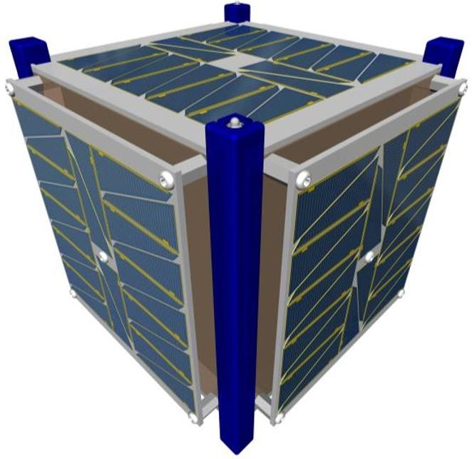
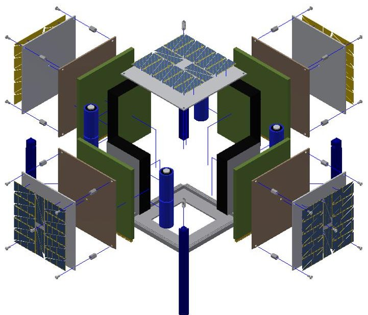
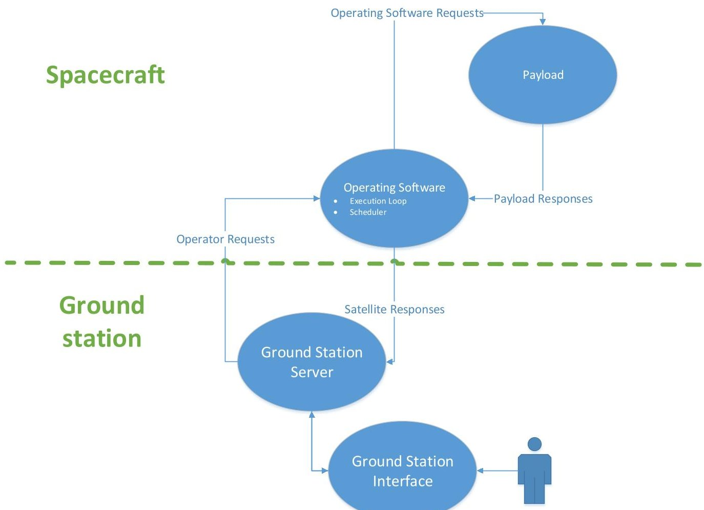
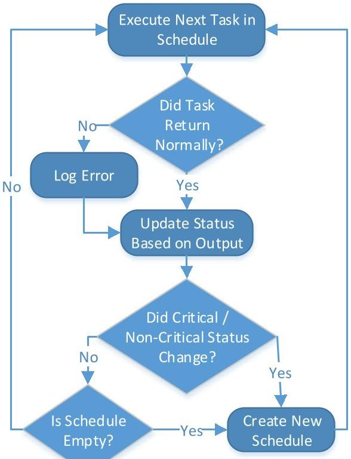
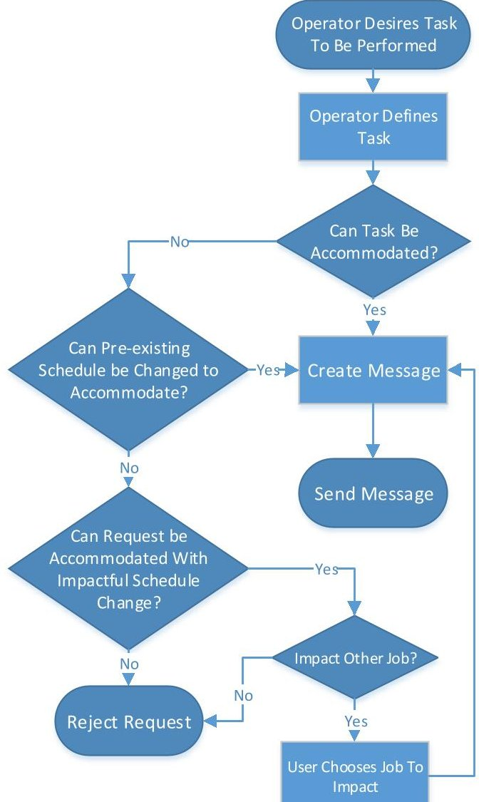
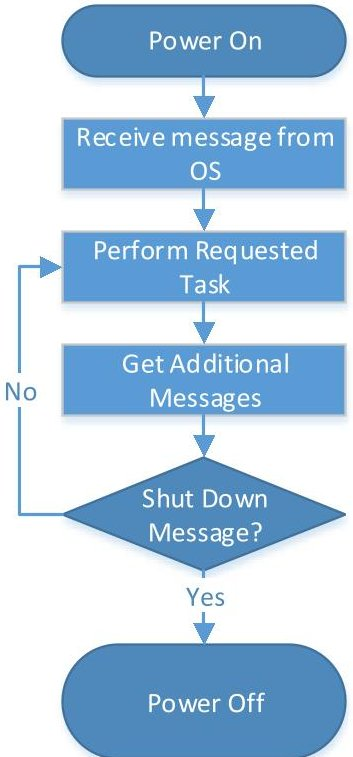

<!-- PDF_PAGE: 1 -->

September, 2015

# Design and Implementation of Satellite Software to Facilitate Future CubeSat Development

Timothy Whitney

Jeremy Straub

Ronald Marsh

<!-- PDF_PAGE: 2 -->

# Design and Implementation of Satellite Software to Facilitate Future CubeSat Development

Timothy Whitney, Jeremy Straub and Ronald Marsh Department of Computer Science, University of North Dakota, Grand Forks, ND 58202

The OpenOrbiter project is a campus-wide effort at the University of North Dakota to design and build a low-cost CubeSat-class satellite. The intent is to create a publically-available framework that allows a spacecraft to be built with a parts cost of less than USD $5,000 (excluding mission payload-specific costs). This paper focuses on OpenOrbiter's software system methodology and implementation.

Current work seeks to create a generalized framework that other CubeSat developers can use directly or alter to suit their mission needs. It discusses OpenOrbiter's overall design goals with an emphasis on software design. The software architecture is divided into three main components: operating software, ground station software and payload software. Each component is discussed along with the requirement for efficient and effective communication between the components. A communication standard that fulfills these goals is discussed herein.

The paper also discusses several challenges encountered and their resolution, including the creation of heuristics to optimally schedule tasks, handling the uncertainty that is inevitable in satellite operations, defining useful standards for all components of the software, communicating between components effectively and testing software to ensure proper operation in an orbital environment. Then, the current state of each software component and its implementation is presented. Finally, the significance of OpenOrbiter is discussed and plans for future work are presented.

## I. Introduction

THE OpenOrbiter Small Spacecraft Development Initiative (OOSDI) at the University of North Dakota is an ongoing project to design and develop a low-cost framework for a CubeSat-class spacecraft. This framework, entitled the Open Prototype for Educational Nanosats (OPEN), will be made publically available to aid other developers, giving them a starting point that can be adapted to their specific needs.

An important part of this spacecraft cyber-physical system is the software. The software is responsible for command and control of the spacecraft; it manages communications with the ground station, schedules the performance of the tasks provided and commands and monitors the spacecraft hardware.

This paper provides an overview of that software system. It begins with a discussion of relevant background in three areas. It, then, presents the goals of the OpenOrbiter software system. Next, it discusses, in depth, the components of this system, followed by a discussion of development and implementation challenges, before concluding.

## II. Background

Prior work from three areas informs the current design and development efforts. These areas include the CubeSat form factor, prior work on CubeSat software and the OpenOrbiter project. Each is now discussed.

## A. CubeSat Form Factor

The CubeSat form factor was developed by Twiggs and Puig-Suari in the early 2000s to facilitate the incorporation of hands-on development work into aerospace engineering courses [1]. The CubeSat concept was based on the OPAL [2] mission (which ejected six hockey-puck shaped sub-satellites); the P-POD, a launcher based on the OPAL launcher, was developed by Puig-Suari and the CalPoly team [3].

CubeSats were initially decried as little more than toys [1]; however, their use has now been demonstrated across multiple constituencies. They are being developed by industry [4] (and have spawned new entrants: e.g., [5]) and

<!-- PDF_PAGE: 3 -->

government agencies [6, 7]. The form factor's capabilities for education [8-10], technical development [8, 11] and scientific work [12, 13] have been demonstrated. The use of CubeSats in clusters [12, 14] and as a mechanism for space entry [15] and collaborative missions [16] for developing nations has been considered. CubeSats have even been proposed for use on interplanetary missions [17, 18], either free-flying or 'hitchhiking' with other spacecraft [19].

## B. CubeSat Software Systems

While the initial CubeSats had limited computational hardware, recent and future proposed missions have significantly more robust computational capabilities, allowing significant potential for software. Samson [20], for example, proposes the use of multiple onboard processors (using several GumStix computer-on-module units). A distributed architecture (separating mission-specific functionality from spacecraft operations) using an I2C bus was developed by Mitchell, et al. [21]; prior work [22] had also used the payload / core functionality separation. Brandon and Chapin [23] discuss the use of ADA on a CubeSat. Rapid development for nanosatellites, however, Fitzsimmons [5] suggests, can be facilitated through the use of open-source software (backed by the knowledge base of a large user community).

Work [24] at the Jet Propulsion Laboratory on autonomy has demonstrated the ability to have significant autonomy on a CubeSat, the utility of using autonomy for "instrument processing and product generation" and the utility of using small spacecraft for testing parts for later larger craft. Manyak [25] has considered how fault tolerance and flexibility can be attained, given CubeSat limitations, while Spangelo, et al. [26] had demonstrated the use of model-based systems engineering for CubeSats (including software components). Schmidt and Schilling [27] have considered the extensibility of CubeSats' software platforms. Farkas [28] discusses the creation of standard software bus (for CalPoly spacecraft) and Montenegro [29] discusses how dependability can be facilitated with a double-board design.

## C. OpenOrbiter

The OpenOrbiter Small Satellite Development Initiative started in 2012 as an offshoot of a thematically-related precursor program. The program, which aims to demonstrate the efficacy and space-worthiness of the Open Prototype for Educational Nanosats designs, is developing a complete set of plans, fabrication instructions and other materials to aid the implementation of CubeSat programs at other institutions. The base OPEN design [22, 30] is a 1U (10 cm x 10 cm x 11 cm, 1.33 kg) CubeSat with a design that utilizes the overhang space between the CubeSat deployment rails in the P-POD, maximizing the available volume. It has a central cavity for payload storage, in addition to reserving one of its four side panels for this purpose.

Figure 1. OpenOrbiter CubeSat [30].

Figure 2. Exploded view of Open Prototype for Educational Nanosats [30].

In the OpenOrbiter spacecraft, this payload board will include significant processing capabilities via the inclusion of multiple GumStix computer-on-module (COM) units. These units supplement the processing

<!-- PDF_PAGE: 4 -->

capabilities of the flight computer, a Raspberry Pi single board computer. The flight computer controls all actuation and sensing components of the spacecraft (including the payload camera); it also is responsible, via the software defined radio [31], for communications with the ground station. Figures 1 and 2 depict the OpenOrbiter design. In addition to technical development, educational activities [9, 32, 33] have also been a major focus of the program.

## III. OpenOrbiter Software System Goals

In keeping with the intent of OpenOrbiter to provide a framework to facilitate future CubeSat work, the goal of the software system is to provide a generalized architecture. This allows CubeSat developers to utilize the OPEN architecture directly or to modify it to suite their specific purposes. To accomplish this, the software must provide two things.

The first is the basic functions that every satellite requires. This functionality includes executing satellite tasks, scheduling tasks and communicating with the ground station. Tasks are defined as any function that the satellite may need to perform, for example checking sensors or carrying out the satellite's mission. In addition to simply executing tasks, a control system must be in place to do the following: ensure the time of task execution is correct, terminate tasks if they have been running too long and receive and deal with errors and information reported from finished tasks. The scheduler determines an optimized execution order and particular runtime assignments for tasks. This is provided to the task execution mechanism. To acquire these execution times, heuristics must be defined that help build a logical schedule. Since uncertainties are inherent in the operation of a CubeSat, the system responsible for building the schedule must be able to respond to events that affect the normal operations of the satellite. Communication between a ground station and the satellite is another key aspect of any CubeSat. This system must be able to send relevant data to the ground station and receive any data that the ground station sends up.

Second, the overarching goal of the OPEN software architecture is to create a framework that allows the control software and software that supports the satellites' basic functions to be easily modified or scaled to accommodate future CubeSat missions. To this end, the ability to easily modify the basic functions and defined conventions to add or modify satellite tasks within the context of the existing software system is critical. This has been enabled through componentized design and a robust documentation process.

## IV. Software System Components

The structure of OpenOrbiter's software architecture is comprised of three main components: the operating software, payload, and ground station software. The structure of these components is depicted in Figure 3.

## A. Operating Software

The operating software is responsible for executing and scheduling tasks. Control structures are required to ensure proper execution. The structure that executes tasks is a loop that executes tasks sequentially based on a schedule. Each task contains data that informs the execution loop on how and when to execute it. The schedule is a list of tasks sorted by and stamped with the time at which they are to execute.

Since the tasks are sorted in the schedule, the execution loop can take the first (next to be executed) task from the schedule, wait until the task is to be executed, then execute the task. Each task also contains a value indicating how long the task is allowed to execute for. If a running task exceeds its allotted runtime and another task is scheduled in the subsequent time block, the execution loop will terminate the task and move on to the next task. If a certain type of task is repeatedly terminated due to exceeding its execution time, it is possible that an error is occurring. Therefore, the loop makes a log of tasks that fail. Tasks that fail above a designated frequency are reported to the ground station. Each task also defines how to handle its results. For example, if a task that checks the temperature returns a value that exceeds the acceptable range, the main execution loop is required to respond accordingly. A diagram of this main execution loop is presented as Figure 4.

Scheduling tasks is the other major responsibility of the operating software. Although some may suggest that a ground station generated schedule that is simply executed by the spacecraft would be ideal, uncertainties in spacecraft operations combined with limited communications windows make this untenable. To account for uncertainties such as long running processes, changing task assignments and hardware issues, onboard scheduling is performed. To accomplish this, heuristics have been defined that inform the scheduler on how to build a schedule, given specific satellite conditions. For example, if batteries are low on power, the scheduler will avoid tasks that are not mission-critical, to reduce battery draw. When the batteries charge up to an acceptable level, the scheduler will incorporate the tasks it excluded back into the list of potential tasks.

<!-- PDF_PAGE: 5 -->

Figure 3. OpenOrbiter Software System.

Figure 4. Operating Software Diagram

## B. Ground Station Software

The ground station software is responsible for communication between operators on Earth and the satellite. The three modules that are necessary to accomplish this task are a user interface that allows the user to input information

<!-- PDF_PAGE: 6 -->

to be sent to the satellite and receive data that was sent from the satellite, a communication standard that provides efficient communication between the satellite and ground station, and modules to convert incoming data to a usable form and send data using the previously mentioned communications standard.

The user interface is a web-application that was developed with the Django Web Framework. It has a connection to a MySql database that facilitates storage and retrieval of data. The interface displays data received from the satellite in a user-friendly format. It also allows the user to input tasks that will be sent to the satellite. The backend of this web-application is a module that converts data to and from the communication standard to a usable format. To run this application, the ground station interface utilizes Microsoft's Azure cloud service to host an Ubuntu virtual machine that houses the webserver, database and backend program. A management client program connects to this virtual machine via TCP/IP. This approach allows multiple users running the client program to connect and share information using the main server.

Figure 5. Ground Station Software Diagram

A communications framework has been developed to coordinate communications between the ground station and the satellite. It includes six types of transmissions that can be sent from the ground station to the satellite. The first is task assignments, which are new tasks for the satellite to perform. A task update is used to modify an existing task. A task status request queries the satellite for relevant information regarding a specific task. A system status request asks the satellite for a report on a specific satellite system's status, such as battery charge, temperature, memory capacity and such. A data request is used when data, such as a picture or a sensor reading, is desired. Conversely, the satellite has five types of communications that can be sent to the ground station. A confirmation is a message that tells the ground station that a transmission has been received. An error report contains a log of all of the instances of a system failure. Data transmission is a response to a data request from the ground station, in which the requested information (or part thereof) is sent. A task status response is the response to a task status request from the ground station. A system status response sends data regarding the satellite's status. A mechanism for issuing direct commands to the satellite in an emergency also exists.

<!-- PDF_PAGE: 7 -->

In order to send and receive data, the satellite is equipped with a software defined radio and modem. When the satellite comes within communications range of the ground station, a task is executed that converts all the data that needs to be sent into messages based on the communication standard and then transmits the data to the radio receiver on the ground. Upon receiving data, the ground station converts it and adds the information to the database, which is used by the interface to display the data to users. When a user creates a task that needs to be sent to the satellite, the client program connects to the web server which receives the data from the user. The data is then sent through a serial port to a radio transmitter / receiver to be sent to the satellite. This radio transmitter / receiver is also the means of receiving data sent from the satellite. A diagram of the flow of the ground station software is shown in Figure 5.

## C. Payload Software

The third major component of the software system is the payload software, which is responsible for carrying out the spacecraft's mission. OpenOrbiter's current payload consists of a camera system, that when requested by the ground station operators, will take pictures of specified areas of the Earth. Once the pictures are gathered, they can be processed onboard the satellite and / or stored to be sent down to the ground station, when requested. The payload will likely be different in every satellite that uses the OPEN framework, so the payload software is less likely to be reused, as compared to the other software components. However, as imaging is a common spacecraft task, this software may serve as a template for others. An overview of the payload software is shown in Figure 6.

Since OpenOrbiter's payload software will be performing computationally expensive image processing tasks, the payload tasks will be performed on a computer that is external to the main flight computer. This ensures that the flight computer is able to perform tasks that are critical to the spacecraft's maintenance in a timely manner and that it is not overwhelmed by payload tasks. Although separating the payload and operating software on two computers helps the operations of each system, communicating between these two computers then becomes an issue. To address this, basic communications message types have been developed, similar to the ground station transmissions types. In general, the communication messages request and send data. A message to acknowledge the retrieval of data is also included.

Figure 6. Payload Software Diagram

From the operating software to the payload software, the communication types include the following: a task processing request, a data processing request, a transmission acknowledgement, a task status request, a subsystem status request, a data request and a power down command. The task processing request tells the payload computer to perform a task, such as to calculate when a region can be imaged. A data processing request is a task processing request that tells the payload to perform an image processing task on a set of existing data. Possible tasks include super resolution, mosaicking and combined super resolution and mosaicking. A transmission acknowledgement informs the payload software that a message has been received. Similar to the ground station software, a task status

<!-- PDF_PAGE: 8 -->

request asks for the current status of a task. A subsystem status request asks the payload for information regarding the status of the payload computers and auxiliary systems. A data request requests data that is stored on the payload computer. The power down command tells the payload computer to shut down immediately or at a future time.

Also similar to the ground station, the payload software has message types to respond to requests from the operating system. Task processing and data processing responses send the data that resulted from a task or data processing request from the operating system. An error report is a notification regarding a specific significant error identified by the payload software. A task status response is a transmission containing the status of a task that was requested by the operating system. A data response includes data that was requested by the operating system. Finally, an acknowledgement is a message that informs the operating system of a successful transmission.

## V. Software System Development & Implementation Challenges

Challenges are inherent in creating a spacecraft software system. In addition to challenges caused by the unique characteristics of the orbital environment, challenges stem from two principles of the OpenOrbiter spacecraft's mission: for the satellite to operate without constant user control and to create a framework that others can use and modify easily.

## A. Definition of Heuristics

The process of defining heuristics for the main operating software loop is ongoing and will need to be refined during testing and even on-orbit operations. The spacecraft will utilize the concept of management by exception (which is similar to the beacon concept proposed the Beacon-Based Exception Analysis for Multi-missions (BEAM) system [34]). In order for this approach to be successful, however, the heuristic thresholds must be defined closely enough to normal system operating levels to allow errors to be quickly caught, before problems can escalate, and simultaneously be far enough away that random 'noise' fluctuations don't trigger unnecessary responses.

A characterize and constrain approach to heuristic development has been taken, which measures the actual performance over a period of time to set thresholds. However, as multiple characteristics are different from testing environment to testing environment (and will be, similarly, different in the orbital environment), ongoing characterization is required. It is anticipated that some of these heuristics thresholds will be usable by others implementing the OPEN designs, while others will be configuration and/or fabrication-instance specific. It is also anticipated that the normal level may change over time, requiring the recalibration of the heuristic thresholds during operations.

## B. Architecture, Validation and Testing of Software

A model-based development and validation approach [35], utilizing the Architecture Analysis & Design Language (AADL) [36], has been undertaken. Under this approach, an AADL model has been created of the hardware-software system, which defines how the components interoperate and allows actual system performance to be validated against the performance projected by the model.

## C. Standards for Software Development & Code Maintenance

With the goal of allowing reuse and extensibility of the OPEN designs, a robust set of software development standards have been developed. These provide guidance to the team's developers regarding code formatting, commenting and other related matters. These standards will be included with the OPEN deliverables set, to facilitate their use by others who may wish to contribute their extensions of the framework back to the user community.

The OPEN / OpenOrbiter development efforts have utilized GitHub extensively [37]. This tool is utilized for code storage, versioning and to track issues through to their resolution (and preserve a historical record of the changes made). This tool will also be utilized to facilitate the incorporation of community-generated changes back into the spacecraft software framework, after the general OPEN deliverables release.

## D. Development for Autonomous Operations

Since the satellite will not be in communications range at all times, operators will not be able to respond immediately to issues with the operation of the satellite. This requires issue response to be considered during development, instead of dealt with, by operators, during flight. To accomplish this, a dynamic scheduler with robust heuristics is being implemented. Every function of the satellite is given an initial priority that may change given the occurrence of an event. A heuristic response mechanism is being defined that is triggered by significant events and decides the necessary response to the event. However, as every possible event cannot be accounted for beforehand,

<!-- PDF_PAGE: 9 -->

the scheduler must be generalized to react reasonably to any prospective event. In the event that an error cannot be directly responded to by the onboard software, it must act to preserve the spacecraft hardware and communications capabilities to allow prospective controller intervention during the next communications, thus the onboard autonomy has a 'fail-soft' methodology.

## E. An Extensible Framework

The other major challenge is to create software that allows CubeSat developers that use the OPEN framework to easily augment the code to suit their mission's needs. This is problematic as the needs and intentions of future developers using the framework cannot be specifically accounted for. Consequently, the software has to be developed in way that the basic satellite functions are abstracted, so future developers can focus on their payload, as opposed to the details regarding basic operations. This abstraction manifests itself as a modular architecture that essentially allows developers to "plug-in" their payload. The architecture is implemented as follows: any satellite function that needs to be scheduled and executed is coded and placed in a task directory. Accompanying these tasks are structures, called templates, which inform the scheduler of relevant scheduling information about that task. Upon compilation of the operating software, the files in the task directory are compiled into executables. The scheduler and execution loop are then made aware of all of the resulting executables and can take the information from the task's templates to create a schedule and execute the schedule.

## VI. Conclusion

The goal of the OpenOrbiter Small Spacecraft Development Initiative is to create a low-cost framework for a CubeSat developers. OpenOrbiter's software system supports this goal by defining a scalable software framework that future CubeSat developers can utilize and modify to suit their specific needs. The three main parts of this framework are the operating system, ground station and payload software. These components work together to perform the satellite's mission effectively and respond to events that will occur during the operation of the spacecraft. This architecture is also designed to facilitate future development using the OPEN framework.

## VII. Acknowledgements

Small satellite development work at the University of North Dakota is and/or has been supported by the North Dakota Space Grant Consortium, North Dakota NASA EPSCoR, the University of North Dakota Faculty Research Seed Money Committee, North Dakota EPSCoR (NSF Grant # EPS-814442), the Department of Computer Science, the John D. Odegard School of Aerospace Sciences, and the National Aeronautics and Space Administration.

## VIII. References

[1] R. A. Deepak and R. J. Twiggs. Thinking out of the box: Space science beyond the CubeSat. Journal of Small Satellites 1(1), pp. 3-7. 2012.

[2] J. Cutler and G. Hutchins. OPAL: Smaller, simpler, and just plain luckier. 2000.

[3] H. Heidt, J. Puig-Suari, A. Moore, S. Nakasuka and R. Twiggs. CubeSat: A new generation of picosatellite for education and industry low-cost space experimentation. 2000.

[4] M. Taraba, C. Rayburn, A. Tsuda and C. MacGillivray. Boeing's CubeSat TestBed 1 attitude determination design and on-orbit experience. Presented at Proceedings of the AIAA/USU Conference on Small Satellites. 2009, .

[5] S. Fitzsimmons and A. Tsuda. Rapid development using tyvak's open source software model. 2013.

[6] L. R. Abramowitz. US air force's SMC/XR SENSE NanoSat program.

[7] J. London, M. Ray, D. Weeks and B. Marley. The first US army satellite in fifty years: SMDC-ONE first flight results. 2011.

[8] M. Swartwout. AC 2011-1151: Significance of student-built spacecraft design programs it's impact on spacecraft engineering education over the last ten years. Presented at Proceedings of the American Society for Engineering Education Annual Conference. 2011, Available: http://www.asee.org/file_server/papers/attachment/file/0001/1307/paper-final.pdf.

[9] J. Straub and D. Whalen. Evaluation of the educational impact of participation time in a small spacecraft development program. Education Sciences 4(1), pp. 141-154. 2014.

[10] P. Thakker and G. Swenson. "Management and implementation of a cubesat interdisciplinary senior design course," in Emergence of Pico- and Nanosatellites for Atmospheric Research and Technology Testing, P. Thakker and W. Shiroma, Eds. 2010, .

<!-- PDF_PAGE: 10 -->

[11] M. Swartwout. University-class satellites: From marginal utility to 'disruptive' research platforms. Presented at Proceedings of the 18th Annual AIAA/USU Conference on Small Satellites. 2004, .

[12] S. Padmanabhan, S. Brown, P. Kangaslahti, R. Cofield, D. Russell, R. Stachnik, J. Steinkraus and B. Lim. A 6U CubeSat constellation for atmospheric temperature and humidity sounding. 2013.

[13] I. Cartwright, L. Stepan and D. Lingard. Scheduling multi-spectral collection of the australian landmass using a 6U cubesat constellation. 2012.

[14] E. Gill, P. Sundaramoorthy, J. Bouwmeester, B. Zandbergen and R. Reinhard. Formation flying within a constellation of nano-satellites: The QB50 mission. Acta Astronaut. 82(1), pp. 110-117. 2013.

[15] K. Woellert, P. Ehrenfreund, A. J. Ricco and H. Hertzfeld. Cubesats: Cost-effective science and technology platforms for emerging and developing nations. Advances in Space Research 47(4), pp. 663-684. 2011.

[16] J. Straub, J. Berk, A. Nervold, C. Korvald and D. Torgerson, "Application of collaborative autonomous control and the open prototype for educational NanoSats framework to enable orbital capabilities for developing nations," in Proceedings of the 64th International Astronautical Congress, Beijing, China, 2013, .

[17] R. Staehle, D. Blaney, H. Hemmati, M. Lo, P. Mouroulis, P. Pingree, T. Wilson, J. Puig-Suari, A. Williams and B. Betts. Interplanetary CubeSats: Opening the solar system to a broad community at lower cost. Presented at CubeSat Developers' Workshop, Logan, UT. 2011, .

[18] D. Blaney, R. Staehle, B. Betts, L. Friedman, H. Hemmati, M. Lo, P. Mouroulis, P. Pingree, J. Puig-Sauri and T. Svitek. Interplanetary cubesats: Small, low cost missions beyond low earth orbit. Presented at Lunar and Planetary Institute Science Conference Abstracts. 2012, .

[19] D. Torgerson, A. Nervold, J. Straub, J. Berk, R. Marsh and S. Kerlin. Interplanetary hitchhiking to support small spacecraft missions beyond earth orbit. Presented at Proceedings of the 64th International Astronautical Congress. 2013, .

[20] J. Samson. Update on dependable multiprocessor CubeSat technology development. Presented at Aerospace Conference, 2012 IEEE. 2012,.

[21] C. Mitchell, J. Rexroat, S. A. Rawashdeh and J. Lumpp. Development of a modular command and data handling architecture for the KySat-2 CubeSat. Presented at Aerospace Conference, 2014 IEEE. 2014, . DOI: 10.1109/AERO.2014.6836355.

[22] J. Straub, C. Korvald, A. Nervold, A. Mohammad, N. Root, N. Long and D. Torgerson, "OpenOrbiter: A LowCost, Educational Prototype CubeSat Mission Architecture," Machines, vol. 1, pp. 1-32, 2013.

[23] C. Brandon and P. Chapin. "A SPARK/ada CubeSat control program," in Reliable Software Technologies-Ada Europe 2013Anonymous 2013, .

[24] S. Chien, J. Doubleday, K. Ortega, D. Tran, J. Bellardo, A. Williams, J. Piug-Suari, G. Crum and T. Flatley. Onboard autonomy and ground operations automation for the intelligent payload experiment (IPEX) CubeSat mission. 2012.

[25] G. D. Manyak. Fault tolerant and flexible cubesat software architecture. 2011.

[26] S. C. Spangelo, D. Kaslow, C. Delp, B. Cole, L. Anderson, E. Fosse, B. S. Gilbert, L. Hartman, T. Kahn and J. Cutler. Applying model based systems engineering (mbse) to a standard cubesat. Presented at Aerospace Conference, 2012 IEEE. 2012, .

[27] M. Schmidt and K. Schilling. An extensible on-board data handling software platform for pico satellites. Acta Astronaut. 63(11-12), pp. 1299-1304. 2008. DOI: http://dx.doi.org/10.1016/j.actaastro.2008.05.017.

[28] J. Farkas. CPX: Design of a standard cubesat software bus. California State University, California, USA 2005.

[29] S. Montenegro, K. Briess and H. Kayal. Dependable software (BOSS) for the BEESAT pico satellite. Proceedings of Data Systems on Aerospace-DASIA 2006.

[30] B. Kading, J. Straub and R. Marsh. Mechanical design and analysis of a 1-U CubeSat. Presented at Presented at the North Dakota EPSCoR State Conference. 2014, .

[31] M. Wegerson, J. Straub, S. Noghanian and R. Marsh, "Development of an open source software defined radio," in Presented at the 6th Annual European CubeSat Symposium, Estavayer-le-Lac, Switzerland, 2014, .

[32] J. Straub and D. Whalen. An assessment of educational benefits from the OpenOrbiter space program. Education Sciences 3(3), pp. 259-278. 2013.

[33] J. Straub and R. Marsh. Assessment of educational expectations, outcomes and benefits from small satellite program participation. Presented at 28th Annual AIAA/USU Conference on Small Satellites. 2014, .

[34] L. Paal, N. Golshan, F. Fisher and M. James. Background and architecture for an autonomous ground station controller. Presented at 19th AIAA International Communications Satellite Systems Conference. 2001, .

[35] J. Huber, C. Korvald, A. Chawla, J. Straub and H. Reza, "A Model Based Approach to Develop a Small Spacecraft," Prepared for Submission, 2014.

<!-- PDF_PAGE: 11 -->

[36] P. H. Feiler and D. P. Gluch, Model-Based Engineering with AADL: An Introduction to the SAE Architecture Analysis & Design Language. Boston, MA: Addison-Wesley Professional, 2012.

[37] J. Straub and C. Korvald. A review of online collaboration tools used by the UND OpenOrbiter program. Presented at Proceedings of the Collaborative Online Organizations Workshop at the Autonomous Agents and Multi-Agent Systems (AAMAS) 2013 Conference. 2013, .