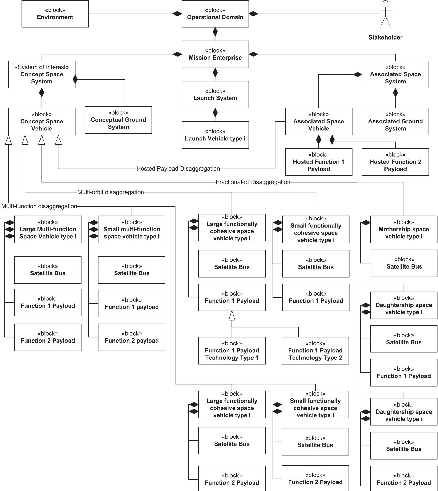
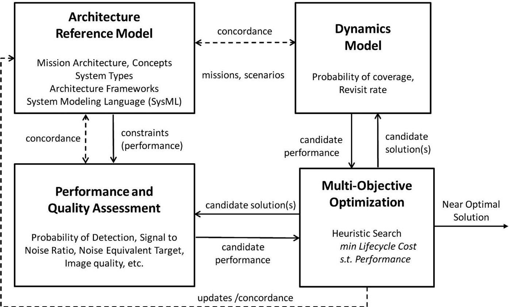
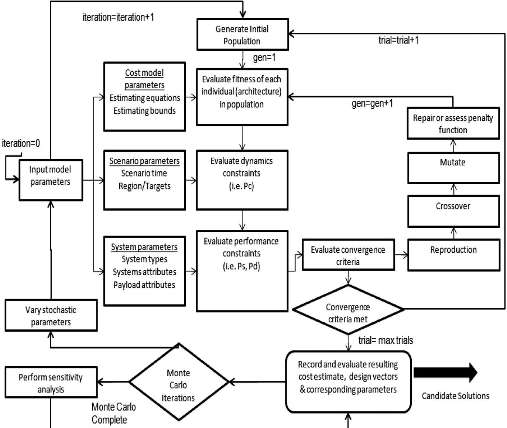
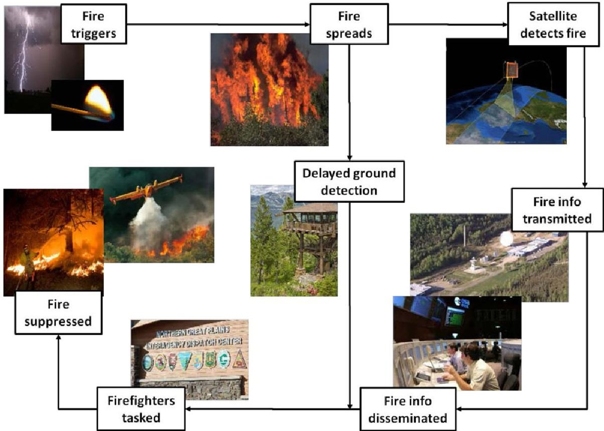
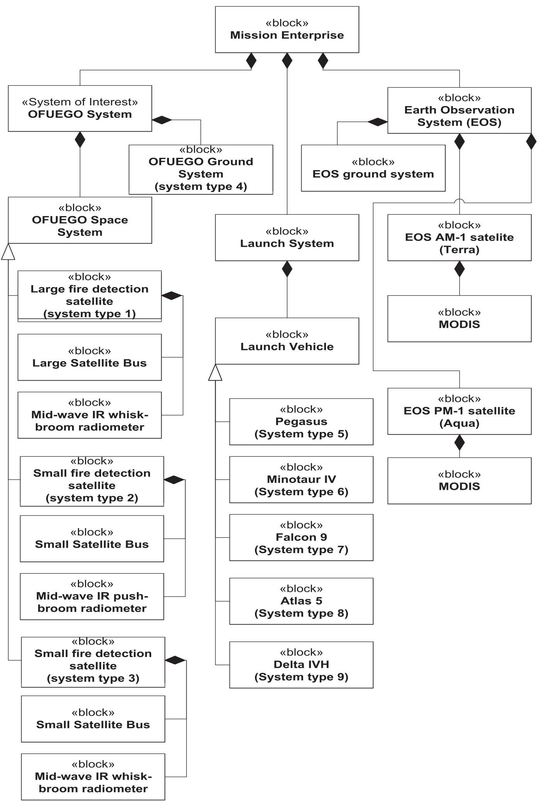
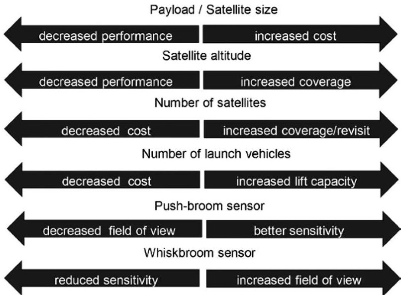
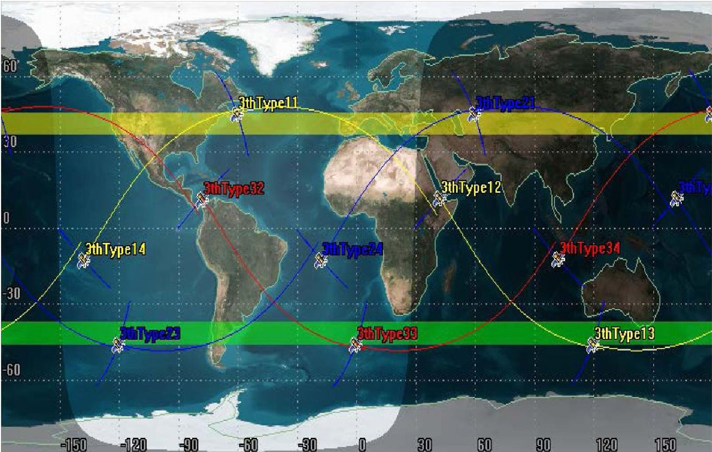
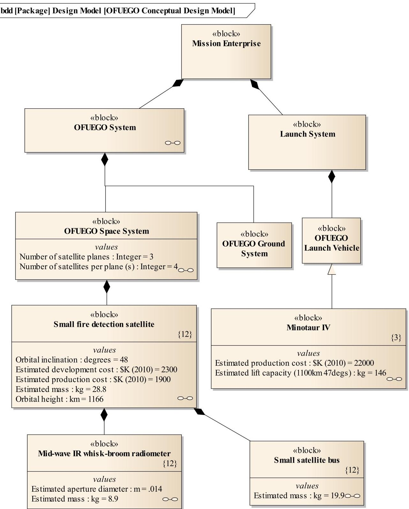

<!-- PDF_PAGE: 1 -->

# Disaggregated Space System Concept Optimization: Model-Based Conceptual Design Methods

Robert E. Thompson, $ ^{*} $ John M. Colombi, Jonathan Black, and Bradley J. Ayres

Air Force Institute of Technology, Wright-Patterson AFB, OH 45433

Received 16 April 2014; Revised 4 June 2015; Accepted 12 July 2015, after one or more revisions Published online in Wiley Online Library (wileyonlinelibrary.com). DOI 10.1002/sys.21310

## ABSTRACT

Optimal design techniques have proven to be an effective systems engineering tool. Using systems architecture as the foundation, this paper explores the use of mixed variable optimization models for synthesizing and evaluating disaggregated space system concepts. Model-based conceptual design (MBCD) techniques are used to identify and assess system architectures based upon estimated system cost and performance trades. The Disaggregated Integral System Concept Optimization (DISCO) methodology is introduced, and then applied to a space-based, fire detection mission. Several results are obtained that indicate potential cost effectiveness gains from the concept design optimization of a fire detection mission. The general methodology has broad applicability for MBCD of systems, but is particularly useful for dynamic, nonlinear disaggregated space systems. $ \textcircled{c} $ 2016 Wiley Periodicals, Inc. Syst Engin 18:549-567, 2015

Key words: systems architecture; space systems; model-based systems engineering (MBSE); model-based conceptual design (MBCD); systems optimization

## 1. INTRODUCTION

Today's space systems have far reaching impacts to military, civilian, and commercial end-users globally. They provide a multitude of mission applications such as communications; global navigation and timing; precise weather and climate inputs; global intelligence, surveillance, and reconnaissance; and a continuous record of our earth's surface. However, the systems that provide these capabilities can be complex, costly, with high technical risks (Chaplain et al., 2012). It has been hypothesized that the "vicious circle of space acquisition"

leads to large, complex, and expensive satellites that lack resiliency. Furthermore, it has been proposed that applying disaggregation strategies to space system conceptual design could improve cost effectiveness and/or reduce risk exposure to catastrophic failures (Pawlikowski, Loverro, and Cristler, 2012).

Current methods of space system conceptual architecting are largely based on the design, assessment, and improvement of a few candidate architectures. These methods are inadequate to effectively design, assess, and optimize the vast conceptual design space associated with disaggregated space systems.

The vast trade space associated with system architectures in the concept phase can lead to analysis difficulties. Simpson and Dagli state that when a system under design is "highly dynamic and contains a large number of context-specific, adaptable interfaces, the task of system architecting can

<!-- PDF_PAGE: 2 -->

become overwhelming" (Simpson and Dagli, 2008: 978). Disaggregated space systems represent highly dynamic systems with a large number of context-specific adaptable interfaces. Therefore, particular attention should be paid to developing methodologies that increase effectiveness of the conceptual design process if the potential benefits of disaggregated space systems are to be achieved. To this end, this paper introduces a novel Disaggregated Integral System Concept Optimization (DISCO) methodology and applies it to a spacebased fire detection mission. The proposed formalization of conceptual design methods, in concert with the essential creativity of the designer(s) and advanced tools, enables the exploration of greater numbers of architectural options and trades.

## 1.1. Background

## 1.1.1. Disaggregation Strategies

Recently, disaggregation has gained considerable interest as a system architecting approach to improve the resiliency and robustness of space systems, as well as increase affordability, technology refresh rates, and launch and space industrial base stability. Disaggregation is defined as "the dispersion of space-based missions, functions, or sensors across multiple systems spanning one or more orbital plane, platform, host, or domain" (Air Force Space Command, 2013:4). The potential improvements that disaggregated space systems have to offer are highly dependent upon effective conceptual design and system architecting.

It has been proposed that disaggregation can be categorized into five distinct architecting approaches consisting of multiorbit disaggregation, functional disaggregation, hosted payloads, fractionation, and multidomain disaggregation (Air Force Space Command, 2013). Some or all of these approaches may be appropriate for a particular conceptual architecture problem.

Multiorbit disaggregation is the dispersion of sensors or payloads across multiple satellites spanning one or more orbital planes. Multiorbit disaggregation is a familiar concept for space systems engineers. Multiorbit disaggregation is often employed to meet geographic coverage or revisit requirements. Satellite constellations such as the Global Positioning System (GPS), Galileo, IRIDIUM, and the Defense Meteorological Satellite Program (DMSP) employ payloads on multiple satellites in separate orbital planes at the same orbital altitude to meet coverage requirements. Weather satellites also routinely disperse sensors providing similar functionality in low earth orbit and geosynchronous orbit to provide global coverage and meet varied coverage and revisit rate requirements. The U.S. Air Force Space Command (AFSPC) is currently investigating the potential of replacing or augmenting the baseline GPS constellation with numerous small NavSats (Ferster, 2014).

Multifunction disaggregation is the dispersion of functions from large multifunction satellites to smaller functionally cohesive spacecraft. A recent example of multifunction disaggregation is the Space Environment NanoSatellite Experiment (SENSE) program. Two SENSE satellites launched in November 2013 successfully demonstrated the

dispersion of space weather functionality onto functionally cohesive cubesats (Lam, La Tour, and Kim, 2013). The strategic and tactical protected communications mission currently provided by Advanced Extremely High Frequency (AEHF) satellites are also being studied for functional disaggregation (Pawlikowski et al., 2012).

Hosted payload disaggregation disperses sensors or payloads from large satellites onto other defense, civil, or commercial satellite systems. A recent example of hosted payload disaggregation is the Commercially Hosted Infrared Payload (CHIRP) experiment (Schueler, 2012). The dispersion of GPS functionality onto Positioning, Navigation, & Timing (PNT) hosted payloads to augment a revamped GPS constellation is being considered by the Air Force.

Fractionated space systems are intended to disperse the subsystem functionality of a satellite among multiple satellites. The Defense Advanced Research Project Agency (DARPA) F6 program was an example of fractionated space system architecture (Cornford et al., 2012). The F6 program was a Research and Demonstration program intended to prove out the concepts of satellite fractionation.

Lastly, multidomain disaggregation is a strategy where functions are dispersed across multiple domains such as land, sea, space, or cyber. The Air Force Space-based Space Surveillance System (SBSS) is an example of multidomain disaggregation.

Many practical concept trade studies may include combinations of the disaggregation strategies outlined above. For example multiorbit/multifunction disaggregation enables the dispersion of sensors and payloads commonly aggregated on large satellites to be sized and dispersed onto smaller functionally cohesive satellites placed in orbits conducive to the mission. The design of the Weather System Follow-on (WSF) concept can be viewed as a multifunction/multiorbit disaggregation problem. Significant potential life-cycle savings have been identified using the DISCO methodology to assess the WSF conceptual design problem (Thompson R., Colombi, Black, & Ayres, 2014). The proposed DISCO methodology enables the systematic analysis and comparison of these disaggregation concepts.

## 1.1.2. Model-Based Conceptual Design (MBCD)

Model-Based Systems Engineering (MBSE) is the "formalized application of modeling to support system requirements, design, analysis, verification and validation, beginning in the conceptual design phase and continuing throughout development and later life cycle phases" (INCOSE, 2007, June 29: 189). The primary output of MBSE is a coherent model of the system and emphasis is placed on evolving and refining the model using model-based methods and tools (Friedenthal et al., 2012). MBCD is "the application of MBSE to the exploratory research and concept stages of the generic lifecycle" (INCOSE, 2013). During conceptual design, it is unlikely that the system architect has high fidelity models for all associated areas. A system architect is likely limited to parametric cost models and initial functional and performance models. Therefore, the integration of standardized systems engineering tools that are capable of integrating parametric

<!-- PDF_PAGE: 3 -->

cost models with functional and performance models could provide significant utility.

MBCD processes and methodologies are still maturing. The DISCO methodology is an example of applying MBCD techniques to the space system domain. In this approach, stakeholder's needs are mapped to quantitative measures of effectiveness (MOE). Then, component technologies are associated to potential system types. For example, space vehicle system types are identified based upon the payload technology types on the space vehicle (e.g., infrared scanning, infrared push-broom, radar, or microwave radiometer). Stakeholder's needs are refined by providing early conceptual feedback of operational performance and affordability. Finally, feasible and potential near-optimal solutions are identified and analyzed via an integrated optimization construct.

A general overview of MBSE and how it can be used to specify and design a system during the conceptual design phase is provided in Piaszczyk (2011). An overview of multiple MBSE methodologies is summarized in Estefan (2007). Several research efforts including Nottage and Corns [2012], Delp [2008], and Spangelo et al. [2010] have applied MBSE to space systems. The work presented in this article extends this previous work by integrating these MBSE principles within a disaggregated space system concept optimization framework.

## 1.1.3. Systems Architecture

Systems architecture is the "selection of system elements their characteristics, and their arrangement." The arrangement and characteristics of these elements must meet requirements and implement functions in a near-optimal and technically mature and consistent manner (INCOSE, 2011). The system architecture process includes defining the architecture, analyzing and evaluating the architecture, and documenting and maintaining the architecture (INCOSE, 2011). Traditional system architecting is iterative and highly dependent upon engineering analysis, heuristics and experience; consequently, the synthesis of multiple system architectures can be very resource intensive.

The selection of a preferred system architecture solution is highly dependent upon metrics and evaluation criteria. Automation of the synthesis and evaluation of alternative system architectures is a primary goal of an MBCD methodology. Significant academic research has been conducted on evaluating and ranking architectures based upon expert evaluations. Multi-Attribute Utility Theory is often used to rank and evaluate alternative architectures (Keeney and Raiffa, 1993). In addition, Simpson and Dagli described the use of genetic algorithms to conduct alternative analysis/evaluation in (Simpson and Dagli, 2008). Their effort is largely focused on subjective assessments of a system and the fuzzy modeling of quality attributes. This research effort proposes that a quantitative approach applying metaheuristic optimization techniques to integrated cost and dynamic system models would significantly improve the performance and quality of the system architecting process. In addition this approach could potentially minimize inherent weighting toward favored or familiar technologies or designs associated with expert opinion-based architecture assessment.

## 1.1.4. System Design Optimization

Significant research has been conducted in space system conceptual design optimization. This growing body of research has applied heuristic design optimization techniques (i.e., simulated annealing, genetic algorithms, or particle swarm optimization) to the conceptual design of space systems. Heuristic algorithms have been widely applied to optimize spacecraft component, spacecraft configuration, and launch vehicle configuration conceptual design problems. In addition heuristic algorithms have been applied to distributed task constellation (DTC) concepts, and distributed space system (DSS) concepts. These DTC and DSS concepts are analogous to some of the disaggregation strategies previously identified. However, an integrated MBCD methodology that is capable of simultaneously optimizing spacecraft conceptual designs and disaggregated architectures may represent a significant improvement in the conceptual design of space systems architectures.

The use of genetic algorithms to optimize the configuration of a spacecraft was introduced by Mosher in 1999. Mosher introduced the Spacecraft Concept Optimization and Utility Tool (SCOUT), which uses a genetic algorithm to identify and assess the inclusion of various component technologies on a spacecraft (Mosher, 1999: 200). These techniques have been extended to the conceptual design of numerous spacecraft types and space related systems such as launch vehicles Aliakbargolkar et al., 2013).

Heuristic methods for optimizing the conceptual designs of DTCs were introduced by Matossian in 1996. Matossian used a simulated annealing algorithm to identify the nearoptimal inclusion of existing sensors in a conceptual spacebased Earth Observation System (EOS) designs according to science utility measures (Matossian, 1996). Matossian's concept of DTCs is similar to the concept of multifunction disaggregation. The method introduced was limited to linear optimization techniques to select clusters of heritage sensors for configuration of notional spacecraft based upon the subjective performance of various EOS sensors.

A methodology for optimizing distributed satellite constellations was introduced by Jilla and Miller in 2004. Their Multiobjective Multidisciplinary Design Optimization Systems Architecting (MMDOSA) methodology uses a simulated annealing algorithm with numeric orbital simulation to optimize the conceptual design of homogeneous spacecraft (Jilla and Miller, 2004). The DSS concepts assessed are analogous to multiorbit disaggregation problems. The MMDOSA methodology is based upon modeling and assessing space systems as networks of homogeneous systems. Consequently, the methodology was limited to the optimization of homogeneous spacecraft types (Shaw, Miller, and Hastings, 2001).

Selva's Rule-Based System Architecting (RBSA) methodology extended the DTC optimization introduced by Matossian. RBSA included the treatment of instrument selection, assignment of instruments, and mission scheduling for a conceptual NASA EOS constellation design (Selva, Cameron, and Crawley, 2014). The RBSA approach represented a significant progression in space system conceptual design optimization for multifunction disaggregation problems. However, the methodology was

<!-- PDF_PAGE: 4 -->

limited to the clustering of existing sensors on spacecraft and does not enable the optimization of sensor/payload and orbital parameters for meeting system requirements.

Based on extant literature, a methodology does not exist that applies MBCD techniques to the optimization of multiorbit disaggregation problems, where heterogeneous or mixed satellite types are possible. Also, a methodology has not documented the optimization of multifunction/multiorbit disaggregation concepts where the individual spacecraft system conceptual designs are optimized for the specific orbit rather than the clustering of existing sensors. This paper presents the DISCO methodology and applies it to a multiorbit disaggregation problem.

## 2. DISCO METHODOLOGY

The primary motivation for the DISCO methodology is the enablement of improved system analysis and optimized solutions across all disaggregation types. An overview of all potential logical decompositions is presented in Figure 1.

Figure 2 shows a general overview of the DISCO approach. The general DISCO approach is similar to the MMDOSA approach presented by Jilla and Miller, consisting of the following components: reference system architecture, dynamics models, performance assessment models, and mixed variable optimization functionality.

The architecture reference model forms the basis of the disaggregated space system optimization approach. The primary stakeholder needs, mission objectives, system requirements, and logical/physical architecture artifacts are modeled in a MBSE architecture tool. Examples of common MBSE architecture tools include Cameo Systems Modeler, Enterprise Architect, Modelio, Papyrus, and Rational Rhapsody Architect. DISCO is intended to be tool agnostic, however, advanced capabilities and plug-ins such as the MBSE Pak plugin enable automated integration between the architecture reference model and the performance, dynamics, and optimization models. These advanced capabilities enable design evaluation, parametric analysis using external engineering tools, and requirements trade studies. The architecture reference model is kept in concordance with performance/quality assessment and dynamics simulations via engineering analysis. The concept of concordance refers to a formal process that ensures consistency and completeness between architecture products as discussed in Levis and Wagenhals (2000). This concordance may be maintained via an automated electronic means or through manual manipulation as currently implemented. Requirements documented in the architecture reference model (e.g., maximum revisit rate) form the constraints of the performance assessment.

The performance assessment models consist of performance estimating equations, sizing equations, and cost estimating equations that are used to calculate the estimated performance and cost of candidate architectures. Candidate solutions (represented as individuals in the genetic algorithm) are evaluated and the estimated performance and cost of the solution are returned to the optimization routine. The dynamics model consists of a numeric simulation capability or analytic coverage estimating equations used to assess the dynamic performance of the conceptual system. The dynamics model inputs candidate solutions (individuals) and returns dynamics-related performance measures. The optimization routine evaluates the fitness of each of the candidate solutions as well as the feasibility (e.g., constraint violations) of each of the candidate solutions. The optimization routine then outputs the best feasible candidate architecture for further evaluation.

The methodology assumes that the performance of disaggregated space architectures is dependent upon the type of systems, the number of systems, the performance of each system, and the orbital dynamics of the constellation. The optimization component outputs candidate near-optimal disaggregated space system architectures in the form of a design variables that represent the number of systems included in the architecture, the critical design variables (i.e., payload aperture diameter), and the constellation orbital parameters. These near-optimal solutions are assessed and evaluated. The candidate solutions and corresponding calculated functions (i.e., satellite mass, volume, and power) are used to update the reference architecture.

The DISCO methodology employs three process steps:

1. Develop reference architecture

2. Develop optimization/assessment models

3. Evaluate solutions and update the architecture.

The example problem presented in Section 3 of this paper is structured to follow these DISCO process steps.

## 2.1. Develop Reference Architecture

Reference architectures can be viewed as a template for system solutions based upon a generalized set of solutions. According to the INCOSE SE handbook, it is critical that a reference architecture be created in the early stages of the conceptual design of a system to "whatever depth is necessary to identify technological risks, assess technology readiness, and generate early cost and schedule projections" for a program (INCOSE, 2011). The DISCO methodology adopts four steps from the Object Oriented Systems Engineering Method (OOSEM) "specify and design system process" in order to develop a reference architecture (Friedenthal, Moore, and Steiner, 2012). Accordingly, the four tasks used to develop reference architectures are:

1. Analyze stakeholder needs

2. Analyze system requirements

3. Define logical architecture

4. Synthesize candidate physical architectures

## 2.1.1. Analyze Stakeholder Needs

Stakeholder needs can be analyzed and established via numerous methods including stakeholder elicitation and causal analyses comparing existing capabilities and desired capabilities. Accurately assessing needed mission functions and their corresponding MOE is critical to the effective application of DISCO. The DISCO optimization model is currently structured to assess operational cost effectiveness as the primary MOE by minimizing estimated life-cycle cost (LCC) subject

<!-- PDF_PAGE: 5 -->

Figure 1. Disaggregated space system logical decomposition strategies summary.

<!-- PDF_PAGE: 6 -->

(performance constraints, system types/ quantities, system/subsystem parameters, orbit parameters)

Figure 2. DISCO methodology summary.

to performance requirements. However, it should be possible to structure the optimization objective function as a value function. Future research is planned to assess alternative optimization model formulations to maximize the weighted value model subject to varying performance constraints. Analysis of stakeholder needs concludes with the documentation of mission needs, mission objectives, mission requirements, MOE, use cases, and an operations concept documented in the reference architecture. These items should be documented in an MBSE software tool in the corresponding requirements diagrams, use case diagrams, and block definition diagrams.

## 2.1.2. Analyze System Requirements

System requirements for DISCO applications are analyzed via traditional MBSE means such as mission scenario/system context assessment and identification of critical system properties and constraints. The output of this analysis is the documentation of system requirements in requirements diagrams contained in the reference architecture model. Accurate identification of space system performance requirements is critical for the analysis of disaggregated space systems. These requirements often fall into the general categories of coverage, refresh rates (such as revisit), mission data delivery and dissemination timeliness, mission data geolocation, and mission data accuracy/sensitivity requirements. The DISCO methodology varies from other DSS optimization methods, such as MMDOSA, by incorporating space system performance requirements as constraints in the design optimization model. DISCO models these system requirements as constraints that can be varied to perform requirements trade studies.

This requirements traceability often requires the modeling of estimated payload or sensor performance. Consequently, physics-based models are often necessary to determine the estimated payload/sensor performance. This analysis sometimes requires subsystem and component modeling that is traditionally abstracted during system architecture studies.

## 2.1.3. Define Logical Architecture

Defining the logical architecture is a critical step in the DISCO methodology. During this process task the system is decomposed into logical components and the interconnections needed to satisfy system requirements are described (Friedenthal et al., 2012). The logical decomposition forms the framework for the disaggregated space system optimization. The varying disaggregation strategies summarized in Figure 1 represent the various logical decomposition strategies.

## 2.1.4. Synthesize Candidate Physical Architectures

The transition from a logical architecture to a candidate physical architecture is a critical step for the DISCO methodology. The reference logical architecture is decomposed into logical and physical nodes. The distribution of functions to specific payloads/sensors and orbital compartments represent the transition from a logical node architecture to a physical node architecture. Ultimately, the DISCO optimization routine produces size, weight, and power, and performance estimates for the spacecraft and the mission payload. These estimates are used to update the physical architecture block definition diagrams with initial specification values. These specification

<!-- PDF_PAGE: 7 -->

values can then be used as technical performance measures to assess development status in the system development lifecycle stage.

## 2.2. Develop Assessment/Optimization Models

## 2.2.1. Cost Assessment Models

LCCs for space systems are traditionally calculated using cost estimating relationships derived from historical programs. Several relevant parametric cost models have been previously developed including the Unmanned Satellite Cost Model (USCM), the Small Satellite Cost Model (SSCM) and the NASA Instrument Cost Model (NICM). The DISCO methodology enables the identification of system types within these corresponding cost model parameters. For example, the SSCM applies to spacecraft that weigh between 20 and 500 kg. Consequently, constraints exist in the optimization formulation limiting the feasible small satellite solutions to spacecraft between 20 and 500 kg. Large satellites are correspondingly constrained to masses between 500 kg and 5,127 kg. The NICM has similar constraints associated with instrument mass, power, data rate, etc. Additional cost models such as the software focused Cost Construction Model (COCOMO) and the NASA operations cost model can, and have been applied to the DISCO methodology. However, the example application described later only uses the USCM, and SSCM (Wertz, Everett, and Puschell, 2011).

## 2.2.2. Performance Assessment Models

Performance assessment models for disaggregated space systems are scenario and technology dependent. The needed performance models are linked to the space system performance requirements determined in the analyze system requirements task of developing an architecture model. The performance models output expected performance values for candidate architecture. These performance values are then evaluated as part of the constraint equations.

## 2.2.3. Dynamics Assessment Models

Assessment of spacecraft dynamics is integral to the evaluation of disaggregated space systems. Space systems are commonly evaluated for dynamics-related requirements such as coverage and revisit rates. The dynamics of individual systems vary in a disaggregated space system context. Consequently dynamics models must be developed that are capable of determining whether space vehicles are capable of meeting these requirements. Coverage models are commonly based upon analytic models and numerical simulations. Analytic models can estimate area access rates and consequently can be used to estimate percent coverage for a specific time. Numeric simulations are required to accurately calculate revisit rates and coverage figures of merit. This is especially true for discontinuous or regional based coverage areas and distributed systems where coverage overlaps exist. The DISCO

methodology enables analytic dynamic assessment as well as numeric simulation assessment.

## 2.2.4. Optimization Models

The DISCO methodology is intended to analyze architectural problems where performance and cost are dependent upon the number and type of dynamic systems in the architecture, as well as the performance of individual sensors or payloads. The optimization of a disaggregated space system is dependent upon an integrated constellation design (evaluated via a dynamics model) and the conceptual spacecraft design (evaluated via the performance models). The integration of these two components is structured via a mathematical optimization model. For example, the probability of detection of a spacebased remote sensing system is dependent upon the number, orbit, and conceptual type of satellites in the architecture. Design problems with mixed integer problem formulations fall into the category of problems known as Mixed Variable Optimum Design Problems (MV-OPT; Arora, 2004).

The general mathematical model of a MV-OPT design problem is:

$$
f (x)
$$

Minimize

subject to:

$$
\begin{array}{l} h _ {i} = 0, i = 1.. p, \\ g _ {j} \leq 0, j = 1.. m, \\ x _ {i} \epsilon D _ {i}, D _ {i} = \left(d _ {i 1}, d _ {i 2}, \dots , d _ {i q _ {i}}\right), i = 1.. n _ {d}, \\ x _ {i L} \leq x _ {i} \leq x _ {i U}, i = \left(\mathrm {n} _ {\mathrm {d}} + 1\right). \mathrm {n}, \\ \end{array}
$$

where,

f is the cost/objective function,

x is the design variable vector,

h represents the p equality constraint functions,

g represents the m inequality constraint functions,

$ D_{i} $ is the set of discrete values for the ith variable, $ q_{i} $ is the number of allowable discrete values,

$ d_{i k} $ is the kth possible discrete value for the ith variable, $ n_{d} $ is the number of discrete design variables,

$ x_{iL} $ represents a continuous variable lower bound,

$ x_{iL} $ represents a continuous variable lower bound, and n is the number of design variables.

The current formulation for a general DISCO problem is an extension of this MV-OPT formulation. The DISCO extension of the general mathematical optimization model represent a Mixed Integer Non-Linear Programming (MINLP) formulation where the objective function is the estimated system LCC, which is dependent upon the integer formulation of the system type configuration and nonlinear constraint equations.

The corresponding DISCO mathematical optimization formulation is:

Minimize

$$
f (\mathbf {x}) = \sum_ {i = 1} ^ {n _ {1}} c _ {\mathbf {i}} ^ {d e v} x _ {\mathbf {i 0}} + c _ {\mathbf {i}} ^ {p r o d} x _ {\mathbf {i}} + c _ {\mathbf {i}} ^ {o p s} x _ {\mathbf {i}} + c _ {\mathbf {i}} ^ {s u p t} x _ {\mathbf {i}} + c _ {\mathbf {i}} ^ {r e t} x _ {\mathbf {i}}
$$

subject to

$$
h _ {i} = 0, i = 1 \dots p,
$$

<!-- PDF_PAGE: 8 -->

$$
g _ {j} \leq 0, j = 1 \dots m
$$

$$
x _ {i} \epsilon D _ {i}, D _ {i} = \left(d _ {i 1}, d _ {i 2}, \dots , d _ {i q _ {i}}\right), i = 1 \dots n _ {d}
$$

$$
x _ {i o} \epsilon \{0, 1 \}
$$

$$
x _ {i L} \leq x _ {i} \leq x _ {i U}, i = \left(n _ {d} + 1\right). \mathrm {n},
$$

where

f is the estimated LCC of the architecture,

$c$ is the calculated cost coefficient for system type $i$

x is the number of systems of type i, and

$ x_{i o} $ is a binary linked discrete variable representing the existence of a system type in the architecture.

The term $ x_{i o} $ is calculated from the value of $ x_{i} $ ; if $ x_{i} $ is greater than zero, $ x_{i o} $ equals one, else $ x_{i o} $ equals zero. The objective function is a summation function of variables associated with cost coefficients, c, and variables associated with the number of systems of type i. $ x_{i} $ . The cost coefficients are categorized based upon the life-cycle phases (i.e., development, production, operations, support, and retirement). The life-cycle phases used in this formulation are organized according to the life-cycle stages outlined in the INCOSE handbook (2011). For example, the cost coefficient $ (c_{i}^{dev}) $ represents the estimated system development cost for system type i. Therefore, the summed product $ \sum_{i=1}^{n_{1}} c_{i}^{dev} x_{i o} $ represents the total estimated development costs for all systems in the architecture. The coefficient term $ c_{i}^{prod} $ represents the estimated production cost associated with system type i. Therefore the summed product $ \sum_{i=1}^{n_{1}} c_{i}^{prod} x_{i} $ represents the total estimated system production costs. The costs for operations, support (i.e., sustainment and satellite replacement costs), and retirement are calculated similarly as applicable. The minimized objective function then represents the minimum disaggregated system estimated LCCs for the analyzed life-cycle components subject to physical and performance constraints.

The DISCO methodology has been applied using a genetic algorithm. There are multiple reasons for the choice of a genetic algorithm. First, space systems constellation design problems have "practical limits on coverage analysis with objective functions that are not differentiable, so non gradient-based optimization methods are necessary" (Crossley and Williams, 2007). Second, stochastic optimization techniques such as simulated annealing and genetic algorithms have been widely used for space system optimization problems, and continue to show significant promise. Finally, a genetic algorithm was chosen due to availability in analysis tools that are integrating within the MBSE framework. Industry standard genetic algorithm software routines are available that allow nonlinear constraint functions, mixed-variable (i.e., discrete and continuous) design variables, and multiobjective optimization (Deep et al., 2009). These capabilities are necessary for the DISCO methodology based upon the MINLP formulation.

## 2.3. Evaluate Solutions and Update Architecture

The output of the DISCO optimization routine is a design vector (x) and the corresponding estimated parameters that represent a candidate physical architecture solution. The results should be assessed for accuracy, global optimality, and

if possible, sensitivity to requirements and stochastic parameters. After results are sufficiently evaluated, the reference architecture (particularly the physical block definition diagram) can be updated with the estimated parameters.

## 2.3.1. Evaluate Solutions

A summary of the general DISCO optimization and results evaluation routine is summarized in Figure 3. The internal loop is representative of a standard genetic algorithm where an initial population is iteratively generated, evaluated, reproduced, crossed over, mutated, assigned a penalty value, and assessed for convergence criteria. The results from each individual trial should be verified for physical and design limitations to ensure that the overall model is coded correctly. An external loop is then used to perform multiple optimization trials as a common global optimization technique. Confidence that the candidate solution is not a local minimum is gained by adopting the best solution from multiple GA trials. Multiple similar solutions also indicate that the optimization routine is returning values near the global optimum.

The outermost loop can then be used to conduct requirements trade studies. A requirement (such as max revisit time) can be varied from threshold to objective values. The corresponding sensitivity analysis results can then be used to determine the Pareto front of estimated LCC versus varied requirements values. In addition, the outermost loop can be used to determine the impact of stochastic parameters. The stochastic parameter can be varied according to an assumed probability distribution. Monte Carlo methods can then be used to determine the impact of the random variables on the performance of the system. A similar technique using a Monte Carlo method was discussed by Aliakbargolkar and Crawley for the conceptual architecting of resource extraction systems (Aliakbargolkar and Crawley, 2012). Once the candidate solutions have been evaluated sufficiently then the corresponding best solution can be used to update the reference architecture as a reference physical architecture design.

## 2.3.2. Updating the Architecture

Finally, the conceptual reference architecture is updated based upon the chosen candidate solution from the optimization and evaluation technique. Feasible solutions represent conceptual architectures that meet performance requirements. The number and types of systems in the chosen candidate solution are identified in the block definition diagrams of the reference architecture as enumerations. Calculated parameters associated with the chosen solution (i.e., preliminary size, weight, and power estimates) are added to the block diagrams and parametric diagrams where applicable. These conceptual estimated parameters can then serve as candidate technical performance measures for subsequent preliminary and detailed engineering design phases.

## 3. FIRE DETECTION PROBLEM

A notional early warning space-based fire detection system is presented to demonstrate the utility of the DISCO

<!-- PDF_PAGE: 9 -->

Figure 3. DISCO optimization/results evaluation routine.

methodology to generate and assess optimized conceptual designs. Using the requirements as performance constraints, we examine designs on a cost versus performance basis to address this urgent need.

## 3.1. OFUEGO Reference Architecture

An Optimized FUEGO (OFUEGO) reference architecture was developed according to the process steps outlined in Section 2.1 of this paper. Information from two primary sources was used to develop the reference architecture. Stakeholder needs and system requirements were primarily derived from (Escorial, Tourne, and Reina, 2003). Escorial et al. describe a space-based fire detection and observation concept utilizing a constellation of Low Earth Orbiting (LEO) satellites to meet the objectives of a proposed European Space Agency (ESA) FUEGO program. Additional information was derived from Pennypacker and Jakubowski (2013). Pennypacker et al. describe a fire detection concept termed Fire Urgency Estimator in Geosynchronous Orbit (FUEGO) utilizing a satellite in Geosynchronous Equatorial Orbit (GEO) with a wide field of view infrared sensor. The solution from DISCO will be referred to as the OFUEGO concept solution.

## 3.1.1. Analyze Stakeholder Needs

Stakeholder needs are first assessed by characterizing the asis system. Every year, billions of dollars are spent on fire suppression globally with an annual U.S. fire suppression budget of approximately one billion dollars (Pennypacker and Jakubowski, 2013). Additional monetary and humanitarian damages are caused by out of control fires that are not suppressed in a timely fashion due to a lack of early detection and notification capability. Current fire detection methods rely on out-dated fire spotters in towers, or multipurpose spacebased environmental sensors. Space-based fire detection data is derived from multipurpose environmental earth observation payloads such as MODIS (Moderate Resolution Infrared Spectrometer) on the Aqua and Terra satellites, part of the EOS. In addition, the imaging payloads on the Geostationary Operational Environmental Satellites (GOES) are capable of detecting large fires. These systems do not provide the sensitivity and revisit rate necessary to identify small fires early when they can be most easily suppressed.

The general operations concept for a space-based fire detection and monitoring system is shown in Figure 4. A satellite detects a heat signature associated with a developing fire. It processes and geo-locates the heat signatures and sends a warning of the potential forest fire location and intensity to

<!-- PDF_PAGE: 10 -->

Figure 4. Firesat Operational Concept, derived from Delp (2008).

an operations center. A satellite continues to provide tracking updates of the fire. Operators disseminate the fire alert information to a dispatch service, where firefighters can then respond.

## 3.1.2. Analyze System Requirements

OFUEGO system requirements were determined by analyzing and consolidating performance requirements summarized in Escorial et al. (2003) and Pennypacker and Jakubowski (2013). These consolidated performance requirements are summarized and compared to the approximate performance of existing systems in Table I. Additional system requirements such as a mission constraint to abandon the protected orbital zone could be introduced, but were not explicitly modeled for this example as there were not introduced in the FUEGO references.

## 3.1.3. Define Logical and Candidate Physical Architectures

The reference architecture for the proposed OFUEGO mission consists of satellites, a ground system, launch vehicles, operators, users, and the interfaces between these systems and actors. The initial analysis focuses on the space segment and launch vehicle selection as the primary drivers for the overall LCCs. The potential system types for a disaggregated OFUEGO solution were modeled in the reference architecture and are summarized in Figure 5. The large fire detection satellite (system type 1) is modeled using a multispectral sensor analogous to the MODIS sensor. The small push-broom fire detection satellite (system type 2) was modeled upon

a minimally sized multispectral push-broom imager analogous to the Advanced Land Imager (ALI) sensor of Earth Observing-1 (EO-1) satellite heritage. The small whiskbroom fire detection satellite (system type 3) was modeled after a bi-spectral (MWIR 3.4-4.2 $ \mu $ m/TIR 8.5-9.3 $ \mu $ m) Hot Spot Recognition Sensor (HSRS) of BIRD satellite heritage (Brie $ \beta $ et al., 2000). The legacy capability represented by on-orbit MODIS sensors could be added to the optimization problem as available systems; however, they are currently excluded to simplify the example. It is also assumed that legacy imagers on GEO spacecraft, such as Geostationary Operation Environment Satellite (GOES) and Meteosat, will provide the data necessary to monitor fires once they have grown large.

## 3.2. Develop FUEGO Assessment/Optimization Models

## 3.2.1. Cost Assessment Model

Two space system cost models are used for this application of the DISCO methodology. The first cost model is the Unmanned Space System Cost Model (USCM). This cost model was developed by the U.S. Air Force and is primarily intended to estimate the cost of large operational satellites. Specifically, the USCM 8 variant of the cost model is used for this application.

The second cost model used for the OFUEGO example is the SSCM developed by the Aerospace Corporation. The SSCM is primarily intended to estimate the cost of small satellites as the name implies. The cost model was based upon data from primarily stand-alone small research and development satellites. The USCM and SSCM models are used to

<!-- PDF_PAGE: 11 -->

Table I. OFUEGO Space System Requirements Summary

<table border="1"><tr><td></td><td>Current capability(GOES)</td><td>Current capability(EOS)</td><td>Requirements(OFUEGO)</td></tr><tr><td>Target characteristics</td><td>Large fires</td><td>Large fires</td><td>Developing fires</td></tr><tr><td>Coverage area</td><td>North and South America</td><td>Global</td><td>Critical regions37-46°N/S</td></tr><tr><td>Min detectable fire</td><td>~3000m21100K fire</td><td>~200m21100K fire</td><td>50m21100K fire(SNR=100)</td></tr><tr><td>Probability of detection,Pd</td><td>Unspecified</td><td>Unspecified</td><td>Pd&gt;95% within25min</td></tr><tr><td>Revisit interval</td><td>Avg~15min
Max~15min</td><td>Avg~4.4 hours
Max~8.7 hours</td><td>Avg&lt;15min
Max&lt;25min</td></tr><tr><td>Mapping accuracy</td><td>~8km</td><td>~500m</td><td>&lt;500m</td></tr><tr><td>Fire detection timeliness</td><td>&gt;1 hour, based on fire growth</td><td>~12 hours</td><td>&lt;30min</td></tr></table>

calculate the cost coefficient dependent variables in the objective function. The estimated satellite development and production costs were estimated using the corresponding cost estimating relationships summarized in the Space Mission Analysis and Design (SMAD) textbook (Larson and Wertz, 2006). SMAD was also used to estimate the production costs for the launch vehicles.

## 3.2.2. Performance Assessment

The probability of fire detection is the driving system measure of effectiveness. The system probability of detection is calculated using:

$$
P _ {d} = P _ {c} P _ {s},
$$

where

$ P_{d} $ is the system probability of detection,

$ P_{s} $ is the probability of signal detection, and

$ P_{c} $ is the probability of coverage.

The probability of coverage for the required 25-minute max revisit period is equivalent to the percent coverage calculation for the same time period. A 100% probability of coverage for a given 25 minute time period is also equivalent to a max revisit of less than 25 minutes. Percent coverage is calculated numerically by dividing the number of points in a given region covered in a period of time by the total number of points in a region.

The probability of signal detection is significantly more complicated to calculate numerically because it is dependent upon the detection algorithm, sensor characteristics, and environmental factors such as the presence and optical thickness of smoke. The SMAD text assumes an SNR value of 88 is acceptable for a low fire detection false alarm rate based upon heritage (MODIS) sensor performance (Larson and Wertz, 2006). A similar SNR value of 100 was identified as sufficient for fire detection in Pennypacker and Jakubowski (2013). Likewise, we assume a SNR of greater than 100 was sufficient for fire detection. The equation for calculating SNR was:

$$
S N R = \frac {S i g n a l}{N o i s e} = \frac {S i g n a l _ {f i r e}}{\sqrt {n o i s e _ {f i r e} ^ {2} + n o i s e _ {b g} ^ {2} + n o i s e _ {d e t} ^ {2}}},
$$

where

Signal fire is the number of electrons received at the detector for a 1100K fire that radiates from a 50 m $ ^{2} $ area on earth,

noise $ _{bg} $ (background) is the number of electrons received at the detector for the projected surface area of one pixel,

noise $ _{det} $ (detector) is the number of noise electrons per pixel for the assumed focal plane,

The Signal fire is estimated using Planck's equation at 1100K and the signal of the background is estimated using Planck's equation for 300K (the approximate temperature of earth's surface at noon). This calculation method is discussed in more detail in (Thompson R. E., Colombi, Black, & Ayres, 2014).

## 3.2.3. Dynamics Assessment Model

Systems Tool Kit (STK) software was used as the dynamics model for this application. Spacecraft objects are created according to the corresponding design variables and calculated sensor parameters (i.e., horizontal and vertical half angles). The probability of coverage is calculated using the STK coverage figure of merit. The scenario is modeled for the fire detection timeliness requirement of 25 minutes. A physical constellation is modeled based upon the current design variables. A coverage figure of merit is modeled based upon the corresponding coverage area requirement. The coverage area is divided into $ 1^{\circ} $ increments. The total probability of coverage is then calculated by dividing the number of points covered in the required timeframe by the total number of points.

## 3.2.4. Optimization Model

The OFUEGO optimization formulation was developed according to the DISCO methodology for the identified system types and design variables, summarized as

Minimize

$$
\begin{array}{l} f (\boldsymbol {x}) = c _ {1} ^ {d e v} x _ {1 o} + c _ {2} ^ {d e v} x _ {2 o} + c _ {3} ^ {d e v} x _ {3 o} + c _ {1} ^ {p r o d} x _ {1} + c _ {2} ^ {p r o d} x _ {2} \\ + c _ {3} ^ {p r o d} x _ {3} + c _ {4} ^ {p r o d} x _ {4} + c _ {5} ^ {p r o d} x _ {5} + c _ {6} ^ {p r o d} x _ {6} + c _ {7} ^ {p r o d} x _ {7} \\ + c ^ {o p s} + c _ {4} ^ {d e v} x _ {4} \\ \end{array}
$$

subject to

$$
h _ {1} (\boldsymbol {x}) \rightarrow N _ {s p} - N _ {l v} = 0,
$$

<!-- PDF_PAGE: 12 -->

bdd [Package] Structure [OFUEGO Logical Node Architecture]

Figure 5. OFUEGO logical node architecture summary.

<!-- PDF_PAGE: 13 -->

$$
g _ {1} (\boldsymbol {x}) \rightarrow M _ {s} - L C \leq 0,
$$

$$
g _ {2} (\boldsymbol {x}) \rightarrow - P _ {d} + 0. 9 5 \leq 0,
$$

$$
g _ {i, 1} (\boldsymbol {x}) \rightarrow - S N R + 1 0 0 \leq 0, f \mathrm {o r} i = 1.. 3,
$$

$$
g _ {i, 2} (\boldsymbol {x}) \rightarrow - M A + 5 0 0 \leq 0 \mathrm {f o r} i = 1.. 3,
$$

$$
g _ {i, 3} (\boldsymbol {x}) \rightarrow - G S D _ {d i f f} + G S D \leq 0 \mathrm {f o r} i = 1.. 3,
$$

$$
x _ {i, 0} = \left\{ \begin{array}{c} 0 \mathrm {i f} x _ {\mathrm {i}} = 0 \\ \mathrm {e l s e} 1 \end{array} \right\}; i = 1 \dots 9,
$$

$$
x _ {i} \epsilon D _ {i}, D _ {i} = (1 \dots 2 0 0), i = 1.. 3,
$$

$$
x _ {i} = 1, i = 4,
$$

$$
x _ {i} \epsilon D _ {i}, D _ {i} = (1 \dots 2 0), i = 5.. 9,
$$

$$
x _ {i} = x _ {i, 1} * x _ {i, 2}; i = 1.. 3,
$$

$$
0 \leq x _ {i, 3} \leq p - 1; i = 1.. 3,
$$

$$
0 \leq x _ {i, 4} \leq 3 6 0; i = 1.. 3,
$$

$$
2 0 0 \leq x _ {i, 5} \leq 3 5, 7 8 6; i = 1.. 3,
$$

$$
0 \leq x _ {i, 6} \leq 0; i = 1.. 3
$$

$$
0 \leq x _ {i, 7} \leq 9 9; i = 1.. 3 0
$$

$$
\leq x _ {i, 8} \leq 3 6 0; i = 1.. 3
$$

$$
0 \leq x _ {i, 9} \leq 3 6 0; i = 1.. 3
$$

$$
0 \leq x _ {i. 1 0} \leq 3 6 0; i = 1.. 3
$$

$$
0. 2 \leq x _ {i, 1 1} \leq 1. 2; i = 1
$$

$$
0. 0 2 5 \leq x _ {i, 1 1} \leq . 6 2 5; i = 2
$$

$$
0. 0 0 5 \leq x _ {i, 1 1} \leq . 1 1 5; i = 3,
$$

where

f is the estimated OFUEGO LCC

$ h_{1} ( \boldsymbol{x} ) $ is the minimum launch vehicle (LV) constraint $ N_{sp} $ is the total number of satellite planes $ N_{lv} $ is the total number of launch vehicles $ g_{1} ( \boldsymbol{x} ) $ is the minimum LV lift capacity constraint $ M_{s} $ is the total mass of satellites (kg) $ LC $ is the total LV lift capacity (kg) $ g_{2} ( \boldsymbol{x} ) $ is the minimum probability of detection constraint $ P_{d} $ is the OFUEGO constellation probability of detection $ g_{i,1} ( \boldsymbol{x} ) $ is the fire detection minimum SNR constraint $ SNR $ is the estimated signal to noise ratio $ g_{i,2} ( \boldsymbol{x} ) $ is the maximum mapping accuracy constraint $ MA $ is the estimated sensor mapping accuracy (m) $ g_{i,3} ( \boldsymbol{x} ) $ is the optical diffraction limit constraint $ GSD $ is the Ground Sample Distance (m) $ x_{i,1} $ is the number of satellite planes (p) $ x_{i,2} $ is the number of satellites per plane (s) $ x_{i,3} $ is the walker constellation RAAN spacing (f) $ x_{i,4} $ is the walker constellation RAAN spread $ (\Omega^{*}) $ $ x_{i,5} $ is the seed satellite orbital height (h) $ x_{i,6} $ is the seed satellite orbital eccentricity (e) $ x_{i,7} $ is the seed satellite orbital inclination (i) $ x_{i,8} $ is the seed satellite RAAN $ (\Omega) $ $ x_{i,9} $ is the seed satellite argument of perigee $ (\omega) $ $ x_{i,10} $ is the seed satellite true anomaly $ (\nu) $

$ x_{i,11} $ is the sensor aperture diameter $ (A_{d}) $ .

Currently, the estimated OFUEGO operations costs $ ( c^{ops} ) $ and ground system development and production costs are

assumed to be fixed values independent of the OFUEGO concept design. Consequently $ c^{ops} $ is assumed to be $ 25M $ $ c_{4}^{dev} $ is assumed to be $ 20M $ , and $ c_{4}^{prod} $ is assumed to be $ 5M $ ; The total number of satellite planes $ N_{sp} $ is calculated by summing the number of planes (p) for all three satellite types. The total number of launch vehicles $ N_{lv} $ is calculated by summing the number of launch vehicles $ (x_{i}) $ for $ i=5...9 $ associated with the five previously identified launch vehicle types.

The fire detection sensor aperture diameter $ ( A_{d} ) $ represents the most critical design variable in the OFUEGO optimization problem. The concept aperture diameter establishes the estimated mass of the fire detection payload and consequently the estimated mass and cost of a conceptual fire detection satellite. The approach used to estimate the mass of a satellite is based upon scaling relationships with existing similar payloads. The scaling equations used for the OFUEGO design are:

$$
R = \frac {A _ {d}}{A _ {o}}
$$

$$
M _ {p} \sim K R ^ {3} M _ {o},
$$

where

R is the aperture diameter ratio,

$ A_{d} $ is the aperture diameter of the design payload,

$ A_{o} $ is the aperture diameter of the reference payload,

$ M_{p} $ is the estimated mass of the conceptual payload,

$ M_{o} $ is the mass of the reference payload, and

K is a constant that addresses small R values.

The constant K is assumed to be 2 if R is less than 0.5. Sizing estimates are constrained to R values greater than 0.2 and less than 5. These sizing relationship equations and other sizing relationships are discussed in detail in the SMAD textbook (Wertz et al., 2011). These sizing relationships also serve as a proxy sizing relationship for varying payload types (i.e. whiskbroom or push-broom sensors) as the relative mass for whiskbroom scanners are larger than push-broom sensors for comparative aperture diameters. The mass of the space vehicle is estimated using the empirical relationship that the payload is approximately 31% of the SV mass (empirical average for earth observation payloads). The required fuel mass based upon the orbit is then added to this SV mass estimate and a 30% margin is added as recommended for the early conceptual design phase (Wertz et al., 2011).

Using this simple sizing relationship it would appear that determining the minimum cost satellite constellation design would be as simple as determining the minimal payload aperture diameter and propagating the minimal number of satellites based upon that payload to meet coverage and revisit requirements. However, the complex interaction of satellite constellation design variables in a disaggregated system makes this extremely difficult task due to conflicting combinatorial trades. A summary of the conflicting combinatorial trades are summarized in Figure 6. The relative disadvantages are shown as arrows to the left and the relative advantages are shown as arrows to the right. This conflicting combinatorial trade-space is the primary reason for using a computer aided optimization algorithm.

<!-- PDF_PAGE: 14 -->

Figure 6. Conflicting OFUEGO combinatorial trade summary.

Table II. Design Vector of the OFUEGO Solution

<table border="1"><tr><td>Design vector(x)</td><td>System type3</td><td>System type4</td></tr><tr><td>Description</td><td>Small whisk broom</td><td>Minotaur IV Launch Vehicle</td></tr><tr><td>$x_{i}-(\#SV/LV)$</td><td>12</td><td>3</td></tr><tr><td>p(#planes)</td><td>3</td><td></td></tr><tr><td>s(#SV/plane)</td><td>4</td><td></td></tr><tr><td>fw(inter-plane spacing)</td><td>2</td><td></td></tr><tr><td>$\Omega^{*}(\mathrm{RAAN}\mathrm{spread}^{\circ})$</td><td>360</td><td></td></tr><tr><td>h(orbital altitudekm)</td><td>1166</td><td></td></tr><tr><td>e(eccentricity°)</td><td>0.0</td><td></td></tr><tr><td>i(inclination°)</td><td>48</td><td></td></tr><tr><td>ω(argument of perigee°)</td><td>130</td><td></td></tr><tr><td>$\Omega(\mathrm{RAAN}^{\circ})$</td><td>108</td><td></td></tr><tr><td>v(true anomaly°)</td><td>304</td><td></td></tr><tr><td>$A_{d}(\mathrm{aperture diameter m})$</td><td>0.014</td><td></td></tr></table>

It is important to note that the sensor field of view (FOV) is constrained in a complex manner in this formulation. The sensor FOV is calculated based upon equations derived from table 17-9 of Wertz et al. (2011). A maximum incidence angle of 70 degrees (20 degree elevation angle) was assumed for a scanning sensor. The push-broom sensor FOV was calculated directly based upon the diffraction limit. The FOV is then constrained in multiple ways. First as the orbital altitude increases the maximum slant range increases. This reduces the fire signal and consequently reduces the SNR value. Second, as the orbital altitude is increased the slant range increases and the ground sample distance at the edge of the field of view increases towards the diffraction limit dependent upon the diameter of the optics. Third, as the orbital altitude increases the mapping error increases based upon increased target altitude, cross track, and in track errors. Consequently, the optimization attempts to increase coverage area by increasing orbital height while minimizing payload aperture diameter while constrained by SNR, GSD, and MA.

The candidate solutions from the FUEGO optimization routine consist of estimated life-cycle costs, design variable values, and associated technical performance measures such as estimate mass and estimated payload performance measures (i.e., SNR). The reference architecture was updated according to the techniques provided in Section 2.3.1.

## 3.2.5. Evaluate OFUEGO Solutions

The integrated optimization and simulation routine was executed and analyzed via multiple experimental trials according to the global optimization technique discussed in Section 2.3.1. Ten trials were conducted with five of the ten trials resulting in a feasible constellation design with an estimated LCC between $141M and $161M. These constellation designs all consisted of 12 small whiskbroom satellites in three planes of four satellites, using three Minotaur launch vehicles.

Four other solutions consisted of constellations based upon larger numbers of small push-broom satellites with estimated LCC between $385M and $683M. These candidate solutions

appear to converge on a local minimum associated with small push-broom satellite constellations. The fifth candidate solution consisted of three large whiskbroom satellites and had an estimated LCC of $618M. The solution diversity provided confidence that the best design solution was indeed near the global optimum and that other local minimums centered on homogeneous constellations based upon the various system types. It was noted that none of the near optimal solutions contained heterogeneous or mixed system types. The best solution design vector from the 10 trials was selected and summarized in Table II.

The near-optimal constellation design solution identified is a 3/4 Walker constellation of 12 small whiskbroom scanning satellites with a 0.014m diameter infrared optic system at 1166 km orbital height. A 2-dimension representation of the constellation design solution is displayed in Figure 7. The associated probability of coverage $ P_{c} $ for the highlighted region in a 25 minute period is 100%. The maximum revisit rate was calculated as 25 minutes. The average revisit for the points in the identified region was calculated at approximately 15 minutes.

## 3.2.6. Update OFUEGO Architecture

The resulting optimized conceptual design was used to update the reference architecture. Figure 8 displays the updated OFUEGO conceptual architecture summary. The multiplicities and the relevant estimated parameters for the system types were updated with the calculated values from the optimization routine. The system types that were not included in the OFUEGO solution were removed. The estimated properties can then be used as requirements or constraints for further detailed engineering analysis. For example the estimated dry mass of the proposed OFUEGO satellite is shown as 28.8 kg in Figure 8. An estimated 3.64 kg of fuel are required based upon -304 m/s delta V to deorbit and 46 m/s delta V for in-plane maneuver and orbit maintenance for a standard biropellant motor with a specific impulse of 300. The total SV

<!-- PDF_PAGE: 15 -->

Figure 7. OFUEGO constellation design overview. Note: each satellite is identified by the i'th type, plane#, satellite#.

mass is thus estimated at 42.6 kg with a 30% margin and 0.15 propulsion structures to fuel mass ratio. There is significant LV lift capacity margin given the approximate 1100 kg lift capacity of the Minotaur IV to this orbit calculated using the Minotaur IV user guide. These approximations can be refined as the orbit and SV design are refined through the detailed design process.

## 4. RESULTS

The DISCO methodology proved capable at searching a complex design space with heterogeneous system types. Importantly, it was able to find a feasible cost-effective concept. The resulting concept was similar to the results of the ESA FUEGO concept study summarized in Escorial et al. (2003).

A comparison of conceptual design results for the reference ESA FUEGO concept and the Optimized FUEGO (OFUEGO) solution and are summarized in Table III. The ESA FUEGO program identified a constellation of 12 small satellites in a Walker Delta 47.5 $ ^{\circ} $ :12/3/2 constellation with an an orbital altitude of 700km. The OFUEGO solution also identified a constellation of 12 small satellites in a Walker Delta 48 $ ^{\circ} $ :12/3/2 constellation; however the OFUEGO solution identified an orbital altitude of 1,166 km. The ESA FUEGO program estimated that the LCC for a 7-year mission would be $ 203 million Euro ( $ 278 million US dollars ). An estimated LCC of $ 223 million was derived for the ESA FUEGO concept using the small satellite cost modeling (SSCM) formulation discussed previously with an assumed $ 25 million for ground system development, $ 25 million for

space vehicle operations, and $55.5 million for 3 Rockot launch vehicles. The OFUEGO solution LCC was estimated at $141 million with an assumed $25 million for ground system development, $25 million for space vehicle operations, and $66 million for 3 Minotaur launch vehicles. The $82 million reduction in estimated costs for the OFUEGO solution is primarily associated with the employment of a higher orbit with a smaller optical system than the ESA FUEGO reference design (Escorial et al., 2003). The FUEGO and OFUEGO concept designs both employ a significantly smaller and less expensive fire detection payload than the point design identified for Firesat in the SMAD textbook (Wertz et al., 2011).

The comparison between FUEGO and OFUEGO is primarily intended to demonstrate that the DISCO methodology is able to identify cost-effective solutions efficiently for given system requirements and constraints. The provided comparison is not intended to demonstrate superiority between the ESA FUEGO concept and the OFUEGO solution concept. Additional constraints such as those related to the radiation environment and orbital debris mitigation would impact a preferred concept selection. In addition, performance requirements related to rejection of false alarm rates and sensor detectivity have a significant impact on system design. A more detailed discussion of engineering trades related to these performance requirements is provided in (Martin-rico et al., 2001). The OFUEGO system model could be expanded to address these additional constraints/requirements; however, the first-order similarity between solutions provides confidence in the DISCO methodology enabling extended applications such as the multifunction disaggregation application presented in (Thompson et al., 2015).

<!-- PDF_PAGE: 16 -->

Figure 8. Updated OFUEGO architecture summary.

## 5. DISCUSSION

Three immediate results were assessed from the research presented in this paper. First, the DISCO methodology and MBCD framework proved applicable to the example fire detection multiorbit disaggregation problem. Second, the DISCO methodology was able to effectively search a vast design space of heterogeneous system types, their quantity, continuous payload/sensor parameters, and constellation orbit parameters. It was able to identify candidate nearoptimal architectures that were very similar to, and potentially more cost effective, than previously identified designs. Third, the DISCO methodology did not identify mixed or

heterogeneous system types as the near optimal solution for this problem.

The presented work represents a new approach to the optimization of conceptual space system architectures, especially as related to multiorbit heterogeneous disaggregated space systems. DISCO applies many of the principles described in Madni's [2013] article on generating novel system architectures. Such principles include: systems thinking, situational decision modeling, temporal analysis, analogical reasoning, sensitivity analysis, and option management in a computer-aided conceptual design approach.

A fire detection problem demonstrated the application of this methodology to a multiorbit/multisystem type single

<!-- PDF_PAGE: 17 -->

Table III. OFUEGO Results Summary

<table border="1"><tr><td></td><td>FUEGO requirements</td><td>ESA FUEGO reference</td><td>OFUEGO solution</td></tr><tr><td>Target characteristics</td><td>Developing fires</td><td>Developing fires</td><td>Developing fires</td></tr><tr><td>Coverage area</td><td>Critical regions(37-46°N/S)</td><td>Critical regions(37-46°N/S)</td><td>Critical regions(37-46°N/S)</td></tr><tr><td>Min detectable fire</td><td>50m21100K fire(SNR=100)</td><td>20m21100K fire(SNR=100)</td><td>50m21100K fire(SNR=100)</td></tr><tr><td>Probability of detection,Pd</td><td>Pd&gt;95% within25min</td><td>Pd&gt;95% within25min</td><td>Pd&gt;95% within25min</td></tr><tr><td>Revisit interval</td><td>Avg&lt;15min
Max&lt;25min</td><td>Avg~15min
Max~25min</td><td>Avg~15min
Max~25min</td></tr><tr><td>Mapping accuracy</td><td>&lt;500m</td><td>&lt;500m</td><td>&lt;500m</td></tr><tr><td>Fire detection timeliness</td><td>&lt;30min</td><td>&lt;30min</td><td>&lt;30min</td></tr><tr><td>LCC estimate</td><td></td><td>~$223M(modeled)</td><td>~$141M(modeled)</td></tr></table>

function disaggregation problem. The research in this paper also demonstrated a MATLAB genetic algorithm routine with an STK orbital dynamics model. This integrated approach was capable of evaluating thousands of iterations, tens of thousands of potential solutions and the corresponding millions of functional evaluations over the course of hundreds of hours. Similar diversity of solution space evaluations using traditional or concurrent design techniques would take months to years. Automating this process was essential.

With traditional approaches, "there is no guarantee that a system-level focus will be taken, and often the final design chosen achieves only feasibility, instead of near optimality" (Mosher, 1996). Initial results indicate that the DISCO methodology may benefit the conceptual design of potential disaggregated space systems by codifying that system-level focus.

## ACKNOWLEDGMENTS

The authors would like to express our sincere gratitude to the manuscript reviewers that provided detailed reviews and significant suggestions. This article was greatly improved through the review process due to their invaluable insight and suggested improvements.

## REFERENCES

Air Force Space Command, Resiliency and disaggregated space architectures—White Paper, DTIC, www.dtic.mil, 2013.

A. Aliakbargolkar and E.F. Crawley, Architecting methodology for spatially and temporally distributed resource extraction systems, Syst Eng 16(3) (2012), 277-286.

A. Aliakbargolkar, E.F. Crawley, A.C. Wicht, J.A. Battat, and E.D. Calandrelli, Systems architecting methodology for space transportation infrastructure, J Spacecraft Rockets 50(3) (2013), 579- 590.

J. Arora, Introduction to optimum design, Academic Press, Iowa City, IA, 2004.

K. Brie $ \beta $ , W. Bärwald, T. Gerlich, H. Jahn, F. Lura, and H. Studemund, The DLR small satellite mission BIRD, Acta Astronautica 46(2) (2000), 111-120.

C.T. Chaplain, A. Gallegos, M. Cherveny, L. Hook, A. Pleasants, R. Sun, and A. Weir, Space acquisitions: DOD faces challenges in fully realizing benefits of satellite acquisition improvements, GAO, Washington DC, 2012.

S. Cornford, R. Shishko, S. Wall, B. Cole, S. Jenkins, N. Rouquette and B. Durham, Evaluating a fractionated spacecraft system: A business case tool for DARPA's F6 program: Aerospace Conference, Big Sky, IEEE, 2012, pp. 1-20.

W.A. Crossley and E.A. Williams, Simulated annealing and gentic algorithm approaches for discontinuous coverage satellite constellation design, Eng Optimizat 32(3)(2007), 353-371.

K. Deep, K.P. Singh, M. Kansal, and C. Mohan, A real coded genetic algorithm for solving integer and mixed integer optimization problems, Appl Math Comput (2009), 505-518.

C.L. Delp, Firesat: Model vs document alone, http://mbse.gfse.de 2008, accessed May 15, 2015.

D. Escorial, I.F. Tourne, and F.J. Reina, Fuego: A dedicated constellation of small satellites to detect and monitor forest fires, Acta Astronautica (2003), 765-775.

J.A. Estefan, Survey of model-based systems engineering (MBSE) methodologies, INCOSE, Seattle, WA, 2007, accessed May 1, 2015.

W. Ferster, For a revamped GPS, biggest savings carry biggest risks www.spacenews.com:http://www.spacenews.com/(2014, Sep 23), accessed March 2, 2014

S. Friedenthal, A. Moore, and R. Steiner, A practical guide to SysML: The systems modeling language, Morgan Kaufmann, 2012.

INCOSE, (2007, June 29), Model-based systems engineering (MBSE) initiative, INCOSE: http://www.incose.org/, accessed November 15, 2013.

INCOSE, Systems engineering handbook: A guide for system life cycle processes and activities, INCOSE, San Diego, 2011.

INCOSE. (2013, March 5). Model-based conceptual design working group charter, INCOSE: http://www.incose.org/

C.D. Jilla, and D.W. Miller, Multi-objective, multidisciplinary design optimization methodology for distributed satellite systems, J Spacecraft Rockets 41(1) (2004), 39-50.

R. Keeney and H. Raiffa, Decisions with multiple objectives: Preferences and value tradeoffs, Cambridge University Press, Cambridge & New York, 1993.

J.F. Lam, P. LaTour, and J. Kim, Architecting disaggregated space weather solutions using nanosatellites, AIAA SPACE 2013 Conference and Exposition, AIAA, San Diego, 2013.

<!-- PDF_PAGE: 18 -->

W.J. Larson and J.R. Wertz, Space mission analysis and design, Microcosm, Inc., Torrance, CA, 2006.

A. Levis and L. Wagenhals, C4ISR architectures: I. Developing a process for C4ISR architecture design, Syst Eng 3(4) (2000), 225-247.

A.M. Madni, Generating novel options during systems architecting: Psychological principles, systems thinking, and computer based aiding, Syst Eng 17(1) (2013), 1-9.

C. Martín-rico, J. Gonzalo, A. Mariani, and W. Leibrandt, The FUEGO system concept, Acta Astronautica 48(1) (2001), 45-56.

M.G. Matossian, Earth observing system constellation design optimization through mixed integer programming, Space Technol 5(16) (1996), 233-243.

T. Mosher, Conceptual spacecraft design using a genetic algorithm trade selection process, J Aircraft 36(1) (1999), 200-208.

D. Nottage and S. Corns, Application of model-based systems engineering on a university satellite design team, Procedia Comp Sci (2012), 207-216.

E. Pawlikowski, D. Loverro, and T. Cristler, Space: Disruptive challenges, new opportunities and new strategies, Strat Stud Quart 6(1) (2012), 27-54.

C.R. Pennypacker & M.K. Jakubowski, FUEGO-Fire Urgency Estimator in Geosynchronous Orbit: A propese early-warning fire detection system, Remote Sens 5(10) (2013), 5174-5192.

C. Piaszczyk, Model based systems engineering with Department of Defense Architectural Framework, Syst Eng 15(3) (2011), 305- 326.

C.F. Schueler. FD-CHIRP hosted payload system engineering lessons, SPIE Opt Eng Appl (2012), 851607.

D. Selva, B. Cameron, and E. Crawley, Rule-based system architecting of earth observing systems: The Earth Science Decadal Survey, J Spacecraft Rockets 15(5) (2014), 1-17.

G.B. Shaw, D.W. Miller, and D.E. Hastings, Development of the quantitative generalized information network analysis methodology for satellite systems, J Spacecraft Rockets 38(2) (2001), 257-269.

J.J. Simpson and C.H. Dagli, System of systems architecture generation and evaluation using evolutionary algorithms, 2008 2nd Annual Systems Conference, IEEE, Montreal, 2008.

R.E. Thompson, J.M. Colombi, J.T. Black, and B.J. Ayres, Model based conceptual design optimization methods: Weather system follow-on, J Spacecraft Rockets 52(4)(2015), 1021-1037.

R.E. Thompson, J. Colombi, J. Black, and B. Ayres, Computer aided design of disaggregate systems, IEEE aerospace, IEEE, Big Sky, MT, 2014.

J.R. Wertz, D.F. Everett, and J.J. Puschell, Space mission engineering: The new SMAD, Microcosm Press, Hawthorn, CA, 2011.

Major Robert Thompson received a BS in Engineering from the United States Air Force Academy in 2002. He has held several space acquisition and operations positions as an officer in the U.S. Air Force, including an Air Force Satellite Control Network system architect. He later became the project manager for the third-generation IR ground system and was instrumental in establishing the Commercially Hosted Infrared Payload (CHIRP) program. In 2008, he earned an MS in Systems Engineering from Loyola Marymount University. Afterward he led launch telemetry operations at the NRO Ops Squadron (NOPS). Major Thompson is currently a PhD student at the Air Force Institute of Technology where his interests include space systems and system of systems architectures.

John Colombi is a Ph.D. and an assistant professor of Systems Engineering at the Air Force Institute of Technology. He received his PhD in 1996 and MS in 1992 from AFIT and a BS degree in electrical engineering from the University of Lowell, MA. He has 21 years of military experience where he led systems engineering for the E-3 aircraft, managed C4ISR portfolio integration, developed and tested biometrics and information security, and researched secure tactical networking. His research interests include systems and enterprise architecture, complex adaptive systems, acquisition process modeling and human systems integration. He is a member of the INCOSE, IIE, and IEEE.

Dr. Jon Black is director, Center for Space Research and Assurance, and associate professor of Aerospace Engineering, Department of Aeronautics and Astronautics (AFIT Appointment date: 2007 [AFIT/ENY]). Dr. Black received his BS in industrial engineering from University of Illinois at Urbana-Champaign; MS in mechanical and aerospace engineering from Joint Institute for Advancement of Flight Sciences (joint NASA Langley Research Center and George Washington University program); and PhD in mechanical engineering from University of Kentucky. Dr. Black has worked on several successful space experiments and AFIT's Space Vehicle Design sequence. His current research interests include structures, structural dynamics, advanced sensing technologies, space systems engineering, and novel orbit analysis for a wide variety of military and intelligence applications including large lightweight space structures, micro UAV development, and taskable satellites. He is the first AFIT recipient of an AFOSR Young Investigator Award and is an AIAA Associate Fellow.

<!-- PDF_PAGE: 19 -->

Bradley Ayres is a Ph.D. and an adjunct assistant professor of systems engineering, Department of Aeronautics and Astronautics at the Air Force Institute of Technology. He serves as the Aerospace Corporation Chair supporting AFIT and the Center for Space Research and Assurance. He received his PhD in business administration specializing in MIS from Florida State University in 2003. Dr. Ayres has degrees from University of Missouri (BS, Chemical Engineering), Webster University (MA, Procurement and Acquisition Management), and AFIT (M.S., Software Systems Management). Dr. Ayres' research interests include management of complex systems, model-based systems engineering, and space systems engineering. His is a member of the PMI, INCOSE, and AIAA.