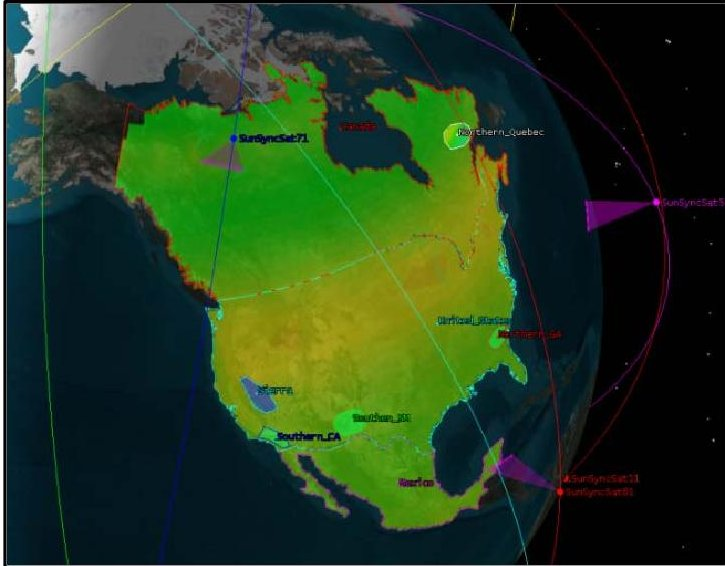
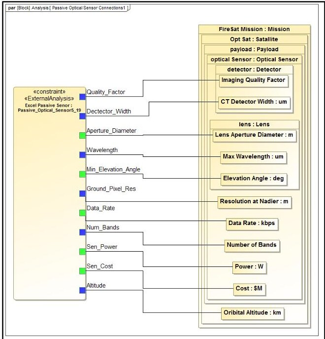
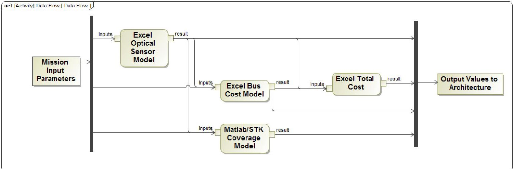
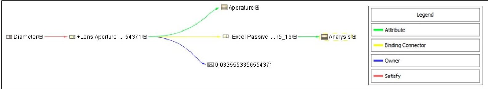
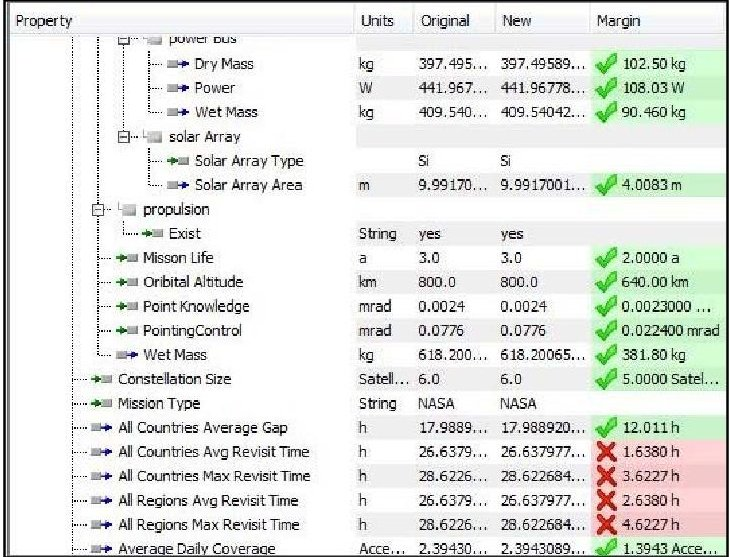
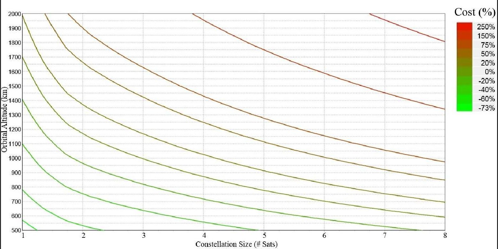
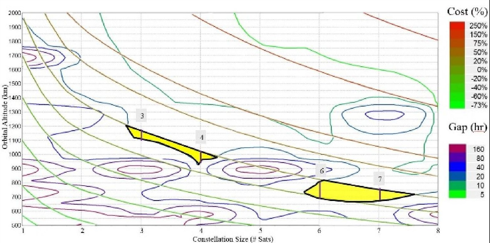

<!-- PDF_PAGE: 1 -->

# Optimization of Multi-Satellite Systems Using Integrated Model Based System Engineering (MBSE) Techniques

Jeremiah Crane

Defense and Intelligence Group

Booz Allen Hamilton

Los Angeles, CA

crane_jermeiah@bah.com

Leonard Brownlow Defense and Intelligence Group Booz Allen Hamilton Los Angeles, CA brownlow_leonard@bah.com

Abstract - Advances in workstation computational capabilities have enabled more powerful modeling and simulation tools to system engineers. Concurrent Engineering Methodologies (CEMs) are now more accessible than ever before. Model Based System Engineering (MBSE) toolsets can be incorporated to the analysis process to facilitate the management of the requirements and design parameters and objectives. This paper explores how CEMs and MBSE techniques can be combined together to produce a single analytic framework we call the MBSE Integration for System Optimization (MISO). We test the approach on a pilot project to aid in the design of a resilient fire detection remote sensing constellation of small satellites. This proof-of-concept study showcases how the MISO analytic framework can be used to optimize satellite designs, trade-space generation, and requirements validation.

## I. Introduction

The purpose of this paper is to describe how CEMs can be combined with MBSE integration techniques to create an architecting framework that supports trades across performance, cost, schedule, risk, and resiliency. The case study, which is based around building a constellation of fire detecting satellites, explores how integration of component sizing, cost and performance models in a MBSE structure can facilitate requirements validation and trade-space generation. While the example discusses a specific application, the framework supports all mission types.

## Context

The Space environment is changing rapidly. There is an ever increasing number new ventures announced almost daily from International Governments, Commercial ventures, and "new entrants" (e.g. Space X, Virgin Galactic). While these newly emerging concepts and technical requirements are bold, fiscal realities continue to dictate that cost remains a major constraint.

Validation of requirements using early modeling and simulation (M&S) can help ensure requirements will satisfy mission needs within the given constraints. Preliminary system design decisions are critical. If the high-level requirements are set incorrectly, errors will propagate throughout the development cycle. A noted heuristic "all the serious mistakes are made on the first day" highlights the importance of early requirements formulation. [1] CEMs combined with MBSE can be a powerful tool to help assist properly defining requirements and making the right trades.

## Background

One example of using CEMs for Space systems was the Operationally Responsive Spacelift (ORS) Analysis of Alternatives (AoA) study conducted in 2004. This study focused on developing space constellation concepts that met mission capabilities outlined in a military utility analysis (MUA). [2] The Aerospace Corporation developed the Space Architecture Development and Analysis Tool (SADAT) to quickly generate a set of ORS designs. The space portion of the analysis focused on the spacecraft bus, constellation and payload designs. The variant design sets revolved around the altitude, number of satellites, inclination, spacecraft mass, and deployment. SADAT used several excel-based

<!-- PDF_PAGE: 2 -->

models for the various components and was integrated using Phoenix Integration's ModelCenter $ ^{\mathrm{TM}}. $

More recently, the space community has started to combine MBSE and more traditional Model Based Engineering (MBE). The infusion of MBE into MBSE has been explored in recent years with regard to CubeSats. [3][4] These are small 10 cm $ ^{3} $ cube and relatively inexpensive (< $ 100 k $ ) satellites used by industry and universities. One study focused on the integration of component models the Radio Aurora Explorer (RAX) mission within a SysML framework. It also used ModelCenter $ ^{TM} $ toolsets to tie the models of the battery and solar panels together for sizing, as well as integrated with an AGI Satellite Tool Kit $ ^{TM} $ (STK) model to calculate the various sun-states the CubeSat orbit. In addition to these CubeSats studies, integrated MBSE pilots using early lifecycle information were used on the Europa deep space probe. [5]

## II. Fire Detection Constellation

Our example model puts these techniques to use using a Space-based fire detection mission. The mission need is the timely location and characterization of forest fires to protect public safety and property. This drives key technical capabilities for a satellite constellation that include adequate sensor resolution to detect the fires, adequate coverage, and a revisit time that provides timely updates. This capability statement can be used to develop initial requirements of the satellite system and identify attributes that are needed of the system to meet the mission. Additionally, since cost is an important parameter in the system development, major cost drivers in the requirements and their attributes will be quantified during the requirements development process. The MISO framework enables the ability for the system developer to cost requirements and perform cost benefit and stakeholder utility analysis.

Optical/infrared sensors are typically used to detect forest fires from low earth orbit (LEO). The sensor aperture diameter correlates directly to both performance and physical dimensions. The Size, Weight and Power (SWAP) of a sensor have direct correlations to cost as well as sizing of the overall spacecraft. MISO incorporated a sensor sizing model as a key component of the payload. This model was

chosen from the Space Mission Analysis and Design (SMAD) reference that has input parameters of altitude, ground resolutions and wavelength. [6] The payload power and data rate requirements to help size and cost the satellite bus based on historical parametric data.

For the system to have significant stakeholder utility, the revisit time of frequent fire danger areas needs to be low. How often the system revisits an area is primarily driven by the sensor swath angle as well as the altitude and number of satellites utilized. The higher the orbital altitude, the fewer satellites that are needed to cover a given area. However, higher orbits require larger sensor aperture diameters to meet the required resolution which drives the sensor (and thus the spacecraft) cost. Conversely the lower orbit constellations are cheaper on a per spacecraft basis, but will require more satellites to achieve the same performance which also factors into total system cost.

To characterize how well the constellation covered the target fire area, the model employed an STK coverage analysis, shown in Figure 1. Countries including United States, Canada, Australia, and others that experience frequent, costly forests fires were chosen as target areas, as well as several smaller regions with historical burn-scar data, as recorded by the MODIS and VIIRS sensors onboard NASA and NOAA satellites. [7] Daily coverage values of these areas were returned as a metric of performance for each constellation. The STK analysis was run through Matlab to help automate scenario generation so that constellation size and altitude could be used as input parameters.

Figure 1: STK Coverage Model for North America, Green is less than 20 hours

<!-- PDF_PAGE: 3 -->

## Integration of MBE into MBSE

All of the sizing, cost and performance models are built using traditional MBE methodologies. MISO provides an improved capability by incorporating the models together into the larger analytic framework. To build the framework, the various component models are incorporated into the context of a MBSE model written in SysML. Using MagicDraw $ ^{\mathrm{TM}} $ by No Magic Inc, the technical baseline of the satellite can be generated and stored as a single repository of knowledge. The various architecture artifacts of structure, requirements, parameters, behaviors and model pointers are all defined in a single ontology.

ModelCenter's MBSE Pak $ ^{\mathrm{TM}} $ was used to link in the MBSE component models within the SysML model. Each of the sizing, cost and performance models are "wrapped" with a script that identifies the input/output parameters of the model. A constraint block is then built that represents this model and placed into a parametric diagram. Shown on Figure 2, the passive optical sensor sizing model is linked with the parameters the fire detection satellite structure and its payload. When the linked input parameters are set, they automatically fed into the sensor model and for computation. Once the values are computed, the output is returned and stored in the appropriate parameter location.

The inputs of each model do not always have to manually entered. If a model uses input values derived from another component model output, then those values can be fed directly from one model to the next via the shared stored parameter. For example, the sizing model outputs the viewing angle based on the geometry of the optical sensor. That viewing angle is stored as a parameter of the lens component. The STK performance model then uses

that as an input for the characterization of the sensor in its analysis. This model hierarchy is set up automatically by the MBSE Pak and each is executed in order of dependency that is programmed into the framework. This data flow, shown in Figure 3 exemplifies how the sensor sizing model feeds the bus sizing and STK coverage models.

Figure 2: Mapping of parameters to model inputs (blue) and outputs (green)

ModelCenter $ ^{\mathrm{TM}} $ allows any sort of component model to be run as long as it can be placed within a wrapper. This enables models to be swapped in and out with relative ease. Early phase, lower fidelity models, can eventually be replaced by with those with higher fidelity as the design matures. So while the spacecraft bus sizing model requires few input parameters, a more detailed model can be added later without changing the initial mappings. Additionally, the system abstraction level can be expanded by adding

Figure 3: Data Flow between component models

<!-- PDF_PAGE: 4 -->

Figure 4: Complete Trace for the parameter lens aperture diameter

launch vehicle costs, propulsion sizing, and communication models. In theory, the number of component models contained can increase indefinitely. Reusability of the component models can aide in the rapid development of future projects Since the development of this initial model, our team created an additional microwave sensor model to explore the trade-spaces of a weather satellite constellation.

## III. Utilizing MISO

Once the analytic models become tied together into the descriptive MBSE context, the unified MISO framework is complete. The advantages of using this framework are the ability to validate the requirements and run a concurrent trades on the satellite structure.

## Requirements Validation

A key attribute that is offered by using an MBSE frontend for concurrent design trades is the added traceability. This traceability comes from the various mappings between elements. For example, linking of requirements to component parameters is done though a "satisfy relationship" in SysML. Because the values of the satellite model structure also linked to the analytic models, an end-to-end trace can be formed as shown in Figure 4.

Starting on the left in Figure 4, the trace begins from the sensor aperture diameter requirement to the optical sensor sizing model. Additionally, the value from the sizing model is stored as a child of the lens aperture value. If the requirement statement is stored in a machine readable way, the mapping to the output values from the models can be used to directly compare the two. The ModelCenter MBSE Pak $ ^{\mathrm{TM}} $ included requirements evaluation tool yields a table of outputs from the models that can be validated against their corresponding requirements, shown in Figure 5.

If the value is below the threshold it is displayed green, otherwise it is indicated in red. The relative margins and the corresponding units are also displayed for comparison. This direct evaluation of the values to the requirements can help the system engineer determine if different input values need to put into the models or if the requirements themselves need to be adjusted. These small adjustments can be useful in seeing the cost of a specific requirement. This can be especially helpful early in system definition, when the impact of requirements changes are typically not as costly as later in the life-cycle.

Figure 5: Shows the values from all the models in a single table

## Building a trade-space

With all the models linked together, it is possible to have them execute as a single group. This larger integration allows for a single analyst to build a trade-space that incorporates many facets of the design simultaneously. It also eliminates the need for several modelers to physically pass snapshots from one model to another. More importantly, running all models simultaneously means the data is not dependent on time consuming, serial model runs. Instead a single machine executes the models in the

<!-- PDF_PAGE: 5 -->

Figure 6: Cost curves for Orbital Altitude vs Constellation Size. Along the curves the cost is constant.

dependency order and automatically passes the data from one model to the next.

To better illustrate this concept in action, we included an example on satellite orbit altitude, constellation size, coverage, and cost. For satellites, altitude affects both how large the observation sensors need to be and how wide of a swath it will cover. Also, as more satellites are added to a constellation, the total system cost will increase, but so will the overall coverage. With the two design parameters of altitude and constellation size, a trade-space for cost can be

generated by using a using a Design of Experiments (DOE), shown on Figure 6. The figure highlights the constant cost curves that show that a single satellite at 1200 km is the same cost as 4 satellites at 650km. This cost equivalency of the 4 smaller satellites is due to the size/weight reductions required for the lower altitude and per unit cost savings that come from replication of design, assembly, and bulk parts buys. This trade-space also highlights the synergy of the sensor sizing model feeding into the power bus model.

Figure 7: Combining Cost and Performance Constant curves. Highlighted area reveals possible choice of with less than 20 hours average gap

<!-- PDF_PAGE: 6 -->

During the same trade-study the values were also fed into the STK Coverage model. The same constant performance of average gap between coverage curves were generated and overlaid on top of the cost curves, shown on Figure 7. These values come from characterizing the average gap between observations of the target areas by the entire constellation. For example, when targeting performance of 20 hours revisit time (or less) and setting a reasonable budget, the analysis indicates solutions with 3,4,6 or 7 satellites deliver the similar performance for comparable cost. Adding other decision factors, such as resiliency, can then help differentiate between similar solutions. Larger constellations experience less impact to performance if one satellite failed. The application of stakeholder utility and/or risk analysis would further help identify the optimal constellation size.

Once an architecture is selected, its performance and capability parameters can be compared to the original system requirements to validate compliance. Utilizing a feature of MBSE tools, the set of system requirements and corresponding design parameters can be automatically published into standard documentation formats.

## IV. Next Steps

There are several ways that this pilot trade study can be further expanded. For example, other analytic models that model development schedules, risk assessments, or other components of the space vehicle could be incorporated. Some of these components could include a launch vehicle model, propulsion sizing models, other sensor models for different missions or communication relays for expanded mission capability. Additionally, each of the current models could be improved to increase their fidelity. Finally, the measurement framework could be expanded on to look at additional metrics. For example, looking at a normalized metric that could provide a single measure of cost/performance might be useful for quickly rating a large number of architecture solutions.

## V. Conclusion

Incorporation of analytic models into the descriptive MBSE model yields a useful analytic framework. It allows for traceability from the models to the requirements to support validation efforts. Costly requirements can be relaxed or non-optimal designs can be identified early. For the fire detection system, a trade-space was generated to show cost and performance curves built concurrently from all of the analytic models. This can help developer and customer teams both optimize designs and generate requirements within the same framework. Overall, this toolset can help the system engineer design and optimize systems that are increasing complex examining a wide array of variables simultaneously.

## VI. References

[1] Rechtin, E. System Architecting: Creating and Building Complex Systems. Prentice-Hall 1 ed,1991.

[2] Min, I.; Mahr, E.; Vaughan, R.; Kellogg, I., "Rapid space architecture development and analysis using an integrated toolset," Aerospace Conference, 2004. Proceedings. 2004 IEEE , vol.6, no., pp.3896,3906 Vol.6, 6-13 March 2004

[2] Spangelo, S.C.; Cutler, J.; Anderson, L.; Fosse, E.; Cheng, L.; Yntema, R.; Bajaj, M.; Delp, C.; Cole, B.; Soremekum, G.; Kaslow, D., "Model based systems engineering (MBSE) applied to Radio Aurora Explorer (RAX) CubeSat mission operational scenarios," Aerospace Conference, 2013 IEEE , vol., no., pp.1,18, 2-9 March 2013

[3] Spangelo, S.C.; Kaslow, D.; Delp, C.; Cole, B.; Anderson, L.; Fosse, E.; Gilbert, B.S.; Hartman, L.; Kahn, T.; Cutler, J., "Applying Model Based Systems Engineering (MBSE) to a standard CubeSat," Aerospace Conference, 2012 IEEE , vol., no., pp.1,20, 3-10 March 2012

[4] Kaslow, D.; Soremekun, G.; Hongman Kim; Spangelo, S., "Integrated model-based systems engineering (MBSE) applied to the Simulation of a CubeSat mission," Aerospace Conference, 2014 IEEE , vol., no., pp.1,14, 1-8 March 2014

[5] Bjorn, B.; Delp, C.; Donahue, K. "Piloting Model Based Engineering Techniques for Spacecraft Concepts in Early Formation." INCOSE IS 2010. June, 2010.

[6] Larson, W.; Wertz, J.; "Space Mission Analysis and Design, Third Edition". Microcosm Press, Hawthorne, CA and Springer, New York, NY, 2008

[7] NASA;NOAA "MODIS/VIIRS Burn Scar Data". Retrieved June , 2013 Available: http://activefiremaps.fs.fed.us/burnscar.php