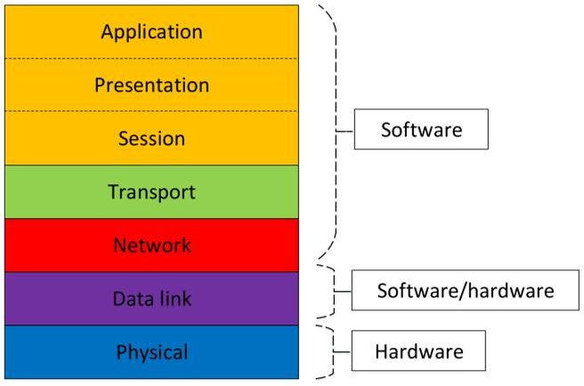
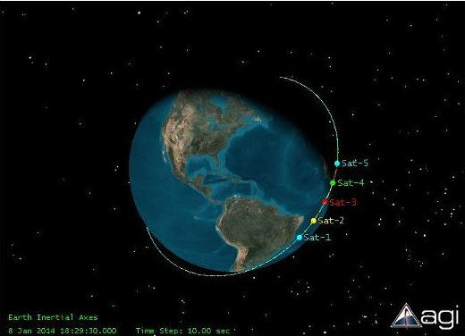
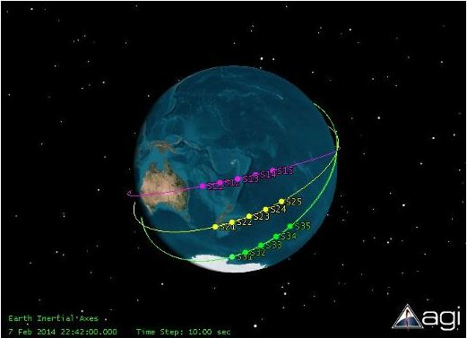
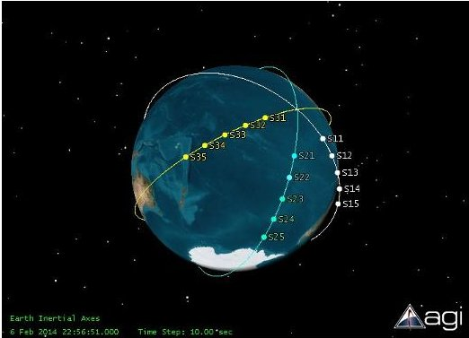
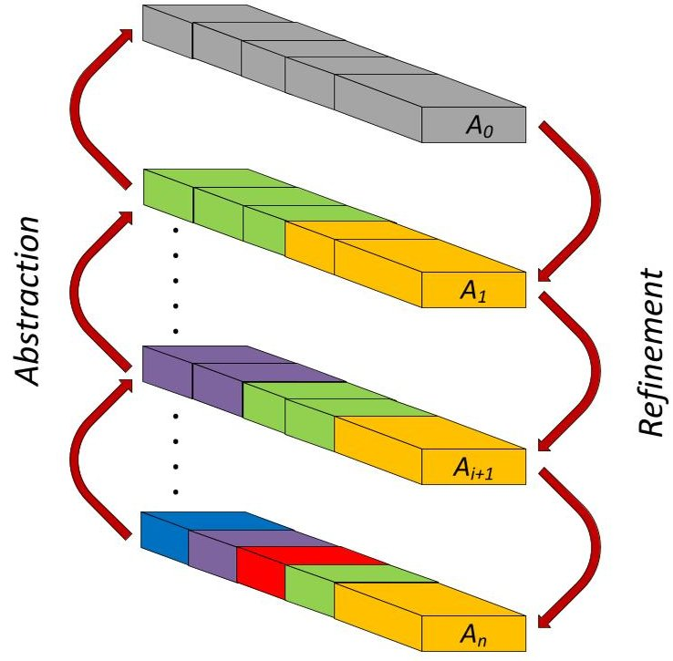

<!-- PDF_PAGE: 1 -->

# Systems Engineering of Inter-Satellite Communications for Distributed Systems of Small Satellites

W. Edmonson, S. Gebreyohannes, A. Dillion,

R. Radhakrishnan, J. Chenou, A. Esterline and F. Afghah

NC A & T State University

Greensboro, NC 27411

Email: {wwedmons,shgebrey,acdillio,rradhakr,jchenou,esterlin,fafghah} @ncat.edu

AbstractPresent design processes for satellite networks mainly involve interconnected system models and their parameter-based simulations without emphasizing high level requirements in the process. What is missing is a systems engineering approach and a system of verification and validation based on formal representation and analysis. We propose a systems design methodology for inter-satellite communication based on the Responsive and Formal Design (RFD) [1] - [3], which addresses the need for a model-based system engineering approach coupled with a system of validation and verification based on formal representation and analysis. The goal is to apply the RFD process to provide a solution for the Inter-Satellite Communications (ISC) problem within the Open Systems Interconnection (OSI) framework. The OSI represents a standard framework for communication between devices. It divides the communication process into seven layers, with each one providing well-defined functions and services. We will address the integration of the RFD process with the OSI framework for ISC. The RFD process involves levels of design abstraction and refinement which correspond to layers or groups of layers of the OSI model. The process illustrates how the complete framework for ISC unfolds in an iterative manner.

## I. INTRODUCTION

The concept of multiple small satellite missions is becoming attractive because of their potential to perform coordinated measurements of remote space, which can be classified as a sensor network or generally as a Cyber-Physical System (CPS). A multi-satellite solution is highly economical and helps to provide improved spatial and temporal resolutions of the target. A large number of heterogeneous small satellites can be deployed in space as a network, with minimum human intervention and thus requiring a need for inter-satellite communication (ISC) [4]. Future space missions will be designed to take advantage of a multi-satellite that operate symbiotically [5]. Such missions will consist of multiple advanced, intelligent, and yet affordable satellites all in communication with each other. It is imperative that the satellite system demonstrates consistent and reliable communication. This paper provides the foundation and framework for the systems engineering of a communication systems that will take into account mission operational parameters to ensure reliable information flow between satellites.

A large number of heterogeneous small satellites can be deployed in space as a network using inter-satellite communications [4], [6], [7]. Such a network will provide data to

enable command, control, communication, and information processing with real time or near real time communication capabilities. Thus, ISC assists in performing advanced functions, for example, distributed processing, servicing or proximity operations, autonomous applications, fractionated operations, etc. It also facilitates in reducing the use of extensive ground based relay systems and worldwide tracking systems [8]. It is our expectation that ISC will support transmission with high capacity data rates, real time data delivery and also provide absolute interoperability among various spacecraft within the system. The ISC enables navigation and formation control by exchanging the attitude and position information and also maintains time synchronization between spacecraft. Consequently, inter-satellite communications enable multiple satellite missions for earth observations and inter-planetary explorations and observations.

Present design processes for satellite networks mainly involve interconnected system models and their parameter-based simulations without emphasizing high level requirements in the process. What is missing is a systems engineering approach and a system of verification and validation based on formal representation and analysis [6], [7], [9] - [11].

In this paper, we propose a design process that is specific to designing ISC and is based on the OSI framework. This design process will be based on the Responsive and Formal Design (RFD) process that represents an integration of modelbased systems engineering (MBSE) and formal methods [1] [3]. The RFD methodology utilizes a risk-tolerant philosophy that notionally should lead to a correct design with minimalto-no redesign through the use of an agile and formal design process based on models. By integrating formal methods into the proposed design process at the appropriate levels, many design failures and integration challenges can be eliminated. Formal methods will provide automatic means for verification by translating requirements into a higher order logic language for which automatic theorem prover tools can perform consistency and traceability checks throughout the design process. Examples of theorem provers are PVS [12], HOL [13], and Coq [14].

We will show how the RFD process and OSI framework are integrated to achieve a design process that is specific to ISC systems. This integration entails relating the RFD abstractions to the OSI structure. It will improve the limitations of the cur-

<!-- PDF_PAGE: 2 -->

rent satellite network design processes. An important feature of the RFD process with respect to framework integration is that it never loses track of high-level requirements. The OSI stack has become a universally accepted way of explaining and designing communication protocols. Integrating the RFD methodology with the OSI makes it easier to understand the inner workings of the RFD process, and gives it legitimacy. Germane to the integration process is the task of ensuring consistency among levels of the RFD abstractions and across the OSI refinement layers.

One of the main drivers of ISC design through the RFD process is the set of design parameters (constraints) obtained from the behavior of satellites operating in various types of constellations. These parameters are dependent on mission types leading to different applications such as autonomous operations [15], earth observation missions, deep space missions, servicing or proximity operations [16] and distributed processing [17].

The following sections of this paper will begin by introducing an overview of the RFD process, the OSI framework, and the operations of a distributed system of small satellites. Section 3 will discuss the ISC design process and Section 4 describes the key design parameters that need to be addressed for any ISC system.

## II. BACKGROUND

## A. Responsive and Formal Design Process

The RFD process represents a procedure for designing small satellites in the pico- and nano-class of satellites (PNSat). This class of satellites are constrained by size, mass, power, and cost (SMAP-C), and is designed using a small, multidisciplinary team. A major benefit of RFD is the integration of formal methods throughout the design process as an integral part of requirements management, with the goal of insuring that the engineered product represents a high-confidence design. Furthermore, the RFD process for small satellite systems takes into consideration that the system design life cycle is short, while insuring that the resultant design is correct from a formal methods perspective. The goal of the RFD process, with the use of formal methods, is to develop a "correct-by- construction" design process for systems which are low cost, while allowing for degraded or limited modes of operation.

Designing a system using a short and agile process relies on the ability to characterize system functions at various levels of abstraction [18]. Ensuring responsiveness to foreseen and unforeseen changes requires an understanding of how system inputs, interactions with the environment, or stakeholders input flow through such generalized system descriptions to dictate its output. The framework which we follow in implementing this RFD process is based on mission design flow, and is iterative.

Each level $ \mathcal{A}_{i} $ in an MBSE design generally represents a set of requirements and its associated models, simulations, and the relationships between them, see Eq.1.

$$
\begin{array}{c c c c} \mathcal {L} _ {n} \iff & \mathcal {L} _ {l} & \iff \mathcal {M} \Longrightarrow \mathcal {S} _ {p} \\ & \Downarrow & \\ & \mathcal {S} _ {b} & \end{array}
$$

where each design parameter is defined as the following:

- $ \mathcal{L}_{n}\Rightarrow $ requirements written in natural language form

- $ \mathcal{L}_{l}\Rightarrow $ requirements written as a set of logical functions

- $ \mathcal{M}\Rightarrow $ system of interconnected models

- $ S_{p}\Rightarrow $ simulations based on the parameters of $ \mathcal{M}. $

- $ \mathcal{S}_{b}\Rightarrow $ simulations based on the logical description of $ \mathcal{L}_{l}. $

System requirements expressed in natural language is the starting point of the RFD process. As a model-based process, it produces two main system models representing the logical and behavioral aspects of the requirements. A simulation is successful if all constraints associated with attributes of the system are met. The objective of behavior model simulation is to describe the operations of a system and the flow of information between the different subsystems. Traditional system simulation can be described as parametric since it focuses on the parameters of a system model. The RFD process introduces formal methods and simulations of system behavior based on the formal logics used to capture the system requirements. A cornerstone of the RFD process is that there exists a formal check for consistency within each level of abstraction and a check for traceability between levels of abstraction [2].

A cornerstone of RFD is the different levels of system abstraction and refinement it produces that go hand in hand in an inverse relationship. As we descend from higher levels of abstraction, we naturally produce more granular refinements.

## B. The OSI Framework

The Open System Interconnection (OSI) model serves as a reference tool for communication between heterogeneous devices connected in a network. It is a conceptual framework that helps us understand complex interactions within such network. It divides the communication process into seven

Figure 1. Frame work for inter-satellite communication [6]

layers [19]. Each layer has well defined functions and offers services to the layers above and below it. It will be used as a framework for inter-satellite communications of small satellite systems. The seven layers are physical, data link network, transport, session, presentation, and application. For small satellite systems, the upper three layer functionalities of

<!-- PDF_PAGE: 3 -->

(a) Leader-Follower

(b) Cluster

Fig. 2. Formation Flying Patterns

(c) Constellation

the OSI model can be merged as shown in Fig. 1, and can be implemented using software programs [6].

The layers of the OSI framework can be described as:

- The physical layer of a networking environment is concerned with the physical characteristics (electrical, mechanical, optical, etc.) that allows communication to take place. Some of the technical aspects it covers include frequency allocation and data rate, error detection and correction, modulation schemes, and others.

- Data link layer is responsible for framing and physical addressing (Medium Access Control/MAC address), and also for ensuring error free data transmission.

- The network layer is responsible for logical data packet routing.

- The transport layer provides services for applications to ensure reliability in communication.

- The application layer is the top layer and deals with shared protocols and interfaces.

The functionalities of each layer will be given in more detail when we describe the ISC application for small satellites.

## C. Distributed System of Small Satellite Operations

A communication architecture design for small satellites depends on various parameters. These parameters (design constraints) are obtained from the behavior of satellites operating in the various types of constellations, assuming that they are orbiting in Low Earth Orbits (LEOs).

Small satellites with distributed computing capabilities can fly in various configurations like formation flying spacecraft [20], satellite constellation [6], [21]----[23], swarms, and fractionated spacecraft [24], [25].

In accordance with the engineering definition for formation flying of spacecrafts, ISC is required to maintain relative separation, orientation, or position among the spacecrafts [20]. The Leader-Follower (A-Train) is a good example of this pattern (see Fig. 2(a)).

A satellite constellation (Fig. 2(c)) is a set of similar or dissimilar satellites distributed in space so that they overlap well within the coverage area to accomplish mission objectives

[21]. A cluster configuration (Fig. 2(b)) is a subgroup of constellation as it covers a smaller portion of the Earth. A cluster consists of a number of satellites distributed in different orbital planes that operate cooperatively. The Flower constellation [6] and TECHSAT-21 [22] are examples of cluster configuration.

The behavior of satellites operating in various types of constellations determines the set of design parameters (constraints) at our disposal. The exact set of parameters employed will be dependent on specific missions.

## III. INTER-SATELLITE COMMUNICATION DESIGN PROCESS

We propose a design process that is specific to designing ISC based on the OSI framework using the RFD process. Our design process is integrated with the conceptual OSI framework to produce reliable inter-satellite communication. Unless explicitly stated, we use level to refer to each step of representation in the RFD process and layer for each conceptual functional partition of the OSI framework.

In Fig. 3 we show the integration of the RFD process with the OSI framework for ISC design. Each level of abstraction in the RFD process covers the OSI framework in varying levels of details, i.e. the OSI layers will emerge as we move to lower levels of abstraction.

At the highest level, from the RFD perspective, we view the OSI communication framework as an unpartitioned layer providing the means to communicate with other similar devices. The various layers of the OSI framework can be viewed laterally instead of the usual vertical arrangement from Application to Physical layer. As we move to lower levels of abstraction, i.e. $ \mathcal{A}_{i}\rightarrow \mathcal{A}_{i+1} $ of the RFD representation we identify high level communication concepts which, themselves, are progressively refined and expressed in lower levels of abstraction. Finally, at the lowest level, we should end up with the different layers of the OSI stack, expressed laterally.

All the seven (five, for small satellites) known layers of the OSI model may not be visible at each level, especially at higher levels of abstraction. It is a common practice to have some derivatives of the OSI framework, merging layers together. However, more layers come to view as we proceed in the design process for refinement.

The refinement helps to make clear the connection with parametric considerations that are represented by $ \{ \mathcal{M}, \mathcal{S}_{p} \} $ of

<!-- PDF_PAGE: 4 -->

TABLE I. SYSTEM DESIGN PARAMETERS FOR VARIOUS APPLICATIONS

<table border="1"><tr><td colspan="5">OSI Layers
(Potentially Affected)</td><td>System Design Parameters</td><td>Autonomous Operations</td><td>Earth Observation Missions</td><td>Deep Space Missions</td><td>Servicing or proximity operations</td><td>Distributed Processing</td></tr><tr><td>A</td><td>T</td><td>N</td><td>D</td><td>P</td><td>Network topology (fixed/variable)</td><td>variable</td><td>variable/fixed</td><td>variable</td><td>variable</td><td>variable</td></tr><tr><td></td><td></td><td>N</td><td>D</td><td>P</td><td>Science data transmission frequency</td><td>low</td><td>high</td><td>high/low</td><td>low</td><td>high</td></tr><tr><td></td><td></td><td>N</td><td>D</td><td>P</td><td>Navigation data transmission frequency</td><td>high</td><td>low</td><td>high</td><td>high</td><td>high</td></tr><tr><td></td><td></td><td>N</td><td>D</td><td>P</td><td>Command data transmission frequency</td><td>high</td><td>low</td><td>high</td><td>high</td><td>high</td></tr><tr><td></td><td></td><td>N</td><td>D</td><td>P</td><td>Health and status data transmission frequency</td><td>low</td><td>low</td><td>low</td><td>low</td><td>low</td></tr><tr><td>A</td><td>T</td><td>N</td><td>D</td><td>P</td><td>Power requirements</td><td>high</td><td>high</td><td>high</td><td>high</td><td>high</td></tr><tr><td></td><td></td><td></td><td>D</td><td>P</td><td>Bandwidth requirements</td><td>high</td><td>high</td><td>high</td><td>high</td><td>high</td></tr><tr><td></td><td></td><td>N</td><td>D</td><td>P</td><td>Near real time access</td><td>high</td><td>low</td><td>high/low</td><td>high</td><td>high</td></tr><tr><td>A</td><td></td><td></td><td>D</td><td>P</td><td>Processing capabilities of each satellite</td><td>high</td><td>high/low</td><td>high/low</td><td>high</td><td>high</td></tr><tr><td>A</td><td></td><td>N</td><td>D</td><td>P</td><td>Reconfigurability</td><td>high</td><td>high/low</td><td>high/low</td><td>high</td><td>high</td></tr><tr><td>A</td><td></td><td>N</td><td>D</td><td>P</td><td>Scalability</td><td>high</td><td>high/low</td><td>high/low</td><td>high</td><td>high</td></tr><tr><td>A</td><td>T</td><td>N</td><td>D</td><td>P</td><td>Connectivity (intermittent/consistent)</td><td>intermittent</td><td>consistent</td><td>intermittent</td><td>intermittent</td><td>intermittent/consistent</td></tr><tr><td>A</td><td>T</td><td>N</td><td>D</td><td>P</td><td>Variable data size</td><td>low</td><td>high</td><td>high</td><td>low</td><td>high</td></tr></table>

Figure 3. Integration of the RFD process with the OSI framework

the RFD process described in Eq.1. Unlike many traditional design methods, RFD integrates high level requirements with domain specific considerations and verifies the combination formally. As levels of RFD proceed towards refinement, the design process becomes a local or discipline specific activity, though always with a global perspective. The formal methods concepts and techniques we propose for abstraction and refinement can be found in [3]. Briefly, refinement is defined as a relation between the $ i^{th} $ and the $ (i+1)^{th} $ levels of abstraction, in which their logical properties are preserved. We employ category theory to express this refinement relations [2]. The importance of our use of category theory is that it is an abstraction of mathematic representation (set theory); as such, it is embedded with different formalisms (logic, algebra, etc.), thereby providing formal underpinning to its usage. As outlined in [26], it can provide for a formal unification between " ... systems description (category theory), specification (logical theory), and verification (proof theory)."

Category theory [27] - [29] represents a way to express system properties through relations between objects and morphisms. In general, a category C consists of a class of objects and a class of morphisms (or arrows or maps) between objects. Each morphism f has a unique source object a and target object b; written as f: a $ \rightarrow $ b. The composition of f: a $ \rightarrow $ b and g: b $ \rightarrow $ c is written as g $ \circ $ f and is required to be associative: if in addition h: c $ \rightarrow $ d, then $ h \circ(g \circ f)=(h \circ g) \circ f. $ It is also required that, for every object x, there exists a morphism $ 1_{x}:x \rightarrow x $ (the identity morphism for x) such that, for every morphism f: a $ \rightarrow $ b, we have $ 1_{b} \circ f=f=f \circ 1_{a}. $ It follows from these properties that there is exactly one identity morphism for every object. A functor from one category to another is a structure-preserving mapping, preserving the identity and composition of morphisms. More exactly, if C and D are categories, then a functor F from C to D is a mapping that associates with each object $ x \in C $ an object $ F(x) \in D $ and, with each morphism f: x $ \rightarrow $ y $ \in C $ a morphism $ F(f):F(x) \rightarrow F(y) \in D. $ In addition, it requires that $ F(id_{x})=id_{Fx} $ for every object $ x \in C $ , and $ F(g \circ f)=F(g) \circ F(f) $ for all morphisms f: x $ \rightarrow $ y and g: y $ \rightarrow $ z.

It is important to achieve consistency across the OSI layers. At the highest layer in the OSI framework we have the application layer and as we proceed to the physical layer we must ensure that each layer is a consistent refinement of the one above it. It is also equally important to maintain consistent information as we proceed in the design process for refinement. Our design process considers both verifications, yielding a reliable and formal design methodology for intersatellite communication.

## IV. DESIGN PARAMETERS

The main components that drive the ISC design process are the set of design parameters (constraints). They are obtained from the behavior of satellites operating in various types of constellations and is outlined in Table I. The criticality of the various system design parameters and their dependence on the different applications of small satellites are also shown. The first column of the table is color-coded (based on Fig. 1) to show the relationship between the design parameters

<!-- PDF_PAGE: 5 -->

(constraints) and various layers of the OSI. This relationship may represent "derived from", "verify", etc. However, the table does not present all the relationships. The table should be understood with the disclaimer that the design parameters in column 2 have varying degrees of impact on the OSI layers mentioned in column 1 for a given level of RFD abstraction.

The main drivers of ISC design process in general are the set of design parameters (constraints). They are obtained from the behavior of satellites operating in various types of constellations. The following are the design constraints from which specifications of one or more layers of the OSI framework are derived.

1) Network topology: Network topology is the arrangement of various elements (satellites, nodes in a computer network, sensor nodes, etc.) in a network. In a small satellite system, satellites can be arranged in a fixed or varying topology.

2) Frequency of data transmission: In distributed spacecraft systems there are four different data types that need to be exchanged between the satellites: science data, navigation data, spacecraft health/status data, and command/control data. Each data type can have different access rates and transmission speeds from each other.

3) Bandwidth requirements: The network of small satellites performing advanced functions requires high bandwidth, which largely depends on the mission and frequency of data transmission.

4) Near real-time access: Extending networking to space will involve autonomous transfer of data without human intervention. There are various applications for small satellites, like servicing or proximity operations, where data packets (involving timestamp information) need to transmit with least amount of delay. Satellites need to have real-time access to the communication channel for such applications.

5) Processing capabilities of each satellite: Depending on the mission, each small satellite will have distinct processing capabilities. For a centralized system, the mother satellite in the system would have higher processing capabilities in comparison to daughter satellites. Daughter satellites can transmit raw data to the mother satellite, which in turn processes the data, reduces the size, executes necessary error correction techniques, and transmits it to the ground station. For a purely distributed network, the processing capability of each satellite in the system would be comparable.

6) Reconfigurability and scalability: The two important requirements for small satellite sensor networks are reconfigurability and scalability. Applications and protocols implemented in these networks should check for node failures or addition of new nodes, and the network should reconfigure itself to maintain mission objectives. The various layers of the OSI model should be designed to support different network architectures and control over network topology, and also to assist high degree of scalability.

7) Connectivity: The challenging space environment and node mobility will cause the low power small satellites to periodically lose connection with each other. Networking under such intermittent connectivity is demanding, as many of the terrestrial protocols are not suitable in

this context. Thus, their performance deteriorates drastically as connectivity becomes intermittent and short-lived. Hence, routing is one of the biggest problem to overcome. The existing terrestrial protocols need to be modified in order to meet the requirements in space applications.

8) Variable data size: The data size can vary considerably from several kilobits to megabits, depending on specific application. The protocol design should be capable of adapting based on the size of data.

One example of reading Table 1 is that network topology can be fixed or variable depending on the mission requirements. Hence, the various design parameters of the OSI model are potentially affected. The algorithms and software programs designed in the application layer should incorporate the change in network topology. Considering the dynamic topology, the transport and network layer parameters must choose the optimum routing metric such that highest performance can be achieved by minimizing the delay. Depending on the change in topology, the MAC protocols must be designed to ensure fairness among different satellites in the system, which in turn affects the physical layer parameters. The network and physical layer parameters are primarily affected by the rate at which various data (science, navigation, command and health/status) are transmitted among the small satellites. Depending on the frequency of data transmissions, network layer must choose ideal routing metric and routing path. The frequency of data transmissions predominantly influences all physical layer parameters, such as bandwidth, data rate, antenna design parameters, frequency etc.

System design parameters (constraints) are dependent on mission types leading to different applications such as autonomous operations [15], earth observation missions, deep space missions, servicing or proximity operations [16] and distributed processing [17]. For example, autonomous operations require variable network topology, low science data transmission frequency, health and status data transmission frequency, variable data size and high navigation data transmission frequency, power, bandwidth, real-time access, processing capabilities of each satellite, reconfigurability, scalability, and intermittent connectivity. Design processes should capture this information and pass it to the OSI framework ensuring consistent and reliable ISC among satellites.

## V. CONCLUSION

The problem we have addressed is the application of model-based systems engineering based on the Responsive and Formal Design methodology to designing of an intersatellite communication system. The implementation of ISC for a distributed network of small satellites will enable the symbiotic operations of command, control, and information processing. In particular, ISC will allow the performance of advanced functions like distributed processing, autonomous applications, and fractionated operations. As a result, missions incorporating ISC would rely less on the use of ground stations and hence providing the capability of enhanced autonomy.

In this paper, we described the integration of the RFD methodology with the OSI framework for producing an ISC design. An important feature of the RFD process with respect to framework integration is that it never loses track of

<!-- PDF_PAGE: 6 -->

high-level requirements. This is significant because a design methodology should maintain consistency within each abstracted layer and traceability between the layers of abstraction. It will also provide a way to ensure that communications between the OSI layers is consistent.

We have also reviewed the communication design space for various types of satellite constellations. In this analysis, a general set of design parameters have been identified given these constellations.

## REFERENCES

[1] W. Edmonson, H. Herencia-Zapana, N. Neogi, W. Moore, and S. Ferguson, "Highly confident reduced life-cycle design process for small satellite systems: Methodology and theory," in Complex Systems and Data Management Conference, 2012.

[2] N. N. W. Edmonson, J. Chenou and H. Herencia-Zapana, "Small satellite systems design methodology: A formal and agile design process," in IEEE International Systems Conference.

[3] J. Chenou, W. Edmonson, A. Esterline and N. Neogi, "Formal framework for ensuring consistent system and component theories in the design of small satellite systems," in Complex Systems and Data Management Conference, Paris, France, 2014.

[4] R. Radhakrishnan, W. Edmonson, F. Afghah, J. Chenou, R. Martinez Rodriguez-Osorio and Q. Zhen, "Optimal multiple access protocol for inter-satellite communication in small satellite systems," in 4S Small Satellite Systems and Services Symposium, 2014.

[5] J. G. J. Chu and E. Gill, "Functional, physical, and organizational architectures of a fractionated space infrastructure for long-term earth observation missions," IEEE Aerospace and Electronic Systems Magazine, vol. 29, no. 12.

[6] T. Vladimirova, C. Bridges, J. Paul, S. Malik, and M. Sweeting, "Space-based wireless sensor networks: Design issues," in Aerospace Conference, 2010 IEEE, March 2010, pp. 1-14.

[7] T. Vladimirova, W. Xiaofeng, C.P. Bridges, "Development of a satellite sensor network for future space missions," in IEEE Aerospace Conference, 2008, pp. 1-8.

[8] G. Shirville and B. Klofas, "Genso: A global ground station network," in AMSAT Symposium, October, 2007.

[9] S. Ekpo and D. George, "A system-based design methodology and architecture for highly adaptive small satellites," in IEEE Systems Conference, 2010, pp. 516-519.

[10] Z. L. Z. Yuan and J. Zhang, "Inter-satellite link design for the leo/meo two-layered satellite network," in Wireless Communications, Networking and Mobile Computing, vol. 2, 2005, pp. 1072 - 1075.

[11] G. Q. W. Zhenyong, L. Dezhi and L. Jianwei, "Hierarchichal satellite network design based on permanent inter-satellite links," in Wireless Communications, Networking and Mobile Computing, 2008, pp. 1-4.

[12] J. M. R. Sam Owre and N. Shankar, "Pvs: A prototype verification system," in 11th International Conference on Automated Deduction (CADE), 1992.

[13] M. Gordon and T. Melham, Introduction to HOL: A Theorem Proving Environment for Higher-Order Logic. Cambridge Press.

[14] (2012) The Coq Proof Assistant. Electronic. Coq Development Team:https://coq.inria.fr/distrib/current/refman/.

[15] C. Bridges and T. Vladimirova, "Agent computing applications in distributed satellite systems," in International Symposium on Autonomous Decentralized Systems, ISADS '09, 2009, pp. 1-8.

[16] B. W. Barbee and et al., "Guidance and navigation for rendezvous and proximity operations with a non-cooperative spacecraft at geosynchronous orbit," in George H. Born Symposium, 2010.

[17] B. Palmintier, C. Kitts, and M. Swartwout, "Distributed computing architecture for small satellite and multi-spacecraft missions," in SSC02- IV-6 -16th Annual AIAA/USU Conference on Small Satellites, 2002.

[18] J. Rasmussen, "A Framework for Cognitive Task Analysis In Systems Design," Riso National Laboratory, Denmark, 1985.

[19] P. Simoneau, "The OSI Model: Understanding the Seven Layers of Computer Networks," Global Knowledge, 1985, Tech. Rep.

[20] L. S. Stephens and et al., "The Cloudsat Mission and the A-train: A New Dimension of Space-based Observations of Clouds and Precipitation," Bulletin of American Meteorological Society, vol. 83, no. 12, pp. 1771- 1790, 2002.

[21] M. Burlacu and P. Lorenz, "A Survey of Small Satellites Domain: Challenges, Applications and Communications Key Issues," ICSTs Global Community Magazine, 2010.

[22] M. Martin and S. Kilberg, "TechSat 21 and Revolutionizing Space Missions Using Microsatellites," pp. 13-16, 2001.

[23] Iridium. The Iridium Constellation. [Online]. Available: http://www.iridium.com/default.aspx

[24] A. Dubey, W. Emfinger, A. Gokhale, G. Karsai, W. Otte, J. Parsons, C. Szabo, A. Coglio, E. Smith, and P. Bose, "A software platform for fractionated spacecraft," in Aerospace Conference, 2012 IEEE, March 2012, pp. 1-20.

[25] P. P. Sundaramoorthy, E. Gil, and C. J. M. Verhoeven, "Systematic Identification of Applications for a Cluster of Femto-satellites," 61st International Astronautical Congress, Prague, CZ, 2010.

[26] D. Luzeaux, "A formal foundation of systems engineering," in Complex Systems Design & Management CSD&M 2014, M. J. R. R. Boulanger, D. Krob, Ed.

[27] H. Simmons, An Introduction to Category Theory. Cambridge University Press, 2011.

[28] W. F. Lawvere and S. H. Schanuel, Conceptual Mathematics A first Introduction to Categories. Bufflo Worship Press., 1991.

[29] B. C. Pierce, Basic Category Theory for Computers Scientists. MIT Press., 1991.