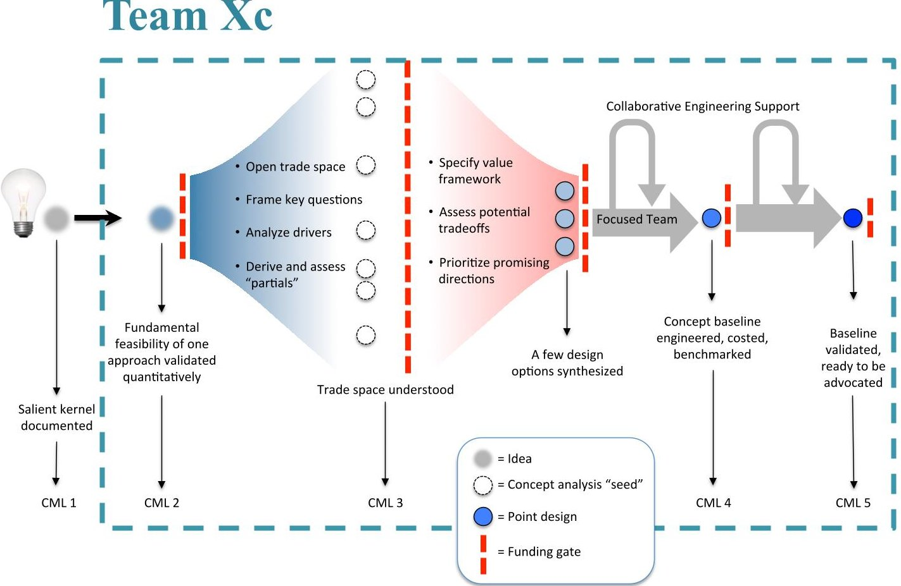
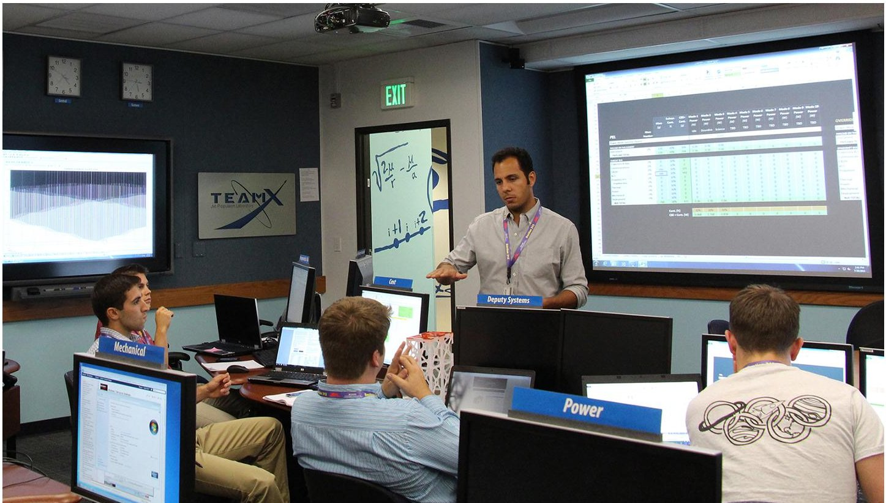
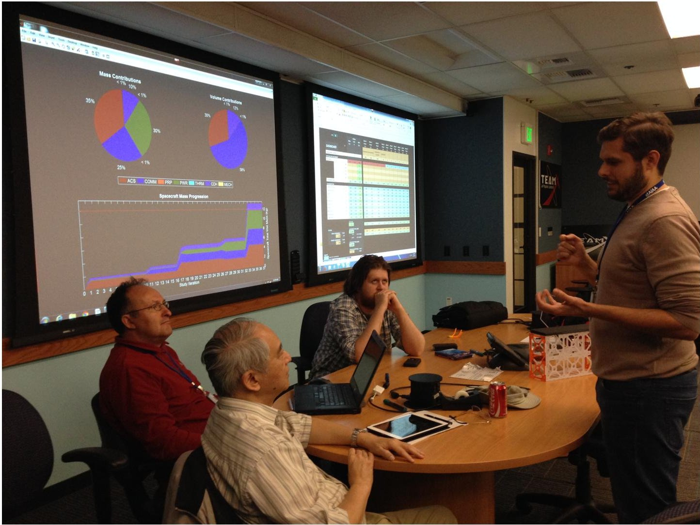
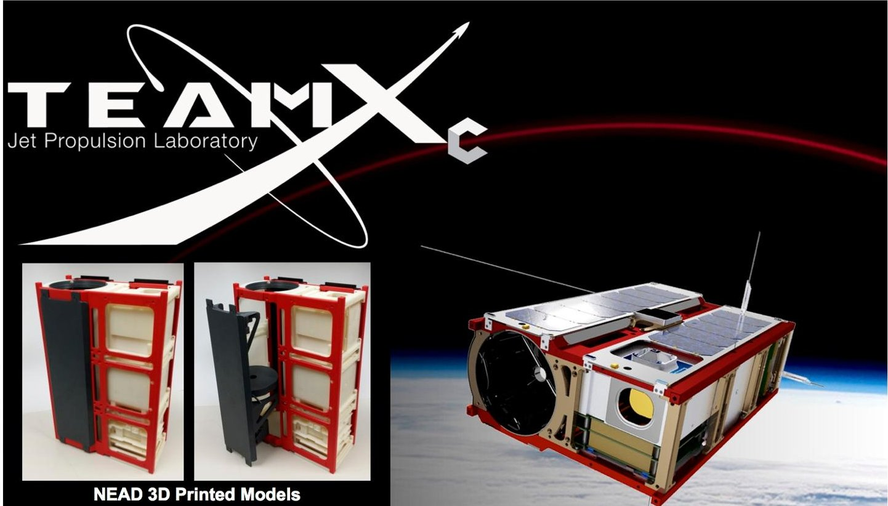
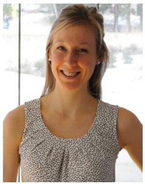

<!-- PDF_PAGE: 1 -->

# Team Xc: JPL's Collaborative Design Team for Exploring CubeSat, NanoSat, and SmallSat-based Mission Concepts

Pez Zarifian Jet Propulsion Laboratory Pasadena, CA 91109 (818)354-1159 Pezhman.Zarifian@jpl.nasa.gov

Robert C. Moeller Jet Propulsion Laboratory Pasadena, CA 91109 (818)393-5079 Robert.C.Moeller@jpl.nasa.gov

Leigh Rosenberg

Jet Propulsion Laboratory

Pasadena, CA 91109

(818) 354-0716

Leigh.S.Rosenberg@jpl.nasa.gov

Payam Banazadeh Jet Propulsion Laboratory Pasadena, CA 91109 (713) 817-1845 Payam.Banazadeh@jpl.nasa.gov

Travis Imken Jet Propulsion Laboratory Pasadena, CA 91109 (818)354-5608 Travis.Imken@jpl.nasa.gov

Matthew W. Bennett Jet Propulsion Laboratory Pasadena, CA 91109 (818) 393-8200 Matthew.W.Bennett@jpl.nasa.gov

Farah Alibay Jet Propulsion Laboratory Pasadena, CA 91109 (818)354-2778 Farah.Alibay@jpl.nasa.gov

Raul Polit Casillas Jet Propulsion Laboratory Pasadena, CA 91109 (818)354-8677 Raul.Polit-Casillas@jpl.nasa.gov

Steve E. Matousek

Jet Propulsion Laboratory

Pasadena, CA 91109

(818) 354-6689

Steven.E.Matousek@jpl.nasa.gov

Charles D. Norton

Jet Propulsion Laboratory

Pasadena, CA 91109

(818) 393-3920

Charles.D.Norton@jpl.nasa.gov

Sara Spangelo Jet Propulsion Laboratory Pasadena, CA 91109 (818)354-0699 Sara.Spangelo@jpl.nasa.gov

Jessie Kawata Jet Propulsion Laboratory Pasadena, CA 91109 (818)354-0421 Jessie.M.Kawata@jpl.nasa.gov

Abstract—Recently there has been an increasing demand for a rapid mission concept generation capability for CubeSats, NanoSats, and SmallSats at JPL and in the broader community in the Concept Maturity Level (CML) 2-5 range. To help address these needs, JPL's Innovation Foundry has extended its long-standing advanced concepts concurrent engineering team, Team X, with a new, agile, and collaborative design capability called Team Xc. This concurrent team-based approach provides rapid turnaround for small spacecraft mission and system early concept studies. The process is adaptable to a wide variety of CubeSat, NanoSat, and SmallSat customers and mission applications. Team Xc design and analysis services include feasibility assessments, trade space exploration studies, and point design studies, commensurate with the level of maturity of the mission concept. The team is assembled with experts experienced in designing, building, launching, and operating CubeSats; leaders in mission architecture, spacecraft design, and concurrent engineering methods; and subject matter experts tailored to the specific needs of each study and customer. The Team Xc capability has been applied to several studies and extended to cover a large breadth of missions spanning applications including Earth science, planetary science, astrophysics, and technology demonstration. Team Xc draws from Team X, JPL, and external subject matter experts to produce quick-turnaround reports targeted to each customer's needs.

## TABLE OF CONTENTS

1 BACKGROUND ... 1

2 FORMATION OF TEAM XC... 2

3 TEAM XC'S CAPABILITIES AND APPROACH ... 2

4 STUDY PROCESS... 3

5 MARCO TEAM XC STUDY ... 4

6 CONTINUED TEAM DEVELOPMENT... 4

7 LARGER SATELLITE SIZES ... 6

8 DIFFERENCES BETWEEN TEAM X AND TEAM XC ... 7

9 MODEL BASED SYSTEMS ENGINEERING INTEGRATION ... 7

10 BEYOND JPL ... 7

11 CONCLUSION ... 7

    ACKNOWLEDGMENTS ... 8

    REFERENCES ... 8

    BIOGRAPHY ... 8

## 1. BACKGROUND

Ever since the birth of the Cube Satellite [1] (or CubeSat) era at Cal Poly San Luis Obispo (SLO) and Stanford University in 1999, CubeSats have served as a relatively simple and costeffective way of accessing space for focused applications. A CubeSat is a modular Nano Satellite (or NanoSat) standard classified by its size and described in Units (or Us). A 1U CubeSat is nominally 10 x 10 x 10 $ cm^{3} $ and weighs 1.33 kg. CubeSats are typically classified as secondary payloads and are ejected from their own deployer on the launch vehicle after the primary payload has been delivered to the target orbit. As a result, CubeSat designers are able to gain low cost access to space while having to accept many constraints from the orbit or trajectory of a primary payload as their mission baseline.

CubeSats were initially developed for educational purposes, however this standard has quickly become popular within government and private initiatives due to its low cost and standardized Commercial Off-The-Shelf (COTS) components. JPL has been involved in small spacecraft development since

<!-- PDF_PAGE: 2 -->

well before the CubeSat era, but started to pursue how CubeSats could support technology and science mission objectives based on a meeting at the 2009 CubeSat Developer's Workshop. A review was held for the University of Michigan (UMich) MCubed CubeSat, designed to take mid-resolution images of the Earth from Low Earth Orbit (LEO). At the meeting, UMich announced they had room for an additional payload. JPL, simultaneously, was developing a processing board to advance new instrument signal processing algorithms for a future multi-angle spectropolarimetic imager and leveraged this opportunity to flight validate new technology associated with this development. A partnership between UMich and JPL was formed, with support from NASA's Earth Science Technology Office (ESTO) to fund completion of MCubed and incorporation of the CubeSat On-Board Processing Experiment (COVE) leading to the launch and operations of JPL's first CubeSat flight experiment in partnership with University of Michigan. Since that time, 10 other CubeSat projects involving various NASA, university, and industry partners, have come into development with many successful launches manifested and underway. These involve a spectrum of activities from LEO to interplanetary projects flying new technologies and new science observations.

The capabilities of the CubeSat platform have opened a new design space for exploration that includes stand-alone spacecraft, constellations, and mother-daughter systems that collaborate. Recently JPL finished the development of the world's first two interplanetary CubeSats named INSPIRE (Interplanetary NanoSpacecraft Pathfinder In a Relevant Environment)[2]. These two CubeSats are currently awaiting an assignment on a NASA CubeSat Launch Initiative launch on an Earth-escape trajectory to demonstrate cross-link telecommunication, navigation, science utility, and survivability of NanoSats in interplanetary space. It is now clear that while JPL will continue to design and build medium and large-scale spacecraft, the capabilities of small spacecraft will add to the laboratory's portfolio of systems for remote exploration of Earth and the Solar System beyond.

## 2. FORMATION OF TEAM XC

In 2013, JPL's Innovation Foundry [3] began the development of a new collaborative engineering team called Team Xc in response to the program offices' need for maturing CubeSat, NanoSat, and Small Satellite (or SmallSat) concepts. Examples of these concepts include the NEAScout (Near Earth Asteroid Scout) CubeSat to flyby a near-Earth asteroid and the Lunar Flashlight CubeSat to investigate the permanently shadowed craters of the Moon, both using solar sail, as well as MarCO (Mars Cube One) relay CubeSats for support of the operation of the InSight Mission at Mars.

The 'c' in Team Xc originally stood for CubeSat. However, during the development phase the core team realized the need for flexibility in form factor and therefore expanded the team's capability to accommodate the technical design of non-standard NanoSats and SmallSats (defined here to be less than or equal to 50 kg). The teams processes build off the experiences of Team X [4][5], JPL's concurrent engineering team for rapid design and analysis of space mission concepts, with the processes tailored and design tools created to embrace the high-risk low-cost paradigm spearheaded by the CubeSat community. Such a capability provides internal and external Principle Investigators (PIs) with an opportunity to further explore their NanoSat and SmallSat mission concepts and learn about the opportunities provided by, as well as

the limitations of this class of spacecraft. Unlike the typical Earth-orbiting CubeSat mission concepts seen in the industry, Team Xc is not limited by a particular platform or mission destination. Space mission concepts utilizing various platforms, standards and form factors to numerous destinations in the Solar System are designed and evaluated by the team. The core team is comprised of engineering practitioners with previous experience from leading CubeSat universities such as University of Texas at Austin and University of Michigan, augmented with seasoned JPL systems engineers. Team Xc also includes a group of subject matter and subsystem experts from Team X, hand-picked based on the needs of the concept study. An average Team Xc study takes two weeks with two study sessions and costs the equivalent of one work-month of a full-time employee.

## 3. TEAM XC'S CAPABILITIES AND APPROACH

Team Xc leverages and builds upon many of the methods and lessons learned from the long-standing JPL concurrent design team, Team X, and JPL early concept development team, A-Team. Team Xc's capabilities are aligned with the Concept Maturity Level (CML) scale [6][7][8], from feasibility assessment (CML 2), and continuing through trade space exploration (CML 3), point design (CML 4), and high level baseline concept review (CML 5), as shown in Figure 1. These capabilities are tailored to provide the following services at each CML to the customer.

## Feasibility Assessments (CML2)

CML 2 studies are essentially aimed to answer the question: "can I fit my mission into a CubeSat, NanoSat or SmallSat?" In these studies, the customer team provides Team Xc with a high level overview of their concept including a description of the instrument and/or the science data they wish to collect or technology they wish to demonstrate. The team would then assess the feasibility of the mission concept within the known constraints such as mass, power, volume, CubeSat design requirements, etc., as well as known capabilities such as propulsion, attitude control, etc. The reverse question can also be asked by the customer: "what can I do with a CubeSat, NanoSat or SmallSat for my objectives at my desired destination?" During CML 2 studies, subsystem experts use low-fidelity, rapid design tools and first-order sizing calculations to determine whether or not the concept is feasible. CubeSat, NanoSat, and SmallSat experts and systems engineers provide the customer team and the subsystem experts with their knowledge on the current state of the art NanoSat and SmallSat software and hardware (both COTS and in development) to help the team arrive at a feasible and practical solution within the customer team's set of initial requirements and desired objectives. Additionally, the team identifies key issues and challenges for the customer team to address as they mature their concept.

## Trade Space Exploration (CML 3)

CML 3 studies help the customer team with the high-level development and exploration of both the science and the implementation options in the architectural trade space. Prior to the study sessions, the systems engineering team, comprised of the study facilitator, a systems engineer, and a deputy systems engineer, identifies and discusses the trades with the customer and creates an agenda to explore those trades within a predetermined number of study sessions (typically 2 or 3). During the sessions, the various trades are assessed, and quantitative analyses are provided to help the customer

<!-- PDF_PAGE: 3 -->

Figure 1. The teal dashed lines mark Team Xc's concept development context boundary through Concept Maturity Levels 2-5.

team with down-selection to the most promising one or two mission concepts and architectures that can then be carried forward into a CML 4 study.

## Point Designs (CML4)

CML 4 studies provide the customer team with a point design for their concept. During the planning session, the team helps identify the areas where pre-study work needs to be done for specific subsystems such as trajectory design or preliminary configuration and Computer Aided Design (CAD). During the course of the study, Team Xc develops a preliminary concept of operations for the mission, and provides the customer team with the following set (or subset) of products: Master Equipment List (MEL), Power Equipment List (PEL), power modes, orbit/trajectory design, high-level mission cost range, science/mission requirements and traceability, schedule or project timeline, link budget, End-to-End Information System (EEIS) design, identification of ground stations, assessment of level of complexity of software, risk analysis, identification of heritage missions and/or components, and structural design. Where needed, Team Xc can generate dedicated report or proposal graphics and animations. In addition to CAD design, Team Xc also can generate for the customer a realsize modular 3D printed model of the spacecraft that can be taken apart and put together like Lego $ ^{\textcircled{2}} $ parts during review sessions.

## High Level Baseline Concept Review (CML 5)

CML 5 studies provide the customer team with an independent review of their concept and report/proposal in the areas of management and schedule, flight system design, instrument design, science investigation design and operations, and cost. Team Xc also provides the customer team with a risk rating and a set of major and minor weaknesses to work on towards improving their concept or proposal.

## 4. STUDY PROCESS

The Team Xc study process consists of planning meetings, study concurrent design sessions, and product generation. Each study process is tailored to the customer's desired results. The design process allows for flexibility depending on the type of study, including feasibility assessments, trade space explorations of a single subsystem or integrated spacecraft, a point design, or a review. Hereafter the study sessions, Team Xc will deliver final products oriented towards the customer's next steps. These products range from simple parametric computer models, PowerPoint slides, and text reports, to more sophisticated products such as 3D printed components and animations.

## Pre-Study Work

Before each study, the Team Xc facilitator and systems engineer conduct a planning meeting with the customer team to understand the goals of the study sessions. This allows the Team Xc staff to determine which subsystem experts will be needed in each session, how many sessions will be required to converge on a solution, and if any preliminary work needs to occur before the study session. For example, a CubeSat flying along as a daughtership with a mothership may require the propagation of an orbit to allow the telecom lead to create a link budget in the study. Additionally during a pre-session

<!-- PDF_PAGE: 4 -->

meeting, the customer team briefs the subsystem experts on their concept and discusses what kind of results the experts will produce for the customer team as well as the schedule for meetings and deliverables.

## Study Concurrent Design Sessions

The Team Xc study facilitator determines the number of session required to deliver the product to the customer depending on the maturity of the design before the study, the complexity of the concept being investigated, and the number of discrete trades being considered. The collaborative, concurrent design sessions are typically constrained to three hours each. This limitation helps establish a pace for the study; since the studies are focused on Pre-Phase A designs for small satellite systems, the fast pace of the study sessions encourages and supports the subsystem experts to converge on a design with rapid design methods and tools. The sessions are directed by the study facilitator, and the customer team is invited to provide continuous feedback and guidance during the study. A systems engineer and deputy systems engineer are present in each study to support design convergence within the limited timeframe. The systems engineers are tasked with identifying the design trade loops going on between subsystems and coordinate the cross-cutting problem solving. The lead systems engineer also tracks the instantaneous mass, volume, and power best estimates from the subsystem chairs and verifies that they are consistent with the customer's requirements (see Figure 3).

Design sessions usually consist of 2-3 sessions within 1 week, with 7 to 10 subsystem/discipline experts depending on the complexity of the concept. Each expert operates their own specific design models. These disciplines can include command and data handling (CDH), telecom and ground data systems (GDS), instruments, attitude control, propulsion mission design and trajectory visualization, thermal, power, mechanical systems, spacecraft configuration and CAD, cost, programmatics/risk, software, as well as launch and deployment systems.

Team Xc has the flexibility to draw upon existing Team X subsystem experts as well as other experts across JPL. Where appropriate, an individual study participant may be responsible for analyses and products of multiple disciplines combined for efficiency and cost savings. Further, Team Xc draws, as needed, from experts across academia, industry, and other science, research, and technology organizations to include the necessary expertise in the design process. The placement of the subsystem chairs within the Team Xc study room are configured to optimize the flow of information between relevant subsystems. For example, power and mechanical subsystem chairs sit next to thermal and configuration chairs; and CDH, GDS, and telecom leads sit next to the instrument and science leads. This fosters communication between chairs as the design begins to converge and allows for ad-hoc side meetings to occur rapidly if an issue arises. During the session, the lead systems engineer will pause the study session and go around the room to allow each subsystem chair to report on the status of their work (see Figure 2). This break also allows the team to view the current roll-ups of the combined mass and power budgets and adjust the direction of the study, if required. During the course of the study, a variety of tools including multiple projected screens and white boards, digital write-on displays, and 3D printed component and structural CubeSat and SmallSat models allow the team members to communicate ideas and design changes to one another.

## Post-Study Deliverables

Studies are considered to be converged at the end of the final session, assuming no critical trade or design remains unfinished. Depending on the customer's needs, Team Xc can provide in-session comments or a refined post-session final report. In-session comments are generated as the final session wraps up and can provide a general "go" or "no-go" feasibility analysis of the study. The preliminary results are typically delivered to the customer within 24 hours after the conclusion of the sessions. More commonly, the customer asks for a more in-depth final report. Each subsystem expert has templates to generate slides or text reports that focus on assumptions and decisions that were made during the study, how each subsystem meets the customer's requirements, lists generated technical information and component selection, and spells out major concerns and future work. These reports are compiled by the systems engineers and proofread for consistency and missing pieces across all subsystems. This iterative report generation process allows for subsystem chairs to revisit their designs and fix minor issues with the systems engineering team in the loop. Within one week after the conclusion of the study, the customer is presented with a draft report from the study for review, and one week later the final report is sent out.

Team Xc also provides a unique opportunity for customers to walk away with a real size and modular 3D physical model of their spacecraft (see Figure 4). The proliferation of 3D printing technologies allows for the quick and low-cost generation of a 3D printed model of the spacecraft generated by the configuration lead. JPL has a dedicated printing facility to generate these models. Team Xc engineers are able to optimize the printed design to create a functional 3D printed model that includes removable pieces, moving components, and realistic parts. The turnaround time for a complete 3D printed spacecraft model is about two weeks although high fidelity models can take longer to print and assemble. Simpler, pre-fabricated 3D printed building-block-style components are also used in real-time during the study for facilitating discussions and illustration purposes.

## 5. MARCO TEAM XC STUDY

In January 2014, the initial discussions were held about using a number of CubeSats to relay the InSight Entry, Descent, and Landing (EDL) data during the seven minute passage through the Martian atmosphere to touchdown, since the Mars Reconnaissance Orbiter will record the EDL data, but not be able to play it back for hours. The MarCO (Mars Cube One) mission concept was formed on the basis that a number of free-flying 6U CubeSats launched with JPL's InSight Mars lander could relay the EDL data during the passage of the lander through the atmosphere of Mars. Following the generation of this CML 1 concept, the MarCO team realized that the rapid pace of formulation was necessary in order to be able to launch in March 2016. A quick study using the JPL A-Team in March matured the concept to CML 3 and revealed that it is possible to use most of the INSPIRE deep space CubeSat components. It was also determined that upgrades to the radio, UHF and X-band antennas, and the addition of delta-V cold gas propulsion would enable the spacecraft to navigate to Mars and communicate at 1 AU distance from Earth. The next step was to further mature the concept using a Team Xc CML 4 point design study. Team Xc rapidly produced a viable point design that indicated it was possible to be able to have a Mission Concept Review (MCR) in September 2014 and provided the MarCO team with a complete preliminary

<!-- PDF_PAGE: 5 -->

Figure 2. Team Xc concurrent design session in JPL's Project Design Center (PDC): the lead systems engineer puases the study to allow each subsystem chair to report on the status of their work.

Figure 3. Instantaneous mass and volume best estimates from the subsystem chairs are tracked visually using the graph on the left and varified to be consistent with with customer's requirements.

<!-- PDF_PAGE: 6 -->

Figure 4. Team Xc advanced design products include high-quality graphics and 3D printed models.

design. Subsequent to the Team Xc study, JPL internally decided to continue work and hold an MCR. The material from the Team Xc point design study was readily used in the MCR slide package and helped the project team demonstrate the feasibility and maturity of their concept. Ultimately, JPL decided to fund the rapid implementation of two 6U CubeSats for launch in March 2016 with InSight. Much of the success of the MarCO team was due to the rapid maturation of the concept possible using the A-Team and Team Xc collaborative design teams.

## 6. CONTINUED TEAM DEVELOPMENT

Since the inception of the team in 2013, Team Xc has completed 10 studies spanning applications including Earth science, planetary science, astrophysics, and technology demonstration to achieve a variety of science and technological goals. However, to serve the relatively large SmallSat trade and design space, there is an active effort to improve the capabilities of the team as part of a continuous development process. Study design methods are continuously improved through lessons learned with each study and cross-training. With the rapid growth of the CubeSat industry both in government, educational, and private enterprises, Team Xc works to keep track of subsystem technological advancements through an up-to-date parts database and continuously edited subsystem domain models. While Team Xc's models leverage parts of the physics-based sizing equations included within longproven Team X design models, discipline experts need additional specialized tools to design SmallSat missions. With the rapidly evolving SmallSat landscape, the team's models must also actively change to reflect the newest technologies, capabilities, and JPL design principles tailored for this class of spacecraft. Many of the model improvements come from miniaturization of technologies that help address the volumetric limits on SmallSats; this is especially apparent in power storage and generation. For example, only 10s of Watthours can be stored in a 3U CubeSats, however, increasingly ambitious missions require more power generation. Just a

few years ago, no CubeSats had deployable solar panels and now, many missions use larger deployable solar panels that unfold after deployment. The next generation of satellites will use gimbals to aim panels while maintaining the optimal orientation for science or telecom. Integrating this small satellite gimbal knowledge into the Team Xc power model, for example, increases the fidelity of the battery sizing tools and options in the power analysis trade space.

Beyond the inclusion of new technologies into the domain models, Team Xc is improving the models for designing beyond-Earth CubeSats. This initiative has been stimulated by JPL's development of the pair of INSPIRE CubeSats, the first CubeSats developed for deep space operation. This interplanetary model development takes into account a range of the different scenarios and environments CubeSats may face beyond Earth, including radiation, link budget analysis between the spacecraft and/or a mothership, thermal effects from the Sun and other bodies albedo, as well as component lifetime and reliability challenges. Team Xc is staying upto-date with CubeSats, NanoSat and SmallSat experiences and developments within JPL and the community at large in order to continuously reflect the knowledge gained from flight projects in the improvement of its design models.

Currently the Team Xc cost model is capable of generating a grass root cost range for Earth-orbiting SmallSats. The estimates depend on a number of input parameters based on the design of the spacecraft, the programmatic details of the mission such as the schedule and where the bus is built, the number of spacecraft built (in case of a constellation), and the labor loads. Currently Team Xc is working with the INSPIRE team to use the cost data and lessons learned from their mission in order to add a interplanetary SmallSat mission cost estimation functionality to the existing cost model.

<!-- PDF_PAGE: 7 -->

## 7. LARGER SATELLITE SIZES

Team Xc was originally chartered to focus on the concurrent engineering of CubeSats. As a consequence of Team X traditionally only investigating larger missions, Team Xc was expanded to cover the design space designated for NanoSats and SmallSats. Work is ongoing to expand the capabilities of Team Xc models for the best practices used when designing larger-than-CubeSats small spacecraft. For example, CubeSat missions are highly unlikely to use primary batteries due to volume limitations. However, a larger spacecraft may benefit from primary batteries during a period of intense use, such as a flyby of or aerocapture by a planetary body or an asteroid. On the other hand, tools such as the attitude control system model can easily be scaled for larger missions the spacecraft uses the same type of sensors and actuators, just in different sizes. This flexibility in designing SmallSats of various sizes gives Team Xc an advantage over design approaches that purely focus on the CubeSat form factor. While conforming to a standard 3U or 6U satellite size makes it easy for satellite developers to be manifested as secondary payloads in Earth orbit, a set form factor may not always be the best solution for interplanetary missions that rely on small spacecraft as daughterships. In the near future, constellations of these small spacecraft may become the primary payload themselves. Team Xc's flexible approach allows CubeSat components to be baselined for a design but can adapt any spacecraft form factor for the individual mission.

## 8. DIFFERENCES BETWEEN TEAM X AND TEAM XC

Team X and Team Xc are similar in many ways and operate as parallel branches of the JPL Innovation Foundry's early concept formulation capabilities. Many of the discipline experts, subsets of the tools, facilities, and many of the concurrent engineering techniques and best practices are shared by Team Xc. However, there are some key differences between the study approaches and tools used by each of the teams, as well. Team X traditionally focuses on larger, primary spacecraft missions that are driven by much higher launch masses and larger instrumentation payloads, amongst other design parameters. Small satellites are more commonly driven by volume and low mass constraints due to the limited space allocated for secondary payloads. This volume limitation drives subsystems to rethink how they address issues such as power generation and thermal control, for example. With these specific characteristics, Team Xc has customized its design models to ensure the design products are aligned with the low cost, low mass paradigm governing small satellite missions. Also in contrast to Team X, Team Xc does not necessarily need a large group of subsystem experts to be present in studies, which lowers the cost of the study sessions and focuses on the key disciplines and design trades. Because many of the components for CubeSats and SmallSats involve commercial products, a systems engineer with the appropriate expertise can provide a quick preliminary design that is not part of the study's critical design loop. As an example, for a subsystem like command and data handling, there are a suite of commercial system-on-a-module boards that can readily meet the processing and storage requirements of a broad range of missions.

As Team X has done for its long history, Team Xc also embraces a careful balance between heritage and "out-of the-box" thinking. While heritage is important for COTS parts selection and later sizing of subsystems like power and ACS, other subsystem functions such as entry, descent, and

landing (EDL) do not exist for many NanoSat and SmallSat configurations and are borrowed from Team X, as needed. Playing on the theme that small satellites are lower cost and risk tolerant, design approaches can be looked at differently in Team Xc. For example, while the conceptual design or subsystem implementation may cause one satellite to be singlestring redundant, the volume, price, and relative simplicity of small spacecraft may allow the customer to build several small spacecraft.

## 9. MODEL BASED SYSTEMS ENGINEERING INTEGRATION

Similar to Team X, Team Xc's models use Microsoft Excel workbooks as the front-end tool for communicating through a server to exchange parameters with options for running integrated MATLAB and Python scripts. Within each subsystems workbook, several internal tools help guide the design of a specific part of the spacecraft. For example, the power design workbook has formulas and tools that govern power generation, solar array sizing, battery sizing, power modes, bus current utilization, depth of discharge analysis, and end-of-life deterioration effects. Not all Team Xc design tools are self-contained; design tools such as the telecom model, require the discipline expert to run simulations in MATLAB and STK to generate design data, which must then be manually copied over into the Excel workbook. JPL's Model Based Systems Engineering (MBSE) team within the JPL Innovation Foundry is working with Team Xc to evolve JPL's concurrent engineering capabilities and solve these model integration challenges.

While the verification and validation of the domain (technical and cost) models is the responsibility of each subsystem subject matter expert, the MBSE effort is less concerned with the content of the domain models and is instead focused on improving the user's experience when running the models together. Rather than a monolithic workbook with many different formula-based tools, MBSE wrappers can interface with Excel, STK, MATLAB, CAD tools, scripting languages, and many other platforms using a common input and output scheme for attributes. These attributes can be shared between tools automatically. This interconnection through a common interface allows large trade spaces to be investigated rapidly. In the current power design workbook, the discipline expert must step through the design serially to manually converge on the design. With the wrapper-based MBSE approach, the interconnected models can be run quickly through a wide range of potential values within the trade space. The results can be rapidly interpreted through plots, formulas, or comparisons that allow converged design points to be quickly iterated in order to identify the sensitivities in the design. While Team Xc maintains a working "operational" version of the models at all time, the team is continuously working in parallel with the MBSE effort to improve the efficiency and the way the models interoperate during design sessions and converge on solutions.

## 10. BEYOND JPL

Part of the Team Xc approach involves collaboration with academia (faculty, staff, and students), research institutions, and industry groups beyond JPL. Increased collaboration with more groups fosters the exchange of knowledge between JPL's modeling and discipline experts and external customer teams, as well as leveraging the emerging expertise across

<!-- PDF_PAGE: 8 -->

academia and industry. This approach helps to refine the subsystem and discipline-specific domain models that will result in improved study results while providing the best concurrent engineering practices of Team X and Team Xc.

## 11. CONCLUSION

Team Xc is JPL's collaborative design team for rapid development of mission and system concepts for CubeSats, NanoSats, and SmallSats. The goal of Team Xc is to provide a central hub for maturing small satellite concepts spanning preliminary feasibility studies, trade space exploration, point design, and high level baseline reviews. Team Xc, in collaboration with other groups at JPL and beyond, is working on exploring new and innovative concepts and approaches for missions spanning science, exploration, and technology demonstration. Through rapid, efficient concurrent design techniques, new design models, and leveraging broad expertise, Team Xc seeks to extend what can be accomplished with this smaller class of spacecraft and the missions they enable. Since the inception of the team in 2013, Team Xc has successfully studied and generated products for 10 innovative and novel mission concepts spanning applications including Earth science, planetary science, astrophysics, and technology demonstration. It is Team Xc's primary objective to successfully help prospective PIs, technologists, and program offices bridge the gap between the origin of their ideas and their matured preliminary CubeSat, NanoSat, or SmallSatbased point design concepts.

## ACKNOWLEDGMENTS

The authors would like to thank Kelley Case, Tony Freeman, Al Nash, Jackie Green, and Melissa Vick of the Jet Propulsion Laboratory for their support and guidance in developing the Team Xc process, roles, and methods. The authors would also like to thank members of Team X: Bob Kinsey, Dhack Muthulingam, Alessandra Babuscia, Joe Mrozinski, and Ron Hall, as well as interns Lynn Nehme, William Macon Vining, Adam Nelessen, and Alex Talarico for their contributions to the development of tools and processes for Team Xc. Finally, the authors would like to acknowledge other members of the Project Systems Engineering and Formulation section: Peter Kahn and Richard Bennett for their support of the Team Xc core team.

This research was carried out at the Jet Propulsion Laboratory, California Institute of Technology, under a contract with the National Aeronautics and Space Administration.

## REFERENCES

[1] California Polytechnic State University, "CubeSat Design Specification", Rev.13, 2014.

[2] Klesh, T.A., Baker, D.J., Castillo-Rogez, J., Halatek, L., Murphy, N., Raymond, A.C., Sherwood, B., Bellardo, M.J., Cutler, W.J., Lightsey, G.E., "INSPIRE: Interplanetary NanoSpacecraft Pathfinder In Relevant Environment," AIAA/USU Conference on SmallSatelites, Logan, Utah, August 10-15, 2013. SSC13-XI-8.

[3] Sherwood, B., and McCleese D., "JPL Innovation Foundry," Acta Astronautica, Vol. 89, 2013, pp. 236-247.

[4] Wall, S., "Reinventing the Design Process: Teams and Models", Proceedings of the IAF, Specialist Symposium:

Novel Concepts for Smaller, Faster & Better Space Missions, Redondo Beach, California, 1999.

[5] Sherwood, B., Adler, M., and Wheeler, R., "The New Team X: Concurrent Engineering Advancement at JPL," Presentation

[6] Wessen, R.R., Adler, M., Leising, C.J., Sherwood, B., "Measuring the Maturity of Robotic Planetary Mission Concepts," AIAA Space Conference Proceedings, Pasadena, California, September 14-17, 2009. AIAA 2009-6824.

[7] Wessen, R.R., Adler, M., Leising, C.J., Sherwood, B., "Measuring the Maturity of Robotic Planetary Mission Concepts II," SpaceOps 2010 Conference Proceedings, Huntsville, Alabama, April 25-30, 2010. AIAA 2010- 2034.

[8] Wessen, R.R., Borden, C., Ziemer J.K., "Space Mission Concept Development Using Concept Maturity Levels," AIAA Space Conference Proceedings, San Diego, California, September 10-12, 2013. AIAA 2013-5454.

BIOGRAPHY

Mr. Pez Zarifian is the lead engineer in JPL's Team Xc, the concurrent engineering team for CubeSats, NanoSats, and SmallSats. He holds a B.S. in Aerospace Engineering and a M.S. in Astronautical Engineering from University of Southern California (USC). Pez started his career at JPL as a systems engineer in Team X and the DARPA-funded F6 project. Prior to his involvement with

JPL's formulation activities, Pez was a member of the I&T team for JPL's PMD and ASTRA projects and was awarded certificates of achievement for delivery of flight hardware and software for these projects. Prior to JPL, he was actively involved in a number of projects at USC's Information Sciences Institute (ISI) and participated in the structural design and fabrication of flight hardware for SmallSat and CubeSat missions, including the Aeneas CubeSat project. Pez is the recipient of a number of JPL awards including the Mariner Award for exceptional co-leadership of the Team Xc concurrent design team development and initial pilot studies prior to his appointment as the lead engineer for Team Xc in 2013.

Mr. Travis Imken received an M.S. in Aerospace Engineering from The University of Texas at Austin in 2014. While in school, Travis worked in the Texas Spacecraft Laboratory and developed the 3D-printed cold-gas attitude control system for the JPL INSPIRE CubeSatellites. He currently works as a Systems Engineer in the Advanced Design Engineering Group at the Jet Propulsion

Laboratory. Travis serves as a systems engineer and model developer for the Team Xc concurrent design team. He also works as a systems engineer for the proposed Lunar Flashlight and NEA Scout CubeSat missions. Travis is an avid skier and enjoys the outdoors.

<!-- PDF_PAGE: 9 -->

Mr. Steve Matousek is currently a senior staff member of the JPL Project Systems Engineering and Formulation section. He also leads all JPL early concept training. Steve was the proposal manager and mission manager for the Juno mission on its way to a July, 2016 Jupiter arrival. He has managed over 15 major mission proposals for Discovery, New Frontiers, and Small Explorer.

Previous assignments include section manager of the JPL Mission and System Architecture section, Mars Scout Program manager, and Deputy Manager of Planetary Advanced Studies. He is founder of the JPL early concept concurrent engineering A-Team and enjoys creating ideas by mixing people from diverse backgrounds in new environments. Steve is frequent robotic space exploration public speaker, an avid endurance road and mountain cyclist, and a mediocre tennis player.

Dr. Robert Moeller is a Systems Engineer and Mission Architect in the Project Systems Engineering and Formulation Section (312). Robert is currently on the InSight project systems engineering team as both the Launch and Cruise Phase Lead and the Project Requirements Lead for this Mars surface lander mission launching in 2016. Until recently, he was the Group Supervisor of

the Advanced Design Engineering Group (312D) and a Study Lead for proposal/advanced concept design teams. Prior to this, Robert has been an advanced design team Study Lead and Facilitator for numerous Team X and Rapid Mission Architecture studies. He has been Mission Architect and systems engineer on many advanced mission concepts and related projects spanning planetary/lunar exploration, Earth science, and astrophysics. He has also been involved in various software/analysis tool developments and technology assessments. Additionally, Robert has an in-depth background in high-power electric propulsion research and development of magnetoplasmadynamic (MPD) thrusters. Prior to coming to JPL, Robert worked as a co-op at Northrop Grumman. Robert holds a Ph.D. and an M.S. degree from the California Institute of Technology (Caltech) and a B.S. degree from the University of Southern California (USC).

Mr. Matthew Bennett has been a systems engineer at JPL for four years. He has contributed in a number of areas including mission formulation (Team X, Team Xc, and airborne missions), program systems engineering for the Carbon Monitoring System, radar performance analysis tool development for DESDynI (now NISAR), and the development of a CubeSat ground station at

JPL. He is currently the project systems engineer for the Orbiting Carbon Observatory 3 (OCO-3) mission, an external payload to be hosted on the International Space Station. Before starting at JPL, Matthew served as the project manager for the Radio Aurora Explorer (RAX) CubeSat mission at the University of Michigan. He continues to advise CubeSat missions at JPL and JPL-partnered universities on systems engineering methods, integration and test approaches, and spacecraft/mission design.

Dr. Charles D. Norton is a Principal Technologist and Program Area Manager at the Jet Propulsion Laboratory, California Institute of Technology. He is the Advanced Information Systems Technology and Advanced Technology Initiatives Program Associate for the NASA Earth Science Technology Office (ESTO) at JPL. He is also the Engineering and Science Directorate Formulation Lead

for Small Satellites at JPL. He also holds additional duty appointments in the Earth Science and Technology Directorate and Space Technology Program Offices, among others. He is a recipient of numerous NASA awards for new technology and innovation including the JPL Lew Allen Award and the NASA Exceptional Service Medal.

Dr. Farah Alibay received her Bachelors and Masters degrees in Aerospace and Aerothermal Engineering from the University of Cambridge in 2010. She then received a Ph.D. in Space Systems Engineering from the Department of Aeronautics and Astronautics at the Massachusetts Institute of Technology in 2014. Her primary research focused on multi-vehicle architectures for planetary

exploration, both in terms of surface and orbital assets. She is now a systems engineer in the mission concept systems development group at JPL, where she works on small spacecraft missions and early mission concepts for planetary missions.

Dr. Sara Spangelo completed a Ph.D. in aerospace engineering at the University of Michigan, developing a modeling and simulation framework for space systems, and optimization algorithms for scheduling small satellites and ground network. She also supported the Radio Aurora Explorer (RAX) CubeSat missions and has consulted in space systems modeling. She has been working

at NASA's Jet Propulsion Lab (JPL), as lead systems engineer for a Discovery-class concept, leading a portfolio of advanced deep-space small sat concepts, optimizing operational schedules, researching optimal small spacecraft vehicle and trajectories, and supporting the development of Team Xc.

Mr. Payam Banazadeh is a former NASA Jet Propulsion Laboratory (JPL) engineer who is now receiving his masters in both Aerospace Engineering and Management, Science, Engineering (MS&E) at Stanford University. Payam received his bachelors degree from the University of Texas at Austin in Aerospace Engineering, magna cum laude, before joining NASA JPL as a

systems engineer and a core member of TeamXc. Payam has been working with CubeSats since 2008 when he first got involved with Texas Spacecraft Laboratory (TSL).

<!-- PDF_PAGE: 10 -->

Mr. Raul Polit Casillas is a technologist lead for technology infusion activities with external companies at the NASA Space Technology Program Office at JPL. He is also a member of the Mechanical Division at 35 leading several initiatives regarding processes and new technologies/concepts for the new generation of spacecraft. He is also a core member of JPL's Architecture Team (A-

Team) as the resident expert in design engineering, architecture and collaborative methods. Raul is the mechanical lead for Team Xc. He holds a Master of Science in Space Studies and Human Spaceflight (MSc ISU, 2011) and a Master in Architecture, Construction and Structural Engineering (UPV, 2008) as well as studies Industrial Engineering (UPV). He is currently a Systems Engineer JPL NASA/Caltech with several awards regarding leadership for the lab and technology/methods advancements. He has participated in multicenter projects such as NASA Habitation, Deep Space Habitat (DSH) and Advance Exploration Systems, team member. He is has been a JPL JVSRP Fellow (2011) and a license Architect in Europe (Since 2008) with an extensive career as an architect, builder and manager of several architecture projects all over the world. He is a member of AIAA Space Architecture Technical Committee SATC (since 2009) and the Chair of AIAA Space Construction Subcommittee (since 2011). He has collaborated with several universities in USA and Europe such as: Pomona Cal Poly University Lecturer (2011-2012) //Space Architecture and Sustainability, director at UCV (Spain, 2011/2012). He is Caja Madrid International Postgraduate Scholarship Fellow (twice 2010-12) and was preselected candidate, Fulbright Commission Scholarship (2010-2012). In the past he directed international projects in outreach arena such as: Inhabiting Cosmos International Exhibition Series, curator (IVAM Museum of Modern Art, 2012) or Aliter International Symposium Series in Space Architecture, founder (since 2010).

Ms. Jessie Kawata Jessie Kawata is originally from Los Angeles. She received a BFA in Industrial Design and Illustration from Art Center College of Design in Pasadena, California in 2011. Currently, Jessie is a Designer and Visual Strategist at NASA'S Jet Propulsion Laboratory in the Advanced Design Engineering group where she focuses on data visualization, rapid prototyping,

design-thinking, and creative strategy. She is also a core member of the A-Team, in the JPL Innovation Foundry, where she facilitates sessions and develops creative tools for low concept maturity mission studies.