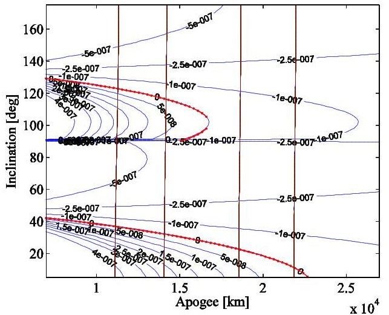
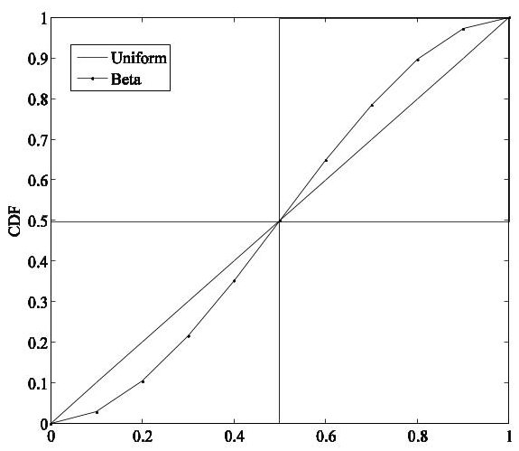
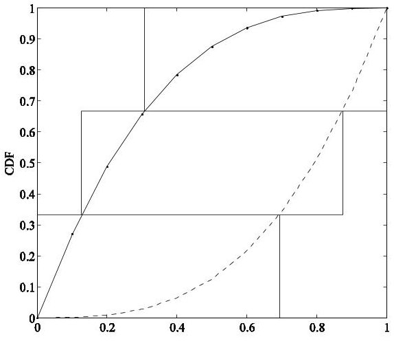
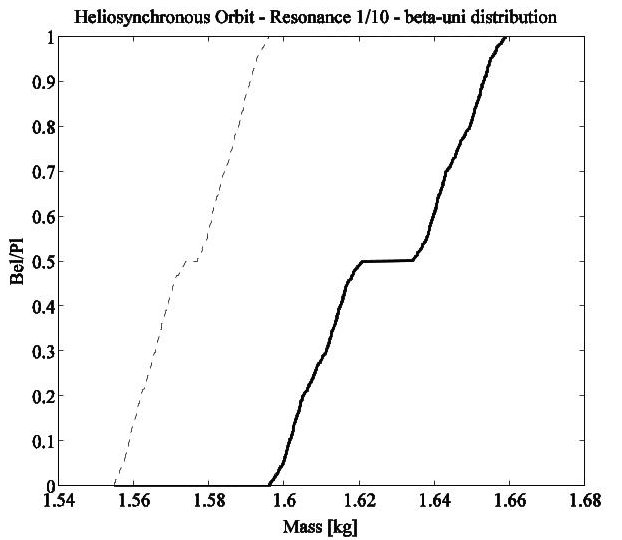
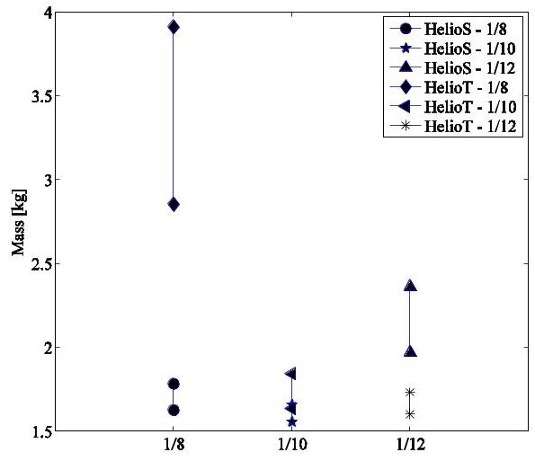
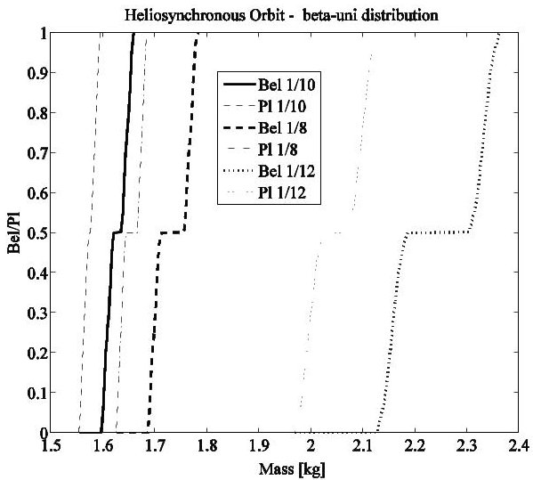
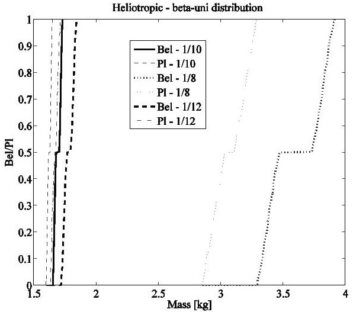
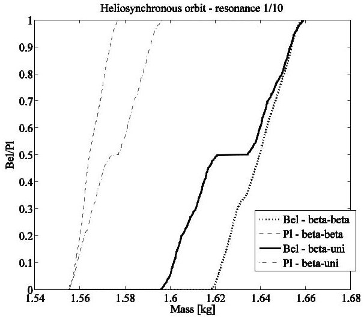

<!-- PDF_PAGE: 1 -->

IAC-14.C3.4.2

# AN APPROACH FOR THE ROBUST DESIGN OF THE POWER SYSTEMS OF SMALL SATELLITES

Massimiliano Vasile University of Strathclyde, UK, massimiliano.vasile@strath.ac.uk

Simone Alicino University of Strathclyde, simone.alicino@strath.ac.uk

The paper presents an approach to Robust Model-Based System Engineering (RMBSE) applied to the design of the power system of a small-satellite. Tow simple low-fidelity parametric models of the power and telecommunication systems are used to compute the mass and power requirements for different orbital geometries. The low model fidelity implies that model and parameters are affected by epistemic uncertainty. This uncertainty is commonly captured by adding margins at subsystem and system level. In this paper instead, the effect of epistemic uncertainty is modelled with p-boxes on finite sets of values and propagated through the system models to compute the upper and lower expectation on the mass budget. A robust optimisation procedure is then introduced to find the design solution that minimises system mass and the impact of uncertainty.

## 1. INTRODUCTION

Nano-satellites are expected to answer to the cheaper, faster and better design philosophy. One can argue that a proper definition of better should include elements of performance and reliability. Reliability standards based on margins added to the system budgets might fail to correctly capture the actual quality of the design, and might lead to oversize the spacecraft or underestimate the impact of uncertainties $ ^{1} $ Furthermore, the need to maximise performance with a minimal spacecraft mass and size would demand for a fully optimised system. In general terms, however, optimised solution can be poorly robust to uncertainty while reliable solution might be highly suboptimal.

The paper presents a simple parametric simulation model for the power and telecommunication subsystems of a generic small satellite and a computational approach that provides an optimal design solution under uncertainty. Uncertainties are generally classified in two types: aleatoric and epistemic. The former type collects irreducible uncertainties which are generally well represented with probability distributions describing the frequency of an event. The latter type instead collects reducible uncertainties due to a lack of knowledge. Epistemic uncertainties are typical in the preliminary design phase, in particular when new ideas and concepts are introduced and when a reduced (low-fidelity) model of a system is used to estimate mass and power. Although nano-satellites, like cubesats, follow generally accepted standards, they are often used as test bed for new technologies. The content of epistemic uncertainty is therefore not negligible and needs to be taken into account alongside aleatoric uncertainty. Furthermore, when reduced, low-fidelity models are used to assess the feasibility of a particular design solution the value of some parameters can only be estimated based on the

known variability of system components to different operational conditions. Later on in the design process, when operational conditions are better defined, more complete models can be used to derive more precise values. This form of uncertainty is epistemic in nature as it can be reduced once a more complete body of knowledge is available. Likewise, adding subsystem and system margins to capture the possible variability in the performance of the actual component that is going to fly (e.g. variation in the manufacturer or in the specific type of component) can be seen as an epistemic uncertainty as it reduces to zero once the component is installed. What is left is an aleatoric uncertainty due to manufacturing tolerances and a mixed epistemic/aleatoric uncertainty due to system failures, noise and measurement errors.

The approach proposed in this paper unifies the treatment of aleatoric and epistemic uncertainty through the theory of Upper and Lower Previsions, and incorporates the quantification of uncertainty into the optimisation of the performance of the power system of the satellite. Previous efforts by the authors used Evidence Theory to derive an upper and lower expectation $ ^{2,3} $ . It will be shown that an analogous approach can be used in the case the input uncertainty is expressed as a set of probability measure. The result is an optimal compromise between performance and reliability. The paper illustrates the main features of this approach through the robust design of an integrated power and telecom system for a hypothetical small satellite in Low Earth Orbit.

## II. POWER AND TELECOM MODEL

This section describes the power and telecom models used in this paper. The models were developed in collaboration with the ESA European Space Research

<!-- PDF_PAGE: 2 -->

and Technology Centre as part of a Network Partnership Initiative (NPI) grant on the use of robust optimisation for the design of space systems. The models are part of the System Engineering Toolbox developed at the University of Strathclyde as part of the same NPI. In this paper, the subsystem models were partially adapted to size small satellites.

## II.1 Power System Model

The power system (POW) model consists of solar arrays, a battery pack, and a power control and distribution unit (PCDU) and related hardware. Starting from the required power in daylight and eclipse, the total required power is computed as:

$$
P _ {\mathrm {s a}} = \frac {\left(\frac {P _ {\mathrm {e}} T _ {\mathrm {e}}}{X _ {\mathrm {e}}}\right) + \left(\frac {P _ {\mathrm {d}} T _ {\mathrm {d}}}{X _ {\mathrm {d}}}\right)}{T _ {\mathrm {d}}}
$$

where $ P_{\mathrm{e}} $ is the power consumption during eclipse, $ T_{\mathrm{e}} $ is the orbital eclipse time, $ X_{\mathrm{e}} $ is the energy transfer efficiency during eclipse, $ P_{\mathrm{d}} $ is the power consumption during daylight, $ T_{\mathrm{d}} $ is the orbital daylight time, $ X_{\mathrm{d}} $ is the energy transfer efficiency during daylight. The energy transfer efficiencies are computed as

$$
X _ {\mathrm {e}} = \eta_ {\mathrm {s a r}} \eta_ {\mathrm {b c r}} \eta_ {\mathrm {b a t}} \eta_ {\mathrm {b d r}} \eta_ {\mathrm {l c l}} \eta_ {\mathrm {h a r n}}
$$

$$
X _ {\mathrm {d}} = \eta_ {\mathrm {s a r}} \eta_ {\mathrm {l c l}} \eta_ {\mathrm {h a r n}}
$$

where $ \eta_{\mathrm{sar}}, \eta_{\mathrm{bcr}}, \eta_{\mathrm{bdr}} $ and $ \eta_{\mathrm{lcl}} $ are the efficiencies of solar array regulator (SAR), battery charge/discharge regulators (BCR/BDR) and distribution (latching current limiter LCL), and are input parameters, whereas

$$
\eta_ {\mathrm {h a r n}} = 1 - \mathrm {V} _ {\mathrm {d r o p}}
$$

where $ V_{\mathrm{drop}} $ is the allowable voltage drop as percentage of the bus voltage (10% in the following). In the following an uncertainty value will be given to the daylight and eclipse transfer efficiencies.

The array specific power at the End Of Life (EOL) is:

$$
P _ {E O L} = \eta_ {\mathrm {c e l l}} G I _ {\mathrm {d}} L _ {\mathrm{d}} \eta_ {\mathrm {t e m p}} \eta_ {\mathrm {a}} \cos \theta_ {\mathrm {S A}}
$$

where $ \eta_{\mathrm{c e l l}} $ is the solar cell efficiency, G is the solar flux, $ I_{\mathrm{d}} $ is the inherent degradation, $ \theta_{\mathrm{S A}} $ is the worst case angle of incidence, $ L_{\mathrm{d}} $ is the array degradation over satellite lifetime and is calculated as follows:

$$
\mathrm {L} _ {\mathrm {d}} = \left(1 - \mathrm {D} _ {\mathrm {c e l l}}\right) ^ {\mathrm {L i f e}}
$$

where $ D_{\mathrm{cell}} $ is the array degradation per year, Life is the expected satellite lifetime, $ \eta_{\mathrm{temp}} $ is the change in efficiency at a certain temperature T and is given by:

$$
\eta_ {\mathrm {t e m p}} = 1 - \eta_ {\mathrm {T}} \left(\mathrm {T} - \mathrm {T} _ {\mathrm {n o m}}\right)
$$

where $ \eta_{\mathrm{T}} $ is the degradation per centigrade, and $ T_{\mathrm{nom}} $ is the nominal temperature of the cell, usually $ 28^{\circ}\mathrm{C} $ . A further important factor affecting the efficiency of the solar array is the assembly efficiency $ \eta_{\mathrm{a}} $ : The efficiency of the array is lower than the efficiency of the single cells because of a loss due to assembly. Such factor is usually uncertain and is given as input.

The calculations described above are essential for calculating the solar array area $ A_{\mathrm{sa}} $ as follows:

$$
A _ {\mathrm {s a}} = \frac {P _ {\mathrm {s a}}}{P _ {\mathrm {E O L}}}
$$

The solar array mass $ M_{\mathrm{s a}} $ is then calculated based on the solar array area $ A_{\mathrm{s a}} $ as follows:

$$
M _ {\mathrm {s a}} = A _ {\mathrm {s a}} \rho_ {\mathrm {s a}}
$$

where $ \rho_{\mathrm{s a}} $ is the specific mass of the panel. The $ \eta_{\mathrm{c e l l}} $ input defines the type of solar cell that will be used including its intrinsic characteristics, utilizing the data included in Table 1.

Table 1: Solar cell intrinsic characteristics

<table border="1"><tr><td></td><td>CdTe</td><td>p c-Si</td><td>u c-Si</td><td>3jGaAs</td><td>Conc.3jGaAs</td><td>Multijunc.cells</td></tr><tr><td>$\eta_{\mathrm{cell}}$</td><td>0.165</td><td>0.203</td><td>0.25</td><td>0.30</td><td>0.38</td><td>0.41</td></tr><tr><td>Dcell</td><td>1</td><td>0.037</td><td>0.037</td><td>0.05</td><td>0.05</td><td>0.05</td></tr></table>

The PCDU is a modular unit composed of modules such as battery charge and discharge regulators, solar array regulators, latching current limiters, heaters distribution modules, pyro release modules, telemetry interface. The number of modules, and therefore the mass of the unit, is largely dependent on the spacecraft mission, number of payloads, and power system configuration. The way this component is modeled is with a simple proportional law:

$$
\mathrm {M} _ {\mathrm {p c d u}} = \mu_ {\mathrm {p c d u}} \mathrm {P} _ {\mathrm {s a}} / \eta_ {\mathrm {p c d u}}
$$

where $ \mu_{\mathrm{pcdu}} $ is a specific mass and $ \eta_{\mathrm{pcdu}} $ is the PDCU efficiency.

Given the power requirement $ P_{\mathrm{e}} $ during eclipse, the eclipse duration $ T_{\mathrm{e}} $ , the minimum capacity requirement for the battery is

$$
C _ {\min } = \frac {P _ {\mathrm {e}} T _ {\mathrm {e}}}{D O D \eta_ {\mathrm {b a t}} \eta_ {\mathrm {h a r n}} \eta_ {\mathrm {b d r}} \eta_ {\mathrm {l c l}}}
$$

where $ \eta_{\mathrm{b a t}} $ is the battery efficiency, $ \eta_{\mathrm{b d r}}=0.94 $ , and $ \eta_{\mathrm{l c l}}= $ 0.99. The battery mass $ M_{\mathrm{b a t}} $ is computed starting from the energy density $ E_{\mathrm{d}} $ which defines the particular

<!-- PDF_PAGE: 3 -->

battery chemistry to be used (see Table 2). The efficiency depends on the type of battery and therefore on $ E_{\mathrm{d}} $ . The efficiency $ \eta_{\mathrm{bat}} $ is computed by linearly interpolating the data in Table 2 Furthermore, the depth of discharge DOD is calculated based on the input parameters $ c_{1}, $ $ c_{2}, $ and the number $ N_{\mathrm{cycles}} $ of charge/discharge cycles

$$
\mathrm {D O D} = 0. 0 1 \mathrm {c} _ {1} \ln \left\{\mathrm {N} _ {\mathrm {c y c l e s}} / \mathrm {c} _ {2} \right\}
$$

The mass of the battery cells $ M_{\mathrm{b}} $ is calculated is

$$
M _ {\mathrm {b}} = \frac {C _ {\min}}{E _ {\mathrm {d}}}
$$

Table 2: Battery intrinsic characteristics

<table border="1"><tr><td></td><td>NiCd</td><td>NiH2</td><td>NiMH</td><td>LiFePO4</td><td>LiIon</td><td>LiPoly</td></tr><tr><td>Ed(Wh/kg)</td><td>60</td><td>75</td><td>80</td><td>110</td><td>150</td><td>200</td></tr><tr><td>$\eta_{\mathrm{bat}}$(%)</td><td>85</td><td>86</td><td>87</td><td>90</td><td>95</td><td>99.8</td></tr></table>

The mass of the harness is taken as 25% of the whole mass of the power system.

## II.II Telecom System Model

The telemetry and telecommand (TTC) system is composed of an antenna, a set of amplified transponders, and a radio frequency distribution network (RFDN). The mass of the system is therefore the sum of the masses of the components, whereas the power required is the power input required by the amplifier.

The transmitter power $ P_{t} $ can be computed from the link design equation, in decibels

$$
P _ {t} = E b / N o - G _ {t} - L _ {t} - L _ {s} - L _ {p} - G _ {r} - T _ {s} + 1 0 \log R - 2 2 8. 6
$$

where Eb/No is the received energy-per-bit to noisedensity ratio, $ G_{t} $ is the transmit antenna gain, $ L_{t} $ is the onboard loss, $ L_{s} $ is the free space path loss, $ L_{p} $ is the propagation loss, $ G_{r} $ is the receive antenna gain, $ T_{s} $ is the system noise temperature, and R is the data rate. The data rate is given by the data volume B divided by the access time that is derived from the orbital geometry. The system noise temperature is given by the sum of the receiver system noise $ T_{r} $ , the antenna noise $ T_{a n t} $ and the transmitter noise temperature that is a function of the amplifier gain $ G_{a} $ amplifier noise temperature $ T_{e t} $ and figure $ F_{t} $ . The Eb/No is computed from the bit error rate BER and the modulation. The ground station gain and temperature, $ G_{r} $ and $ T_{r} $ are known once a receiving station is selected. The free space loss is

$$
\mathrm {L} _ {\mathrm {s}} = 9 2. 4 4 + 2 0 \log \mathrm {r} + 2 0 \log \mathrm {f} _ {\mathrm {T}}
$$

where r is the distance between transmit and receive antennas in km, and $ f_{T} $ is the frequency in GHz. The propagation loss collects atmospheric $ L_{a} $ and rain $ L_{r} $ attenuations, pointing loss:

$$
L _ {\mathrm {p}} = L _ {\mathrm {a}} + L _ {\mathrm {r}} + L _ {\theta}
$$

The atmospheric and rain attenuations depend on transmission frequency, elevation angle, altitude of the ground station, and can be estimated for standard atmosphere from tables provided by the International Telecommunication Union (ITU). The pointing loss is

$$
L _ {\theta} = - 1 2 \left(e / \theta\right) ^ {2}
$$

where e is the pointing error in degrees, and $ \theta $ is the half-power beamwidth of the antenna. In the example in this paper no pointing error is assumed for sake of simplicity. The transmit antenna gain $ G_{t} $ is given as an input parameter, and allows to select and size the antenna

It is well know that the best antenna for 5 dB $ \leq $ $ G_{t} \leq $ 10 dB is the patch one, while the best for 10 dB $ < $ $ G_{t} \leq $ 20 dB belongs to the horn type set, therefore the mass of the antenna is computed as follows. The antenna characteristic length (it is the diameter of the normal conical section for conical horns, parabolas, and circular patches, and an equivalent diameter for pyramidal horns and square/rectangular patches) is:

$$
D _ {\mathrm {a n t}} = \left(\frac {1 0 ^ {\frac {G _ {\mathrm {t}}}{1 0}}}{\eta_ {\mathrm {A N T}}}\right) ^ {0. 5} \frac {\mathrm {c}}{\pi \mathrm {f} _ {\mathrm {T}}}
$$

where $ \eta_{\mathrm{A N T}} $ is the antenna efficiency and c is the speed of light. If $ 5\leq G_{t}\leq 1 0 \mathrm{d B} $ the mass of the patch is:

$$
M _ {\mathrm {a n t}, \mathrm {p a t c h}} = \pi \frac {D _ {\mathrm {a n t}} ^ {2}}{4} \left(0. 0 0 1 5 \rho_ {\mathrm {d i e l}} + 0. 0 0 0 5 \rho_ {\mathrm {c o p p e r}}\right) [ 1 9
$$

where $ \rho_{\mathrm{diel}}=2000 \mathrm{~kg / m^{3}} $ and $ \rho_{\mathrm{copper}}=8940 \mathrm{~kg / m^{3}} $ are the averaged value of a dielectric material density and the copper density, respectively, considering a 2 mm total thickness, with 1.5 mm of dielectric material and 0.5 mm copper.

If 10 dB $ < G_{t}\leq 20 $ dB the length of the horn, $ L_{\mathrm{horn}} $ is computed as:

$$
\mathrm {L} _ {\mathrm {h o r n}} = \left(\mathrm {h} ^ {2} - 0. 2 5 \mathrm {D} _ {\mathrm {a n t}} ^ {2}\right) ^ {1 / 2}
$$

where h = $ D_{\mathrm{ant}}^{2} /(3 \lambda) $ and $ \lambda $ the wavelength. The lateral surface area of the conic horn is then

$$
S _ {\mathrm {L A T}} = 0. 5 \pi D _ {\mathrm {a n t}} L _ {\mathrm {h o r n}}
$$

and the mass, $ M_{\mathrm{ant,horn}} $ is:

$$
\mathrm {M} _ {\mathrm {a n t}, \mathrm {h o r n}} = \mathrm {S} _ {\mathrm {L A T}} \rho_ {\mathrm {A}}
$$

<!-- PDF_PAGE: 4 -->

where $ \rho_{\mathrm{A}} $ is the areal density, which has a mean value of approximately 15 kg/m $ ^{2} $ (from available data $ ^{7} $ ).

If the gain of the antenna is > 20 dB, the parabolic antenna is selected, the diameter of the antenna is computed with Eq.[18], and the mass of the antenna, $ M_{\mathrm{ant,par}} $ is computed through a best fit formula:

$$
\mathrm {M} _ {\mathrm {a n t , p a r}} = 2. 8 9 \mathrm {D} _ {\mathrm {a n t}} ^ {2} + 6. 1 1 \mathrm {D} _ {\mathrm {a n t}} - 2. 5 9
$$

The half-power beamwidth of an antenna can be computed as follows. An ideal isotropic antenna would radiate energy evenly over the surface of a sphere of $ 4 \pi $ square radians, or 41,253 square degrees. Therefore, the product of gain and field of view would be

$$
G \theta^ {2} = 4 1 2 5 3
$$

Thus, for a real antenna with efficiency $ \eta_{\mathrm{ANT}} $ the halfpower beamwidth, in degrees, is

$$
\theta = \left(4 1 2 5 3 \eta_ {\mathrm {A N T}} / \mathrm {G}\right) ^ {1 / 2}
$$

The mass $ M_{\mathrm{a m p}} $ and power input $ P_{\mathrm{a m p}} $ of the amplifier are a function of $ P_{t} $ (see Ref. 6). Here we suppose that the transponder includes an amplifier that can be either a Traveling-Wave Tube Amplifier (TWTA) or a Solid- State Amplifier (SSA). The choice between the two types is an input design parameter. As it will be shown in the results section, although the model contains also TWTA amplifier the optimizer selects a simple solid state amplifier given the required power.

## III. ORBIT MODEL

One can consider a variety of possible Low Earth Orbits in which a small satellite can operate. The goal can be to serve multiple users or a single user multiple times within a single day. A further requirement can be to serve the user at particular times during the day. Here it will be considered the case in which a repeated ground track is essential and the satellite needs to needs to fly on a sun-following or sun-synchronous orbit. Such a solution would also allow an ideal illumination condition of the satellites in orbit with minimum attitude and reconfiguration requirements.

The analysis of sun-synchronous solutions can start by taking the secular variation of the line of the nodes and the line of the apsis due to $ \mathrm{J}_{2} $ the oblateness of the Earth. In this paper we will limit the analysis to the gravitational effects only and considering only $ \mathrm{J}_{2} $ however a complete treatment would require including higher harmonic terms and solar pressure. The secular variations of the right ascension of the ascending node and the argument of the perigee due to $ \mathrm{J}_{2} $ can be written as $ ^{9} $

$$
\dot {\Omega} = - \frac {3 n R _ {\mathrm {E}} ^ {2} J _ {2}}{2 p ^ {2}} \cos \mathbf {i}
$$

$$
\dot {\omega} = \frac {3 n R _ {\mathrm {E}} ^ {2} J _ {2}}{4 p ^ {2}} \left(4 - 5 \sin^ {2} \mathbf {i}\right)
$$

with $ p=a(1-e^{2}) $ , a the semimajor axis, e the eccentricity i the inclination, $ R_{E} $ the mean radius of the Earth and $ n=\sqrt{\mu_{E}}/a^{3} $ . By combining Eqs. [2] and [3] one can impose the simple sun-synchronicity condition:

$$
\Delta_ {\mathrm {S S}} = \frac {3 n R _ {\mathrm {E}} ^ {2} J _ {2}}{4 p ^ {2}} \left(4 - 5 \sin^ {2} \mathrm {i}\right) - \frac {3 n R _ {\mathrm {E}} ^ {2} J _ {2}}{2 p ^ {2}} \cos \mathrm {i} - \frac {2 \pi}{P _ {\mathrm {E}}} = 0
$$

with $ P_{E} $ the revolution period of the Earth around the Sun. Eq. [4] is valid for prograde orbits, i.e., with an inclination from $ 0^{\circ} $ to $ 90^{\circ} $ . For retrograde orbits, the helio-synchronicity condition reads:

$$
\Delta_ {\mathrm {S S}} = - \frac {3 n R _ {\mathrm {E}} ^ {2} J _ {2}}{4 p ^ {2}} \left(4 - 5 \sin^ {2} \mathbf {i}\right) - \frac {3 n R _ {\mathrm {E}} ^ {2} J _ {2}}{2 p ^ {2}} \cos \mathbf {i} - \frac {2 \pi}{P _ {\mathrm {E}}} = 0
$$

In the following, the term heliotropic, proposed by Hedman et al. $ ^{10} $ will be used to identify orbits that satisfy conditions [4] or [5].

If a repeated ground track is required then one has to compute the correction to the orbital period $ P_{n} $ due to the drift in the argument of the periapsis and the mean motion given by $ ^{9} $ :

$$
P _ {\Omega} = P _ {n} \left(1 + \frac {3 n J _ {2}}{4} \left(\frac {R _ {E}}{p}\right) ^ {2} \left(- \sqrt {1 - e ^ {2}} \left(2 - 3 \sin^ {2} i\right) + 4 - 5 \sin^ {2} i\right)\right) ^ {- 1}
$$

The corrected period needs to be equal to the period in which a subsatellite revisits a station including the drift in right ascension of the ascending node:

$$
P _ {\mathrm {G T}} = \frac {2 \pi}{\omega_ {\mathrm {E}} - \dot {\Omega}}
$$

with $ \omega_{\mathrm{E}} $ the rotation period of the Earth, which gives the repeated-ground track condition:

$$
P _ {\Omega} = \frac {k}{j} P _ {\mathrm {G T}}
$$

where k and j are two integer numbers. Figure 1 shows the level curves of $ \Delta_{\mathrm{SS}} $ for different inclinations and altitude of the apogee assuming a constant perigee at an altitude of 600 km. The red curves correspond to $ \Delta_{\mathrm{SS}}=0 $ The almost vertical brown lines are the solutions of Eq. [8] with (from left to right) the following resonances:

$$
\left. \frac {k}{j} \right| \in \{1 / 1 0, 1 / 8, 1 / 6, 1 / 5 \},
$$

<!-- PDF_PAGE: 5 -->

Figure 1. Heliotropic and Earth resonant solutions for a perigee altitude of 600 km.

the intersection between the resonance curves and red lines give the heliotropic repeated ground track solutions. For example, if a solution along the red line has a resonance 1/5 it means that the station on the Earth can see a satellite at the zenith every 5 orbits. Figure 1 also shows that, as expected, heliotropic Molniya orbits with an inclination of 63.5 $ ^{\circ} $ are not possible. On the other hand, prograde solutions below $ 40^{\circ} $ are possible with a maximum altitude between 20000 km and 25000 km. Lastly, the figure shows the classical circular sun-synchronous solutions at about $ 95^{\circ} $ inclination and a family of retrograde orbits. In the following we will consider two orbital options: a sun-synchronous mid-day-mid-night solution with k/j=1/12,1/10 and 1/8 and heliotropic mid-day-mid-night solution with the same resonance. The latter serves as an example of repeated ground-track elliptical orbit that can provide long-time contact at the apogee.

IV. UNCERTAINTY MODEL

Figure 2. Discretised beta-uniform upper and lower probabilities.

Figure 3. Discretised beta-beta upper and lower probabilities.

The power and telecom parametric models are incomplete representations of the two subsystems. By their nature the value of some parameters is not completely known in the preliminary design phase. This type of uncertainty is epistemic and is proportional to the level of fidelity of the model. As an example the line losses depend on an number of factors such as the architecture, the specific components and the operational conditions. All these factors can be modelled and down to very fine details but are poorly known in a preliminary assessment of the key design budgets. This type of uncertainty cannot be correctly captured by assigning a probability mass to a crisp value and is better modelled assuming that the uncertain parameter belongs to an interval spanning the range of possible values. The probability that the parameter assumes a particular value within the interval is in itself uncertain. One can assume that all values are equally possible, in this case a uniform distribution is appropriate. It is however, not uncommon that an expert is able to identify a most probable value. It is therefore assumed that the case in which a most probable value can be identified is modelled with a beta distribution with $ \alpha=\beta=2 $ . A truncated normal distribution would be equally good for this model but in the reminder of this paper we will use the beta distribution as an example. The cumulative beta and uniform distributions on the normalised interval [01] are represented in Figure. For half of the interval the beta distribution represents the lower probability associated to the values in that part of the interval, while the uniform distribution represents the upper probability. In the second half the situation is inverted. The specific trend of the beta distribution depends on the two parameters $ \alpha $ and $ \beta $ that in Bayesian inference are adapted as new information is available. Here it was decided to discretise the upper and lower probabilities with the two intervals [0 0.5] and [0.5 1] with probability assignment (bpa) 0.5 and 0.5

<!-- PDF_PAGE: 6 -->

respectively (lower left and upper right squares in Figure ). This choice corresponds to two curves, a lower and upper probability curve, that envelop all the beta distributions with $ \alpha=\beta $ . A different choice could be to assume that all possible distributions of values are enclosed by the two beta distributions with $ \alpha=1,\beta=3 $ and $ \alpha=3,\beta=1 $ . These two distributions correspond to having the most probable value at 0 or 1 respectively. The two distributions are represented in Figure along with a discretisation in three intervals with probability assignment 0.3, 0.3 and 0.3. These two models will be applied to all the uncertain values with the assumption that the input uncertain quantities are uncorrelated. Once defined the upper and lower probabilities for each uncertain parameter, one needs to build the set of focal elements $ E_{i} $ given by the Cartesian product of all the uncertain intervals. The probability mass of each focal element is given by the product of all the bpa's associated to each uncertain interval.

The uncertain space U is therefore a hypercube collecting of all the focal elements. If the inputs were correlated the uncertain space U would no longer be a hypercube. When an upper and lower probability are defined for the values of the input parameters the expected value of the quantity of interest (for example the mass of the power system) is bound from below by a lower expectation and from above by an upper expectation. Once the uncertain space is defined and each focal element has an assigned bpa one can use the definition of Plausibility and Belief functions to compute the upper and lower expectation of the outputs. The Belief Bel and the Plausibility PI functions are defined as follows:

$$
\begin{array}{l} \operatorname {B e l} (A) = \sum_ {\forall \theta_ {i} \subseteq A} m \left(E _ {i}\right) \\ \mathrm {P I} (A) = \sum_ {\forall \theta_ {i} \cap A \neq 0} m \left(E _ {i}\right) \\ \end{array}
$$

where A is a proposition the Belief and Plausibility of which are to be evaluated and $ m ( E_{\mathrm{i}} ) $ is the basic probability assignment of focal element $ E_{\mathrm{i}} $ . For example, the proposition can be expressed as:

$$
\mathrm {A} = \left\{\mathrm {u} \in \mathrm {U} \mid \mathrm {f} (\mathrm {u}) \leq \nu \right\}
$$

where f is the output of the system model and the threshold v is the value of a design budget (e.g. the mass). If for each component of the vector u one considers the discretisation in two intervals as defined in Figure then a focal element is a hypercube defined by the interval [0 0.5] or [0.51] for each component of u. Thus, the bpa of all focal elements intercepting the set A but not included in A contribute to Pl but not in Bel, while the bpa of all focal elements fully included in A contribute to both Pl and Bel.

IV.I Robust Design Formulation

Let us consider a function $ f:D\times U\subseteq \Box^{m+n}\rightarrow \Box $ characterizing a system to be optimized, where D is the available design space and U the uncertain space. The function f represents the model of the system budgets (e.g. power budget, mass budget, etc.), and depends on some uncertain parameters u and design parameters d such that:

$$
u \in U \subseteq \square^ {m}; d \in D \subseteq \square^ {n}
$$

From the definition of Bel it is clear that the maximum of f over every focal element of U should be computed and compared to $ \nu $ . If the maximum and minimum do not occur at one of the vertices of the focal element an optimisation problem has to be solved for every focal element and for each new design vector. Because the number of focal elements increases exponentially with the number of uncertain parameters and associated intervals so does the number of optimisation problems.

What designers are usually interested in is the variation of the optimal belief with the threshold v. Indeed, it may be relevant to take a little more risk (a slightly lower value of the belief) if the performance gain is significant. Therefore, in practise, the designers are interested in the trade-off curve, solution of the bi-objective optimization problem:

$$
\begin{array}{l} \max _ {d \in D \wedge u \in U} \operatorname {B e l} \left(f (d, u,) < v\right) \\ \min v \\ \end{array}
$$

In previous works $ ^{3,1} $ the bi-objective problem [12] was approached directly with a multi-objective evolutionary optimizer working on the d and $ \nu $ components. The whole curve could be reconstructed with a population of agents converging to the optimal pairs of values [Bel $ \nu $]. However, the computational cost was driven by the identification of the A set and the number of focal elements included in it. The assumption was that the maxima and minima of f were occurring only at the corners of the focal element. The evaluation of the corners is in itself an operation that grows exponentially with the number of dimensions and is, anyway, not applicable to a general case. In this paper we propose a different way of approaching the problem. First of all, the computation of the Belief function is performed by exploiting the following relationship:

$$
\mathrm {B e I} (\mathrm {A}) = 1 - \mathrm {P I} (\neg \mathrm {A})
$$

According to [9], the calculation of $ \mathrm{P I} (\neg A) $ is computationally cheaper than the calculation of Bel(A). In fact, any subset of U that contains at least one value (even a single sample) above the threshold $ \nu $ is part of $ \mathrm{P I} (\neg A) $ . The computation of Bel(A) instead requires that all the elements of A are below the threshold.

<!-- PDF_PAGE: 7 -->

## V. COMPUTATIONAL APPROACH

The computational approach to derive an optimal Upper and Lower Expectation on the value of the design budgets is analogous to the one proposed by the authors in Ref1. The first step is to derive the best and worst case solutions as they provide the respectively the lower and upper limits on the possible values of the design budget, given the range of the uncertain parameters. The worst case and the best case scenarios correspond to the solution of the following two bi-level optimisation problems over the Cartesian product of the unit hypercube U and D:

$$
\nu_ {\max } = \min _ {D} \max _ {U} f (d, u)
$$

$$
v _ {\min } = \min _ {D} \min _ {U} f (d, u)
$$

Problem [14] looks for the minimum possible threshold value $ \nu_{\mathrm{m a x}} $ such that the entire unit hypercube is admissible, hence the Belief is 1. Problem [15] looks for the minimum threshold value $ \nu_{\mathrm{m i n}} $ above which the Plausibility is different from 0. As for problem [14], problem [15] does not require the knowledge of the focal elements and sets a lower limit on the value of the cost function. Below that limit the design is not feasible, given the current model and evidence on the design parameters.

The minimax problem is solved with an evolutionary process that alternatively minimises f over D and maximises f over U. The maxima identified during the maximisation in U are stored in an archive $ A_{u} $ and the minimisation over D is done by checking the $ \mathbf{u}\in A_{u} $ that maximises f(d,u) for a given d. For more details, the interested reader can refer to Ref.11.

Once the minmax and the minmin solutions are available, one can generate the full Bel and PI curves by computing the max and min over each focal element for a constant d. In general the Bel and PI curves for $ \mathrm{d}_{\mathrm{max}}=\operatorname* {arg} \min_{d \in D} \max_{u \in U} f \left( d, u \right), $ the solution of the minmax problem, and for $ \mathrm{d}_{\mathrm{min}}=\operatorname* {arg} \min_{d \in D} \min_{u \in U} f \left( d, u \right), $ the solution of the minmin problem, are different. In the following, however, we will consider only the curves that correspond to $ \mathrm{d}=\mathrm{d}_{\mathrm{max}}. $ Note that if a simple sampling of the focal elements is used instead of a maximisation and minimisation, one would obtain two curves that have the actual PI and Bel as upper and lower bounds.

Alternatively one can calculate and approximation of the Bel and PI curves by using one of the approaches presented in Ref. 12.

## VI. SOME RESULTS

In this section we consider the simple case of a small satellite orbiting in LEO and of a small ground base

located at 60° of latitude North and 0° of longitude. The receiving antenna is assumed to have a gain $ G_{\mathrm{r}}=1 $ with an amplifier noise temperature of $ T_{\mathrm{r}}=412\mathrm{K} $ . The range of the design and uncertain parameters, d and u, is defined in Table 3 and is based on a mix of data sheets and information generally available on the power and telecom subsystems on board cubesats and other small satellites. Better value can be defined to address more specific design solutions but would not change the general picture. The f is integrating power and telecom system and is the sum of all the masses modelled in section II. The integrated system is sized to provide minimum mass, with required data volume and bit error rate, in the condition of maximum distance, maximum eclipse time and minimum access time (maximum data rate) over one solar year of operations. In this sense the system is sized for the worst case requirements and no uncertainty is placed on the requirements themselves.

We consider two classes of orbits with different period, all with repeated ground-track: a class of heliotropic elliptical orbits and a class of heliosynchronous mid-day-mid-night orbits both with resonances 1/8, 1/10 or 1/12. The use of two different classes of orbits is to show how different orbit regimes can impact the sensitivity to some of the uncertain parameters.

The minmax and minmin problems were efficiently solved in less than 2 minutes, on a DELL LATITUDE E6330 laptop, running a modified version of IDEA $ ^{4,11} $ implemented in Matlab. The individual maximum and minimum for each focal element was found running IDEA for max 500 evaluations. The generation of the full curves for the case with the two beta distributions representing the upper and lower probability on the inputs required a total of 19683 focal elements while for the case with beta and uniform distribution, only 512 focal elements were generated. By using the approach presented in Ref. 12 these numbers can be reduced by up to two orders of magnitude making the generation of the two curves very fast.

Figure shows an example of upper and lower expectation on the value of the mass of the integrated system for a heliosynchronous orbit with resonance 1/10 and the uncertainty in the input modelled with a beta and a uniform distributions. The minimum mass value corresponds to the solution of problem [43] and the expectation for this value to be correct under uncertainty is 0. The maximum mass value is the solution of problem [44] and corresponds to the minimum possible system mass in the worst possible conditions dictated by the uncertainty in the input parameters. The expectation for this value is of course 1. A system with a mass lower than the minimum mass is not feasible and a system with a mass higher of the maximum mass is oversized under current information. The two curves, Pl and Bel, in Figure represent, respectively, the upper and lower

<!-- PDF_PAGE: 8 -->

expectation that the mass of the system is the one (or lower than the one) reported on the axis of the abscises. For example, the lower expectation that the mass of the system is 1.62kg is about 0.5 while the upper expectation is 1. This means that, given the available information on the input parameters and the characteristics of the system model, there is an expectation equal to 1 that 1.62kg might be the right value. On the other hand, there is only an expectation of 0.5 that the 1.62kg is certainly the right value. Note that the discretisation of the upper and lower probabilities on the inputs encompasses all possible beta distributions such that $ \alpha=\beta $ as a consequence the upper expectation takes into account the most favourable conditions under which the mass of the system can be 1.62kg or lower. A finer discretisation would lead to a reduction in the difference between upper and lower expectation but at the same time it would imply that the upper and lower probabilities on inputs are exactly known.

Table 3 Design and Uncertain space for the TTC and POW systems

<table border="1"><tr><td>Parameter</td><td>Low bound</td><td>Upper bound</td></tr><tr><td colspan="3">Design Parameters</td></tr><tr><td>$f_{T}(\mathrm{MHz})$</td><td>7e3</td><td>11e3</td></tr><tr><td>Mod</td><td>0</td><td>1</td></tr><tr><td>T</td><td>0</td><td>1</td></tr><tr><td>$G_{t}(\mathrm{dB})$</td><td>5</td><td>20</td></tr><tr><td>B(kb)</td><td>100</td><td>1000</td></tr><tr><td>$G_{a}$</td><td>1</td><td>10</td></tr><tr><td>$\eta_{\mathrm{cell}}$</td><td>0.1</td><td>0.3</td></tr><tr><td>$\rho_{\mathrm{sa}}(\mathrm{kg/m^{2}})$</td><td>1</td><td>2</td></tr><tr><td>$\eta_{\mathrm{pcdu}}$</td><td>0.8</td><td>0.9</td></tr><tr><td>$\mu_{\mathrm{pcdu}}(\mathrm{kg/W})$</td><td>0.001</td><td>0.002</td></tr><tr><td>$E_{d}(\mathrm{Wh/kg})$</td><td>60</td><td>150</td></tr><tr><td colspan="3">Uncertain Parameters</td></tr><tr><td>$\eta_{\mathrm{ANT}}$</td><td>0.55</td><td>0.95</td></tr><tr><td>$L_{t}(\mathrm{dB})$</td><td>1</td><td>3</td></tr><tr><td>$T_{\mathrm{et}}(\mathrm{K})$</td><td>340</td><td>450</td></tr><tr><td>$F_{t}$</td><td>1</td><td>2</td></tr><tr><td>$T_{\mathrm{ant}}(\mathrm{K})$</td><td>300</td><td>500</td></tr><tr><td>$X_{e}$</td><td>0.6</td><td>0.8</td></tr><tr><td>$X_{d}$</td><td>0.7</td><td>0.9</td></tr><tr><td>$I_{d}$</td><td>0.8</td><td>0.9</td></tr><tr><td>$\theta_{\mathrm{SA}}(\mathrm{rad})$</td><td>0.08</td><td>0.1</td></tr></table>

Note that a system level design margin can still be added to the worst case scenario value to capture further epistemic uncertainty that is not included in the parameter uncertainty. The design and uncertain values for the two extreme cases are reported in Table 4. One can see that the worst and best case uncertain parameters corresponds, as expected to the extreme values in Table 3, except for the incident angle on the arrays as a variation of 0.01 rad leads to a variation in

the 6 digit of the mass. The design solutions are very similar apart from the gain of the transmitting antenna. Note that the upper limits for some of the components are rather advanced for a simple a nanosat and show be taken just as an example of application of this methodology.

Table 4. Worst and best case solutions for the neliosynchronous orbit solution with 1/10 resonance

<table border="1"><tr><td>Parameter</td><td>Best</td><td>Worst</td></tr><tr><td colspan="3">Design Parameters</td></tr><tr><td>$f_{T}(\mathrm{MHz})$</td><td>1404.9</td><td>1404.9</td></tr><tr><td>Mod</td><td>0</td><td>0</td></tr><tr><td>T</td><td>1</td><td>1</td></tr><tr><td>$G_{T}(\mathrm{dB})$</td><td>6.2</td><td>7.3</td></tr><tr><td>B(kb)</td><td>100</td><td>100</td></tr><tr><td>$G_{t}$</td><td>10</td><td>10</td></tr><tr><td>$\eta_{\mathrm{cell}}$</td><td>0.3</td><td>0.3</td></tr><tr><td>$\rho_{\mathrm{sa}}(\mathrm{kg/m^{2}})$</td><td>0.1</td><td>0.1</td></tr><tr><td>$\eta_{\mathrm{pcu}}$</td><td>0.9</td><td>0.9</td></tr><tr><td>$\mu_{\mathrm{pcu}}(\mathrm{kg/W})$</td><td>0.001</td><td>0.001</td></tr><tr><td>$E_{d}(\mathrm{Wh/kg})$</td><td>150</td><td>150</td></tr><tr><td colspan="3">Uncertain Parameters</td></tr><tr><td>$\eta_{\mathrm{ANT}}$</td><td>0.95</td><td>0.55</td></tr><tr><td>Lt(dB)</td><td>1</td><td>3</td></tr><tr><td>Tet(K)</td><td>340</td><td>450</td></tr><tr><td>Ft</td><td>1</td><td>2</td></tr><tr><td>$T_{\mathrm{ant}}(\mathrm{K})$</td><td>300</td><td>500</td></tr><tr><td>$X_{e}$</td><td>0.8</td><td>0.6</td></tr><tr><td>$X_{d}$</td><td>0.9</td><td>0.7</td></tr><tr><td>$I_{d}$</td><td>0.9</td><td>0.8</td></tr><tr><td>$\theta(\mathrm{rad})$</td><td>0.09</td><td>0.1</td></tr></table>

The result in Figure, however, provides the limits of variability of the system mass given the expected variability of the model parameters. Since the variability of model parameters includes the effect of the expected range of operational conditions and the effect of part of the unmodelled components, the result in Figure can capture all the effects that are normally lumped into the subsystem margins plus the part of the system level margins as the propagation of the parameter uncertainty is propagated through the integrated system model. The result in Figure already includes the cross-correlation between the subsystems (power and telecom in this case). Figure compares the worst and best case scenarios for all orbit regimes. The figure shows that different orbit solution can correspond to a different impact of parameter uncertainty. In particular, the least sensitive solutions are the heliosynchronous 1/10 resonance and the heliotropic 1/12 resonance solutions.

<!-- PDF_PAGE: 9 -->

Figure 4. Upper and lower expectations for the case of a uniform and beta distribution lower and upper probabilities on the input parameters and a heliosynchronous orbit solution.

Figure 5. Worst case and best case mass of the integrated system for different orbital solutions.

Figure 6. Upper and lower expectation for all heliosynchronous solutions for the case of a beta and uniform upper and lower probabilities on the inputs.

Figure 7. Upper and lower expectation for all heliotropic solutions for the case of a beta and uniform upper and lower probabilities on the inputs.

Figure 8. Upper and lower expectations for two different types of uncertainty quantification.

The same effect can be seen in Figure and Figure where the upper and lower expectation curves for all the heliosynchronous and heliotropic options are represented. It is interesting to note that the shape of the curves is essentially the same in all cases. One can now compare the effect of different upper and lower probability distributions on the inputs. Figure compares the upper and lower expectations for the two upper and lower probabilities on in the inputs for the same orbit regime. As it has to be expected since the beta-beta upper and lower probabilities enclose the beta-uniform distributions the beta-beta upper and lower expectation encloses the beta-uniform upper and lower expectation. Only at the extremes of the mass interval the curves intersect due to the added effect of the system model. Even in this case a tighter representation of the upper and lower probability on the inputs would lead to a tighter upper and lower expectation but would imply a

<!-- PDF_PAGE: 10 -->

an exact knowledge of the $ \alpha $ and $ \beta $ parameters defining the beta distributions.

## VII. FINAL REMARKS

The paper presented an approach to the robust design of the power system for small satellites. The idea is to use parametric system models to estimate system performance and to propagate the uncertainty on the value of the parameters through the system models to get an upper and lower expectation on the value of the system mass. The upper and lower expectations provide an exact quantification of the system margins given the current information on the parameters. The paper included an optimisation approach to minimise the impact of uncertainty and maximise system performance.

The approach can be effectively used to generate optimal and robust solutions for small satellites maximising the reliability of the design. The resulting value of the uncertain parameters corresponds to the expected performance during all the possible operational conditions of the components that are installed on board. The uncertainty derives mainly from the unmodelled components and is therefore epistemic in nature. As the deign progresses this uncertainty reduces and the upper and lower expectations converges to exact value of the system mass.

## VIII. ACKNOWLEDGMENTS

This work is partially supported through an ESA/NPI grant. The authors would like to thank Quirien Wijnands of the European Research and Technology Centre for the support and help in the development and validation of the system models.

$ ^{1} $ Vasile M., Minisci E., Zuiani, F., Komninou, E., Wijnands, Q. Fast evidence-based space system engineering. In: 62nd International Astronautical Congress 2011, 2011-10-03 - 2011-10-07, Cape Town,

$ ^{2} $ N. Croisard, M. Vasile, S. Kemble, and G. Radice. Preliminary space mission design under uncertainty. Acta Astronautica, 66:5-6, 2010.

$ ^{3} $ M. Vasile. Robust mission design through evidence theory and multiagent collaborative search. Annals of the New York Academy of Sciences, 1065:152-173, Dec. 2005.

4 M. Vasile, E. Minisci, and M. Locatelli. An inflationary differential evolution algorithm for space trajectory optimization. IEEE Transactions on Evolutionary Computation, 2011.

5 Dennis Roddy Satellite Communications 3rd ed., McGraw-Hill, 2001.

6 J. Larson, James R. Wertz Space Mission Analysis and Design 3rd ed., Microcosm Press & Kluwer Academic Publishers.

$ ^{7} $ Constantine A. Balanis Antenna Theory Analysis and Design 3rd ed., Wiley-Interscience, 2005.

$ ^{8} $ Mukund R. Patel. Spacecraft Power Systems, CRC Press, 2004.

$ ^{9} $ Vallado D.A. Fundamentals of Astrodynamics and Applications. Space Technology Libraries, 2007

10 Hedman, M. M., Burt, J. A., Burns, J. A. and Tiscareno, M. S., "The Shape and Dynamics of a Heliotropic Dusty Ringlet in the Cassini Division," Icarus, Vol. 210, No.1, 2010, pp. 284-297.

11 Vasile M. On the Solution of Min-Max Problems in Robust Optimization. EVOLVE2014, 1-4 July Beijing, China,

12 Vasile M, Minisci W, Wijnand Q. Approximated Computation of Belief Functions for Robust Design Optimization. 14th AIAA Non-Deterministic Approaches Conference, 2012-04-23 - 2012-04-26, Honolulu, Hawaii.