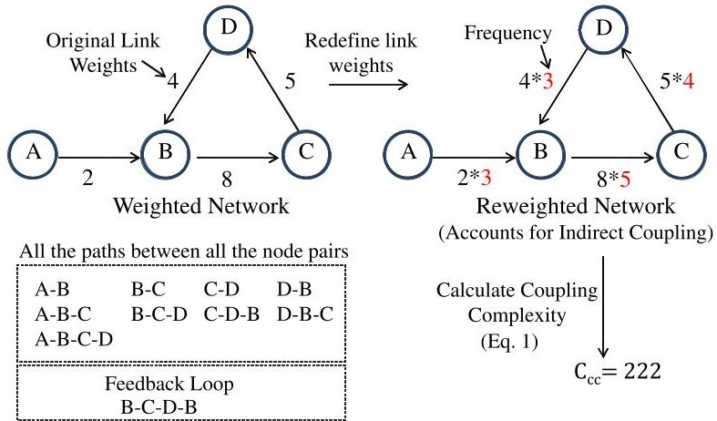
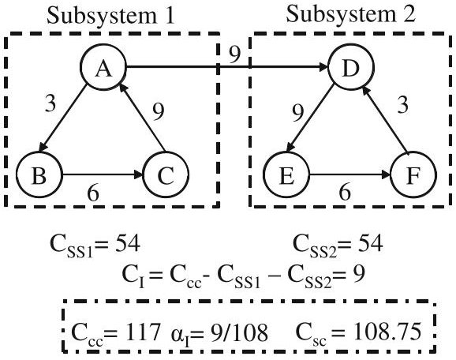
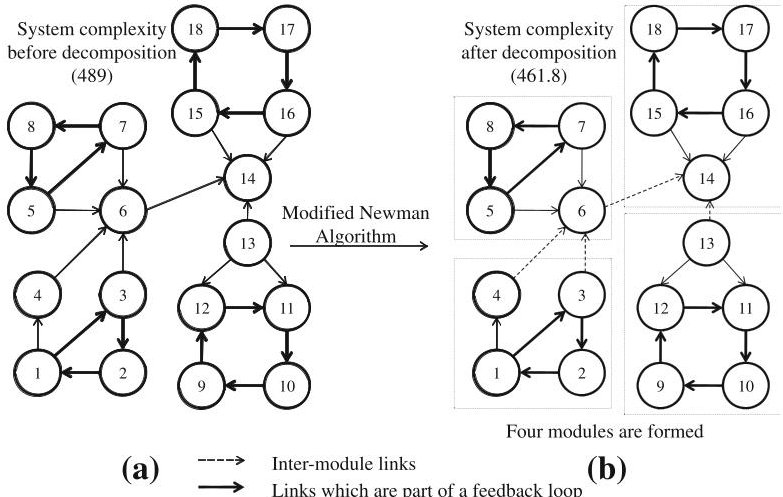
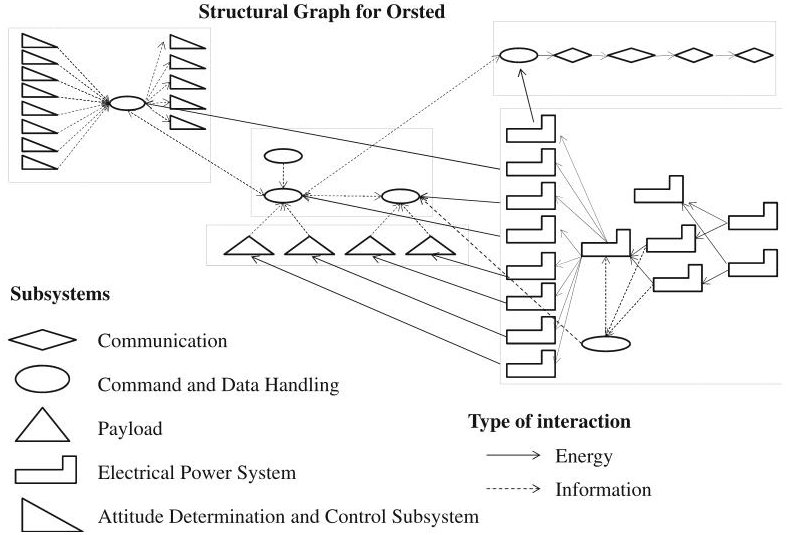
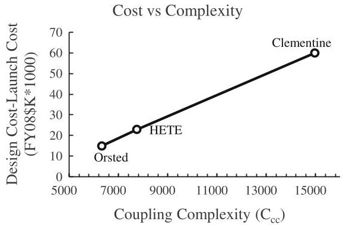
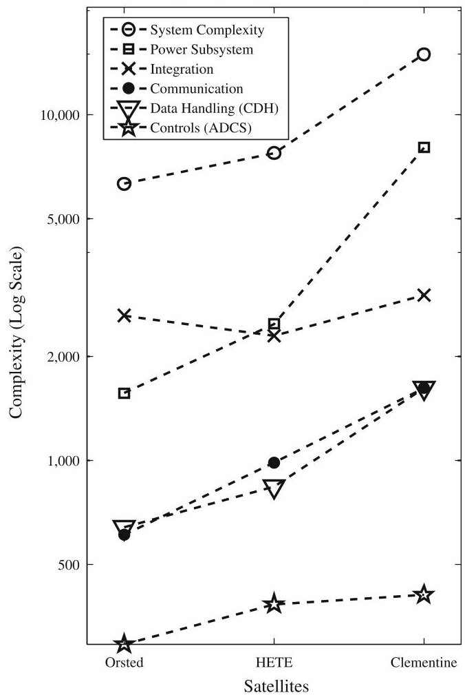
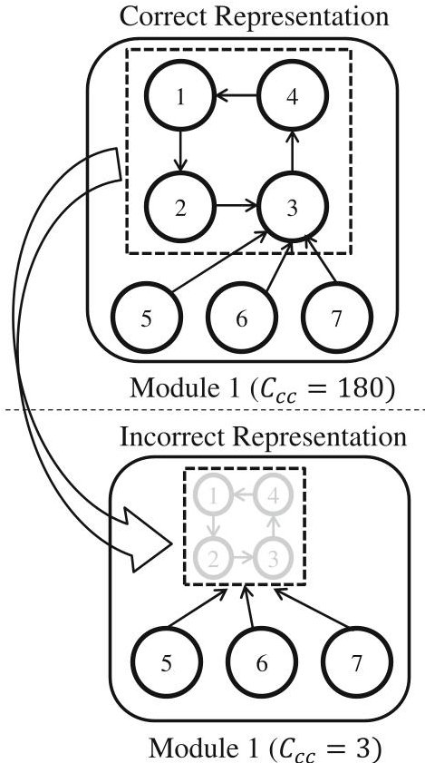
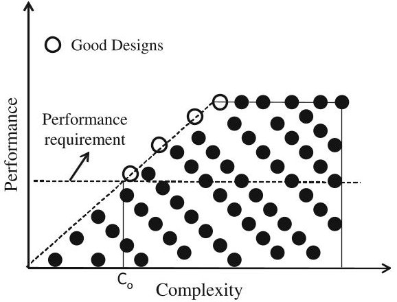

<!-- PDF_PAGE: 1 -->

ORIGINAL PAPER

# Framework for measuring complexity of aerospace systems

Shashank Tamaskar·Kartavya Neema· Daniel DeLaurentis

Received: 2 May 2013/Revised: 7 February 2014/Accepted: 10 February 2014/Published online: 22 February 2014 $ \textcircled{c} $ Springer-Verlag London 2014

Abstract We propose a framework for measuring the complexity of aerospace systems and demonstrate its application. A measure that incorporates size, coupling, and modularity aspects of complexity is developed that emphasizes the importance of indirect coupling and feedback loops in the system. We demonstrate how hierarchical modular structure in the system reduces complexity and present an algorithm to decompose the system into modules. The measure is tested and found to be scalable for large-scale systems involving thousands of components and interactions (typical in modern aerospace systems). We investigate the sensitivity of the measure and demonstrate the ability of the framework to identify incorrectness in system representation. The merits of the framework are exemplified through a case study comparing three spacecraft. The framework provides the designer with three key capabilities that can positively influence the aerospace (or other) design process: the ability to identify complex subsystems, the ability to classify misrepresentations, and the ability to trade-off commercially of the shelf (COTS) and non-COTS components.

Keywords Complexity · Coupling · Modularity · Satellite design · Design space exploration

## 1 Introduction

1. 1 Role of complexity in aerospace systems design

Aerospace systems are different from other engineering systems as they are characterized by large heterogeneity of components, low number of production units, greater reliability and safety concerns, and high-performance requirements. Modern aerospace systems, which are designed to provide high performance and reliability while operating in extreme environments, have exposed the limits of conventional systems engineering tools and practices. These systems have adopted significant technological and architectural changes to meet the everincreasing demand for performance. F-35, a fifth generation tactical fighter, is a good example, with increased capabilities (3-8 times that of fourth generation F-16, F-18) coming at the cost of increased difficulty in realizing and validating the design (Arena et al. 2008). The superior capabilities of F-35 result from more components and greater coupling between them. For example, "the F-35 has 130 subsystems, around $ 1 0^{5} $ interfaces, and 90 % of its functions are managed by software. This is a substantial growth from the F-16 that has 15 subsystems, $ 1 0^{3} $ interfaces, and less than 40 % of its functions managed by software" (Arena et al. 2008). This increase in technical complexity has challenged the efficacy of the systems engineering tools to design and develop the systems in a timely and cost-effective manner. According to the US Government Accountability Office (GAO), 42 % of defense acquisition programs are expecting 25 % or more increase in unit acquisition cost. Further, only 28 % of major programs are on schedule, and the average delay in delivering initial capability is around 22 months (Sullivan et al. 2009).

<!-- PDF_PAGE: 2 -->

Complexity is manifested in aerospace system design and development in several ways. More components and greater coupling between them increase the effort required for analysis, design space exploration, and verification. Thus, complexity is highly correlated with the design effort. Braha and Bar-Yam (2007) describe studies relating to complex engineering systems, which show that challenges from tighter coupling are accentuated by the presence of feedback loops within the connections. Highly complex systems may require additional redundancy to maintain the desired level of reliability in operation. This additional redundancy, in turn, introduces more complexity and increases the cost of the system. Thus, increasingly complex systems exhibit the phenomenon of cost-complexity spiral. As described by Carlson and Doyle (2002), complexity added to achieve reliable operation to expected disturbances can make a system highly vulnerable to small, but unexpected disturbance modes. These vulnerabilities may reveal themselves during the validation or testing phase resulting in cost and schedule overruns. Thus, mitigating the illeffects of complexity is an important goal in any design effort.

The design activity must grapple with the balance between performance and complexity. The goal of the design process is to find the designs that lie on the Pareto frontier of the performance-complexity curve, i.e., find the simplest design that gives the desired performance. This is in line with the principles of Axiomatic design, which states that a good design is one that satisfies all the functional requirements with minimum number of components and relations (Suh 2001). A simpler design leads to enhanced reliability and quality at lower cost (Maimon and Braha 1996), and reduces the possibility of unwanted emergent behaviors.

Managing complexity is not new to engineering systems design. Asikoglu and Simpson (2012) and Dolan and Lewis (2008) suggested developing product families to manage complexity. Another approach for managing complexity is to develop quantifiable complexity measures and incorporate complexity as one of the design objectives during design space exploration. This will help in identifying the good designs lying on the performance-complexity Pareto frontier. Effective complexity measures can assist in "weeding out" regions of the design space, which are either too complex to be feasible, or too simple to provide the required performance. This will substantially reduce the size of the design space and thus facilitate faster and better exploration. An effective measure of complexity should also help in identification of complex subsystems and help the designers in understanding the underlying sources of complexity in a system. This will help in identifying strategies for managing them.

## 1.2 Goals of this paper

In this paper, we propose a framework for measuring the complexity of aerospace systems. While the focus of our study is aerospace systems design, the approach is easily applicable to other engineering domains. We begin with the literature survey of the state of the art and identify the different aspects of system complexity. A comprehensive treatment of all these aspects is beyond the scope of this paper; hence, we focus our attention toward a measure that captures size, coupling, and modularity aspects of complexity. Our approach gives special emphasis on capturing the effect of indirect coupling and feedback loops present in the system. Through synthetic examples, we demonstrate how modularity helps in reducing complexity of the system. We propose an approach that combines these aspects into a single measure for system complexity. Next, we present an algorithm that identifies the optimal decomposition of a system into modules. We also discuss the scalability of our algorithms to large-scale systems, involving thousands of components and interactions, typically found in modern aerospace systems. Through sensitivity studies, we investigate the sensitivity of the measure to incorrectness in the system representation. The merits of the framework are demonstrated through a case study involving space systems. Toward the end, we describe how the approach can positively influence the design process and help in identifying high-performance, low-complexity designs.

## 2 Complexity in design: a focused review

The concept of complexity has been studied in variety of disciplines such as computer science, design, information theory, and physics. While each discipline has adopted a unique approach for representing and studying these complex systems, some fundamental characteristics can still be extracted. Sheard and Mostashari (2010) provide a review of some of the underlying factors for complexity of a design and describe how these factors influence performance and cost. Simon (1996) describes complex systems as systems containing large number of components that interact with each other in a non-simple manner. Another fundamental characteristic of these systems is the idea of emergence, i.e., the whole is more than the summation of the parts. Simon proposes the concept of "nearly decomposable systems" meaning that the links within the subsystems are generally stronger than those between the subsystems. This decomposability of complex systems suggests an approach toward managing the complexity of system synthesis. This section provides a focused overview of different approaches for measuring complexity and

<!-- PDF_PAGE: 3 -->

concludes with a comparison of these views, forming the basis for a comprehensive measure for system complexity.

## 2.1 Measures based on information theory

While some information theory measures quantify complexity in terms of information content of a design, others try to measure it as the lack of information about the design (Maimon and Braha 1996). Later, the authors (Braha and Maimon 1998) also develop an information-theoretic framework for measuring the structural and functional complexity. El-Haik and Yang (1999) propose measures that highlight some of the components of complexity of the design process such as variability, vulnerability, and correlation, and Gell-Mann and Lloyd provide information measures for measuring the effective complexity of the system(Gell-Mann and Lloyd 1996). Similarly, Hornby measures complexity as the amount of modularity, reuse, and hierarchy within the system (Hornby 2007). Willcox et al. (2011) define complexity as the potential of a system to exhibit unexpected behavior in the quantities of interest and use information entropy measure to capture the effect of uncertainty on complexity. One of the advantages of their formulation is that it can capture the change in system complexity during different phases of design. While the information-based methods are good for measuring the size, heterogeneity, and uncertainty aspects of system complexity, they do not capture the effect of topology of interactions and dynamical behavior of the system. Murray et al. (2011) propose the concept of dynamic complexity that combines information entropy and topology of interactions in a single measure. This marks an important step in moving toward a comprehensive system complexity measure.

## 2.2 Measures based on design theory

## 2.2.1 Network theoretic measures

Networks provide an intuitive way of representing a system and thus have been a popular starting point for complexity analysis as well as design in general. Braha, Bar-Yam, and Maimon analyzed various network statistical properties such as small world behavior, clustering coefficient, disassortative mixing, and hierarchical organization to study complex engineered systems (Braha and Maimon 1998; Braha and Bar-Yam 2004, 2007). They also describe how feedback loops in the network are the result of directionality and correlation among nodes of the network. They also show a high dependency between complexity measure and total assembly time. While several of these properties correlate with complexity, the authors do not propose a measure that unifies these aspects in a single framework.

Several other network complexity measures, based on the design structure matrix (DSM), are also proposed in the literature. DSM is one of the popular representation and analysis tools for system modeling. DSM is a square matrix that displays the relationship between components of a system. Elements along the diagonal represent the relationship of the component with itself while the off-diagonal elements signify the relationship of the component with others. Chen and Li (2005) suggest a complexity measure based on the DSM. Mathieson and Summers (2010) describe a DSM-based measure for interconnectivity. Hölttä and de Weck (2007) present a modularity measure based on singular value decomposition to measure the coupling within the system. Murray et al. (2011) describe a measure based on the DSM to capture the size, heterogeneity, and connectivity aspects of system complexity. Their approach captures the coupling within the system through the concept of graph energy. Barabasi and Ravasz have used the network approach to describe the characteristics of networks having hierarchy and modularity (Ravasz and Barabasi 2003). While the DSM is a compact way of system representation, it is unable to capture bipartite and multipartite relationships common in many engineering systems. To address these shortcomings, several other representations such as boundary representations, bond graphs, and bipartite graphs are considered (Mathieson and Summers 2010). Ameri et al. (2008) present a coupling measure based on bipartite entity-relation graph. Morse (2003) describes the concept of assembly graphs to represent the complexity of assemblies. An important shortcoming of these methods is that they fail to capture the effect of feedback loops, which play an important role in driving system complexity.

## 2.2.2 Empirical measures

Several empirical measures exist where the complexity is qualitatively estimated as a measure of the coupling between performance parameters and design variables. The most notable in this regard is the work of Bearden (2003), where the measure is based on empirical data from small satellites developed over a period of time. The approach used by Bearden is the following: identify the parameters that drive or otherwise contribute to the complexity of a spacecraft design, quantify the identified parameters, and combine the parameters into an aggregate complexity index. While the author has confined himself to the space domain, the approach can be applied to other domains as well. A limitation of the approach is that it only captures the effect of final design parameters not the design process, which might include the number, type, and repeatability of tasks. In addition, this might not work for radically new designs.

<!-- PDF_PAGE: 4 -->

## 2.3 Synopsis of gaps

What is missing in the complexity measures available in the literature is a comprehensive framework that combines them to produce a measure for system complexity. An important step in this direction was the DARPA Meta program where an attempt was made to develop a measure for complexity that would correlate with cost and schedule. Work done by Murray et al. (2011) is particularly notable as it combines an information theory measure with a topology measure to create a combined measure for system complexity. However, their topology measure does not account for directionality of interactions, which is an important aspect for capturing coupling between the components. In addition, by rolling up the different factors into a single number, the measure provides little insights into the relative complexity of subsystems. We believe that this is an essential feature for a complexity measure, since once complex subsystems are identified strategies can be developed to manage them. However, they use a simplistic measure for complexity that fails to capture the topology factors such as the presence of feedback loops. In addition, their approach involves converting the directed network into undirected, which may introduce errors in the analysis.

Our approach builds upon the state of the art to develop a comprehensive measure for system complexity that captures size, coupling, and modularity for a directed, weighted network. Apart from characterizing the complexity of a design by a single number, this measure allows the designer to identify complex subsystems. It also explains how modularity reduces the complexity of the design.

## 3 Measure for system complexity

## 3.1 Different aspects of system complexity

Based on the literature survey described in the previous section and interaction with the aircraft designers at Boeing (Stuart et al. 2011), we list some of the important aspects that affect system complexity. Several of these aspects such as level of abstraction, size, and heterogeneity are also described by Braha and Maimon (1998) from an information-theoretic perspective.

- Level of abstraction: Level of abstraction denotes the visualization of the system at different levels of detail. For instance, consider a hypothetical system classified into three levels of abstraction. At the top, we have the system level of abstraction where the system is viewed in terms of its primary components or functions. For an aircraft, these would be wing, fuselage, engines, etc. As

we go down the level of abstraction, the amount of detail increases. The choice of level of abstraction depends on the fidelity of analysis specified by the designer.

- Type of representation: At each level of abstraction, the system can have different representations. Ameri et al. (2008) describe the system using the function-structure connectivity graph and parametric associativity graph. A system can also be represented as a structural graph in terms of components and interactions. There can be different structural representation of the same system and each may lead to different complexity. For our analysis, we primarily focus on the functional and structural representations of the system.

- Size: Size is representative of number of components and interactions within the system. Generally, the greater the number of components and interactions, the higher is the complexity. While this relationship is not true for the case of system involving highly repetitive components, for example computer chips, aerospace systems exhibit this trend due to high heterogeneity of components.

- Heterogeneity: The greater the heterogeneity of the components and interactions more is the complexity of the system. Summers and Shah (2010) combine size and heterogeneity into a single measure.

- Coupling: Coupling between components is of two types. Direct coupling is the result of interdependency between the components due to direct physical connection between them. Indirect coupling occurs when a path with one or more components connects two components. Indirect coupling makes it possible for a component to affect another in the absence of a direct physical link. A feedback loop is an important type of indirect coupling, which results from the presence of closed loops in the system.

- Modularity: Hohlta and de Weck (2007) define modularity in two ways. Modularity is understood as the coupling of form. This means that a system is modular if the strength of coupling or density of interconnection is stronger in certain regions than average across the system. Those regions called modules have higher interconnectivity within them and have loose coupling with other modules. Functional encapsulation is another way of understanding modularity. A module is a set of components that are highly coupled and perform one or more functions. For our analysis, we have chosen the former definition of modularity.

- Uncertainty: Complexity can be understood as the potential of the system to exhibit unexpected behavior. Hence, uncertainty in the quantities of interest of the system is one of the ways of measuring complexity.

<!-- PDF_PAGE: 5 -->

- Dynamics: Systems can exhibit dynamic behavior across different timescales resulting in change in the strength of interactions between the components. For instance, an aircraft has different modes of operations where the importance of interaction between components changes.

- Off-design interactions: Off-design interactions are the interactions that occur due the operation of components and interactions outside their design range.

## 3.2 Proposed framework for measuring system complexity

While investigation of the different aspects of complexity is a topic of active research, we narrow the scope of this paper by proposing a framework that captures size, coupling, and modularity aspects of complexity. This framework consists of three steps:

1. Generate the structural and functional representation of the system: In this step, we first generate the functional representation of the system. Each function (or a group of functions) of the functional graph is mapped to a component (or group of components) in the structural graph. The structural representation is generated such that each component of the structural graph is a COTS component. To illustrate this further, consider an aircraft whose engine is a COTS component, whereas the wing is designed in-house, and hence, made from COTS components such as spars and ribs. In this case, the structural graph will contain engine as one component and will contain a large number of components (spars and ribs) corresponding to the wing. The motivation behind representing the structural graph as COTS components is that the design effort required to develop COTS is assumed to be zero, and thus, they do not contribute to the design complexity of the system. An important consequence of this formulation is that components of a system need not be at the same level of abstraction, which is one of the salient features of our framework. It allows the designer to decide whether to buy the COTS components or initiate in-house development as given in Sect. 6. In addition, in case of cyber-physical systems, software components are included as virtual components/functions in these representations.

2. Determine the weights of the links of the structural network: In this step, each function is mapped to components and interactions in the structural network. The weight of components and interactions in the structural network is defined by sum of the weight of the functions associated with them. In cases where groups of components perform a function, the weight

associated with the function is uniformly divided between the links connecting them. For the application problem demonstrated in this paper, due to lack of availability of functional data, we do not demonstrate this mapping. However, this does not prevent us from demonstrating the effectiveness of our framework. The result of this mapping is a weighted network, which is analyzed in step 3.

3. Calculate the complexity of the weighted network: We measure the complexity of the system in a two-step process described in Sect. 3.3.

## 3.3 System complexity measure and illustrative calculations

System complexity is calculated using a two-step process. First, we describe a measure that captures coupling within the system. This measure captures direct and indirect coupling present in the system and gives special emphasis on the presence of feedback loops. We also demonstrate that the same measure also captures size complexity. In the second step, we introduce a correction factor to this measure that results from the presence of a modular structure within the system. Through synthetic examples, we demonstrate how the measure captures size, coupling, and modularity aspects of complexity.

## 3.3.1 Coupling complexity

Summers and Shah (2010) propose an algorithm for measuring coupling by testing the decomposability of an entityrelation graph. One of the shortcomings of their approach is that it neglects the effect of link weights and directionality. In addition, it ignores the presence of feedback loops, which play an important role in determining the system complexity. Our proposed approach addresses all these shortcomings. Another key feature of the proposed measure for coupling is its ability to measure indirect coupling between nodes.

The measure for coupling is as follows: Given weighted structural network, we redefine the link weights to account for indirect coupling (note that direct coupling is captured from the link weights of the weighted structural network). We list all the possible paths between all the node pairs in the network. The importance of a link in the structural network depends on the frequency with which the link occurs in this list. The new weights are obtained by multiplying the weights of the network by the frequency of each link. This ensures higher weight is given to the links that are used a large number of times and thus captures the effect of both types of coupling. Coupling complexity is calculated using Eq. (1).

<!-- PDF_PAGE: 6 -->

Fig.1 Illustration of coupling complexity metric

$$
C _ {c c} = \sum_ {s = 1} ^ {c} \left(n _ {s} \sum_ {i = 1} ^ {n _ {s}} W _ {i s}\right) + \sum_ {k = 1} ^ {m} W _ {k}
$$

where c denotes the number of feedback loops, $ n_{s} $ denotes the number of links in the sth feedback loop. $ W_{is} $ denotes the weight of the i th link of the sth feedback loop. m is the number of links that are not the part of any feedback loop. $ W_{k} $ denotes the weight of the kth link that is not the part of any feedback loop. Coupling complexity $ (C_{cc}) $ can be interpreted as the summation of the link weights. However, if the links are the part of a feedback loop, we multiply the weights of all the links belonging to the feedback loop $ (W_{i}) $ with the size of the loop (j) (if a link is part of more than one feedback loop, then its weight is considered in all the loops). This ensures a higher importance to the links corresponding to the feedback loop and will also ensure a higher importance for the links belonging to a longer feedback loop. To illustrate this further, Fig. 1 shows the structural graph of an artificial network. On the left, we have the weighted network with numbers denoting the link weights. To calculate the coupling complexity of the network, we first enumerate all the paths between all the node pairs. Figure 1 lists the possible paths between all the node pairs of the network. Since we are dealing with a directed network, order of the nodes in a path is important. Hence, the paths B-C-D, C-DB, and D-B-C are considered distinct. After enumeration, we calculate the frequency of links as shown in Fig. 1. New weights are obtained by multiplying frequency with original link weights. Using Eq. (1), the coupling complexity of the network is found to be 222. This number is indicative of number and weights of direct, indirect coupling, and feedback loops in a network. Apart from representing the complexity of the system by a single number, this measure also allows us to investigate the complexity of individual subsystems as well as the integration complexity. This is further described in Sect. 3.3.3.

The proposed coupling measure automatically incorporates size complexity, which increases with number of components and interactions. By accounting for direct

coupling in the coupling measure, we ensure that the coupling complexity increases with number of links. In addition, an engineered system cannot have disconnected subgraphs, and thus, every node pair must be associated with at least one link. This puts an upper limit on the maximum number of nodes in the system (Eq. 2). If N be the number of links within the system and n be the number of nodes, then

$$
n \leq N + 1
$$

Hence, by capturing the effect of number of links, direct coupling also captures the information about the maximum number of nodes, which is an indirect measure of the size of the system. The proposed measure for coupling thus incorporates size aspect of system complexity.

## 3.3.2 Role of modularity in managing complexity

Modularity is an important design characteristic, which the designers want to imbue in their system. The complexity of a system depends not only upon its interconnections, but also on how and to what degree the system is organized hierarchically into modules (Holttä and de Weck 2007). A modular design allows flexibility to decompose the system and design each subsystem independently with minimal influence from the other subsystems. Numerous measures for determining modularity exist in the literature (Allen and Carlson-Skalak 1998; Gershenson et al. 1999; Mikkola 2000; Martin and Ishii 2002; Mattson and Magleby 2001; Newcomb et al. 1998; Sosa et al. 2000). Guo and Gershenson (2004) developed a new measure by first studying existing measures and then validating their improved measure through experiments. Apart from measuring modularity, identifying modules is an important activity in systems design. Holttä et al. (2003) describe a method for modularizing an architecture using flow-distance dendrograms. Erixon (1996) describes a method based on modular function deployment. Andersson and Sellgren (2003) propose a method for modularization based on interface modeling.

Another popular approach for modularization is the use of clustering algorithms. Majority of them are based on graph partitioning, which cuts a graph into subgraphs to minimize the interconnections between them. One such method is the minimum cut method, which produces extremely imbalanced cuts (Stoer and Wagner 1997). Other methods impose an additional constraint to produce betterbalanced cuts. Minimum bisection methods impose the constraint that the two subgraphs are of equal size. However, this is an unnatural constraint yielding in poor clustering results, and the method is NP-complete (Charney and Plato 1968). Ratio cut methods provide naturally balanced and yet high-fitness cuts by minimizing the ratio of the number of edges connecting the two subgraphs divided

<!-- PDF_PAGE: 7 -->

by the product of the number of nodes in each subgraph (Wei and Cheng 1989; Leighton and Rao 1988). Braha (2002) describe a clustering approach for partitioning tasks among product development teams. Spectral graph partitioning is another approach for graph partition that uses the eigenvalues and eigenvectors of DSM (Fiedler 1973, 1975; Von Luxburg 2007). While spectral graph partitioning works better than other methods for graph partitioning, it assumes a symmetric DSM, which is not true for most engineering systems.

We propose a model to incorporate modularity that effectively reduces the complexity of the system and also propose an algorithm to decompose the design into modules.

## 3.3.3 Incorporation of modularity into complexity metric

Section 3.3.1 provides a way of calculating the coupling complexity of the system. This calculation does not account for the fact that systems are usually designed by decomposing them into subsystems. Hence, we introduce the concept of subsystem and integration complexity to capture this behavior (Eq. 3). To calculate subsystem and integration complexity, we assume that the system is decomposed into n subsystems. Starting with redefined link weights of the network (to account for direct and indirect interactions between the components), we first calculate the coupling complexity $ ( C_{cc} ) $ . We then calculate the complexity of a subsystem $ ( C_{SSi} ) $ by isolating it from the other parts of the re-weighted network. Integration complexity is calculated by Eq. (3).

$$
C _ {I} = C _ {c c} - \sum_ {i = 1} ^ {n} C _ {S S i}
$$

The problem with Eq. (3) is that system complexity, which should be the sum of complexity of subsystems and integration, is constant irrespective of how the system is decomposed. In reality, decomposition simplifies system design and reduces the integration effort, and hence, integration complexity is less than what is obtained by Eq. (3). We capture this effect using the coefficient of integration $ \alpha_{I} $ as a correction factor and define modified integration complexity $ (C_{Im}) $ using Eq. (4). Now, the system complexity $ (C_{sc}) $ is given by Eq. (5). Note that for the special case, when n=1, we do not have any decomposition, and thus, the system complexity is equal to the coupling complexity.

$$
C _ {I m} = \alpha_ {I} C _ {I}
$$

$$
C _ {s c} = \sum_ {i = 1} ^ {n} C _ {S S i} + C _ {I m}
$$

The coefficient of integration captures the ease with which a system can be integrated. Intuitively, a designer

Fig. 2 Illustration of system complexity metric

prefers a lower value of complexity of integration and higher value of complexity of subsystem, and thus, the coefficient of integration is defined as the ratio of integration complexity and the sum of complexities of subsystems (Eq. 6). This definition is formulated such that $ \alpha_{I} $ will be scale invariant and depends only the network topology and not its size. Note that our formulation assumes that the coefficient of integration is always less than one. This is reasonable as for a good design with modest integration effort $ C_{I} $ should be less than sum of complexities of subsystems. Another consequence of this formulation is that $ C_{sc} $ is less than $ C_{cc} $

$$
\alpha_ {I} = \frac {C _ {I}}{\sum_ {i = 1} ^ {n} C _ {S S i}}
$$

Figure 2 shows a synthetic example that illustrates how modularity is incorporated into complexity metric. The link weights in the figure denote the combined effect of direct and indirect coupling. We also assume decomposition into two subsystems. We calculate $ C_{cc} $ and $ C_{sc} $ by Eqs. (1) and (5), respectively.

## 3.4 Algorithm for modular decomposition

We propose a graph partition approach that uses the modified complexity measure to find a modular decomposition of the system. Our method is based on the modification of an algorithm proposed by Newman and Girvan (2004), which identifies community structures within a network. Community structure closely relates to the notion of clustering, i.e., nodes within the same community are more densely connected as compared to that of inter community nodes. The algorithm divides the network into communities by removing the links with highest betweenness centrality. The links are removed until the network splits into separate communities. Newman defines modularity measure Q that is calculated each time the network splits into separate communities. The process of removing links, identifying communities, and calculating

<!-- PDF_PAGE: 8 -->

modularity continues until Q reaches local maxima. Along with high clustering within a community, we believe that a good decomposition should have the following characteristics to minimize system complexity:

1. Feedback loops should be localized within a subsystem: Feedback loops are inherently indivisible, and all the components within it must be designed in concert. It is easier to design systems where the integration involves fewer feedback loops, as it minimizes the coupling between the subsystems. Hence, we believe that good system decomposition should ensure that the links associated with feedback loops should remain localized to individual subsystems.

2. It should divide the system such that the subsystems have similar complexity.

3. Integration complexity should be close to the average subsystem complexity: This will result in equitable distribution of design effort between different subsystem and integration teams.

In order to achieve a good decomposition, we propose a modification to Newman modularity measure. Note that the decomposition obtained through the algorithm is different from the traditional subsystems, which are based on functional modularization (segregating components based on function).

## 3.4.1 Modified newman algorithm to find modules

We propose two modifications to Newman algorithm:

1. Link removal: Links corresponding to highest betweenness centrality are removed provided following three conditions are satisfied:

(a) Do not cut links of the feedback loop.

(b) Do not cut links, which results in complexity of a subsystem to be less than the integration complexity.

(c) Cut links only in the biggest module. Steps (b) and (c) ensure that the system is decomposed in modules of roughly same complexity.

2. Stopping criteria: The algorithm is terminated when the integration complexity is greater than the average complexity of the subsystem.

Once decomposition is obtained, Eqs. (4)-(6) are used to calculate the system complexity $ ( C_{sc} ) $ . An example demonstrating the modified Newman algorithm is shown in Fig. 3. We assume that the weight of each link is one. On the left, we have the undecomposed system. The complexity of this system is calculated using Eq. (5) for the special case of n=1. We decompose this network using modified Newman algorithm and obtain a decomposition with four

Fig. 3 Illustration of modified Newman algorithm

Fig.4 Structural graph for orsted

modules shown in Fig. 3b. The complexity of this decomposition is calculated using Eq. (5). We can see a reduction in complexity from 489 to 461.8 indicating the positive effect of decomposition.

## 4 Application

While synthetic examples are good for illustration, the real utility of the framework can be demonstrated by applying the framework over an engineering design problem. For this purpose, we choose three existing satellite missions for analysis. The choice of these missions is primarily driven by availability of the relevant information about their structural and functional graphs. Some of the details of the structural graph for these missions can be found in (Wertz and Larson 1996). Two different types of interactions have been considered while creating the structural graph, namely energy and information. Due to the lack of information about their relative strengths, these interactions are assigned equal importance. Figure 4 shows the structural graph for Orsted satellite. The colors in the structural graph

<!-- PDF_PAGE: 9 -->

Table 1 Complexity of spacecraft

<table border="1"><tr><td>Mission</td><td>Orsted Magnetic field</td><td>HETE Gamma ray burst</td><td>Clementine Moon&amp;1620 geographos</td></tr><tr><td>Cost(FY08$K*1000)</td><td>15</td><td>23</td><td>60</td></tr><tr><td>Weight(Kg)</td><td>60</td><td>125</td><td>232</td></tr><tr><td>No.of components</td><td>47</td><td>59</td><td>68</td></tr><tr><td>No.of interactions</td><td>58</td><td>71</td><td>92</td></tr><tr><td>Complexity(Ccc)</td><td>4893</td><td>7749</td><td>14962</td></tr></table>

Fig. 5 Correlation of cost with complexity

indicate functional modules. For instance, all the components in yellow color are associated with communication function.

Table 1 shows the relevant mission details about the example satellites. It also shows the coupling complexity of the three missions (calculated using Eq.1). For the chosen example set, the measure for complexity shows a promising correlation with the development cost of the mission (Fig. 5). Figure 6 shows the complexity of the individual subsystems as well as the integration complexity (not the modified integration complexity).

Results show that integration complexity is generally higher than the complexity of all the subsystems. This is expected for any complex aerospace system where complexity of integration is major driver of cost and schedule. In addition, complexity of Clementine is significantly higher than other spacecraft. This is because Clementine is a mission to the Moon and the asteroid 1620 Geographos, and hence, the power requirements are a major design driver, which resulted in a complex power subsystem. This demonstrates an important fact that performance and complexity are correlated and components are intentionally coupled to extract high performance from the system. To illustrate how modularity affects the complexity of the satellites, we apply the modularity correction on the satellite examples. The results are summarized in Table 2. We apply the modified Newman algorithm to these systems and identify the optimal decomposition (Tables 3,4,5). Our algorithm suggests that most of the components of

Complexity of Spacecraft Subsystems

Fig. 6 Complexity of subsystems and integration

Table 2 Complexity before and after modularization

<table border="1"><tr><td></td><td>Orsted</td><td>HETE</td><td>Clementine</td></tr><tr><td>Before modularization(Csc)</td><td>6312</td><td>7749</td><td>64904</td></tr><tr><td>After modularization(Csc)</td><td>5668</td><td>6879</td><td>63385</td></tr></table>

propulsion and control subsystem of Clementine should be in a single module. This is justified, as the mission of Clementine is to perform scientific observation of the moon and a near earth asteroid, thus control input is continuously required for orbital maneuvers. The algorithm also suggests that the power regulator should be a part of each (Controls, Payload, Communication, and Propulsion) subsystem instead of part of the power subsystem.

## 5 Scalability and sensitivity studies

## 5.1 Scalability for large-scale systems

The examples described in the previous sections are relatively small. Most modern aerospace systems contain thousands of components and millions of interactions.

<!-- PDF_PAGE: 10 -->

Table 3 Modularization of Orsted

<table border="1"><tr><td>Modules(# of components)</td><td>Complexity</td></tr><tr><td>Power regulator 1+Propulsion(23)</td><td>621</td></tr><tr><td>Power regulator 2+Comm.(7)</td><td>670</td></tr><tr><td>Power regulator 3-8+CDH+Payload(29)</td><td>4279</td></tr></table>

Table 4 Modularization of HETE

<table border="1"><tr><td>Modules(# of components)</td><td>Complexity</td></tr><tr><td>Power+CDH+Payload+comm.(28)</td><td>5432</td></tr><tr><td>Power regulator+prop(9)</td><td>808</td></tr><tr><td>Power regulator+ADCS(22)</td><td>510</td></tr></table>

Table 5 Modularization of clementine

<table border="1"><tr><td>Modules(# of components)</td><td>Module</td></tr><tr><td>Power+CDH+payload(35)</td><td>60,413</td></tr><tr><td>Power regulator+communication(6)</td><td>1,225</td></tr><tr><td>Propulsion+ADCS(28)</td><td>1,710</td></tr></table>

Thus, we demonstrate the scalability of the proposed measure for these large-scale systems. The proposed measure for coupling requires calculation of all the paths between all node pairs, and hence, the computation time increases significantly with the increase in number of nodes and links. To reduce the computation time, we ignore all the dependencies that are farther than 50 "hops" from a node. This assumption is reasonable since a disturbance cannot propagate indefinitely in a network and the likelihood of a node being affected beyond 50 "hops" is minimal.

To demonstrate the scalability of the measure with this approximation, several synthetic examples were constructed. Due to the lack of availability of data about large aerospace systems, we create random graphs of different sizes and examine the time required for calculating the complexity (Table 6) with the expectation that the metric will have similar performance on real networks with same number of nodes and links. Random networks are constructed with number of nodes (n) and link probability (p) such that np=1. All the examples were run on 8 core (0.8 GHz each) 16Gb RAM, 2x Quad-Core AMD Opteron 2380 system in Matlab.

## 5.2 Sensitivity studies

While developing structural and functional graphs of large systems, misrepresentations are unavoidable. These misrepresentations can be either due to an omission of a node

Table 6 Scalability of the coupling complexity measure

<table border="1"><tr><td># of nodes</td><td># of links</td><td>Time(s)</td><td>(Ccc)(Loops)</td></tr><tr><td>10</td><td>6</td><td>0.8</td><td>47(0)</td></tr><tr><td>100</td><td>110</td><td>7.7</td><td>1,259,104(9)</td></tr><tr><td>1,000</td><td>967</td><td>8.3</td><td>44,272(3)</td></tr><tr><td>10,000</td><td>10,009</td><td>608.0</td><td>1,147,052(4)</td></tr></table>

Fig. 7 Misrepresentation due to incorrect system decomposition

or a link or due to an erroneous weight given to a particular link. It is evident from our formulation (Eq.1) that the complexity measure will be sensitive to misrepresentations of links and nodes belonging to the feedback loop, and hence, extra care should be taken while representing them. The formulation is also sensitive to mistakes in system decomposition. This is shown in the example below:

Figure 7 shows a hypothetical scenario where a part of a module (components 1 through 4) of the system is misrepresented. This type of situation often occurs in the case of software components where there are multiple ways of representation. Since the misrepresentation removes the feedback loop, we observe a significant change in coupling complexity. In order to detect this misrepresentation, we need to analyze the complexity of the individual modules. Table 7 illustrates the effect of misrepresentation on Orsted spacecraft. The designer is being provided with the data as shown in Table 7 where it is evident that the complexity of CDH subsystem is significantly lower than others. There are two explanations for this, either there is a

<!-- PDF_PAGE: 11 -->

Table 7 Misrepresentation in orsted

<table border="1"><tr><td>Subsystem</td><td>Complexity</td></tr><tr><td>(Ccc)</td><td>5507</td></tr><tr><td>Power</td><td>1493</td></tr><tr><td>Control</td><td>284</td></tr><tr><td>Comm.</td><td>630</td></tr><tr><td>Propulsion</td><td>570</td></tr><tr><td>CDH</td><td>17</td></tr><tr><td>Integration</td><td>2513</td></tr></table>

Fig. 8 Performance versus complexity

misrepresentation or its complexity is genuinely less than other subsystems. By further analysis, the designer identifies that a feedback loop belonging to the CDH subsystem is misrepresented as a single component.

One of the limitations of the approach is that the size of the system and the feedback involved in misrepresentation should be large. While this approach is not foolproof, it focuses the attention on the misrepresentation and encourages further discussion to identify the problem.

## 6 Context for application in design space exploration

The research reported in this paper was motivated by the imperative for improved aerospace systems design. In this section, we briefly highlight how this framework facilitates complexity-enabled design space exploration. Figure 8 shows a notional relationship between performance and complexity in a system. To achieve a particular level of performance, the complexity of the system must be above a particular threshold. A good design satisfies the requirements with minimum complexity. This figure also highlights the problem with traditional design paradigm where all designs that meet the requirements are equal. With complexity added as one of the design objectives, the exploration will gravitate toward designs that strike a balance between complexity and performance. The size of the

design space can also be reduced by setting a complexity threshold, which rejects the designs that are either too simple to provide the required performance or overly complex to be feasible. The proposed framework and measure together allow the designer to dig deeper, identify the sources of coupling within the system, and develop strategies to manage them.

The approach presented in this paper is also tailored toward Model-based Design, Engineering and Development (MBDED) (Bellman 2011), which aspires toward creating design tools and processes to enable design and verification in a virtual environment. One of the approaches in MBDED is component-based design where the design problem is transformed into a problem of identifying an acceptable configuration of components that meet the requirements by using a library of pre-verified component models. This facilitates design and validation of systems much more rapidly because if the components and interactions are properly characterized, their composition may be also verified computationally without resorting to expensive prototyping and testing. However, the benefits may be reduced when the size of the verified component library is too small (not enough good design options) or too big (large search space). In the latter case, this framework will try to mimic the designer's intuition, help in navigating the large design space, and help manage the complexity of system through modularity.

As described in Sect. 3.2, one of the important advantages of our framework when applied to the componentbased design paradigm is that it solves the designer's dilemma of buying a COTS component/subsystem or designing it in-house. The framework allows us to represent structural graphs with components at different levels of abstraction. Thus, component library, as described earlier, can contain components at multiple levels of abstraction. For example, to design an aircraft, it can have a wing (high level of abstraction) and also contain constituent components of the wing such as spars and ribs (low level of abstraction). Now, the combination of components at different levels of abstraction will lead to different designs with each having its unique structural graph. These choices will have different implications for performance and complexity. A performance-complexity trade-off study will address the problem by identifying designs on the Pareto frontier.

It is important not to confuse the concept of modeling components belonging to different levels of abstraction in the same structural graph with the concept of misrepresentation described in the previous section. While the former case describes a conscious decision by the designer to use a COTS component, the latter describes the case of misrepresentation where the component was modeled as COTS and hence, was less complex.

<!-- PDF_PAGE: 12 -->

## 7 Conclusions

In this paper, we identify several aspects of system complexity relevant to the design of engineered systems. We also present a framework for measuring system complexity and propose a measure that combines size, coupling, and modularity. The measure is an improvement over other state-of-the-art approaches, as it works effectively with a directed and weighted design structure matrix. It also incorporates direct, indirect coupling and provides special emphasis on feedback loops, which play an important role in increasing system complexity. The framework successfully demonstrates how the presence of modularity reduces the complexity of a system and facilitates system design. Along with representing the system complexity by a single numeric value, our measure places a special emphasis on digging deeper into the sources of complexity by highlighting the complexity of subsystems and integration. We also propose an intuitive framework for system decomposition where optimal decomposition means that the modules have similar complexity and that the complexity of subsystems roughly equals the complexity of integration. In contrast, techniques based on singular value decomposition do not have an intuitive explanation for their decomposition. An important consequence of this algorithm is the ease of integration. Functional decomposition involves coupling and feedback loops in the integration and hence results in complex integration process. Our algorithm, by redefining the modules, simplifies the integration process by localizing the feedback loops. Thus, the design effort is concentrated on integrating and testing critical interactions before integrating the modules into a system, which leads to a simplified integration process. This also will result in changes in the composition of the integration team, which will be more interdisciplinary, to support integration of diverse components into a module. Scalability is another desirable characteristic of our framework, and we demonstrate that the measure works for large-scale systems comprising of thousands of nodes. We also investigate the sensitivity of our measure to a variety of misrepresentations (that have a potential to cause cost and schedule overruns). While our framework is applicable to many engineering domains, we put a special emphasis on its applicability to aerospace systems. Aerospace systems are different from other systems and are characterized by a low number of production units, greater reliability and safety concerns, and high-performance requirements. Our work has been motivated by keeping some of these challenges in mind. In the end, we provide a rough outline for our future endeavors by proposing to use this framework to facilitate the effective and efficient exploration of the multidimensional design space. We also hypothesize that

this framework will help in solving the designer's dilemma of buying a component/subsystem COTS or designing it from scratch.

Acknowledgments The authors acknowledge the sponsorship of this research from the Boeing Company (Contract PO 410958) under the DARPA META program. In particular, we thank David Corman, Tom Herm, Doug Stuart for their contributions in this effort. The views and conclusions contained herein are those of the authors only.

## References

Allen K and Carlson-Skalak S (1998) Defining product architecture during conceptual design. In: ASME design engineering technical conferences, DETC1998/DTM, Atlanta, Georgia

Ameri F, Summers J, Mocko G, Porter M (2008) Engineering design complexity: an investigation of methods and measures. Res Eng Des 19(2):161-179

Andersson S, Sellgren U (2003) Modular product development with focus on modeling and simulation of interfaces. In: Proceedings of the 6th workshop on product structuring-application of product models, pp 17-24

Arena M, Younossi O, Brancato K, Blickstein I, Grammich C (2008) Why has the cost of fixed-wing aircraft risen? A macroscopic examination of the trends in us military aircraft costs over the past several decades. Tech. Rep. MG-696-NAVY/AF, RAND Corporation, Santa Monica, California

Asikoglu O, Simpson T (2012) A new method for evaluating design dependencies in product architectures. In: 12th AIAA aviation technology, integration, and operations (ATIO) conference and 14th AIAA/ISSMO multidisciplinary analysis and optimization conference, Indianapolis, Indiana, AIAA 2012-5660

Bearden D (2003) A complexity-based risk assessment of low-cost planetary missions: when is a mission too fast and too cheap. Acta Astronaut 52(2-6):371-379

Bellman K (2011) Model-based design, engineering, and development: advancements mean new opportunities for space system development. In: AIAA SPACE 2011 conference and exposition, Long Beach, California, AIAA 2011-7304

Braha D (2002) Partitioning tasks to product development teams. In: Proceedings of the ASME design engineering technical conference, Montreal, Canada, vol 4, pp 333-344

Braha D, Bar-Yam Y (2004) Topology of large-scale engineering problem-solving networks. Phys Rev E 69(1):016,113

Braha D, Bar-Yam Y (2007) The statistical mechanics of complex product development: empirical and analytical results. Manag Sci 53(7):1127-1145. doi:10.1287/mnsc.1060.0617

Braha D, Maimon O (1998) The measurement of a design structural and functional complexity. IEEE Trans Syst Man Cybern Part A: Syst Hum 28(4):527-535. doi:10.1109/3468.686715

Carlson J, Doyle J (2002) Complexity and robustness. Proc Natl Acad Sci USA 99(Suppl 1):2538. doi:10.1073/pnas.012582499

Charney H, Plato D (1968) Efficient partitioning of components. In: Proceedings of the 5th annual design automation workshop, ACM, New York, USA, DAC '68, pp 16.1-16.21, doi:10.1145/ 800167.805401

Chen L, Li S (2005) Analysis of decomposability and complexity for design problems in the context of decomposition. J Mech Des 127. doi:10.1115/1.1897405):545

Dolan B, Lewis K (2008) Robust product family consolidation and selection. J Eng Des 19(6):553-569. doi:10.1080/09544820 802126511

<!-- PDF_PAGE: 13 -->

El-Haik B, Yang K (1999) The components of complexity in engineering design. IIE Trans 31(10):925-934. doi:10.1023/A: 1007650829429

Erixon G (1996) Modular function development mfd, support for good product structure creation. In: Proceedings of the 2nd WDK workshop on product structuring, pp 13-16

Fiedler M (1973) Algebraic connectivity of graphs. Czechoslov Math J 23:98

Fiedler M (1975) A property of eigenvectors of nonnegative symmetric matrices and its application to graph theory. Czechosl Math J 25(100):619-633

Gell-Mann M, Lloyd S (1996) Information measures, effective complexity, and total information. Complexity 2(1):44-52

Gershenson J, Prasad G, Allamneni S (1999) Modular product design: a life-cycle view. J Integr Des Process Sci 3(4):13-26

Guo F, Gershenson J (2004) A comparison of modular product design methods based on improvement and iteration. In: Volume 3a: 16th international conference on design theory and methodology, ASME, Salt Lake City, Utah, USA, doi:10.1115/DETC2004- 57396

Hölttä K, de Weck OL (2007) Metrics for assessing coupling density and modularity in complex products and systems. In: ASME 2007 design engineering technical conferences, American Society of Mechanical Engineers, Las Vegas, Nevada

Hölttä K, Tang V, Seering W (2003) Modularizing product architectures using dendrograms. In: Proceedings of the 14th international conference on engineering design, Stockholm, DS31- 1021FPB

Hornby G (2007) Modularity, reuse, and hierarchy: measuring complexity by measuring structure and organization. Complexity 13(2):50-61. doi:10.1002/cplx.20202

Leighton T, Rao S (1988) An approximate max-flow min-cut theorem for uniform multicommodity flow problems with applications to approximation algorithms. In: Foundations of Computer Science, 1988., 29th Annual Symposium on, IEEE, pp 422-431, doi:10. 1109/SFCS.1988.21958

Maimon O, Braha D (1996) On the complexity of the design synthesis problem. IEEE Trans Syst Man Cybern Part A Syst Hum 26(1):142-151

Martin M, Ishii K (2002) Design for variety: developing standardized and modularized product platform architectures. Res Eng Des 13(4):213-235

Mathieson J, Summers J (2010) Complexity metrics for directional node-link system representations: theory and applications. In: Proceedings of the ASME IDETC/CIE 2010, Montreal, Canada, 10.1115/DETC2010-28561

Mattson C, Magleby S (2001) The influence of product modularity during concept selection of consumer products. In: ASME Design Engineering Technical Conferences, Pittsburgh, PA, DETC2001/DTM-21712

Mikkola JH (2000) Modularization assessment of product architecture. Druid working papers, DRUID, Copenhagen Business School, Department of Industrial Economics and Strategy/ Aalborg University, Department of Business Studies

Morse E (2003) On the complexity of mechanical assemblies. In: Volume 3a: 8th Design for Manufacturing Conference, ASME Chicago, Illinois, USA, 10.1115/DETC2003/DFM-48159

Murray BT, Pinto A, Skelding R, de Weck O, Zhu H, Nair S, Shougarian N, Sinha K, Bopardikar S, Zeidner L (2011) Meta II complex systems design and analysis (CODA). Tech. Rep. ADA552676, United Technologies Research Center, Hartford, CT

Newcomb PJ, Bras B, Rosen DW (1998) Implications of modularity on product design for the life cycle. J Mech Des 120(3):483-490. doi:10.1115/1.2829177

Newman M, Girvan M (2004) Finding and evaluating community structure in networks. Phys Rev E 69(2):026,113. doi:10.1103/ PhysRevE.69.026113

Ravasz E, Barabasi A (2003) Hierarchical organization in complex networks. Phys Rev E 67(2):026,112

Sheard SA, Mostashari A (2010) A complexity typology for systems engineering. In: Twentieth Annual International Symposium of the International Council on Systems Engineering

Simon HA (1996) The sciences of the artificial, 3rd edn. MIT Press, Cambridge

Sosa M, Eppinger S, Rowles C (2000) Designing modular and integrative systems. In: ASME design engineering technical conference proceedings, Baltimore, Maryland, DETC2000/ DTM-14571

Stoer M, Wagner F (1997) A simple min-cut algorithm. J ACM (JACM) 44(4):585-591. doi:10.1145/263867.263872

Stuart D, Mattikalli R, DeLaurentis D, Shah J (2011) Meta II complexity and adaptability (ADA552865)

Suh N (2001) Axiomatic design: advances and applications, vol 4. Oxford University Press, New York

Sullivan MJ, Schwenn RE, Brink H, Mebane CT, Seales SC, Wintfeld JR, Best DB, Bowman RC, Denomme TJ, Fairbairn BD (2009) Defense acquisitions: assessments of selected weapon programs. Tech. rep., Defense Technical Information Center, Ft. Belvoir, Virginia

Summers J, Shah J (2010) Mechanical engineering design complexity metrics: size, coupling, and solvability. J Mech Des 132(2): 021,004. doi:10.1115/1.4000759

Von Luxburg U (2007) A tutorial on spectral clustering. Stat Comput 17(4):395-416. doi:10.1007/s11222-007-9033-z

Wei Y, Cheng C (1989) Towards efficient hierarchical designs by ratio cut partitioning. In: IEEE international conference on computer-aided design, 1989, IEEE, pp 298-301, doi:10.1109/ ICCAD.1989.76957

Wertz J, Larson W (1996) Reducing space mission cost. Microcosm Press, Hawthorne

Willcox K, Allaire D, Deyst J, He C, Sondecker G (2011) Stochastic process decision methods for complex-cyber-physical systems. Tech. Rep. ADA552217, Massachusetts Institute of Technology, Cambridge

