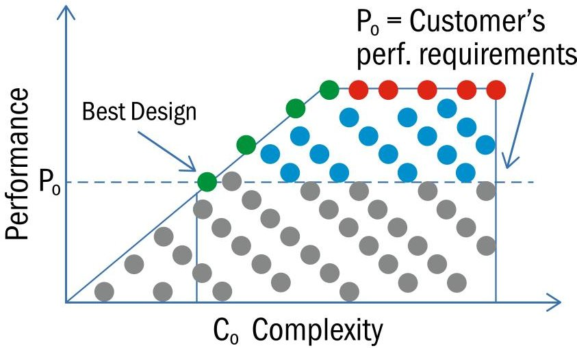
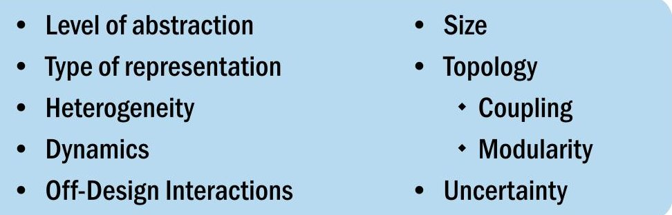
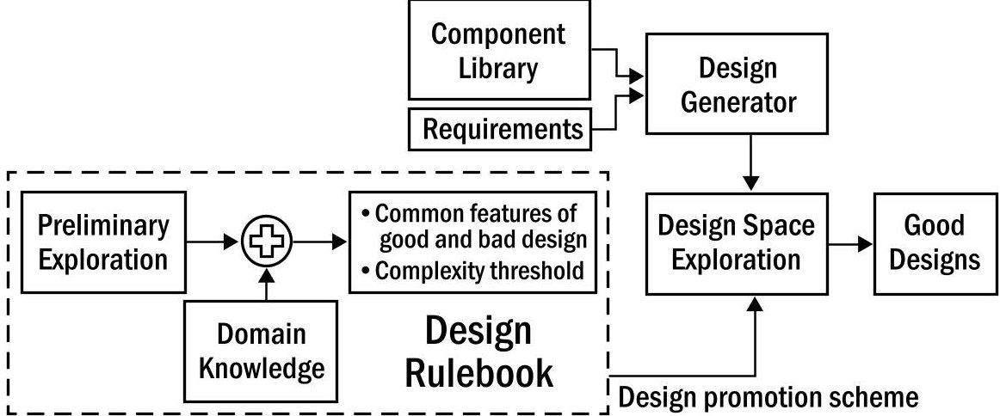

<!-- PDF_PAGE: 1 -->

Designers must strive for an optimum balance between performance and complexity and identify the designs that lie on the performance- complexity Pareto frontier.

## Managing Complexity in Model-Based Conceptual Design

Shashank Tamaskar, shashank.tamaskar@incose.org; Kartavya Neema, kartavya.neema@incose.org; and Daniel DeLaurentis, daniel.delaurentis@incose.org

## Problem of Growing Complexity of Engineering Systems

In the past several decades, engineering systems have seen a significant growth in complexity due to improved performance and capabilities. For instance, F-35, a fifth generation aircraft, offers roughly three to eight times the operational capability compared to F-16 (fourth generation aircraft). This additional operational capability stems from an increase in subsystems (increase from 15 to 130), and number of interfaces (from 103 to 105) (Arena 2008). This growth in complexity has been poorly managed, leading to substantial cost and schedule overruns. According to the US Government Accountability Office (GAO), 42% of defense acquisition programs are expecting 25% or more increase in unit acquisition cost. Further, only 28% of major programs are on schedule and the average delay in delivering initial capability is around 22 months (Sullivan 2009). Thus to assure the affordability of these complex engineering systems, it is increasingly important to develop tools and capabilities for managing their complexity.

Model-based systems engineering aims to address some of the deficiencies of the document-centric systems engineering approaches by using models to drive specification, design, integration, and validation. This enables efficient communication between various system elements through automatic propagation of design changes, detection of specification inconsistencies, which may lead to faster verification and validation. Model-based conceptual design proposes using models for conceptual design activities. One of the approaches here is to transform a design problem into a problem of identifying an acceptable configuration of components that meets the requirements by using a library of pre-verified component and flow models. This can facilitate identification of better designs by enabling a more exhaustive search of the design space. However, the benefits may be reduced when the size of the component-flow library is too small (not enough good design options) or too big (large search space). For complex engineering systems containing thousands of components, the problem of identifying an acceptable design may prove to be intractable.

Another approach for managing complexity of engineering

systems is to explicitly measure complexity and use it in design space exploration to identify designs on the performance-complexity Pareto frontier. Before learning about how complexity is measured and incorporated into design space exploration, we first discuss the trade-off between performance and complexity. This trade-off is the result of architectural and design decisions. For instance, the designers incorporate coupling between the systems components to get high performance, which results in increase in complexity. Thus the goal of the design process is to identify the designs on the performance-complexity Pareto frontier, that is to find the simplest design, which gives the acceptable performance. Figure 1 shows this trade-off for a hypothetical system and highlights the potential designs along the performance-complexity frontier in green. In the next section we outline an approach for incorporating complexity in the model-based conceptual design and the ways in which it can improve the quality of designs obtained.

Figure 1. Performance-complexity tradespace

## Measuring Complexity of Engineering Systems

Complexity is manifest in the design and development of complex engineering systems in several ways. More components and greater coupling between them increases the effort required for analysis, exploring the design space, and verification. Challenges from tighter coupling are accentuated by the presence of feedback loops within the connections, and the interplay between the

<!-- PDF_PAGE: 2 -->

hardware and software domains. Highly complex systems may require additional redundancy to maintain the desired level of reliability in operation. This additional redundancy, in turn, introduces more complexity and increases the cost of the system. Thus, increasingly complex systems exhibit the phenomenon of cost-complexity spiral. As described by Carlson (2002), complexity added to achieve reliable operation in the presence of expected disturbances can make a system highly vulnerable to small but unexpected disturbance modes. These vulnerabilities may be revealed during the verification and validation phase resulting in cost and schedule overruns. Thus apart from increasing the cost of the system, an increase in system complexity reduces our ability to accurately predict the development cost and time of the system. Although these relationships might portray complexity in a negative light, it is important to understand that complexity is a symptom of coupling and lack of modularity in the system and not the cause. Designers must strive for an optimum balance between performance and complexity and identify the designs that lie on the performance-complexity Pareto frontier.

The concept of complexity has been studied in a variety of disciplines such as computer science, design, information theory, and physics. While each discipline has adopted a unique approach for representing and studying these complex systems, some fundamental characteristics can still be extracted. The US Defense Advanced Research Projects Agency's Meta program led to several developments towards developing a holistic complexity measure, which would correlate with cost and schedule. While there exist different opinions in the literature about what constitutes as holistic measure, some of the common aspects to consider in a complexity metric are shown in Figure 2.

Figure 2. Different aspects of a complexity (Tamaskar 2011)

Complexity metrics can be classified into three categories:

1. Information theory measures quantify complexity in terms of the information content of the design. El-Haik and Yang (1999) propose measures that highlight some of the components of complexity of the design process such as variability, vulnerability, and correlation, and Gell-Mann and Lloyd (1996) provide information measures for measuring the effective complexity of the system. While the information-based methods are good for measuring the size, heterogeneity, and uncertainty aspects of system complexity, they do not capture the effect of topology of interactions and dynamical behavior of the system. Murray et al (2011) propose the concept of dynamic complexity that combines information entropy and topology of interactions in a single measure. This marks an important step in moving towards a comprehensive system complexity measure.

2. Networks provide an intuitive way of representing a system and thus have been a popular starting point for complexity analysis as well as design in general. Ameri (2008) present a coupling measure based on bipartite entity-relation graph. Mathieson and Sumners (2010) describe a measure for interconnectivity based on the design structure matrix. Holtta-Otto and DeWeck (2007) present a modularity measure based on singular value decomposition to measure the coupling within the system.

3. Several empirical measures exist where complexity is qualitatively estimated as a measure of the coupling between performance parameters and design variables. The most notable is the work of Bearden (2003), where the measure is based on empirical data from small satellites developed over a period of time. A limitation of the approach is that it only captures the effect of final design parameters and not the effect of the design process, which might include the number, type, and repeatability of tasks. In addition, this might not work for radically new designs.

Several improvements were made to the state-of-the-art during the Meta program, which have taken us closer towards a comprehensive metric for complexity. Murray et al. (2011) combines an information-theoretic measure with a topology measure to create a combined measure of system complexity. However, their topology measure does not account for the directivity of interactions, which is an important aspect for capturing the coupling between the components. In addition, by rolling up the different factors into a single number, the measure provides little insights into the relative complexity of subsystems. We believe that this is an essential feature, since once complex subsystems are identified, strategies can be developed to manage them. Another important feature, which Zeidner, Banaszuk, and Becz (2010) discuss, is how modularity reduces complexity. However they use a simplistic measure for complexity that fails to capture the topology factors such as the presence of feedback loops. In addition, their approach involves converting the directed network into undirected, which may introduce errors in the analysis. Tamaskar (2014) builds upon the state-of-the-art to develop a comprehensive measure for system complexity that captures size, coupling, and modularity for a directed, weighted network. Apart from characterizing the complexity of a design by a single number, this measure allows the designer to identify complex subsystems. It also explains how the presence of a hierarchical structure reduces the complexity of

<!-- PDF_PAGE: 3 -->

the design. In the next section we describe how the capabilities of model-based design can be combined with the metrics for complexity to improve the design space exploration process in conceptual design.

## Complexity-Enabled Design Space Exploration

The previous section described a quantitative measure for complexity. By incorporating this measure in the design space exploration framework the exploration will gravitate towards the designs that strike a balance between complexity and performance. The size of the design space can also be reduced by setting a complexity threshold, which rejects the designs that are either too simple to provide the required performance or overly complex to be feasible. Also, by analysis of the performance-complexity tradespace we can identify good and bad design characteristics, which can be used to develop an expert system based on a design rulebook that leads to further improvement in the speed of design space exploration. Figure 3 outlines our approach for complexity-enabled design space exploration. We begin by performing a preliminary exploration and identify some high performance-low complexity designs. We then identify common features of good and bad designs and collect them in a design rulebook. We can also incorporate the domain knowledge about the good and bad design features in this rulebook. We also identify a complexity threshold in this preliminary exploration. Thus only the designs lying within this threshold will be analyzed. Because complexity calculation (based on high-level network connectivity) is significantly faster than calculating performance, we also increase the speed of exploration. This design rulebook is used to guide the design space exploration and helps in identifying designs on the performance-complexity Pareto frontier. A case study exemplifying this approach is shown in Tamaskar (2014). Neema, Tamaskr, and DeLaurentis (2014) also describe a similar performance complexity trade study of fractionated spacecraft using a model-based design approach.

## Conclusions

This article outlines our vision for how complexity metrics can be used in modelbased conceptual design for identifying designs on the performance-complexity Pareto frontier. We believe that this approach can be the first step towards addressing the problem of growing complexity. The approach is generic enough to be used along with a variety of complexity metrics available in the literature. We also encourage the systems engineers to not solely focus on a single number for complexity but to dig deeper into the underlying sources of complexity. This can help in identifying complex subsystems so that the design team can identify strategies for managing them. We envision that model-based complexity management leads to better exploration of the performance-complexity tradespace. This will help us in identifying potential good designs which can be further improved by digging deeper into the sources of complexity and managing them. This combined effort between the tool and the designer will enable us to strike the right balance between performance and complexity.

## References

Figure 3. Complexity enabled design space exploration

Ameri, F, J Summers, G Mocko, and M Porte. 2008. "Engineering design complexity: an investigation of methods and measures." Research in Engineering Design 19(2):161-179.

Arena, M, O Younossi, K Brancato,I Blickstein, and C Grammich . 2008. "Why has the cost of fixed wing aircraft risen ? A macroscopic examination of the trends in US military aircraft costs over the past several decades." DTIC Document.

Bearden, D. 2003. "A complexity-based risk assessment of low-cost planetary missions: when is a mission too fast and too cheap." Acta Astronautica 52(2-6):371-379.

Carlson J and J Doyle. 2002. "Complexity and Robustness." Proceedings of the National Academy of Sciences of the United States of America. 2538.

El-Haik, B, Yang K. 1999. "The components of complexity in engineering design." IIE Transactions 925 934.

Gell-Mann, M, and S Lloyd. 1996. "Information measures, effective complexity and total information." Complexity 2(2):44-52.

Holtta-Otto, K amnd O de Weck. 2007. "Metrics for assessing coupling density and modularity in complex products and systems." ASME.

Mathieson, J and J Summers. 2010. "Complexity metrics for directional node-link system representations: Theory and applications." Proceedings of the ASME IDETC/CIE.

Murray, BT, A Pinto, R Skelding, OL de Weck, H Zhu, S Nair, N Shougarian, K Sinha, S Bodardikar, and Zeidner. 2011. Meta II complex systems design and analysis (CODA). United Technologies Corporation.

Neema, K., S Tamaskar, and D DeLaurentis. 2014. "Enhanced Design Space Exploration of Satellite via Complexity and Flexibility Measures." submitted to AIAA Journal of Spacecrafts and Rockets.

Sullivan, MJ, RE Schwenn, H Brink, CT Mebane, SC Seales, JR Wintfeld, DB Best, RC Bowman, TJ Denomme, and BD Fairbairn. 2009. "Defense acquisitions: Assessments of selected weapon programs." Tech Report, DTIC Document.

Tamaskar, S, T Kotegawa, K Neema, and DA DeLaurentis. 2011. "Complexity Enabled Design Space Exploration." IEEE International Conference on Systems, Man, and Cybernetics. Anchorage, Alaska. 1250-1255.

Tamaskar, S, K Neema, and DA DeLaurentis. 2014. "Framework for Managing Complexity of Aerospace Systems." Research in Engineering Design.

Zeidner, L, A Banaszuk, and S Becz. 2010. "System complexity reduction via spectral graph partitioning to identify hierarchical modular clusters." 10th AIAA Aviation Technology Integration and Operations (ATIO) Conference.

