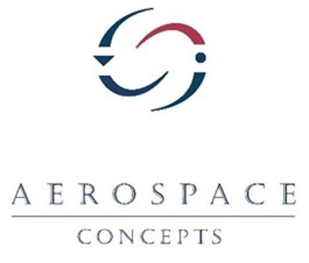
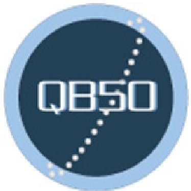
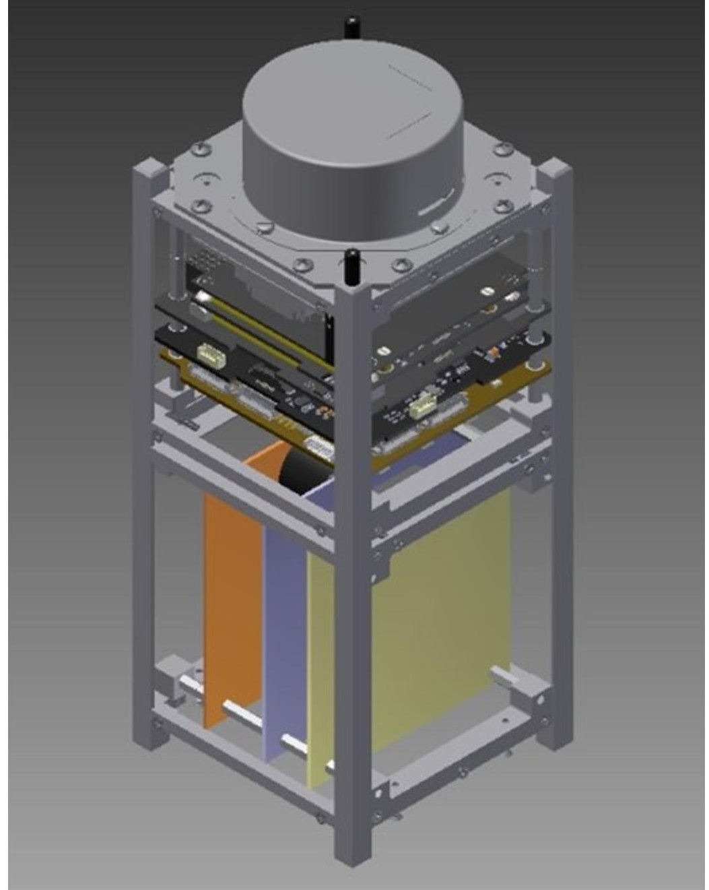
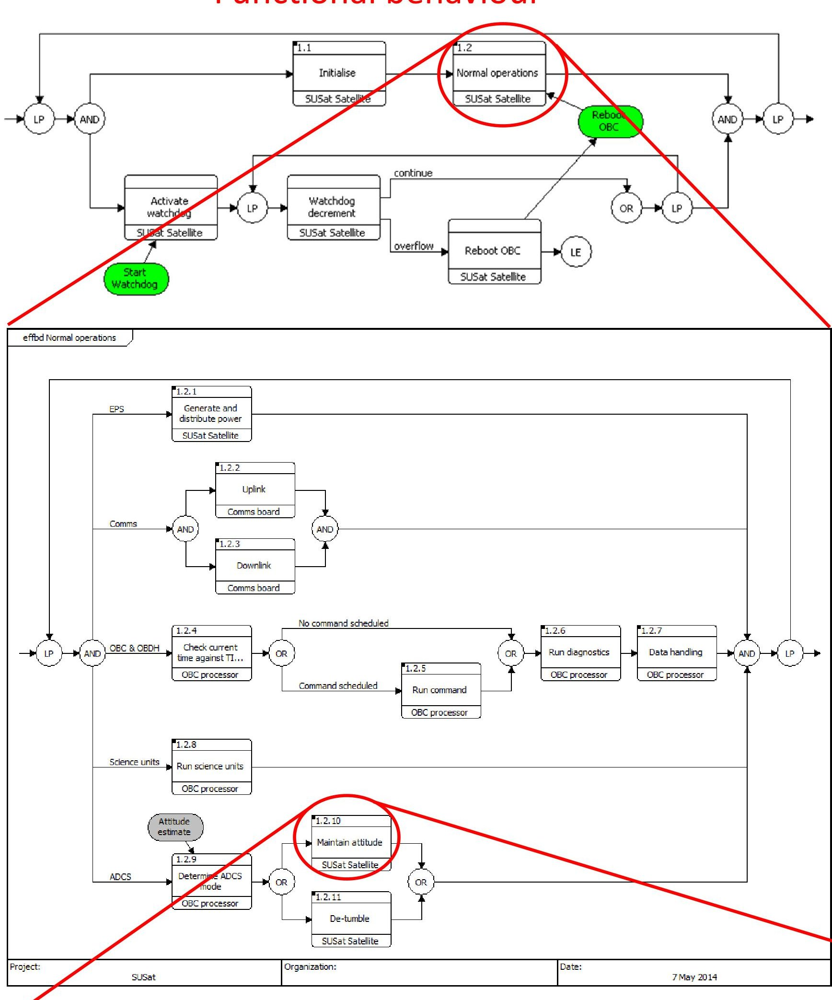
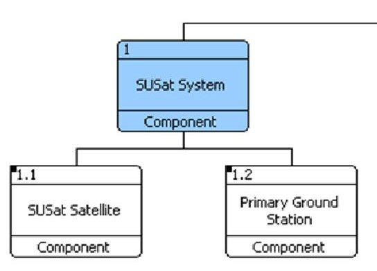
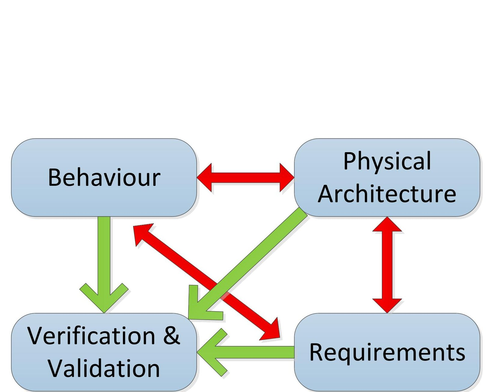
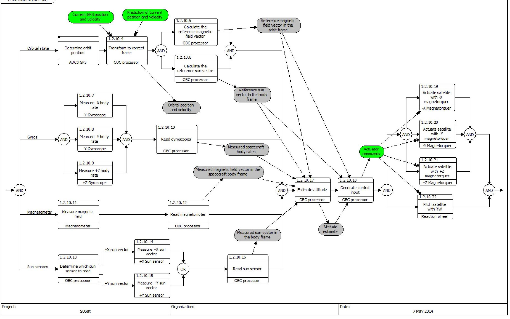
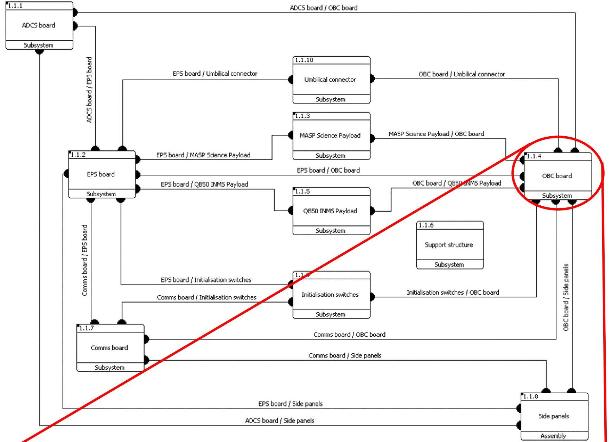
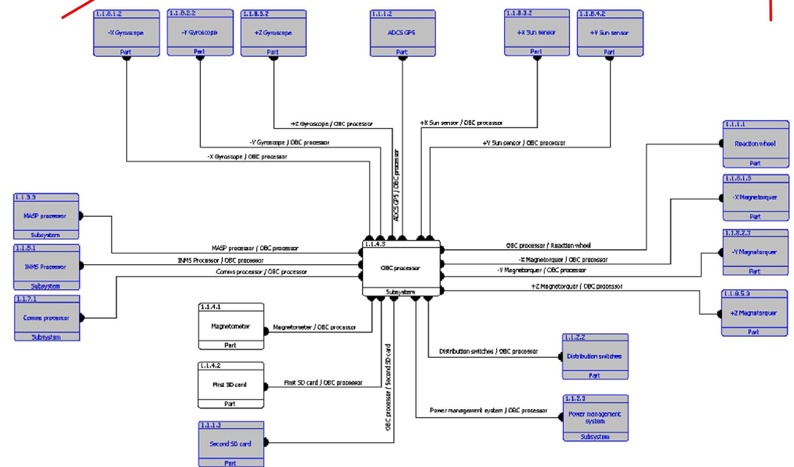
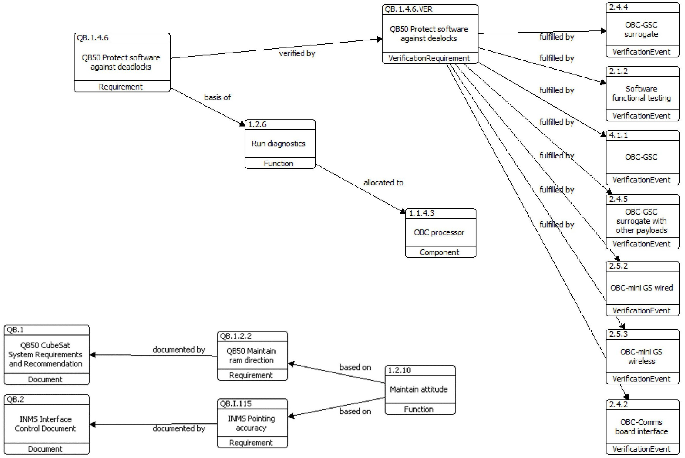

<!-- PDF_PAGE: 1 -->

# MBSE for a University NanoSat

Matthew Tetlow, Flavia Tata-Nardini — The University of Adelaide

Tristan Cook, Daniel Spencer — Aerospace Concepts

Aim

University of South Australia

To develop an MBSE model to support the design, development and test of SUSat

## Why MBSE?

- Supports design and development by providing a link between the physical architecture, functional behaviour and requirements

- Provides traceability to support verification & validation

- Provides a single source of truth

- Documentation can be automatically generated from the model

## What is SUSat?

- Nano-Satellite project lead by University of Adelaide

- Part of the QB50 project, headed by The Von Karman Institute

## Verification and validation

## Acknowledgements

