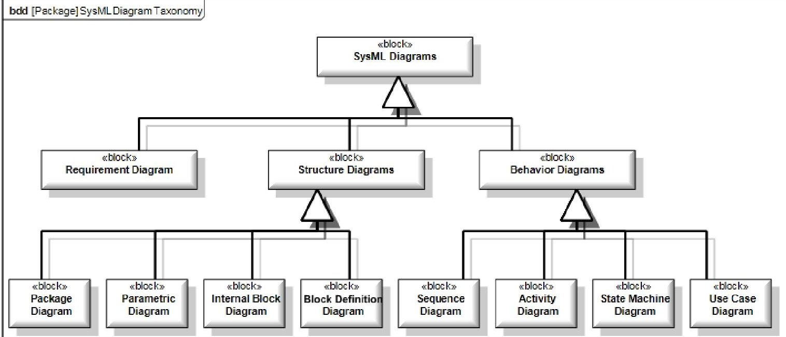
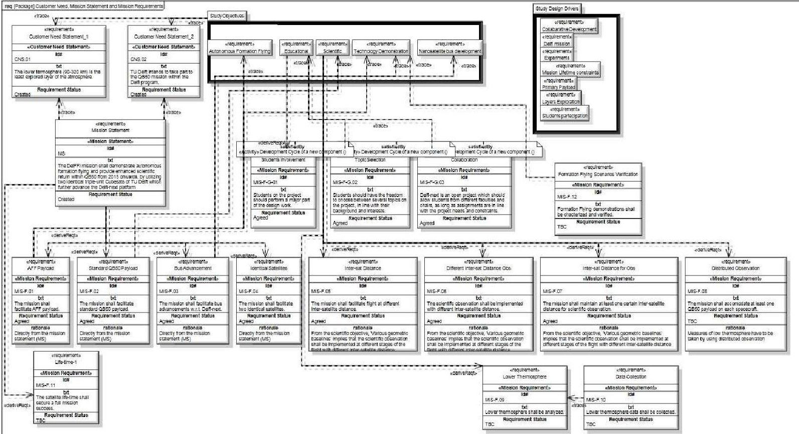
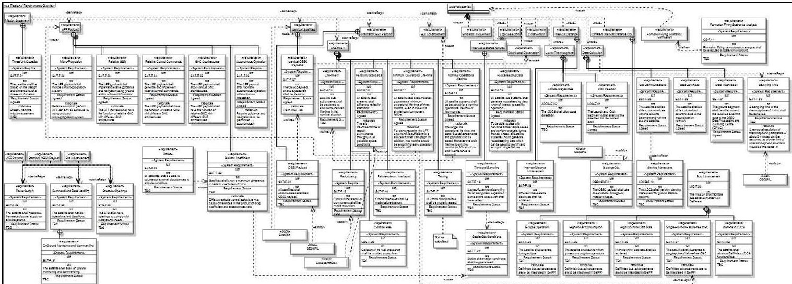
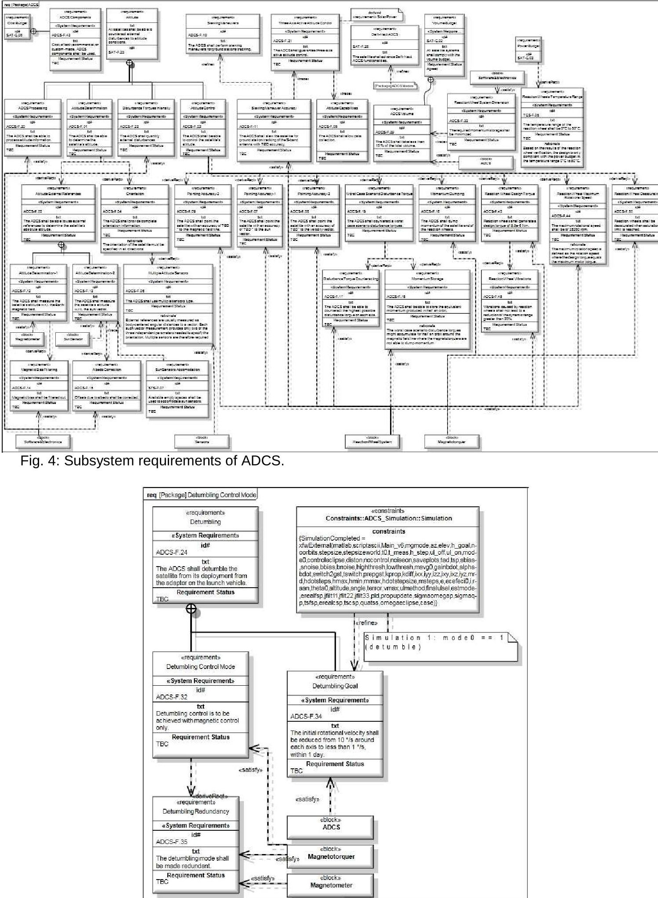
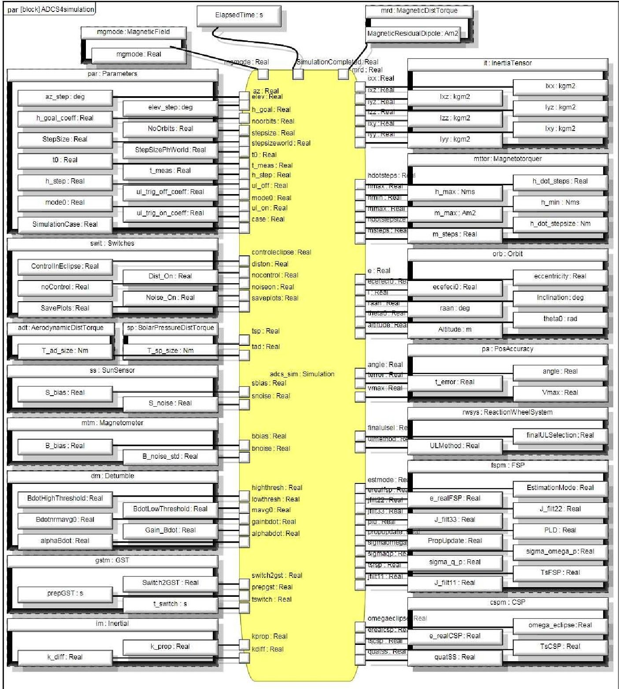
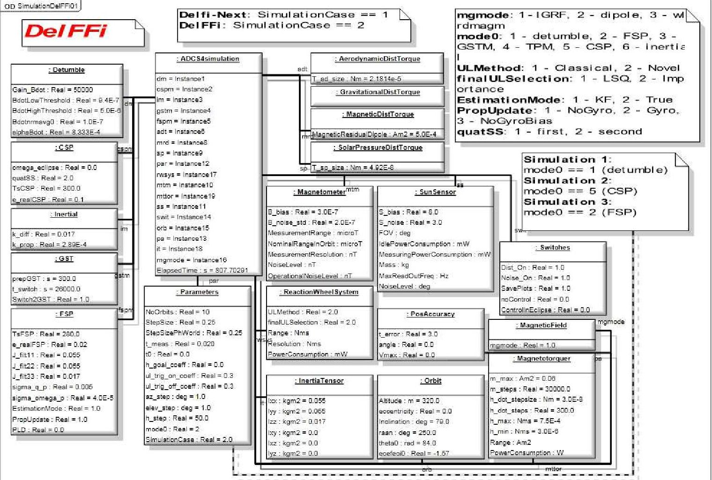
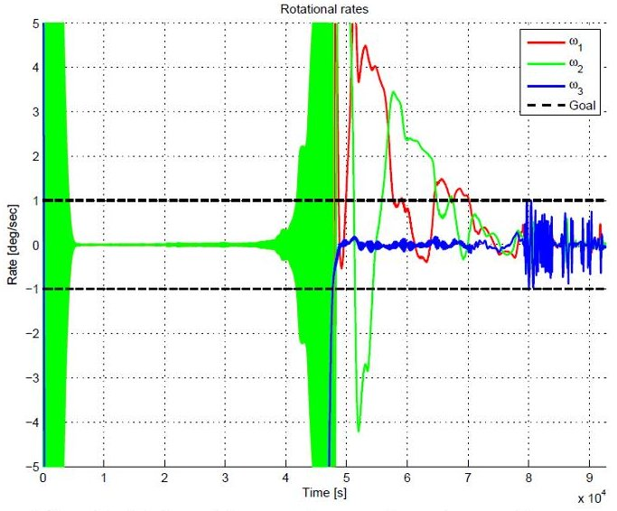
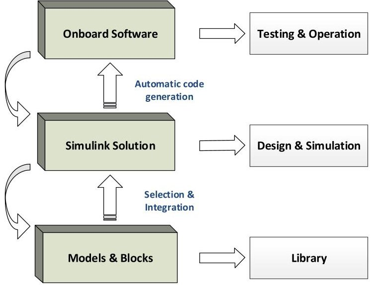
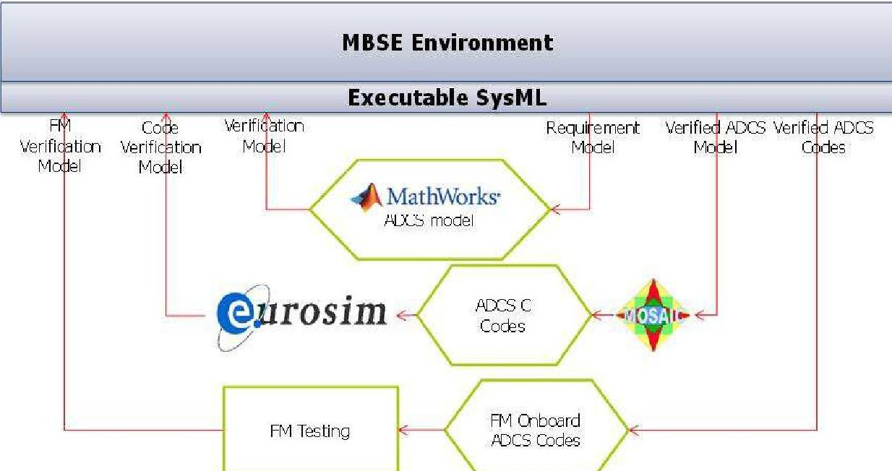

<!-- PDF_PAGE: 1 -->

IAC-14-D1.6.3

<div align="center">

# MODEL-BASED SYSTEMS ENGINEERING TO SUPPORT THE DEVELOPMENT OF NANO-SATELLITES

</div>

Delft University of Technology, The Netherland guo@tudelft.nl

Eberhard Gill Delft University of Technology, The Netherlands esk.a.gill@tudelft.nl

Stefano Figari

Delft University of Technology, The Netherlands stefano.figari.to@gmail.com

This paper presented a gap-filling methodology utilizing Model-Based Systems Engineering (MBSE) in support of nano-satellite development. Using a satellite mission as case study, this paper focuses two particular aspects of applying MBSE: requirements development and design validation, and their linkinboard software development. A collaborative MBSE workspa environment is provided. This workspace integrate discipline-specific models capable of performing aspects of the system definition. With proper construction of Simulink models and wrap-up of engineering model flight model of onboard software, this workspace allows a seamless integration of requirement development, design verification, code automatic generation and verification with high efficiency and quality.

## I. INTRODUCTION

DelFFi is of particular interest for this part of investigation.

In the recent decade, the advancement investigation. miniaturization and the revolutionary design philipsy The third part of the paper analyses the link between make nano-satellites a success story. However, the MBSE and the onboard software development of the systems engineering methodology point of view, nanoADCS. In early development phases, the ADCS models satellites are still following the (simplified) cure of are used mainly for running simulations to verify Document-Based Systems Engineering (DBSE) from design, while in later phases all the models and traditional space industry. The lack of alignmentalgorithms have to be coded on the ADCS processors. between innovative enabling technologies and Typically this is done by different engineers using traditional systems engineering methodology cardifferent development tools. In this paper a more procrastinate the further advancement of nanolistel efficient way is implemented: the ADCS models that

This paper aims at filling the aforementioned have been developed in Simulink for early stages of misalignment by utilizing Model-Based Systemsand verified using executable SysML are translated Engineering (MBSE) in support of nano-satellite automatically to hardware-independent C codes, which development. Using the DelFFi mission of the Delftare then integrated with low layers of ADCS onboard University of Technology (TUD) as a case study thi software. Using this approach, a bridge between MBS paper focuses on two particular aspects of applying and onboard software development is built up through MBSE: requirements development and designmodel sharing. The ADCS models developed earlier ca validation, and their link with onboard software be re-used, and the engineers can focus more on development. Developing the models rather than programming. A

The paper consists of three primary parts. The first benefit is the increase in quality of the second part is a brief introduction of MBSE and the System since the consistency of the simulation models Modelling Language (SysML, a representative tool onboard software is structurally assured.

MBSE). In the second part, a SysML template is

developed for the modelling of the DelFFi and theyw II. MBSE AND SYSML

that requirements are developed is illustrated. e This chapter provides background information about SysML description is completed, a specific simulati Model-Based Systems Engineering (MBSE) and the model is created in Simulink and linked through Systems Modelling Language (SysML, a representative executable SysML. The execution aims at validating tool of MBSE).

invalidating) the design by comparing it with

requirements automatically, and testing SysML's I.I MBSE

adaptability to perform this kind of studies. The attitude Determination and Control System (ADCS) design term that describes an approach to systems engineer

<!-- PDF_PAGE: 2 -->

in order to create a model as a central database to manage system complexity, an improved containing all information concerning the system to product quality, an enhanced knowledge capture and examined. The traditional systems engineering just reuse of information.

are adopted and combined with a visual modeling

language, which also serves as a lingua franca mon.II SysML

differet kinds of engineers, industries and stakeholders. Friedenthal et al. give the following definition of International Council on Systems EngineeringSysML: (INCOSE) gives the following definition "SysML is a general-purpose graphical modeling

(INCOSE) gives the following definition "SysML is a general-purpose graphical modeling "Model-Based Systems Engineering is thelanguage that supports the analysis, specification, formalized application of modeling to support syste design, verification, and validation of complexteys. requirements, design, analysis, verification, andThese systems may include hardware, software, data, validation activities beginning in the conceptual sign personnel, procedures, facilities, and other elements of phase and continuing throughout development and lat man-made and natural systems." life cycle phases." SysML provides a means to collect system

life cycle phases." SysML provides a means to collect system The largest projects have traditionally applied information. The modeling process can be performed document-based systems engineering approach that different ways accordingly with the particular method based on design documents and textual specification that is selected. Table 1 is a list of the commotivities hard-copy or electronic file format. Although very that are usually executed in SysML while designing rigorous, this approach has some important limitati system $ ^{2} $ . These activities are usually performed in an Since requirements, design, analysis and testerative process.

information are spread across several documents, it In SysML, the basic unit of structure is the block difficult to assess their consistency and completeness can be used to represent hardware, software, tfasili addition, it becomes difficult to perform the necessary personnel or any other system element. Blocks can traceability and to maintain or reuse system contain information e.g. properties, or can betelto requirements and design information for ulteriated other model elements such as activities, functions, system design. Instead, MBSE produces a systemlmodases, requirements and so on. Each model element c contained in a model repository, that enhances the connected to another element by means of relat ability to capture, analyze, share, and manage these elements and relations can then be shown by information associated with the complete specific means of diagrams. In Fig. 1 the SysML diagram of a product, resulting in benefits like improved taxonomy is reported. For details please refer to communications among stakeholders, an increased

<table border="1"><tr><td>Item</td><td>Specification</td></tr><tr><td>Capture and analyze black box system requirements</td><td>-Capture text-based requirements in a requirements management tool-Import requirements into the SysML modeling tool-Identify top-level functionality in terms of system use cases-Capture the traceability between the use cases requirements-Model the use case scenarios as activity diagrams sequence diagrams and/or state machine diagrams-Create the system context diagram-Identify system test cases to support systemification</td></tr><tr><td>Develop one or more candidate system architectures to satisfy the requirements</td><td>-Decompose the system using the block definition diagram-Define the interaction among the parts using variety of sequence diagrams-Define the interconnection among the parts using internal block diagram</td></tr><tr><td>Perform engineering and trade-off analysis to evaluate and select the preferred architecture</td><td>Capture the constraints on system properties using parametric diagram to support analysis of performance, reliability, cost, other critical properties-Perform the engineering analysis to determine targeted values of the system properties (typically done in separate emerging analysis tools)</td></tr><tr><td>Specify component requirements and their traceability to system requirements</td><td>-Capture the functional, interface, and performance requirements for each component (block) in the architecture-Trace component requirements to the system requests</td></tr><tr><td>Verify that the system design satisfies the requirements by executing system-level test cases</td><td></td></tr></table>

Table 1: List of activities used to specify andig the system

<!-- PDF_PAGE: 3 -->





<div align="center">

Fig. 1: SysML diagram taxonomy.

</div>

## III. REQUIREMENT DEVELOPMENT AND

## VERIFICATION WITH SYSML

One of the most important features enhanced by the usage of SysML is the capability to, in a more structured and transparent way, develop and verify requirements. In this chapter, this feature will be illustrated through a case study on the DelFFi nano satellite mission.

## III.I The DelFFi Mission

As part of the FP7 QB50 consortium, the Delft University of Technology participates to the QB50 mission by supplying two nano-satellites, called De and Phi, which form the space segment of the DelFFi mission.

Beside the scientific objective, the DelFFi mission aims at demonstrating autonomous formation flying between Delta and Phi. The control of the relative dynamics of the two CubeSats is meant to be autonomously achieved by means of various guidance, navigation and control technologies. The possibility to control the baseline between Delha a Phi, would allow the collection of atmospheric data such that temporal resolved measurements of the thermosphere could be obtained

The DelFFi mission can be described by means of the following mission statement:

The DelFFi mission shall demonstrate autonomous formation flying and provide enhanced scientific return within QB50 from 2015 onwards, by utilizing two identical triple-unit CubeSats of TU Delft which further advance the Delfi-n3Xt platform

Thus, the objectives to be met are:

- Demonstrate autonomous formation flying (AFF) using various Guidance, Navigation and Control (GNC) architectures.

- Facilitate students with hands-on experience and cutting-edge technology.

- Characterize low thermosphere with enhanced scientific return by using distributed observation on various geometric baselines.

The DelFFi mission will be further discussed and examined in the rest of this chapter, making use of System Modeling Language (SysML).

## III.II Requirement Development

For the case study of DelFFi, the following requirement stereotypes are created:

- Customer Need Statement

- Mission Option Mission Requirement

- Mission Requirement

- Mission Statement

- Study Design Driver

- Study Objective

- System Requirement

Most stereotypes are self-explained. The only exception is the 'Mission Option Mission Requirement' stereotype, which is assigned to requirements that change between missions where more options are considered.

Each stereotype is provided of the following attributes:

- id#, as a String

- Rationale, as a String

- Requirement Status, using EnumerationLiterals

- txt, as a String

<!-- PDF_PAGE: 4 -->

## III.II.I Mission Requirements

Mission requirements come from customer need and mission statement. The mission statement was already provided in Section III.I, while customer needs were derived from the general problem description using the process suggested by

- Derive customer need statement from customer input.

- Model customer need statement using the Customer Need Statement stereotype.

- Derive mission statements from customer need statement and customer input.

- Model mission statements as Mission Statement stereotype.

- Model relation between customer needs and mission statements.

- Verify customer need statement, mission statements and their relation.

- After identified the customer need and mission statement, as shown in Fig. 2, mission requirements can be derived with the following steps $ ^{5} $

- Derive mission requirements from Mission Statement.

- Derive mission requirements from Study Objectives.

- Model mission requirements in the 'Customer Need, Mission Statement and Mission Requirements' diagram.

- Provide title, text, rationale and status to the requirements.

- Repeat the applicable study objectives in the 'Customer Need, Mission Statement and Mission Requirements' diagram (Fig. 2).

- Model the relations between the mission requirements and the mission statement and study objectives.

- Store the requirements in the 'Requirements' package.

As it may be clear from Fig. 2, mission requirements represent a sort of bridge between two groups of requirements, characterized by a different level of specification: on one side there are missi statement and study objectives, on the other there are system requirements.

All requirements characterized by the Requirement Status 'Agreed' come from a preliminary analysis of the DelFFi mission made by All requirements denoted by the 'TBC' status instead, were created as the model was being developed. It means they are still to be confirmed by the custome or by other study participants.





<div align="center">

Fig. 2: 'Customer Need, Mission Statement and Miss Requirements' diagram.

</div>

<!-- PDF_PAGE: 5 -->

Since the diagram, to be complete and comprehensive, must contain a large number of items it may be difficult for the reader to have a cleav of it just by looking at Fig. 2. Furthermore, part of the relationships that each of the shown requirement actually owns, is displayed: the presen of additional information would further clutter the diagram indeed. These considerations hold for most of requirement diagrams. Thus, in order to have a complete overview of all features proper of every single requirement, SysML comes in help by allowing the automatic creation of a table containing all possible information. Due to page length constrain this table will not be introduced here.

## III.II.II System Requirement

System requirements are derived by means of the following sequence of suggested activities

- Drag-and-drop all mission requirements into the 'Requirements Overview' diagram (Fig. 3).

- Derive system requirements from mission requirements, Use Cases, system context diagram mission phases diagram and functional analysis.

- Model the system requirements in the 'Requirements Overview' diagram using the containment relation to the mission requirement.

- Provide Title, text, rational and status to the requirements.

- Model 'derived', 'trace', or 'Refine' relations when applicable in new requirements diagrams.

- Where possible, hyperlinks the new requirements diagrams.

Both the first and the second list of activities explains how to develop mission and system requirements, as well as how to properly model them by means of requirement diagrams.

As it can be observed from Fig. 3, most system requirements were modeled using the containment

relationship to the mission requirement they come from. Nevertheless, this guideline was followed when that relationship seemed to be the most proper one. As a matter of fact, some system requirements are not contained but are just derived from system requirements. Some other system requirements are not even directly traceable to mission requirements but are refinements of other system requirements instead. The reported work flow aims at being a general recipe indeed, but the way a relation is modeled, strongly depends upon the specific case. However, it was several times noticed that little difference was found between the use of, for instance a containment relationship, instead of a derive relationship. The trace relationship also appeared be suitable in some cases, but again without excluding other solutions. This ambiguity did not represent a problem though. In fact, way more important was considered the possibility to differentiate between levels of specification. Then be done both with containment relationships, and we derive or trace relationships.

In the 'Requirements Overview' diagram, it may be observed that some requirements do not generate lower level requirements. This happens for the study objectives focusing on the students involvement within the project, and for the 'Testing' requirement In the first case, it was decided to not investigate upon the way students could actively collaborate to the DelFFi mission development, since it would have led to matters not strictly concerning the actual DelFFi satellite definition. About the 'Testing' requirement instead, a proper testing architecture still to be defined, therefore any specificity can assigned yet. Other requirements not showing connections to lower level requirements were developed in dedicated diagrams.





<div align="center">

Fig. 3: 'Requirement overview' diagram.

</div>

```markdown

```

<!-- PDF_PAGE: 6 -->

The division of the requirements analysis across several different diagrams represented a 'must esi the presence of too many information in one single representation would have led to a very chaotic exposition. However, splitting the analysis in dedicated diagrams helped in focusing on specific aspects or subsystems. Thus, in order to successful develop requirements, a proper partitioning is high suggested. All relationships that cannot be directl shown, can still be depicted by means of compartments and callout notations. Furthermore, th Requirements Table can be consulted every time more information are to be probed.

## III.II.III Low Level Requirement

Once all high level system requirements are identified in the main requirements discovery the investigation moves on lower level system requirements. The suggested \citep{dorus} workflow for this task is reported below:

- Derive lower level requirements.

- Model the lower level requirements as containment in system level requirements.

- Create new requirements diagrams for the lower level requirements, hyperlinked to the system requirements.

- Proved Title, text, rationale and status for the requirements.

- Model 'derived', 'trace', or 'refine' relations when applicable in the new requirements diagrams.

- Model and references as Reference stereotype and add a trace relation where beneficial.

This sequence of activities will be the recipe adopted, from now on, to further develop requirements.

Lower level requirements will still be modeled as 'System Requirement' stereotypes, but they will be characterized by an Identifier proper of the suteys they refer to. For example, requirements relative t the 'Electrical Power Subsystem' will be designated with the 'EPS.#' Id.

Again, the selection of a 'containment' relatiopshi instead of another type of derivation, is not as suggested in the workflow.

- For the DelFFi case study, low level requirements of the following subsystems or domains are developed using SysML:

- Guidance, Navigation & Control (GNC)

- Attitude Determination and Control Subsystem (ADCS)

- Command & Data Handling Subsystem (CDHS)

- Electrical Power Subsystem (EPS)

- Communication Subsystem

- Structural Subsystem

- Propulsion Subsystem

- Thermal Subsystem

- Satellite Budgeting and CubeSat Specifications

- Ground Segment

- Launch & Orbit Segment

Since the interest of this paper is on ADCS, only the subsystem requirements of ADCS are shown in Fig. 4.

ADCS subsystem requirement ADCS-F.24 (in Fig. 4) is further developed in a dedicated discover tree (in Fig. 5). It states thatThe ADCS shall detumble the satellite from its deployment from the adaptor on the launch vehicle

It can be observed from Fig. 5 that Detumbling can be divided into two sub-requirements: 'Detumbling Control Mode' and 'Detumbling Goal'. The latter has particular importance, since it is so a precise goal to be accomplished. It says that initial rotational velocity shall be reduced from 10deg/s around each axis, to less than 1deg/sjnwith 1 day.

In the diagram it is possible to see that ADCSF.34 is connected to a constraint block by means of 'refine' relationship. This is the way SysML adopts indicate that a requirement can be analyzed executi parametric models. The constraint block contains a compartment reporting the equation used to call the simulation model. A note providing information useful in order to properly launch the simulation, which will be explained later on, is connected t block.

Similarly, low level requirement discovery trees for other ADCS modes, i.e. coarse sun pointing, fin sun pointing, ground station tracking and thruster pointing, are also developed in SysML.

## III.III Design Verification

So far, a SysML description of the DelFFi model has been proposed. Particular focus was dedicated how to develop requirements. In this section, some these requirements are actually used to check whether the satellite design complies with mission objective In particular, the ADCS design is to be investigate Therefore, a specific simulation model is created a linked with external tools through executable SysML The execution aims at validating (or invalidating design by comparing it with requirements. The purpose of this examination is twofold: actual validation of the design, and testing SysML adaptability to perform this kind of studies.

<!-- PDF_PAGE: 7 -->





<div align="center">

Fig. 5: Low level requirement discovery.

</div>

<!-- PDF_PAGE: 8 -->

## III.III.I Executable SysML Model

Executable SysML is realized with parametric diagram $ ^{3} $ . A parametric diagram is to be created inside the block it refers to. This means that all equation's input and output have to be properties a attributes of the owning block. Since many different variables were found to be influencing the outcome the simulation, and since it was not possible to directly associate all these quantities to a unique model element, an ad-hoc block was created. This block's name is 'ADCS4simulation', and it wraps all simulation variables and parameters.

The equation the constraint calls is not defined within the block itself, but it is defined in a MAAB script. Therefore, simulation's input and outputnu be connected to the constraint block that wraps the ADCS simulator. In SysML, this task can be accomplished in a straightforward way: mathematical equations, defined within constraint blocks, are connected to model's blocks by means of constraint properties, whose type is the required constraint block. Once all properties are defined, the paramet diagram can actually be drawn. The one used within the current examination can be observed in Fig. 6.





<div align="center">

Fig. 6: 'ADCS4simulation' parametric diagram.

</div>

<!-- PDF_PAGE: 9 -->

The yellowish block in the centre of the diagram is the ADCS4simulation's constraint property, which contains the constraint block that calls the simula

The Parameters block was created to contain simulation parameters like the step-size, the number of orbits to be simulated, and the specific mode in which to start the simulation. The latter will be used to differentiate among the three simulations needed demonstrate the five possible ADCS modes.

## III.III.II Model Instance

The model instance of the DelFFi satellite was created in the object diagram shown in Fig. 7.

Parametric relationships have been created, but the model cannot be executed yet. In fact, an most of the model shall be created, i.e., all blocks solved in the parametric analysis must be reproduced by means of instances, and actual numbers must be assigned to each attribute.

It may be seen that all eighteen blocks modelled in Fig. 7 are connected to the ADCS4simulation instance, i.e., to the block owning the parametric model.

For this examination, none variable was given ancillary causality, whilst to ElapsedTime was obviously assigned target causality.

In Fig. 7 it is possible to read the different numerical values that were associated with simulation input. They can be directly assigned on the diagram by double clicking each variable, or by means of the related property tab. Furthermore, a browser can al be exploited to quickly attribute numerical values variables before the simulation is launched.

## III.III.III SysML Driven ADCS Simulations

Once the SysML executable model is realized, the last step before implementing ADCS simulations from SysML is to link the simulation code. This can be done using commercial tools. In this study, ParaSolver $ ^{\mathrm{TM}} $ is used to create intermediate input and output files to communicate SysML instance values from the SysML tool Artisan Studio, and to transfer MATLAB results to SysML instance values (targets). Details about setting up the link between SysML and external simulator can be found in.

To automatically verify the ADCS design satisfy requirements, simulations are performed from SysML, aiming at investigating the satellite behavior in the five ADCS modes, i.e. detumble, coarse sun pointing, fine sun pointing, thruster pointing and ground station tracking. Here only the verification the detumble mode is presented.





<div align="center">

Fig. 7: Model instance of DelFFi.

</div>

<!-- PDF_PAGE: 10 -->

The requirement of interest behind this simulation obviously is ADCS-F.34 (see Fig. 5). An initial rotational rate of 10 degrees per second around eac axis is assigned, and a total of 15 orbits are listed.

Both in this simulation, and in all simulations not reported in this paper, noise as well as disturbance are considered. A step-size of two seconds is selected and the physical world updated every two seconds. As suggested by Fig. 7, 'mode0' is to be put equal 1.

The simulation is launched from the browser, the Matlab/Simulink model is called and computations are executed. In Fig. 8 the attitude behaviour of satellite is reported. At the very end of the maximum allowed time (1 day) for the goal to be accomplished the satellite seems to be correctly detumbled, indicating requirement ADCS-F.34 is satisfied. In SysML, this verification is actually implemented automatically by transferring MATLAB results to SysML instance values after the simulation and changing the "Requirement Status" of ADCS-F.34 from "TBC" to "Satisfied".





<div align="center">

Fig. 8: Detumble mode goal and results

</div>

## IV. MBSE AND ONBOARD SOFTWARE DEVELOPMENT

The study reported in Chapter 3 shows that the MBSE (represented here by SysML) can effectively support the requirement development and design verification in early phases of nano-satellite development. However, the capability of MBSE could be further explored by combining it with Model-Driven Engineering (MDE) for onboard software development.

## IV.I MDE and Onboard Software

In early development phases, the ADCS models are used mainly for running simulations to verify design, while in later phases all the models and algorithms have to be coded on the ADCS processors.

Typically this is done by different engineers using different development tools. However, MDE can efficiently solve this problem since it enables the development of on-board software directly from models (not only ADCS/GNC) and provides model reuse capability.

Model-based concepts have been adopted in the design processes of several missions. The Formation Control Testbed (FCT) of NASA's Jet Propulsion Laboratory is a system-level ground hardware testbe to simulate and demonstrate six degrees of freedom, autonomous formation flying and reconfiguration control architectures and algorithms The Swedish Space Corporation (SSC) has simulated the AOCS subsystem in a Matlab/Simulink environment for the SMART-1 moon probe, and produced a majority of the high-level on-board software using automatic code generation. Thereafter, in PRISMA FF space mission, numerical simulations have been conducted and the SSC further extended to incorporate the whole on-board software architecture in the Simulin environment $ ^{8} $ using Model-Based OnBoard SoftWare (MBOBSW) design method

TU Delft is now working at an even more flexible, scalable and user-friendly simulation platform, which verifies the MDE design strategy of developing and implementing the AOCS/GNC system for small satellite missions Taking DelFFi formation flying mission as a case study, this simulation platform is applicable covering the geos development and hardware-in-loop implementation of a set of two small satellites, for the full-scaletand validation of FF mission architectures and function

With this simulation platform, the design and development process for a specific mission can be outlined in Fig. 9, which indicates three major sta





<div align="center">

Fig. 9: MDE based design and development process

</div>

<!-- PDF_PAGE: 11 -->

## Stage 1 - Models & Blocks:

This is basically a set of libraries which collect the MATLAB/Simulink models, including the spacecraft hardware (sensors/actuators), kinematics dynamics, the space environment, as well as some generic functions and algorithms.

## Stage 2 - Simulink Solution:

Supported by the Models & Blocks libraries, the designers select sets of components and build up the whole closed-loop architecture in pure Matlab/Simulink environment as a solution to realize the system requirements.

## Stage 3 - Onboard Software:

If the Simulink Solution works well and the AOCS/GNC algorithms have been executed so far with desirable results in simulation, the C code be generated directly from an executable Simulink Solution. On this basis, the Onboard Software is ready for testing and after some necessary items will be the exact software running in operation. The seamless transition achieves efficiency by avoiding duplication of work. And a more reliable AOCS/GNC system can be expected because of the consistency structure and functionality through different development stages.

Since the design of the AOCS/GNC system regarding FF satellites can be quite complex and demanding, it is hardly the case that the selection of components and algorithms can meet the requirements all in one go. Additionally, the requirements coming from payloads or customers sometimes are not yet final.

The simulation platform makes it possible to quickly respond to the changes in requirements by generating a different configuration of the satellite taking advantage of its flexible and scalable

characteristics. To be more specific, this simulati platform enables the reuse or modification of model to generate new solutions during design work.

Once built up, the simulation solution is saved but still embraces changes in terms of adding new models, removing unnecessary models, modifying model parameters or even changing control algorithms. With a more straightforward structure i Simulink, these changes can be made quickly and a reliable new solution can be created efficiently to cope with the changes in top level requirements.

Iterations can also be conducted during the whole development process of a satellite, which means the AOCS/GNC design can also be reviewed concerning the whole satellite. Once the AOCS/GNC system is decided not to be optimum for the whole satellite changing only parts of its configuration and taking over the other parts it is possible to create new AOCS/GNC solutions very quickly and the results can be improved continuously.

Using the Model Driven development procedure defined above and the supporting simulation platform, the AOCS/GNC designer can reduce the time to design the system while an even more reliab outcome is guaranteed.

## IV.II Bridging MBSE and Onboard Software

From the case study of DelFFi, it can be observed that the key of both MBSE and MDE-based onboard software development is the model. Therefore a bridge between MBSE and onboard software development can be built up through model sharing. Fig. 10 shows an integrated environment that support requirement development, design verification, onboard software development and verification using the MBSE methodology.





<div align="center">

Fig. 10: Bringing MBSE and onboard software devept.

</div>

<!-- PDF_PAGE: 12 -->

Fig. 10 still uses ADCS as an example to illustrate the satellite delopment procedure from early design final system test. Three key steps are foreseen her

## Stage 1 - Requirement & Model Development:

In this step, detailed technical requirements are developed, and integrated system models including requirement model and ADCS models are built, as described in Chapter III of this paper. Since the construction of models is an iterative procedure might be several internal iterations within step each corresponding to an early development phase, i.e. Phase-A or B, with different level of details ofeth models. For each iteration, verification using SysM or executable SysML driven simulations shall be performed.

## Stage 2 - Onboard Software Development:

In this step, the ADCS models that have been developed as Simulink blocks for early stage phases and verified using executable SysML are translated automatically to hardware-independent C codes, which are then integrated with low layers of ADCS onboard software to perform Hardware-in-loop simulations. The output of this step is code verification model, which is then feedback into MBSE environment through executable SysML wrap-up for verification.

## Stage 2 - Flight Software Development:

In step 3, the verified ADCS C codes are put into the hardware Flight Model (FM) of the ADCS. Some modifications of lower layers of ADCS onboard software may be necessary, but the application laye especially the algorithms are kept same. The flight software of ADCS is then completed, after the verification linked with MBSE environment.

Using this three-step approach, The ADCS models developed earlier can be re-used, and the engineers can focus more on developing the models rather than programming. A second benefit is the increase in quality of the codes since the consistency of the simulation models and the onboard software is structurally assured. More importantly, this approa allows a seamless integration of systems engineer and onboard software development, which could significantly improve the development efficiency and quality of the product.

## VIII. CONCLUSIONS

This paper presented a gap-filling methodology of utilizing Model-Based Systems Engineering (MBSE) in support of nano-satellite development. Using the DelFFi mission of the Delft University of Technology (TUD) as a case study, this paper focuses on two particular aspects of applying MBSE: requirements development and design validation, and their link with onboard software development.

SysML is an appropriate tool to perform systems modeling activities. With respect to requirements management and development, SysML is retained to be a very well-suited tool.

The definition of guidelines associated to a welldefined template is observed to be of vital importa in order to apply the MBSE approach, and to actual make the model reusable.

SysML allows the modeler to customize the language by defining stereotypes that further characterize model elements. Stereotypes do not benefit of universality though, but they need to be reconsidered case by case.

Requirements traceability appeared to be very much improved. Cross-check examinations between the Requirements Table and requirement diagrams assured an overall consistency of the model, allgwi easily performing an excellent traceability.

A stronger collaboration between SysML experienced users and domain experts is highly suggested. This way, domain-specific SysML customization could be realized, and the use of the language promoted.

A collaborative MBSE workspace/environment is provided. This workspace integrates discipline-specific models capable of performing all aspects of the system definition. With proper construction of Simulink models and wrap-up of engineering model and flight model of onboard software, this workspace even allows a seamless integration of requirement development, model verification, code automatic generation and verification with high efficiency and quality.

## REFERENCES

1. INCOSE. Systems Engineering Vision 2020 INCOSE Technical Report, 2007.

2. Friedenthal, S., Moore, A. and Steiner, R. Practical Guide to SysML - The Systems Modeling Language Morgan Kaufmann Publishers, Inc., 2009.

3. Holt, J. SysML for Systems Engineering The Institution of Engineering and Technology, 2008.

4. Guo, J. and Gill, EDelFFi: Formation Flying of Two CubeSats for Technology, Education and Science International Journal of Space Science and Engineering, Vol.1, No.2, 2013.

5. de Lange, D., Guo, J. and de Koning, H. Applicability of SysML to the Early Definition Phase of Space Missions in a Concurrent Environment Complex Systems Design & Management, Springer Berlin Heidelberg, 2012.

<!-- PDF_PAGE: 13 -->

6. Regehr, M.W., Acikmese, A.B., Ahmed, A., et al. The Formation Control Testbed Proceedings of IEEE Aerospace Conference, 2004.

7. Bodin, P., Berge, S., Björk, M., et al. Development, Test and Flight of the SMART-1 Attitude and Orbit Control System AIAA Paper, 2005-5991.

8. Gill, E., Montenbruck, O. and D'Amico, S. Autonomous Satellite Formation Flying for the PRISMA Mission AIAA Journal of Spacecraft and Rockets, 44 No. 3: 671-681 (2007).

9. Olsson, T. and Edfors, AModel-Based Onboard Software Design: The Prisma Case Study AISA 2006-Data Systems in Aerospace, p. 43.1, Berlin, May 22-25, 2006.

10. Liu, X., Guo, J. and Gill, E.Towards ModelDriven Development of AOCS/GNC for Small Satellite Missions Proceedings of the 65 International Astronautical Congress, 2014.