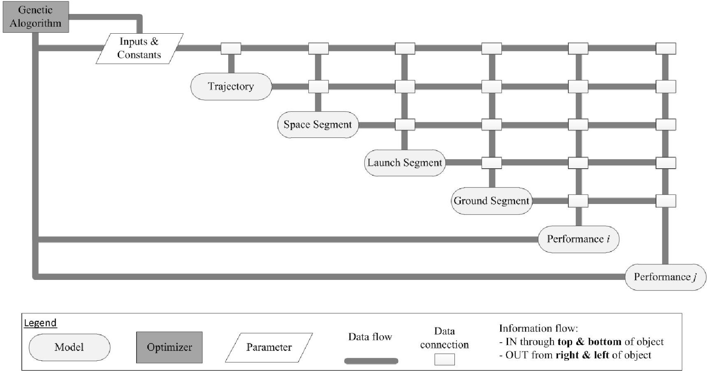
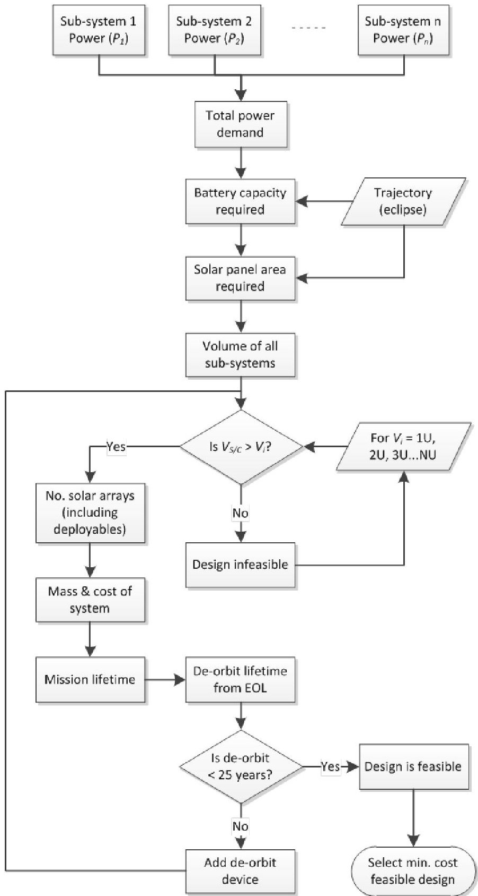
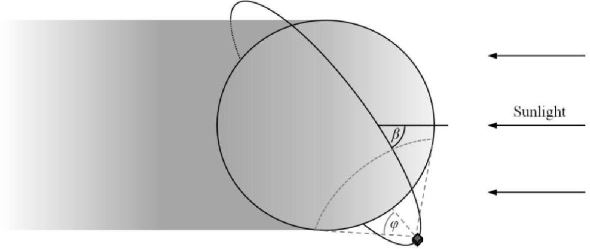
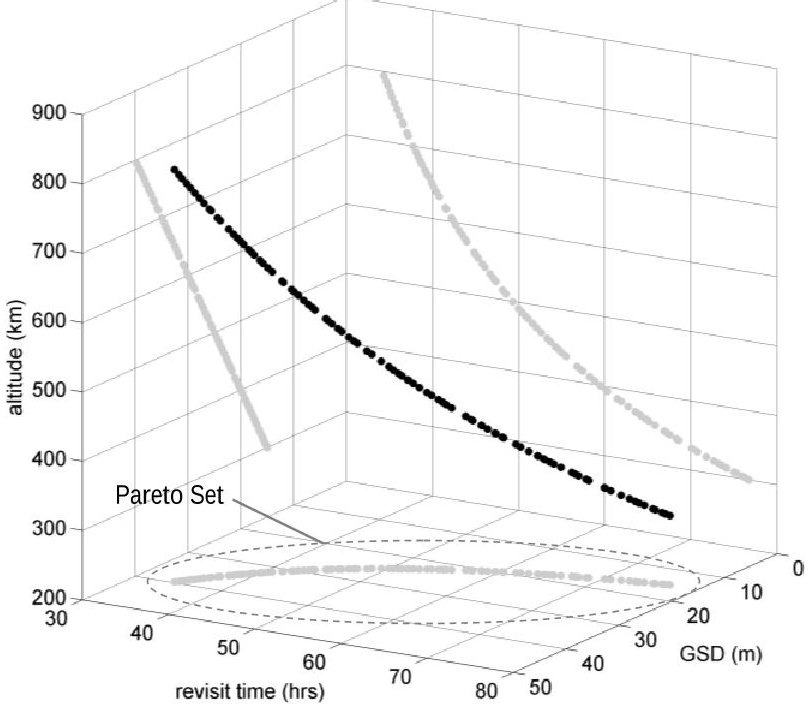
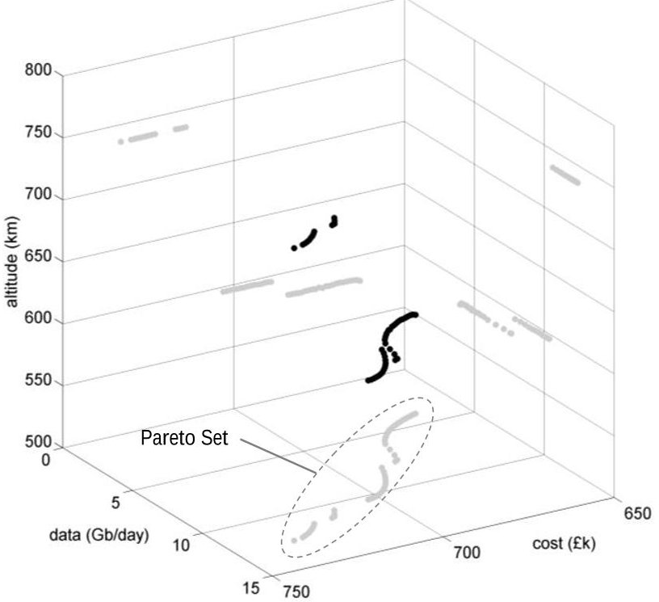
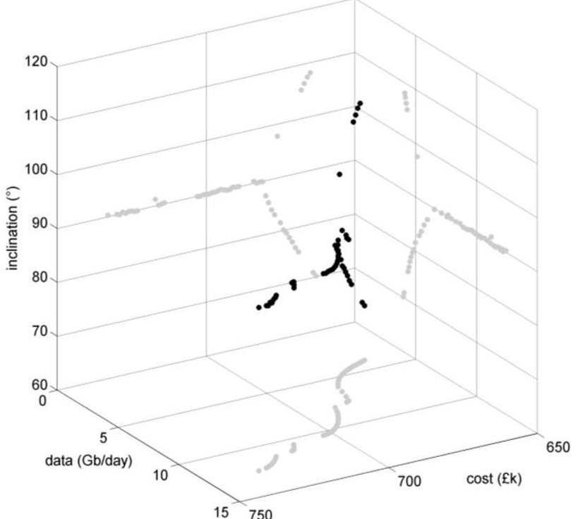
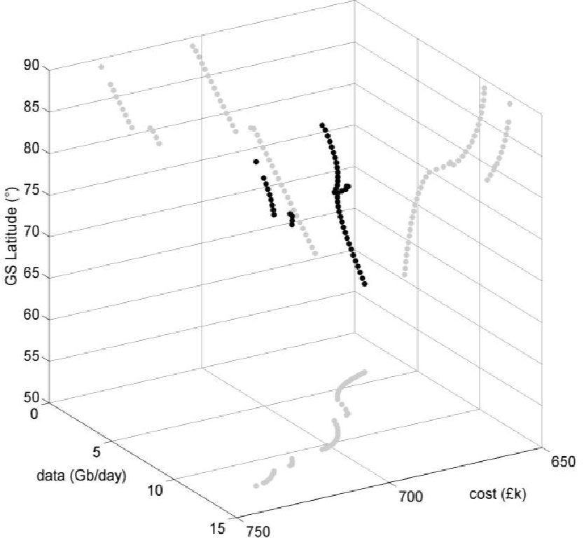

<!-- PDF_PAGE: 1 -->

# Rapid Model-based Inter-disciplinary Design of a CubeSat Mission

C. J. Lowe $ ^{*} $ , M. Macdonald $ ^{\dagger} $

Advanced Space Concepts Laboratory, Department of Mechanical and Aerospace Engineering University of Strathclyde, Glasgow, G1 1XJ, UK

With an increase in the use of small, modular, resource-limited satellites for Earth orbiting applications, the benefit to be had from a model-based architecture that rapidly searches the mission trade-space and identifies near-optimal designs is greater than ever. This work presents an architecture that identifies trends between conflicting objectives (e.g. lifecycle cost and performance) and decision variables (e.g. orbit altitude and inclination) such that informed assessment can be made as to which design/s to take on for further analysis. The models within the architecture exploit analytic methods where possible, in order avoid computationally expensive numerical propagation, and achieve rapid convergence. Two mission cases are studied; the first is an Earth observation satellite and presents a trade-off between ground sample distance and revisit time over a ground target, given altitude as the decision variable. The second is a satellite with a generic scientific payload and shows a more involved trade-off, between data return to a ground station and cost of the mission, given variations in the orbit altitude, inclination and ground station latitude. Results of each case are presented graphically and it is clear that non-intuitive results are captured that would typically be missed using traditional, point-design methods, where only discrete scenarios are examined.

Keywords: CubeSat; mission; optimization; LEO; mbse; trade-space

## 1. Introduction

The use of CubeSats for purposes other than education, such as scientific data collection [1][2][3], Earth observation (EO) [4][5][6][7] and communication [8][9][10][11] is becoming increasingly popular. As a result, the need to maximize performance and minimize cost is also increasing as commercial organizations tend toward the use of nano-satellites as a cost effective satellite solution. While simulation is commonplace for identifying mission performance, it is typically computationally expensive and applied on a case-by-case basis, enabling the analyst to develop an understanding of the range of solutions over time. A multitude of cost modeling

<!-- PDF_PAGE: 2 -->

approaches are widely available, including both bottom up and top down methods, but again are generally applied by the analyst manually, rather than integrated into an automated search. Once an acceptable mission design is identified during the conceptual/early design phase using this approach, design parameters tend to be held fixed throughout the remaining design life-cycle. A simple, dedicated method of directly relating cost and performance to key mission design parameters could significantly increase mission robustness, as resultant changes could be analyzed rapidly and the design modified appropriately. Incorporation of global, multi-objective optimization techniques would further benefit the process ensuring near-optimal solutions are carried forward.

Historically, mission design has been conducted by teams of systems engineers and domain specialists applying knowledge and experience to identify a feasible solution that will satisfy system demands. Whether an optimal, or even near-optimal, solution is found is not necessarily known since inter-domain trade studies are typically conducted in isolation due to the complexity of the problem at this top level. For traditional, large satellites, this is likely to be the situation for the foreseeable future as both the design space and solution space are complex and the relationship between the two is not deterministic (a large number of potentially very different system designs exist for any particular mission). This demands an iterative, expert-led process, as demonstrated successfully by concurrent engineering centers throughout the world. Some effort has been applied to exploiting methods in the field of multi-disciplinary design optimization [12], but it has seen little deployment into industry. Other point design approaches, such as design of experiments in the form of factorial design [13] and Taguchi methods [14] have been applied to the mission design problem, however knowledge of much of the solution space remains unclear due to the limited number of assessments made using this approach.

In order to search a larger proportion of the mission solution space and thus identify optimal mission designs, whilst still considering large numbers of design (input) variables, the computation time for calculation of performance and cost parameters must be reduced. This is a promising prospect for CubeSat-type platform because of their limited capability and modular design. Inherently, the number of design variables, in particular the number of discrete integer variables, is reduced, whilst still maintaining a good approximation of the performance metrics.

<!-- PDF_PAGE: 3 -->

Importantly, the general lack of time-periodic orbit properties such as repeat ground tracks allow for the use of long-term averaging methods, which cannot be accurately applied otherwise due to the inherent longitude-dependency associated with visibility statistics. This allows for rapid assessment of visibility characteristics between satellites and ground stations (GSs), which typically demands time consuming numerical propagations and thus rules out the opportunity to assess large numbers of mission options. A shift in the way mission analysis can be conducted for resource-limited Earth orbiting systems is presented, highlighting a move away from a masscentric view of the space segment [15] towards a multi-attribute, performance-centric view of the entire mission. Design solutions that may have been hidden from the designer searching the trade-space using expert knowledge and point design tools, may become available as a result, and a broader more complete view of the solution space is realized.

## 1.1. The Inter-disciplinary Design Problem

Generally, a space mission comprises multiple disciplines including, but not exclusively, an orbit trajectory, space segment (i.e. the satellite), ground segment and launch segment, with a set of inputs and requirements driving the design and a set of performance parameters characterizing mission success. The complex nature of a space mission means that each discipline is related to almost all of the others to a certain degree, such that none can be neglected if one is to truly optimize the mission as a whole. The order in which each discipline is solved, thus dictating which variables are of a dependent nature, is defined by the causality employed. A completely closed form system of equations can be considered acausal, such that any variable could be assigned as an input and any other as the unknown target to be solved. This type of system can be exploited using parametric analysis tools such as ParaMagic $ ^{\circledR} $ (for Magic Draw) and Solvea $ ^{\circledR} $ (for Enterprise Architecture), and is a powerful approach to conducting sensitivity analysis on a complex system. However for it to work successfully, all of the mathematical relationships must be in closed form such that they can be solved using symbolic mathematical engines, such as Mathematica $ ^{\circledR} $ . The Space Systems Working Group of the International Council on Systems Engineering are making developments in this particular field of research specifically on CubeSats [3][16]. In the present work, some of the relationships have a specific directionality

<!-- PDF_PAGE: 4 -->

and require iterative loops or other numerical methods to find a solution. As such, sequential programming is used to model the various disciplines, within the Matlab $ ^{\textcircled{R}} $ environment.

Since each space mission is unique, the model architecture introduced here cannot be completely generalized, however a baseline structure can be maintained with modifications of the inputs and requirements made for each use case. The general design structure matrix is shown in Figure 1, based on the graphical notation pioneered by Lambe and Martins [17]. A set of inputs, which includes the mission requirements, feeds each of the mission disciplines, from which one or more performance metrics are produced. An optimizer manipulates the inputs to the system in order to improve these performance parameters, as defined by the user. Lines emanating from the right of the segments along the main diagonal represent outputs which can be passed to segments further down the chain, while lines entering the top & bottom represent inputs. Depending on the level of fidelity and/or rigidity of the analysis, certain links between disciplines may be neglected. For example a specific launch may be pre-defined for the mission such that the launch segment block becomes independent from the space and trajectory blocks and no link between them is required.

Fig.1. Design Structure Matrix

<!-- PDF_PAGE: 5 -->

## 1.2. Case Studies

In order to illustrate some of the capabilities and flexibility of the proposed methodology, two case studies are analyzed which represent typical CubeSat applications. It should be noted that it is beyond the scope of this work to demonstrate complete novel mission solutions, but is instead aiming to introduce a design approach.

## 1.2.1. Case I: Earth Observation Payload

Earth observation (EO) is, and promises to be, one of the most widely applied disciplines for CubeSats due to the low cost, responsive solution they offer to capturing valuable image data. This case study features a mission involving an optical payload with a 10cm focal length, 9cm aperture and $ 5 \mu\mathrm{m}^{2} $ detector pixel size. The objectives are two-fold; minimizing the ground sample distance $ ^{4} $ (GSD) and minimizing the average revisit gap time $ ^{5} $ over an arbitrary point at the lower latitude of the UK mainland $ (50^{\circ}). $ The decision variable is orbit altitude (300km-800km) and a Sun-synchronous orbit requirement is imposed.

## 1.2.2. Case II: Scientific Payload

The second case study involves a payload that collects scientific data at a constant rate over the mission lifetime, with the objectives of maximizing the return of data to the ground and minimizing mission cost. Decision variables include orbit altitude (300km-1000km), orbit inclination $ ( 6 0^{\circ}-1 2 0^{\circ} ) $ and GS latitude $ ( 0^{\circ}-8 9^{\circ} )^{6}. $

## 2. Methods

Within this section, the methods used to model each mission discipline are introduced and justified in the case of a CubeSat mission architecture. The optimization approach is also introduced.

## 2.1. Orbit Trajectory

The orbit around which a satellite flies generally has a significant impact on performance of the mission. It affects such top-level parameters as ground site visibility, eclipse duration, communication link distance and mission lifetime and is therefore an ideal candidate for input to the system. Since this work considers only long-term averages with respect to orbit trajectory, the position variables (right ascension of ascending node and true anomaly) remain undefined. Furthermore, only circular orbits are considered such that

<!-- PDF_PAGE: 6 -->

eccentricity and argument of perigee are also undefined. As such, altitude and inclination are the remaining variables, which are used to examine ground station coverage via analytical methods, described in detail in section 3.1.2.

## 2.2. Space Segment

The CubeSat is a specific class of Nano-satellite (mass range between 1kg and 10kg), for which an internationally recognized standard [18] provides design guidelines, on such elements as geometry, materials and mechanical and electrical interfaces. Size of a CubeSat is defined in discrete intervals, built up of one or more units (U), including half units, which are 10cm x 10cm x 10cm in form. CubeSats have grown in popularity over recent years, in particular within the University and research fields, due in part to the abundance of Off-The-Shelf (OTS) components/sub-systems available for the platform, but also because of the low cost (often free-of-charge [19]) launch opportunities afforded as a secondary payload. The current boom in CubeSat popularity is helping to accelerate development of the available technology making commercial application of this platform type more attractive.

## 2.3. Launch Segment

The launch segment of any space mission, CubeSat included, is inherently difficult to generalize since many of the elements involved are mission-specific, stochastic in terms of quantities and highly dynamic with respect to schedule. Options for CubeSat launches range from fully funded, government-based initiatives such as NASA's Educational Launch of Nano-satellites (ELaNa) program [19] to secondary payloads on vehicles such as the Dnepr, which was advertised at $30k per 1U CubeSat (in 2001) [20] and $325k for a dedicated 3U CubeSat launch (as of January 2014) through Spaceflight Incorporated [21]. Other launches range from $12k per kg (to 310km altitude) with Interorbital Systems [22] to Quantum Research International being commissioned by NASA to provide access to low Earth orbit (LEO) with 24 hours' notice for no more than $1M [23]. Owing to the complexity and risk associated with incorporating CubeSats as secondary payloads, the "piggy-back" approach is falling out of favor with many primary payload teams. As a result, the concept of a dedicated nano launch vehicle is gaining an increased amount of attention from the space community [23]. Indeed, the NASA Launch Services Enabling eXploration & Technology (NEXT) program [24] aims to place three 3U (three unit) CubeSats into a near polar, sun-synchronous orbit at a cost of $300k per platform. In order to maximize applicability for the future and remove dependency on primary payload orbit demands, this study will assume use of a dedicated launch vehicle.

<!-- PDF_PAGE: 7 -->

## 2.4. Ground Segment

A typical CubeSat communicates on one of three frequencies; VHF (130MHz-150MHz, 1.2kbps), UHF (420MHz-450MHz, 9.6kbps) or S-band (2.2GHz-2.5GHz, <2Mbps), with X-band systems employed in recent operations [4] and receiving significant attention for future application [25][9]. In order to support this type of system for relatively low data-rates (<1Mbps), it is possible to locate GSs at bespoke sites convenient to the user, such as on top of buildings in cities. High data-rates (<100Mbps, via X-band) are possible with larger antennae located at dedicated tracking and command centers. It is considered that whilst convenience may drive GS location for low-cost educational CubeSat missions, as applications become more complex and capabilities increase, placement/selection of GSs at new locations could mean the difference between success and failure of a mission. This is likely to be of particular relevance to commercial systems, where the up-stream cost of GS implementation is significantly outweighed by the potential financial return.

## 2.5. Multi-Objective Global Optimization

Previous attempts to apply optimization at the space mission level have been successful with single, often cost-centric, objectives [12]. However, it is clear that other objectives should be incorporated, which may suffer following successful minimization of the cost metric if a truly optimal solution is to be found. Successful examples of system-level optimization exist [26], but they do not generally consider performance/cost impact on the overall mission, which could reflect non-intuitive, and indeed variable, relationships with system design parameters at different mission design points. Owing to the complex nature of the problem at hand, with characteristics of a highly discontinuous solution space with many local minima, potential for mixed-integer constraints and a large number of input variables, evolutionary algorithms are considered necessary. In order to achieve this, a controlled elitist (variant of type 2 non-dominated sorting genetic algorithm, NSGA-II) Multi-Objective Genetic Algorithm (MOGA) is employed $ ^{7} $ . The nature of heuristic approaches in terms of finding only near-optimal solutions is considered acceptable in this study, since even a near-optimal solution may present vast improvements over a solution obtained through engineering judgment and point design alone.

A general multi-objective problem can be described as the problem of finding "a vector of decision variables (x) which satisfies constraints and optimizes a vector function whose elements represent the objective functions (f)” [27], where

<!-- PDF_PAGE: 8 -->

$$
\boldsymbol {x} = \left[ x _ {1}, x _ {2}, \dots , x _ {n} \right] ^ {T}
$$

$$
\boldsymbol {f} (\boldsymbol {x}) = \left[ f _ {1} (\boldsymbol {x}), f _ {2} (\boldsymbol {x}), \dots , f _ {m} (\boldsymbol {x}) \right] ^ {T}.
$$

Objectives will tend to conflict (e.g. performance and cost) such that a range of optimal solutions can exist, forming a Pareto set. The dimension of the Pareto set is equal to the number of objective functions for which the problem is defined.

## 3. Theory & Calculations

The following sections describe the model architecture in more detail, including the space, launch, ground and performance disciplines.

## 3.1. Space System Design

The approach to space system design is summarized by the process described in Figure 2, whereby the most suitable CubeSat platform is selected based on compliance with mission requirements and minimum cost. This is of course specific to CubeSat applications and would require modification in order to be applied successfully to other platform types.

The platform selection can often be non-trivial, such that a fully laden 2U CubeSat in need of a de-orbit device may be more costly than a sparsely packed 3U CubeSat which can decay in an acceptable time without such a device. The lowest cost system is selected as the one to take forward in the model. The following sections provide further detail into some of the more involved space segment design elements.

## 3.1.1. Mass, Volume, Power and Cost

The mass, volume, power and cost of the platform are calculated as a sum of these parameters for each sub-system. Sub-system selection is made based on either mission requirements (e.g. a 3-axis attitude determination and control system would be selected should a pointing demand from the payload/communication system demand it) or as a function of other dependent variables (i.e. power demand and eclipse conditions will drive the battery size), from a database of OTS components, taken from various on-line sources [28][29][30].

<!-- PDF_PAGE: 9 -->

Fig. 2. Space segment design process (each rectangular block represents a calculation or process)

## 3.1.2. Communication Power Demand

Operation of the communication system is dependent on whether a suitable GS is in view for transmission, which is a function of the GS location and orbital parameters. In order to calculate the duty

<!-- PDF_PAGE: 10 -->

cycle for this equipment, the view period ratio $ (\rho) $ , defined in [31] is exploited, providing the fraction of time a satellite is in view of a GS. For multiple $ (p) $ GSs, the transmission duty cycle $ (DC_{transmit}) $ is

$$
D C _ {t r a n s m i t} = \sum_ {k = 1} ^ {p} \rho_ {k} \alpha_ {k}
$$

where $ \alpha $ is the availability fraction of $ G S_{k} $ (proportion of time available for communication), taken as 0.9 in this work. This approximation assumes no GS mask overlap (i.e. the satellite is never in view of more than one GS), a constant orbit period over the lifetime and operation of the communication system every time a GS is in view, accounting for the availability fraction $ (\alpha) $ , irrespective of eclipse. If transmission during eclipse is forbidden, as is often the case due to the significant power demand from such a sub-system, then multiplication of this parameter by the fraction of the orbit spent in eclipse would provide a sufficient modification. The nominal communication system power demand can therefore be approximated as

$$
P _ {c o m m} = D C _ {t r a n s m i t} P _ {t r a n s m i t} + P _ {r e c e i v e}
$$

where $ P_{transmit} $ and $ P_{receive} $ are transmit and receive power demands, respectively.

## 3.1.3. Battery Sizing

Battery capacity can be analytically approximated as a function of the power demand during eclipse $ ( P_{eclipse} ) $ , eclipse duration $ ( \tau_{eclipse} ) $ (worst case over the lifetime), charging efficiency $ ( \eta_{charge} ) $ , depth of discharge (DOD) and a safety factor accounting for degradation effects over the lifetime $ ( S F_{bat} ) $ [32]

$$
E _ {b a t} = \frac {S F _ {b a t} P _ {e l i p s e} \tau_ {e l i p s e}}{\eta_ {c h a r g e} D O D}.
$$

Since eclipse duration is generally variable over the mission lifetime $ ^{8} $ due to relative motion between the orbit plane and the Earth-Sun line, the required capacity should be calculated based on the worst case

<!-- PDF_PAGE: 11 -->

(longest eclipse) conditions. The eclipse period can be found as a function of beta angle $ \beta=\angle $ between the orbit plane and Earth-Sun vector), and is at a minimum when $ \beta $ is at a minimum. This is illustrated in Figure 3and defined in equations (6) and (7)

Fig. 3. Eclipse scenario for LEO

$$
\phi = 2 \cos^ {- 1} \frac {\cos \varphi}{\cos \beta}
$$

$$
\tau_ {e c l i p s e} = \frac {\tau \phi}{2 \pi}
$$

where $ \varphi $ is the angular radius of the Earth as seen from the satellite [33] and $ \tau $ is the satellite circular orbit period. The battery capacity calculated in equation (5) is the minimum required to satisfy the demands from the platform, so the battery device would be a discrete size available that exceeds this.

## 3.1.4. Solar Array Selection

The average effective area of solar arrays projected toward the Sun $ ( A_{array,proj} ) $ , required to satisfy power demands from sub-systems during the sunlit period $ ( P_{sun} ) $ and battery charging $ ( P_{charge} ) $ , can be defined as [33]:

$$
A _ {a r r a y, p r o j} = \frac {P _ {s u n} + P _ {c h a r g e}}{S \eta_ {c e l l} \eta_ {p a c k} (1 - D) ^ {L}}
$$

<!-- PDF_PAGE: 12 -->

where S is the solar flux at the Earth $ (1 3 6 6 \mathrm{W m}^{-2}) $ $ [3 4]^{9} $ $ \eta_{cell} $ is the solar cell energy conversion efficiency, $ \eta_{pack} $ is the cell packing efficiency, D is the cell degradation due to radiation and other lifetime effects ( $ \sim2. 7 5 \% $ /year [33]) and L is the nominal lifetime (in years). The power required to recharge the battery following eclipse is

$$
P _ {c h a r g e} = \frac {P _ {e c l i p s e} \tau_ {e c l i p s e}}{\tau_ {s u n} \eta_ {b a t}}
$$

where $ \eta_{bat} $ is the total efficiency of the path between the solar array and battery (including charge regulator efficiency). For a large, traditional satellite, the projected area found using equation (8) can generally be directly translated into a solar panel size, assuming some maximum expected angle of incidence given active control of array orientation. For small satellites however, this is typically not the case since solar array pointing mechanisms are generally not employed. As such, the cell area required to meet requirements must be mapped to a total cell area on the satellite, calculated as a function of the average solar cell fraction effectively collecting sunlight energy over the lifetime (henceforth referred to as cell utility). The drivers behind the utility value are attitude scheme (e.g. a sun tracking satellite would require significantly less cell area than a tumbling satellite), solar panel deployment configuration and $ \beta $ -angle. The problem is complicated further as the number of deployed solar panels increases, due to a greater effect from shading. A study to find the optimal solar panel deployment configuration (to maximize average energy collection over the mission lifetime) has been conducted [35], which shows an average cell utility of more than 27% is possible for a system with between 2 and 4 deployed arrays in a Sun-variable attitude scheme (i.e. the Sun position unit-vector in the satellite body frame, $ \hat{r}_{sun}^{body} $ , is time-variant). This utility is seen to reach a low of $ \sim15\% $ at specific beta angles for systems with only body-mounted cells, which will therefore be used as a conservative estimate in this work. For constant relative Sun-position attitude schemes (Sun pointing), 95% of the total area shall be assumed effective.to account for some error in attitude pointing.

<!-- PDF_PAGE: 13 -->

$$
A _ {a r r a y, t o t a l} = \left\{ \begin{array}{l l} \frac {A _ {a r r a y , p r o j}}{0. 1 5} & \forall \hat {r} _ {s u n} ^ {b o d y} = f (t) \\ \frac {A _ {a r r a y , p r o j}}{0. 9 5} & \forall \hat {r} _ {s u n} ^ {b o d y} \neq f (t) \end{array} \right..
$$

Depending on the CubeSat volume in question $ ( V_{U}=1\mathrm{U},2\mathrm{U},3\mathrm{U}\dots $ etc.), conversion of the required solar array area $ ( A_{array,total} ) $ into a discrete set of body mounted and deployed arrays will vary. The process is generalized in Eq. (11), whereby it is assumed 4 body-mounted arrays are available and 8 deployed arrays are available (4 panels with cells on both sides),

$$
n _ {a r r a y s} = \left\lceil \frac {A _ {a r r a y , t o t a l}}{0 . 0 1 V _ {U}} \right\rceil .
$$

## 3.1.5. De-orbit Device Selection

The requirement to include a de-orbit device is generally difficult to confirm, given large variability of atmospheric density with variation in both altitude and time [36], uncertainty in satellite drag coefficient and uncertainty in the body's uncontrolled attitude relative to the incoming flow. However, in order to identify general trends, some assumptions are made which allow analytical approximations for the orbit decay time to be used. The basic approach is based on the fit of a power curve to the international standard atmosphere to get an analytical relationship between density and altitude between 150km and 1000km [37]. From this, it is possible to find the decay time $ \left(t_{d}\right) $ as a function of initial $ \left(r_{i}\right) $ and final $ \left(r_{f}\right) $ orbit radii

$$
t _ {d} = \frac {M}{C _ {D} A \Lambda \sqrt {\mu R _ {E}}} \frac {\left[ \left(r _ {i} - R _ {E}\right) ^ {(1 + \gamma)} - \left(r _ {f} - R _ {E}\right) ^ {(1 + \gamma)} \right]}{1 0 0 0 ^ {\gamma} (1 + \gamma)}
$$

where M is the satellite mass, A is the average cross sectional area projected in the velocity direction, $ \mu $ is the Earth gravitational parameter, $ R_{E} $ is the Earth radius (6371km), and $ \gamma $ and $ \Lambda $ are non-dimensional constants from the curve-fit, which take the values of 7.201 and 107 respectively.

Given a beginning of life orbit radius and a minimum orbit radius considered acceptable for successful operations, the natural decay time can be calculated. The lifetime of the mission is then the minimum of the natural decay time and the nominal lifetime. A minimum acceptable mission lifetime can also be imposed

<!-- PDF_PAGE: 14 -->

to avoid unacceptably low altitude solutions being considered in the optimization. A penalty function is applied in this case to remove the solution from the Pareto set.

Compliance with the Inter-Agency Space Debris Coordination Committee 25 year de-orbit time recommendation [38] can then be assessed and if non-compliant, a de-orbit device can be added to the system. In this work, the Aerodynamic End Of Life De-Orbit System (AEOLDOS) is used as the baseline de-orbit device, which can have either a $ 1.5\mathrm{m}^{2} $ or $ 3.0\mathrm{m}^{2} $ cross-sectional area when deployed, depending on system demand. A drag coefficient of 2.1 is used throughout this work for all configurations, but an alternative could be easily applied if better knowledge of the system's aerodynamic behavior exists.

## 3.2. Launch Segment

As discussed in section 2.3, this study assumes a dedicated launch vehicle is used to inject platforms into LEO. The cost of launching a CubeSat into a dedicated LEO is $325k, which shall be used as the baseline cost （ $ Claunch ） throughout this study.

## 3.3. Ground Segment

Historically, communication with CubeSats has been achieved via a mixture of pre-existing GSs and bespoke, custom built GSs. For the former, only an operational cost exists which is dependent on the lifetime of the satellite, whereas the latter requires a set-up cost also. A VHF/UHF or S-band only system will incur an upfront cost of $35k, while a VHF/UHF/S-band system will be $45k [39]. Furthermore, due to remoteness of the upper latitude, it is assumed that the setup cost of a GS will increase by $1k per degree of latitude greater than $60 $ north such that a VHF/UHF/S-band station at $80 $ will cost $65k. Operational costs of using a GS are generally calculated on a mission-by-mission basis, depending on the type of customer, level of involvement from the GS team, whether day and/or night contact is required and communication frequency band. For the purposes of this study, a cost per hour $ \dot{C}_{gsOps} $ shall be applied to each GS such that orbit-GS combinations with high levels of visibility, and hence greater contact performance, shall experience greater operational costs. Furthermore, it is assumed that remote control of ground station equipment is possible, enabling latitude-independence of the cost-per-hour metric. The GS operations cost can therefore be formulated as

$$
C _ {g s O p s} = L \rho_ {g s} \dot {C} _ {g s O p s},
$$

<!-- PDF_PAGE: 15 -->

where $ \rho_{gs} $ is the visibility view period ratio over a particular GS and L is the mission lifetime. The total cost of the ground segment, comprising a total of p GSs, is

$$
C _ {g r o u n d} = S F _ {C g r o u n d} \sum_ {k = 1} ^ {p} \left(C _ {g s S e t u p, k} + C _ {g s O p s, k}\right).
$$

A safety factor of 1.2 shall be applied in this study, but can be modified depending on confidence levels.

## 3.4. Measure of Performance

The measure of performance used to quantify success of a mission is highly dependent on the mission objectives, and as such cannot be generalized. For the majority of CubeSat systems, the return of scientific/observation data to a user on the ground could be considered a common metric, however area coverage must also be considered for a surveillance satellite, or perhaps lifetime for a system being deployed gradually over the long term. Mission cost is always likely to be a major factor of whether a mission is feasible and successful, especially for commercial applications, however for a relatively narrow design-space cost may not vary significantly and as such may be ignored as part of the trade study.

For the first mission case (EO payload), target revisit rate and GSD will be considered, while for the second mission case (scientific payload), rate of data returned to ground and mission cost will be the measures of performance.

## 3.4.1. Mission Cost

Costing of a space mission is a very complex problem with many variables including recurring and non-recurring costs, dependency on design complexity, lifetime effects on operations cost and economic phenomena such as inflation. Because of this the cost metric defined here is not intended as a final price estimate, but as a measure with which to compare the relative cost of different designs. The total mission cost is calculated as

$$
C _ {m i s s i o n} = C _ {s p a c e} + C _ {l a u n c h} + C _ {g r o u n d}.
$$

<!-- PDF_PAGE: 16 -->

## 3.4.2. Data Return Rate

Data return rate $ \dot{Q}_{ret} $ of a system can be defined as the sum of the average daily data return of useful payload data. This can be further defined as the minimum limit of either the data collection or data download, as

$$
\dot {Q} _ {r e t} = \min \left(\sum_ {i = 1} ^ {m} \dot {q} _ {i} ^ {u p} T _ {i} \alpha_ {i}, \sum_ {j = 1} ^ {n} \sum_ {k = 1} ^ {p} \dot {q} _ {j k} ^ {d o w n} T _ {j k} \alpha_ {j k}\right)
$$

where $ \dot{q} $ is the data transfer rate from each sub-system, of which there are m that perform upload (e.g. multiple payloads each collecting information) and n that perform download (e.g. VHF/UHF and S-band transmitters) to p GSs, T represents the fraction of time in view of a target over which payload data can be collected/transferred, applicable to the sub-system, i or j, and $ \alpha $ is the average proportion of total time that the GS/target is available for use by the satellite. Effectively, Eq. (16) states that if the maximum possible data collection exceeds the maximum possible data transmission, the return rate equates to the transmission rate, and vice versa. This linear approach to data return assumes that while a target is visible to an agent (be it a payload target or a GS), data transfer is conducted at a constant rate, which is considered acceptable for the current state of CubeSat hardware. While variable rate communication systems are receiving attention, and are even being implemented on some platforms [3], they are not standard practice and the proposed approach is thus considered representative.

For this study, given the generally accepted low downlink data-rate potential from a CubeSat and the relatively short, infrequent pass duration with GSs, it shall be assumed that download of data is always the limit of the system (i.e. upload via the payload always exceeds download potential) such that Eq. (16) can be simplified to

$$
\dot {Q} _ {r e t} = \sum_ {j = 1} ^ {n} \sum_ {k = 1} ^ {p} \dot {q} _ {j k} ^ {d o w n} T _ {j k} \alpha_ {j k}.
$$

Typically, the time in which a satellite is in view of a target on the ground is found numerically, via long term orbit propagation and assessing change in a visibility function over the simulation timespan. This can be computationally expensive, especially for the case of multiple satellites and multiple GSs, which

<!-- PDF_PAGE: 17 -->

impedes the rapid focus of this methodology. The combination of two analytical methods resolves this issue for near-circular, non-repeating ground-track orbits, assumptions which are considered acceptable for the majority of CubeSat applications. The first of these methods is a solution to the long-term visibility ratio, presented by Lo [31]. A definite integral was presented that when solved provides the view period ratio (fraction of time in which a GS is visible to a satellite), given the latitude of the GS, orbit inclination, orbit altitude and minimum visibility elevation above the horizon. This work has been extended by both Lo [40] and Ming and Shi-Jie [41] to include visibility statistics from elliptical orbits, however this is considered beyond the scope of the current work. The second enabling method was pioneered by Burk [42], which provides a closed-form expression for GS visibility frequency per day, or passes per day (PPD). This is again a function of GS latitude, inclination, altitude and minimum elevation.

In isolation, the methods presented by Lo and Burk provide interesting results, but offer significantly more information when combined. In particular, neither provides an approximation of the average pass duration, which is important to the communication characteristics of a satellite to a GS. Through combination of the methods, it is possible to obtain an estimate of total time in view of a GS, average pass duration and average visibility frequency. Perhaps a medium altitude satellite may be in view of a ground site for an average of 1 hour per day, but achieve all of this in a single pass, whereas a satellite in LEO with the same total daily pass duration might accumulate this contact time over 5 or 6 shorter passes. Finally, accounting for time at the start and end of a pass required for operations other than payload data transfer, $ ( t_{noData} ) $ , it is possible to calculate the useful contact time

$$
T = \rho - \frac {2 P P D t _ {n o D a t a}}{8 6 4 0 0}.
$$

A system characterized by many short passes over the GSs is therefore more susceptible to losses from initialization and close-out routines than one with fewer, longer passes.

## 3.4.3. Ground Sample Distance

GSD, or image resolution, is a measure commonly applied to EO payloads as it defines the effectiveness of the system to identify objects on the ground. GSD is a function of the distance from the target (S), which for a nadir-pointing payload will be the orbit altitude, the pixel size $ (\Delta l) $ and the focal length (F),

$$
G S D = \frac {S \Delta l}{F}.
$$

<!-- PDF_PAGE: 18 -->

It is recognized that a theoretical physical limit applies to the GSD in the form of the Rayleigh criterion, which represents the minimum acceptable pixel size $ \theta_{R} $ to achieve the resolution specified. It is a function of focal length, wavelength $ ^{10} $ $ \lambda=700nm $ and aperture (D), which for a standard optics arrangement on board a CubeSat is considered $ \leq 9 $ cm [7],

$$
\theta_ {R} = 2. 4 4 \frac {F \lambda}{D}.
$$

Should the pixel size be less than this limit, a penalty function shall be applied to the GSD, effectively moving the solution far away from the Pareto set.

## 3.4.4. Revisit Gap

The average amount of time between two sightings of a particular target on the ground can be approximated using the PPD method introduced earlier for calculating data return rate (§3.4.2). Whilst in reality, the revisit rate may vary between one orbit to many weeks, which can only be found accurately with numerical methods, the long term average gap length $ ( t_{gap} ) $ , in hours, can be approximated as

$$
t _ {g a p} = \frac {2 4}{P P D}.
$$

Since the minimum elevation angle considered acceptable for a visible imaging payload is relatively high ( $ \sim 6 0^{\circ} $ ) compared to typical communication elevation angles $ (0^{\circ}-1 0^{\circ}) $ , the pass durations will be short in LEO (on the order of seconds) such that this can be neglected from the calculation.

## 3.5. Problem Formulation

## 3.5.1. Case I: Earth Observation Payload

The first mission case can be defined using the two objectives for ground sample distance （GSD）and revisit time （ $ t_{gap} $ ）,where the aim is to

<!-- PDF_PAGE: 19 -->

$$
\min \{G S D \}
$$

$$
\min \left\{t _ {g a p} \right\}
$$

subject to the decision variables in Table 1.

<table border="1"><tr><td>Variable</td><td>Lower Bound</td><td>Upper Bound</td></tr><tr><td>Orbit altitude</td><td>300km</td><td>800km</td></tr></table>

Table 1. Case 1: Decision variables

Since the orbit is restricted to a Sun-synchronous type, inclination is a function of altitude so need not be included as a decision variable.

## 3.5.2. Case II: Scientific Payload

The second mission case is defined by the objectives for mission cost （ $ C_{mission} $ ）and data return rate （ $ \dot{Q}_{ret} $ ）,where the aim is to

$$
\min \{C _ {m i s s i o n} \}
$$

$$
\max \left\{\dot {Q} _ {r e t} \right\}
$$

subject to the decision variables in Table 2.

<table border="1"><tr><td>Variable</td><td>Lower Bound</td><td>Upper Bound</td></tr><tr><td>Orbit altitude</td><td>300km</td><td>800km</td></tr><tr><td>Inclination</td><td>60°</td><td>120°</td></tr><tr><td>Ground Station Latitude</td><td>0°</td><td>89°</td></tr></table>

Table 2. Case II: Decision variables

<!-- PDF_PAGE: 20 -->

## 4.1. Case I: EO Payload

As expected, the result for the trade between ground sample distance and revisit time is trivial; owing to the fact that only one decision variable (altitude) was applied. The solution space is therefore a single line, which could be deduced analytically, although calculating revisit time is somewhat involved. Projection of the solution space (also the Pareto set) onto each coordinate plane highlights the general trend relating the altitude to the objectives. This result verifies the model architecture and shows its usefulness at conducting trade studies via a basic example.

Using the model-based architecture described in this work has additional benefits over identifying the trends shown in Figure 4, as it defines a baseline system design for each point in the solution space (e.g. which subsystems are required, system mass, volume, power and cost and ground network properties etc.). Development of the models through the life-cycle, as information becomes available and experience grows, would allow additional parameters to be calculated, which can be carried through for additional analysis on a sub-set of near-optimal missions. This further analysis could be detailed behavioral simulation, operation scheduling or sensitivity analysis, for example.

Fig. 4. Solution space - GSD (m) vs. revisit time (hours) vs. altitude (km)

<!-- PDF_PAGE: 21 -->

## 4.2. Case II: Scientific Payload

Whilst the previous case study presented a trivial result, most applications involve significantly more complexity, thus removing them from the ability of traditional trade-off approach. This second example presents such a case, which would typically have been approached using a point-design method, potentially failing to identify even near-optimal solutions. The results for the second mission case are shown, comparing the two objectives functions and each of the three decision variables in turn (Figures 5, 6 & 7). Again, the Pareto set data is projected onto each of the coordinate planes for clarity of the relationships between each combination of parameters.

Fig. 5. Solution space - data return (Gb/day) vs. cost ($k) vs. altitude (km)

<!-- PDF_PAGE: 22 -->

Fig. 6. Solution space - data return (Gb/day) vs. cost ($k) vs. inclination ( $)

Fig. 7. Solution space - data return (Gb/day) vs. cost ($k) vs. GS latitude $ $ $ $ $

It is clear that there are no continuous trends which might have been immediately obvious to a system designer, highlighting perhaps the most important feature of this work. Two major altitude regions are indicated as optimal, the lower just below 600km and the higher around 740km, the step changes resulting from the moments immediately preceding a discrete change in platform characteristic; either from 2U to

<!-- PDF_PAGE: 23 -->

3U, or from a bus without a de-orbit device to a bus with one. For the 600km altitude set, inclination varies from $ 1 1 0^{\circ} $ to $ 7 0^{\circ} $ and remains near-polar with an increase in altitude. Of course, selecting one or more points from the Pareto set to carry through for further analysis requires expert judgment, but the general relationships between primary mission drivers are evident in the results.

These results were obtained in 10 minutes on a personal workstation with an Intel i7 quad-core 2.2GHz processor, with a GA population of 500 and solution convergence after 102 generations (i.e 51,000 iterations of the model architecture).

## 5. Conclusions

This work presents a rapid, model-based approach to the inter-disciplinary design of a CubeSat mission, through exploitation of analytical relationships at the inter- and intra-mission levels. Global multi-objective optimization, in the form of a controlled elitist genetic algorithm, is applied to the architecture and is shown to find a Pareto set of near-optimal solutions from an arbitrary, user defined design space. The method is shown to be applicable to both trivial and non-trivial design problems, the latter illustrating a potential to identify missions typically out of view when using a point-design approach.

The assumption of there being no time-periodic orbit properties present, which is considered typical for most CubeSat applications, enables reliance on computationally costly numerical orbit propagation to be removed. This allows rapid, long-term visibility assessments to be made in fractions of a second (as opposed to minutes that is considered acceptable using numerical approaches), enabling many thousands of analysis iterations of the mission design space in the time typically expected for just one.

Results from two case studies are presented; in the first, optimal solutions from a trade-off between ground sample distance and revisit rate are shown, over a range of orbit altitude. In the second, it was shown that non-intuitive, near optimal CubeSat mission design solutions could be identified for maximum data return rate and minimum mission life-cycle cost, for a scientific payload on board a CubeSat.

## Acknowledgment

This work was conducted as part of an EPSRC iCASE studentship with Clyde Space Ltd.

## References

<!-- PDF_PAGE: 24 -->

[2] E. Gill, P. Sundaramoorthy, J. Bouwmeester, B. Zandbergen, R. Reinhard, Formation flying within a constellation of nano-satellites: The QB50 mission, Acta Astronaut. 82 (2013) 110-117. doi:10.1016/j.actaastro.2012.04.029.

[3] S.C. Spangelo, J. Cutler, L. Anderson, E. Fosse, R. Yntema, M. Bajaj, et al., Model based systems engineering (MBSE) applied to Radio Aurora Explorer (RAX) CubeSat mission operational scenarios, 2013 Proc. IEEE Aerosp. Conf. Big Sky, MT. (2013). doi:10.1109/AERO.2013.6496894.

[4] W. Marshall, C. Boshuizen, Planet labs' remote sensing satellite system, in: Present. CubeSat Dev. Work. Logan UT, 2013. http://digitalcommons.usu.edu/smallsat/2013/all2013/7/ (accessed March 13, 2014).

[5] K. Khurshid, R. Mahmood, A survey of camera modules for CubeSats - Design of imaging payload of ICUBE-1, in: Proc. IEEE 6th Int.Conf. Recent Adv. Sp. Technol. (RAST), Istanbul, Istanbul, 2013: pp. 875-879. doi:10.1109/RAST.2013.6581337.

[6] S. Boettiger, S. Wagstaff, "Flock" of nano satellites to capture high-res views of whole Earth, Sci. Am. (n.d.). http://www.scientificamerican.com/article.cfm?id=flock-of-nano-satellites-to-capture-high-res-views-of-whole-earth (accessed March 08, 2014).

[7] D. Selva, D. Krejci, A survey and assessment of the capabilities of Cubesats for Earth observation, Acta Astronaut. 74 (2012) 50-68. doi:10.1016/j.actaastro.2011.12.014.

[8] A. Budianu, T.J.W. Castro, A. Meijerink, M.J. Bentum, Inter-satellite links for cubesats, in: Proc. 2013 IEEE Aerosp. Conf., Big Sky, MT, ieee, Big Sky, MT, 2013: pp. 1-10. doi:10.1109/AERO.2013.6496947.

[9] G. Guillois, T. Dehaene, T. Sarrazin, E. Peragin, X band downlink for CubeSat: from concept to prototype, in: Present. 27th Annu. AIAA/USU Small Satell. Conf., Logan, UT, 2013. http://digitalcommons.usu.edu/smallsat/2013/all2013/50/ (accessed February 26, 2014).

[10] D.J. Weeks, A.B. Marley, SMDC-ONE: An army nanosatellite technology demonstration, in: Present. 23rd Annu. AIAA/USU Small Satell. Conf., Logan, UT, 2009.

[11] J. London, M. Ray, D. Weeks, B. Marley, The first US army satellite in fifty years: SMDC-ONE first flight results, in: Present. 25th Annu. AIAA/USU Small Satell. Conf., Logan, UT, 2011. http://digitalcommons.usu.edu/smallsat/2011/all2011/25/ (accessed January 14, 2014).

[12] I. Budianto, A collaborative optimization approach to improve the design and deployment of satellite constellations, Ph.D. Dissertation, Georgia Inst. of Tech., Atlanta, GA, 2000. http://adsabs.harvard.edu/abs/2000PhDT...252B (accessed January 09, 2014).

[13] G. Ridolfi, E. Mooij, D. Cardile, S. Corpino, G. Ferrari, A methodology for system-of-systems design in support of the engineering team, Acta Astronaut. 73 (2012) 88-99. doi:10.1016/j.actaastro.2011.11.016.

<!-- PDF_PAGE: 25 -->

[14] R. Doyotte, S.G. Love, C.E. Peterson, The Zeus Mission Study An application of automated collaborative design, Acta Astronaut. 45 (1999) 441-448. doi:10.1016/S0094-5765(99)00163-0.

[15] R. Hassan, W. Crossley, Spacecraft reliability-based design optimization under uncertainty including discrete variables, J. Spacecr. Rockets. 45 (2008) 394-405. doi:10.2514/1.28827.

[16] L. Anderson, B. Cole, R. Yntema, M. Bajaj, S.C. Spangelo, D. Kaslow, et al., Enterprise Modeling for CubeSats, in: Proc. 2014 IEEE Aerosp. Conf., Big Sky, MT, Big Sky, MT, 2014.

[17] A.B. Lambe, J.R.R. a. Martins, Extensions to the design structure matrix for the description of multidisciplinary design analysis, and optimization processes, Struct. Multidisc. Optim. 46 (2012) 273-284. doi:10.1007/s00158-012-0763-y.

[18] S. Lee, A. Hutputanasin, A. Toorian, W. Lan, R. Munakata, CubeSat Design Specification, Rev. 12, CubeSat Progr. (2009). http://scholar.google.com/scholar?hl=en&btnG=Search&q=intitle:CubeSat+Design+Specification#0 (accessed December 02, 2013).

[19] NASA, ELaNa: educational launch of CubeSats http://www.nasa.gov/offices/education/centers/kennedy/technology/elana_feature.html (accessed February 22, 2014).

[20] J. Puig-Suari, C. Turner, R. Twiggs, CubeSat: the development and launch support infrastructure for eighteen different satellite customers on one launch, in: Present. 15th Annu. AIAA/USU Small Satelll. Conf., Logan, UT, 2001. http://digitalcommons.usu.edu/smallsat/2001/All2001/59/ (accessed October 29, 2013).

[21] Spaceflight, Spaceflight Services - Pricing Page, http://spaceflightservices.com/pricing-plans/ (accessed January 06, 2014).

[22] Interorbital, NEPTUNE launch services, http://www.interorbital.com/interorbital_01132014_003.htm (accessed January 10, 2014).

[23] D. Todd, Small and sweet: NASA wants a dedicated launch vehicle for cubesats (updated) http://seradata.com/SSI/2013/09/small-and-sweet-nasa-wants-a-dedicated-launch-vehicle-for-cubesats/ (accessed December 15, 2013).

[24] G. Diller, NASA awards first CubeSat-class launch services contract, http://www.nasa.gov/centers/kennedy/news/releases/2013/release-20130930.html#.UoOCZ3C9nIU (accessed December 12, 2013).

[25] E. Peragin, H. Diez, F. Darnon, D. Belot, J. Millerioux, J. Issler, et al., X band downlink for CubeSat, in: Present. 26th Annu. AIAA/USU Small Satell. Conf., Logan, UT, 2012. http://digitalcommons.usu.edu/smallsat/2012/all2012/52/ (accessed February 26, 2014).

<!-- PDF_PAGE: 26 -->

[26] A. Ravanbakhsh, S. Franchini, Multiobjective optimization applied to structural sizing of low cost university-class microsatellite projects, Acta Astronaut. 79 (2012) 212-220. doi:10.1016/j.actaastro.2012.04.011.

[27] C. Coello Coello, D. Van Veldhuizen, G. Lamont, Evolutionary algorithms for solving multi-objective problems, 2nd ed., Springer, 2007. http://link.springer.com/content/pdf/10.1007/978-0-387-36797-2.pdf (accessed March 14, 2014).

[28] Clyde Space Ltd, CubeSat shop, http://www.clyde-space.com/cubesat_shop (accessed September 20, 2013).

[29] Pumpkin Inc., Homepage, http://www.cubesatkit.com/ (accessed January 20, 2014).

[30] Innovative Solutions In Space, CubeSat Shop, http://www.cubesatshop.com/ (accessed October 23, 2013).

[31] M.W. Lo, TDA progress report 42-118 - The long-term forecast of station view periods, 1994. http://ipnpr.jpl.nasa.gov/progress_report/42-118/118J.pdf (accessed October 24, 2013).

[32] P. Fortescue, G. Swinerd, J. Stark, Spacecraft systems engineering, 3rd ed., Wiley, 2011.

[33] W. Larson, J. Wertz, Space mission analysis and design, 3rd ed., Microcosm Press, 2005.

[34] International Organization for Standardization, ISO 21348: Space environment (natural and artificial) - process for determining solar irradiances, 2007.

[35] C. Lowe, M. Macdonald, S. Greenland, Through-life modelling of nano-satellite power system dynamics, in: Present. 64th Int. Astro. Congr., Beijing, 2013.

[36] D. King-Hele, Satellite orbits in an atmosphere: theory and application, 1st ed., Springer, 1987.

[37] M. Macdonald, C. McInnes, C. Bewick (Lucking), L. Visagie, V. Lappas, S. Erb, Needs assessment of gossamer structures in communications platform end-of-life disposal, in: Proc. AIAA GNC Conf. Boston, MA, Boston, MA, 2013. doi:10.2514/6.2013-4870.

[38] Inter-Agency Space Debris Coordination Committee, IADC-02-01 - Space debris mitigation guidelines, 2007.

[39] Innovative Solutions In Space, Ground Stations - CubeSat Shop, http://www.cubesatkit.com/index.php?option=com_virtuemart&Itemid=72 (accessed August 18, 2014).

[40] M.W. Lo, The coverage of elliptical orbits using ergodic theory, in: Proc. 2004 IEEE Aerosp. Conf. Big Sky, MT, Ieee, 2004: pp. 541-546. doi:10.1109/AERO.2004.1367638.

[41] X. Ming, X. Shi-Jie, An ergodic algorithm for long-term coverage of elliptical orbits, Chinese Phys. B. 17 (2008) 343- 349. doi:10.1088/1674-1056/17/1/060.

<!-- PDF_PAGE: 27 -->

[42] R.C. Burk, Closed-form approximation of revisit rate for low-altitude satellites, J. Spacecr. Rockets. 50 (2013) 872-883. doi:10.2514/1.A32275.

Christopher J. Lowe received his B.Eng. and M.Eng. degrees in aerospace engineering from the University of Southampton, England, in 2008 and is currently a PhD candidate at the Advanced Space Concepts Laboratory at the University of Strathclyde, Scotland. From 2008 to 2011, he was a Design Engineer at Magna Parva Ltd, where he developed instrumentation for European Space Agency Missions including ExoMars and

BepiColombo. His research interests are modeling and simulation of CubeSat systems and Earth orbiting constellation design. He also has a keen interest in Model-Based Systems Engineering (MBSE) and is an active member of the International Council on Systems Engineering Space Systems Working Group (SSWG).

Malcolm Macdonald obtained a B.Eng in aeronautical engineering from the University of Glasgow in 2000. He then studied for his PhD at the University of Glasgow from 2000- 2002, prior to gaining a research assistant post until December 2004. From 2005-2008 he worked at SciSys UK Ltd. on a range of European Space Agency missions throughout the project life cycle, progressing to become a senior member of

technical staff leading a team working across non-linear dynamic systems and control, modeling and simulation and advanced mission and concept studies. Since 2008, he has been an Associate Director of the Advanced Space Concepts Laboratory at the University of Strathclyde, where his research interests cover celestial mechanics, swarming systems, mission analysis and design, spacecraft systems, including solar sailing and nano-spacecraft, and unmanned autonomous systems.