<!-- PDF_PAGE: 1 -->

# Risk-Based Space System Design: A Novel Probabilistic Approach to Design Risk for Small Satellites

Alessandra Babuscia Jet Propulsion Laboratory California Institute of Technology 4800 Oak Grove Dr. Pasadena, CA 91109 818-354-0704 Alessandra.Babuscia@jpl.nasa.gov

Kar-Ming Cheung Jet Propulsion Laboratory California Institute of Technology 4800 Oak Grove Dr. Pasadena, CA 91109 310-393-0662 Kar-Ming.Cheung@jpl.nasa.gov

Abstract $ ^{1 2} $ Spacecraft are complex systems that involve different subsystems and multiple relationships among them. The design of a spacecraft is an evolutionary process that starts from requirements and evolves across different design phases. During this process, a lot of changes can happen and affect mass and power at component level, at subsystem level, and even at system level. Each spacecraft has to respect overall constraints in terms of mass and power: for this reason, it's important to be sure that the design does not exceed these limitations. Current practice in system modeling primarily deals with this problem allocating margins. However, a statistical characterization of the fluctuations in mass and power in the early design phases is missing. This lack of statistical characterization would result either in a risky spacecraft design that might not fit the mission constraints and requirements, or in a conservative design that might not fully utilize the available resources. The authors have previously developed a mathematical approach ( [1] [2] [3] [4]) to quantify the likelihood that the major design drivers of mass and power of a space communication system would meet the spacecraft and mission requirements and constraints through the mission design lifecycle. The methodology uses a combination of statistics based on data and probabilities assessed by experts in the field. Additionally, the methodology is innovative in the approach developed to elicit experts' opinions [5] which allows the analyst to identify biases or mis-calibrations which can affect the final estimation. The work presented in this paper extends the approach developed to the entire spacecraft design, focusing on small spacecraft (less than 50 Kg mass) due to the recent interest in the space community in such platforms. The spacecraft is analyzed in its subsystems and related components. A database is constructed to compute data statistics. An interview process to elicit expert opinions in all the areas of spacecraft design is developed and the results are presented. A test case made of a small satellite mission (CASTOR) is presented and the results are described.

## TABLE OF CONTENTS

4. CONCLUSIONS ...12

5. ACKNOWLEDGMENT ...12

6. APPENDIX ...12

REFERENCES ...13

BIOGRAPHY ...14

## 1. INTRODUCTION

Spacecraft are complex systems that involve different subsystems and multiple relationships among them. For these reasons, the design of a spacecraft is an evolutionary process that starts from requirements and evolves across different design phases. During this process, a lot of changes can happen. They can affect mass and power at component level, at subsystem level, and even at system level. Each spacecraft has to respect the overall constraints in terms of mass and power: for this reason, it's important to be sure that the design does not exceed these limitations. Current practice in system modeling primarily deals with this problem allocating margins on individual components and on individual subsystems. However, a statistical characterization of the fluctuations in mass and power of the overall system (i.e. the spacecraft) is missing. This lack of adequate statistical characterization would result in a risky spacecraft design that might not fit the mission constraints and requirements, or in a conservative design that might not fully utilize the available resources.

The risk-based probabilistic approach described in this paper aims to quantify the likelihood that the major design drivers of mass and power of a space system would meet the spacecraft and mission requirements and constraints through the design and development lifecycle. The methodology focuses on the problem that during different design phases engineers are compelled to estimate the values for mass and power at the component level and at the subsystem level, and these values inevitably fluctuate over time. This problem is crucial in spacecraft design as each mission is subjected to constraints in total launch mass and power of the spacecraft.

The technique developed by the authors [1] [2] enables engineers to evaluate the design risk of different architecture options, to perform risk-performance tradeoff, and to make opportune design adjustments during the early system design phases - from preliminary design review (PDR)

<!-- PDF_PAGE: 2 -->

through critical design review (CDR). The methodology is innovative since it uses a combination of "frequentist" statistics based on data and "subjective" probabilities assessed by experts in the field. Additionally, the methodology is novel in the approach developed to elicit experts' opinions [5] which is composed of a three-part interview that allows the analyst to identify potential biases or uncalibrations which can affect the final estimation.

The work presented in this research represents the first attempt to extend the mathematical approach developed for the communication system to the entire spacecraft design, focusing on small spacecraft (less than 50 Kg mass) due to the recent interest in the space community in the development of such platforms. The spacecraft is analyzed in all its subsystems and related components. A database is constructed and used to compute the frequentist statistics. A specific interview process to elicit expert opinions in all the areas of spacecraft design is developed and the results are presented. A test case made of a small satellite mission previously designed at MIT (CASTOR) is presented and the results of the application of the methodology are described.

The following is a summary of selected work that addresses the problem of design risk (a more detailed list can be found in [1]). Cortellessa [6] categorized the different possible design risks. Meshkat [7] analyzed design risk and described different cases in which she observed "significant deviations in mass and power" from the initial system design to the final system design. Barrientos [8] explored the causes of design risks, and focused on the lack of human interaction between engineers. Oberkampf [9] analyzed the causes of risks, while Asnar [10] developed qualitative risk analysis techniques to deal with the problem of selecting across design alternatives. A more quantitative approach to design risk can be found in the work of M. Fuchs and A. Neumaier [11] [12] [13]. They described a statistical approach based on the creation of an n-dimensional cloud of uncertainties in which the different architectural solutions lie. This methodology represents the first attempt to statistically model the lack of knowledge in the space system design process. However, this methodology is based on expert opinion only, while our approach uses a combination of data and experts.

Previous work done by the authors includes: the development of an approach to model expert opinion [5], the creation of the statistical methodology with preliminary results [3], the application of the statistical methodology to a satellite mission developed at MIT, the CASTOR satellite [1] [2], and the development of an optimization framework [4].

The paper is organized as follows: Section 2 recalls the main aspects of the methodology and the statistics; Section 3 describes the CASTOR test case and the results of the methodology developed, Section 4 presents conclusions and suggestions for future work.

## 2. PROBABILISTIC APPROACH TO DESIGN RISK

The approach to perform design risk analysis is summarized in the following block diagram:

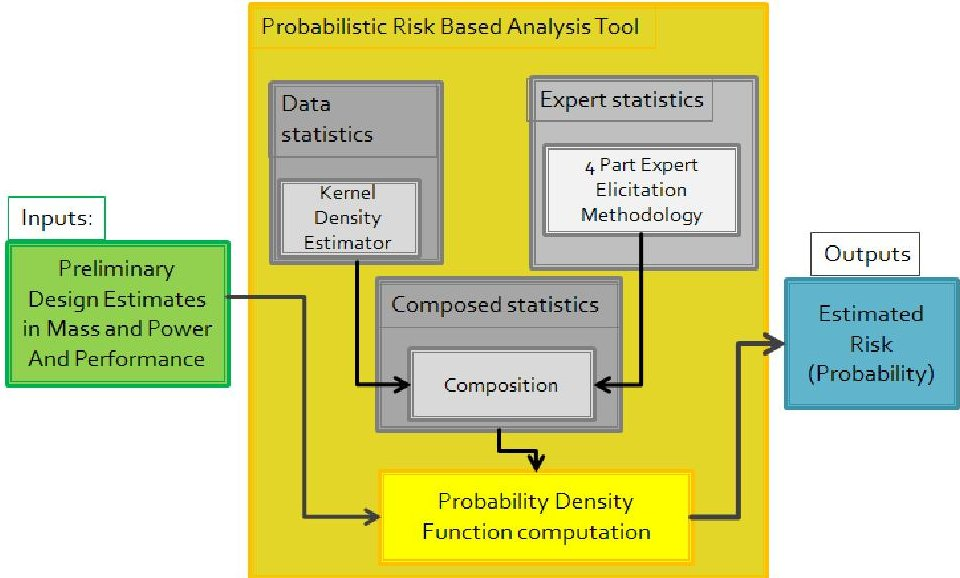

Figure 1: Block diagram of the approach.

Specifically, the models require as input a preliminary design estimate for each component or subsystem. This kind of input is comparable to the information that the engineering team possesses at PDR, when some components may have been selected, some may not have but the engineers have to "guess" approximate values for the mass and power consumption of the different components. These guesses are the inputs for the model. In addition to mass and power consumption estimates, each component should also have an estimate of the desired performance according to a specific performance metric. The performance metric is important because it is used to scale the database sample vectors in the data statistic part of the methodology. Examples of performance metrics for some of the components are listed in Table 1.

Table 1: Examples of performance metric for various components.

<table border="1"><tr><td>Component</td><td>Performance Metric</td></tr><tr><td>Antenna</td><td>Gain(dB)</td></tr><tr><td>Solar Panels</td><td>Output power(W)</td></tr><tr><td>Batteries</td><td>Energy(Wh)</td></tr><tr><td>Processor</td><td>Computational Speed(MHz)</td></tr><tr><td>Reaction Wheel</td><td>Nominal Moment(mNm)</td></tr><tr><td>Magnetometer</td><td>Resolution(μT)</td></tr><tr><td>Sun Sensor</td><td>Accuracy(deg)</td></tr></table>

<!-- PDF_PAGE: 3 -->

When the preliminary estimates on mass, power consumption and performance are introduced in the model, the risk-based analysis tool uses a set of statistical techniques to assess the risk that each of the components will exceed the initially estimated values of mass and power consumption. The output of the model is an assessment of the risk produced in terms of tail function (1 minus the cumulative distribution function). Details on the different statistics used are provided in the following subsections.

## Data Statistics

The database approach uses historical and empirical mission data to estimate the mass and power distributions of a component. Data statistics developed for this analysis are very similar to what has been previously done by the authors in [1] [2] [4]. Specifically, data statistics use samples to construct the probability distributions of the mass and power of a component. Each sample collected is converted into a coefficient that represents a relation between two parameters. For example, the mass data collected for antennas are converted into mass per unit of gain (where gain is an input parameter for the statistic). The formalization of the approach is presented in the following

equation, where a is a vector of scalar coefficients of mass per unit of gain (G), f is the probability density for the mass of a component, x is the support of the distribution and k is the kernel density estimator (chosen because it is the non-parametric technique which achieves the minimum estimation error in the case of small samples sizes [1]):

$$
f (x) = \frac {1}{G} \cdot k \left(x, \bar {a} \cdot G\right)
$$

The function k can be expressed as:

$$
k \left(x, \bar {a} \cdot G\right) = \frac {1}{n \cdot h} \sum_ {i = 1} ^ {n} K \left(\frac {x - a _ {i} \cdot G}{h}\right)
$$

where n is the total number of elements of vector a, and $ a_{i} $ indicates a single element of the same vector b in the

indicates any single element of the same vector. h is the bandwidth of the kernel density estimator, and it is selected to optimize the estimation by reducing the minimum square error.

## Expert Statistics

In the area of spacecraft design, there are experts in the field, who can provide subjective assessment of the mass and power of future components based on their experience. Expert opinion can be viewed as a form of external knowledge that is introduced into the model, with the objective of substituting or improving the knowledge given by the historical data. The authors developed in [5] an approach to elicit expert opinion which takes into account possible biases and mis-calibrations which can affect the experts' judgments. In this way, the authors can aggregate

the opinions of different experts by weighting them differently according to the experts' performance in the elicitation interview.

The interview is composed of three parts:

1. Probabilistic Thinking: This part contains general questions (a total of 11 in this case) on probability that are used to model the expert's ability to think probabilistically. The result of this part is the generation of a quality index that can be used to compare and to weight opinions from different experts. This part of the interview is focused on mapping the possible biases and heuristics that experts can have: hindsight bias, small sample bias, judgment by availability, judgment by representativeness, anchoring and adjustments, awareness of underlying conditional probabilities, and coherence. The result of Part 1 is the generation of a total score between 0 and 100 that is the sum of the scores the expert would achieve after answering all the questions (more information on the methodology for Part 1 are in [5]).

2. Calibration: This part contains technical but general questions (12 total) on mass and power for small satellite components. Experts are required to estimate the mass and power for typical components, and their answers are used to identify if the expert has the tendency to underestimate or overestimate certain quantities. This part results in a calibration coefficient that can be used to shift the final probability assessments performed by the experts (more information on the methodology for Part 2 and an example applied to communication system design are in [5]).

3. Expert Elicitation: In this part, the interview aims at helping the experts to express their belief on the mass and power values for certain components (16 questions total) and their corresponding uncertainties, and translate the experts' estimates into a density function. Two different approaches are chosen to construct the density function based on the experts' belief: an approach derived from statistical link analysis, and the quantile method.

Finally, the opinions of the different experts are aggregated by using a weighted combination: the weights are defined based on the performance of each expert in Part 1 and Part 2 of the interview. The interview was tested for the first time for the case of communication system design with students and professional engineers. Results are reported in [5].

For this analysis, which aims to extend the risk analysis model developed for the communication system to the entire spacecraft, Part 2 and 3 of the interview were modified to accommodate questions on the different components for small satellites. Then, the interview was performed with six experts of small satellite design: graduate students who have been working extensively in designing and fabricating small

<!-- PDF_PAGE: 4 -->

satellites. The results of the interview are shown in the results section of the paper.

## Bayesian Statistics

Bayesian statistic is a composition of the previous two statistics performed according to a Bayesian rule for which the data statistic is the a priori distribution and the expert statistic is the likelihood function. The approach is different from traditional Bayesian approaches and it is mostly based on [14].

## 3. TEST CASE ANALYSIS AND RESULTS

## CASTOR Test Case

The approach has been applied to the CASTOR mission as a test case. CASTOR is a small satellite developed at MIT and it has been chosen for this analysis because it is considered relevant due to the recent interest of the aerospace community in the development of small satellite missions. Additionally, CASTOR has been chosen due to the availability of all the design data at the different stages (PDR and CDR). The following two subsections describe the test case and the results respectively.

CASTOR [15] is a small ESPA ring class satellite developed at the MIT Space System Laboratory. The satellite dimensions are 50x50x60 cm with a total mass of 50 Kg. The main goal of this spacecraft is to test in the space environment the performance of a new type of electric propulsion engine, the DCFT (Diverging Cusped-Field Thruster), which guarantees up to 1 km per second of $ \Delta V $ . This type of engine is very efficient in terms of mass/impulse ratio and the whole system is very promising to perform rapid orbital transfer maneuvers. The deployed configuration of the CASTOR satellite is shown in Figure 2. CASTOR has been developed entirely at MIT Space System Laboratory over 4 years and it has already been used by the authors to test the statistical risk methodology for the communication system [2] .

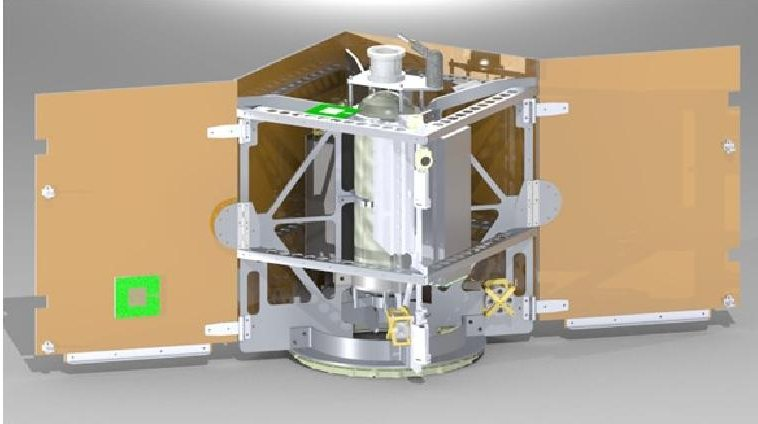

Figure 2: CASTOR satellite.

In this paper, CASTOR mission is used as a test case to validate the extension of the model to the entire spacecraft

design. All the design data for CASTOR PDR and CDR are available, which is very important since it allows the authors to validate the methodology developed: the PDR data are used as inputs for the model and the final results are compared to the CDR data to verify whether or not the model is able to identify very risky PDR estimates: estimates that have a very high likelihood of fluctuates over time.

The PDR and CDR values of mass and power consumption for different components and subsystems are shown in Figure 3 and Figure 4, while a breakdown component by component is presented in the appendix (Table 2). It is possible to notice that structure is the subsystem which observed the biggest mass fluctuation and ADCS (Attitude Determination and Control System) is the one which experienced the biggest fluctuation in power consumption. The results of the statistical analysis are described in the next sub section.

Mass Breakdown

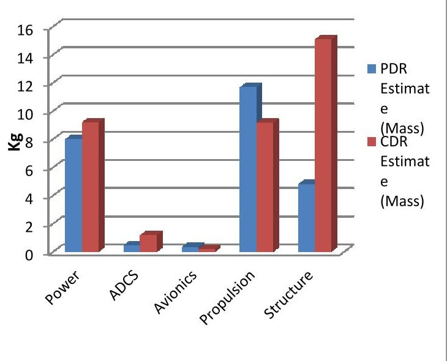

Figure 3: Mass breakdown for subsystems (PDR and CDR data).

<!-- PDF_PAGE: 5 -->

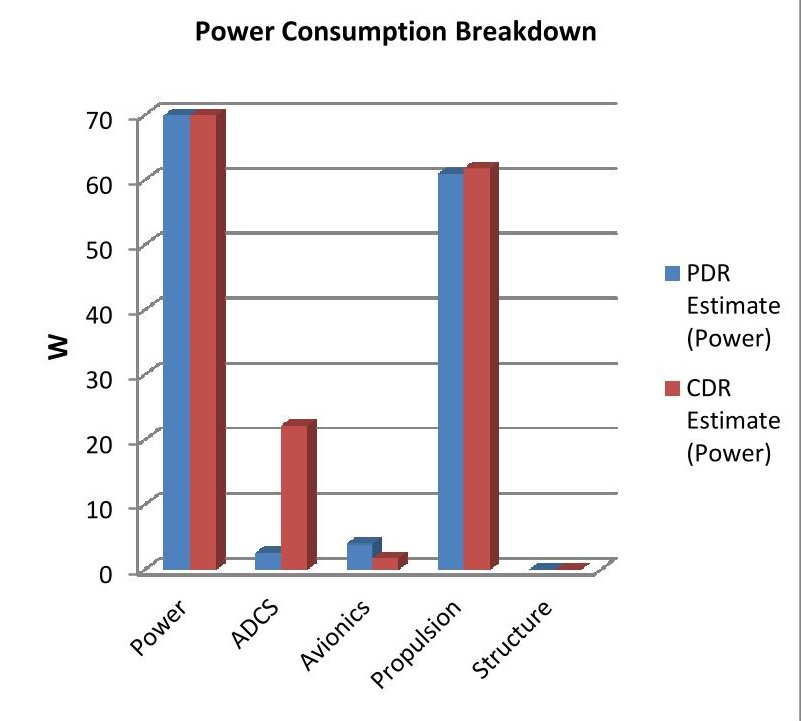

Figure 4: Power breakdown for subsystems (PDR and CDR data).

## Results

The methodology has been applied to the CASTOR test case, specifically to the components for which data were available. The propulsion subsystem has been excluded from the study because the payload was completely new (Diverging Cusped Field Thruster - DCFT); hence we could not use data statistics and we did not have a specific panel of propulsion experts to perform the elicitation. Future work will focus on how to manage fluctuations in newly developed scientific payloads, while this paper focuses on performing statistical risk estimation for the basic spacecraft subsystems. Additionally, the analysis for power consumption is limited to the only two subsystems that present fluctuations: ADCS and avionics.

The analysis has been conducted in two phases: initially results for each single component have been derived using the three statistics (data, expert and Bayesian). Finally, results have been aggregated into total probability density functions for the system. In this section, some of the components' results will be presented together with the system results.

For each component, the following probability density functions have been computed:

- Data statistic: Only one probability density function is computed for each component. The function is derived from the kernel density estimator and it is computed using a database of previously developed components for small satellites. The process of construction of the data statistic is clarified in Section 2.

- Expert statistics: Several probability density functions have been computed. Specifically, a total of 6 experts have been interviewed. Experts were chosen from academia (mostly PhD students in the field), due to the fact that a lot of expertise in the development of small satellites can be found in the academic environment. Each expert performed the three-part interview described in Section 2. Part 1 and 2 of the interview are used to compute the weighting scores which are then used to aggregate the probability density functions of the single components. The results (scores for each of the experts) for Part 1 (Probabilistic Thinking) and Part 2 (Calibration) are shown in Figure 5 and Figure 6 respectively. Figure 7 shows the combined score obtained by averaging the results of Part 1 and Part 2.

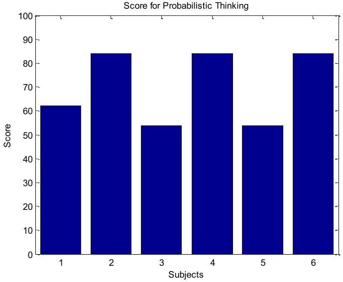

Figure 5: Score for part 1 of the interviews (Probabilistic Thinking) for each of the experts interviewed. A high score indicates that the expert is less sensitive to biases and heuristics which can affect the probability estimates by causing errors.

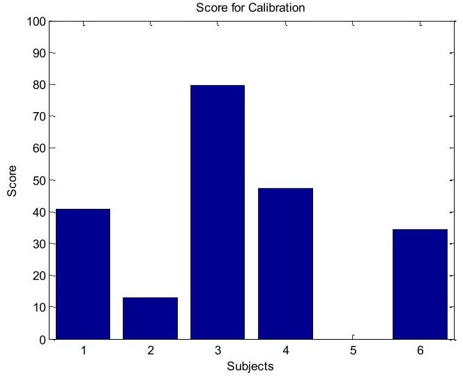

Figure 6: Score for part 2 of the interview (Calibration). As explained in [5], calibration score is 100 $ ^{*} $ (1- |calibration_coefficient|). The calibration coefficient

<!-- PDF_PAGE: 6 -->

ranges from zero to one, where zero is perfect calibration and one is strong overestimation/underestimation. Hence, the score is the reverse of the coefficient: a high score indicates that an expert is less inclined to over or under estimate quantities of interest, while a low score indicate that the expert suffers strongly from over/underestimation. Note that Expert 5 obtained a score that is almost zero due to strong overestimations.

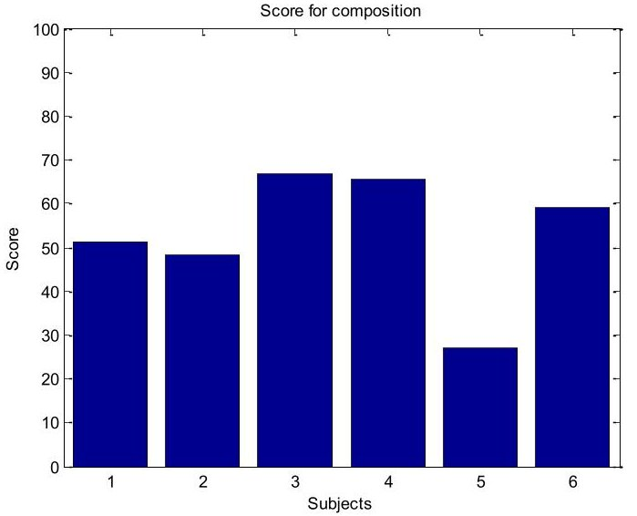

Figure 7: The combined score is obtained for each expert by averaging the scores computed in part 1 and part 2. It can be noticed that Expert 3 reached the highest score followed by Expert 4 and 6.

The results shown in Figure 7 are used to compute the weights which will be used to aggregate the probability density functions elicited by each expert individually. The methodology chosen for aggregation is the linear aggregation. According to the linear aggregation, the final (aggregated) probability density function is computed as:

$$
f _ {t o t} (x) = \sum_ {i = 1} ^ {6} w _ {i} \cdot f _ {i} (x)
$$

where $ f_{tot} $ indicates the total probability density function, $ f_{i} $ are the densities elicited by each expert and $ w_{i} $ are the weights for each of the experts. The weights need to be normalized to one and they are computed using the results shown in Figure 7. Two possible techniques have been used to compute the weights: a proportional technique in which weights are just computed proportionally to the combined scores and a bisection technique in which weights are computed according to a bisection rule. The bisection technique works according to a ranking principle: experts are ranked in function of their combined score and the weights are distributed according to a bisection rule: the top expert (in this case Expert 3) receives a weight of 0.5, the second

top expert (Expert 4) receives a weight of 0.25 and so forth. The last two experts receive a weight of $ 2^{-(n-1)} $ . The bisection technique was successfully applied by the authors in [5] and it is proposed also in this analysis. However, one of the objectives of this analysis is also to compare this technique with the proportional assignment of weights. Hence, in the rest of the paper, results computed with both the rules will be presented. The weights are shown in Figure 8 and Figure 9.

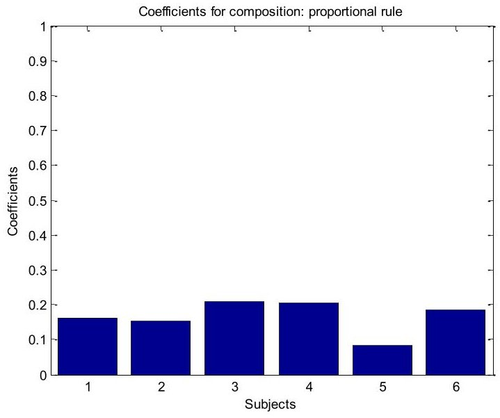

Figure 8: Weights (coefficients) assigned to the experts according to a proportional assignment.

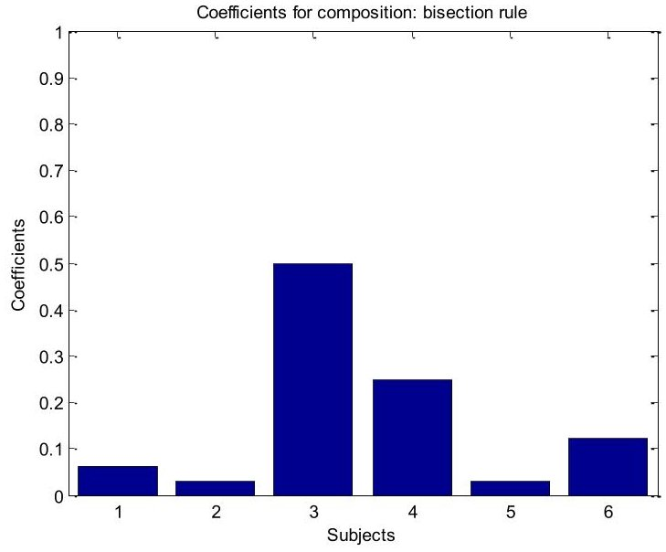

Figure 9: Weights (coefficients) assigned to the experts according to a bisection rule. Note that in this assignment the top performing expert (Expert 3) receives a weight of 0.5.

Hence, for each component a total of 8 probability functions can be visualized: the individual densities elicited by each of the experts and the two composed using proportional and bisection

<!-- PDF_PAGE: 7 -->

weights. An example of the probability density functions computed for a component, in this case the solar panels is shown in Figure 10. Figure 11 shows the tail function of the component, which is defined as 1 minus the cumulative density function. The tail function is very important for the risk analysis, because it allows the analyst to visualize the risk of exceeding a certain constraint. The vertical lines in both Figure 10 and Figure 11 show the PDR and CDR values of the mass of the solar panels. It is possible to notice that the initial PDR estimate (3.5 Kg) was underestimated since the final CDR mass was approximately 5 Kg. The expert estimates are not very accurate in the mean value (they tend to maintain the mean around the incorrect PDR value). However, the large variance allows to identify the overestimation. In fact, if we look at the tail function in Figure 11, it is possible to notice that the composed density functions (both the proportional one and the bisection one) assess a risk of exceeding the PDR value of more than 80%: the reader can verify this value by looking at the intersection between the vertical dotted line (PDR value) and the two tail curves which indicate the composed functions. Hence, this show that the expert-based approach followed is effective in identifying very risky initial estimates. Additionally, the reader can notice that the value of the tail (risk) at the intersection between the dashed CDR vertical line and the composed tails is less than 10%. This indicates that if engineers had used this model to size the contingency and if they had followed a 10% rule (allocating a mass such to not exceed 10% risk), the final allocation would have been very close to the final real CDR mass value.

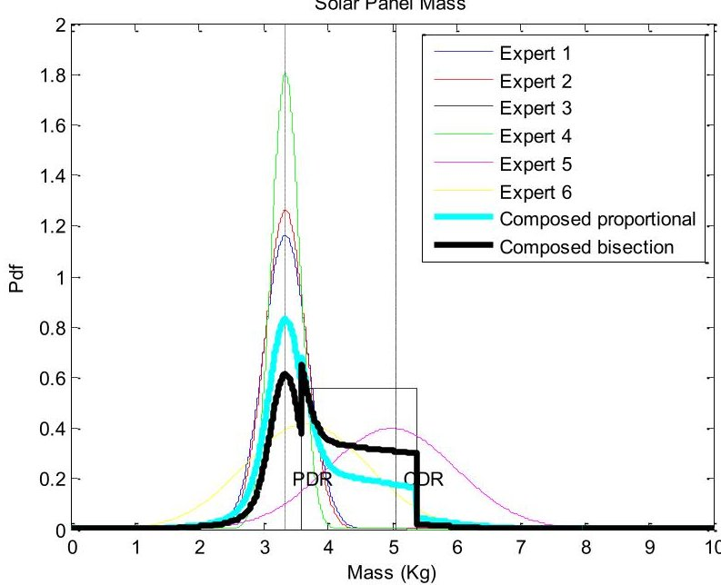

Figure 10: Probability density functions for the solar panel mass. The probability density functions of the six

experts are plotted together with the composed probability density functions obtained by using proportional and bisection weights. The vertical dotted and dashed lines indicate the mass estimates of the solar panels at PDR and CDR.

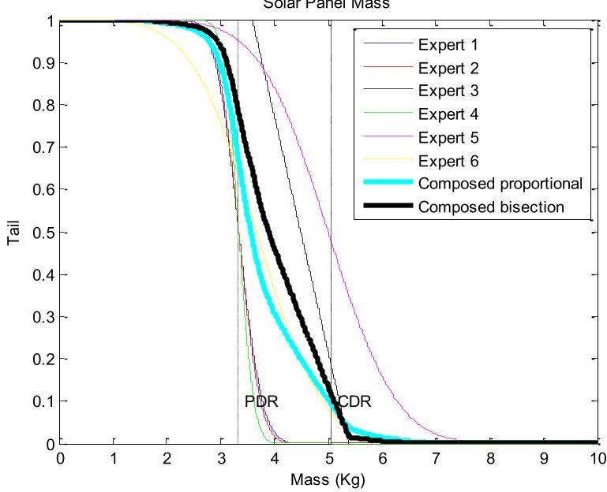

Figure 11: Tail functions for the solar panel mass. The vertical dotted and dashed lines indicate the mass estimates of the solar panels at PDR and CDR.

- Bayesian statistics: The Bayesian statistics are obtained by composing data statistic and expert statistics according to a Bayesian rule in which data statistic is considered the a priori distribution, and the expert statistics are the a posteriori distributions. Two Bayesian statistics are computed for the two aggregated expert probability density functions with proportional and bisection weights.

An example of the final results for a component (solar panel) is shown in Figure 12: data statistic, 2 expert statistics and 2 Bayesian statistics are shown. Figure 13 presents the tail functions for the solar panel mass. The two vertical lines indicate again the initial PDR estimate and the final CDR estimate.

It is interesting to notice that the two aggregated Bayesian statistics provide similar results: the two weight combinations seem to not strongly affect the results of this specific component. The probability density functions tend to be concentrated around the initial PDR estimate. However, as noticed for the previous plots (Figure 10 and 11), also in this case the strong variance allows us to identify a high risk of exceeding the initial PDR estimate. This can be noticed again by observing the tail functions in Figure 13. The risk of exceeding the PDR value is approximately 0.8 (80%) according to all the five statistics. The risk at CDR drops at approximately 0.1 (10%) according to all the statistics except for the data statistics. Hence, data statistic appears to be very conservative (also observed in [2], [4]), while expert and Bayesian statistics seem to be effective in estimating the mass for the panels.

<!-- PDF_PAGE: 8 -->

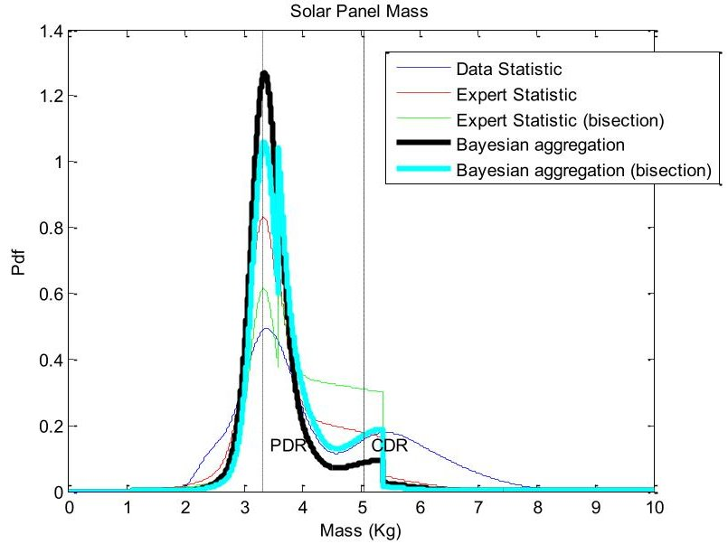

Figure 12: Solar panel mass probability density function. The plot shows results for data statistic, two expert statistics (proportional and bisection weights) and two Bayesian statistics. The vertical dotted and dashed lines indicate the value of the solar panel mass estimates at PDR and CDR.

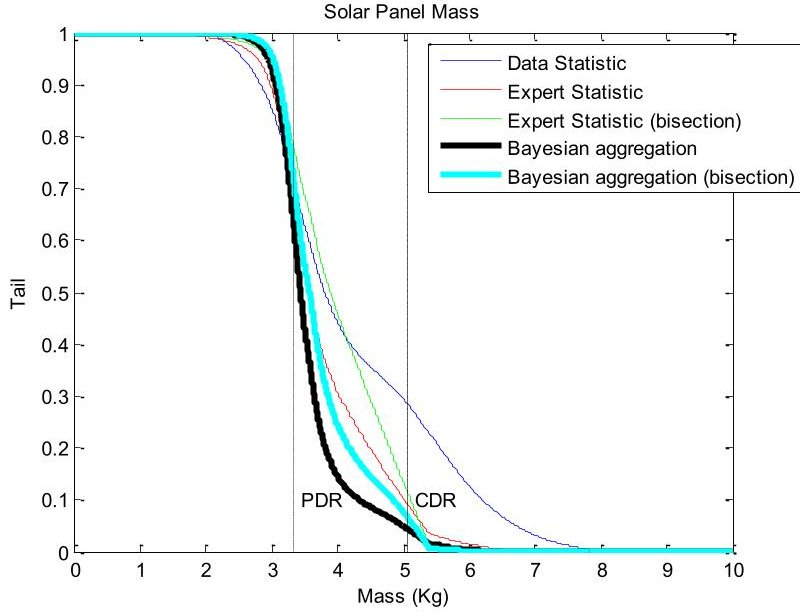

Figure 13: Solar panel tail functions. The plot shows

expert, Bayesian) identify that the PDR value is underestimated. This risk function can be used to appropriately size contingencies for components.

Another example of the application of the approach to the spacecraft design is represented by the avionics board. In this case the estimate is related to the avionics board power consumption. The initial estimate at PDR was 4 W, while the final CDR estimate for the board resulted in a consumption of only 1.8 W. The results are shown in Figure 14 and Figure 15.

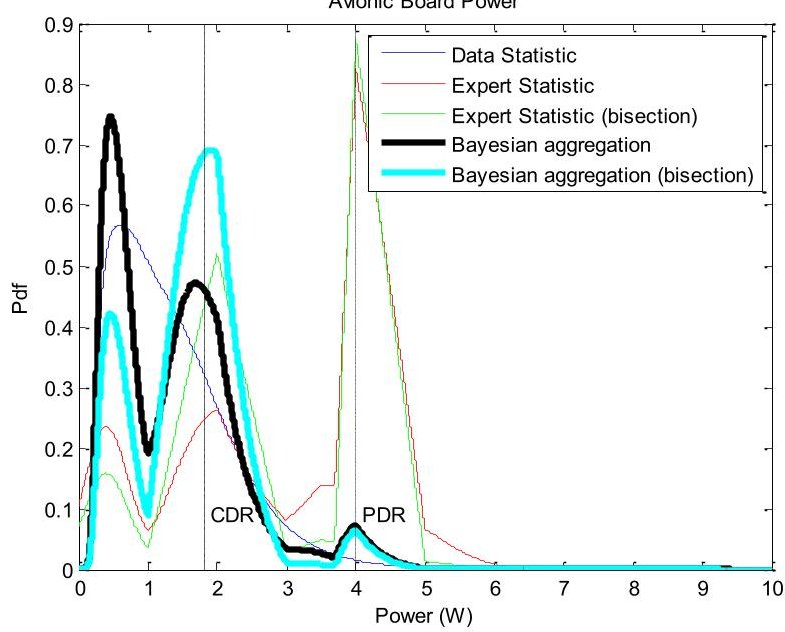

Figure 14: Probability density functions for avionics board power consumption. The plot shows results for data statistic, two expert statistics (proportional and bisection weights) and two Bayesian statistics. The vertical dotted and dashed lines indicate the estimates at

PDR and CDR. It can be noticed that the Bayesian statistics are more effective in estimating the real power consumption: the two curves are bimodal with one peak centered around the final CDR value.

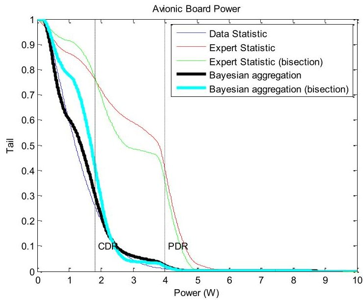

Figure 15: Tail functions for the avionics board power consumption. The plot shows results for data statistic, two expert statistics (proportional and bisection weights)

and two Bayesian statistics. The vertical dotted and dashed lines indicate the estimates at PDR and CDR. It is possible to notice that the two Bayesian statistics are more accurate than the two experts statistics in assessing the risk. In fact, the two Bayesian statistics show how the initial PDR value is an overestimation: the risk is very close to zero.

As noticed in Figure 15, the Bayesian statistics and data statistic are more accurate than expert statistics in identifying the overestimation at PDR. They are also a very

<!-- PDF_PAGE: 9 -->

good instrument to help sizing the contingency. In fact, even if the risk at CDR is somehow a little too high (about 20%) the use of the Bayesian risk curves to size contingency in power consumption would have allowed the engineers to save at least 1 W in power consumption. Just by allocating 3 W and not 4 W, the risk of exceeding that value would have been less than 10%.

It is interesting to notice how the behavior of data statistic and expert statistics change from component to component: in the first case (solar panel mass) the expert statistics seem to work better, while in the second case (avionics board power consumption) data statistic performs better. This is why it is important to use the Bayesian statistics, which include components of both expert and data statistics and hence they offer on average the better performance in the highest number of cases.

A final example before looking at the system results is the spacecraft structure mass, which for simplification is considered as a unique component. In this case, the estimate at PDR (4.8 Kg) was extremely underestimated with respect to the final value of the spacecraft structural mass at CDR (15 Kg). The underestimation was due to design and materials changes which affected the structural configuration of the spacecraft. The following plots (Figure 16 and Figure 17) show the probability density functions and tail functions for this case.

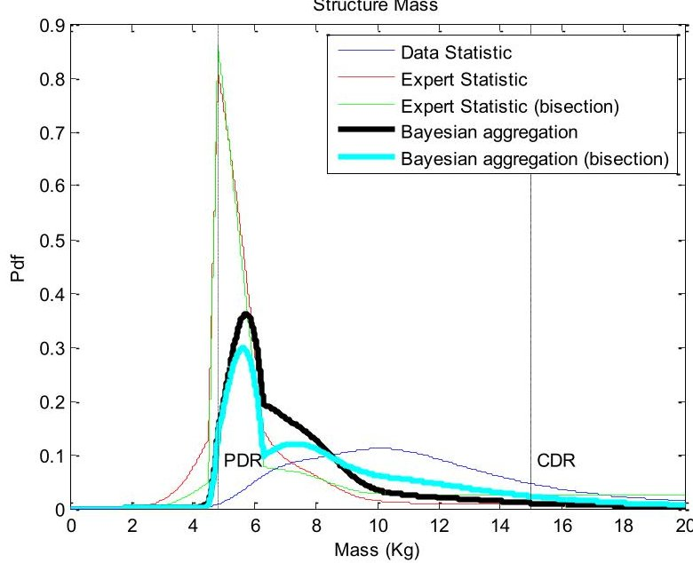

Figure 16: Probability density functions for the structural mass. The plot shows results for data statistic, two expert statistics (proportional and bisection weights) and two Bayesian statistics. The vertical dotted and dashed lines indicate the estimates at PDR and CDR. It can be noticed how both expert statistics and Bayesian statistics tend to be more concentrated around the PDR value. Data statistic seems to be extremely spread.

Luckily, the high variance allows the statistician to identify that the initial PDR value is overestimated as it can be noticed in Figure 17.

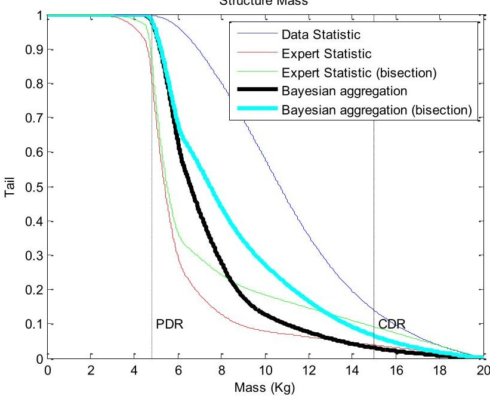

Figure 17: Probability density functions for the structural mass. The plot shows results for data statistic, two expert statistics (proportional and bisection weights) and two Bayesian statistics. The vertical dotted and dashed lines indicate the estimates at PDR and CDR. It can be noticed that all the statistics (data, expert and Bayesian) show that the PDR value is underestimated: the risk of exceeding this value is in fact estimated at 1 (100%). Finally, all the statistics identifies that the CDR value is the correct estimate, although data statistic is still a bit conservative (20% risk of exceeding the CDR value).

It can be observed that in this case all the statistics identify that the initial PDR mass estimate is extremely underestimated. Again, if Bayesian statistics had been used to size the final mass allocation for the structural part of the spacecraft and if a rule of not allowing more than 10% risk of exceeding the mass value had been followed, the final mass allocation would have been very close to the real CDR value. This shows once again the accuracy of this approach which can be really beneficial in assisting engineers in estimating the initial contingencies and in assessing the risk of exceeding specific limits in mass and power consumption.

The results obtained for the single components have been aggregated through convolution under the hypotheses of independence to generate the total system probability density functions. The total results for the mass and power consumption are shown in the following figures. Specifically, Figure 18 and Figure 19 show probability density functions and tail functions for the total mass. Figure 20 and Figure 21 show probability density functions and tail functions for the total power consumption.

Regarding the total mass, the PDR and CDR estimates were computed by summing the respective PDR and CDR masses assessed for each of the analyzed components listed in the appendix. It can be noticed that the total PDR estimate was again underestimated (12.5 Kg), while the final CDR estimate was approximately 25 Kg.

<!-- PDF_PAGE: 10 -->

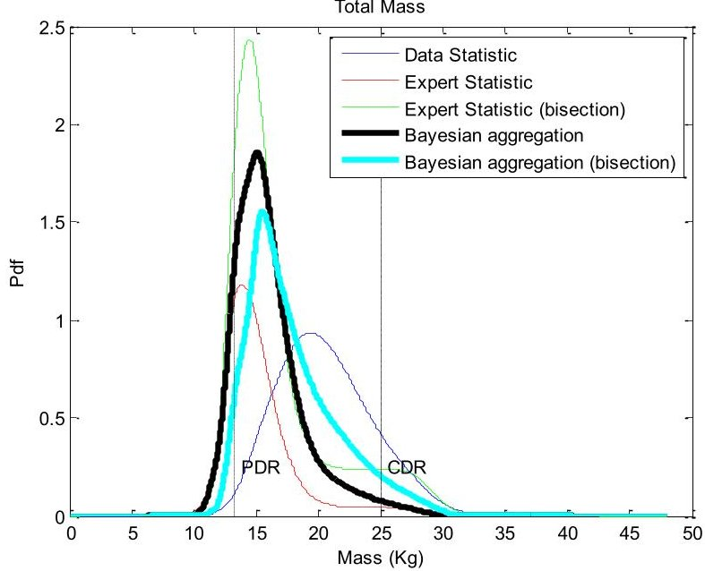

Figure 18: Probability density functions for the total spacecraft mass. The plot shows results for data statistic, two expert statistics (proportional and bisection weights) and two Bayesian statistics. The vertical dotted and dashed lines indicate the estimates at PDR and CDR. All

the statistics exhibit a very large variance: as a consequence the risk of exceeding the initial PDR value is extremely high as shown in Figure 19.

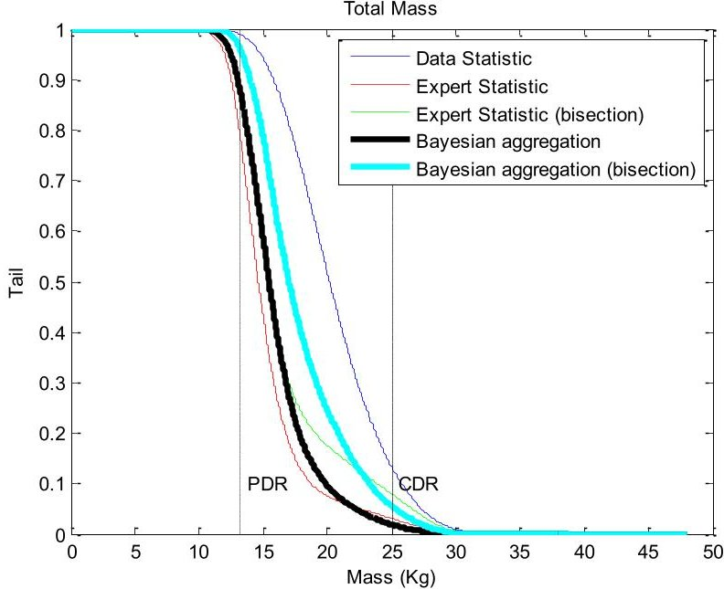

Figure 19: Tail functions for the total spacecraft mass. The plot shows results for data statistic, two expert statistics (proportional and bisection weights) and two Bayesian statistics. The vertical dotted and dashed lines

indicate the estimates at PDR and CDR. It can be noticed that all the statistics (data, expert and Bayesian) show that the PDR value is underestimated: the risk of exceeding this value is very close 1 (100%). Finally, all the statistics identifies that the CDR value is the correct estimate, and the risk of exceeding that value is less than equal to 10% for all the statistics.

statistics are effective in identifying the underestimation: the risk of exceeding the PDR estimate is close to 1 (100%) Additionally, the statistics identify that the CDR estimate is correct by assessing a risk below 10%.

The results obtained for the spacecraft mass show that the

Regarding power consumption, the total estimate includes only the components of the control system and the avionics board. Their PDR and CDR estimates are reported in the appendix. The total power consumption at PDR was estimated at 6.5 W, while the total estimate at CDR was 10 W. Figure 20 and Figure 21 show the results for the probability density functions and the tail functions. Interestingly, this seems to be the only case in which Bayesian estimates are not very successful.

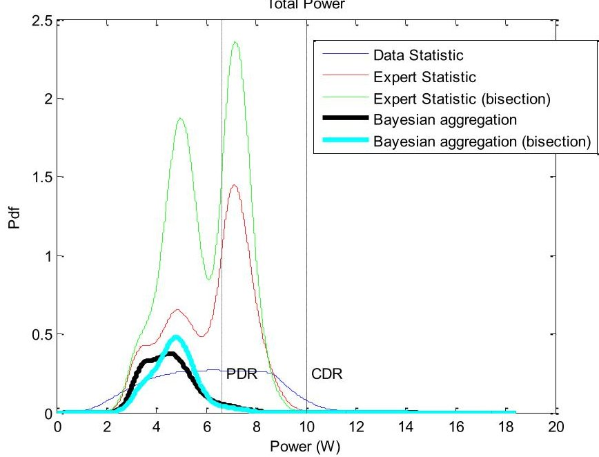

Figure 20: Probability density functions for the spacecraft power consumption (due to data availability only ADCS components and avionics board are considered in this plot). The plot shows results for data statistic, two expert statistics (proportional and bisection weights) and two Bayesian statistics. The vertical dotted and dashed lines indicate the estimates at PDR and CDR. It can be noticed that all the densities are concentrated around the underestimated PDR value.

<!-- PDF_PAGE: 11 -->

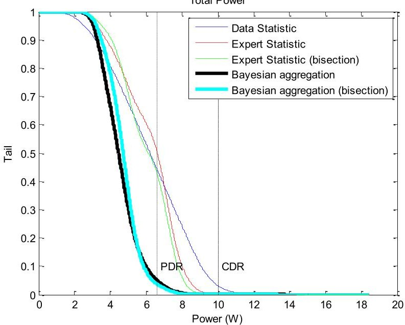

Figure 21: Tail functions for the spacecraft power consumption (due to data availability only ADCS components and avionics board are considered in this plot). The plot shows results for data statistic, two expert statistics (proportional and bisection weights) and two Bayesian statistics. The vertical dotted and dashed lines indicate the estimates at PDR and CDR. It can be noticed that in this case the statistics (especially Bayesian) fail in recognizing the underestimation at PDR.

Differently from the other cases, the risk analysis for the total power consumption shows some problems. Specifically, the statistics do not seem to identify the underestimation of the initial PDR estimate. The cause of this issue depends mostly on the estimates of the power consumption for the ADCS components, since the estimates of the power consumption for the avionics board seem to be more accurate. Future work will focus on improving estimates for the ADCS components, maybe developing a specific expert elicitation interview with control experts only.

The last results of this paper were computed performing the analysis of variance. The analysis considers how the variance of each factor (component or subsystem) affects the total variance. The objective of this analysis is to identify the main drivers for mass and power fluctuations. To compute the analysis [4], the hypothesis of independence between the distributions of the single components is assumed. Hence, the variance of fluctuations for mass and power is the sum of the single variances:

$$
\sigma_ {M a s s _ {-} t o t} ^ {2} = \sum_ {i = 1} ^ {n} \sigma_ {M a s s _ {-} i} ^ {2}
$$

$$
\sigma_ {P o w e r _ {-} t o t} ^ {2} = \sum_ {i = 1} ^ {n} \sigma_ {P o w e r _ {-} i} ^ {2}
$$

The variance proportions' coefficients are defined as the ratio of the variance of each component to the total variance. They are computed as:

$$
c _ {M a s s _ {- i}} = \frac {\sigma_ {M a s s _ {- i}} ^ {2}}{\sigma_ {M a s s _ {- t o t}} ^ {2}}
$$

$$
c _ {P o w e r _ {- i}} = \frac {\sigma_ {P o w e r _ {- i}} ^ {2}}{\sigma_ {P o w e r _ {- t o t}} ^ {2}}
$$

The coefficients for mass fluctuations are shown in Figure 22. The coefficients for power fluctuations are shown in Figure 23.

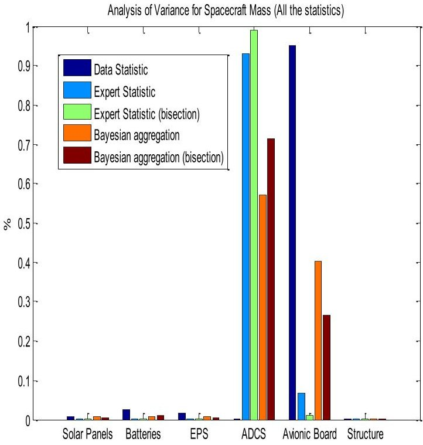

Figure 22: Analysis of variance for the spacecraft mass estimates. According to all the statistics, the components of the control system together with the avionics board seem to be the components that show the biggest variance in their estimation.

<!-- PDF_PAGE: 12 -->

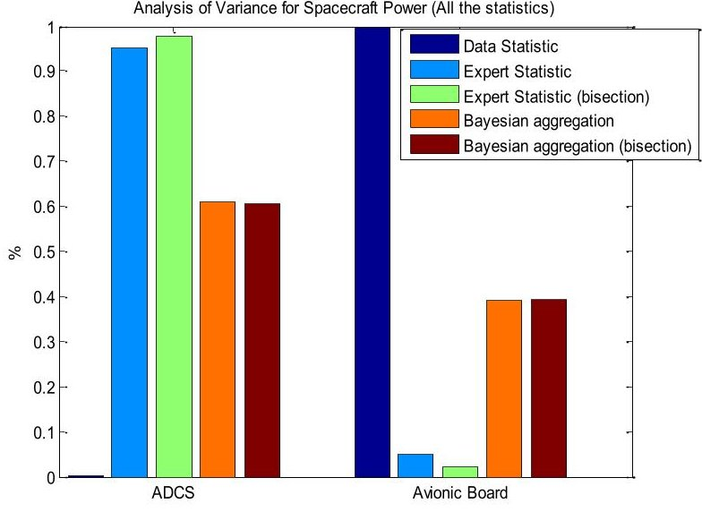

Figure 23: Analysis of variance for the spacecraft power consumption estimates. The statistics offer different results on which component seems to be the principle driver for the variance of the power consumption estimate.

Analysis of variance shows that all the statistics identify ADCS and avionics board components as the major drivers for the variance in the estimation of the total mass. Regarding the power consumption, the analysis of variance presents conflicting results: according to experts and Bayesian statistics the ADCS subsystem is the main driver of the variance, while according to data statistic the avionics board is the main driver. This difference can also be correlated with the issues observed in the total power consumption probability density function (Figure 20 and 21). Future work will focus on a more detailed analysis of the control system for the spacecraft.

A final comment is related to the weighting of the distributions. In this analysis two weighting schemes have been used: the proportional scheme and the bisection scheme. While in previous works focused on communication system design only [1] [5] [3] [4] the bisection rule achieved substantially better results, in the case of this paper the two methods provide very similar outcomes and they both give reasonable estimates. However, since this is the first case in which the methodology has been applied by the authors to the entire spacecraft design, it is too early to claim that in all the cases the two schemes will perform in the same way. More test cases need to be analyzed and additional interviews with experts need to be performed.

Conclusions and suggestions for future work are presented in the next section.

## 4. CONCLUSIONS

This paper presents the first attempt to extend the probabilistic approach to design risk to the entire spacecraft design. This approach has been developed initially by the authors primarily for the design of the communication subsystem. In this paper, the authors extend the approach to the different subsystems and focus their effort on small spacecraft which are becoming increasingly more developed in academia, space agencies and industries. The methodology is extended to the entire spacecraft: the database now includes data on several spacecraft components and the expert elicitation interview includes questions on the different subsystems. A university satellite mission (CASTOR) developed at MIT is used as a test case. Results show that the methodology is effective in analyzing each component and in identifying whether the initial estimate of mass and power consumption made at PDR was an overestimation or an underestimation. Specifically, the tail functions provide useful insights which can be applied by the engineers while designing the spacecraft. The system results are obtained by convolution of the results obtained for the single components and they show that the model is able to clearly identify underestimation for the spacecraft mass, while it does not perform as well for the power consumption. Similar results are obtained in the analysis of variance proportions. Future work will be dedicated to analyzing the issue on the power consumption estimate as well as in developing specific statistical approaches to include newly developed payloads for which no previous data are available or for which expertise in the field is somehow limited. Finally, future work will also focus on extending the model to the design of larger spacecraft than small satellites and to the design of satellite constellations.

## 5. ACKNOWLEDGMENT

Part of this work was performed at the Jet Propulsion Laboratory, California Institute of Technology, under a contract with the National Aeronautics and Space Administration. Part of this work was carried out at the Space System Laboratory, Massachusetts Institute of Technology.

## 6. APPENDIX

A breakdown of mass and power consumption data for each of the components at PDR and CDR is shown in the following table:

Table 2: Values of mass and power consumption at PDR and CDR for each of the components analyzed.

<table border="1"><tr><td>Component</td><td>Mass(PDR)Kg</td><td>Mass(CDR)Kg</td><td>Power(PDR)W</td><td>Power(CDR)W</td></tr><tr><td>Solar Panel</td><td>3.34</td><td>5.066</td><td>0</td><td>0</td></tr></table>

<!-- PDF_PAGE: 13 -->

<table border="1"><tr><td>Battery</td><td>3.2</td><td>2.64</td><td>70</td><td>50</td></tr><tr><td>Avionics Board</td><td>0.35</td><td>0.21</td><td>4</td><td>1.8</td></tr><tr><td>Satellite Structure</td><td>4.82</td><td>15.09</td><td>0</td><td>0</td></tr><tr><td>Magnetometer</td><td>0.01</td><td>0.01</td><td>0.03</td><td>0.03</td></tr><tr><td>Sun Sensor</td><td>0.03</td><td>0.03</td><td>0.08</td><td>0.075</td></tr><tr><td>GPS receiver</td><td>0.02</td><td>0.32</td><td>0.5</td><td>0.8</td></tr><tr><td>IMU</td><td>0.02</td><td>0.16</td><td>0.8</td><td>0.285</td></tr><tr><td>Reaction Wheels Assembly</td><td>0.12</td><td>0.21</td><td>1.2</td><td>7</td></tr></table>

## REFERENCES

[1] A. Babuscia, Statistical Risk Estimation for Communication System Design, Ph.D. Thesis, Massachusetts Institute of Technology, 2012.

[2] A. Babuscia and K.-M. Cheung, "Statistical Risk Estimation for Communication System Design," IEEE Systems Journal, vol. PP, no. 99, pp. 1-12, 2012.

[3] A. Babuscia and K.-M. Cheung, "Statistical Risk Estimation for Communication Systems Design-A Preliminary Look," The Interplanetary Network Progress Report, Vols. 42-188, pp. 1-33, 2012.

[4] A. Babuscia, K.-M. Cheung and D. W. Miller, "Statistical Risk Estimation for Communication System Design: Development of Optimization Frameworks," in IEEE Aerospace Conference, Big Sky, Montana, 2013.

[5] A. Babuscia and K.-M. Cheung, "An approach to perform expert elicitation for engineering design risk analysis: methodology and experimental results.," Journal of the Royal Statistical Society (Series A), Oct 2013.

[6] V. Cortellessa, "Model-Based Performance Risk Analysis," IEEE, 2005.

[7] L. Meshkat, "A Holistic Approach for Risk Management During Design," IEEE, 2006.

[8] F. Barrientos, I. Tumer and D. Ullman, "Design Teams, Complex Systems and Uncertainties," IEEE, 2005.

[9] W. L. Oberkampf, J. C. Helto, C. A. Joslyn, S. F. Wojkiewicz and S. Ferson, "Challenge problems: uncertainty in system response given uncertain parameters," Vols. 85(11-19), 2004.

analysis to evaluate alternatives," IEEE, 2006.

[13] M. Fuchs and A. Neumaier, "Potential based clouds in robust design optimization," Issue on Imprecision of Statistics and Applied Mathematics, 2008.

[11] M. Fuchs and A. Neumaier, "Autonomous Robust Design Optimization with potential clouds.," Reliability and Safety, 2009.

[12] M. Fuchs, A. Neumaier and D. Girimonte, "Uncertainty modeling in autonomous robust spacecraft system design," in Proceedings in Applied Mathematics and Mechanics, 2007.

[14] N. O. Siu and D. L. Kelly, "Bayesian parameter estimation in probabilistic risk assessment," Reliability Engineering and System Safety, vol. 62, pp. 89-116, 1998.

[15] A. Babuscia, M. M. McCormack, M. Munoz, S. Parra and D. W. Miller, "MIT CASTOR Satellite: development , implementation and testing of the communication system," Acta Astronautica, vol. 81, pp. 111-121, 2012.

[10] Y. Asnayr, V. Bryl and P. Giorgini, "Using risks

<!-- PDF_PAGE: 14 -->

## BIOGRAPHY

Alessandra Babuscia received her B.S. and M.S degrees from the Politecnico di Milano, Milan, Italy, in 2005 and 2007, respectively, and her Ph.D. from the Massachusetts Institute of Technology (MIT), Cambridge, in 2012. She has been a Post-Doctoral Associate with the

Space System Laboratory, MIT. She has developed communication systems for different university missions (CommCube 1, CommCube 2, TSat, CASTOR, ExoPlanet, TerSat, TALARIS). She is currently Telecommunication Engineer in the Communication Architecture Research Group, NASA Jet Propulsion Laboratory in Pasadena, CA. Her current research interests include communication architecture design, statistical risk estimation, expert elicitation, inflatable antennas, communication system design for small satellites and CubeSats, multidisciplinary design optimization, mission scheduling, and planning. Dr. Babuscia received the Amelia Earhart Fellowship in 2010 and 2011, became a Gordon Engineering Leadership Fellow in 2010 and 2011, and received the Teaching Assistant Award from the MIT Aeronautics and Astronautics Department in 2010, and the Top Graduate Award in the B.S. Program in 2005 and in the M.S. Program in 2007 from the Politecnico di Milano.

Kar-Ming Cheung received his B.S.E.E. degree from the University of Michigan, Ann Arbor, in 1984, and his M.S. and Ph.D. degrees from the California Institute of Technology, Pasadena, in 1985 and 1987, respectively. He is currently a Principal Engineer and a Technical

Group Supervisor with the Communication Architectures and Research Section (332), Jet Propulsion Laboratory

(JPL), Pasadena. His group supports design and specification of future deep-space and near-Earth communication systems and architectures. He has authored or co-authored over 30 journal and conference papers in the areas of error-correction coding, data compression, image processing, and telecom system operations. He has been with JPL since 1987, where he has been engaged in research, development, production operation, and management of advanced channel coding, source coding, synchronization, image restoration, and communication analysis schemes. Dr. Cheung has received NASA's Exceptional Service Medal for his work on Galileo's Onboard Image Compression Scheme.

<!-- PDF_PAGE: 15 -->

