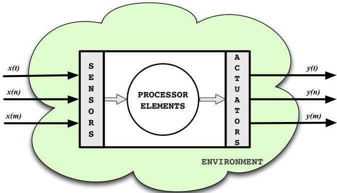
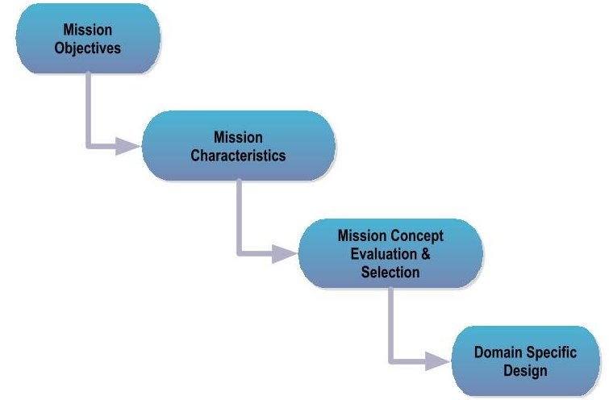
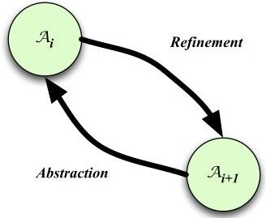

<!-- PDF_PAGE: 1 -->

# Small Satellite Systems Design Methodology: A Formal and Agile Design Process

William Edmonson

and Jules Chenou

NC A & T State University

Greensboro, NC 27411

Email: {wwedmons,chenou}@ncat.edu

Natasha Neogi

and Heber Herencia-Zapana

National Institute of Aerospace

Hampton, VA 23666

Email: {neogi,heber.herencia-zapana} @nianet.org

Abstract-We propose to develop a model-based systems engineering process that results in high-confidence designs for small satellite systems in the pico-/nano-class, i.e. $ < 50kg $ . This objective will be achieved through the integration of formal methods and model based systems engineering to develop an agile framework for high-confidence designs for these small systems. We propose, Reliable and Formal Design (RFD) process whose results are correct by construction, formally verified, and responsive to system requirement changes. This paper develops an intelligent framework that ties requirements, models, and simulations in a cogent manner. Furthermore, this papers provides a formulation for consistency and traceability, where the latter enforces a condition on the relationship between abstraction layers, that is, the function that refines any layer of abstraction into a successive layer must have a dual. An example of this refinement is illustrated using PVS to express the logical requirement formulation and for providing type checking proof.

## I. INTRODUCTION

The nature of our space-based scientific investigations of the Earth is evolving as humanity's role in Earth's evolution is changing. A new approach to satellite design will allow us to produce intelligent, small, highly-integrated sensory platforms that incorporates what we know about their operating environment with what we want to know, thereby achieving our scientific objectives with high confidence. Present design processes for small satellite systems are based on a physical-centric philosophy whereby the system is made up of electromechanical parts. This places the computing aspects of satellite design as a secondary concern, often leading to design cost and life-cycle overruns. A paradigm shift to a cyber-physical systems (CPS) design philosophy elevates algorithms and their associated hardware/software components to the forefront of the design process. There is also a need to show traceability and consistency of these requirements throughout the design process.

The transformative technology of small satellites in the pico-/nano-class (PNSats) is underutilized, and has yet to be fully embraced by the science or space community due to restrictive size, mass and power constraints. Extreme resource constraints of size, mass, power and cost (SMAP-C) drive highly integrated designs in which the behavior of the satellite subsystems cannot be isolated from each other or from the operational algorithms or from the operating environment. Small satellites offer the potential for highly responsive programs that are able to rapidly respond to technology or environmental changes. Rapid development schedules and highly

confident designs are necessary to keep pace with evolving technology, so that we are not launching obsolete equipment or responding to last decade's environmental challenges. In order to meet these challenges, a tightly integrated design, modeling, and analysis framework for high-confidence design of cyber-physical systems, capable of tolerating fault-inducing environmental regimes, is proposed. This proposed process for PNSats, defined as Reliable and Formal Design (RFD) process, will follow a risk-tolerant design philosophy due to its low cost to build and replace.

Present satellite systems engineering process and methodologies do not translate very well to PNSats because of the cost and time incurred due to the multiple design reviews, the larger cost associated with the asset, additional time for design, and the overall increase in complexity of the design due to the drive to integrate multiple and sometimes disparate instruments on the same platform. The latter requires many more engineers along with an increase in validation and verification assurance (V&V) checks. Because of this higher cost associated with the design and build of the large space assets, a risk-adverse design philosophy is practiced.

This proposed RFD process [1] for small satellites must utilize a risk-tolerant philosophy that notionally should lead to a correct design with minimal-to-no redesign through the use of an agile and formal design process based on models. By integrating formal methods into the proposed design process at the appropriate levels, many design failures and integration challenges can be eliminated. Formal methods will provide automatic means for verification by translating requirements into a higher order logic language for which tools such as PVS [2] can perform consistency and traceability throughout the design process.

This RFD systems engineering process must also take into account that the design team is multi-disciplinary, the system is complex and heterogeneous, and is affected by its operational environment. Additionally, design of a complex system involves multiple disciplines that must interact symbiotically. This also implies that at the first step in the process each of the disciplines must have a global view of the system. As they proceed towards refinement, the design process becomes a local or discipline specific activity, though always with a global perspective. The integration of formal methods into the design process of a complex system can reduce the need for a significant amount testing during the system integration phase because of the "correct by construction" nature of the process.

<!-- PDF_PAGE: 2 -->

This leads to testing virtually at each level of refinement. Thereby, the theme of this design process from a systems engineering point of view is: Think globally, design locally, and test virtually.

This paper is organized by providing background information describing PNSats as cyber-physical systems, then describing model based systems engineering, and finally providing a short tutorial on formal methods in Section 2. The RFD process is outlined in Section 3. The verification process is defined in Section 4 and we describe how it is to be used in conjunction with the RFD process. Section 5 will provide a simple example illustrating refinement between levels of abstraction as well as illustrate the process of type checking using the verification tool PVS. We state the conclusion in Section 6.

## II. BACKGROUND

## A. PNSats as Cyber-Physical System

n developing a modern systems engineering process for highly confident designed small satellite systems, computing must be taken into account very early on in the design process. Due to the size and cost of PNSats, they are being designed to operate as a suite of heterogenous systems that behave as a sensing network. This sensing network of satellites interacts directly, and is affected by, its operating environment of space and its sensed environment. PNSats provide communication both between satellites and with ground systems. Thus, PNSats can easily be described as a cyber-physical system, see Fig. 1. Computing represents a major component of these systems, for which it enables the command, control, communications, and information processing of the satellites. In addition, the computing platform of PNSats can also be described as an embedded system and, in effect, focuses much of the design on algorithm development for sustaining space mission operations. This focus leads to implementing the algorithms in software, and thereby much of the satellite development becomes a software (SW) solution. This shift in the design paradigm also requires a shift in the design process; this is the motivation for the development of the RFD process.

Fig. 1. PNSats as CPS

## B. Model Base Systems Engineering Design Process

As space systems become more complex and more integrated, i.e. complex system of systems, the design methodology must be able to compensate without extending the

development life-cycle, provide better communication amongst the engineering disciplines, and increase fidelity of the complete systems design capture. The latter includes capturing the behavior and performance of the system, its components, and their interactions while providing a direct connection at all levels of abstraction. Historically the design methodology has been somewhat ad-hoc and is based on a document-centric approach. A document-centric methodology conveys and stores information through documents, e.g. MS Power Point $ ^{\mathrm{TM}} $ , whereby each engineering or subsystem discipline conveys the associated performance and hardware behavior characteristics using that disciplines language. Without a common language and/or semantics can lead to misinterpretation of the system specification at the subsystem interfaces, between the different levels of abstraction, and loss of historical data due to lack of appropriate data management. These issues can be mitigated through the use of a model driven design and the use of common design language and data management. It is with these issues in mind that the systems modelling language (SysML) [3] -[5] takes into account. This new approach has been described as model-based systems engineering (MBSE), whereby a model, $ \mathcal{M} $ , represents an abstracted concept of a physical realization with only relevant information, the components of this abstractions and the rules for the interconnections.

## The MBSE methodology has been defined as a:

...formalized application of modeling to support system requirements, design, analysis, verification and validation activities beginning in the conceptual design phase and continuing throughout development and later life cycle phases. MBSE is expected to replace the document-centric approach that has been practiced by systems engineers in the past and to influence the future practice of systems engineering by being fully integrated into the definition of systems engineering processes [6].

We have chosen the graphical modeling language of SysML to be used as the basis of our design process development for small satellites and will be used for the design analysis, simulation, and verification and validation of systems. It strongly supports MBSE methodology. Another important aspect of SysML is that it facilitates communication by being a common language across organizational disciplines, thereby reducing ambiguity caused by a lack of a common formal design semantics. Beside SysML being a common language among domains and a platform for implementing MBSE, we will use it as the basis of our design process and for the integration of formal methods. Others have looked into integration of SysML, though without the development of an associated process for design development [7], [8]. Customization of SysML for the RFD process can be accomplished through the SysML extensions of stereotypes, which are grouped through packages defined as profiles. This will aid in the streamlining and codifying SysML to be specific to the proposed process and application.

## C. Formal Methods

The term "formal methods" encompasses the art and science of modeling complex systems as mathematical and logical entities [9], [10]. By specifying a complex system in

<!-- PDF_PAGE: 3 -->

a mathematically rigorous format, it is possible to improve system reliability by employing this property throughout the design life cycle. Formal methods use mathematical proofs as a complement to system testing in order to ensure correct behavior. Though formal methods cannot fix incorrect assumptions made in the design phase, it can help illuminate and identify errors in reasoning; as once a system is formally specified, it can be reviewed in depth for logical consistency [11].

By writing requirements as a formal specification, the engineering system can rigorously be described using a formal modeling language, which possesses a defined syntax and semantics. This helps system engineers to clearly state the overall problem to be solved, the goals of the system, and the system solution, thereby reducing ambiguity in the requirements specification [12]. Most complex engineering systems are elaborate, descriptive and all encompassing; therefore, the modeling language chosen to formally specify these systems are selected based on their capacity to express the largest possible group of behaviors. Unfortunately, this flexibility makes the formal model difficult to comprehend and use properly, as the mathematical bases for such modeling languages ranges outside the common background of practicing engineers [13], [14]. A contracted version of formal methods offer a compromise, inasmuch as they relax the strictness of many assumptions inherent in formal proof systems, thereby increasing the readability and reviewability of the specified model [15].

In addition to their emphasis on correctness and proof, the use of formal methods in design also offers the benefits to the involved engineering disciplines by rigorously specify systems goals and requirements for both peer review and archival purposes [16]. Clarity of requirements is also achieved by the use of formal methods, as ambiguity due to the use of natural language is resolved early in the design process. Flaws associated with formal methods approaches stem from overreaching on the part of practitioners; highly abstracted schemes have lead to many formal methods becoming all encompassing, overly rigorous and expensive [14]. It is clear that formal methods are not a panacea; there are areas in system design where formal methods are highly applicable, and yield great benefit, such as the specification of complex interfaces or high quality subcomponents, and other areas where the costs are prohibitive [15].

Broadly speaking, a theorem prover is a software tool used to assist with the development of formal proofs via humanmachine collaboration. This involves some sort of interactive proof editor, or other interface, with which a human can guide the search for proofs, the details of which are stored in, and some steps provided by, a computer. We classify theorem provers according to the type of logic, the degree of automatisation and the kind of reasoning they employ. In this paper, we concern ourselves with interactive, procedural theorem provers which use higher order logic.

Interactive procedural theorem provers have the user inputs a proof as a sequence of tactical invocations, which are commands that transform proof obligations, which are called goals. A tactic reduces a goal to zero or more new subgoals. When all goals have been solved this way, the proof is finished. Note that although most procedural systems support both forward and backward proofs, the user interaction in the system

primarily consists of reasoning backwards from a goal. Several interactive theorem provers that use the procedural style are HOL4 [17], HOL Light [18], [19] and ProofPower [20], the original version of Isabelle [21], Coq [22], Matita [23], PVS [24], as well as the B method [17]. These latter two are used in the methodology outlined in this paper.

## III. RESPONSIVE AND FORMAL DESIGN PROCESS FOR SMALL SATELLITES

## A. Overview

In this section we continue our research on the Responsive and Formal Design (RFD) process [1] for small satellite systems of the PNSat class. This class of satellites are constrained by size, mass, power, and cost (SMAP-C), and is designed using a small, multi-disciplinary design team. A major benefit of RFD is the integration of formal methods through out the design process as an integral part of requirements management, with the goal of insuring that the engineered product represents a high-confidence system. Furthermore, the RFD process for small satellite systems takes into consideration the system design life cycle is short, while insuring that the resultant design is correct from a formal methods perspective. The goal of the RFD process is to develop a "correct-by-construction" design process for systems which are low cost, while allowing for degraded or limited modes of operation.

Designing a systems using a short and agile process relies on the ability to characterize system functions at various levels of abstraction. By basing the RFD process on MBSE, will ensure responsiveness to foreseen and unforeseen changes in specifications along with an understanding of how system inputs, interactions with the environment, and stakeholders input affect the resultant design.

## B. Framework

The framework for which we follow in implementing this RFD process is based on the space systems mission design flow described in [25]. An illustration of this design flow is shown in Fig. 2. Each box represents a level of abstraction for which we assign the variable $ \mathcal{A}_{i} $ . This will aid in the development and analysis of the proposed design process. We will describe the meaning and the RFD operations in the next subsection.

Fig. 2. Space mission design flow (SMAD- $ 2^{n d} E d. $ )

<!-- PDF_PAGE: 4 -->

## C. Level of Abstraction Relations

In general for MBSE, each level of abstraction, $ \mathcal{A}_{i}\in \left\{\mathcal{L}_{n},\mathcal{L}_{l},\mathcal{M}_{i},\mathcal{S}_{p},\mathcal{S}_{b}\right\} $ represents a set of requirements or specifications, its associated models, and simulations. In Eq.1 the relationship between them are defined.

$$
\begin{array}{c c c c c} \mathcal {L} _ {n} \iff & \mathcal {L} _ {l} & \iff \mathcal {M} \Longrightarrow \mathcal {S} _ {p} \\ & \Downarrow & & \\ & \mathcal {S} _ {b} & & \end{array}
$$

where each design parameter is defined as:

- $ \mathcal{L}_{n}\Rightarrow $ requirements written in natural language form

- $ \mathcal{L}_{l}\Rightarrow $ requirements written as a set of logical functions

- $ \mathcal{M}\Rightarrow $ system of interconnected models

- $ S_{p}\Rightarrow $ simulations based on the parameters of $ \mathcal{M}. $

- $ S_{b}\Rightarrow $ simulations based on the logical description of $ \mathcal{L}_{l}. $

Note that the arrows represent the directions of information flows.

Requirements are normally written in a natural language where ambiguities in interpretations can exist, i.e. it is not consistent or complete. To provide a verifiable language that is consistent and complete, these requirements are translated to a set of logical functions $ \mathcal{L}_{l} $ . We will use higher order logic (HOL) to represent the set of logical functions because of the expressiveness that is required to capture hybrid dynamic systems. We have chosen to use PVS [2] for its level of logical expressiveness and language flexibility.

Furthermore, parametric simulations, $ S_{p} $ corresponds mostly to the details of a syntactic proof search. The simulations are carried out successfully if all constraints associates with the attributes of the system are met. Constraints are defined logically in term of types, type values, and its associated predicates. In contrast, $ S_{b} $ represents the behaviour model simulation whose objective is to describe the operations of the system and the flow of information between the different subsystems as state diagrams, activity diagrams, etc. The definitions and design parameters associated with each level of abstraction is described below in more detail. Note that as we move down each level of abstraction, there is also an increased level of refinement.

## Mission Objective

Describes the broad goals the system must meet.

$$
\mathcal {A} _ {1} \mapsto \mathcal {L} _ {n} \iff \mathcal {L} _ {l}
$$

Mission Characteristics

Identify mission concepts through abstracted models.

$$
\begin{array}{c c c c} \mathcal {A} _ {2} \mapsto \mathcal {L} _ {n} \iff & \mathcal {L} _ {l} & \iff \mathcal {M} _ {2} \Longrightarrow \mathcal {S} _ {p} \\ & \Downarrow & \\ & \mathcal {S} _ {b} & \end{array}
$$

Mission Concept Evaluation & Selection

Describes how the mission will be executed.

$$
\mathcal {A} _ {3} \equiv \mathcal {A} _ {2}
$$

Domain Specific Design

Subsystem domain experts perform detail design.

$$
\mathcal {A} _ {4} \mapsto \mathcal {M} \Longrightarrow \mathcal {S} _ {p}
$$

## IV. VERIFICATION PROCESS

This section will provide definitions and methodology for insuring a correct-by-construction system through verification across each level of abstraction through consistency checks and refinement traceability between levels of abstraction. Formal method tool PVS will be used from mission objective to mission concept phase, i.e. $ \mathcal{A}_{1}\rightarrow \mathcal{A}_{3}i $ of model checkers and theorem provers. In essence,

- Traceability occurs between $ \mathcal{A}_{i} $ 's

- Consistency occurs across each $ \mathcal{A}_{i} $

PVS (Prototype Verification System) [26] has an expressive language based on higher-order logic (type theory) and a settheoretic semantics. It uses classical (non-constructive) logic in the form of the sequent calculus, which facilitates interactive reasoning. It has an interactive theorem prover with powerful commands and user-definable strategies and is intended to capture the state of the art in mechanized formal methods. Also, PVS is ubiquitous enough to use in significant applications. As a research prototype, it is enhanced with new capabilities as applications expose new requirements. Definitions and lemmas in PVS are packaged into theories, which are the basic unit of modularity in PVS.

## A. Consistency

In classical deductive logic, a consistent theory is one that does not contain a contradiction. The lack of contradiction can be defined in either semantic or syntactic terms. The semantic definition states that a theory is consistent if and only if it has a model, i.e. there exists an interpretation under which all formulas in the theory are true. This is the same sense used in traditional Aristotelian logic, although in contemporary mathematical logic, the term satisfiable is used instead. The syntactic definition states that a theory is consistent if and only if there is no formula, $ P $ such that both $ P $ and its negation are provable from the axioms of the theory under associated deductive system.

For the RFD process, if the logical formulation of the natural language specification is complete and the system state is fully observable, then we define consistency as follows:

$$
\mathcal {L} _ {l} \mathrm {i s c o s i s t e n t} \iff \not \exists \phi \mathrm {s . t .} \mathcal {L} _ {l} \vdash \phi \wedge \mathcal {L} _ {l} \vdash \neg \phi
$$

Furthermore, if $ \mathcal{L}_{l} $ is consistent, then this is a guarantee that a model, $ \mathcal{M} $ , exist. Also, if the behavior simulation $ S_{b} $ associated with $ \mathcal{L}_{l} $ fully captured the requirements of $ \mathcal{L}_{n} $ , then we have equivalence between requirements and it logical representation, i.e.

$$
\text {If} \mathcal {L} _ {l} \text {is consistent} \wedge \mathcal {S} _ {b} \equiv \mathcal {L} _ {n} \Longrightarrow \mathcal {L} _ {l}
$$

Because a consistency proof of a system believing to be consistent by itself is hard, it is easier to prove that a system is consistent relative to another system. This is relative

<!-- PDF_PAGE: 5 -->

consistency; which is shown by exhibiting model. Consistency check is made possible in PVS through relative consistency. A mechanism to construct models of axiomatic PVS theories is by instantiating uninterpreted types and constants. Consistency relative to the PVS logic is then shown via theory interpretations. A theory is then consistent if the type correctness conditions (TCC) in the interpreted model can be discharged. We demonstrate this in Section 5.

## B. Traceability

We define traceability as the ability to verify the history, location, or application of an item by means of documented recorded identification. This includes having the capability of keeping track of a given set or type of information to a given degree, or the ability to chronologically interrelate uniquely identifiable entities in a way that is verifiable. Through traceability, each project engineer has access to contextual information that can assist in determining where a requirement came from, its importance, how it was implemented, and how it was tested. The number of traceability links that need to be captured grows exponentially with the size and complexity of the software system. This means that manually capturing traceability data for large software projects requires an extreme amount of time and effort. Requirements traceability, defined as the ability to follow the life of a requirement, in both a backward and forward direction [27] is a critical element of any rigorous software development process. Software developers must be able to demonstrate traceability of designs against requirements.

## Traceability Process

We wish to formally trace each implementation decision made as a result of a refinement of a source requirement from the system specification via category-theoretic dualization applied iteratively to each successive refinement level.

Traceability can be enforced through a formal proof of correctness of the implementation with respect to the specification, via simulation. Many notions of correctness are based on finding a relation between the state-space of the implementation and that of the specification, and then showing that the relation preserves the logical properties of the specification in the implementation. Such a relation is referred to as a refinement relation. We employ category theory to express these refinement relations.

A category C consists of a class of objects, and a class of morphisms (or arrows or maps) between these objects. Each morphism f has a unique source object a and target object b where a and b; where f : a $ \rightarrow $ b. Furthermore, there must be exactly one identity morphism for every object. A functor from one category to another is a structure-preserving mapping, preserving the identity and composition of morphisms. In category theory, a commutative diagram is a diagram of objects (as vertices) and morphisms (arrows between objects) such that all directed paths in the diagram with the same start and end states lead to the same result by composition [28]. If a system specification is a category, and the relationship between the specification and its refinement is a functor then the relationship between alternative refinements of the same specification is a natural transformation. We illustrate this concept using a transition system that can be expressed as a

category; and thus the concepts expounded below could have be written categorically (i.e. in terms of category theory).

Let $ \mathcal{A} $ be a transition system, represented by the tuple $ (S,\Sigma,R) $ where:

1) S is the set of system states (possibly continuous in nature i.e. infinite)

2) $ \Sigma $ be a set of labels

3) $ R \subseteq S \times \Sigma \times S $ is a relation between states, $ (s,\sigma,s\prime) \in R $ means that there exists a transition passing the system from state s to state s' through label $ \sigma $ , that is $ s \xrightarrow{\sigma} s\prime. $

Morphisms can be used to express interaction between components of the overall system when the design formalism is expressed as a category. In the categorical approach of the description of a system, morphisms are used for modelling horizontal structuring, i.e. to support the process of structuring complex systems by interconnecting simpler components. A morphism identifies how a source object is a related to its target object (in a componentwise fashion). However, in the system engineering process development, additional relationships (other than source-target) need to be accounted for that reflect notions of refinement between different levels of abstraction. In category theory, a section is a right inverse of a morphism. Dually, a retraction is a left inverse. In other words, if f:X $ \rightarrow $ Y and g:Y $ \rightarrow $ X are morphisms whose composition f $ \circ $ g:Y $ \rightarrow $ Y is the identity morphism on Y then g is a section of f, and f is a retraction of g.

Let $ L T S_{1}=\left(S_{1},\Sigma_{1},R_{1}\right) $ and $ L T S_{2}=\left(S_{2},\Sigma_{2},R_{2}\right) $ be two labelled transition systems. Let $ \sigma \in \Sigma_{2} $ . We define a refinement relation $ \Delta \subset S_{1} \times S_{2} $ as the smallest relation that satisfies the following conditions:

1) Strict refinement: $ ( s_{1}, s_{2}) \subset \Delta \wedge ( s_{2}, \sigma , s_{2} \prime) \in R_{2} \Rightarrow $ $ \exists s_{1} \prime \mid \{( s_{1}, \sigma , s_{1} \prime) \in R_{1} \wedge ( s_{1} \prime , s_{2} \prime) \in \Delta \} $

2) Stuttering refinement: $ ( s_{1}, s_{2}) \in \Delta \wedge \{ \forall \sigma_{i} \in $ $ \tau \mid ( s_{i}, \sigma_{i}, s_{i+1}) \in R_{2} $ , where $ \tau $ is the string $ \tau = $ $ \sigma_{2} \sigma_{3} \dots \sigma_{i}, i=2 \dots n $ , and $ i, n \in \mathbb{N} \} \Rightarrow ( s_{1}, s_{n}) \in \Delta $

Thus, $ L T S_{2} $ is a traceable refinement of $ L T S_{1} $ if there exists a refinement relation $ \Delta $ , satisfying the above two conditions.

It should be noted that this is a strict relationship, which constraints the design decisions being made at any refinement layer.

Fig. 3. Level of Abstraction Traceability Formulation

Let us consider the first abstraction layer $ \mathcal{A}_{1} $ as the requirements specification, and a refined exposition of that layer as $ \mathcal{A}_{2} $ (possibly the implementation layer, but more likely an intermediate abstraction in-between the requirements

<!-- PDF_PAGE: 6 -->

specification and the implementation). We can then note that if we can simultaneously express the mapping of $ \mathcal{A}_{1} $ to $ \mathcal{A}_{2} $ by the category theoretic functors $ R: \mathcal{A}_{1}\rightarrow \mathcal{A}_{2} $ (initial morphism), where R is the right adjoint functor; and $ R_{-1}: \mathcal{A}_{1}\leftarrow \mathcal{A}_{2} $ (terminal morphism), where $ R_{-1} $ is the left adjoint functor, then traceability can be established in a fundamental fashion.

Constraining the refinements to be expressed as a right adjoint morphism may limit the design space of the system. It is sufficient to establish that there is a traceable transformation between each terminal system $ \mathcal{A}_{i+1} $ , and some other realization of the system at the same level of abstraction, denoted by $ \mathcal{A}_{i+1} $ , in order to demonstrate that the terminal morphism can be optimized with respect to parametric design criterion at that level of abstraction, while still maintaining traceability.

## V. EXAMPLE

We next illustrate what a specification and refinement would resemble in PVS, whereby consistency and traceability could be formally checked between these two layers.

We consider a simple railway crossing example for the purposes of exposition. We assume that there is an automated controller opening and closing a gate at a railroad crossing, as described in [29]. The system can be construed as the composition of three components: the Train, the Gate, and the Controller. These components execute in parallel and synchronize through the following shared actions or events: train(approach), trainexit), gate(lower), gate(down), and gate(raise). When a train approaches the crossing, the train sends an approach signal, or message, to the Controller and enters the crossing at least 300 seconds later. When a train leaves the crossing, the train sends an exit signal to Controller. The exit signal is sent within 500 seconds after the approach signal. The controller then sends a signal lower to the gate, which acts to lower the gate exactly 100 seconds after the approach signal and sends a raise signal within 100 seconds after exit. Gate responds to the action lower by moving down within 100 seconds and responds to raise by moving the gate up between 100 and 200 seconds after receiving the raise signal. Situations are represented by triplets （i,j,k）for states of (Train, Gate, Controller). The invariant of the composed situation is the conjunction of the invariants of the three components.

An example of the requirements at $ \mathcal{A}_{1} $ of the systems can be expressed by the following statement: The gate should be closed when the train is in the crossing, which is a no incident condition

$$
\forall (i, j, k). (i = i n) \Rightarrow (j = d o w n).
$$

This invariant at the initial level of abstraction logical description is

$$
\begin{array}{l} R C S = \{t r a i n, g a t e, c o n t r o l l e r \} \\ A x i o m: t r a i n i n \Longrightarrow g a t e d o w n \\ \end{array}
$$

which is then expressed in the following PVS specification.

$L_{l_1}$

Level1:THEORY

BEGIN

Train, Gate: TYPE

Controller: [Train,Gate->boolean]

No_Incident?(T:Train,G:Gate):boolean

No_Incid: axiom FORALL

(T:Train,G:Gate,Controller:boolean):

Controller(T,G) Implies No_Incident?(T,G)

The following box, $ \mathcal{L}_{l2} $ , shows a refinement in PVS of the railroad crossing system where more details are added to the train component (Controller and Gate hidden). We could go further and refine subcomponents of Train, but due to brevity we will forgo further refinements. The refinement of $ \mathcal{A}_{2} $ is represented logically as:

train = {far, near, in, after}

gate = {up, down}

controller = predicate on train X gate

= {(far, up), (far, up), (near, down),

(in, down), (after, up),}

}

and its PVS version below.

Level2:THEORY

BEGIN

Up:boolean

IMPORTING Level0

Train:=

[#Far:boolean,Near,Inside,After:boolean#],

Gate:=[#Up,Down:boolean#],

No_Incident?:= lambda(T:

[#Far:boolean,Near,Inside,After:boolean#],

G:[#Up,Down:boolean#]):

NOT(T`Inside AND G`Up),

Controller:=lambda(T:

[#Far:boolean,Near,Inside,After:boolean#],

G:[#Up,Down:boolean#]):

T`Far implies G`Up and

T`Near implies G`Down and

T`Inside implies G`Down and

T`After implies G`Up and G`Up= not(G`Down)

Finally, we illustrate a proof obligation to ensure consistency and traceability within the PVS environment between these two specification. In order to ensure consistency, this type checking condition (TCC) would have to be discharged successfully.

<!-- PDF_PAGE: 7 -->

IMP_Level0_No_Incid_TCC1: OBLIGATION

FORALL (

    T: [# After, Far: boolean,

        Inside: boolean,

        Near: boolean #],

    G: [# Down: boolean, Up: boolean #],

        Controller: boolean):

    (T`Far IMPLIES

    G`Up AND T`Near IMPLIES

    G`Down AND T`Inside IMPLIES

    G`Down AND T`After IMPLIES G`Up AND

        G`Up = NOT (G`Down))

IMPLIES

NOT (T`Inside AND G`Up)

## VI. CONCLUSION

We have described in this paper a clarification on our RFD process [1] by developing the connection between requirements, models, and simulations in an intelligent framework for the implementation of process verification. In conjunction, the formulation of consistency and traceability that will result in a correct-by-construction design was developed. Furthermore, we have defined traceability as a condition on the refinement between levels of abstraction must have a dual. A simple example of this refinement was illustrated through the use of type integration in PVS.

As a follow-on to this research will be to develop the implementation of traceability check that is to be integrated with the RFD process.

## REFERENCES

[1] Edmonson, W. and Herencia-Zapana, H. and Neogi, N. and Moore, W. and Ferguson, S., "Highly confident reduced life-cycle design process for small satellite systems: Methodology and theory," in Complex Systems and Data Management Conference, http://www.csdm2012.csdm.fr/-Programme-.html, 2012.

[2] (2011) PVS Secification and Verification System. http://pvs.csl.sri.comg. SRI.

[3] S. Friedenthal, A. Moore, and R. Steiner, A Practical Guide to SysML The Systems Modeling Language. Burlington, MA: Morgan Kaufman Publishers, 2008.

[4] J. Holt and S. Perry, SysML for Systems Engineering. London, UK: The Institute of Engineering and Technology, 2008.

[5] OMG Systems Modeling Language Version 1.1, [online], Object Management Group Std., Rev. 1.1, Nov. 2008, http://www.omg.org/spec/SysML/1.1/PDF/. [Accessed on March 29, 2010]. [Online]. Available: http://www.omg.org/spec/SysML/1.1/PDF/

[6] INCOSE. (2007) Systems Engineering Vision 2020. http://www.incose.org/ProductsPubs/products/sevision2020.aspx. INCOSE. [Online]. Available: http://www.incose.org/ProductsPubs/products/sevision2020.aspx

[7] H. Graves and Y. Bijan, "Using Formal Methods with SysML in Aerospace Design and Engineering," Annals of Mathematics and Artificial Intelligence, vol. 63, pp. 53-102, Oct. 2011.

[8] E. Bousse, "Requirements management led by formal verification," MS in CS, University of Rennes 1.

[9] J. P. Bowen, J. Bowen, V. Stavridou, and V. Stavridou, "Safety-critical systems, formal methods and standards," 1993.

[10] J. M. Wing, "A specifier's introduction to formal methods," IEEE Computer, vol. 23, no. 9, pp. 8-24, 1990.

[11] R. Kling, "Computerization and controversy (2nd ed.)," R. Kling, Ed. Orlando, FL, USA: Academic Press, Inc., 1996, ch. Systems safety, normal accidents, and social vulnerability, pp. 746-763. [Online]. Available: http://dl.acm.org/citation.cfm?id=233372.233446

[12] J. P. Bowen and M. G. Hinchey, "Ten commandments of formal methods," Computer, vol. 28, no. 4, pp. 56-63, Apr. 1995. [Online]. Available: http://dx.doi.org/10.1109/2.375178

[13] S. Easterbrook, R. Lutz, R. Covington, J. Kelly, Y. Ampo, and D. Hamilton, "Experiences using formal methods for requirements modeling," NASA/WVU Software Research Lab, Tech. Rep., 1996.

[14] A. Hall, "Seven myths of formal methods," IEEE Softw., vol. 7, no. 5, pp. 11-19, Sep. 1990. [Online]. Available: http://dx.doi.org/10.1109/52.57887

[15] E. M. Clarke and J. M. Wing, "Formal methods: state of the art and future directions," ACM Comput. Surv., vol. 28, no. 4, pp. 626-643, Dec. 1996. [Online]. Available: http://doi.acm.org/10.1145/242223.242257

[16] N. G. Leveson, Safeware - system safety and computers: a guide to preventing accidents and losses caused by technology. Addison-Wesley, 1995.

[17] M. Gordon and e. Tom Melham, Introduction to HOL. Cambridge University Press, 1993.

[18] J. Harrison.

[19] ——, The HOL Light Manual (1.1.

[20] L. Ltd, "Proofpower description," Lemma 1 Ltd, 2000.

[21] L. P. Tobias Nipkow and M. Wenzel, sabelle/HOL A Proof Assistant for Higher Order Logic. LNCS - Springer, 2002, vol. 2283.

[22] C. D. Team, "The coq proof assistant reference manual."

[23] E. T. Andrea Asperti, Claudio Sacerdoti Coen and S. Zacchiroli, "Crafting a proof assistant," in Proceedings of the 2006 International Conference on Types for Proofs and Programs, TYPES06.

[24] J. M. R. Sam Owre and N. Shankar, "Pvs: A prototype verification system," in 11th International Conference on Automated Deduction (CADE), D. Kapur, Ed., vol. 607 of LNAI.

[25] J. Wertz and W. Larson, Space Mission Analysis and Design, 3rd ed. Microcosm Press, 1999.

[26] P. Martin-Lof, "A theory of types," 1971.

[27] O. C. Z. Gotel and A. Finkelstein, An Analysis of the Requirements Traceability Problem.

[28] B. Pierce, Basic Category Theory for Computer Scientists. MIT Press.

[29] R. Alur and T. A. Henzinger, "Time for logic," ACM SIGACT NEWS, vol. 22, pp. 100-109, 1991.