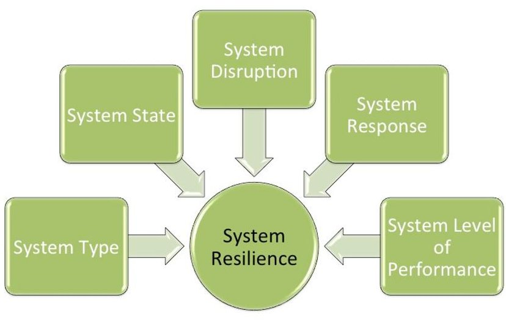
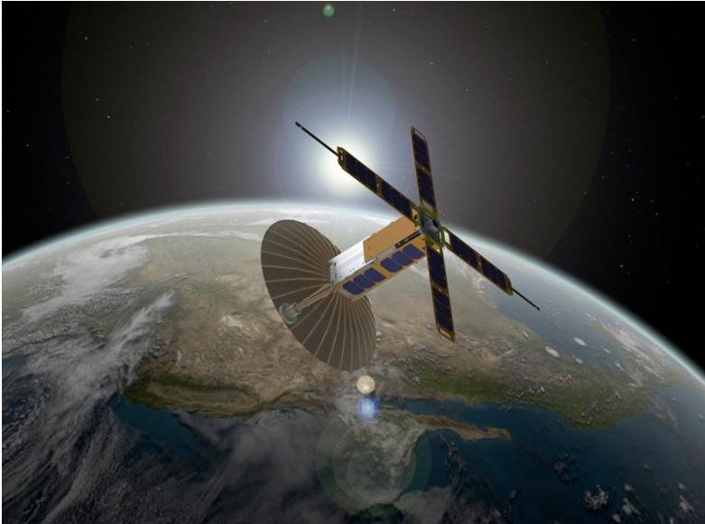
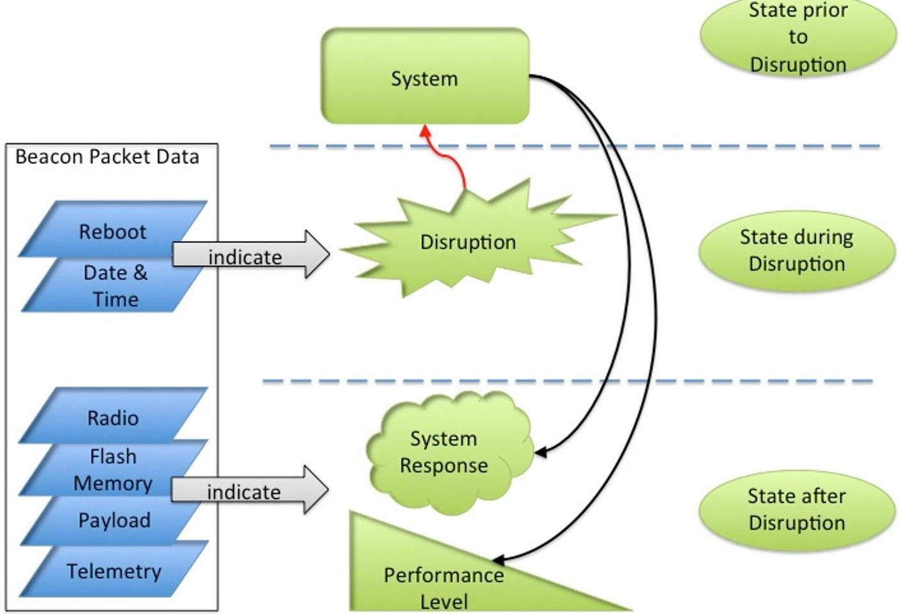

<!-- PDF_PAGE: 1 -->

# System Resilience Framework and Modeling for a CubeSat System

Yvette T. Rodriguez $ ^{1} $ and Azad M. Madni $ ^{2} $

University of Southern California, Los Angeles, CA, 90089-0193

System resilience is an innovative and affordable approach for complex systems to circumvent, survive, and recover from disruptions. Resilience is recognized in various fields of study. Specifically in systems engineering, there are several definitions of system resilience. This makes it challenging when conducting trade studies with respect to system resilience characteristics. The objectives of this paper are to document existing system resilience related definitions, propose a means to capture systems resilience for use as a future tradeoff ility in Model Based Systems Engineering (MBSE) and propose a method to model system resilience in CubeSat systems. System resilience is highly dependent on system behavior, reliability, operational availability, system state, real-time constraints, and potential unknowns.

## Nomenclature

= system level of performance

= system disruption

= system resilience amplitude of oscillation

= system response

= system state

= system type

## I. Introduction

SYSTEM RESILIENCE is affected by various system properties that continue to challenge systems engineers and designers. It is important to be able to conceptualize these in modeling and move toward a unified framework. This will enable communication of system resilience considerations. System resilience is highly dependent on its specific system and can be described based on system specific attributes and parameters. For example, spacecraft developers' main interests include making a spacecraft that can recover from disturbances rather than over designing to develop a perfect spacecraft. In developing these spacecrafts, methods to save in cost, mass, and power are three of the major priorities. Current research in smaller scale satellites such as nanosatellites have created more affordable opportunities for universities to conduct valuable research of these priorities in satellite missions. The benefits of this research extend beyond the university to provide research findings conducive to both private industries and government organizations.

CubeSat missions are available to conduct university level research based on affordable methods to launch payloads into space. The goal of this study is to define system resilience for space platforms in general and for the CubeSat system in particular. CubeSat systems are small and expendable satellite systems, which will increase the feasibility of conducting this research project while providing benefits to university research and the aerospace industry. The modeling of system resilience is a step toward defining system resilience on a larger scale and in more complex systems. This research is expected to support future university level and aerospace industry research in building a foundation for modeling system resilience and value based resilient systems engineering.

<!-- PDF_PAGE: 2 -->

## II. Resilience and Modeling

System resilience is defined in various aspects depending on the field of study. Defining system resilience in terms of system disturbance and response is most closely related to the following definition: "Resilience is the ability of a system to circumvent, survive and recover from failures to ultimately achieve mission objectives. A resilient system is able to reason about own/environmental states in the presence of environmental uncertainty $ ^{1,2} $

The most basic and important concepts in analyzing system resilience are 1) the system, 2) system states, 3) disruption, 4) system response, and 5) level of performance shown in Figure 1. Defining system resilience is highly dependent on these system considerations. Various versions of the definition will always be present in the study of system resilience. It is important to identify if the system is a single stand-alone system or system-of-systems to be able to determine how the resilience of that system is affected.

The system states are addressed to conceptualize the significance to system resilience. The prior states leading up to the disruption have to do with the state of the system and its current level of performance. The analysis of the states which impact system resilience is dynamic and various unknowns must also be held accountable. The dynamic behavior of the environment is considered, but in order to be able to develop the system resilience model, I found it necessary to hold the environmental state constant and identify it as an independent variable. The numerous unknown combinatorial states that may exist can be detrimental to conclusive results, therefore their study is held outside the scope of this research.

The modeling of the system requires us to view not only the current situation that a system may be experiencing, but also the prior states that have significant impact

to the current system disturbance. These are considered to create an influential impact to the system state following the disturbance and its recovery.

A system disruption can be as extreme as a hurricane or oil spill, but may be as minimal as a static electric charge or stray fiber. The desired action is for a system to be able to respond to the disruption. System resilience has been demonstrated on system elements that were not expressly designed to be resilient, but coincidentally resulted in having resilient responses to disturbances. The study of the disruption is one of the most challenging tasks in modeling system resilience, since we cannot realistically predict all disruptions. In addition, we know that all systems are at risk of experiencing some disruption in their existence, which is why it is important to explore and understand system resilience.

Figure 1. Considerations for System Resilience.

The system response is the way the system recovers from the disturbance or, more favorably, completely avoids the disturbance. A response can be a designed precautionary defense tactic or a byproduct of some other design feature of the system. The system response to a disturbance can be a combination of system actions to fully respond to the disturbance. The response may or may not be successful, but the developers and users define the actual classification of success.

When the system responds to the disturbance, the system's level of performance can be identified and 100% percent functional in the case where the disturbance is avoided or some level of graceful degradation that occurs. The graceful degradation is expected to be intentionally designed into the system where the system continues to maintain some percentage of functionality to continue to operate or enters a hibernate mode in order to attempt to recover and awaken at a later time. As opposed to continuing to operate successfully a system can have a complete failure, which does not necessarily indicate that the system is not resilient but the system resilience capability was unable to respond successfully to that particular disturbance.

## A. Importance of Resilience

One guarantee in a system's lifecycle is that system disturbances are inevitable. The likelihood that a system disturbance may occur may be minimal or even negligible, which still equates to a system disturbance. This requires

<!-- PDF_PAGE: 3 -->

that the system be prepared to sustain one of these types of disturbances to continue to maintain some form of functionality rather than degrade to a point beyond recovery.

The fact that system disturbances are inevitable is a contributing factor to why resilience is important. Systems can be prepared for predicted disturbances to a certain level and may be more likely to respond successfully. Other unknown disturbances may arise from events that have not been considered where the response preparation opportunity is not possible. These Unknown-Unknowns (UNK-UNKs) can be addressed through state and probabilistic analysis with a defined set of limits to bound the analysis. Adding to the complexity of analyzing system resilience, UNK-UNKs combined with a series of known events may prove to have detrimental results. It is not uncommon for system disturbances to have catastrophic results ranging from degraded system recovery to loss of life as shown in the following examples:

- Japan's Fukushima 2011 earthquake and tsunami were the catastrophic disturbances responsible for the system failure of the Fukushima Daiichi nuclear power plant. The lack of resilience strategies while focusing exclusively on risk management was at the root of the system failure resulting in loss of human life and detrimental follow-on effects $ ^{3} $

- Two major catastrophic rail disasters include the 2006 Glendale crash due to an attempted suicide by a motorist and the 2008 head-on collision by a Metrolink train due to texting. These collisions took the lives of 36 and injured approximately 235 individuals collectively. The source of the system disturbance in both of these cases is based on the actions of a human user. It is impossible to control human action and measures to move toward resilient designs in rail systems have been addressed in terms of crash-resistant rail cars. Theses Metrolink cars were first introduced in 2010 with designs to minimize disturbance effects through the use of "crumple zones designed to absorb the force of an impact and direct it away from passengers and crew" $ ^{4} $

- The cascading effects of the North American Eastern Interconnection system disturbance resulted in loss of power for approximately 50 million people in the United States and Canada. A task force was assigned to analyze the primary causes and they reported inadequacies regarding system understanding, situational awareness, vegetation management, and Reliability Coordinator support which all point to various consideration in system resilience $ ^{5} $

- The Advanced Extremely High Frequency (AEHF), a secure communication network supported by the U.S. Air Force, experienced major disturbance which could have been catastrophic when its first satellite was launched in August 2010. The satellite experienced a blocked fuel line resulting in the need to employ alternate methods to provide the necessary thrust to ensure the satellite reached its orbital position. The alternative was successful but the satellite reached the orbital slot 14 months later, which was much later than originally planned $ ^{6} $ . The resilient recovery experienced by the AEHF program is exemplary of catastrophic failure avoidance and the gap in space system resilience research to manage environmental disturbances and malicious threats. $ ^{7} $

Real-time systems also require system resilience design where system disturbances may not necessarily have catastrophic results, but may have deleterious effects. The unpredictability and inability to control the source of system disturbance are indicative examples of the need to advance the state of the art in resilient systems. The initial considerations in resilient system design is the need to model the resilience priorities of the system design.

## B. The Importance of Modeling

Modeling offers the means to represent and decompose the system concept to identify relationships and interactions within system elements. The ability to provide a system description that can be communicated is imperative in successful system design meeting the user requirements. The objective of the model is to exploit system ambiguities and communicate design considerations that may have been missed in the design process. The refined model is not expected to be an exact replica of the system but rather a well-defined representation of the system to describe the functionality depicting varying states, system modes, and other "difficult to communicate" system attributes. $ ^{8} $

The model definition communicates the design and may include system interfaces, system processes, and varying system levels/layers/views. The increasing complexity of systems and evolution of System-of-Systems (SoS) $ ^{9,10} $ requires the progression to communicate more complex system attributes while minimizing the ambiguity of the system model.

System modeling provides the opportunity to be able to run systems simulation in an attempt to reveal poor system design choices and or system errors. Analysis can be accomplished to establish a baseline of simulated system operation to be considered in final design. The modeling not only provides the opportunity to reduce system inconsistencies and errors, but also enables the ability to demonstrate dynamic system behavior.

<!-- PDF_PAGE: 4 -->

## C. Incorporating System Resilience into Model Based Systems Engineering

Model Based Systems Engineering (MBSE) emerged as a new paradigm to aid in managing the complexities in systems engineering tasks. The use of MBSE throughout a system's lifecycle, from a concept to a fielded product and eventually disposal, provides an affordable and less risky method to visit alternatives in design decision-making than conducting physical prototyping. A significant research interest in system affordability is also required in addition to design considerations in system architecture and system modeling. Methodologies incorporating modeling have been explored to increase system affordability. $ ^{11,12} $ MBSE provides added benefit in demonstrating the affordability in early life cycle cost estimation $ ^{13} $ and complex system tradeoff analysis prior to system development. The Unified Modeling Language (UML) and Systems Modeling Language (SysML) are two modeling languages developed to provide complex system descriptions through modeling. UML provides the ability to model both the static and dynamic aspects of a system minimizing the workload by traditional modeling methods. UML describes a system through structural diagrams and behavior diagrams, whereas SysML, derived from UML, adds parametric and requirements to the modeling platform.

These modeling languages provide a more picturesque approach as opposed to the document-centric approach of traditional modeling methods. This approach makes it easier to identify inconsistencies in system design by capturing the different layers (i.e. structure, behavior, parametric, requirements) in a single model whereas traditional methods required simultaneous review of several different documents.

Resilience is not a tangible or an easily identifiable system ability and commonly has unidentifiable dependencies. MBSE's approach is best fit to address resilience due to its complex nature. Traditional methods to address resilience would be costly, destructive, and cannot realistically be exhaustive. Attempting to test how a system can survive system disturbances would be a costly measure to conduct while being destructive to that system. MBSE and the evolution of SysML is key in modeling space systems as demonstrated in the analysis of CubeSat system design and mission operations. $ ^{14,15} $ These latest advances in modeling bring system resilience research and MBSE together as the best-fit union.

## III. Modeling CubeSat

Modeling a real system that is a major component of a networked system consisting of the CubeSat satellite, the ground control system, various data collection amateur radio operators, deployment rocket, and launching system is the first step toward addressing system design considerations for system resilience in satellite systems. Each of these elements of the overall networked system has prominence based on the different stages of the lifecycle and the active state of the system. For instance, the rocket and launch system are major components during launch, whereas once the CubeSat is in orbit the major component is the CubeSat itself. The CubeSat plays a major role throughout the different phases of the lifecycle of the networked system. The CubeSat system and the communication system are of most interest in this research, since they are the key to revealing the system's data.

A CubeSat system can be equipped to transmit telemetry data and system health, used to understand the relationship between the data collected and system disturbances. These related occurrences are studied to learn about the system prior to, during, and following the disturbance. The opportunity to examine the system states at the

different stages of the disturbance provides the ability to identify the characteristics and properties of a system demonstrating resilience. By identifying this demonstration of resilience, these characteristics and properties are used with systems engineering methods, process and tools to build a system resilience model. The use of MBSE to demonstrate system resilience takes advantage of past modeling approaches in conjunction with current practices to renew modeling efforts by incorporating the resilience aspect. Modeling system resilience in CubeSat systems can be built upon to explore resilience research interests in more complex, fractionated and distributed systems (i.e. NASA's System F6, ). $ ^{16-18} $

## IV. Aeneas CubeSat

The University of Southern California's (USC) Image 1. USC SERC's Aeneas CubeSat (www.isi.edu). Space Engineering Research Center (SERC) satellite team consists of employees and student body members that

<!-- PDF_PAGE: 5 -->

modified the "3U (30x10x10cm) National Reconnaissance Office (NRO) specified Colony I CubeSat bus to address a research thrust of the Department of Homeland Security (DHS)" known as Aeneas which is currently in orbit. Aeneas' two payloads include a tracking system to track cargo containers over the open ocean designed by iControl Inc. and a radiation-hardened flight processor funded by various government funded research initiatives. In addition to the two payloads, three-axis pointing and a deployable antenna were designed and fabricated to support the mission of the primary payload.

Aeneas was chosen to conduct this research in MBSE and modeling system resilience based on it being a realtime system with the availability of genuine telemetry data. The beacon data available provides the ability to conduct a study to demonstrate the categorization of the data items, such as time, system resets, radio status, signal strength and beacon availability to understand the system response to disturbances. This system data provides the ability to conduct a study of system resilience in a real CubeSat system in orbit with future opportunities to perform resilience modeling for larger scale satellite systems.

## A. Aeneas Amateur Radio Satellite (AMSAT) Data Collection

The collaboration of the international AMSAT community is required to assist in the ability to track the Aeneas satellite. The beacon data is collected through emails including beacon packets from the international AMSAT community conduct telemetry data collection. The collection of the data relies heavily on the AMSAT community similar to data collection methods of many other university CubeSat programs.

The raw Aeneas telemetry data is in ASCII format represented by hexadecimal digits. The beacon data described in Tables 1 and 2 is collected and stored on a custome built MySQL database. $ ^{19} $ These beacon packets include the information listed in Label column of Table 2 which is identified by the location of the information referenced by the Offset column.

## B. Aeneas Data of Interest for System Resilience Modeling

The beacon packets provide the data to be used as indicators of the system resilience considerations shown in Figure 1. The relationship between these considerations are also shown in Figure 2 including the Aeneas beacon packet data indicators. The data collected from a system reboot indicates that a system disruption occurred while the date & time data provides a record when that disruption occurred. The reboot data also includes a reason for the reboot which can range from a minor power conservation mode to complete power reset. The reboot provides additional detailed information to characterize the system disruption.

<table border="1"><tr><td colspan="2">AENEAS AMSAT Information</td></tr><tr><td>CALL SIGN:</td><td>KE6FYA default</td></tr><tr><td>Beacon Downlink Frequency:</td><td>437.600 MHZ,20KHZ bandwidth</td></tr><tr><td>Beacon Output Power:</td><td>1W</td></tr><tr><td>Antenna:</td><td>Monopole Whip</td></tr><tr><td>Modulation Type:</td><td>AFSK</td></tr><tr><td>Modulation Frequency:</td><td>1200bps</td></tr><tr><td colspan="2">AENEAS will beacon every 10 seconds. Due to operational reasons the beacon may not be n at all times or may be at 60 second intervals.</td></tr></table>

Table 1. AENEAS Communication Information.

<table border="1"><tr><td>Label</td><td>Offset</td></tr><tr><td>Packet Header</td><td>0-5</td></tr><tr><td>Packet Length</td><td>6-7</td></tr><tr><td>Packet Type</td><td>8-8</td></tr><tr><td>Unused Bytes</td><td>9-10</td></tr><tr><td>Date/Time Encoding</td><td>11-17</td></tr><tr><td>Reboot Counter</td><td>19-20</td></tr><tr><td>Reboot Reason Code</td><td>21-22</td></tr><tr><td>Flash Status Flags</td><td>23-24</td></tr><tr><td>Telemetry Pointer</td><td>25-28</td></tr><tr><td>Payload Write Pointer</td><td>29-32</td></tr><tr><td>Radio Status</td><td>33-33</td></tr><tr><td>Miscellaneous Write Pointer</td><td>34-37</td></tr><tr><td>Checksum</td><td>38-39</td></tr></table>

Table 2. AENEAS Beacon Packets.

<!-- PDF_PAGE: 6 -->

The system is impacted by the disruption and peforms a system response. The system response is indicated by the data collected from the radio, flash memory, payload and telemetry. The radio data provides information to determine whether or not the radio antenna is responding normally. The flash memory is used to support the geomagnetic model which assists with the attitude determination and control (AD&C) system. The payload data

Figure 2. AENEAS Beacon Data Indicators.

provides the information showing the progress of the main experiment conducted by the iTag processing software to conduct tracking. The telemetry data provides the information to determine how long the spacecraft is active in orbit. The radio, flash, payload and telemetry data are direct indicators to characterize the system response to the aforementioned system disruption. In addition, the data also indicates whether or not the system continued to operate in a degraded mode following the system response.

The system state prior to, during, and following the disruption also requires consideration in showing system resilience. The beacon packet data is revisited here to understand the system at each of these states as characterized by the reboot, date & time, radio, flash, payload and telemetry data. The data collected provides the ability to identify the indicators in formulating the relationships between the system resilience considerations in Figure 1. As a result, the system resilience considerations relationships are identified in the functional equation as follows:

$$
S R _ {s t} = F (s s, s d, s r, l p)
$$

The system resilience of a particular system type is a function of the system state, the system disruption, the system response and the system level of performance as shown in Eq. (1) and tailored to Aeneas in Figure 2.

## V. Conclusion

The challenge of analyzing system resilience is addressed through the use of MBSE to model a CubeSat system. The Aeneas CubeSat system is an experimental case to identify the indicators of the system resilience considerations and show their relationships. The Aeneus CubeSat data collected plays an instrumental role in advancing the state of

<!-- PDF_PAGE: 7 -->

the art in nanosatellite, MBSE, and system resilience research. The findings from this study provide future research opportunities in resilience modeling for larger scale satellite systems to improve the management of system responses to avoid catastrophic failures.

We would thank J. Tim Barrett and Jeff Sachs for their valuable time spent conducting interviews and answering questions regarding the Aeneas CubeSat project. In addition, Dr. Sara Spangelo and Dr. Lucy Hoag provided supportive insight through their research efforts of CubeSat systems. The advisement and expertise of Dr. Michael Sievers and Kenneth Cureton assisted the motivation of this research in systems architecting and engineering.

## Acknowledgments

## References

$ ^{1} $Madni, A. M., "Adaptable platform-based engineering: Key enablers and outlook for the future," Systems Engineering, vol. 15, Mar. 2012, pp. 95-107.

$ ^{2} $Goerger, S. R., Madni, A. M., and Eslinger, O. J., "Engineered Resilient Systems: A DoD Perspective," Procedia Computer Science, vol. 28, 2014, pp. 865-872.

$ ^{3} $Park, J., Seager, T. P., and Rao, P. S. C., "Lessons in risk- versus resilience-based design and management.," Integrated environmental assessment and management, vol. 7, Jul. 2011, pp. 396-9.

$ ^{4} $ Hanson, K., "PUBLIC TRANSIT: Crash - resistant carriages from South Korea face tests before they join the fleet.," Daily Breeze (Torrance, CA), Mar. 2010, p. 3A.

$ ^{5} $Andersson, G., Donalek, P., Farmer, R., Hatziargyriou, N., Kamwa, I., Kundur, P., Martins, N., Paserba, J., Pourbeik, P., Sanchez-Gasca, J., Schulz, R., Stankovic, A., Taylor, C., and Vittal, V., "Causes of the 2003 Major Grid Blackouts in North America and Europe, and Recommended Means to Improve System Dynamic Performance," IEEE Transactions on Power Systems, vol. 20, Nov. 2005, pp. 1922-1928.

$ ^{6} $Yendler, B., "Satellite Rescue- Luck of Skillful Application of Technology : SPACE Conferences & Exposition: Vol. , No. (AIAA)," AIAA Space 2012 Conference & Exposition, Pasadena, CA: 2012.

$ ^{7} $Byrne, D. J., Morgan, D., Tan, K., Johnson, B., and Dorros, C., "Cyber Defense of Space-based Assets: Verifying and Validating Defensive Designs and Implementations," Procedia Computer Science, vol. 28, 2014, pp. 522-530.

$ ^{8} $Cureton, K. L., and Settles, F. S., "Systems-of-Systems Architecting: Educational Findings and Implications," 2005 IEEE International Conference on Systems, Man and Cybernetics, IEEE, 2005, pp. 2726-2731.

$ ^{9} $Fang, Z., and DeLaurentis, D., "Dynamic Planning of System of Systems Architecture Evolution," Procedia Computer Science, vol. 28, 2014, pp. 449-456.

$ ^{1 0} $Uday, P., and Marais, K. B., "Resilience-based System Importance Measures for System-of-Systems," Procedia Computer Science, vol. 28, 2014, pp. 257-264.

$ ^{11} $ Wu, M. S., Ross, A. M., and Rhodes, D. H., "Design for Affordability in Complex Systems and Programs Using Tradespace-based Affordability Analysis," Procedia Computer Science, vol. 28, 2014, pp. 828-837.

$ ^{12} $ Schaffner, M. A., Ross, A. M., and Rhodes, D. H., "A Method for Selecting Affordable System Concepts: A Case Application to Naval Ship Design," Procedia Computer Science, vol. 28, 2014, pp. 304-313.

$ ^{13} $ Dabkowski, M., Valerdi, R., and Farr, J., "Exploiting Architectural Communities in Early Life Cycle Cost Estimation," Procedia Computer Science, vol. 28, 2014, pp. 95-102.

$ ^{14} $Spangelo, S. C., Kaslow, D., Delp, C., Cole, B., Anderson, L., Fosse, E., Gilbert, B. S., Hartman, L., Kahn, T., and Cutler, J., "Applying Model Based Systems Engineering (MBSE) to a standard CubeSat," 2012 IEEE Aerospace Conference, 2012.

<!-- PDF_PAGE: 8 -->

$ ^{15} $Spangelo, S. C., Cutler, J., Anderson, L., Fosse, E., Cheng, L., Yntema, R., Bajaj, M., Delp, C., Cole, B., Soremekum, G., and Kaslow, D., "Model Based Systems Engineering ( MBSE ) Applied to Radio Aurora Explorer ( RA X ) CubeSat Mission Operational Scenarios," IEEE Aerospace Conference, 2013.

$ ^{1 6} $Matni, N., Leong, Y. P., Wang, Y. S., You, S., Horowitz, M. B., and Doyle, J. C., "Resilience in Large Scale Distributed Systems," Procedia Computer Science, vol. 28, 2014, pp. 285-293.

$ ^{17} $ Mosleh, M., Dalili, K., and Heydari, B., "Optimal Modularity for Fractionated Spacecraft: The Case of System F6," Procedia Computer Science, vol. 28, 2014, pp. 164-170.

$ ^{18} $ Kichkaylo, T., Hoag, L., Lennon, E., and Roesler, G., "Highly Efficient Exploration of Large Design Spaces: Fractionated Satellites as an Example of Adaptable Systems," Procedia Computer Science, vol. 8, Jan. 2012, pp. 428-436.

$ ^{19} $Barrett, J. T., Aherne, M., Besouska, W., Schs, J., and Hoag, L., "Caerus - Concept through Flight in Eleven Months: A Story of Rapid Response and Lessons Learned : SPACE Conferences & Exposition: Vol. , No. (AIAA)," AIAA Space 2011 Conference & Exposition, 2011.