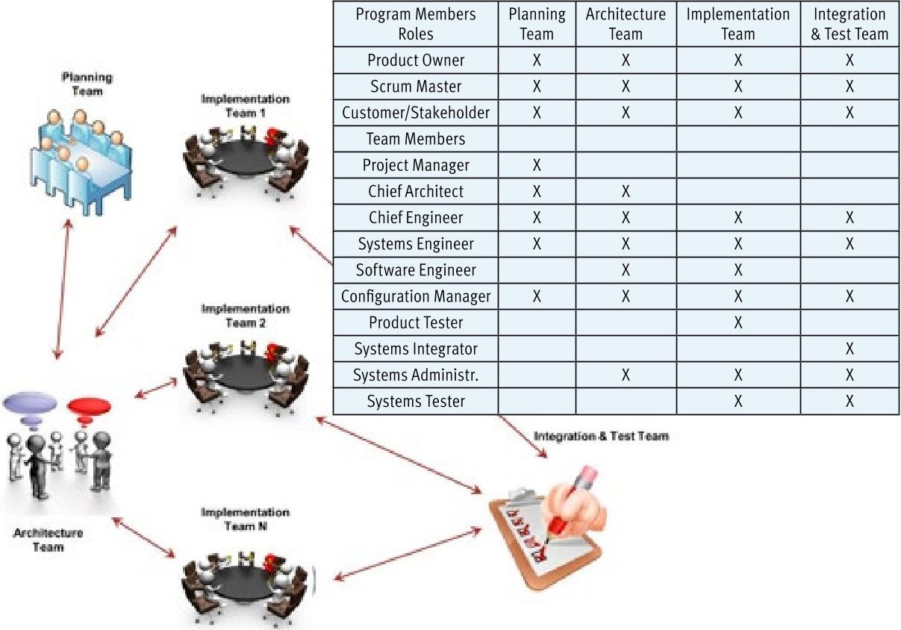
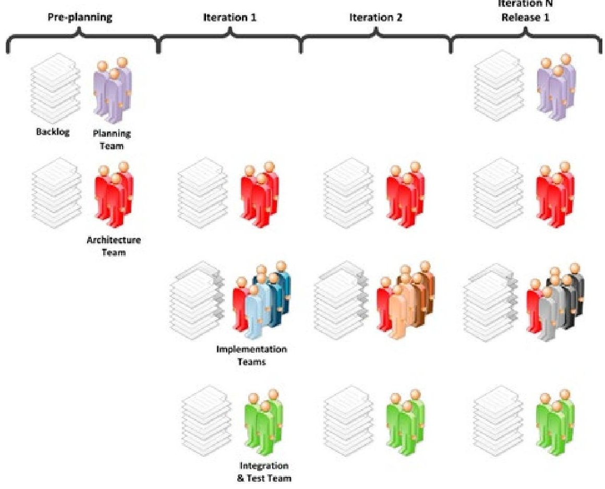

<!-- PDF_PAGE: 1 -->

## LaBarge continued

modules combined with hundreds of educational, corporate, and governmental organizations that design, develop, deploy, and operate CubeSats provide both the modularity and the active infrastructure necessary for an agile system. CubeSat designers have taken advantage of most of the agile design principles for reusability and rescalability and have deferred using of some of the design principles for reconfigurability due to the difficulties of reconfiguring a satellite after launch. In summary, the CubeSat project and most CubeSat satellites use an agile system architecture that is modular, provides both a passive and active infrastructure, and incorporates most of the ten agile design principles.

## i

## References

Cal Poly. 1999. CubeSat Project: Mission Statement. www.cubesat.org/index.php/aboutus/mission-statement, accessed on 14 January 2014.

Cal Poly. 2009. CubeSat Design Specification Rev 12. August 9. http://browncubesat.org/wp-content/uploads/2013/01/Cubesat-Reqs.pdf.

Dove, Rick and Ralph LaBarge. 2014. Agile Systems Engineering - Part 1. International Council on Systems Engineering IS14 Conference, Los Angeles, US-CA, 30 June 03 July. www.parshift.com/s/140721IS14-AgileSystemsEngineering-Part1.pdf.

Smith, Matthew W., Sara Seager, Christopher M. Pong, Jesus S. Villaseñor, George R. Ricker, David W. Miller, Mary E. Knapp, Grant T. Farmer, and Rebecca Jensen-Clem. 2010. "ExoplanetSat: detecting transiting exoplanets using a low-cost CubeSat platform." In SPIE Astronomical Telescopes and Instrumentation: Observational Frontiers of Astronomy for the New Decade, pp. 773127-773127. International Society for Optics and Photonics.

# The Role of Systems Engineering in Large-Scale Agile Projects

Phyllis Marbach, phyllis.marbach@incose.org; Larri Rosser, larri.rosser@incose.org; Gundars Osvalds, gundars.osvalds@incose.org; and David Lempia, david.lempia@incose.org

When software development teams apply agile software methodologies, such as scrum, test-driven development, and continuous integration, there are challenges in coordination with traditional systems engineering efforts. In this article, we present methods for cross-functional teams that include systems and software engineers. We define an agile systems engineering framework that aligns with agile software development methodology, and describes the role of the systems engineer in this context. We show an iterative approach to the aspects of development, such as requirements and design that are relevant to systems engineering practice. This approach delivers frequent, releasable products that result in the ability to absorb changes in mission requirements through collaboration between systems engineers and software engineers. The agile systems engineering framework defines a way to scale from individual agile software teams with a few members to large projects that require a planned architecture and coordinated efforts.

Over the last decade and a half, agile software development methodologies have offered a fast, lean, and flexible approach to developing software. Systems engineers and software engineers have the challenge to integrate valueadded systems engineering activities into an agile software development approach. This challenge has been met most successfully on small projects, in which the necessary systems engineering activities can be owned by members of the development team, and the definition of capabilities and determination of system readiness can be handled by the customer and stakeholders with minimal formality. We are introducing an agile systems engineering framework, which consists of architecture, process, and roles describing the changes necessary to align systems engineers and software engineers in an agile methodology context.

Traditionally, systems engineers define and interpret

stakeholder needs and develop the system design, which software engineers subsequently use to develop detailed designs, and then implement capabilities. The interactions between systems engineers and software engineers are not real-time, iterative, or informal, which limits flexibility and responsiveness to change. This article describes a different approach for systems and software engineers to work together on software-intensive projects, called the agile systems engineering framework.

## The Agile Systems Engineering Framework

Our agile systems engineering framework describes changes to the architecture, process, and roles required to move from traditional systems engineering processes to a systems engineering process that augments agile software development teams. An issue with current agile methodologies is that the system architecture is not an explicit part of agile software development methodology. When developing small software-intensive systems, designing the architecture is the responsibility of the agile software development team. For larger systems, there needs to be consideration for dependencies between the system capabilities and architectural elements developed by different implementation teams. To anticipate the architecture support needed, systems engineers must participate in implementation team within the agile systems engineering framework. In this framework, it is the responsibility of systems engineers to identify and analyze architecture dependencies so they can create and continuously update an architecture description. This description will provide the framework to support the software implementation.

## Architecture Changes

Traditional systems engineering often involves the upfront, top-level design activity. The architecture changes

<!-- PDF_PAGE: 2 -->

required to decompose the top-level design for agile software development teams involves identifying critical architecture choices to be made at the start of a project, and creating a flexible architecture that is amenable to planned refinement as implementation progresses. Having a flexible, modular architecture is an important enabler for iterative development. The systems engineers should treat planned refinement as an opportunity to manage technical risk and benefit from technical and user evaluations made on the products of early iterations. The systems engineer is responsible for maintaining balance in the key quality attributes of the architecture, and for adjusting the architecture to maintain and improve its flexibility to support changes. In the next section we introduce how the architecture team stays just ahead of the implementation team, incorporating lessons learned from the previous iteration as input to refactor and refine the architecture, followed by developing new systems engineering artifacts to support the next iteration.

## Process Changes

In traditional systems engineering approaches, the handoff from systems teams to agile software development teams is not rapid and iterative. However, in an agile environment, the systems engineers and software engineers need to work together to define, implement, and test the project's capabilities to more effectively inspect the results and adapt subsequent iterations to maintain overall system integrity.

Figure 1. Agile teams

Larger programs that have several agile software development teams working in parallel, especially need systems engineers engaged and providing value. The critical message to systems engineers participating with projects using agile software development methodologies is: the work tempo changes, but the systems engineers' work products still matter. The systems engineers focus on articulating and satisfying needs and on verifying capabilities and performance is as important as ever. The challenge is to carry out the essential work in agreement, rather than conflict, with the agile software development teams. To achieve this end, systems engineering processes must be adapted to support agile software design and development methods. In a waterfall model, the design and development teams only have one chance to get each aspect of a project right. In agile methodologies for systems engineering, we continually revisit every aspect of development, such as requirements and design, throughout the development lifecycle. We propose using an agile team (figure 1), to help shift the focus to a flexible and holistic design and development strategy. We describe the team member roles in more detail in the next section.

Figure 2 shows the process flow of the teams introduced in figure 1. At the start (figure 2, Pre-planning), the planning and the architecture teams define the

Figure 2. Agile Systems engineering framework

<!-- PDF_PAGE: 3 -->

capabilities for the system to be developed. The pre-planning period includes the technical planning, mission and needs analysis, requirements articulation, requirements management definition, and architecture framework creation. Input into this pre-planning step includes customer-needed capabilities. During the pre-planning phase, the planning team defines the scope and deliverables of the project, while the architecture team, establishes the vision, the roadmap, the architecture, and a prioritized backlog of significant capabilities to be developed. When working with agile software development teams, the level of detail of the design artifacts needed to start the first implementation iteration may be less than what is normally produced on traditional life cycle projects since the customer will be involved by providing feedback during the program development cycle. We identify some elements of the architecture or requirements for analysis and elaboration later in the implementation cycle. Depending on the level of formality of the project, the planning stage outputs could include a concept of operations (CONOPs), planning artifacts, architecture diagrams and models, and a high level list of requirements.

The outputs from the pre-planning phase will flow into the first iteration. The architecture team updates the capabilities backlog (figure 2, iteration 1) and then prepares materials the implementation teams will develop in the next iteration. These materials can include requirements, architecture, capabilities, and user experience. The architecture team members will also participate on the implementation teams to maintain the architecture as the detailed design evolves and help the software engineers understand and align the software product to the proposed architecture and requirements. Concurrently, the implementation teams work on the highest priority capability product (or software) backlog items and the integration and test team implements the test environment. In subsequent iterations, the completed product from all implementation teams undergoes testing by the integration and test team, thereby providing the ability to verify the requirements either internally or with the customer, if permitted.

In the agile systems engineering framework, implementation team members include systems engineering, software engineers, integrators, product testers, and other cross-functional team members as needed for the product in development. This cross-functional makeup and purpose of the implementation team is similar to the integrated product teams defined in the Systems Engineering Handbook. The systems engineers on the implementation team develop and maintain design artifacts during iterations. Other responsibilities of the systems engineers are the system capabilities, interface definitions, trades studies, detailed design representations, test procedures, and test plans.

When the architecture team determines the need for architecture changes, work to revise the architecture occurs to support upcoming capability development. This work could include trade studies, architecture revision, prototyping database revision, and more. The goal is to provide a modular systems architecture that is resilient to change. The iterations continue until the release is complete (figure2, iteration N, release 1). We demonstrate the release to the customer or stakeholder and to the planning team for review and acceptance. We may plan to defer requested changes until the next release. At the demonstration of the final release, the systems engineers verify that the architecture meets the requirements.

## Role Changes

The team members described in Table 1 fulfill the various roles listed in figure 1, Agile Teams. It is important on self-organizing teams to ensure representation of all needed skills listed in figure 1 are among the agile team members. The team members share the responsibility for products in development by the teams. The agile systems engineering framework provides for integrating systems engineering value with an agile software development approach. Table 1 illustrates, but does not prescribe, providing self-organizing teams the flexibility to manage their artifacts and activities. The desired outcome is to incorporate the value of both systems engineering activities and agile software methodologies into the project approach. This requires "just enough systems engineering" during pre-planning to provide a clear understanding of key performance parameters and robust system architecture. The pre-planning work should guide but not constrain the implementation, and should introduce minimal delays in starting implementation. Additional systems engineering activities should occur as part of the implementation iterations, with systems engineers acting as full participants in the agile systems engineering framework. The goal is to mature the requirements and architecture as the project proceeds, taking advantage of early iterations to add clarity before solidifying specific architectural features or sets of requirements.

A RACI (responsible, accountable, consulted, informed) matrix is a type of responsibility assignment matrix, which documents tasks, activities, milestones, or decisions in the support of a program, project, or task by team members and to clarify expectations on their level of participation. Each team member is designated a role in the RACI hierarchy. Table 1 is an example of how a typical team self-organizes with example assignments. Systems engineers will perform various tasks as an agile team member depending on their skill set and the product in development.

<!-- PDF_PAGE: 4 -->

Table 1. RACI Matrix for Agile Systems Engineering Framework

<table border="1"><tr><td>Roles</td><td>Product Owner</td><td>Scrum Master</td><td>Team Member</td><td>Customer/Stakeholder</td></tr><tr><td colspan="5">PLANNING TEAM</td></tr><tr><td>Scope</td><td>C</td><td>C</td><td>R</td><td>A</td></tr><tr><td>Define Deliverables(Product Level)</td><td>C</td><td>C</td><td>R</td><td>A</td></tr><tr><td>Technical Management Mission</td><td>A</td><td>C</td><td>R</td><td>C</td></tr><tr><td>Needs Analysis</td><td>A</td><td>C</td><td>R</td><td>C</td></tr><tr><td>Requirement Articulation(Product Capability Backlog)</td><td>R</td><td>C</td><td>C</td><td>A</td></tr><tr><td>Requirements Management</td><td>A</td><td>C</td><td>R</td><td>C</td></tr><tr><td>Meeting Facilitator/Impediment Remover</td><td>A</td><td>R</td><td>C</td><td>C</td></tr><tr><td colspan="5">ARCHITECTURE TEAM</td></tr><tr><td>Vision</td><td>A</td><td>C</td><td>R</td><td>C</td></tr><tr><td>Roadmap</td><td>A</td><td>C</td><td>R</td><td>C</td></tr><tr><td>Architecture Framework/System Design</td><td>C</td><td>C</td><td>R</td><td>A</td></tr><tr><td>Define and Maintain Interfaces</td><td>A</td><td>C</td><td>R</td><td>C</td></tr><tr><td>Architecture Product Backlog</td><td>A</td><td>C</td><td>R</td><td>C</td></tr><tr><td>Concept of Operations(CONOPs)</td><td>C</td><td>C</td><td>R</td><td>A</td></tr><tr><td>Perform Trade Studies</td><td>A</td><td>C</td><td>R</td><td>C</td></tr><tr><td>Meeting Facilitator/Impediment Remover</td><td>A</td><td>R</td><td>C</td><td>C</td></tr><tr><td colspan="5">INTEGRATION AND TEST TEAM</td></tr><tr><td>Software(SW)Backup/SW Baseline Test Baseline</td><td>A</td><td>C</td><td>R</td><td>I</td></tr><tr><td>System Integration</td><td>A</td><td>C</td><td>R</td><td>I</td></tr><tr><td>Validation</td><td>A</td><td>C</td><td>R</td><td>C</td></tr><tr><td>Meeting Facilitator/Impediment Remover</td><td>A</td><td>R</td><td>C</td><td>C</td></tr><tr><td colspan="5">IMPLEMENTATION TEAM</td></tr><tr><td>Develop/Maintain Software Design(Detailed Design)</td><td>A</td><td>C</td><td>R</td><td>C</td></tr><tr><td>Software Implementation</td><td>A</td><td>C</td><td>R</td><td>C</td></tr><tr><td>Integration-Unit Test,SW Integration as Possible</td><td>A</td><td>C</td><td>R</td><td>C</td></tr><tr><td>Verification</td><td>A</td><td>C</td><td>R</td><td>C</td></tr><tr><td>Maintain/Verify System Capabilities as possible</td><td>A</td><td>C</td><td>R</td><td>C</td></tr><tr><td>Maintain Interface Definitions of SW/Component</td><td>A</td><td>C</td><td>R</td><td>C</td></tr><tr><td>Perform Trade Studies</td><td>A</td><td>C</td><td>R</td><td>C</td></tr><tr><td>Develop/Maintain Test Procedures</td><td>A</td><td>C</td><td>R</td><td>C</td></tr><tr><td>Meeting Facilitator/Impediment Remover</td><td>A</td><td>R</td><td>C</td><td>C</td></tr></table>

<table border="1"><tr><td colspan="2">RACI Matrix Legend</td></tr><tr><td>Responsible(one)</td><td>Leads the task completion with tangible deliverables</td></tr><tr><td>Accountable(one)</td><td>Delegates the responsibility for task, approves completion</td></tr><tr><td>Consulted(many)</td><td>Multiple contributors provide special knowledge or expertise</td></tr><tr><td>Informed(many)</td><td>Members that will be informed of the task status and deliverables</td></tr></table>

## Conclusion

Agile software development methodologies offer a fast, lean, and flexible approach for developing software, but challenge the traditional approach to systems engineering activities. The most successful applications have been on small projects, where a team executes systems engineering activities with minimal formality. When scaling up to large projects with multiple teams, formal milestones, and cross team dependencies, integration of systems engineering is more challenging but essential.

The agile systems engineering framework described in this article offers a way for systems engineers and software engineers to work together more closely on software-intensive projects, evolving the work products iteratively as is typically done on agile projects. This article proposes that systems engineers develop "just enough" architecture and requirements before the beginning of implementation. The cross-functional implementation teams includes the systems engineers who maintains the integrity of the requirements and architecture. The requirements and architecture evolve as development proceeds. The role of the systems engineers within the implementation teams, the architecture team, and the integration and test team includes customer and stakeholder requirements definition, requirements analysis, architectural design, implementation, integration, and verification. This approach will deliver the frequent releasable products and flexibility to absorb mission requirements changes enabled by an agile approach. The agile systems engineering framework strengthens the focus on requirements, architecture, system design, and validation provided by systems engineering on large-scale agile projects.

INSIGHT

<!-- PDF_PAGE: 5 -->

# INSTITUTE FOR SYSTEMS RESEARCH A. JAMES CLARK SCHOOL OF ENGINEERING

## FACULTY POSITION IN MODEL-BASED SYSTEMS ENGINEERING

The Institute for Systems Research (ISR) and the A. James Clark School of Engineering at the University of Maryland, College Park, invite applications for a tenure-track assistant professor position in Model-Based Systems Engineering (MBSE). We seek applicants with a doctoral degree who have research expertise in MBSE, formal approaches to engineering design and validation, requirements engineering, and multi-objective optimization and trade-off analysis, with appropriate connections to an engineering and/or biological domain.

This position is tenure track in a Clark School department (Aerospace, Electrical and Computer, Fire Protection, Mechanical, Civil and Environmental, Chemical and Biomolecular, Materials Science and Engineering, or Bioengineering) with a joint appointment to the ISR. The tenure home for this appointment will be in the department, and the ISR and its Director will also review the candidate's dossier.

The position holder will contribute to teaching systems engineering, advise systems engineering students for their theses, and develop new systems engineering courses. With regard to research responsibilities, the position holder will propose and conduct MBSE methodology and tools research that improves the ability to conceive, design, and analyze complex multidomain systems and will collaborate with other ISR faculty researchers to incorporate MBSE methods into ISR multi-disciplinary research.

The Clark School's (www.eng.umd.edu) graduate programs collectively rank 19th nationally (11th among public universities) in U.S. News & World Report's "America's Best Graduate Schools 2014." In 2013 the Academic Ranking of World Universities ranked the Clark School programs 16th in the world. ISR (www.isr.umd.edu), an original NSF ERC, celebrates 27 years of multi-disciplinary research in cooperation with universities, government, and industry. With annual expenditures exceeding $20M, it conducts interdisciplinary research and provides education in systems engineering and sciences; and devises basic solution methodologies and tools for systems problems in disparate application domains. ISR has 38 joint appointment faculty; 27 affiliate faculty; and eight research scientists from four colleges and 14 units across the University of Maryland.

Prospective candidates should demonstrate the required expertise and apply with: A cover letter

- Curriculum vitae

- Teaching and research statements

- Three relevant scientific papers

- List of references

TO APPLY: Please visit (ejobs.umd.edu) and find posting #105839. For best consideration, submit applications by January 31, 2014; the position remains open until filled. The University of Maryland is an EEO/AA employer. We strongly encourage women and minorities to apply.

