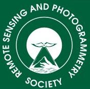
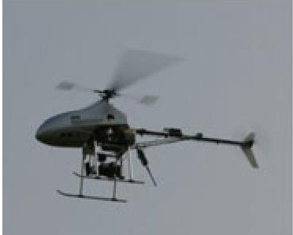
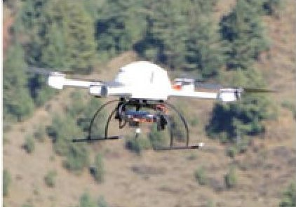
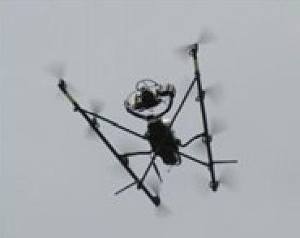
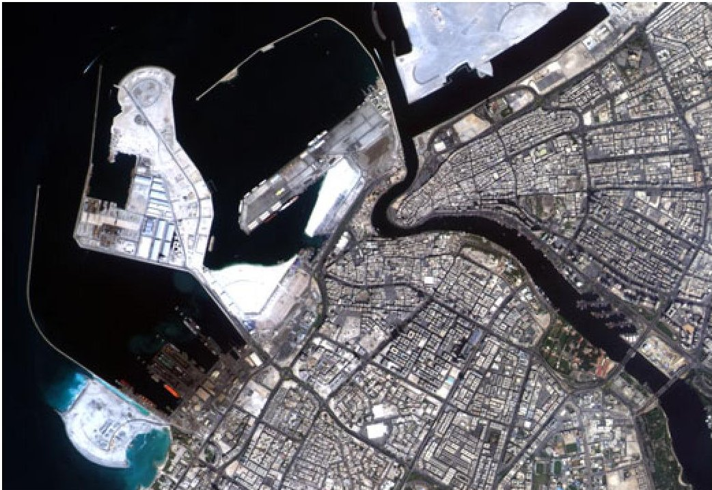
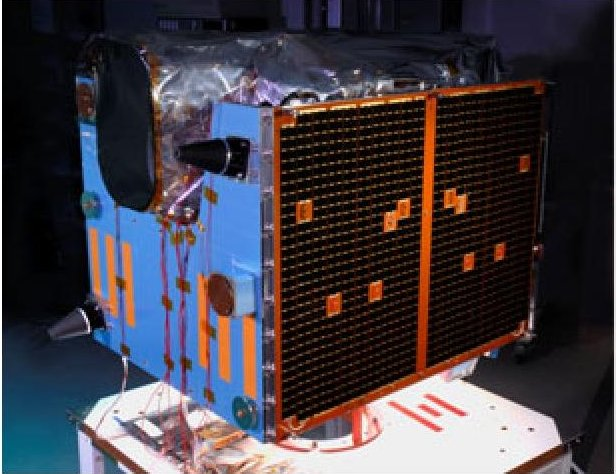
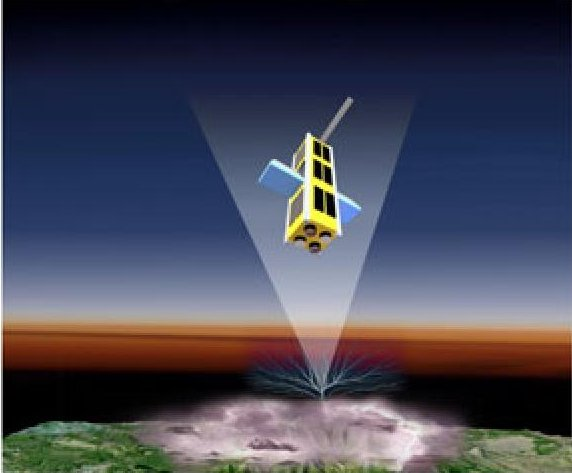

<!-- PDF_PAGE: 1 -->

THE PHOTOGRAMMETRIC RECORD

The Photogrammetric Record 28(144):337-341 (December 2013) DOI: 10.1111/phor.12042

Editorial

## A MATTER OF SIZE

I ATTENDED THE REMOTE SENSING AND PHOTOGRAMMETRY SOCIETY (RSPSoc) Annual Conference in Glasgow at the beginning of September 2013. In the "Notes" section of this issue there are photographs of Sajid Ghuffar receiving the E. H. Thompson Award on behalf of the team at the Vienna University of Technology, and Editor Emeritus Paul Newby receiving the Society's Founders' Award. Most of the papers presented at the conference primarily concerned, as usual, remote sensing topics. The leaning within the Society in favour of remote sensing rather than photogrammetry is perhaps one that can only be addressed by photogrammetrists themselves, especially those in the UK. I have noted more than once (see, for example, Granshaw, 2012) that the very existence of this publication, the official photogrammetry journal of RSPSoc, depends on its international profile and the contribution of overseas authors rather than those from the UK. However, the two keynote conference speakers, both originally from Scotland, redressed some of the imbalance. Dr Stewart Walker, from BAE Systems and president elect of ASPRS (American Society for Photogrammetry and Remote Sensing), provided a very comprehensive overview (similar to one presented at the ISPRS Congress in Melbourne) entitled "Photogrammetry and Image Processing: History, Trends and Opportunities"; Craig Clark, MBE, of Clyde Space, presented a refreshing account of his Scottish space company in a fascinating delivery called "Cheaper, Faster, Better EO Data".

Whilst the Walker address had an unashamedly photogrammetric bias, and Clark's was firmly in the remote sensing camp, I do not wish to dwell on the subject of what might be labelled "photogrammetric identity", which was aired in my last editorial (Granshaw, 2013). On this occasion the diversity that is a strength of both photogrammetry and remote sensing, and indeed is a common thread between them, concerns the scale and range of both the imaging equipment employed and the platforms from which that equipment operates. These vary from small, relatively inexpensive, non-metric cameras mounted on tripods, masts or unmanned aerial vehicles (UAVs) (and, as we will see, very small satellites) to the large, costly space vehicles such as WorldView, which operate expensive specialist scanners. The Frontispiece amply illustrates this diversity.

Stewart Walker opened his address by recalling his excitement at seeing John Glen's space image of Florida in February 1962, and also pride in personally experiencing the latter three of Konecny's four stages of photogrammetric development: plane table, analogue, analytical and digital. He contrasted his experience with that of E. H. Thompson, professor of

<!-- PDF_PAGE: 2 -->

photogrammetry at University College London from 1951 to 1976, who: missed the development of GPS (Global Positioning System), IMU (inertial measurement unit) and GIS (geographical information system); missed high-resolution remote sensing; missed highresolution digital cameras; missed lidar; and missed UAVs. Walker wondered what Thompson would have thought of these various developments over the 37 years since his death. As well as Konecny and Thompson, Walker remembered other heavyweights of photogrammetry: Ackermann, Bean, Blachut, Brown, Church, Förstner, Hallert, Helava, and so on.

Although I have no intention of reporting every topic of Walker's wide-ranging presentation, I do wish to select some elements that illustrate the nature of what might be called "big photogrammetry" (my term, not Walker's). This includes both cameras (or scanners) and the platforms on which they are based. Most readers will be aware of the high-end large-format cameras such as Microsoft's UltraCam and Hexagon's DMC and ADS systems. There are also medium-format cameras, as discussed by Shih et al. elsewhere in this issue. Most satellite imagery is also part of "big photogrammetry": Walker noted the 20 Big Bird (KH-9 Hexagon) spy satellite launches between 1971 and 1986 by the US National Reconnaissance Office: the 3m diameter satellite weighed 13 tonnes and the camera had a focal length of 1.5m; an aeroplane had three chances to recover the ejected film. Walker outlined the four eras of satellite imagery: improved resolution; improved geometric accuracy; improved velocity (speed of gathering data); and improved content (8 bands with high bit depth). WorldView-2 imagery is certainly a good example of the current state of the art, as used by Sefercik et al. in this issue.

Walker's thoughts on the modern commercial photogrammetric workflow also emphasised "big photogrammetry"; the huge investment in cameras and digital workstations means focusing on maximising the exploitation of expensive hardware, often sounding the death knell of many medium-sized firms. Discussing photogrammetry in defence, Walker noted the Autonomous Real-Time Ground Ubiquitous Surveillance Imaging System (ARGUSIS), which involves a 1.8 billion pixel video system, generating a huge number of terabytes of data per day - by anyone's standards this is "big data". The equipment can be held in the belly of a UAV and can distinguish detail as small as 150 mm on the ground but, as information is classified, it is not clear whether the system has been used in earnest by the military.

Talk of UAVs provides me with a transition from "big" to "small" photogrammetry. In his address, Walker noted that UAVs are big in Europe, but not in the USA because of current air traffic regulations. UAVs provide an aerial platform that is much smaller, both physically and in terms of expenditure, than either conventional aircraft or satellites. Eisenbeiss and Sauerbier (2011) provide examples of the photogrammetric use of UAVs (Fig. 1); the Frontispiece depicts an even smaller imaging UAV (just 100 mm long) currently deployed by

FIG. 1. UAVs used by Eisenbeiss and Sauerbier (2011) for photogrammetric applications. Left: Survey Copter's Copter 1B, 2 m long and weighing 8.5 kg. Centre: Microdrone's md4-200, 0.5 m long and weighing 0.8 kg. Right: AscTec's Falcon 8, 0.9 m long and weighing 1.3 kg.

<!-- PDF_PAGE: 3 -->

the British Army, albeit not for photogrammetric use. In general a smaller platform implies a smaller payload of much-reduced cost, and hence the implementation of consumer-grade digital cameras. In this issue, the paper by Martinez et al. uses an off-the-shelf Canon EOS 550D 18 megapixel camera and a total system cost, including software, camera, PC and accessories, of under €6000. The authors of this low-cost application for surveying part of a cathedral have also contemplated using telescopic masts, scissor lifts, articulating or telescopic booms as well as kites, balloons and dirigibles for elevating their camera, considering even UAVs to be too expensive. This really is "small photogrammetry" in action.

However, what of that second keynote speaker at the RSPSoc conference, Craig Clark of Clyde Space? The UK has pioneered the development of small satellites and Clark started his career at Surrey Satellite Technology Ltd (SSTL), which has an Earth Observation and Science Division and has launched 41 small satellites over 31 years, including NigeriaSat-2 which has taken the image of Dubai Port shown in Fig. 2.

After 11 years with SSTL and with a young family, Clark returned to his roots in Scotland. As there was no indigenous Scottish space industry, he started his own company with the proceeds of the sale of his house in Surrey and with a grant from Scottish Enterprise. Early contracts were always international, for example from South Africa, Japan, USA and Malaysia. Clark noted that satellites are becoming both larger and smaller. "Big satellites", such as WorldView depicted in the Frontispiece, typically weigh many tonnes, cost many hundreds (or thousands) of millions of dollars, are infrequently launched and are ultra-reliable. On the other hand, "small satellites" imply small budgets; they are "piggy-backed" onto other launches (thus there is no choice of orbit) and they have a much higher risk of failure. Clark categorised three sizes of small satellites: pico-satellites of perhaps 1 kg; nano-satellites weighing around 30 kg; and mini-satellites of some 500 kg. A lower

FIG. 2. Pan-sharpened NigeriaSat-2 image of Dubai Port. The satellite is based on Surrey Satellite's SSTL-300 platform with a panchromatic 2.5 m ground sampling distance. It provides the Nigerian National Space Research and Development Agency (NASRDA) and the Disaster Monitoring Constellation with a very high resolution imaging capability. $ \textcircled{c} $ NASRDA 2012.

<!-- PDF_PAGE: 4 -->

mass implies lower cost but mass is not the only criterion for cost reduction. Modern off-the-shelf components have a high performance and do not necessarily have to undergo expensive "space-proofing". In addition, differences in satellite shapes and sizes add to the cost. Standardisation is therefore the key and a small satellite in the shape of a cube (Fig. 3(a)) is the Clyde Space norm. According to the specification originally devised by California Polytechnic State University, a standard CubeSat, called a 1U, is $ 1 0 \mathrm{c m} \times 1 0 \mathrm{c m} \times 1 0 \mathrm{c m} $ . They are scalable only along one axis and Clyde Space manufacture 0.5U to 12U systems, with 2U $ ( 1 0 \mathrm{c m} \times 1 0 \mathrm{c m} \times 2 0 \mathrm{c m} ) $ being the most common. A CubeSat can use a large selection of off-the-shelf subsystems with more possible missions and greater launch opportunities: "the smartphone of the space industry". Low cost (perhaps $ £ 2 0 0 \ 0 0 0 $ each) means that CubeSats have "gone viral", with constellations, swarms and clouds of satellites being planned. NASA's Firefly 3U nanosatellite (Fig. 3(b)) is the size of a rugby ball and, although designed to study lightning and gamma rays, Clark suggested its three-hour temporal resolution renders it capable of certain earth observation possibilities.

However, what of a CubeSat's abilities for imaging? Clark noted that early mediumresolution cameras fitted to a CubeSat had 20 to 30m ground resolution from a 600 km orbit. From a 350km orbit 0.7m ground resolution is now possible and opens the possibility of a "live" version of Google Earth rather than current versions where the imagery may be five years old. One wonders about their photogrammetric potential.

Modern aerial and satellite imagery really does display a huge diversity of systems which differ hugely in size. Any meaningful application, photogrammetric or otherwise, must, in the current jargon, be "fit for purpose". Size relates not only to physical dimensions and weight but, more importantly, to cost. Walker related that much bread-andbutter photogrammetry relies on large and expensive equipment that, by its very nature, is the preserve of sizeable companies or government departments. The recent acquisitions in the USA of Photo Science and Watershed Sciences by AeroMetric to form a new company called Quantum Spatial underlines the importance of scale to support the necessary massive investment in aircraft, sensors and ground segments based on a huge infrastructure of IT hardware. Yet there is definitely a place for low-cost cameras and platforms where these are

(a)

(b)

FIG. 3. (a) The UK-DMC-2 is based on the SSTL-100 platform and was launched in 2009 as part of the Disaster Monitoring Constellation. $ \textcircled{c} $ SSTL. (b) NASA's Firefly 3U CubeSat （ $ 1 0 \mathrm{c m} \times 1 0 \mathrm{c m} \times 3 0 \mathrm{c m} $ ）was launched in 2011 and includes student participation from Siena College and the University of Maryland. $ \textcircled{c} $ NASA, NSF.

<!-- PDF_PAGE: 5 -->

appropriate and affordable for small organisations. Moreover, what of CubeSats and similar technologies? Images such as the one in Fig. 2 illustrate current possibilities from small satellites. Perhaps we reject the possibilities of even smaller space vehicles and UAVs at our peril. A future Record paper discussing a photogrammetric application of a CubeSat image or the Black Hornet nanocopter UAV depicted in the Frontispiece of this issue may seem far-fetched. However, in the 1970s many photogrammetrists dismissed the very notion of meaningful topographic mapping from space imagery. How will the balance between "big photogrammetry" and "small photogrammetry" change over time? Whatever the answer, it is certainly a matter of size.

Peniel, Denbighshire, Wales

STUART I. GRANSHAW

December 2013

## REFERENCES

EISENBEISS, H. and SAUERBIER, M., 2011. Investigation of UAV systems and flight modes for photogrammetric applications. Photogrammetric Record, 26(136): 400-421.

GRANSHAW, S. I., 2012. Editorial: London 2012: an international Record. Photogrammetric Record, 27(138): 134-136.

GRANSHAW, S. I., 2013. Editorial: Niche, identity, definitions. Photogrammetric Record, 28(143): 236-239.