<!-- PDF_PAGE: 1 -->

IAC-13-D1.6.1

ENHANCED MODEL-BASED SYSTEM ENGINEERING TO AID THE DELFFI FORMATION FLYING MISSION

L. Huang $ ^{*,t} $

$ ^{*} $Chair Space System Engineering, Faculty of Aerospace Engineering, Delft University of Technology, The Netherlands,

$ ^{t} $DFH Satellite Company Ltd., Beijing, China, doudou-huang@sohu.com

Chair Space System Engineering, Faculty of Aerospace Engineering, Delft University of Technology, The Netherlands, J.Guo@tudelft.nl

## E.K.A. Gill

Chair Space System Engineering, Faculty of Aerospace Engineering, Delft University of Technology, The Netherlands, E.K.A.Gill@tudelft.nl

This paper presented a novel and piloting research on the application of Model-Based System Engineering (MBSE) to the DelFFi formation-flying project. Firstly the research started from the original mission statement and continued to specify the mission/system requirements, define the behavior/structure of the systems of interest within the mission architecture, define the logical/physical system architecture based on some expertises, and also identify and define the analysis problems. During the whole process, the necessary system specification and design information was captured with the descriptive SysML models, and the parametric analysis content was defined with the analytical SysML models and/or some external analytical models. Secondly an integrated design and analysis environment was developed base on several typical commercial products to evaluate the design alternatives. Then the novel MBSE was compared to the traditional document-based approach and showed some impressive advantages, such as, the design information definition and usage, requirement decomposition and management, system description from various aspects. In addition, some experiences of starting using the MBSE were presented.

## I. INTRODUCTION

Model-Based System Engineering (MBSE) is a promising methodology for areas which involve multidisciplinary engineering fields. MBSE relies on models instead of documents to support system requirements, design, analysis, verification and validation activities beginning in the conceptual design phase and continuing throughout the development and later life cycle phase $ ^{1} $

Some efforts have been made on space system modelling and analysing. The Space Systems Working Group (SSWG) of the International Council of System Engineering (INCOSE) has been leading the space system modelling and other application researches since $ 2 0 0 7^{2} $ . The first challenge was to deal with the fictional FireSat project which was used as an example in the widely used Space Mission Analysis and Design( SMAD $ ^{3} $ ) textbook. A part of the system models are provided free via internet $ ^{4} $ . The next challenge was to apply to a real flight CubeSat mission $ ^{5} $ . Meanwhile, some space system modelling initiatives were conducted by other space industrial and academic organizations, for example, the European Space Technology Centre (ESTEC) cooperated with the Space Systems

Engineering Group (SSE) of Delft University of Technology (TUD) to explore the benefits of SysML to the ESTEC Concurrent Design Facility (CDF) $ ^{6} $ . However almost all the known efforts deal with the modelling of the single or independent satellites.

The SSE group is very curious about the application of the MBSE to an Autonomous Formation-Flying (AFF) demonstration project named "DelFFi", including two CubeSats: "Delta" and "Phi". This project is not only an important milestone for the TUD's nanosatellite technology demonstration program, but also an outstanding part of the so-called QB50 prject $ ^{7} $ . DelFFi shall provide a unique contribution of using baseline-controlled in-situ detection on the low Earth thermosphere to QB50 program. The modelling of the DelFFi's systems of interest has to deal with the two cooperative CubeSats, and that leads to more difficulty and difference in the modelling of requirement decomposition, system specification, logical/physical system architecture design, etc.

The main activity is to set up a descriptive SysML system model by using the INCOSE's Object Oriental System Engineering Method (OOSEM) process and the SMAD's conceptual design process, and then set up the

<!-- PDF_PAGE: 2 -->

analytical models with the SysML language and/or other languages. And all the models are to be described in an integrated design & analysis environment, which are developed based on some commercial products, such as the SysML modelling software, the computation platform, and other plugin products. The next activity is to study several parametric analysis cases to investigate the use of the integrated development environment/tools. The other activities include, recording the experiences/lessons of the novel application, comparing the MBSE approaches to the document-based approaches and so on. Finally, some suggestions are proposed.

## II. DELFFI SYSTEM MODELLING

## II.I Mission Statement and Objectives

## Mission Statement

The DelFFi mission shall demonstrate autonomous formation flying (AFF) and provide enhanced scientific return within QB50 from 2015 onwards, by utilizing two identical triple-unit CubeSats of TUD which further advance the Delfi-n3Xt platform. Mission Objectives

## Mission Objectives

The primary objective is to demonstrate autonomous formation flying by using various Guidance, Navigation and Control (GNC) architectures.

The secondary objective is to characterize low thermosphere with enhanced scientific return by using distributed observation on various geometric baselines.

## II.II Analyze Stakeholder Needs

Figure 1 illustrates that the space system of interest detects and delivers the scientific observation data to the ground users by using an iconic bdd diagram. And this figure helps the designers understand the mission context and identify the main stakeholders for the AFF demonstration. Firstly the mission requirements on the space system of interest can be derived from Fig.1 and given in a req diagram or a requirement tables/matrix (omit intentionally for length control). And the measurements of effectiveness (MOE) can be identified by using the causal analysis and captured with the constraint blocks which define the constraint expressions between the value properties of the system of interest and the MOE.

Figure 2 presents the breakdown of the parts in the AFF to-be operational domain named AFFDomain_to_be. One may see the three classes of parts, namely, EarthSpace, AFFEnterprise, and actors. The AFFSystem_to_be block stereotyped with "systemofInterest" is one part of AFFEnterprise_to_be. Two systems of interest, i.e., DeltaSat and PhiSat have been defined clearly. So the next design and analysis turns to the definition of the two blocks.

One enterprise use case diagram is presented as in Fig.3, wherein five use cases at the third level shows

how the actor makes use of the defined enterprise to demonstrate AFF with various GNC architectures.

## II.III Analyze System Requirements

The systems of interest are analyzed from both the behaviour and structure aspects. Figure 4 illustrates the fifth AFF demonstration scenario which shows a part of behaviour properties of the system of interest. One may see the two satellites makes use of the AFF payload measurements and the uploaded TLE data to autonomously navigate and automatically generates the necessary guidance and control commands to perform AFF independently or cooperatively. Figure 5 shows the two satellites connect with the other parts of the enterprise or the environment through the typed flowports and item flows, which shows some structure properties of the system of interest. In addition, he should see some notes which indicate that the behaviour properties (e.g, object flows) have been allocated to the structure properties (item flows).

Then the black-box system of interest which is generated from both DeltaSat and PhiSat (because of the design constraint that two satellites should be totally identical.) can be specified with a req diagram (omit intentionally for length control) and grouped in 3 classes namely, functional requirements, operational requirements, and design constraints. The measurements of performance (MOPs) can also be captured with several constraints blocks. Finally a specified CubeSat is shown in Fig.6, with a block and several properties.

## II.IV Define Logical Architecture

The GNC is one important logical function node for the AFF demonstration system, hence the GNC node is taken as an example. Figure 7 shows the behaviour properties of the system of interest with three GNC logical components, and Fig.8 shows the internal structure of the system of interest wherein the other functions/nodes are given too. The two figures give a complete description of the GNC from the logical aspect. II.V Synthesize Candidate Physical Architecture

A physical CubeSat system consists of a selected physical components which are supposed to realize the logical system. Again take GNC as an example, Figure 13 (on the right side) shows the physical components of the GNC Node and the allocations from the software to the hardware. Also, Figure 9 shows the allocations from the logical GNC components to the physical GNC components. Of course the behaviour and the structure of the physical system can be further defined for the physical system, too (omit intentionally for length control).

## II.VI Optimize and Evaluate Alternatives

## Example1: Primary Mission Objective Evaluation

The example is about the primary mission objective evaluation where the designed/tested performance of the mission/AFF enterprise can be evaluated with a value which represents the degree of satisfaction with the

<!-- PDF_PAGE: 3 -->

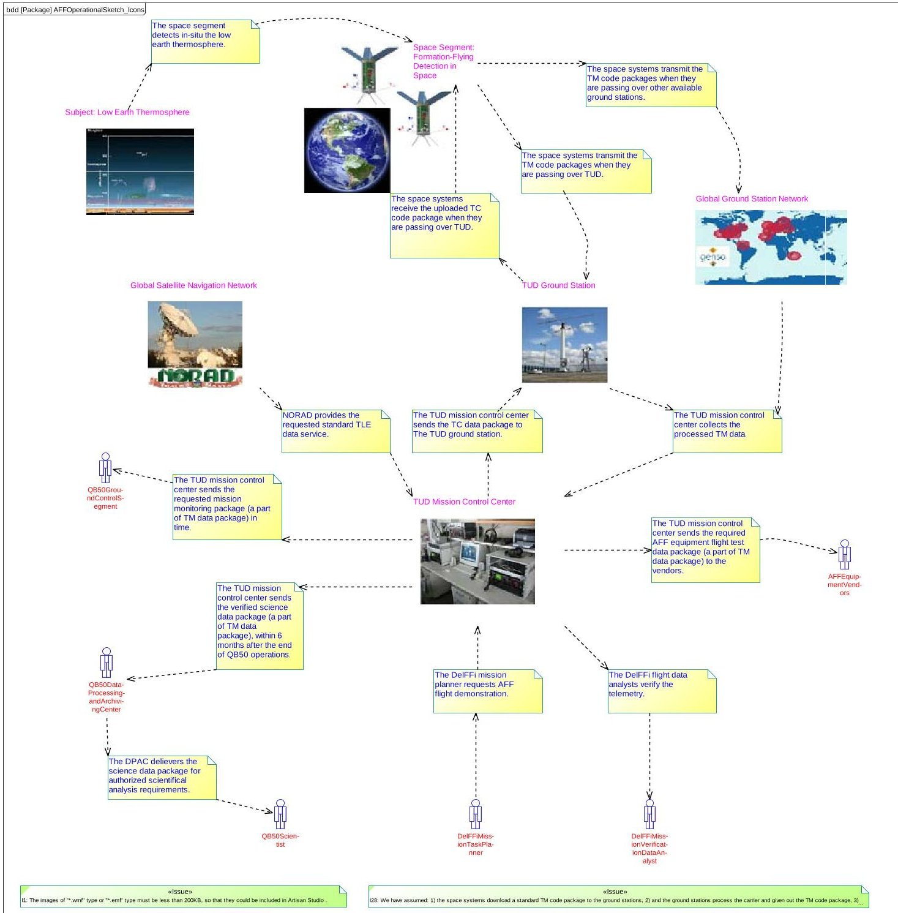

Fig.1: Operation sketch in as-is AFF operational domain

<!-- PDF_PAGE: 4 -->

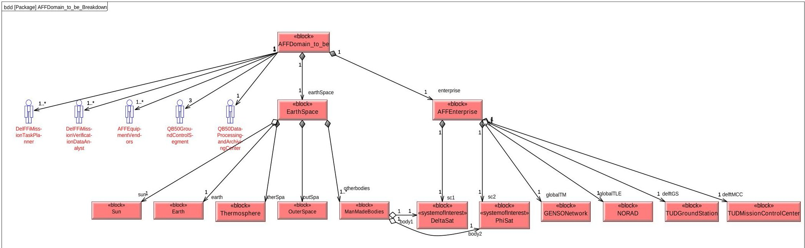

Fig.2 Breakdown of AFF to-be operation domain

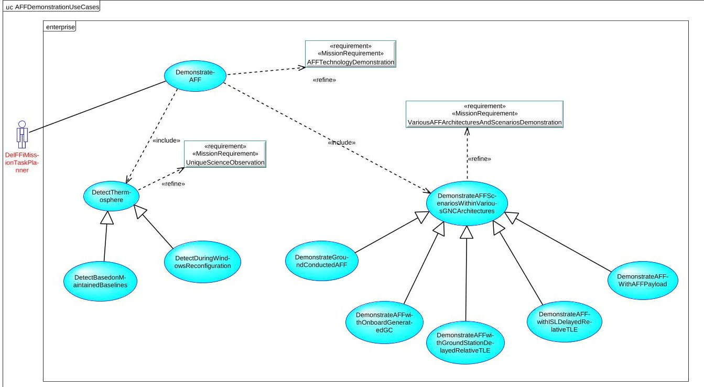

Fig.3 Mission use cases for AFF operational phase

<!-- PDF_PAGE: 5 -->

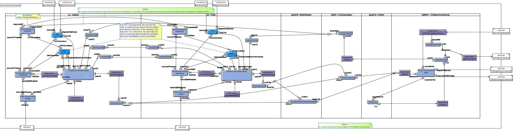

Fig.4 Illustration of system behaviour properties within the AFF demonstration mission (scenario 5 with AFF payload used)

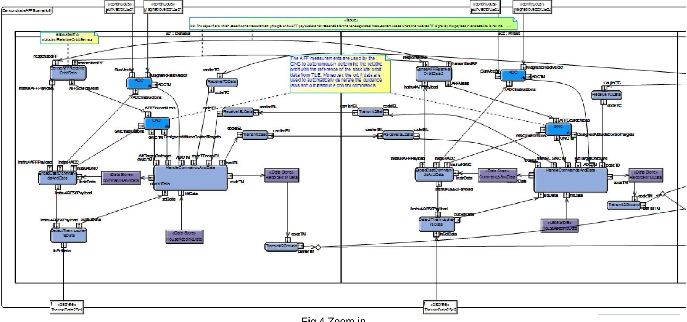

<!-- PDF_PAGE: 6 -->

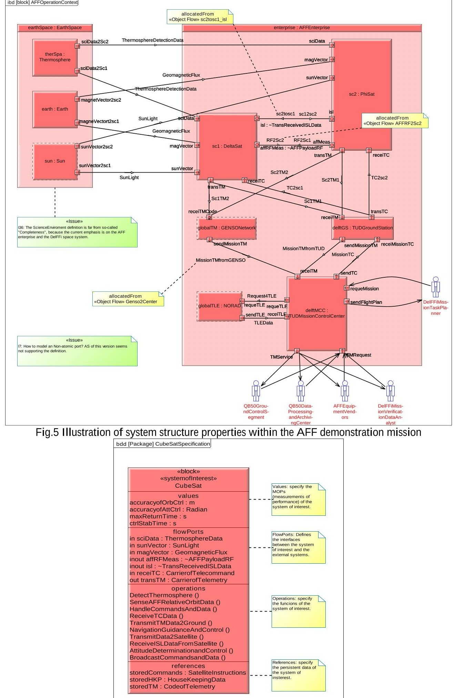

Fig. 6 Black-box system specification on a block

<!-- PDF_PAGE: 7 -->

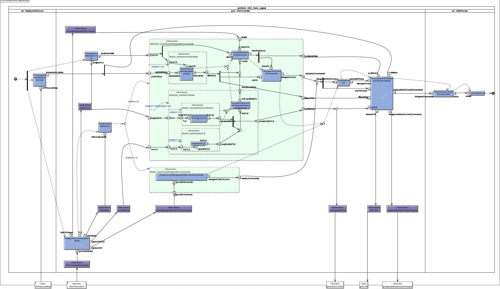

Fig.7 GNC behavior of logical CubeSat system

<!-- PDF_PAGE: 8 -->

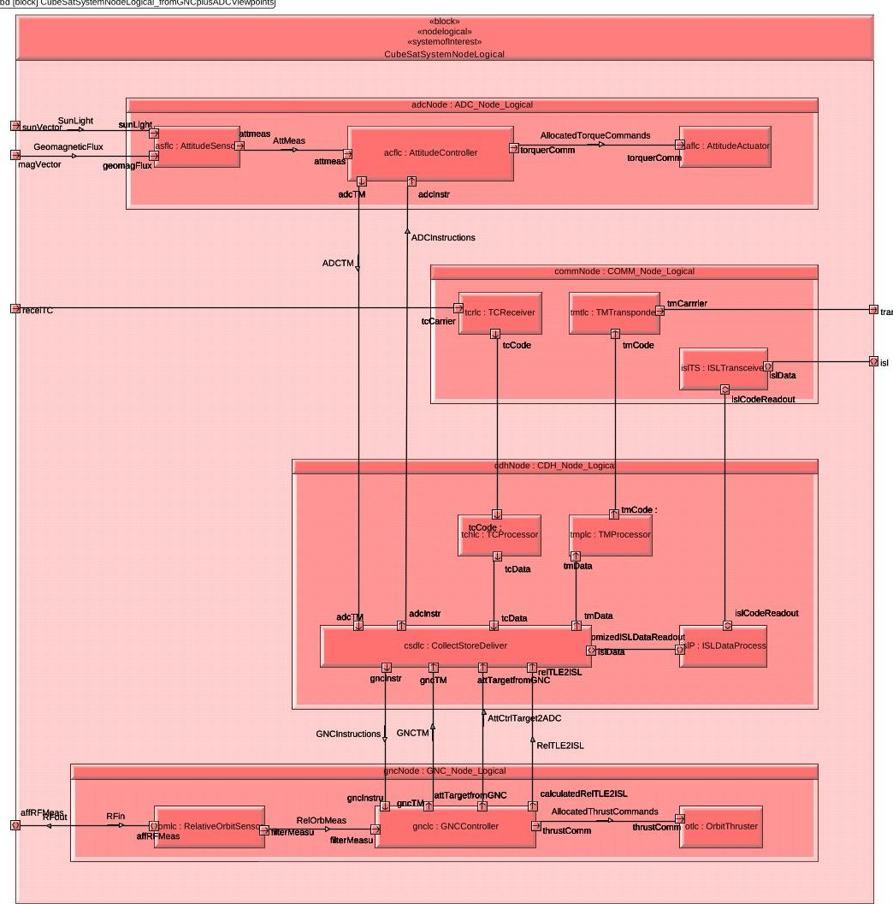

Fig.8 Internal structure properties of logical CubeSat system

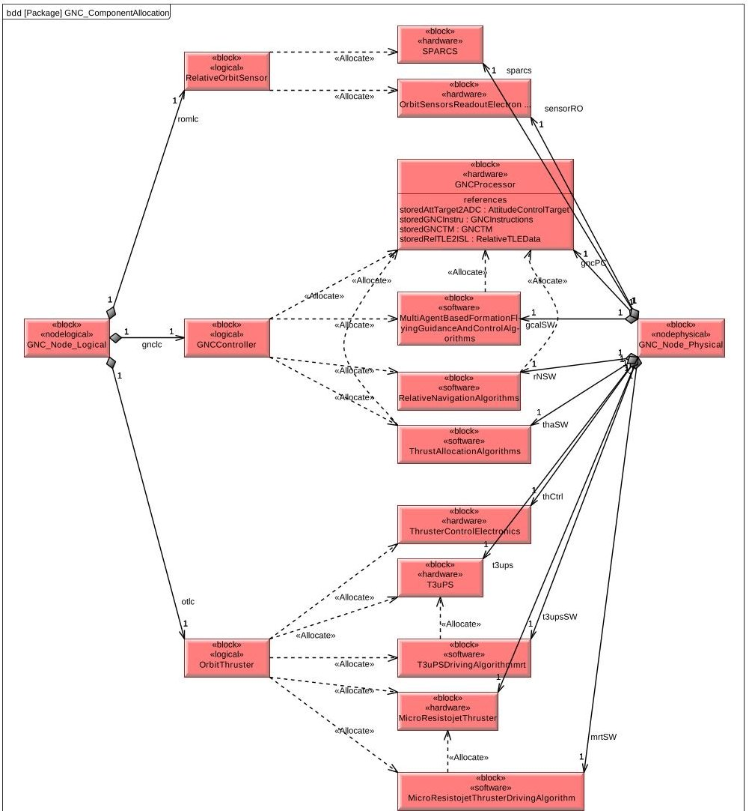

Fig.9 Allocations of logical GNC components to physical GNC components

<!-- PDF_PAGE: 9 -->

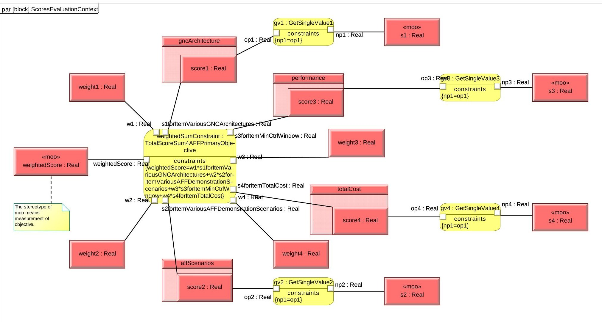

Fig.10 Primary mission Objective Evaluation Constraints Definition and Values Binding

<!-- PDF_PAGE: 10 -->

primary objective. And the four elements, namely diversity of GNC architectures, number of AFF demonstration scenarios, AFF control performance, and total cost, are regarded as the four main causes that determine the degree of satisfaction.

A schema using the SysML analytical models is defined. A top evaluation context is modelled consisting of four sub-contexts. One may see from Fig. 10 the top constraint definition, and four sub constraint definitions.

## Example2: AFF Control Accuracy Performance

## Evaluation

The example is about the AFF control accuracy evaluation where the designed/tested control performance of a single satellite is evaluated with an index of "IsSatisfaction" which represents whether the single satellite control performance meets with the requirement of a targeted along-track separation on the relative orbit control accuracy or not. As for the index, "1" means the requirement has been satisfied, and "0" means the opposite.

However a schema which includes an external Matlab analytical model is defined.

## II.VII Requirement Traceability and Management

An overall requirement hierarchy and the requirement relations management is very important for the decomposed requirements from the customer needs to the system requirements. Figure 11 presents a requirement tree for the DelFFi mission, however the tree is only for a coarse traceability. In order to manage the requirements and trace how they get treated during the design process, more precise relations should be established for the requirements of interest. Figure 12 presents one example, which is about the AFF demonstration performance requirement.

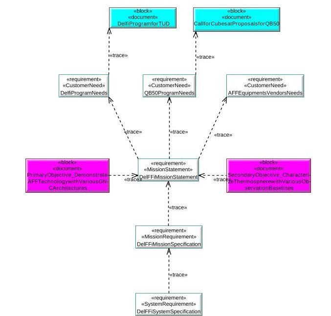

Fig.11 DelFFi Mission Requirements Hierarchy

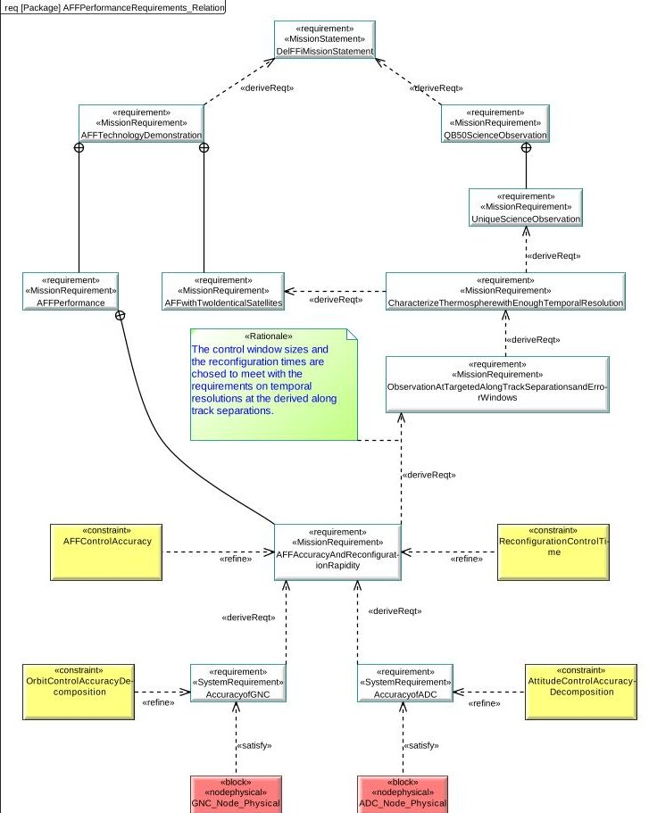

Fig.12 AFF Demonstration Performance Requirements' Relations

III. MODEL-BASED PARAMATRIC ANALYSIS III. I. Integrated Design and Analysis Environment

Some new tools have been developed to integrate the other existed specialty tools. Artisan Studio $ ^{\circledR} $ is one of the main system modelling tools which support the SysML language $ ^{8} $ . However the modelling tools can support parametric analysis on conditions that some other computation tools (e.g., Matlab $ ^{\mathrm{TM}} $ , Mathematica $ ^{\mathrm{TM}} $ , Excel $ ^{\mathrm{TM}} $ , etc.) are connected and used as the computation platform. A key plugin product $ ^{9} $ , i.e., ParaSolver2 $ ^{\mathrm{TM}} $ with a selected Matlab SMT (Symbolic Math Toolbox) core solver is attached to Artisan Studio $ ^{\circledR} $ , which changes the descriptive modelling environment into an integrated design and analysis environment. Moreover, the Excel $ ^{\mathrm{TM}} $ tool is included to the environment to accomplish a flexible input /output definition and instance generation.

## III. II. Parametric Analysis Application

## Example1: Manual Instance Generation

The example1 in sec. II.VI is considered, where the schema has been developed by using the internallydefined SysML analytical models. The instantiated schema is named as one instance. The Parasolver2 offers several windows (one is Fig. 13) to facilitate an easy input instance definition and result output definition. Three instances are generated manually. A weighted sum is adopted and some experience weights are allocated.

<!-- PDF_PAGE: 11 -->

<table class="table table-bordered"><thead><tr><th>Name</th><th>Local</th><th>One...</th><th>Relation</th><th>Active</th></tr></thead><tbody><tr><td>gv1</td><td>Y</td><td></td><td>s1=gncArch.score1</td><td></td></tr><tr><td>gv2</td><td>Y</td><td></td><td>s2=affsce.score2</td><td></td></tr><tr><td>gv3</td><td>Y</td><td></td><td>s3=affPerf.score3</td><td></td></tr><tr><td>gv4</td><td>Y</td><td></td><td>s4=totCost.score4</td><td></td></tr><tr><td>weighted...</td><td>Y</td><td></td><td>weightedScore=weight1*gncArch.score1+weight2*affsce.score...</td><td></td></tr></tbody></table>

Fig.13 Parameters definition in ParaSolver browser window(after computation)

## Example2: Automatic Instance Generation

The example2 in sec. II.VI is considered. A trade study with a big number (e.g, 32) is piloted. The Parasolver also offers an automatic instance generation. In the example the Excel software is used to define the possible design options and serve as the result output. Once the study case starts, the product will generate the instance and analyze the design alternative one by one. All the results will be saved into the Excel automatically.

## IV. ADVANTAGES OF THE MBSE OVER THE DOCUMENT-BASED APPROACH

The experiments of modelling and analyzing with the MBSE approach have impressed the authors who are very familiar with the documented-based approach. We believe the fundamental advantage of the MBSE lies on the model-based integrated develop environment itself. Firstly the environment supports the designers to separate the design/analysis content into pieces/elements and save them in a database, and that makes it possible for the designers of a same group to share, or reuse, or integrate, or link the defined pieces/elements in a very flexible way. Secondly, the environment makes use of a powerful graphic/texture comprehensive expression of the design/analysis information, and that makes it easy for the designer to define the design details and deliver the information to the other members.

And one of the particular features that impress us is that, the requirement decomposition and management has been greatly enhanced by the MBSE methodology with respect to the traditional one. All the decomposed requirements are described in the same environment as the developed model elements. The environment makes

it very easy to link the requirements to the model elements/requirements and illustrate the relations between the requirements and the design elements/requirements. Even the statuses of the requirements can also been traced clearly, such as, deleted, to be confirmed, added, etc.

One more impressive particular feature is that, the design information of the system of interest can be enriched from many design aspects, such as, the behaviour/structure, the logical/physical. And the design information given from one aspect can be allocated to that given from the other aspect, which makes up a completed design.

## V. LEARNING CURVES AND PROBLEMS

The first author served as the modelling apprentice. His journey to study and apply the MBSE approaches maybe be worthy of reference for the starters. Table 1 presents his learning curves of studying and piloting MBSE. Figure 14 presents the daily problems that he met during the piloting application to the DelFFi mission. And the main artifacts of the piloting research include of 137 diagrams, 85 requirements, 144 blocks and 36 constraint blocks. One sees, the starting curve is steep. Of course, that depends on the modeller's skills, experiences, and background. It is necessary to point out that the first author has worked with a satellite system engineering team for 4 years before he started the present work.

<table border="1"><tr><td>No.</td><td>Key Steps</td><td>Workdays</td></tr><tr><td>1</td><td>Get to know the MBSE ideas and the approaches</td><td>30</td></tr><tr><td>2</td><td>Learn SysML language independently without any lessons or help</td><td>30</td></tr><tr><td>3</td><td>Learn and practice the relevant tools (i.e., Artisan Studio, ParaSolver2)</td><td>45</td></tr><tr><td>4</td><td>Learn the INCOSE process and generate a simple space project application template</td><td>50</td></tr><tr><td>5</td><td>Pilot application to the DelFFi mission</td><td>34</td></tr></table>

Table 1: Starting experiences of the first author (for the reference of new MBSE fans)

<!-- PDF_PAGE: 12 -->

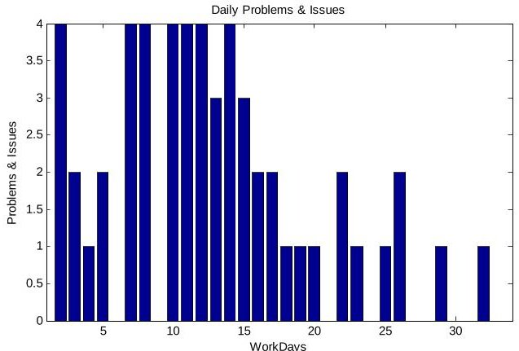

Fig.14 Daily modelling problems met during key step 5

## VI. SUGGESTIONS FOR SPACE ORGANIZATIONS

## VI.I About Starting Application Research

Staring Points:

1) Starting from the developed satellites/buses. This helps the piloting work focuses on the general MBSE methodology, and helps find out the special parts (e.g., processes, methods) adopted by the space organizations.

2) Starting from the early phase of a space project. The MBSE approaches have been proved effective and feasible by several piloting projects (including the present one).

3) Starting from the employees' training. Compared to the traditional ways, the MBSE delivers the knowledge and experiences in a graphic, vivid, low-cost way and provides a good hands-on environment.

## Starting Activities:

1) Establishing a piloting group. Some important members, like the team leader, several system engineers, several specialist engineers, one software engineer, one database engineer, and even some new employees should be included as members.

2) Tailoring the general MBSE methodology to the space organization's needs. The group shall propose a tailored and modified MBSE approaches (including process, methods and tools) for the space organization.

3) Purchasing the necessary MBSE tools and training service. The group is in charge of purchasing the SysML modelling tool and the relevant tools and the necessary training services. Moreover, the group should build up close communication links to the vendors.

## VI.II About Selection of Tools

## SysML Modelling Tool

Two main commercial tools, MagicDraws $ ^{\circledR} $ and Artisan Studio $ ^{\circledR} $ , had been considered at the beginning of the present work. The first author found that: the former is more complicated, more automatical, and more flexible than the latter, however the former also requires the users must have much more knowledge and experiences of the UML language and the objectoriented software development methods; moreover, the

guide provided by the former is not so straight and detailed as that of the latter, at least from the viewpoint of a new user. Therefore, as a new modeller without a lot of UML knowledge and software development experiences, the first author chose Artisan Studio $ ^{\circledR} $ Nevertheless, the author has to point out that his choice does not represent the common feelings but only his personal preference.

## Sovler Tool

Almost all main commercial SysML modelling tools make use of the solvers provided by the company of InterCAX $ ^{1} $ . Through using the ParaSolver $ 2^{\mathrm{TM}} $ , the first author feels that: the solver tool serves as the key role on the integration of various tools. On one side, it is able to support the definition of some simple parametric analysis problems; on the other side the solver tool still has a big space to improve its performance to match with that of the SysML modelling tool. Integration Links to Specialty Tools

Some popular commercial specialty tools, such as the Microsoft Excel $ ^{\mathrm{TM}} $ and Word $ ^{\mathrm{TM}} $ , the IBM DOORs $ ^{\mathrm{TM}} $ and the Matlab $ ^{\mathrm{TM}} $ have been successfully linked to the core platform formed with the SysML tool and the Solver tool. However the development of relevant links of the platform to the space specialty tools (e.g. orbit/thermal/mechanical analysis and design) just starts or not yet. Moreover, a good debugging environment for those links is expected to be provided in the future.

## VII. CONCLUSIONS

A piloting application of the MBSE approach to the DelFFFi mission was reported. The novel MBSE contributes to the document-based DelFFi mission concept design work, especially enhancing the requirement decomposition and traceability, the illustration of mission demonstration scenarios within the mission architecture, the logical/physical system architecture design from the behaviour and structure aspects, and so on.

The principle advantages of the MBSE over the traditional document-based one are impressing especially the capture and usage of the design information. In fact, the integrated design and analysis environment is the key to realize the MBSE ideas.

Even though the documented-based system engineering methodology has been proved effective by hundreds of successful projects, the space organizations are suggested to start their MBSE application researches as soon as possible for the arrival of a new space age.

## ACKNOWLEDGEMENTS

The authors would like to thank the company of AtegoTM for the use of the Artisan Studio $ ^{\circledR} $ software and the ParaSolver $ 2^{\mathrm{TM}} $ plugin.

<!-- PDF_PAGE: 13 -->

