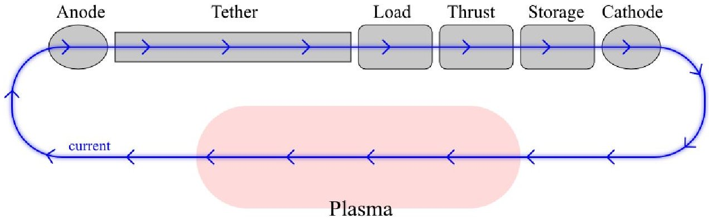
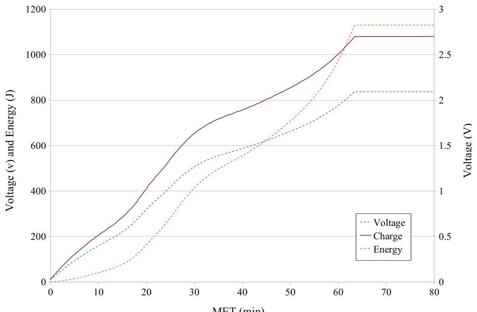
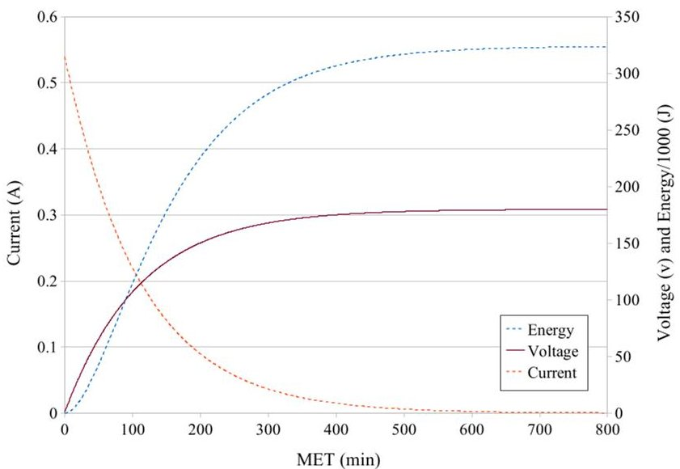
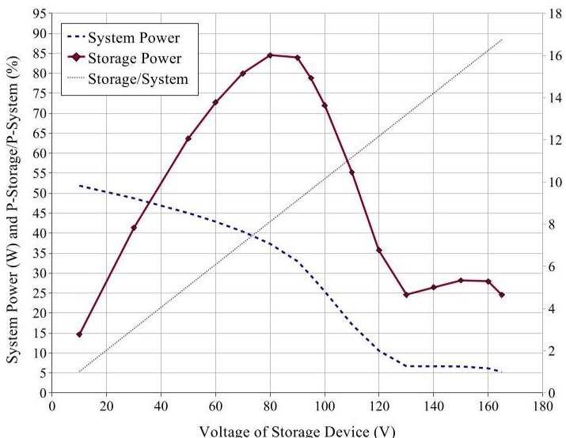
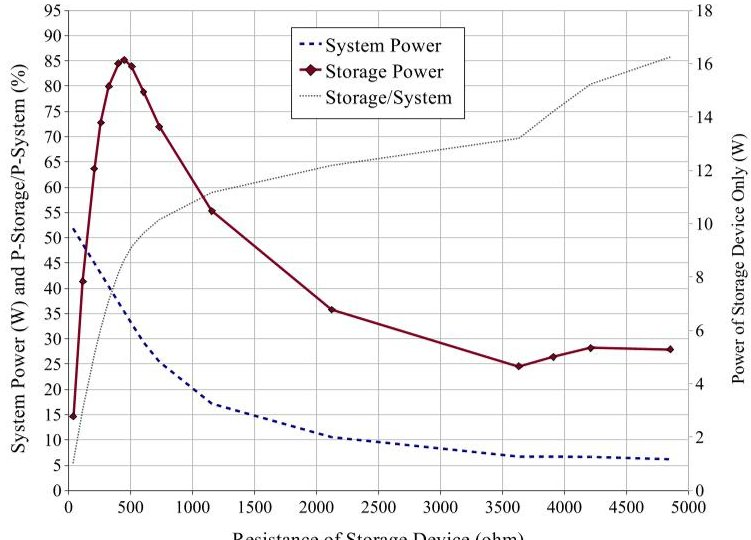
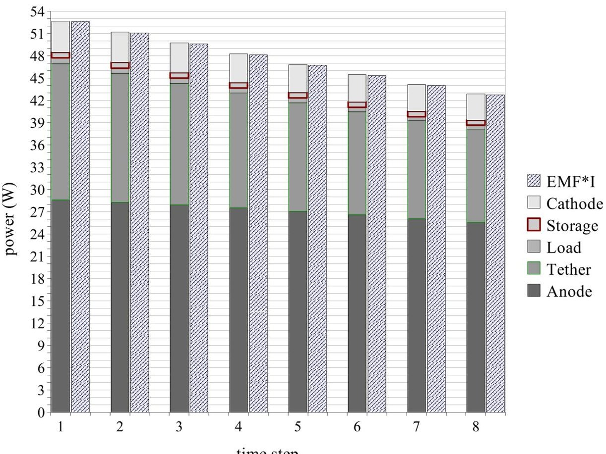
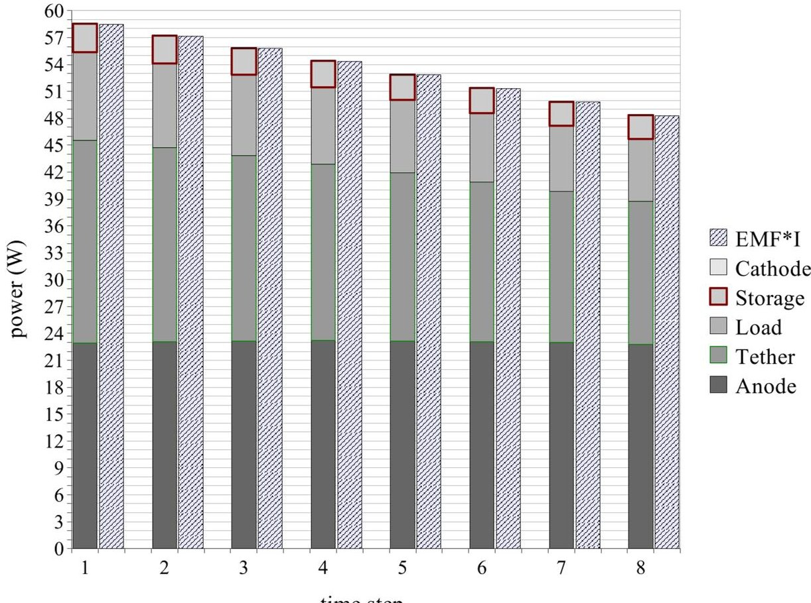
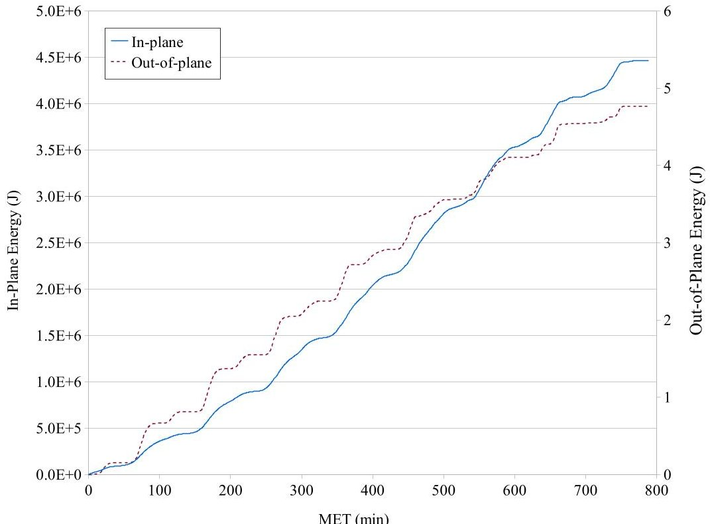
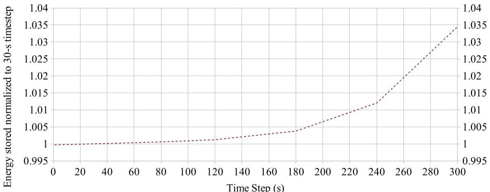

<!-- PDF_PAGE: 1 -->

# Development of a Modeling Capability for Energy Harvesting Modules in Electrodynamic Tether Systems

Jesse K. McTernan and Sven G. Bilen $ ^{y} $

The Pennsylvania State University, University Park, 16802, USA

Orbital energy of a spacecraft can be transferred into electrical energy using an electrodynamic tether. The energy can be stored or used immediately for onboard power. We developed an energy storage module for our simulation software, TeMPEST, that models various storage devices such as supercapacitors, lithium{ion batteries, or a generic storage device. The principle of conservation of energy was used to verify our system model as well as our electrodynamic orbital-perturbation model. The energy storage module is also capable of examining other aspects of a spacecraft's energy budget, such as the in-plane or out-of-plane contributions of the electrodynamic work done on the system. An emphasis was placed on scaling the storage devices to satisfy the requirements of the CubeSat platform.

## Nomenclature

$ A_{t} $ tangential acceleration (m s $ ^{2} $ )

B magnetic eld of Earth (T)

C capacitance (F)

E energy (J)

$ E_{amb} $ ambient electric eld of Earth (V m $ ^{1} $

$ E_{v B} $ electric eld due to the velocity of a charge in a magnetic eld (V m $ ^{1} $

E electromotive force, emf (V)

F force (N)

G gravitational constant (6.673 $ 10^{11} $ m $ ^{3} $ kg $ ^{1} $ s $ ^{2} $

I current (A)

$ I_{0} $ intermediate term in the Parker{Murphy model

K kinetic energy (J)

L length of tether (m)

M mass of the Earth (5:9742 $ 10^{24} $ kg)

P power (W)

Q charge (C)

R resistance ( )

R average radius of Earth (6:3781 $ 10^{6} $ m)

U potential energy (J)

V voltage (V)

W work (J)

a semi-major axis of orbit (m)

$ dR_{t} $ resistance per length of tether ( )

$ d_{len} $ length of segment of tether (m)

e charge of an electron ( 1:602 $ 10^{19} $ C)

g gravity at location r (m s $ ^{2} $

i current vector (A)

Associate Professor, Engineering Design, Electrical Engineering, and Aerospace Engineering, Associate Fellow.

<!-- PDF_PAGE: 2 -->

di incremental current (A)

i current (A)

$ i b_{n} $ current in segment of bare tether (A)

$ k_{B} $ Boltzmann constant (1:3806503 $ 10^{23} \mathrm{m}^{2} \mathrm{kg} \mathrm{s}^{2} \mathrm{K}^{1} $

m mass of an object (kg)

n density of electrons or ions $ (m^{3}) $

$ p b_{n} $ power dissipated in a segment of bare tether (W)

q charge (C)

$ \hat{r} $ unit vector in the direction of r (m)

r distance of an object from the center of mass of the Earth (m)

$ r_{spiral} $ radius of spiral in polar coordinates (m)

$ r_{t} $ radius of tether (m)

t time (s)

t time (s)

$ \hat{v} $ unit vector in the direction of v $ (m \mathrm{s}^{1}) $

v velocity $ (m \mathrm{s}^{1}) $

Subscripts

gr gravity

orb orbit

sc spacecraft

sec secondary

Symbols

correction factor to Parker{Murphy model

correction factor to Parker{Murphy model

$ t_{c} $ e ciency of thermionic cathode

scaling factor from Simpson's Rule

standard gravitational parameter, $ G(M+m) $ GM $ (3:986005 \ 10^{14} \mathrm{m}^{3} \mathrm{s}^{2}) $

tether potential (V)

0 intermediate term in Parker{Murphy model

density of atmosphere $ (m^{3}) $

$ t_{c} $ perveance of thermionic cathode (perv)

## I. Introduction

Electrodynamic tethers (EDTs) have the potential to function as an energy \harvesting" and propulsion device. In particular, an EDT system is capable of converting orbital energy into electrical energy for immediate use on board a spacecraft or the energy can be stored for later use. Energy conversion could be useful for \harvesting" energy while the spacecraft is in the shadow of the Earth where solar panels cannot collect energy. As energy is converted from orbital energy, the altitude of the spacecraft is reduced. However, the same EDT system can be utilized for propulsion, not only to raise the altitude of the spacecraft, but also to change any of the craft's orbital elements (e.g., inclination). $ ^{1} $ In this manner, an EDT system acts as an energy harvesting and propulsion device.

Energy can be stored to enable high-power applications, converted back into orbital energy (which reboosts the system), or used to power the spacecraft bus. The focus of our present research is to minimize the losses associated with the conversion while maximizing the energy storage capability.

## A. System Concept

A signi cant portion of our research focuses on developing EDT systems for picosats, such as the standard CubeSats. For example, on a 3-unit CubeSat, mass is limited to 4 kg and volume to 10 10 30 cm. The system we considered, which satis ed the restrictions and provided equivalent energy as solar panels, had a 1300-m bare aluminum tether of diameter 0.45 mm, and total mass of 0.558 kg. Plasma interfaces (contactors) at either end were a passive conductive sphere (anode) and thermionic emitter (cathode). It was

<!-- PDF_PAGE: 3 -->

assumed for our simulations that the spacecraft started at an altitude of 500 km with an orbital inclination of 28.6 degrees.

## B. Simulation Software

Our simulation software, TeMPEST (TEthered Mission Planning and Evaluation Software Tool), has been used to study various tethered systems since 1994, support tethered satellite system development, and has evolved to include the features shown in Table 1. TeMPEST is still in development and used today at UM/SPRL, Tethers Unlimited, Inc. (TUI), ElectroDynamic Applications, Inc., (EDA), and The Pennsylvania State University.

Table 1. Various features supported in TeMPEST

<table border="1"><tr><td>Precision Runge{Kutta 4(5) orbital propagator(with perturbations)
Solar and Magnetic indices prediction(e.g.,F10.7,kp,ap)
International Geomagnetic Reference Field(IGRF)Earth magnetic eld model
MSIS/MSISE neutral atmosphere model(valid up to 1000-km altitude)
International Reference Ionosphere(IRI)model of ionospheric densities and temperatures(valid in the altitude range 50km to 2000km)
Simple tether libration forced-harmonic mode
Induced electromotive force(emf)tether voltage model
Tether current collection model for bare and insulated tethers with various plasma contactors(hollow cathodes,eld emissive arrays,thermionic emitters,various collecting surfaces)
Energy storage module</td></tr></table>

## II. Electrodynamic Tether Fundamentals

In this section we provide a brief explanation of the fundamental principles of the EDT from the perspective of the charges in a conductive tether as they move through the Earth's magnetic eld. This movement creates a force on the charged particles. This is essence of EDTs.

## A. Harvesting Energy

The charges (i.e., free electrons) in the tether move at 7.5 km/s through the Earth's magnetic eld. $ ^{a} $ There is a Lorentz force on the charges, which is perpendicular to both the velocity and magnetic eld, given by

$$
F _ {\mathrm {c h a r g e}} = F _ {\mathrm {m a g n e t i c}} + F _ {\mathrm {e l e c t r i c}}
$$

$$
= q E _ {v} _ {B} + q E _ {\mathrm {a m b}};
$$

where $ F_{\mathrm{charge}} $ is the total force on the charge, q is the magnitude of the charge, $ E_{\mathrm{amb}} $ is the ambient electric eld, and $ E_{V_{B}} $ is the electric eld associated with the motion of a charged particle through a magnetic eld. The charges will also experience a force due to an ambient electric eld. However, the surrounding plasma tends to mask electric elds. Therefore, the ambient electric eld component is usually negligible in comparison to the contribution of the electron velocity (i.e., the tether's velocity) and ambient magnetic eld components. The total force on the electron (Equation 1) reduces to the magnetic force

$$
F _ {\mathrm {c h a r g e}} = F _ {\mathrm {m a g n e t i c}} = \mathrm {q} (\forall_ {\mathrm {s c}} \quad \mathrm {B});
$$

where $ \forall_{\mathrm{sc}} $ is the velocity of the spacecraft (which is also the velocity of the charge) and B is the magnetic eld of the Earth at the location of the charge.

The direction of the magnetic force (and associated $ \forall $ B electric eld) is given by the right hand rule, and is perpendicular to both the $ \forall_{sc} $ and B. The net result of the electric eld along the entire length of the

<!-- PDF_PAGE: 4 -->

tether is an electric potential given by

$$
\mathrm {t e t h e r} = \begin{array}{c c c} Z _ {\mathrm {L}} & & \\ 0 & E _ {\mathrm {V}} & \mathrm {B} \end{array} \mathrm {d} \mathrm {f} = \begin{array}{c c c} Z _ {\mathrm {L}} & & \\ 0 & \left(\forall_ {\mathrm {s c}} \quad \mathrm {B}\right) & \mathrm {d} \mathrm {f}: \end{array}
$$

In the simple case of a rigid tether aligned with the local vertical, the electric eld will be parallel to the tether. The potential across the tether will be, simply, $ v_{\mathrm{sc}} $ BL, where L is the length of the tether. In the case of a spinning, librating, or non-linearly shaped tether, only the component of the electric eld along the incremental df will contribute to the tether potential.

Without a closed-loop path for the electrons, there would exist a potential across the tether, but no current would ow. The ionosphere acts as a means of closing the circuit. Plasma contactors such as thermionic cathodes or eld emitter arrays are the interface between the tether and the surrounding ionosphere. Once plasma contacts are used, current can ow in the tether.

The current, i, owing through the tether creates a secondary force because the current is also owing through the Earth's magnetic eld, B. The secondary force is given by

$$
F _ {\sec} = \underset {0} {Z} \bot h \dot {1} (I) B (I) d I
$$

$$
F _ {\mathrm {s e c}} = \mathrm {L} (\mathrm {i} \quad \mathrm {B});
$$

where dI and L are the incremental length and total length of the tether, respectively. Both, i and B are functions of the position along the tether, I.

In the simple case of a rigid, vertically aligned tether, the force (Equation 6) is anti-parallel to the velocity and will reduce the speed of the spacecraft. This, in turn, causes the spacecraft to lose altitude (deboost) and eventually deorbit. For spinning, librating, or non-linearly shaped tethers, the net force vector is calculated using Equation 5.

## B. Thrusting

Current can be forced to ow in the opposite direction of the induced potential. In this case, the B force will be parallel to the direction of motion and will increase the altitude of (i.e., boost) the spacecraft. A power supply is needed to produce a voltage greater than the \naturally" induced voltage. The energy for the power supply could come from the storage device coupled with a DC{DC converter.

## III. Energy

Energy usage in the EDT system can be viewed from two different perspectives: orbital and electrical. It is possible to convert \measured" current to electrical energy provided speci c knowledge of the components is known. $ ^{b} $ It is also possible to \measure" the change in orbital energy due to the current.

The current is the dependent variable from the perspective of the electrical system and the independent variable from an orbital-dynamics perspective. Therefore, it is necessary to calculate the current accurately given the ambient conditions and components used as well as determine the ect the current-derived force will have on the orbital dynamics of the system.

If it is verified that the electrical energy used in the tether is equal to the change in orbital energy, then one's confidence in the analysis in increased. Otherwise, a discrepancy in energy would be a clear indicator that there was an error in the analysis. In this way, conservation of energy is used as a check.

It is necessary to identify and understand all possible sources of energy usage or generation in the electrical circuit. Speci c knowledge of how current a ects the orbit is also required. The sum of the electrical sources and sinks is called the \energy budget".

## A. Orbital Energy

The force of gravity is conservative, which means that energy is conserved when gravity acts on a mass. When a mass is accelerated toward the gravitational source it loses potential energy but gains kinetic energy.

<!-- PDF_PAGE: 5 -->

The value of the kinetic and potential energy changes but the sum remains constant. $ ^{c} $ The energy of the orbit is given by

$$
E _ {\mathrm {o r b}} = U + K
$$

(constant)

$$
E _ {\mathrm {o r b}} = \frac {G M m _ {\mathrm {s c}}}{r} + \frac {m _ {\mathrm {s c}} \left(v _ {\mathrm {s c}}\right) ^ {2}}{2}
$$

$$
E _ {\mathrm {o r b}} = \frac {m _ {\mathrm {s c}}}{2 a};
$$

where a is the semi-major axis of the orbit, and r is the distance from the gravitational source.

Work done on the system in the orbital plane will change the energy of the orbit. We consider only in-plane changes because out-of-plane ects are orders of magnitude smaller based on the system under consideration. $ ^{4} $ , d

## B. Work{Energy Relationship

Another method to calculate the change in orbital energy is to calculate the work done on the EDT system by the forces given by

$$
W = F d x = \left(F _ {\mathrm {g r}} + F _ {\mathrm {E D}} + F _ {\mathrm {d r a g}} + F _ {\mathrm {S u n = M o o n}} + F _ {\mathrm {J 2}}\right) d x:
$$

To simplify the expression and isolate the electrodynamic forces $ \left( F_{\mathrm{E D}} \right) $ , the perturbations from drag $ \left( F_{\mathrm{d r a g}} \right) $ Sun and Moon $ \left( F_{\mathrm{S u n=M o o n}} \right) $ , and Earth oblateness $ \left( F_{\mathrm{J 2}} \right) $ are initially disabled yielding

$$
W = F _ {\mathrm {g r}} \mathrm {d x} + F _ {\mathrm {E D}} \mathrm {d x}:
$$

Since gravity is a conservative force, it will not change the total energy when working on a mass. Gravity will result in a change of potential energy into kinetic energy. Therefore, with all other perturbations disabled, the change in orbital energy, $ E_{orb} $ , will be equal to the work done by the EDT, i.e.,

$$
W = \begin{array}{c c c} Z & & \\ F _ {E D} & d x = & E _ {o r b} \end{array}:
$$

This is a useful method for isolating in-plane and out-of-plane forces. In-plane forces will a ect the shape (energy) of the orbit while out-of-plane forces cause a torque. The force vectors can be decomposed into their constituent components, transferred to the proper coordinate system, and dotted with the associated change in position (dx, dy, or dz) to nd the work.

## C. Electrical Energy

The electrical energy is calculated by summing the energy dissipated (or stored) by the individual components. At a minimum, the electrical components are the tether, anode (electron collector from the surrounding plasma), and cathode (electron emitter to the surrounding plasma). In practice, there could be other components such as circuit-conditioning devices, storage devices, scientific payload, or control circuits. Figure 1 displays the signi cant electrical energy sources and sinks in the EDT system we considered. The ionosphere is considered to be a good conductor that does not dissipate a large portion of energy. Typical ionospheric resistance is on the order of tens of ohms. Our simulations do not account for these losses.

Because a signi cant portion of our research is focused on developing EDT systems for CubeSats, $ ^{2} $ we selected electrical components that are as small (in volume and mass) as possible.

<!-- PDF_PAGE: 6 -->

Figure 1. Signi cant electrical energy sources and sinks in the EDT system include the anode, tether, load, thruster, storage device, cathode, and plasma. The current in this diagram is the the ow of electrons in power-generating mode.

## 1. Tether

Bare aluminum tethers were chosen for our research because they are relatively lightweight with low resistance. The power dissipated in a segment of tether follows the general $ \mathrm{I}^{2} \mathrm{R} $ relation. The total power dissipated across the tether is the sum of the power dissipated in each segment. Input parameters of the tether are given in Table 2. To nd the power, the general procedure is rst to nd the voltage of the tether, $ V_{t} $ , with respect to the plasma, $ V_{p} $ , at a segment of tether then follow these equations:

$$
V _ {n} = V _ {t _ {n}} \quad V _ {p _ {n}} \quad (\text {v o l t a g e o f t e t h e r w i t h r e s p e c t t o t h e p l a s m a a t n}) \tag {13}
$$

$$
\frac {\mathrm {d} \mathbf {i}}{\mathrm {d} y} _ {n} = \mathrm {q} _ {\mathrm {e}} \mathrm {n} _ {\mathrm {e}} \left(2 \mathrm {r} _ {\mathrm {t}}\right) \frac {2 \mathrm {q} _ {\mathrm {e}}}{\mathrm {m} _ {\mathrm {e}} \mathrm {V} _ {\mathrm {n}}}
$$

$$
\mathrm {i b} _ {\mathrm {n}} = \mathrm {i b} _ {\mathrm {n}} _ {1} + \frac {\mathrm {d i}}{\mathrm {d y}} _ {\mathrm {n}} \mathrm {d} _ {\mathrm {l e n}} (\mathrm {})
$$

$$
\mathrm {p b} _ {\mathrm {n}} = \left(\mathrm {i b} _ {\mathrm {n}}\right) ^ {2} \mathrm {d R} _ {\mathrm {t}} \mathrm {d} _ {\mathrm {l e n}}
$$

$$
P _ {\mathrm {t e t h e r}} = \underset {n} {p b} _ {n};
$$

where $ i b_{n} $ is the current in a segment, $ d R_{t} $ is the resistance of the tether per length, and $ d_{l e n} $ is the length of one segment of tether. $ q_{e}, n_{e}, $ and $ m_{e} $ are the charge, density, and mass of electron(s); $ r_{t} $ is the radius of the tether; is Simpson's rule scaling for nding the total current; and $ d R_{t} $ is the resistance per length of the tether.

In Equation 15 it is seen that the total current in one segment of tether is the sum of the incoming current from the previous segment plus the additional current from the ionosphere if the tether is bare (Equation 14). If the tether is insulated, then di=dy is zero and the current at the end of the tether is equal to the current at the beginning.

## 2. Anode

A passive contactor, a conducting sphere, was chosen as the anode. The current collected by the anode is given by

$$
\mathbf {i} _ {\mathrm {p m}} (\mathrm {v}) = \mathbf {I} _ {0} \quad_ {\mathrm {p m}} 1 + \frac {V _ {\mathrm {p m}}}{0} ^ {\mathrm {p m}} ^ {\#};
$$

which is the modified Parker{Murphy current in a sphere. $ ^{6,7} $ The input parameters are tabulated in Table 2. The power dissipated at the anode is

$$
P _ {\mathrm {a n o d e}} = \mathbf {i} _ {\mathrm {p m}} V _ {\mathrm {p m}};
$$

which is the current at the anode, $ \mathbf{i}_{\mathrm{p m}} $ , multiplied by the voltage across it, $ V_{\mathrm{p m}} $ . The voltage of the anode is found using an iterative method.

<!-- PDF_PAGE: 7 -->

## 3. Storage Device: Generic

One method of energy storage is to assume a generic device with a xed voltage regardless of the current owing through it or the amount of energy already stored. In practice, a conditioning circuit is needed to maintain the voltage. An e ciency can be applied to the conditioning circuit since energy is required to operate the circuit. Initially, the e ciency is set to 1.0 and the power contribution to the energy budget from the generic energy storage scenario is given by

$$
\mathrm {P} _ {\mathrm {s t o r a g e}} = \mathbf {i} _ {\mathrm {e n d}} \mathrm {V} _ {\mathrm {g}}:
$$

Input parameters are tabulated in Table 2.

## 4. Storage Device: Supercapacitor

For a second storage device we chose a supercapacitor, a type of electrochemical capacitor, sometimes referred to as ultracapacitors or electric double layer capacitors (EDLCs). According to a report by the Department of Energy, supercapacitors $ \dots $ have a number of potentially high-impact characteristics, such as fast charging (within seconds), reliability, large number of charge{discharge cycles (hundreds of thousands), and wide operating temperatures."

As a rst-order approximation, supercapacitors behave like a typical capacitor with extremely high capacitance (100s of farads) that charges exponentially by

$$
Q _ {\mathrm {c}} = C _ {\mathrm {c}} V _ {\mathrm {S}} 1 \exp \frac {t}{R _ {\mathrm {c}} C _ {\mathrm {c}}} ;
$$

with current given by

$$
\mathrm {I} _ {\mathrm {c}} (\mathrm {t}) = \frac {V _ {\mathrm {S}}}{R _ {\mathrm {c}}} \exp \frac {\mathrm {t}}{R _ {\mathrm {c}} C _ {\mathrm {c}}} ;
$$

where $ C_{\mathrm{c}} $ is the capacitance of the supercapacitor, $ V_{S} $ is the voltage of the source, $ R_{\mathrm{c}} $ is the equivalent series resistance, and t is time.

An EDT system with a supercapacitor can be thought of as a nominal $ \mathrm{\backslash RC}" $ circuit, where $ \mathrm{\backslash R}" $ is the eective resistance of the components (or $ R_{\mathrm{e}} $ ). The eective resistance is the sum of the resistance of the anode, tether, load, and cathode, or

$$
R _ {\mathrm {e}} = R _ {\mathrm {a n o d e}} + R _ {\mathrm {t e t h e r}} + R _ {\mathrm {l o a d}} + R _ {\mathrm {c a t h o d e}}:
$$

The tether resistance is a property of the material used, and the load resistance is chosen by the user. $ R_{\mathrm{anode}} $ and $ R_{\mathrm{cathode}} $ are found by using the voltage across the contactor divided by the current through it.

Solving for t in Equation 21; substituting it into Equation 22; substituting $ R_{C} $ and $ V_{c} $ with $ R_{e} $ and E, respectively; and reducing yields the equation for current as a function of charge given by

$$
I _ {\mathrm {c}} = \frac {E}{R _ {\mathrm {e}}} 1 \frac {Q _ {\mathrm {c}}}{C _ {\mathrm {c}} E};
$$

where E is the electromotive force (emf). Since I is $ Q= $ t,the accumulated charge in one time step will be $ I_{c} $ in Equation 24 multiplied by the time step, t,i.e.,

$$
Q _ {\mathrm {c}} = \frac {E}{R _ {\mathrm {e}}} \quad 1 \quad \frac {Q _ {\mathrm {c}}}{C _ {\mathrm {c}} E} \quad \mathrm {t}:
$$

The typical time step used in this research is 30 seconds.

The energy in a capacitor is given by

$$
E _ {\mathrm {c}} = \frac {1}{2} \frac {Q _ {\mathrm {c}} ^ {2}}{C _ {\mathrm {c}}} \quad \mathrm {a l s o} E _ {\mathrm {c}} = \frac {1}{2} C _ {\mathrm {c}} V _ {\mathrm {c}} ^ {2} = \frac {1}{2} Q _ {\mathrm {c}} V _ {\mathrm {c}}:
$$

It is found by \counting" the number of charges that ow into it based on the process mentioned above. The effective power is

$$
P _ {\mathrm {s t o r a g e}} = \frac {E _ {\mathrm {c}}}{t}:
$$

<!-- PDF_PAGE: 8 -->

The supercapacitor is modeled after the BC Power Series Radial D CELL 310F Ultracapacitor" from Maxwell Technologies. $ ^{9} $ The energy capacity of this supercapacitor is 5.06 Wh/kg times its mass, 0.062 kg, or approximately 0.317 Wh. $ ^{e} $ The input parameters for the simulations are given in Table 2.

## 5. Cathode

The nal component of the EDT system that current ows through before leaving into the surrounding plasma is another contactor, the cathode. Due to volume and mass constraints of the CubeSat platform, a thermionic device was chosen as the cathode. The voltage of the thermionic cathode $ ^{10} $ is found using the nal current at the end of the tether, $ i_{end} $ , and the expression

$$
V _ {\mathrm {t c}} = \frac {\mathrm {t c}}{\mathrm {t c}} \mathrm {i} _ {\mathrm {e n d}} ^ {2 = 3}:
$$

The power dissipated at the cathode,

$$
\mathrm {P} _ {\mathrm {c a t h o d e}} = \left(\mathbf {i} _ {\mathrm {e n d}}\right) \mathrm {V} _ {\mathrm {t c}};
$$

is the current multiplied by the voltage across it. Thermionic inputs are tabulated in Table 2.

Table 2. Input parameters for the energy harvesting simulation.

<table border="1"><tr><td>Parameter</td><td>Value</td><td>Units</td><td>Description</td></tr><tr><td>Anode</td><td></td><td></td><td></td></tr><tr><td>$r_{pm}$</td><td>1.00</td><td>m</td><td>radius</td></tr><tr><td>$p_{m}$</td><td>2.50</td><td></td><td>Parker{Murphy modi cation term}$</td></tr><tr><td>$p_{m}$</td><td>0.52</td><td></td><td>Parker{Murphy modi cation term}$</td></tr><tr><td>Tether</td><td></td><td></td><td></td></tr><tr><td>$r_{t}$</td><td>0.45</td><td>mm</td><td>radius</td></tr><tr><td>$I_{t}$</td><td>1300</td><td>m</td><td>length($d_{len}=I_{t}=N_{t}$)</td></tr><tr><td>$N_{t}$</td><td>100</td><td></td><td>number of segments</td></tr><tr><td>$R_{t}$</td><td>2:8</td><td>$10^{6}$</td><td>cm resistivity(aluminum)</td></tr><tr><td>Load</td><td></td><td></td><td></td></tr><tr><td>$R_{L}$</td><td>0.0</td><td></td><td>resistance(for maximum storage)</td></tr><tr><td>$R_{L}$</td><td>100</td><td></td><td>resistance(used when validating)</td></tr><tr><td>Storage</td><td></td><td></td><td></td></tr><tr><td>$V_{g}$</td><td>10.0</td><td>V</td><td>voltage of generic device</td></tr><tr><td>$g$</td><td>1.0</td><td></td><td>e ciency of generic device</td></tr><tr><td>$C_{c}$</td><td>310</td><td>F</td><td>capacitance of supercapacitor</td></tr><tr><td>$V_{op}$</td><td>2.7</td><td>V</td><td>operating voltage of supercapacitor</td></tr><tr><td>$R_{c}$</td><td>2.2</td><td>m</td><td>equivalent series resistance of supercapacitor</td></tr><tr><td>Cathode</td><td></td><td></td><td></td></tr><tr><td>$tc$</td><td>0.97</td><td></td><td>e ciency</td></tr><tr><td>$tc$</td><td>7.2</td><td>pervs</td><td>perveance of the electron gun assembly</td></tr></table>

<!-- PDF_PAGE: 9 -->

## D. Relationship Between Electrical and Orbital Energy

The electrical energy is related to the orbital energy through conservation of energy, i.e.,

$$
\mathrm {E} _ {\mathrm {o r b i t a l}} = \mathrm {E} _ {\mathrm {e l e c t r i c a l}}
$$

$$
E _ {\mathrm {n a l}} \quad E _ {\mathrm {i n i t i a l}} = E I t;
$$

where E, I, and t are the emf, current, and time step, respectively. Equation 31 can be further expanded into

$$
\frac {m}{2} \frac {1}{a _ {2}} \frac {1}{a _ {1}} = \left(P _ {\mathrm {a n o d e}} + P _ {\mathrm {t e t h e r}} + P _ {\mathrm {l o a d}} + P _ {\mathrm {s t o r a g e}} + P _ {\mathrm {c a t h o d e}}\right) t;
$$

where , m, and $ a_{1}=a_{2} $ are the standard gravitational parameter, mass, and semi-major axis of the orbit before and after the time step, respectively. P is the power dissipated or stored in the associated device.

When considering small time scales, power generation and orbital changes can be treated somewhat independently. It is true that the motion of the spacecraft in the magnetic eld produces an emf that drives a current, and it is true that the current in the magnetic eld produces a force that a ects the orbit. But, the two processes are not numerically solved simultaneously for a particular time step. Theoretically, one could solve for the current using TeMPEST, then use the current in a separate software package to determine the change in orbital energy. The process can be repeated again for subsequent time steps. This \independence" is key to using orbital energy as a validation to the electrical energy simulations. It can also be used to verify and validate the software.

A common factor in both processes is the magnetic eld of Earth. It is a key component to the current generating process as well as the orbit changing force. To see this connection and to verify Equation 31 for a simple case, consider a circular orbit at zero inclination in a constant magnetic eld. Also, assume a perfectly rigid, zenith aligned tether.

The emf (E) and $ \backslash t $ B" force (F) in this simple case reduce to the following:

$$
E = \forall B L = L v B
$$

$$
F = I L \quad B = I L B = \frac {E}{R _ {\mathrm {e}}} \quad L B = \frac {L v B}{R _ {\mathrm {e}}} \quad L B = \frac {v L ^ {2} B ^ {2}}{R _ {\mathrm {e}}};
$$

where L, B, and v are the length of the tether, magnitude of the magnetic eld, and velocity of the spacecraft, respectively. The term $ R_{\mathrm{e}} $ is introduced to represent the eective impedance of the EDT system. The current and power are given by

$$
I = \frac {E}{R _ {e}}
$$

and

$$
\mathrm {P o w e r} = \frac {E ^ {2}}{R _ {\mathrm {e}}} = \frac {v ^ {2} L ^ {2} B ^ {2}}{R _ {\mathrm {e}}}:
$$

It can be seen in Equations 34 and 36 that the electrical power dissipated in the tether and the force generated from the current are both proportional to $ L^{2} B^{2} $ . The fact that power is proportional to $ v^{2} $ while force is only proportional to v is expected when reviewing the following unit analysis:

$$
\mathrm {P o w e r} = [ W ] = \frac {J}{s} = \frac {N m}{s} = ^ {h} N \frac {m}{s} ^ {i}
$$

$$
\mathrm {F o r c e} = [ \mathrm {N} ]:
$$

The units of power and force only di er by a factor of m/s, which are the units of v.

Using this simple scenario and the equation of motion of a spacecraft in a circular orbit that is experiencing a constant tangential acceleration, the energy connection can be observed. If the tangential acceleration opposes the spacecraft's velocity, then the orbit will be a decaying spiral that starts at an initial value of $ \mathbf{r}_{0} $ as seen in

$$
r = \frac {r _ {0}}{1 \frac {2 s A _ {t}}{v _ {0} ^ {2}}};
$$

<!-- PDF_PAGE: 10 -->

where s is the arc length of the spiral, which depends on the time, $ A_{t} $ is the acceleration, and $ v_{0} $ is the circular velocity of the spacecraft at position $ r_{0} $ . The change in orbital energy is given by Equation 31. For circular orbits, the position, r, is equal to the semi-major axis, a. Therefore, $ a_{1} $ is equal to $ r_{0} $ and $ a_{2} $ can be found by Equation 39.

The time step used to calculate the arc length of the circular orbit was used to convert the electrical power into electrical energy so that a comparison could be performed. Input and output parameters of the simulation are given in Table 3. The change in orbital energy was equal to the electrical energy.

Table 3. Inputs and outputs for the simple spiral decay analysis that demonstrates the conservation of energy.

<table border="1"><tr><td>Inputs</td><td colspan="2">Value</td><td>Units</td></tr><tr><td>t</td><td colspan="2">30</td><td>s</td></tr><tr><td>L</td><td colspan="2">1000</td><td>m</td></tr><tr><td>B</td><td>3:00367</td><td>105</td><td>T</td></tr><tr><td>r0</td><td>6:6713</td><td>106</td><td>m</td></tr><tr><td>v0</td><td>7:7336</td><td>103</td><td>m s1</td></tr><tr><td>Re</td><td colspan="2">1000</td><td></td></tr><tr><td>m</td><td colspan="2">4.00</td><td>kg</td></tr><tr><td></td><td>3:99</td><td>1014</td><td>m3s2</td></tr><tr><td>Outputs</td><td colspan="2">Value</td><td>Units</td></tr><tr><td>r</td><td colspan="2">90.2829</td><td>m</td></tr><tr><td>s</td><td>2:32</td><td>105</td><td>m</td></tr><tr><td>Electrical energy</td><td colspan="2">1,518.8</td><td>J(Equation36t)</td></tr><tr><td>Orbital energy</td><td colspan="2">1,518.8</td><td>J(Equation31)</td></tr></table>

A second approach was used to validate that the change in orbital energy is equal to the electrical energy. A separate MATLAB simulation was created that had the following features: dipole magnetic eld model; Runge{Kutta 4(5) propagator (ODE45); dynamic calculation of emf, current, and electrodynamic forces; and a graphical output to visually inspect the orbit. It was again found that Equation 31 is valid. For more details on the MATLAB analysis, see McTernan. $ ^{4} $

## IV. Results and Discussion

The primary task of the energy storage research, up to this point, was to add a module to TeMPEST that would model a realistic and generic storage device. The energy budget was used as a measure of accuracy and overall success.

It was found that the supercapacitor model, with its given characteristics, behaved as expected. The results from TeMPEST were compared to a separate analysis made using standard \RC" circuit analysis.

## A. Supercapacitor Results

Since the e ective charging voltage of a supercapacitor in an EDT circuit is on the order of hundreds of volts (but the maximum voltage of the supercapacitor chosen for this study was 2.7 V), the characteristic RC curve for charging the capacitor was not obviously seen when looking at a charge or voltage-versus-time plot. The charging was terminated when the supercapacitor reached its operational voltage. Figure 2 shows the charge, voltage, and energy with respect to time. The average emf was 149 V and the e ective resistance was approximately 736 , though the oscillations were quite large.

In the range of 0 to 63.5 min (the time it takes to reach the operational voltage) the rate of change of the variables was linear with some oscillations due to the variable emf and e ective resistance. The nal charge, 837 C, compares to values obtained using standard RC circuit analysis and average values of emf and resistance.

<!-- PDF_PAGE: 11 -->

Figure 2. Supercapacitor-charging simulation using standard TeMPEST execution. The capacitor was modeled after a commercially available 310-F 2.7-V unit.

To see the characteristic RC curve, a second analysis was performed that forced the emf, electron density, electron temperature, and capacitance to 180 V, $ 5 \quad 1 0^{1 2} \mathrm{~ m}^{3}, $ 2,500 K, and 20 F, respectively, and allowed the capacitor to charge to the emf (Figure 3). $ ^{f} $ The expected exponential curves were present, and it is seen that the voltage plot is approximately linear in the range of 0 to 63.5 min. The RC constant for this capacitor

Figure 3. Veri cation of a supercapacitor allowed to reach the emf voltage.

is 6700 s (20 F 335 ). A capacitor is approximately fully charged after 4 RC constants, 445 min, which can be seen in Figure 3.

## B. Generic Storage Device Results

A generic storage device was modeled as a constant voltage device. Naturally, the rst question to ask is, What voltage should it be set to?" Simulations were performed at various storage-device voltages while the system power and device power were recorded (Figure 4a). The voltage of the device was then converted into resistance (Figure 4b). As the voltage (resistance) of the device increased, the overall electrical power dissipated in the system decreased, but the ratio of stored power to system power increased linearly. This ratio can be thought of as an e ciency. For this simulation, the emf was 187 V. As the voltage of the device

fA CubeSat with a mass of 4 kg being a ected by electrodynamic forces will deorbit on the order of days according to TeMPEST simulations. Therefore, the mass was changed to 400 kg so the spacecraft would not deorbit before the capacitor charged.

<!-- PDF_PAGE: 12 -->

(a) Power and e ciency with respect to voltage.

(b) Power and e ciency with respect to resistance.

Figure 4. The voltage (resistance) chosen for the generic storage device will aect the overall power that can be stored as well as the e ciency of the system.

approached the emf, the current in the system decreased. This prohibited the amount of energy that could be stored, but it also decreased the dissipative losses, which are proportional to the square of the current. A trade-o analysis of storage power and e ciency is needed to determine the appropriate voltage of the device for a given mission.

As seen in Figure 4, storage power peaked around 16 W, when the voltage of the device was about 80 V (450 ). The e ciency was about 45%. If higher e ciency is desired, a voltage of 150 V (4200 ) would produce only 5.3 W, but at 80% e ciency.

## C. Summation of Powers Results

To verify the storage devices, the sum of the powers of the components can be compared to the overall power dissipated in the system (found by using the electromotive force multiplied by the current). For this verification, a load resistance was used so that the sum would contain values from every component, even though a load would not be used in energy harvesting. It is seen in Figures 5 and 6 that the sum of the powers was equal to the total power for the supercapacitor and generic device. This configuration, however, does not yield optimum power or e ciency.

A signi cant portion of the power dissipated is due to the resistive losses in the anode and tether. In order in increase e ciency, these losses need to be decreased. For and EDT system that is not restricted by mass in the same way that a CubeSat system is restricted, thicker copper could be used as the tether (instead of aluminum) to increase conductivity. Or, higher e ciency contactors could be used.

## D. Work Results

The torque on the orbit was examined to determine the in-plane and out-of-plane contributions from the work done on the EDT system. Figure 7 shows the six-orders-of-magnitude difference between the in-plane energy and the energy that torques the orbit. Note that the scale for in-plane energy is megajoules and the out-of-plane energy is only joules.

## E. Accuracy and Error

The error associated with the time step was evaluated by running an energy storage simulation multiple times with different time steps. The nal value of stored energy was compared with the values of the other time steps normalized to 30 seconds (Figure 8). It can be seen that reducing the time step did not greatly aect the results; an indication that 30 seconds was a reasonable choice. When the time step was increased to about 220 seconds, the stored energy was 1% higher than the 30-second value. The total simulated time was 14.5 hours.

<!-- PDF_PAGE: 13 -->

Figure 5. Comparing the sum of the power of the components to the overall electrodynamic power for a supercapacitor.

Figure 6. Comparing the sum of the power of the components to the overall electrodynamic power for a generic storage device. The contribution from the cathode is insigni cant and is not seen in this gure.

<!-- PDF_PAGE: 14 -->

Figure 7. A comparison of electrodynamic work in-plane and out-of-plane shows that the overwhelming majority of the energy was associated with the orbit's energy, not torquing.

Figure 8. In this gure, the ratio of energy-storage output is compared to the value at 30 seconds. It can be seen that decreasing the time step did not improve the accuracy of the results signi cantly.

## F. Resolution

The method for calculating the total energy dissipated or stored by the EDT system was to add the change in energy for each time step. If the change in energy between steps is large, then the addition method may introduce error. This is an identical process to nding the area under a curve by dividing a function into boxes and adding the area of the boxes. The smaller the width of the box, the more accurate the area calculation.

The difference in energy between steps was small enough or linear enough that no special treatment, such as Simpson's scaling, was needed to compute the total energy. For a mission that may operate for many days or weeks, a larger time step may be chosen to reduce computational time or the data-output size. It is recommended that Simpson's scaling be included to the energy storage module for such mission simulations. Or, the time step could be reduced to look for changes in the output. If the change to the output is small, then the time resolution is su cient.

<!-- PDF_PAGE: 15 -->

## V. Conclusion

We successfully implemented an energy storage module into our existing simulation software, TeMPEST, and veri ed the expected behavior of the supercapacitor and generic storage device models. It was found that the e ciency of the storage device is linearly proportional to the voltage of the device. This is due to the fact that the current and, therefore, resistive losses, diminish as the voltage of the storage device approaches the electromotive force. We also considered the resistance of the device, at a given voltage, for an impedance-matching analysis. The amount of energy that can be stored reaches a maximum at about 45% e ciency. If lower energy storage is acceptable, then the electrodynamic-tether system is capable of about 80% e ciency (but at about 30% of the maximum value). These results are for CubeSat-scaled spacecraft. To see the power available and e ciency for other classes of spacecraft, please refer to Hoyt. $ ^{11} $

An additional feature in the energy storage module revealed that the in-plane e ects due to the electrodynamic forces were orders of magnitude larger than out-of-plane e ects. Therefore, the change in orbital energy, as described by the change in semi-major axis, was su cient to describe the entire energy of the spacecraft (i.e., orbital torquing is not signi cant). This makes the comparison between electrical energy and the change in orbital energy straightforward.

## Acknowledgments

We gratefully acknowledge support from AFOSR grant FA9550-09-1-0646. We thank Nestor Voronka for his help with TeMPEST; R. Melton for his input regarding astrodynamics; and B. Gilchrist and I. Bell for providing input regarding the EDT system.

## References

$ ^{1} $Williams, P., \Optimal Orbital Maneuvers Using Electrodynamic Tethers," Advances in the Astronautical Sciences, Vol. 120, 2005, pp. 1671{1690.

$ ^{2} $CubeSat Design Specification Rev. 12, The CubeSat Program, Cal Poly SLO.

$ ^{3} $Bilen, S. G., McTernan, J. K., Gilchrist, B. E., Bell, I. C., Voronka, N. R., and Hoyt, R. P., \Electrodynamic Tethers for Energy Harvesting and Propulsion on Space Platforms," AIAA SPACE 2010 Conference and Exposition, No. AIAA-2010-884, Aug. 2010.

$ ^{4} $McTernan, J. K., Development of a Modeling Capability for Energy Harvesting Modules in Electrodynamic Tether Systems, Master's thesis, The Pennsylvania State University, 2011.

$ ^{5} $Bilen, S. G., Pulse Propagation Along Conductors in Low-Density, Cold Plasmas as Applied to Electrodynamic Tethers in the Atmosphere, Ph.D. thesis, The University of Michigan, 1998.

$ ^{6} $Parker, L. W. and Murphy, B. L., \Potential Buildup on an Electron-Emitting Ionopheric Satellite," Journal of Geophysical Research, Vol. 72, No. 5, March 1967, pp. 1631{1636.

$ ^{7} $Thompson, D. C., Bonifazi, C., Gilchrist, B. E., Williams, S. D., Raitt, W. J., Lebreton, J.-P., Burke, W. J., Stone, N. H., and K. H. Wright, J., \The Current-Voltage Characteristics of a Large Probe in Low Earth Orbit: TSS-1R Results," Geophysical Research Letters, Vol. 25, No. 4, Feb. 1998, pp. 413{416.

$ ^{8} $Goodenough, J. B., \Basic Research Needs for Electrical Energy Storage," Basic Energy Sciences Workshop for Electrical Energy Storage, Department of Energy: O ce of Basic Energy Sciences, 2007.

$ ^{9} \backslash$ BC Power Series Radial D Cell 310F Ultracapacitor," Maxwell Technologies, Datasheet.

$ ^{10} $ Fuhrhop, K. R. P., Theory and Experimental Evaluation of Electrodynamic Tether Systems and Related Technologies, Ph.D. thesis, The University of Michigan, 2007.

$ ^{11} $ Hoyt, R. P., \Propulsion and Power Harvesting Performance of Electrodynamic Tethers," AIAA SPACE 2011 Conference & Exposition, 2011.