<!-- PDF_PAGE: 1 -->

# QuickSAT/step_SATdb: A Satellite Concurrent Design Automation and Design for Manufacturability cloud based environment for Responsive Space

Andrew D. Santangelo $ ^{*} $

sci Zone, Rio Rancho, New Mexico, 87144

QuickSAT/step_SATdb, is a collaborative, design, validation, test and manufacturing Product Lifecycle Management (PLM) environment for application in a range of space vehicles including CubeSATs through 1000+ kg class satellites. In this paper we will update on the latest developments regarding concurrent design tools under QuickSAT, specifically propulsion system modeling and how it ties into the Flight Planning module.

## Nomenclature

3U = 30 cm x 10 cm x 10 cm CubeSAT

ADCS = Attitude Determination and Control System

$ \Delta \mathrm{V} $ change in velocity, m/s

$ I_{sp} $ Specific Impulse

PLM = Product Lifecycle Management

## I. Introduction

For the past 5 years Sci Zone in conjunction with AFRL Kirtland and NASA Ames Research Center developed our innovative Satellite Design Automation - Product Lifecycle Management (PLM) environment QuickSAT $ ^{\mathrm{TM}} $ , in conjunction with our step_SATdb open source database architecture. step_SATdb allows for the exchange of data between existing design tools such as MATLAB, SINDA, SOAP and QuickSAT $ ^{\mathrm{TM}} $ , and provides a data architecture tracking requirements, hardware and software components in inventory, and tracks the variations of satellite configurations and supporting revisions to the analysis done for each configuration. QuickSAT $ ^{\mathrm{TM}} $ is a web based environment supporting the design process via its integrated analysis and information management tools and integration to existing design tools. QuickSAT also provides coherency between a range of applications and data sets. step_SATdb stores and distributes the supporting satellite design, configuration, mission, support and test data from a centralized database server and can distribute the data across multiple platforms and via the internet. $ ^{1} $ QuickSAT/step_SATdb supports DO178B $ ^{2} $ , DO254 $ ^{3} $ and ISO 10303 $ ^{4} $ standards.

The key advantage of the step_SATdb for the U.S. Government, universities and the aerospace industry is that the architecture is open source and utilizes a host of standards and open environments including Java, HTML5, php and MySQL. This provides for not only a low cost software development environment for everyone in the community, but also a standard interface for software development and for the exchange of data. This represents a real savings to the government. Figure 1 shows the relationship between QuickSAT/step_SATdb and the PLM universe.

step_SATdb as a data cloud brings together customers, designers, technicians and vendors, all of which leads to the efficient launch and deployment of a satellite (see Figure 2). $ ^{5} $ One of the key foundations in the step_SATdb cloud environment is its ability to track unique parts and subsystems and the related inventory control system. This forms the basis for building up the design of a satellite. The parts database stores real or imaginary parts for a range of TRL, tracks information unique to a part type (i.e. GPS, Sun

<!-- PDF_PAGE: 2 -->

Sensor, etc) and can track part usage in the QuickSAT environment. Parts in use cannot be deleted or modified, however new versions can be created. Parts not in use can be modified. The step_SATdb also tracks availability, time to build, quantity in stock and TRL.

"Satellite knowledge" is organized on several levels in the QuickSAT/step_SATdb environment as shown in Figure 3. It starts with organizing the entire project in a mission. A mission stores everything related to the project - this starts with the satellite configuration. You can have as many satellite configurations within a mission. A configuration stores the physical configuration of a satellite - system components and subsystems, component location and orientation within a satellite, launch vehicle information and power and propulsion elements at the satellite level. Within QuickSAT/step_SATdb you can view all variations of the satellite configuration and trace the evolution of the design including who assembled it and revised a configuration and when the configuration was generated. You can compare configurations and study trends and changes. All historical data from each configuration is maintained through out the project lifetime and beyond - hence for the controls in QuickSAT/step_SATdb to prevent changes to parts that are in use. For each configuration there can be several revisions to the analysis. You can modify analytical models several times for a given configuration and save each one for comparison. Each revision maintains a flight plan that defines all flight legs and phases of flight plus the modes of operation and the active modes of operation for each flight leg. Each flight leg then tracks to a set of analysis tools - internal and external. This includes link analysis, power analysis, thermal analysis, ACDS, and orbit modeling to name a few. As a flight plan is modified all related analytical data is modified and tracked with the flight plan changes.

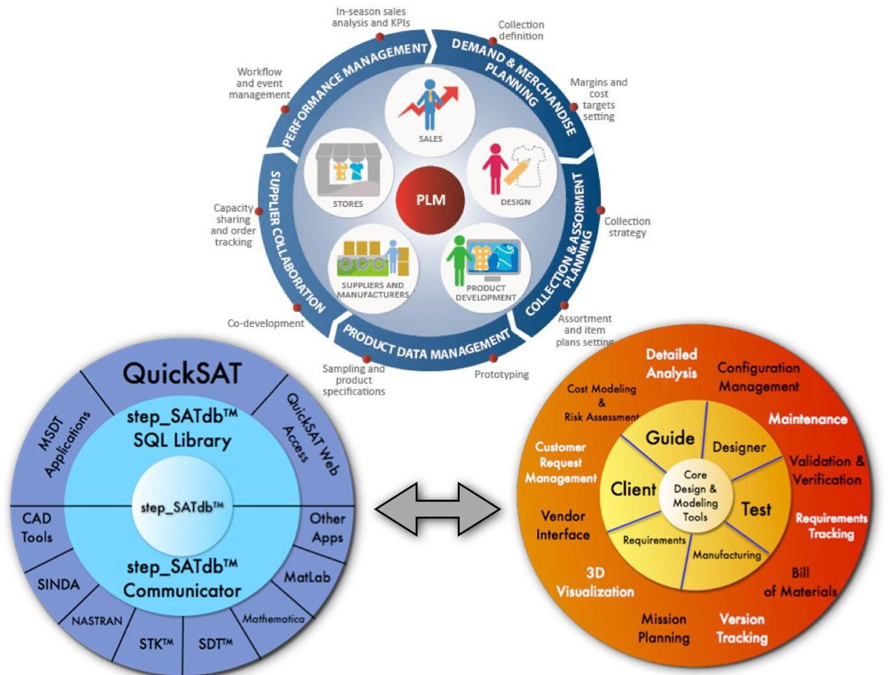

Figure 1. The step_SATdb interfaces with the QuickSAT universe and shares a complete range of "satellite" related information between a range of applications across a host of platforms to capture the Product Lifecycle Management Process $ ^{6} $

<!-- PDF_PAGE: 3 -->

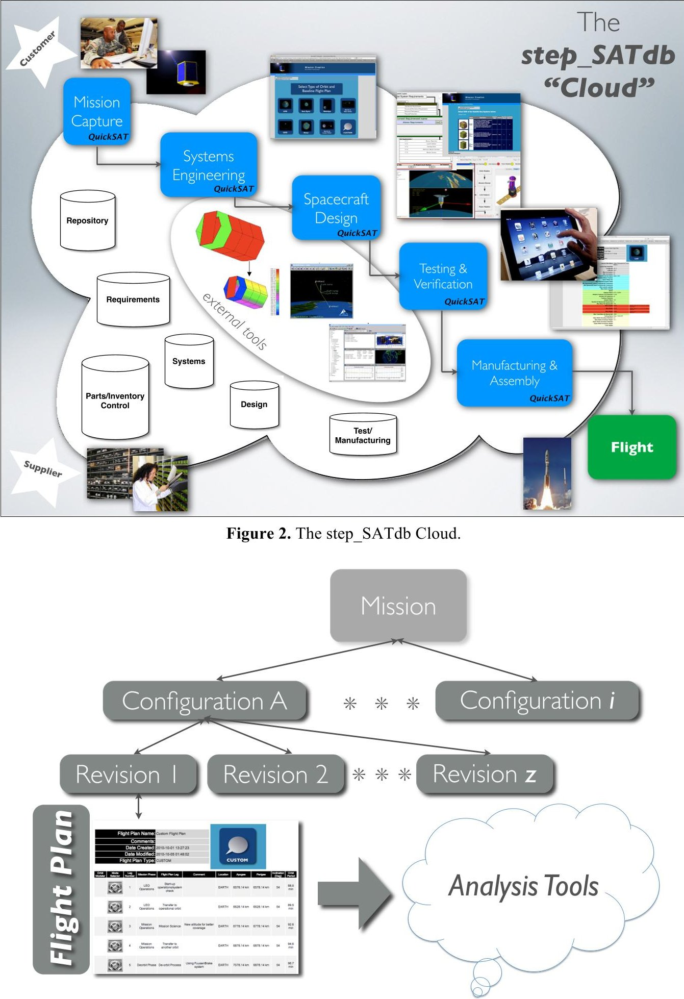

Figure 3. Satellite knowledge organization in QuickSAT

American Institute of Aeronautics and Astronautics 092407

<!-- PDF_PAGE: 4 -->

## II. Flight Planning in QuickSAT

Consider the example of the EarthSCAN formation flying mission. The EarthSCAN formation flying mission is designed to be carried on board as a single "package" as a secondary payload on a larger launch vehicle. The launch vehicle interface consists of three payload interfaces - one for the EarthSCAN "mother ship", EarthSCAN-M, and two side by side P-POD launchers for EarthSCAN cubeSAT satellites C-1 and C-2. All three satellites are spring deployed with the cubeSAT's launched first followed seconds later by the deployment of EarthSCAN-M providing a separation distance of 300 m between EarthSCAN-M and the cubeSATS. Figure 4 shows the flight plan gateway screen in QuickSAT for the EarthSCAN-M satellite. The gateway screen summarizes the flight information for each flight leg along with the flight leg information and Mission Phase name. To edit and add a flight leg, an orbit or an orbit change/trajectory, and re-arrange flight legs one selects the Edit Flight Plan button. Figure 5 shows the Edit Flight Plan screen. Here flight leg information can be modified. Changes to the flight information are propagated to all the analysis tools. QuickSAT will calculate orbital parameters such as eccentricity, orbit period, time in eclipse and in the case of a trajectory calculate the $ \Delta \mathrm{V} $ , a term that is correlated directly with the QuickSAT Propulsion Module. QuickSAT will allow the user to define and change Mission Phases. Note, flight planning information can be shared with tools like SOAP and STK.

The QuickSAT Flight Planning module not only works for Earth based missions, but missions to planets, asteroids, comets, and in Solar orbit. The stepSATdb Repository stores all related planetary data in addition to ground stations, cities and launch vehicles.

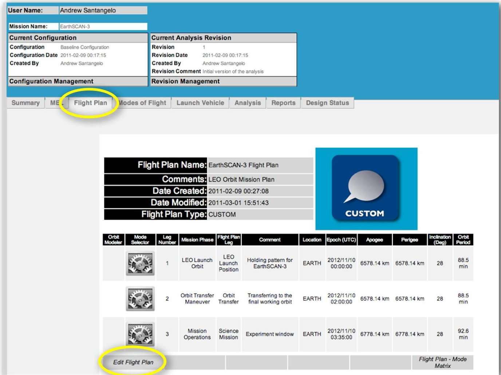

Figure 4. The flight plan gateway screen in QuickSAT.

American Institute of Aeronautics and Astronautics 092407

<!-- PDF_PAGE: 5 -->

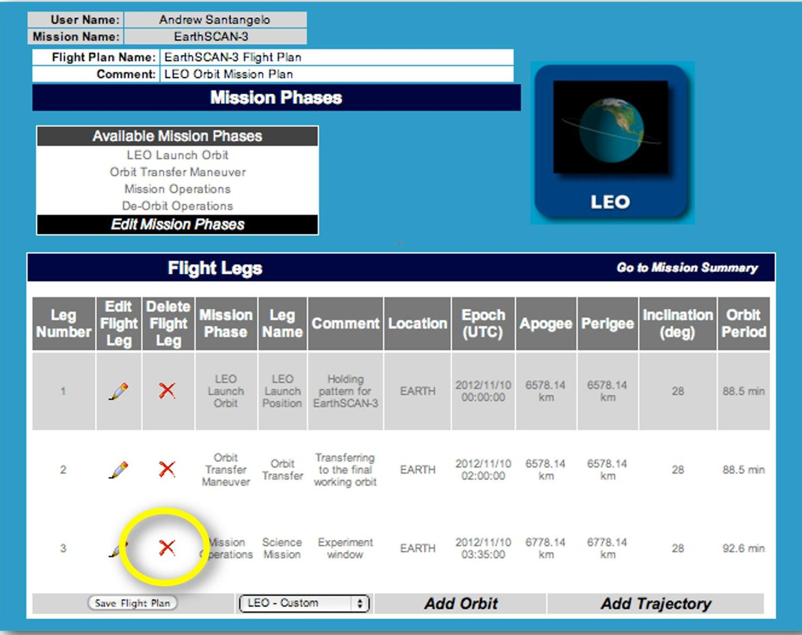

Figure 5. Modifying a flight plan in QuickSAT.

## III. Propulsion Analysis

The Propulsion Module of QuickSAT $ ^{\mathrm{TM}} $ Designer-Systems is designed to assist the technician and engineer in the overall process of the selection of a thruster for orbit change and attitude control, and track supporting components and systems. It also maps a host of parameters including $ \Delta\mathrm{V} $ budget, mass propellant used and $ \mathrm{I}_{\mathrm{sp}} $ . The Propulsion Module allows the user to manually determine likely and optimal first order solutions based on requirements and choices available. The Propulsion Module will also let the user know if there is insufficient propellant for the engines selected for a given orbit and trajectory for all flight legs in a flight plan, and hence an inadequate and non-optimal solution (equations and underlying models can be found in the book Space Mission Analysis and Design) $ ^{8} $

The user will have the option in the Propulsion Module to work from existing requirements and parameters defined in the step_SATdb database for a specified mission. Alternatively, the user can also define the $ \mathrm{I_{sp}} $ and Mass parameters within the module for later use in the definition for the mission, or as a guide in selecting a set of engine options.

As always in QuickSAT, the engineer can select thruster and supporting components via the MEL (Master Equipment List) tab in QuickSAT. These components are then mapped to all the revisions within a configuration for the propulsion module. Thrusters can be real or a reference design entered via the

<!-- PDF_PAGE: 6 -->

Parts Management System. The user selects which engine to use for each leg of the flight. From this point, the Propulsion Module will calculate the mass of the propellant used for the calculated $ \Delta\mathrm{V} $ budget, determined in the Flight Plan tab, the mass of the fuel left in the vehicle, and highlight if there is no fuel left for the orbit or maneuver. The engineer, alternatively, can select a value for the Isp and propellant mass, and the Propulsion Module will determine if the amount of propellant is sufficient for the maneuver, which then serves as a guide to selecting parts and propellant mass. For EP systems, the user would separately track the power bounds within the power module. Figure 6 shows the QuickSAT Analysis gateway screen where one would find access to the Propulsion Analysis module.

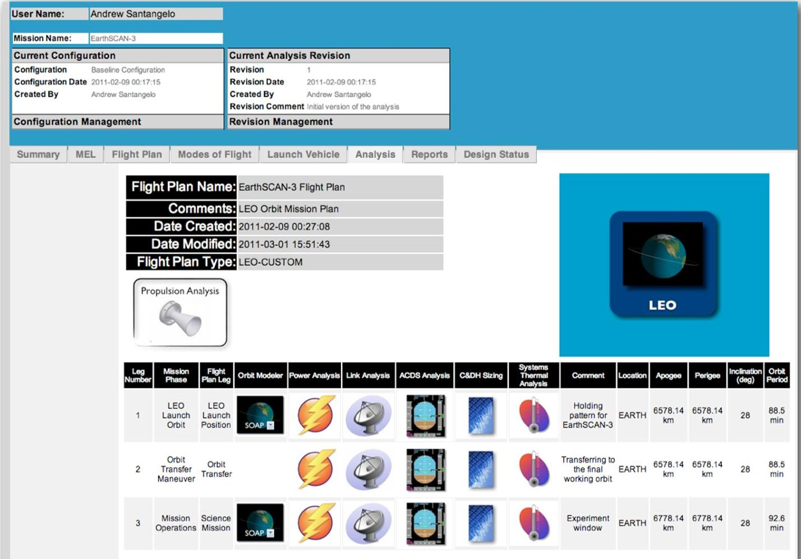

Figure 6. The Analysis gateway screen in QuickSAT.

The Propulsion Analysis screen shows all of the mission flight legs (Figure 7). From here we can select the engine - and related propellant - for our flight. The screen shows the mass of fuel used, mass of fuel left and propellants used for ADCS thrusters for each corresponding flight leg in the flight plan. The term "Propellants" and "Fuel" are used interchangeably in QuickSAT. For example, before we add an actual engine to our configuration, lets add a "model" engine to gauge how much propellant we will need for our given flight plan. For this example we will check the "Model Using Isp" box, enter 230 sec for Isp, enter 10 kg for Fuel Mass, and select Calculate and Save.

<!-- PDF_PAGE: 7 -->

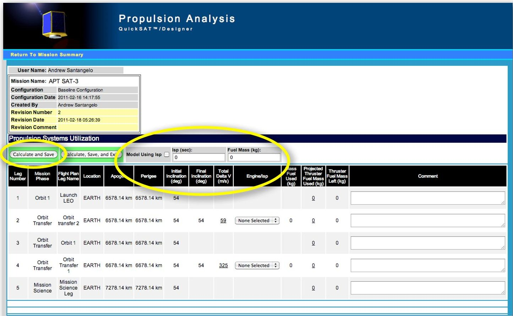

Figure 7. The Propulsion Analysis screen in QuickSAT.

Note in Figure 8, two more columns are now displayed that were not there before. Both are highlighted in grey. One column shows the Theoretical Mass Fuel Used (kg). This is based on the "model" $ I_{sp} $ and the Total Delta V for a given flight leg.

The next column shows the Theoretical Mass Fuel Left (kg). This is based on the "model" Fuel Mass. Note, the amount of fuel is reduced based on the fuel used in Flight Leg 2. In Flight Leg 4 more fuel is used than is available. A negative number is displayed and the column from that point on is highlighted in red. Obviously this value is meaningless since we cannot have a negative value for fuel mass. It does tell us though that additional fuel is required to make this maneuver happen.

Let us now in this example increase the "model" fuel mass to 25 kg. This involves replacing the 10 kg with 25 kg for the "model" Fuel Mass and selecting Calculate and Save. Looking at the Theoretical Mass Fuel Left column we can now see we have not only sufficient propellant for both maneuvers, but also propellant left over (Figure 9). Now, let us add an engine to our example satellite. Figures 10 and 11 shows the steps in adding a thruster, in this case a chemical propellant thruster. In subsystem parts we can add rocket engines and their supporting parts, like we can other parts for other subsystems. However, there are differences on how we add a part in the Propulsion Subsystem and how it is handled. These are:

- You can only enter up to THREE propulsion system types based on part number. It can be any combination of Solid, liquid or electric propulsion systems.

- You can have as many of the same engine model, identified by Part Number, as you want in your design.

- Propellants associated with the selected engine are automatically added to the propellants table. The propellant mass is set to zero.

- Thrusters/engines used for attitude control should not be entered here. You add these under the ADCS Subsystem.

<!-- PDF_PAGE: 8 -->

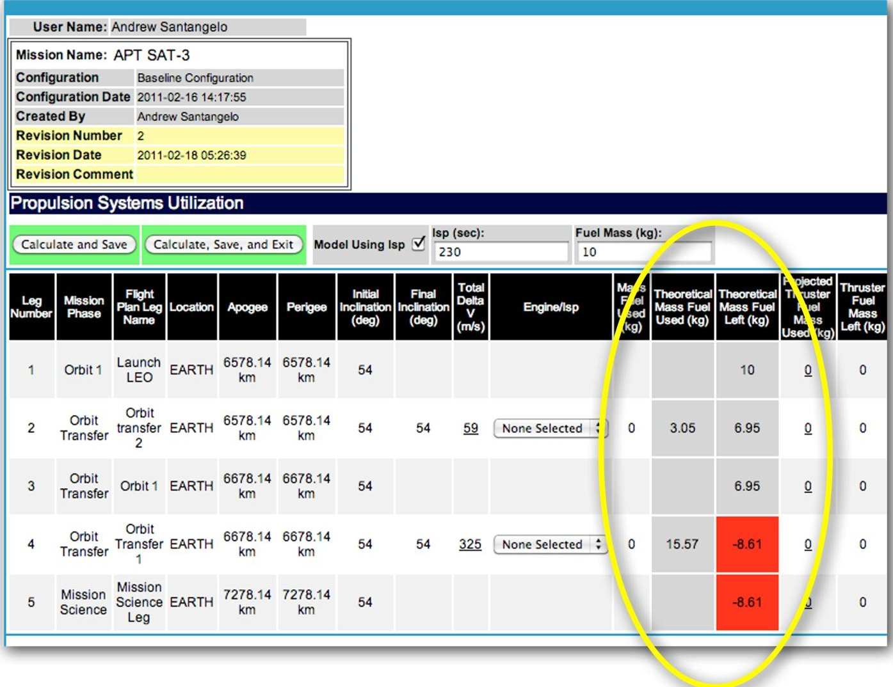

Figure 8. Setting the Model Using $ I_{sp} $ to a fuel mass of 10 kg.

Note in our example the engine is now tracked in the Propulsion module. Engines for orbit change and maintenance are highlighted in the header in purple. Columns are also added to track the fuel used and the mass of the fuel left based on the $ \Delta\mathrm{V} $ for each flight leg. In this example the mass of the propellant, or fuel, is zero. Fuel needs to be added to the model. When the engine was added to the parts list, the associated propellant was added also - with no mass assigned to the propellant. Adding propellant mass is done through the propellants subsystem access.

Note in Figure 12 the total mass for the Aerojet MR-104A propellant shows as 25 kg, however on the flight legs it only shows up as mass fuel left, not under mass fuel used. This is because we now need to select the engine through each pull down menu under Engine/Isp for each flight leg. For this example for flight leg numbers 2 and 4 we will select Aerojet MR-104A/236.09 under the Engine/Isp column and then select Calculate and Save. Now the Mass Fuel Used (kg) for each flight leg is shown. Also, the Mass Fuel Left (kg) is shown for each flight leg. This process can also be applied to calculating the propellant required for maintenance $ \Delta V $ . The QuickSAT Flight Management module directly links with the Propulsion Module. The same is true for thruster and propellant modeling when conducting Attitude Determination and Control analysis.

<!-- PDF_PAGE: 9 -->

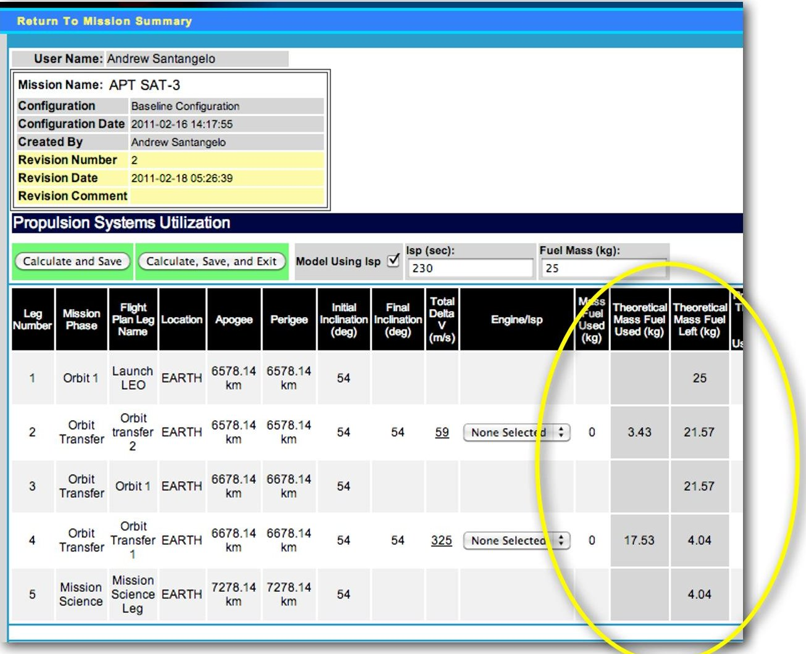

Figure 9. Setting the Model Using $ I_{sp} $ to a fuel mass of 25 kg

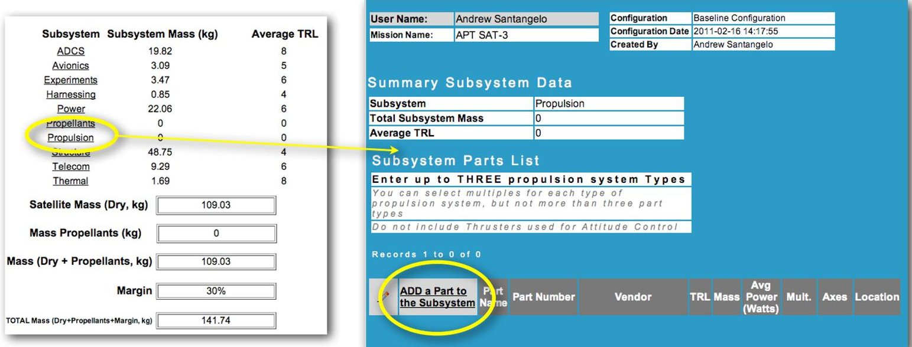

Figure 10. Adding a thruster to the satellite configuration via the MEL configuration management system.

<!-- PDF_PAGE: 10 -->

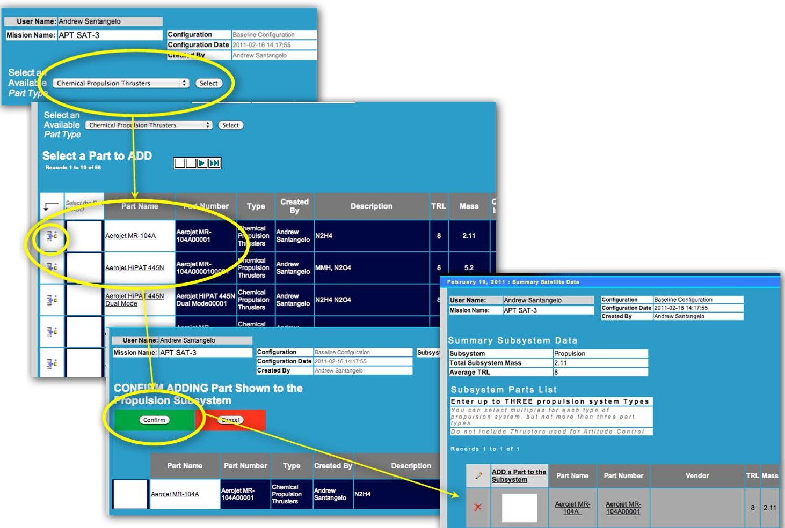

Figure 11. The steps in sdding a thruster to the satellite configuration in QuickSAT

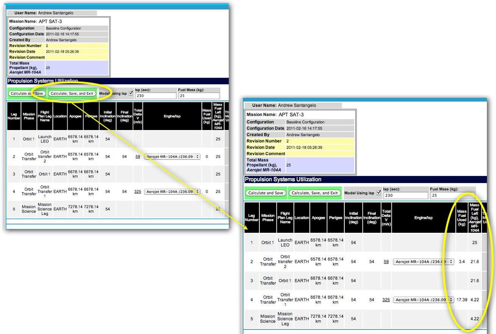

Figure 12. Selecting the engine in the Propulsion Module

<!-- PDF_PAGE: 11 -->

## IV. Conclusion

The QuickSAT/step_SATdb PLM environment stores and distributes the supporting satellite design, configuration, mission, manufacturing and test data from a centralized database/cloud environment and can distribute the data across multiple platforms and via the internet. The QuickSAT $ ^{\mathrm{TM}} $ web based environment supports the design process via its integrated analysis and information management tools and integration to existing design tools - QuickSAT provides a coherency between a range of applications and data sets. As shown in this paper the Flight Planning module is the hub for flight information and related analytical data. In the case of the Propulsion module, all legs of flight are covered including orbit change, maintenance $ \Delta $ V and attitude control. QuickSAT/step_SATdb is an open source data environment that is extensible, multiplatform and allows for internal and external analytical modules to be added.

## References