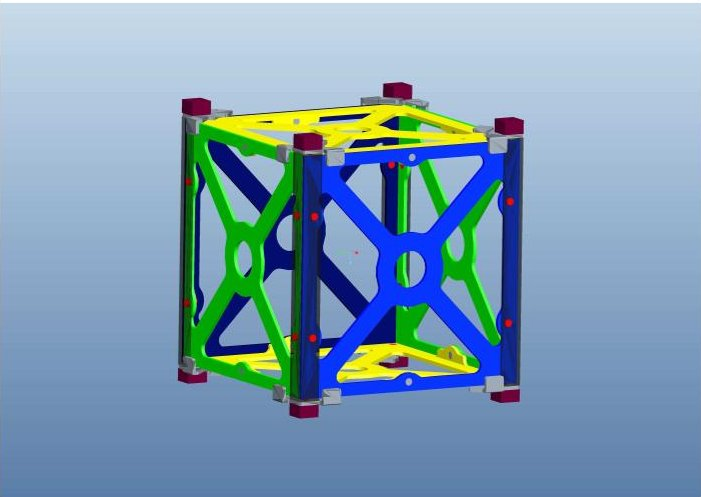
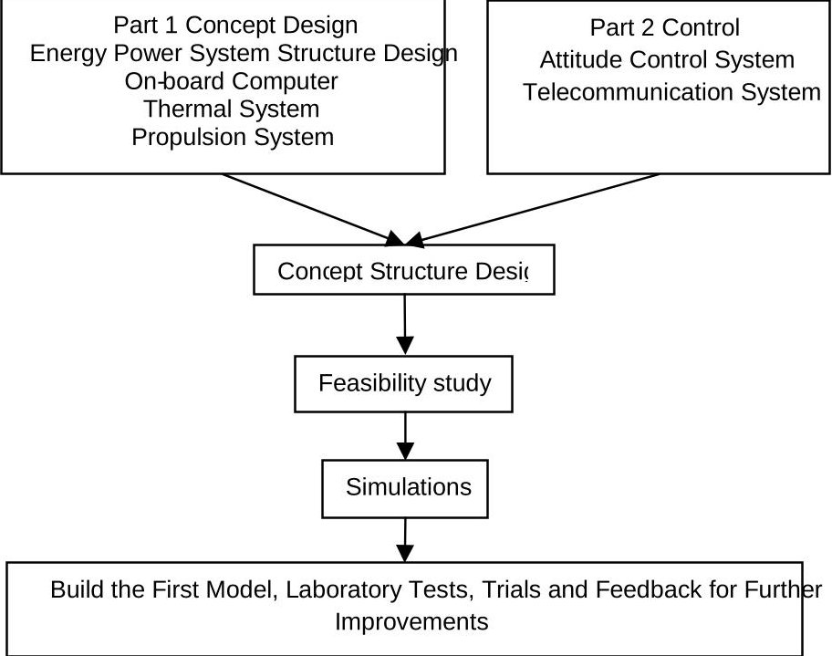
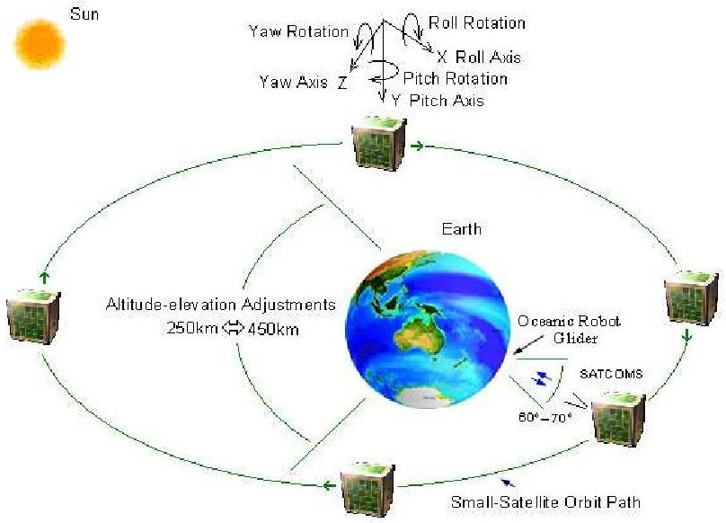
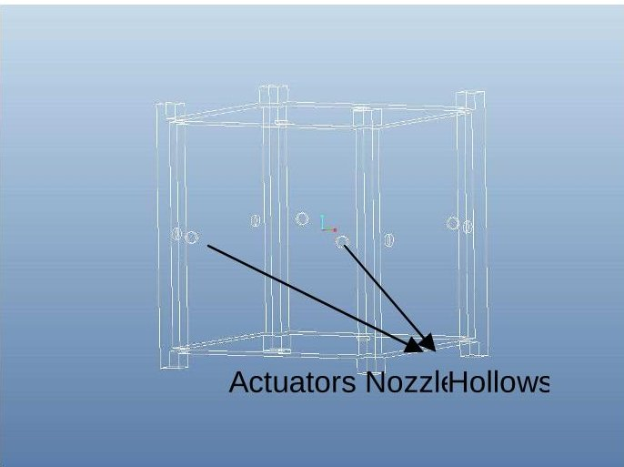
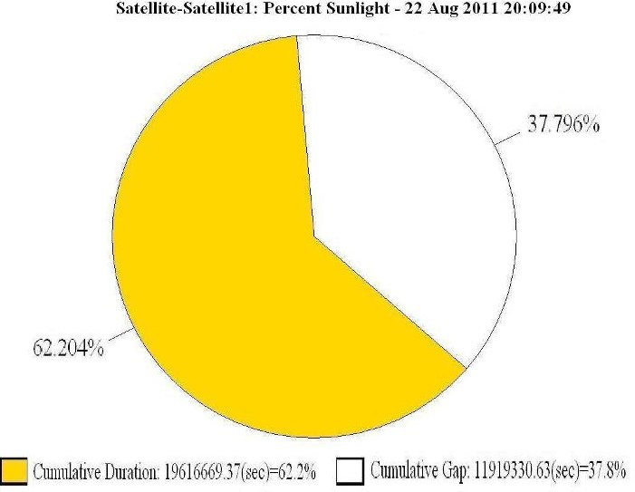
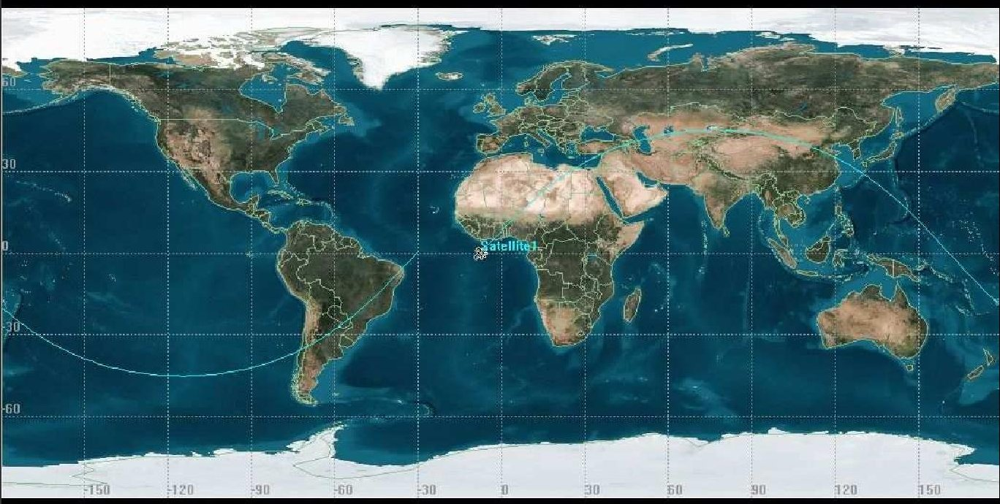
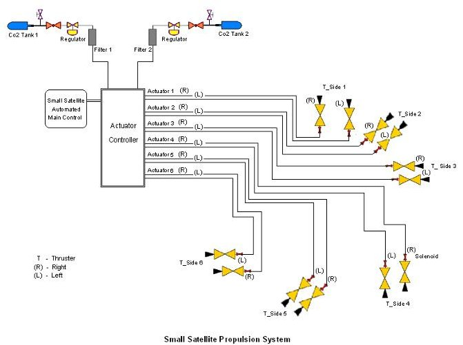

<!-- PDF_PAGE: 1 -->

# Small-Satellite Propulsion System Modelling and Simulation of Orbital Navigation Determination; A Feasibility Study

Lize Zhang $ ^{a} $ and Amir Anvar $ ^{a} $

$ ^{a} $ The University of Adelaide, School of Mechanical Engineering SA5005 AUSTRALIA Emails: lize.zhang@student.adelaide.edu.auamir.anvar@adelaide.edu.au

Abstract: The size and weight of Satellites are currently being miniaturised in order to meet the purpose of lowering cost and saving production time. For this situation, a type of Small-Satellite known as the CubeSat has been identified. This kind of small-satellite is $ 1 0^{3} \mathrm{c m u b e} $ of less than 1.33kg. Due to its limitations on overall mass and dimensions, the CubeSat uses nanotechnology components for the interior design. Therefore, an appropriate design is a crucial aspect of any CubeSat project.

According to space vehicle research and development criteria, the simulation and modelling of the subsystems of CubeSat is both significant and necessary. This paper investigates a feasibility study and demonstrates the simulation of Small-Satellite orbital navigation determination and Propulsion system modelling.

Keywords: Small-Satellite, CubeSat, Propulsion, Modelling, Orbital, Simulation

<!-- PDF_PAGE: 2 -->

## 1. INTRODUCTION

The weight of Satellites could traditionally be several tons. In addition, a satellite may be designed over many years, and enormous budgets are also required for their building. From this circumstance, a new innovative idea has been implemented by designing Small-Satellites which could be utilised for a numbers of simple missions. The purpose of this new method is to reduce the design period and decrease the enormous cost (Beukelaers, 2009) of satellite development. As the development of nanotechnologies has progressed, new components and materials which can be used for Small-Satellites have been created, including on-board Micro-computers, small and high efficiency Solar-cells, Micro-Propulsion systems, Nano-cameras and small Sensors. Whilst, Small-Satellites can be the auxiliary payloads of launching vehicles the weight and dimensions of Small-Satellites imply that their functions may be limited. Nevertheless, Small-Satellites still meet simple mission requirements such as Earth observation, Telecommunications and Swarm Communications between Satellites in space (Beukelaers, 2009).

The CubeSat concept is based on a particu Small-Satellites' design which is a 10 cube shape with less than 1.33 kg weight (Cal Pol 2009). Figure 1 illustrates a typical CubeS framework which clearly demonstrates the structure of CubeSat. Depending on the dimensions of CubeSat, the mission analysis can demonstrate that this type of small-satellite is ide for pure Telecommunication purposes between Earth and Space. Normally, Solar panels of CubeSat are fixed on six surfaces in order receive solar energy at any time from any direction when it navigates under the Sun's lighting are According to the criteria of the mission scenario CubeSat, a Small-satellite orbit path is required be identified. Following this identification, the

Figure 1 Structural Design of a Typical CubeSat Framework Shown to Actual Size (10 $ ^{3} $ m

simulation of a Propulsion system is important, where micro Propulsion systems are necessary for repositioning.

The orbit determination shows the appropriate altitude for Small-Satellites is between 250km and 450km, which are considered Low Earth Orbit (LEO). When Small-Satellites are running in LEO, adjustments of altitude are effected by using a Propulsion system which is controlled by an actuator controller. As a consequence, Propulsion systems and obit determination are significant in the design process of a CubeSat. Calculations and the use of several softwares may be constructive for simulations which then provide the working process of the Propulsion system and identify the orbit path.

This paper critically examines Small-Satellites Propulsion systems and orbital determination theory, as well as the methodology relating to modelling and simulation processes. Additionally, a feasibility study of applying Propulsion system and Orbital determination are addressed in this paper. Finally, the relationship between the Propulsion system working-principle and the Orbit path will be identified.

## 2. THE UNIVERSITY OF ADELAIDE CUBESAT PROJECT

## 2.1 Overview

A CubeSat program is currently operating at the University of Adelaide, School of Mechanical Engineering. This program aims to extend students particular research skills and improve special understanding about Small-Satellites. The entire program has been divided into two projects which are feasibility studies of the Structural Design, Thermal insulation and Energy supply sections and Command Control and Navigation sections. Both studies are postgraduate research projects. Two teams cooperate together and combine the final results in order to demonstrate the overall configurations of the CubeSat. The development process is presented in Figure 2.

<!-- PDF_PAGE: 3 -->

- Estimate certain subsystems in CubeSat projects and establish two distinct but inter-related research groups

- Devise concept design for the structure and construct a model in order to demonstrate the size, provide an overview of CubeSat and finalise the internal and external dimensions of the CubeSat

- Decide on the simulation parts for subsystem by using different softwares

- Build and test the model following the design

- Complete the feasibility study

Figure 2: The Project Components and Modelling

A feasibility study of the relationship between the Propulsion system and orbit determination forms a part of the

project. Depending on the optimal orbit of CubeSat, an ideal solution could be identified as combining the Propulsion system and attitude control system. This innovative system could be one of the examples for the subsystems of CubeSat.

## 2.2 General Orbit Determination

There are several diverse classifications of orbit depending on different parameters of the referencing objective. Generally, one of the orbit types could be divided geocentrically into three categories which are low, medium and high (Arroyo, 2009). CubeSat utilises the Low Earth Orbit (LEO). An expected orbit can be defined as an approximately standard line. Further, the distance between a CubeSat and earth may be represented as positive and negative areas. Additionally, the region between the standard line and earth is positive. In contrast, the distance from the standard line to infinity is negative region. It is meant that, when satellites running within

positive altitude, the communication would be more effective than negative altitude. Due to centrifugal force influences, the distance between satellite and earth is increased by centrifugal acceleration during working period Therefore, in aiming for better communication effect, one solution may be using a Propulsion system to regulate the altitude of CubeSat. Figure 3 illustrates the approximate CubeSat orb schematic diagram. It can be seen from the diagram, there are two emphasised angle One is a small angle approximately 60-7 degrees. Another is a bigger angle opposite to the small angle. These two fields are assumed as two working area

Figure 3: A CubeSat Orbital-Navigation Path Diagram

of satellites. The 60-70 degrees angle is considered as the best region for communication, i.e, satellites main communicating mission would be completed within this area. The larger angle is for orbital adjustments. In this area, the Propulsion system would adjust to the altitude-elevation by using the Propulsion system. Furthermore, Attitude Control System might be applied to CubeSat in order to supply rotation for self-control system.

<!-- PDF_PAGE: 4 -->

Therefore, the Small-Satellites could apply an imager as on-board payload for earth observation. To achieve these functions for CubeSat it may require a special structure to be designed for the Propulsion system.

## 2.3 Principle of Propulsion System

The Propulsion system of a CubeSat may be one of several types. The newest type is solar sails which is propelled by solar wind. This new technology is an innovative method designed to use passive power in space. Another two traditional power sources are electrical and chemical power system. In the Adelaide University project, the simulated of Propulsion system is assumed to use a solid chemical which is dry ice.

There are several advantages of using a chem Propulsion system. The dimensions of $ _{2} \mathrm{C O} $ containers can be appropriately made for CubeS In addition, the supplied rotation is more effective and sensitive; specifically, when the CubeSat changing direction, the torque is provided fast compared to the electric and solar sails systems. achieve the 6 degrees of freedom so that the attit can be accurately controlled, a total 12 jets a required. Figure 4 demonstrates one design for structure of the jet orifice. Two outlets or actuator nozzle hollows, on each surface are able to ke CubeSat rotating freely. This system will be controlled by an actuator controller to simplify calculations for open and closed times and perio for all the orifices to adjust the attitude of Cubes.

Figure 4: General External Jets of Small-Satellite Actuators

and also control the orbit adjustments. According to the orbit determinations and simulations, it is demonstrated that these adjustments do not occur only in one cycle. The results of the simulation are identified and discussed in more detail in the following section.

## 3. RESULTS AND DISCUSSION

## 3.1 Simulation of Orbit Determination

A scenario of CubeSat orbit may be created by software called Satellite Tool Kit (STK) which is a professional and effective application for space mission design, modelling, engineering and operation (Analytical Graphics, Inc., 2011). STK provides modular products, the

understanding of this software can be described visualised Matlab.

There are a number of data types that can be g by this software. For example, in Figure 5, the u of current project specifications to simulate the whole year period sun lighting time is illustrated After creating a scenario, the data is set as a sate (for example, named satellite-1), with an avera altitude of 300km. Then, the satellite-1 can be shown on the world map of STK; the orbit of satellites may also be highlighted. In addition, the reference station can be inserted. For instance, Canberra observatory can be one of the refere stations with longitude 149 degrees and latitude degrees, for Adelaide University project. After th

Figure 5 One Year Period Sun Lighting Percentage

analysis process, a number of results reports of simulations regarding different aspects can be generated for

<!-- PDF_PAGE: 5 -->

various purposes of utilisation. It can be seen from Figure 5 that the sun lighting time during one year is approximately 62.204%. Thus, energy obtained could be calculated by the percentage of sun lighting time during one year. Finally, all data regarding the energy power system can be calculated, including power distribution, power requirements, energy storage and solar panel dimensions and types.

Figure 6 is another example which illustrates the satellite orbit in two dimensional (2D) of worldwide map. The highlighted line with green colour is one orbit cycle. Using STK software simulation, it clearly demonstrates the working period in one day due to the Earth's rotation. Thus, in a period, for example, one day, satellites do not continually orbit the same area. The simulation discussed here provides the opportunity to calculate the approximate working time during a period. Basically, the period would be set as one day, to identify the whole year's data. Figure 6 shows that there is an orbital gap between longitude -10 degrees and longitude -30 degrees.

Figure 6: The Real-time (2D) Satellite Orbital Navigation Path on the World Map Given by STK

Specifically, approximately 20 degrees movement along the longitude is applied during each cycle of the Satellites' navigational operations. Two reasons are involved in this movement; one is due to the STK simulator representation of altitude elevation within the gap of the satellite's navigational paths crossing. The second reason is due to the earth's rotation.

Mathematically, from satellite tracking data, satellite motion in orbit can be described by several equations (Analytical Graphics, 2011). The Equation (1) shows the initial calculation for the orbit. In fact, the satellite altitude equation can demonstrate most of satellites altitude in space altitude and orbit.

$$
U (r, \theta , \lambda) \approx \frac {G M}{R} \left[ \sum_ {l = 1} ^ {l _ {\max }} \sum_ {m = 0} ^ {l} \left(\frac {R}{r}\right) ^ {(l + 1)} P _ {l m} (\sin \theta) \left(C _ {l m} \cos \lambda \mid S _ {l m} \sin m \lambda\right) \right]
$$

Where:

- r, $ \theta, \lambda $ are the spherical geocentric radius, latitude and longitude coordinates of the point where the geopotential is evaluated,

- GM is the product of the universal gravitational constant the Earth's mass,

- R is the Earth's mean semi-major axis,

- I, m are the spherical harmonic degree and order,

- Plm are the fully normalized associated Legendre functions and

- CIm, Sm are the fully normalized Stokes coefficients.

<!-- PDF_PAGE: 6 -->

This simulation provides the majority of data for orbit and mission. The analysis of mission would be identified fully by using this type of simulation process with STK.

## 3.2 Propulsion System Modelling

A six degrees of freedom Propulsion System requires total of 12 jets-hollows which are two outlets on each surface. In addition, at least one sensor is necessary in order to track the sun or Earth. The central actuator controller is required monitor and adjust the attitude of the CubeSate controlling, opening or closing state of 12 orifice Subsequently, filters which are connected to $ \mathrm{o}_{2} \mathrm{C} $ tanks would be managed to distribute $ \mathrm{C}_{2} \mathrm{G} $ to different orifices in order to modify the direction of the CubeSat. Therefore, the Propulsion system working processes could be modelled as illustrated in Figure 7.

Figure 7 Propulsion System Model

Two $ \mathrm{C O_{2}} $ operate tanks in this system. Additionally the actuator-controller is considered as the cent brain in this system. It controls the total of 12

outlets, including 2 for each surface which contains each for left and right side. As Figure 7 demonstrates, the actuator controller is connected with small-satellite main control system. In this case, the signal from the sensor would be transmitted to the main controller and calculated. Then, the control-function signals would be transited to actuators to control the attitude and orbital adjustments.

The modelling provides a demonstration of working principle of Propulsion system. This working process would illustrate one of the typical Propulsion systems of CubeSat. Additionally, the innovation of combining the Propulsion and Attitude Control system, results in, the internal systems of CubeSat being reduced. Thus, the cost is also decreased.

## 4. CONCLUSION

The orbit simulation and Propulsion system modelling clearly demonstrates the basic working process of its system and orbital determination. Small-satellite in LEO could be simulated appropriately by this method by using STK. The STK software provides the determination of orbit and analysis of missions. Due to the significantly high level of mission analysis in a CubeSat project, the use of STK for simulation becomes important. As a consequence, the Propulsion system and orbit determination are also significant in the design process of CubeSat. Through the modelling of the Propulsion system, it can be seen that, the combination of the Propulsion system and attitude control system is possible. Therefore, Small-Satellites Propulsion systems and orbit navigation determinations can be identified via a technical process by the simulation and modelling.

## REFERENCES

Analytical Graphics, Inc. (2011). "agi products category" http://www.agi.com/products/by-product type/applications/stk/

Arroyo, S. (2009). Mission and Thermal Analysis of the UPC Cubes universitat Politecnica de catalunya.

Beukelaers, V. (2009). From mission analysis to space flight simulation of the OUFTI-1 nanosatellite". University of Liège, Belgique.

California Polytechnic State University (2009) CubeSat Design Specification Revision 12The CubeSat Program, Cal Poly SLO.