<!-- PDF_PAGE: 1 -->

# Overcoming the challenges of developing CubeSat flight software with limited access to satellite hardware

$Dirk$ Slabber $^{1}$, $Callen$ Fisher $^{1}$, $Willem$ Jordaan $^{1}$

$ ^{1} $ Electrical and Electronic Engineering Department, Stellenbosch University, Banghoek Road, Stellenbosch, 7600, South Africa

Abstract. The drastic rise of CubeSat missions in recent years has forced satellite developers to deliver satellites at high speeds. The complexity of flight software for missions, however, leaves it susceptible to programmatic failure. To develop the DockSat mission in an acceptable timeframe, this article proposes to utilize digital twins of satellite components to allow software development and complex testing at earlier stages of the mission development cycle where hardware and experimental setups are not available.

## 1 Introduction

The CubeSat standard defines the interfaces and dimensions of a class of nanosatellites as small as 100x100x100mm. By defining larger satellites out of these ubiquitous "cubes", it has gained massive popularity. The widespread adoption of this standard has led to the development of commercial off-the-shelf (COTS) satellite components, accelerated manufacturing processes and more affordable missions.

According to studies, more than 60% of small satellites fail to meet all their mission objectives [1]. This number grows to 70% when only considering CubeSats [2]. More disheartening, it is estimated that 50% of CubeSats launched by universities are retired within the first 6 months after launch [3]. While there are many studies undertaken to identify causes of satellite failure, a root source of failure remains that universities and young space companies are developing satellites while underestimating the complexity of the spacecraft. This consistent error in judgement disrupts development schedules and often cause precious resource and time misallocation, neglecting the necessary verification of systems [2].

CubeSats consists of multiple independent running systems, each with a specialized task. Each one of these subsystems generally includes its own microprocessor and is purchased as a COTS product from a specialized supplier. The coordination of these subsystems is one of the main responsibilities of the flight software, which remains one of the most prevalent aspects to fail during the mission [3].

<!-- PDF_PAGE: 2 -->

The difficulty of developing reliable flight software originates from the unique nature of space missions and the inherent complexity associated with synchronizing the many systems needed to maintain a satellite in orbit. Compounding this difficulty is the tendency of inexperienced teams to leave flight software as one of the last systems to be developed. This is often a necessity, as the hardware required to assemble the satellite and verify the correct operation of the software is often only accessible very late in the development cycle of the mission.

Studies strongly indicate that enough time for the development and testing of integrated systems is paramount in the development of successful satellite missions [4] [5] [6]. Building on this concept, this article presents a method of developing and utilizing digital twins of satellite hardware systems, to allow development and testing of flight software at earlier stages of the mission development cycle. By interfacing the flight software run on an OnBoard-Computer (OBC) with a satellite simulation and these digital twins, complex verification experiments can be performed with minimal cost and effort.

## 2 Literature study

Before the development of the flight software, it is imperative to develop an understanding of the techniques used by industry for flight software development. Deduction of the overarching requirements of flight software can be accomplished through the study of successful existing solutions and works published by both academia and industry. Determining the requirements of software becomes an assessment of functional traits, satellite system characteristics as well as operational requirements of satellites. This approach emphasizes that software affects all system characteristics and that its quality will define the integrity and operation of the entire satellite. Certain works in strongly recommend the adoption of this system engineering mentality in the design of flight software [7].

Software quality can be described as the degree to which software possesses a desired combination of attributes [8]. Many of these attributes of flight software development are qualitative rather than quantitative in nature and refer to design pillars such as robustness, modularity, and autonomy. There are, however, many sources of design rules [9] [10], as well as industry standards for flight software [11] [12] that act as guidelines for the development of flight software. Before launch, professional software is often subjected to strenuous reliability testing performed by external testing facilities to verify that specifications set out by launchers, clients and regulatory bodies are met. It has been shown, however, that these specification verification methods are often not sufficient to consistently determine satellite operational reliability [2].

Various techniques are used by software developers to achieve high-quality flight software. One of the widely implemented methods is the use of Real-Time Operating Systems (RTOS) to manage operations performed by the OBC. Unlike bareback systems which quickly become complex when implementing strict time scheduling, priority-based RTOS systems are developed to meet strict timing deadlines. Systems such as FreeRTOS or OS-III are small, open-source, support most processors frequently used on satellites and are frequently used by both experienced and inexperienced teams [13].

Fault, Detection, Isolation and Recovery (FDIR) processes, have in the past been done on the ground, based on mass data sent down from the satellite as it passes the ground station. The capability of modern satellites to perform FDIR services autonomously has become feasible

<!-- PDF_PAGE: 3 -->

even for small satellites, saving valuable operational time and increasing satellite reliability by addressing issues early on. Examples of successful implementation of these services can be seen in the DelFFI program [14] or ESA's OPS-SAT [15] which utilizes a dedicated computer to manage complex FDIR systems. Works such as [16] present innovative approaches to integrating previously too complex FDIR methodologies in the CubeSat environment.

Recent years have shown an increase in satellite autonomy as systems become more complex, storage capacities increase, and processors are made more powerful. In addition to complex FDIR systems, consideration has been given to redefining satellite operations from programmatic schedules to goal-orientated systems. In these systems, the ground operator only sends the satellite a list of objectives to meet and allows the satellite to autonomously schedule its activities based on real-time data [17]. Goal-orientated planning introduces a great range of new methods to enhance satellite operations such as better trajectory optimization and mitigation of faults through reactive-planning or intelligent collision avoidance.

Some of the more advanced techniques mentioned above are only found as academic works with little to no actual implementation in space. By far the most common technique used by industry to create high-quality flight software is maintaining Software-Development-Kits (SDKs) through experiences from prior missions. Modular and integrable code development allows experienced mission developers to integrate payloads into well-established and familiar satellite bus designs with greater ease than ground-up development. This technique, naturally, is only viable to established developers.

Attempts are made to create generic software frameworks to facilitate easier development of flight software in a manner similar to SDKs used by established developers. Some of these frameworks such as NASA's core Flight System (cFS), are made to support a series of planned missions [18]. Other frameworks are developed for commercial use such as KUBOS [19] or standardization such as ESA's SAVOIR framework [20].

Testing and verification of satellite flight software is often done continuously through Hardware-In-The-Loop (HITL) testing setups. In industry, these setups are often referred to as "flatsats" due to these setups often having satellite components arranged flat on a table. These setups are most often used to verify that hardware components are correctly interfaced [21]. While vital for the development process, these systems are more useful for end of development testing due to needing the various hardware components. As such an alternative method of flight software development must be used. This article

## 3 Flight software design

The development of the DockSat flight software is a large undertaking and its full presentation falls outside the scope of this article. The following sections will present the key elements that influence the design, function and composition of the software, as well as key design choices made during its development.

## 3.1 The DockSat mission

Prior to starting development of the flight software, it is critical to understand the requirements of the mission and the operation of the satellite on which the software will run. The DockSat mission, which defines the satellite mission for this project, is a nanosat mission

<!-- PDF_PAGE: 4 -->

by the Electronic Systems Laboratory of Stellenbosch University. This mission aims to demonstrate the docking of two CubeSats in LEO [22]. Given the complexity of the mission, this article will limit its scope to the development of select software structures applicable to one of the satellites, namely the Chaser satellite. The Chaser is a 3U Cubesat consisting of mostly COTS components supplemented by key hardware components developed in-house. Figure 1 shows the composition of the chaser satellite.

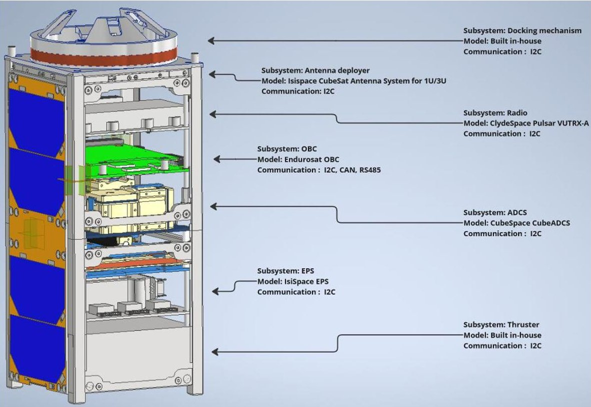

Fig.1. Hardware composition of the Chaser satellite deployed during the DockSat mission

The functional mapping of the DockSat mission is best described through observation of the mission stages. These stages describe sequences of the mission during which the satellite has clearly defined objectives that need to be met before being able to commence the next section of the mission. Figure 2 presents a high-level overview of mission stages with the components of focus and objectives of each stage.

<!-- PDF_PAGE: 5 -->

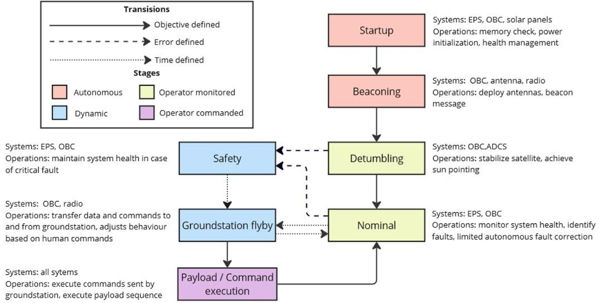

Fig. 2. Overview of the Chaser satellite mission stages, objectives and components of focus.

The first two stages of the satellite mission, namely the startup sequence and the beaconing stage are stages when the satellite is most vulnerable to failure as at this stage the satellite has not achieved communication with the ground station and is therefore completely autonomous.

## 3.2 The satellite OBC

In the interest of creating a more realistic developmental environment, the work presented in this article is conducted utilizing a COTS OBC.

The chosen OBC to be incorporated in the DockSat mission is the EnduroSat OBC, which is then also used as the platform on which this work is conducted. It is appropriate then to also utilize the EnduroSat SDK provided with the hardware. The SDK lays the foundational architecture of the device such as the RTOS, and as such allows the developer to shift focus to higher-level operations.

## 3.3 Design principles and flight software architecture

The development of the flight software is built on a foundation of principles taken from some of the standards referenced in the literature as well as the design guidelines proposed in [7]. While the methods discussed in the literature review each enhance the robustness of software, none do so from an architectural perspective. This can be achieved by applying broad principles of decomposition of functionality and hierarchy.

Satellite software structures are often limited to encapsulation of the hardware subsystems they represent. This limitation, however, lacks a system perspective and complicates the interaction between structures. Alternatively, by creating goal-specific functionality-based software structures, a system is developed that reduces complexity and is more versatile in implementation.

<!-- PDF_PAGE: 6 -->

The decomposition of functions into "wide" architectural designs synergizes them with vertical encapsulation based on layers of abstraction to create "tall" designs. The benefits of abstraction layers are numerous and are standard practice in software development, however, their robustness to error propagation should be noted. Consider a portion of the architectural software blocks required for the deployment of the satellite antennas presented in Figure 3.

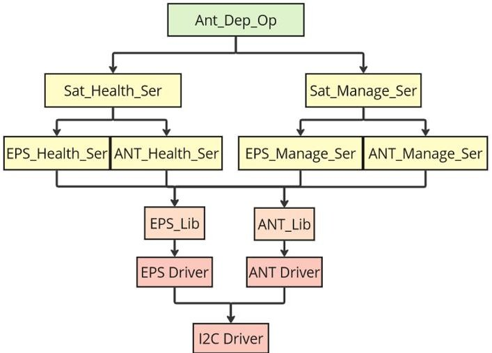

Fig. 3. The architecture of the satellite flight software that performs the antenna deployment operation

Depicted at the most abstract level are the operational commands of the deployment substage of the satellite. For it to execute successfully, both the satellite must remain operationally healthy and must execute commands, thus introducing the concept of functional decomposition in the form of the two services in the second layer of the architecture. Both of these services can then be split into the respective hardware subsystems. Each component is responsible for fault-finding of errors generated by itself and presented by the layer directly below it. As such, errors cannot propagate through layers, except through an error reporting service. By utilizing these principles, software is created to be modular, robust and more intuitive.

## 4 Development of digital twins for verification of flight software

During the development of the flight software, it is imperative to constantly verify the correct operation of the code as well as optimize processes to achieve mission goals. In the absence of other satellite components with which the to interface the OBC, this work utilizes simulated component models. The following sections presents the development of these models.

## 4.1 The DawnDusk simulation environment

The DawnDusk (D2S2) simulation environment, shown implemented in Figure 4, is a recently launched software package that offers versatility in the simulation of satellites in orbit. Specifically, it allows the development of virtual hardware components written in C# which can be integrated into the simulation [23]. The D2S2 simulator already has several generic components with rudimentary operational capabilities as well as some specific satellite components developed by commercial partners. This easy integration of satellite components makes the D2S2 simulation environment ideal for creating digital twins for the DockSat mission and verification of the flight software. Figure 5 presents the solar input

<!-- PDF_PAGE: 7 -->

power as well as the battery capacity of a satellite simulated with generic components performing an operation that draws excessive power.

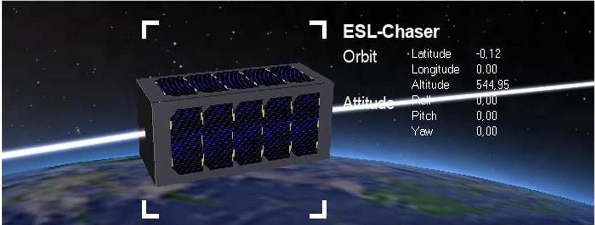

Fig. 4. A simulation GUI of the DockSat satellite in LEO using the DawnDusk simulation environment

Simulation of D2S2 generic satellite

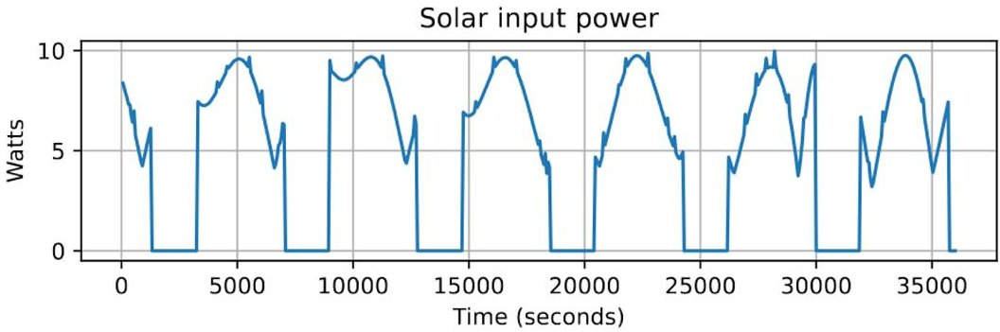

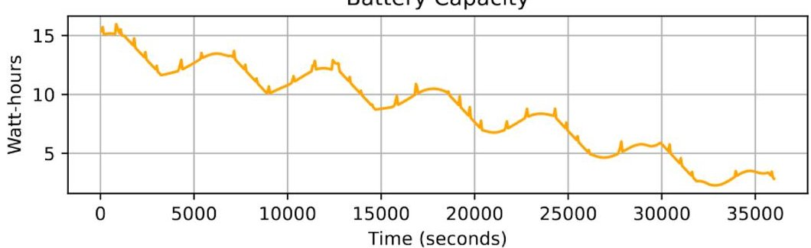

Fig. 5. The logged solar input power and battery capacity of a satellite simulated in the D2S2 environment only utilizing generic components available in the base version of the program. The data depicts the gradual loss of battery capacity as the mission continues with no intervention from health management software.

As can be in Figure 5, the battery capacity of the EPS is slowly drained over multiple orbital cycles. None of the health management operations usually found in satellites nor realistic physical effects such as voltage drop or battery damage during excessive draining are implemented. To perform meaningful experiments, and to verify the operation of the DockSat flight software, more complex virtual models of components are needed.

<!-- PDF_PAGE: 8 -->

## 4.2 Digital Twin development

The satellite subsystem models are based on information obtained from interface control documents (ICDs) and datasheets made available by the manufacturers. The complexity of these subsystems makes it apparent that a standardized way of defining the component's behaviour and interactions is critical in creating useful virtual models. Proper standardization also permits a universal method of introducing errors in the system without having to extensively change how the components are modelled.

Consider the diagram Figure 6 (left) that presents the basic design of each virtualized component. While this design is applied to entire subsystems, it is also the method in which the intra-subsystem components are modelled.

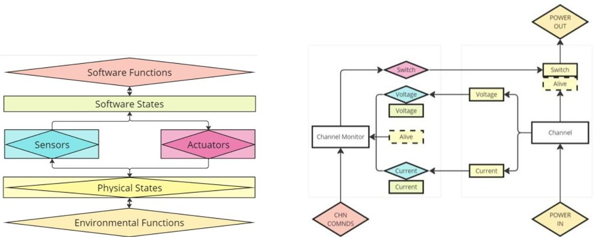

Fig. 6. Abstracted view of a simulated satellite component in the D2S2 environment (left) and a depiction of how an EPS power channel would be defined and simulated in the D2S2 environment (right)

The core of each component is a set of physical states. Physical states refer to those variables that describe the actual component. Examples of these include the actual channel voltages and the alive status of components. Physical states are often limited by defined physical parameters. These simply act as physical milestones which, should the physical state surpass the parameter, some physical function will be triggered. An example of this is the degradation of the battery capacity should it be overcharged. The physical states of a component can be interacted with through only environmental functions, sensor readings and actuation actions. Software states are those variables that are observed by the component during simulation through the use of a sensor. These states are subject to sensor error. An example of a software state is the observed channel voltage. Most of these states are directly taken from ICDs of the respective components.

Environmental functions refer to those functions that change the physical states due to the effect of a different physical state. An example of this is the power entering the channel management system from the battery management system changing the state of the actual channel voltage. Sensors and actuators are treated as functions inherent to a component that are reliant on their own set of states. As mentioned previously, each sensor and actuator has its own alive and bias state through which errors can be injected. Figure 6 (right) depicts the antenna deployment system as an example of how the components are defined.

<!-- PDF_PAGE: 9 -->

After low-level operation of the component is defined in the manner above, what remains is the implementation of the high-level operations. These are classified as the component's software functions and can only be interacted with through the software states, such as perceived sensor measurements, as well as the commands sent by the OBC through the communication channel. These functions generally include the component's state machine command instructions and telemetry.

Another simulation is run using the same conditions as before, however instead of using a generic EPS, an EPS is modelled from ICDs as described above. Figure 7 presents the solar input, battery capacity, and the satellite EPS state over multiple orbital cycles. An observation can be made that the EPS maintains the satellite battery capacity at safe levels by switching to "safe" mode when to capacity reaches a critical low. While this does maintain capacity, it does so at the extreme expense of mission operations as during safe mode, all toggleable power channels are switched off and satellite operations are halted. In the case of this experiment, the satellite operated in "safe" mode for 31.5% of the mission duration.

Simulation of D2S2 satellite with custom EPS

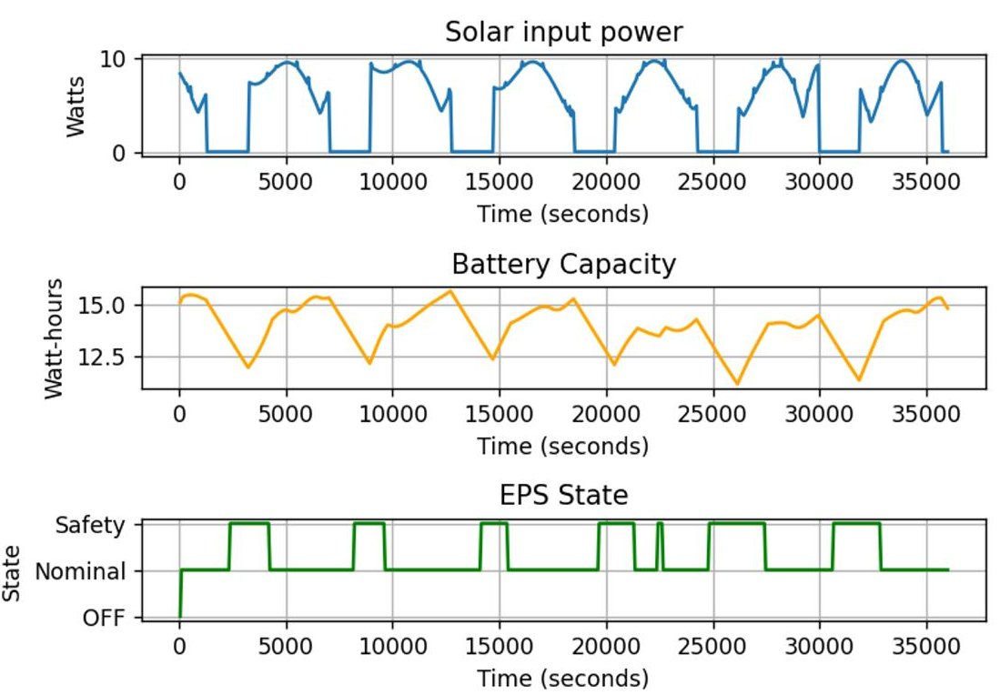

Fig. 7. Logged data from a D2S2 simulation of a generic satellite with an EPS modelled after data obtained from ICD. The data depicts the EPS software maintaining satellite battery capacity by switching into safety mode.

## 4.3 Modelling and simulation of component failures

To increase the realism of the virtualized satellite hardware, as well as evaluate the error handling capability of the flight software during survivability tests, satellite component failures must be modelled in such a way that cascading failures can occur. This article will implement a method of failure modelling done in [24] and [25].

<!-- PDF_PAGE: 10 -->

The most extensive source of satellite failures is the database managed by Seradata formerly known as SpaceTrak. This database is actively used by the satellite industry and has been collecting data on satellite launches, failures and anomalies since 1957. [26]

Most identifiable satellite failures are that which experience total system failure which is designated as Class 1 failure. These failures are defined as those which cause the entire satellite to be retired as mission objectives are not possible thereafter. Class 1 failure is, however, rarely a single event occurrence and most often due to what's known as cascading failures. These are failures that propagate on top of each other and while no single failure is fatal to the operation of the satellite, their combined effects push the system into a further erroneous state eventually leading to failure. These other classes of failure are categorized based on their effect on the ability of the system to still perform its key functions. Failures are thus categorized as follows:

- Class 4: A failure that does not have a significant impact on the operation of the satellite subsystem or which is repairable.

- Class 3: An irreparable failure that causes a loss of redundancy.

- Class 2: An irreparable failure that causes a loss of system functionality.

- Class 1: Total system failure.

Consequently, there are 5 states of operation for each satellite subsystem. Note that no healing occurrence is presented as supporting data is not sufficient to model the healing of satellite components.

With instances of component grouping multi-state failure obtained, the data is processed using statistical techniques to allow the parameterization of probability functions over time predicting the likelihood of state change for each component group. These functions are generated in the form of Weibull distributions and a subset of these function parameters relating to one group are presented in Table 1. Note that the Weibull parameters are defined in years.

Table 1: Different Weibull parameters that model the probability curves of different state changes occurring at some time after launch.

<table border="1"><tr><td>State change</td><td>β</td><td>Θ(years)</td></tr><tr><td>4-3</td><td>0.8229</td><td>59</td></tr><tr><td>4-2</td><td>0.5600</td><td>4003</td></tr><tr><td>4-1</td><td>NA</td><td>NA</td></tr><tr><td>3-2</td><td>1.1593</td><td>17</td></tr><tr><td>3-1</td><td>0.7115</td><td>135</td></tr><tr><td>2-1</td><td>NA</td><td>NA</td></tr></table>

The parameterization of the satellite components' failure probabilities in the form of Weibull functions allows easy implementation in the simulated environment. An experiment is conducted where a population of components are assigned failure probabilities and repeatedly run in a simulated environment. Each component's failure chance is compared to the associated Weibull probability of failure of that component at that point in time. Should the chance of failure be higher than the probability of failure, a failure will occur. The time of failure for each component is then recorded and analysed.

<!-- PDF_PAGE: 11 -->

As seen in Figure 8 this implementation of simulated failure probability can be used to model a wide range of Weibull probability distributions. Furthermore, this method of failure injection is shown to be versatile, easily implemented and applicable to model a majority of failure types typically encountered in the space environment. As digital twins are developed, it is greatly beneficial that these error probabilities are implemented to simulate events such as bitflips, missed messages, operational failures, etc. to stress-test the flight software.

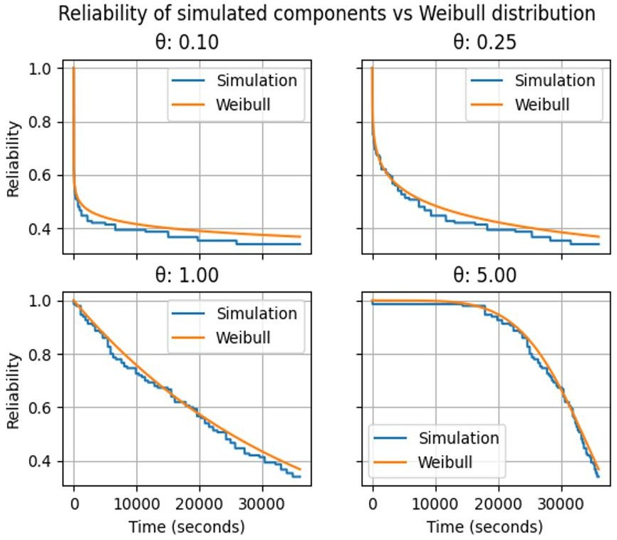

Fig. 8. Comparison of component reliability when simulated in a software environment and the corresponding Weibull distribution of its reliability.

## 5 Testing and results

The experimental setup facilitates communication between the OBC and the digital twins. Key to this setup is the use of a Raspberry Pi 4 Model B (RPi) microcomputer that acts as an intermediate hardware layer between the low-level flight software run on the OBC and the high-level simulation software run on a desktop computer.

Using the pigpio library [27], the Serial-Peripheral-Interface (SPI) pins on the RPi are converted to function as I2C pins with which the RPi can act as a slave device, a function not possible with the standard I2C master pins on the device. Furthermore, as the I2C addresses are defined in software, the RPi can act as a receiver for any number of slave devices. All I2C messages that are sent from the OBC are received by the RPi and passed along with UDP to the Internet Protocol (IP) address of the computer running the simulation software. To differentiate which component is being addressed, the UDP message is transferred to the port corresponding to the addressed device as described in the last section.

With this setup, presented in Figure 9, the simulation software can run the satellite in orbit simulation, dynamically change the satellite parameters and inject component failure as needed. Simultaneously, the flight software can be run on the OBC, and execute stages of the

<!-- PDF_PAGE: 12 -->

satellite mission whilst receiving realistic component communications as if in the space environment.

As the flight software communicates with the other satellite components through an I2C line, data is only sent to the OBC in response to queries from the master device (OBC). As such, line saturation is not expected to occur.

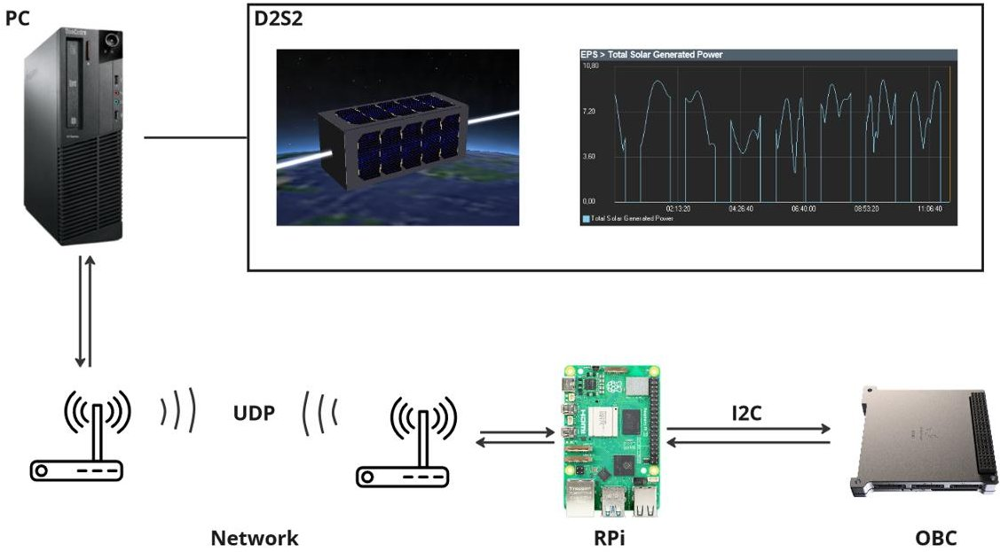

Fig. 9. Schematic depicting the layout of the experimental setup used to test the flight software using digital twins

The experiment is directed at demonstrating the interaction between the power management component of the flight software and the digital twin of the satellite EPS. As a critical background task that runs during all cycles of the mission, enhancing interaction efficiency is of great benefit to mission developers.

During this experiment, the chaser satellite is simulated in a state with limited battery capacity remaining and in the process of performing the beaconing operation that requires more power than the solar panels can provide during the average orbital period. The condition of this experiment is similar to the previous two demonstrations of the D2S2 software and the digital twins.

The OBC will request the EPS system status at regular intervals and should the battery level fall below a certain threshold, the health service will request the satellite management service to reduce power consumption where possible to prevent the EPS from entering safe mode. In the case of the beaconing operation, this results in the management service toggling the switch powering the beacon at a 50% duty cycle.

## 5.1 Discussion of results

The graphs presented in Figure 10 show the successful integration of the OBC flight software and the digital twin of the EPS run on D2S2. While the method of power management implemented during this experiment is rudimentary, when compared to the functionality of

<!-- PDF_PAGE: 13 -->

the satellite without the flight software, the flight software increases the operational beaconing time by 19.5% while also preventing the EPS from entering safety mode, thus increasing the overall operational time of other satellite components by 31.5%.

This experiment illustrates how flight software development can be enhanced using digital twins and simulation. The ease with which adjustments to the flight software can be made and tested, error conditions can be simulated, and satellite operations can be debugged offers a fast and efficient way to facilitate this development.

Simulation of D2S2 satellite with custom EPS

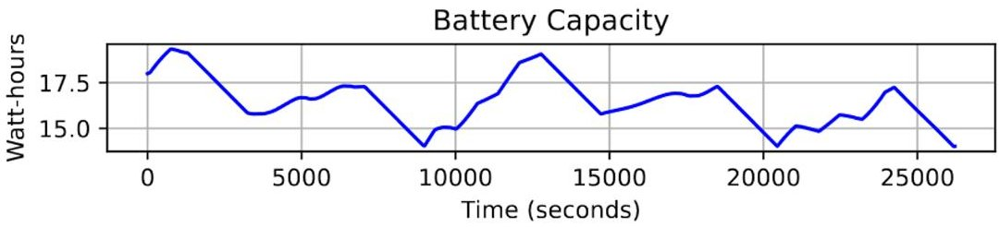

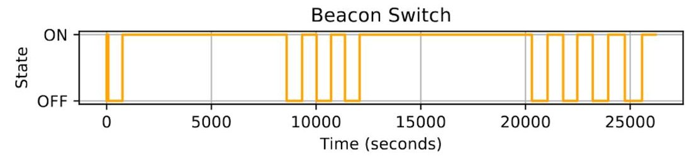

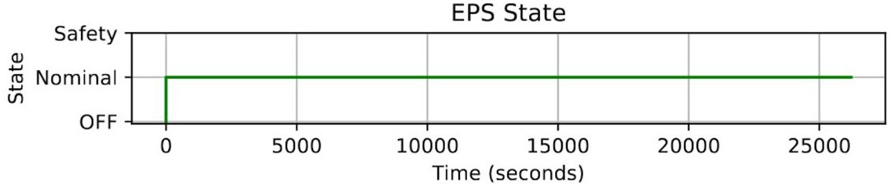

Fig. 10. Data logged from a D2S2 simulation in which the OBC running flight software interacts with the simulated satellite components. The data depicts the OBC sending power switch toggling commands to the EPS to prevent the battery from being drained and the EPS entering "safe" mode.

## 6 Conclusion

This article has presented the methodology in which flight software is developed for the DockSat mission with limited access to CubeSat hardware. The architectural design is presented as well as an example of implanting said design in the case of battery rudimentary battery management. The use of digital twins to replicate responses from real hardware is then suggested to overcome the lack of hardware, their design and implementation are discussed. Finally, an experiment is conducted wherein the flight software operation is verified by integrating the OBC and digital twins in a combined system. The experiment demonstrated that the operation of the flight software can be verified using digital twins and more importantly, demonstrated that quantitative data can be extracted from the simulation to determine the effectiveness of the flight software. Testing more complex software structures will, however, require a rework of the experimental setup. Future work will focus on the development of an expanded intermediate hardware layer to create a formal interfacing system for satellites and satellite components.

<!-- PDF_PAGE: 14 -->

## References

[1] S. A. Jacklin, "Small-Satellite Mission Failure Rates," NASA, 2019.

[2] M. Swartwout, "Secondary spacecraft in 2016: Why some succeed (And too many do not)," in 2016 IEEE Aerospace Conference, (2016).

[3] M. Langer and J. Bouwmeester, "Reliability of CubeSats - Statistical Data, Developers' Beliefs and the Way Forward," in Conference on Small Satellites (2016).

[4] S. Tafazoli, "A study of on-orbit spacecraft failures," Acta Astronautica - ACTA ASTRONAUT, 64, 195-205, (2009).

[5] A. Alanazi and J. Straub, "Statistical Analysis of CubeSat Mission Failure," (2018).

[6] C. Venturini, B. Braun, D. Hinkley and G. Berg, "Improving Mission Success of CubeSats," in 32nd Annual AIAA/USU Conference on Small Satellites, Utah, (2018).

[7] C. Araguz, "Design Guidelines for General-Purpose Payload-Oriented Nanosatellite Software Architectures," Journal of Aerospace Information Systems,15,3,107-119 (2018).

[8] Institute of Electrical and Electronics Engineers, "IEEE Std 1061-1992," in IEEE Standard for a Software Quality Metrics Methodology, Institute of Electrical and Electronics Engineers, (1992).

[9] G. J. Holzmann, "The power of 10: rules for developing safety-critical code," Computer, 39, 6, 95-99, (2006).

[10] Goddard Space Flight Cente, "nasa.gov," 30 June 2026. [Online]. [Accessed 14 June 2024].

[11] NASA, "SOFTWARE ASSURANCE AND SOFTWARE SAFETY STANDARD," 08 September 2022. [Online]. [Accessed 14 June 2024].

[12] V. Sather, "Software Development Standard for Space Systems," The Aerospace Corporation, El Segundo, (2020).

[13] Eclipse, "Iot developer survey results," (2018). [Online]. [Accessed 10 June 2024].

[14] F. Brauer, "System architecture definition of the DelFFi command and data handling subsystem," (2015). [Online]. [Accessed June 2024].

[15] M. Merri and D. Evans, "OPS-SAT: A ESA nanosatellite for accelerating innovation in satellite control," in American Institute of Aeronautics, (2014).

[16] J. Kiesbye, K. Grover, K. Ashok and J. Kretinsky, "Planning via model checking with decision-tree controllers," in International Conference on Robotics and Automation, (2022).

[17] F. Ferreira and K. de Novaes, "F. de Novaes Kucinskis and M. G. V. Ferreira, "Onboard satellite software architecture for the goal-based brazilian mission operations," IEEE Aerospace and Electronic Systems Magazine, 28, 8, 32-45, (2013).

[18] NASA, "Core flight system," [Online]. [Accessed June 2024].

[19] KUBOS, "Overview — kubos 1.21.0 documentatio," [Online]. [Accessed June 2024].

[20] ESA, "SAVOIR," [Online]. [Accessed June 2024].

[21] S. Jeffery, H. Jordaan, D. Slabber and L. Visagie, "Bench satellite development and testing," MATEC Web of Conferences, 388, 12, (2023).

<!-- PDF_PAGE: 15 -->

[22] W. Jordaan, G. Serfontein, I. D. Swart, L. Visagie and J. Lun, "Miniaturizing Docking and Undocking through DockSat," in IEEE Aerospace Conference, (2023).

[23] DawnDusk, "DawnDusk," DawnDusk, 2024. [Online]. [Accessed 01 June 2024].

[24] J.-F. Castet and J. H. Saleh, "Satellite and satellite subsystems reliability: Statistical data analysis and modeling," Reliability Engineering & System Safety, 94, 11, 1718- 1728, (2009).

[25] J.-F. Castet and J. H. Saleh, "Beyond reliability, multi-state failure analysis of satellite subsystems: A statistical approach," Reliability Engineering & System Safety, 95, 4, 311-322, (2010).

[26] Seradata, "Satellite Database & Space Market Analysis," Seradata, 12 January 2021. [Online]. [Accessed 19 Febuary 2024].

[27] J. Hanhock, "pigpio: A library for GPIO handling on the Raspberry Pi (v79) [Software]," 10 Febuary 2024. [Online].