<!-- PDF_PAGE: 1 -->

This is an electronic reprint of the original article. This reprint may differ from the original in pagination and typographic detail.

Otani, Yukihisa; Praks, Jaan; Yamauchi, Takashi; Cho, Mengu

A DSM-based framework for design complexity and component criticality in CubeSat missions

Published in: CEAS Space Journal

DOI:

10.1007/s12567-026-00713-3

E-pub ahead of print: 01/01/2026

Document Version Publisher's PDF, also known as Version of record

Published under the following license: CC BY

Please cite the original version: Otani, Y., Praks, J., Yamauchi, T., & Cho, M. (2026). A DSM-based framework for design complexity and component criticality in CubeSat missions. CEAS Space Journal. Advance online publication. https://doi.org/10.1007/s12567-026-00713-3

<!-- PDF_PAGE: 2 -->

ORIGINAL PAPER

# A DSM-based framework for design complexity and component criticality in CubeSat missions

Yukihisa Otani $ ^{1} $ Jaan Praks $ ^{2} $ Takashi Yamauchi $ ^{1} $ Mengu Cho $ ^{1} $

Received: 5 August 2025 / Revised: 26 January 2026 / Accepted: 24 February 2026 The Author(s) 2026

## Abstract

CubeSats, which were developed at educational institutions, often exhibit low mission success rates because of their limited design and system engineering experience. To address this issue, this study proposes a mission assurance framework that integrates system complexity evaluation with component importance analysis using the design structure matrix. Within this framework, system configuration and dependencies among components visualized through design structure matrix (DSM) and complexity calculations, previously performed manually, are automated. In addition, functions and components are categorized according to mission success levels, enabling a quantitative assessment of each component's contribution to overall mission success. This dual approach not only reduces system complexity but also improves the distribution of critical functions across components, thereby mitigating the risk of single-point failures and enhancing system robustness. The proposed method was validated through a case study involving the BIRDS bus developed at the Kyushu Institute of Technology. The results demonstrate that DSM-based system reconfiguration can reduce system complexity by more than 80% at the highest mission success level while improving the distribution of critical functions. This framework provides an effective tool for assessing design validity from multiple perspectives during the early development phase prior to the preliminary design review. This approach is expected to increase the reliability and mission success rates of student CubeSat projects.

Keywords CubeSats · Complexity · Design structure matrix · System design · Satellite

## 1 Introduction

CubeSats are a class of standardized nanosatellites defined by a unit size of approximately $ 1 0 \times1 0 \times1 1. 3 5 \mathrm{c m}^{3} $ with a mass of up to 2 kg as specified in the CubeSat Design Specification by California Polytechnic State University (Cal Poly) [1]. These base units, known as "1U," can be modularly combined to form larger satellite platforms, such as 3U, 6U, or 12U, depending on mission requirements. Originally developed to provide academic institutions with a low-cost, accessible platform for hands-on space engineering education and basic research, CubeSats have rapidly evolved to support a wide range of scientific, commercial,

and governmental applications. Compared with traditional satellite missions, their compact form factor, reduced component count, use of the commercial off-the-shelf (COTS) component, and simplified systems engineering process contribute to lower development costs and shorter timelines. Since the first CubeSats were launched in 2003 [2], CubeSat technology has gained significant traction beyond academia. According to the Nanosats Database, annual CubeSat launches have exceeded 100 since 2014 and reached 390 in 2023 [3]. Despite this rapid expansion, educational institutions continue to play a pivotal role in CubeSat development.

However, achieving full mission success remains a persistent challenge in academic CubeSat projects. According to Swartwout, approximately 8% of academic CubeSats launched between 2018 and 2023 failed during initial operations, and nearly half accomplished only partial mission objectives [4]. One contributing factor is the lack of comprehensive mission assurance frameworks that are tailored to the needs of student-led or novice teams [5]. Mission assurance encompasses systematic processes for identifying, evaluating, and mitigating technical and programmatic

<!-- PDF_PAGE: 3 -->

risks across all mission phases from early design to on-orbit operation [6].

Space system engineering and space product assurance are supported by the NASA Systems Engineering Handbook [7], the European Cooperation for Space Standardization (ECSS) standards used by ESA [8], and the JAXA System Design Standard [9]. These documents outline structured practices for requirement definition, validation, reliability assessment, and risk analysis. However, these agency-level frameworks are designed for projects that require larger scale and high assurance. Therefore, tailoring is necessary to match the CubeSat development style, which is characterized by limited resources and short development timelines. This need for tailoring is also recognized in documents, such as the JAXA System Design Standard [9] and the ESA ECSS IOD CubeSat guidelines [10, 11].

Several studies have explored satellite system engineering methods with a focus on risk management for CubeSat. For instance, Cech proposed a risk management framework for nanosatellites that covers the design phase through operation and incorporates the results of FMECA based on a case study using VZLUSAT-1 [12]. Also, Mancinelli examined a method for prioritizing risks by calculating the risk priority number (RPN) and representing each failure mode as a code in the early stage of CubeSat design [13]. In addition, Brumbaugh suggested an approach for ranking failure modes in CubeSats [14, 15]. However, they did not address how to modify the design specifically on the basis of risk assessment. Moreover, Radu proposed a system engineering method for reliability, availability, maintainability, and safety (RAMS) analysis, which aims to minimize risk, although it does not include a direct method for implementing design changes [16]. Furthermore, Nejad introduced a framework called simulation-based probabilistic risk assessment (SIMPRA), which evaluates risks and supports design improvement [17]. Since a satellite is essentially a singleitem system, conventional reliability calculations cannot be directly applied. To address this limitation, Sahara proposed a method for quantitatively evaluating satellite architectures and developed a formulation for calculating satellite system complexity [18, 19]. His study also demonstrated a significant correlation between system complexity and mission success rates and helped clarify design policy guidelines [18]. Also, Ishii applied the same formulation to quantify satellite system complexity [20].

The challenge of time-consuming calculations was identified in the process of evaluating satellite system complexity. Specifically, the calculation requires counting the number of blocks and arrows in the system block diagram, which must be repeated each time the design is modified. To address this issue, this research introduces the design structure matrix (DSM). The DSM is a systems engineering tool that represents a system as a matrix, clarifying the interrelationships

and dependencies between each component and function. The DSM concept was first developed by Professor Don Steward at California State University [21]. Since then, it has been widely applied across various fields, from home appliances to semiconductors and is not limited to specific industrial products. For example, Sawai demonstrated a method to improve the modularity of robotic arms by incorporating customer requirements into the DSM framework [22]. In addition, Luh described a DSM-based approach that clusters components on the basis of connection strength derived from graph theory to support future product variety [23]. Furthermore, AlGeddawy and Maaskant analyzed the relationships between components and sought to enhance product modularity for electrical kettles and airplane wings by modifying the clustering structure [24, 25].

Numerous studies have explored the application of DSMs to spacecraft, such as CubeSats. For example, Ibrahim applied the DSM to the i-CanSat picosatellite training kit and NEXUS CubeSat and analyzed the dependencies of components [26]. In addition, Chitsaz evaluated four components of CubeSat with respect to the four kinds of information and clarified the depth of interaction between them for design assurance [27]. As described above, although research results have been produced that have created and analyzed DSM models of CubeSats, they do not provide any concrete guidance on how to make design changes.

Building on prior studies, this research proposes a novel mission assurance framework that places system complexity at its core, with the DSM serving as the primary analytical tool. Unlike previous studies that have focused primarily on visualizing dependencies or assessing risks without offering actionable design guidance, this framework introduces a structured, iterative methodology for analyzing and optimizing satellite system architectures. By modeling subsystem interactions through the DSM, quantifying architectural complexity, and linking these metrics directly to design modification strategies, the proposed approach enables a proactive, data-driven pathway for improving mission reliability.

This study reformulated the existing complexity calculation workflow into a DSM-based representation to enable reproducible and consistent evaluation of system complexity during iterative architecture updates. In addition, in-house software was developed to compute the complexity directly from the DSM, eliminating the manual counting and pathfinding required in the conventional method. Finally, the resulting complexity metrics were incorporated into the repeatable mission assurance framework, demonstrating that they can guide specific architecture modifications. The validity of the approach was confirmed using the CubeSat architecture examined in this paper. The key novelty of this study lies in its integration of system analysis, complexity evaluation, and design refinement within a unified

<!-- PDF_PAGE: 4 -->

framework. By providing a repeatable and scalable approach to complexity-informed design decision-making, this work offers a practical tool for strengthening mission assurance and improving the success rates of CubeSat missions.

The structure of the paper is as follows: Chapter 2 introduces the design structure matrix. Chapter 3 describes the method used to calculate the satellite system complexity using the DSM. Chapter 4 presents a case study in which the BIRDS CubeSat platform is used to demonstrate the application and effectiveness of the method. Chapters 5 and 6 discuss the results and offer concluding remarks.

## 2 Introduction of the design structure matrix

The DSM is a network modeling tool that represents the components forming a system and their interactions, thereby clarifying the system architecture [21]. It maps the interrelationships among N system elements as an $ N\times N $ square matrix with identical element labels in both the rows and the columns. When creating a DSM, the system components are listed in rows and columns. A cell at row i and column j indicates that the component j output something to component i. Therefore, the matrix columns represent the providing (output) side, whereas the rows correspond to the receiving (input) side. This DSM definition is similar to the adjacency matrix of an interaction graph. The adjacency matrix represents the presence or the absence of connections among components by assigning a binary value of "1" for presence and "0" for absence. The DSM is based on the same structure as an adjacency matrix, but it can be scaled to include additional information such as weight dependency by assigning numeric values or by coloring cells.

The most common method for analyzing a DSM is clustering, which groups components based on the number and strength of their interactions by rearranging the rows and columns of the matrix [21]. The purpose of clustering is to improve the ease and efficiency of system integration by placing components with common suppliers, shared interfaces, or complex interconnections into the same group.

Consistent with system architecture principles established in previous studies, priority is given to identifying highly independent modules that exhibit many internal interactions and few external ones [21]. This leads to the fundamental question: "How can we allocate parts to groups so as to minimize interactions between groups?" [21].

Figure 1 shows a weighted directed graph along with its corresponding DSM. In this example, the system consists of six components, forming a $ 6\times 6 $ matrix. The value in the cells in the DSM indicates the number of signal lines between each component. The order of the columns corresponds to the rows, with each cell in the matrix representing a connection from "Component i" to "Component j." For example, in the right diagram in Fig. 1, the cell at Row 6, Column 5 represents the connection from Component E to Component F, as indicated by the yellow arrow. Moreover, the values in the cells at Row 1, Column 3, and Row 3, Column 1 are identical, indicating that the function lines between Component A and Component C are bidirectional. The cells within the same row and column reflect the respective values of their corresponding components.

In addition, the background colors in the DSM indicate the subsystem clustering of the components. For example, Components A, B, and C are grouped into Subsystem 1 (SubSys-1), and their corresponding cells in the DSM are shaded blue, matching the color used in a weighted directed graph. Similarly, Subsystem 2 (SubSys-2), which consists of Components D, E, and F, is represented in red. Accordingly, the DSM cells depicting interactions among these components are also colored red. Cells with a white background indicate interface functions between components belonging to different subsystems.

The advantage of the DSM is its flexibility in accommodating system design changes. Figure 2 shows a DSM in which the design has been modified by replacing the components that constitute the subsystem shown in the left diagram. In the modified design, Components A and C have been relocated to SubSys-2, whereas Components D and F have been transferred to SubSys-1. Furthermore, it is possible to delete a component from the system by erasing the row and the column corresponding to the target component.

Fig.1 Conversion of a weighted directed graph to the DSM

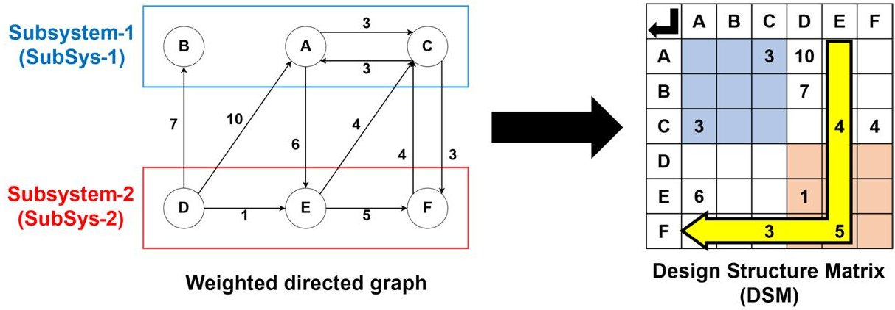

<!-- PDF_PAGE: 5 -->

Fig.2 Weighted directed graph and DSM with the design changes from Fig.1

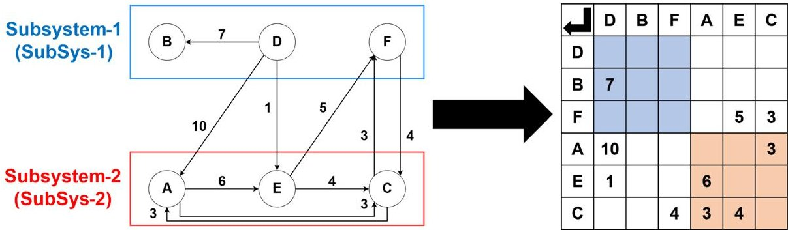

Moreover, when a new component is added to the system, the row and the column for the new component are added to the subsystem group to which it belongs in the DSM. When the same operations are conducted on the system block diagram, the block is added, and the lines are drawn. As a result, the weighted directed graph becomes cluttered and difficult to read. Therefore, the DSM provides a structured and compact matrix format for systems with numerous components and functions. However, in terms of understanding the functions themselves, model-based system engineering (MBSE) offers an advantage.

## 3 DSM-based calculation for satellite system complexity

The complexity of the target subsystem is calculated again when the system design changes. The entire system's complexity is subsequently calculated again with the new value. These values are estimated by counting the blocks and arrows from the weighted directed graph using the conventional method. Therefore, it takes considerable time to repeatedly apply the design change, modify the weighted directed graph, count the number of blocks and arrows, calculate the complexity, and compare the result with the previous answer. This research utilized the DSM to automate these sequences. This chapter shows the flow of calculating the complexity of the satellite system using the DSM step by step using an original DSM.

The satellite system is composed of several subsystems, and the subsystems consist of several components. Equation (1) expresses the complexity of the subsystem [18]:

$$
C _ {s u b _ {i}} = v _ {i} C _ {o h e _ {i}} f _ {i} ^ {2} + C _ {o u p _ {i}} N _ {I F _ {i}} N _ {p _ {i}} + S _ {s u b _ {i}}
$$

where f is the number of components, $ \nu $ is the cyclomatic number at the subsystem level, $ C_{oup} $ is the degree of coupling at the subsystem level, $ C_{ohe} $ is the degree of cohesion, $ S_{sub} $ is the system size at the subsystem level, $ N_{IF} $ is the number of interface lines, and $ N_{p} $ is the number of communication partners.

The entire system's complexity can be calculated from the result of the complexity calculation for each subsystem, as shown in Eq. (2) [18]:

$$
C _ {s y s} = C _ {o u p s y s} V + \sum_ {i = 1} ^ {N _ {s s}} C _ {s u b _ {i}} + S _ {s y s}
$$

where $ C_{oupsys} $ is the degree of coupling at the system level, V is the cyclomatic number at the system level, $ \sum_{i=1}^{N_{ss}} C_{sub_{i}} $ is the total value of subsystem complexity, and $ S_{sys} $ is the system size at the system level.

McCabe introduced the cyclomatic number in 1976 as a valuable metric for quantitatively assessing complexity [28]. In this study, the cyclomatic number within a subsystem $ \nu $ is calculated as described in Eq. (3) [18]:

$$
v = e - (f + 1) + 2 p
$$

where f is the number of components, e is the number of connections, and p is the number of independent functional groups.

In the DSM representation, the number of rows or columns corresponds to the number of components, as shown in Fig. 3. The number of filled cells within the subsystem indicates the number of connections, which can be directly estimated from the DSM. Cells with values that fall within the colored areas (blue and red) represent internal connections within each subsystem. In Fig. 3, the blue background corresponds to SubSys-1, whereas the red background indicates SubSys-2. Cells with values located next

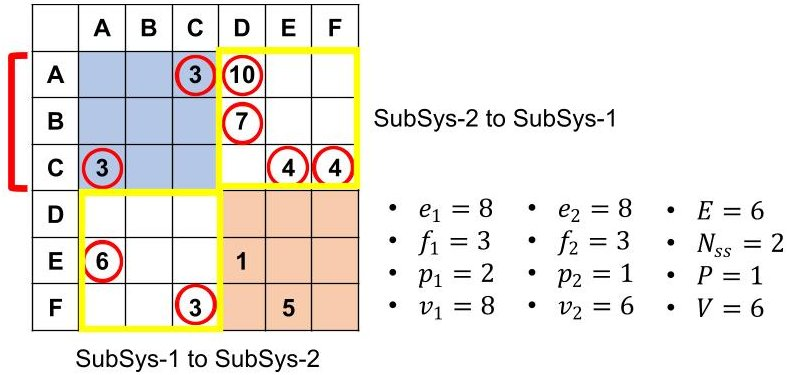

Fig. 3 Calculation of the cyclomatic number using the DSM.

<!-- PDF_PAGE: 6 -->

to the colored area indicate functions that receive inputs from other subsystems. The cells located above or below the colored area represent functions that output to other subsystems. These two areas are highlighted by the yellow frames in Fig. 3. The total number of connections, e, is the sum of these three categories.

The variable p denotes the number of independent functional groups. For example, component B has no connections to other components within SubSys-1, indicating that it is independent of the group formed by components A and C. As a result, the variable $ p_{1} $ is equal to two. This value can be estimated using Dijkstra algorithm, which is commonly employed in graph theory to compute shortest paths [29]. In this study, the algorithm is applied to each subsystem-level DSM to evaluate reachability among components and to determine, for each component, the set of components that can be reached from it via a directed path. These sets are then combined by taking their union, and whenever at least one directed path exists between two components in either direction, they are classified into the same group. Finally, the remaining groups are counted, and this number is defined as p, the number of independent functional groups.

Equation (4) represents the cyclomatic number for the system, denoted as V[18].

$$
V = E - N _ {s s} + 2 P
$$

where E is the number of connections between subsystems, $ N_{ss} $ is the number of subsystems, and P is the number of independent functional groups in the system. The theoretical basis for calculating the cyclomatic number for system V is the same as that for $ \nu $ shown in Eq. (3). It simply reflects a shift in the level of analysis, from components and subsystems to subsystems and the overall system.

The scale of a subsystem and the entire system can be calculated, as shown in Eq. (5) [18]:

$$
S _ {s u b _ {i}} = a f _ {i} ^ {b}
$$

where f is the number of components and where a and b are the parameters. This system scale is derived from the Constructive Cost Model (COCOMO) and is based specifically on the Basic COCOMO model [30, 31]. The Basic COCOMO model estimates the required effort and schedule for a software project using the number of thousands of delivered source instructions (KDSI) [31]. Sahara applied this concept to satellite development using the number of components instead of KDSI [18]. The parameters a and b differ depending on the project type and are categorized into three modes: Organic, Semidetached, and Embedded [30, 31]. Projects that must operate under strict constraints, such as air traffic control systems and electronic funds transfer systems, are classified as Embedded-mode projects

[30]. Finally, the constants a and b were set as 3.6 and 1.20 respectively [18, 30].

Moreover, the system scale can be calculated via Eq. (6) [18], which has the same form as Eq. (5):

$$
S _ {s y s} = a N _ {s s} ^ {b}
$$

where $ N_{ss} $ is the number of subsystems and where a and b are the parameters. These two parameters are the same as those in Eq. (5).

The degree of coupling $ C_{oup} $ represents the level of modularity between subsystems in Eq. (7) [18]:

$$
C _ {o u p _ {i}} = \frac {N _ {s s} - 1}{\sum_ {j = 1} ^ {N _ {s s}} D (i , j)}
$$

where $ N_{ss} $ is the number of subsystems and where $ \sum_{j=1}^{N_{ss}} D(i,j) $ indicates the bond strength between subsystem i and all other subsystems. This bond strength is derived from a concentration index based on closeness centrality and is quantified by the number of interface lines between subsystems [18]. Each component of the matrix D is defined as the reciprocal of the number of lines (connections) between two subsystems. To obtain these values, the directed DSM is converted into an undirected DSM by folding it along its diagonal, which is equivalent to adding the transpose of the DSM to the original matrix. This method is explained in Appendix A, and Fig. 4 illustrates how matrix D derived in the following paragraph. Therefore, the more connections a subsystem has with others, the smaller its corresponding $ D(i,j) $ value will be. This reflects higher closeness centrality.

Figure 4 illustrates the flow leading to the matrix D in Eq. (7). To evaluate this, the first step involves constructing a new DSM at the subsystem level by aggregating the rows and columns that correspond to components within the same subsystem. The values at the interfaces between subsystems are summed to reflect the total number of connections between each pair of subsystems. This process follows the same mathematical approach used to construct a block matrix. A symmetric matrix is then generated by folding the block DSM diagonally. The original DSM is directional, but the symmetric matrix is omnidirectional and represents the number of connections at the interfaces between each pair of subsystems. It is related to the directed graph and undirected graph in graph theory (see Appendix A). In the next step, the reciprocal of each value in the matrix is computed and recorded, transforming the representation to reflect the relative coupling strength. Cells without data indicate the absence of direct connections between the respective subsystems. In such cases, the shortest path through other subsystems is calculated, where the path length is defined as the sum of the $ D(i,j) $ values along the path. The minimum

<!-- PDF_PAGE: 7 -->

Fig.4 Calculation of the degree of coupling using the DSM

<table border="1"><tr><td></td><td>A</td><td>B</td><td>C</td><td>D</td><td>E</td><td>F</td></tr><tr><td>A</td><td></td><td></td><td>3</td><td>10</td><td></td><td></td></tr><tr><td>B</td><td></td><td></td><td></td><td>7</td><td></td><td></td></tr><tr><td>C</td><td>3</td><td></td><td></td><td></td><td>4</td><td>4</td></tr><tr><td>D</td><td></td><td></td><td></td><td></td><td></td><td></td></tr><tr><td>E</td><td>6</td><td></td><td></td><td>1</td><td></td><td></td></tr><tr><td>F</td><td></td><td></td><td>3</td><td></td><td>5</td><td></td></tr></table>

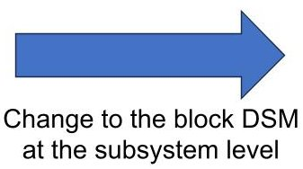

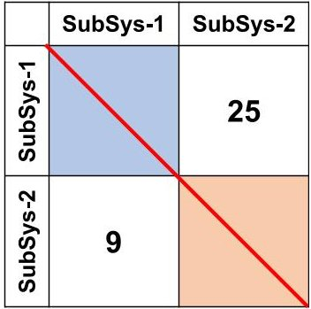

Make the symmetric matrix by folding diagonally

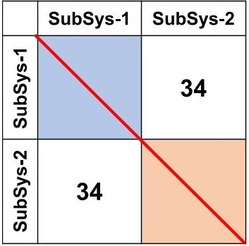

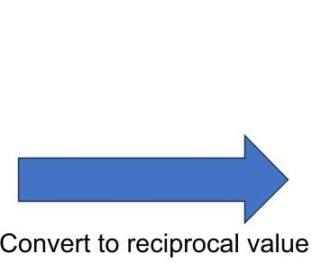

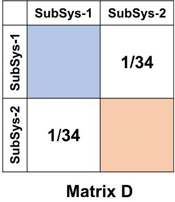

value among all candidate paths are entered into the blank cell. Importantly, the path with the fewest subsystems does not necessarily yield the lowest distance under this weighted definition, because a path with more hops can still result in a smaller total sum of $ D ( i,j) $ . To address this issue, the Dijkstra algorithm for solving the shortest path problem was also implemented [29]. After computing the matrix D, the total values for each column are calculated. Finally, the degree of coupling for each internal subsystem $ C_{oup_{i}} $ is identified and the coupling on subsystem such $ C_{oupsys} $ shown in Eq. (2) can be derived by the sum of $ C_{oup_{i}} $ as shown in Eq. (8).

$$
C _ {o u p s y s} = \sum_ {i = 1} ^ {N _ {s s}} C _ {o u p _ {i}}
$$

Additionally, the total number of interface lines between subsystems is counted and denoted as $ N_{if} $ , and the total number of communication partners $ N_{p} $ can also be derived from the block matrix shown in Fig. 5, which is the same as the block DSM created in Fig. 4.

The degree of cohesion $ C_{ohe} $ represents the density of the connections between each component in the subsystem, as shown in Eq. (9) [18]:

$$
C _ {o h e _ {i}} = \frac {\frac {1}{k} \sum_ {j} ^ {o} \phi \left(o _ {j}\right) - f}{1 - f} + 1
$$

where k is the number of functions from the subsystem i to the other subsystems, $ \phi \left( o_{j}\right) $ is the number of functions within a subsystem required to produce each signal that is sent to the other subsystems, $ \sum_{j}^{o} \phi \left( o_{j}\right) $ is the sum of $ \phi \left( o_{j}\right) $ for each output function, and f is the number of components in the subsystem.

Figure 6 illustrates how to determine the values of variables k and f. In the DSM, each column represents an output signal. Therefore, a cell located outside the colored areas (blue and red) can be interpreted as an output signal to another subsystem. Accordingly, the number of output functions, denoted as k, is determined by identifying the cells that contain a value and are colored white. For example, the output functions from SubSys-1 to SubSys-2 are two functions, such as component A to component E and component C to component F, highlighted by the red circles. The variable f represents the number of components in the subsystems, which is the same as in Eq. (3). In Fig. 5, the number of components in SubSys-1 is three, which is based on components A, B, and C. Similarly, the number of components in SubSys-2 is also three, which is based on components D, E, and F.

Figure 7 shows the process used to determine these two values, such as $ \phi \left( o_{j} \right) $ and $ \sum_{j}^{o} \phi \left( o_{j} \right). $ Equation (9) also requires checking the number of internal functions within a subsystem to make the output signals to the other subsystems $ \phi \left( o_{j} \right) $ , which are summarized as $ \sum_{j}^{o} \phi \left( o_{j} \right). $ The

<!-- PDF_PAGE: 8 -->

Fig.5 Block DSM at the system level based on the original DSM shown in Fig.1

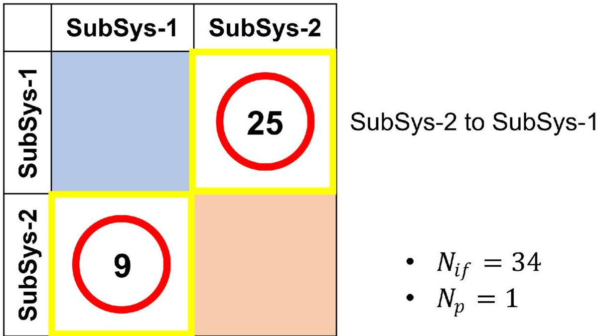

SubSys-1 to SubSys-2

Fig.6 Counting the output signals for calculating the cohesion using the DSM.

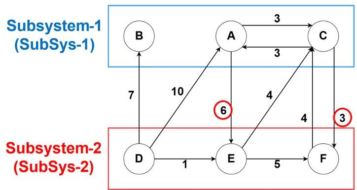

<table border="1"><tr><td></td><td>A</td><td>B</td><td>C</td><td>D</td><td>E</td><td>F</td></tr><tr><td>A</td><td></td><td></td><td>3</td><td>10</td><td></td><td></td></tr><tr><td>B</td><td></td><td></td><td></td><td>7</td><td></td><td></td></tr><tr><td>C</td><td>3</td><td></td><td></td><td></td><td>4</td><td>4</td></tr><tr><td>D</td><td></td><td></td><td></td><td></td><td></td><td></td></tr><tr><td>E</td><td>6</td><td></td><td></td><td>1</td><td></td><td></td></tr><tr><td>F</td><td></td><td></td><td>3</td><td></td><td>5</td><td></td></tr></table>

SubSys-1 to SubSys-2

function propagation path in the subsystem needs to be identified. To complete this process, the interpretive structural modeling (ISM) method is applied to the DSM at the subsystem level. The ISM essentially computes the transitive closure within the subsystem graph (see Appendix B) [23, 32]. By multiplying the Boolean matrix in the ISM method, invisible indirect connections can be revealed when this method is applied to an entire subsystem.

After applying the ISM method, the subsystem matrix is placed back into its original matrix. The cells that contain a value and are colored white are highlighted again with red circles as shown in Fig. 7. These highlighted cells indicate the output functions from component A to component E and from component C to component F. To count the required functions for component A, the corresponding row for component A within SubSys-1 is examined. To make this clear, the applicable area in the first row is highlighted with a yellow frame. Finally, the value of $ \phi \left( o_{j} \right) $ for component A is determined to be two. The same applies to component C, for which the value of $ \phi \left( o_{j} \right) $ is also two. The value of $ \sum_{j}^{o} \phi \left( o_{j} \right) $

in Eq. (9) can be calculated by summing the $ \phi \left( o_{j} \right) $ values for all output functions to the other subsystems.

Table 1 validates the consistency of the proposed satellite system complexity calculation method using the DSM by comparing two equivalent implementations: a manual computation based on the weighted directed graph representation (WDM) and an automated computation performed on the corresponding DSM. The DSM-based automatic calculation software requires the DSM model created in the Excel file and the number of parts that make up each subsystem. The results show no significant discrepancies between the manual and automated calculations, demonstrating that the proposed method and software are both functional and effective for large-scale analysis. A minor discrepancy of approximately one was occasionally observed, which is attributed to cumulative rounding errors in the manual workflow. In principle, an exact manual computation would be possible if all operations were performed symbolically (for example, using fractions), but this quickly becomes impractical as the number of components increases and the expressions

<!-- PDF_PAGE: 9 -->

<table border="1"><tr><td></td><td>A</td><td>B</td><td>C</td><td>D</td><td>E</td><td>F</td></tr><tr><td>A</td><td></td><td></td><td>3</td><td>10</td><td></td><td></td></tr><tr><td>B</td><td></td><td></td><td></td><td>7</td><td></td><td></td></tr><tr><td>C</td><td>3</td><td></td><td></td><td></td><td>4</td><td>4</td></tr><tr><td>D</td><td></td><td></td><td></td><td></td><td></td><td></td></tr><tr><td>E</td><td>6</td><td></td><td></td><td>1</td><td></td><td></td></tr><tr><td>F</td><td></td><td></td><td>3</td><td></td><td>5</td><td></td></tr></table>

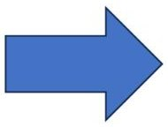

Convert to the binary DSM

<table border="1"><tr><td></td><td>A</td><td>B</td><td>C</td><td>D</td><td>E</td><td>F</td></tr><tr><td>A</td><td></td><td></td><td>1</td><td>1</td><td></td><td></td></tr><tr><td>B</td><td></td><td></td><td></td><td>1</td><td></td><td></td></tr><tr><td>C</td><td>1</td><td></td><td></td><td></td><td>1</td><td>1</td></tr><tr><td>D</td><td></td><td></td><td></td><td></td><td></td><td></td></tr><tr><td>E</td><td>1</td><td></td><td></td><td>1</td><td></td><td></td></tr><tr><td>F</td><td></td><td></td><td>1</td><td></td><td>1</td><td></td></tr></table>

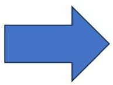

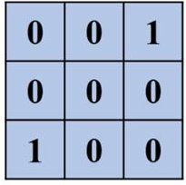

Pick up the subsystem DSM

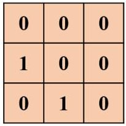

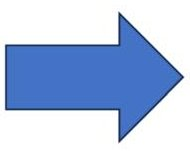

Apply to ISM method

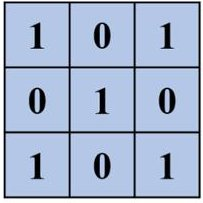

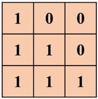

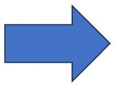

Return to the original binary DSM

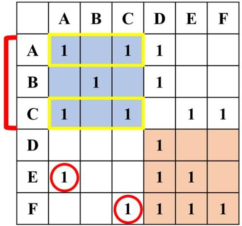

- $ \phi \left(o_{F}\right)=3 $

- $ \sum_{j}^{o} \phi \left(o_{j}\right)=7 $

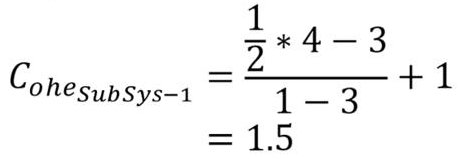

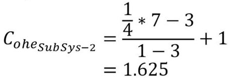

Fig. 7 Calculation of the degree of cohesion using the DSM.

become longer. In contrast, the software performs all computations at full numerical precision, making the automated results more numerically consistent for large-scale analyses.

The application of the DSM effectively enables the automatic calculation of system complexity in satellite systems, reducing manual effort and facilitating analyses of larger models. Once the DSM is created, it can be loaded into the software to perform the calculations. The program then produces the results automatically, as illustrated in Table 1. The newly developed tool allows the immediate computation of system complexity metrics directly from the DSM. In

contrast, the WDM-based approach requires manual counting of blocks and arrows, followed by step-by-step substitution into Eqs. (1) through (9) to complete the calculations. Model creation and data entry are required in both cases. The key difference is that the DSM-based tool automates the calculation step, whereas the WDM-based workflow relies on manual counting and path tracing. Although the example presented includes only six components and two subsystems, the time required increases substantially as the number of elements increases. In particular, calculating coupling requires identifying the shortest paths between

<!-- PDF_PAGE: 10 -->

Table 1 Comparison of the automated calculation values using the DSM and hand-calculation results

<table border="1"><tr><td rowspan="3"></td><td colspan="6">System in Fig.1</td><td colspan="6">System in Fig.2</td></tr><tr><td colspan="3">WDM-based</td><td colspan="3">DSM-based</td><td colspan="3">WDM-based</td><td colspan="3">DSM-based</td></tr><tr><td>Sub Sys1</td><td>Sub Sys2</td><td></td><td>Sub Sys1</td><td>Sub Sys2</td><td></td><td>Sub Sys1</td><td>Sub Sys2</td><td></td><td>Sub Sys1</td><td>Sub Sys2</td><td></td></tr><tr><td>e</td><td>8</td><td>8</td><td>-</td><td>8</td><td>8</td><td></td><td>6</td><td>9</td><td></td><td>6</td><td>9</td><td></td><td></td></tr><tr><td>f</td><td>3</td><td>3</td><td>-</td><td>3</td><td>3</td><td></td><td>3</td><td>3</td><td></td><td>3</td><td>3</td><td></td><td></td></tr><tr><td>p</td><td>2</td><td>1</td><td>-</td><td>2</td><td>1</td><td></td><td>2</td><td>1</td><td></td><td>2</td><td>1</td><td></td><td></td></tr><tr><td>v</td><td>8</td><td>6</td><td>-</td><td>8</td><td>6</td><td></td><td>6</td><td>7</td><td></td><td>6</td><td>7</td><td></td><td></td></tr><tr><td>Cohhe</td><td>1.5</td><td>1.625</td><td>-</td><td>1.5</td><td>1.625</td><td></td><td>2</td><td>1</td><td></td><td>2</td><td>1</td><td></td><td></td></tr><tr><td>Coupi</td><td>34</td><td>34</td><td>-</td><td>34</td><td>34</td><td></td><td>23</td><td>23</td><td></td><td>23</td><td>23</td><td></td><td></td></tr><tr><td>NIF</td><td>34</td><td>34</td><td>-</td><td>34</td><td>34</td><td></td><td>23</td><td>23</td><td></td><td>23</td><td>23</td><td></td><td></td></tr><tr><td>Np</td><td>1</td><td>1</td><td>-</td><td>1</td><td>1</td><td></td><td>1</td><td>1</td><td></td><td>1</td><td>1</td><td></td><td></td></tr><tr><td>Ssub</td><td>13.45</td><td>13.45</td><td>-</td><td>13.45</td><td>13.45</td><td></td><td>13.45</td><td>13.45</td><td></td><td>13.45</td><td>13.45</td><td></td><td></td></tr><tr><td>Csub</td><td>1277.45</td><td>1257.2</td><td>-</td><td>1277.45</td><td>1257.2</td><td></td><td>650.45</td><td>605.45</td><td></td><td>650.45</td><td>605.45</td><td></td><td></td></tr><tr><td>E</td><td>-</td><td>-</td><td>6</td><td>-</td><td>-</td><td>6</td><td>-</td><td>-</td><td>5</td><td>-</td><td>-</td><td>5</td><td></td></tr><tr><td>Nss</td><td>-</td><td>-</td><td>2</td><td>-</td><td>-</td><td>2</td><td>-</td><td>-</td><td>2</td><td>-</td><td>-</td><td>2</td><td></td></tr><tr><td>V</td><td>-</td><td>-</td><td>6</td><td>-</td><td>-</td><td>6</td><td>-</td><td>-</td><td>5</td><td>-</td><td>-</td><td>5</td><td></td></tr><tr><td>Coupsys</td><td>-</td><td>-</td><td>68</td><td>-</td><td>-</td><td>68</td><td>-</td><td>-</td><td>46</td><td>-</td><td>-</td><td>46</td><td></td></tr><tr><td>Ssys</td><td>-</td><td>-</td><td>8.27</td><td>-</td><td>-</td><td>8.27</td><td>-</td><td>-</td><td>8.27</td><td>-</td><td>-</td><td>8.27</td><td></td></tr><tr><td>Csys</td><td>-</td><td>-</td><td>2950.92</td><td>-</td><td>-</td><td>2950.92</td><td>-</td><td>-</td><td>1494.17</td><td>-</td><td>-</td><td>1494.17</td><td></td></tr></table>

subsystems, whereas assessing cohesion involves tracing functional propagation paths along directional arrows. Both tasks become increasingly time-consuming as the system complexity increases.

On the basis of these results, optimal system designs with reduced complexity can be explored by iteratively modifying the DSM, such as by replacing, removing, or adding rows and columns, to minimize overall complexity. However, exhaustively simulating all possible configurations remains computationally intensive. For example, dividing 50 components into six groups results in approximately $ 9. 6 \times1 0^{5} $ possible combinations, and this number increases drastically to approximately $ 7. 6 \times1 0^{9} $ when the number of components reaches 100. The primary variable influencing system complexity represents the number of components. In Eq. (1), f is squared, so its contribution to subsystem complexity increases quadratically with f. Therefore, reducing the number of components is a key strategy for minimizing complexity.

Nonetheless, because system functions are defined by design requirements, they must be preserved. To address this, functions can be reassigned to other parts of the system, allowing for the removal of associated components. While this approach simplifies the system architecture, it results in the concentration of multiple functions within fewer components, thereby increasing their criticality. As a result, the failure of a single component may lead to greater systemwide consequences. Thus, reducing system complexity does not necessarily guarantee higher mission success. A careful

trade-off must be made between the probability of failure and the severity of its potential impact.

## 4 Toward a mission assurance framework for CubeSats—a case study using the BIRDS satellite model

## 4.1 Mission assurance framework

This chapter presents a case study of a mission assurance framework designed for use in the early stages of CubeSat development to evaluate the validity of system designs. In the proposed framework, the required functions and the associated importance of components are mapped on the DSM under progressively defined mission success levels to identify systematic bottlenecks and design imbalances as a first step. On the basis of this original DSM, DSMs are generated to correspond with each defined mission success level, and the complexity of each is calculated. The results are then plotted by success level, enabling visualization of the relationship between mission achievement and system complexity. This enables a candidate quantitative evaluation of design sufficiency at each level.

To reduce system complexity, the DSM structure is refined by addressing system imbalances. Specifically, clusters are reorganized, and interfaces are simplified through operations such as merging, splitting, and reordering rows and columns. Complexity is recalculated after each

<!-- PDF_PAGE: 11 -->

modification to assess its impact. The objective is to derive a configuration that minimizes overall system complexity while preserving the functionality necessary to meet mission requirements. This framework is intended for application before the preliminary design review (PDR) phase, when the system configuration is nearly finalized. Introducing the method at this stage helps prevent rework in later phases, contributing to shorter development timelines and lower project costs.

## 4.2 Introduction of the BIRDS bus system

This section introduces the BIRDS CubeSat project and its system, followed by the results of a related case study. The Kyushu Institute of Technology (Kyutech) launched the BIRDS program in 2015 to support countries with limited prior experience in CubeSat development [33, 34]. Between 2015 and 2023, a total of 17 CubeSats were developed across six generations, with an additional CubeSat project scheduled for 2025 [35-39]. The primary objective of the program is to enhance the technical capabilities of participating graduate students in CubeSat design and development while also cultivating skills in communication and project management. As part of the initiative, Kyutech accepts three students from each participating country as master's degree candidates. As a result, all phases of the CubeSat project, including mission planning, design, testing, and satellite operation, must be completed within a 2-year period.

To address the challenges of limited time and resources, the BIRDS standard bus system was introduced during the BIRDS-3 project [37, 40]. This standardized platform consists of seven internal boards, including the battery, and six external boards, including the antenna panel, as shown in Fig. 8. It promotes efficiency by enabling knowledge transfer and preserving lessons learned and best practices from earlier generations. It streamlines the design process and helps prevent the recurrence of previously encountered issues. The BIRDS platform has since been used in numerous CubeSat missions and has accumulated extensive flight heritage. It has also been updated to support CubeSats intended for scientific missions, reflecting the expanding goals of the program [41-44]. In addition, it was used for some educational CubeSats by outside users, such as SaganSat, LignoSat, and several CubeSats developed at the Chiba Institute of Technology [45-47].

Figure 9 illustrates the satellite system block diagram using the BIRDS bus system. The green background color shows each printed circuit board. The BIRDS bus system comprises four PIC microcontrollers sold by Microchip Technology as microcontroller units (MCUs): Main PIC, COM PIC, Reset PIC, and FAB PIC. Main PIC is responsible for executing mission operation commands and collecting housekeeping (HK) data. These data reflect the satellite's

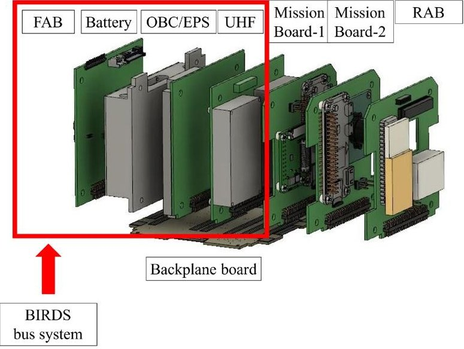

Fig. 8 BIRDS standardized platform inside SaganSat [45]

health status and include parameters such as battery voltage, battery current, power line voltages and currents, and satellite time. COM PIC manages communication with the transceiver. It receives uplink commands from the GS and forwards mission and HK data received from the Main PIC to the transceiver. The Reset PIC monitors satellite time and can initiate a system reboot, including a self-reset function. FAB PIC records the status of the battery and solar cells. The system includes four flash memory units with distinct roles. The main flash memory stores HK data and scheduled commands. Shared flash memory 1 is used for data exchange between the Main PIC and the COM PIC. Shared flash memory 2 facilitates data transfer between the Main PIC and the mission payload. The COM flash memory is dedicated to downlink operations; it allows data to be preloaded before the satellite enters an operational zone, thereby enabling efficient data transmission during limited communication windows.

The communication system (COM), operating in the UHF band, integrates both transmitter and receiver functions. It receives signals from the ground station and transmits downlink data accordingly. Deployment switches are included to keep the satellite powered off while it remains inside the deployment pod. Once released into space, the system is automatically activated. The kill switch is designed to sever the connection between the solar cells and the battery, halting the charging process. Once the battery is depleted, this mechanism ensures that the satellite remains permanently powered off.

For the case study, the mission payload was assumed to include a camera module (CAM) and an attitude determination and control system (ADCS) as shown in Fig. 9. The camera module consists of a camera, an MCU to process commands, flash memory for storing image data, and a power switch that controls the module's power supply. This

<!-- PDF_PAGE: 12 -->

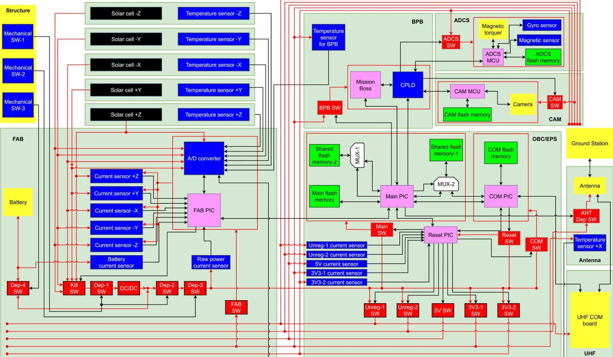

Fig.9 Satellite system model using the original BIRDS bus system [37, 40]

power switch is controlled by the Main PIC. The ADCS unit comprises an MCU, a gyroscope, a magnetometer, an actuator, and a dedicated power switch. Its primary function is to orient the satellite so that the camera lens can be directed toward the Earth.

In this case study, the four mission success levels were defined as listed in Table 2. In addition, a different color is assigned to each mission success level. The minimum success level is the transmission of a continuous wave (CW) signal. When the satellite is powered on, it transmits CW signals periodically. The reception of this signal is considered confirmation that the satellite is operational. The second success level is achieved when the satellite successfully downlinks complete HK data. The third level involves capturing images and transmitting the full-image data. At this level, the satellite takes photographs at random, and the image data are fully downlinked. The highest success level includes successful attitude control of the satellite, enabling

it to capture and downlink images of the Earth with intentional pointing accuracy.

During the complexity evaluation, the inputs and outputs of the COM were clearly not fully represented. This limitation is due to the inability of the DSM to capture interactions that extend beyond the boundaries of the satellite system. To address this, a ground segment (GS), consisting of a personal computer and a radio unit, was introduced to model the influence of external systems separately.

## 4.3 Applying the mission assurance framework to the BIRDS bus system

Figure 10 illustrates the DSM used in the case study. The color scale reflects the criticality of each component or function, as determined by the mission success criteria defined in Table 2. The functions and components essential for achieving the minimum level of success are highlighted in red.

Table 2 Mission success criteria and color classification

<table border="1"><tr><td>Mission success level</td><td>Criteria</td><td>Color</td></tr><tr><td>Level1</td><td>Transmission of a continuous wave(CW) signal</td><td>Red</td></tr><tr><td>Level2</td><td>Downlink of complete housekeeping(HK) data</td><td>Orange</td></tr><tr><td>Level3</td><td>Capturing images and transmission of the full-image data</td><td>Light blue</td></tr><tr><td>Level4</td><td>Capturing an image of pointed target</td><td>Purple</td></tr></table>

<!-- PDF_PAGE: 13 -->

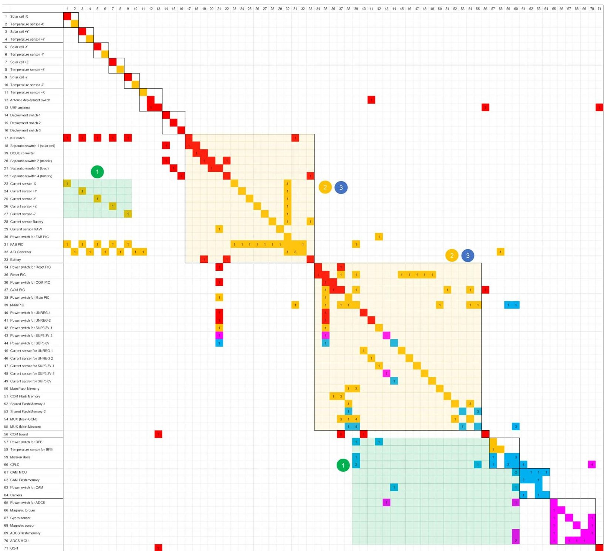

Fig.10 DSM of the original BIRDS bus system colored by the mission success level

Those required for the second-lowest level of success are shown in orange. Functions and components associated with the third-lowest level are indicated in light blue. The highest success level is represented by purple. This color scheme is based on Table 2. The DSM is interpreted by reading from column to row. Therefore, the cell representing the link from Current Sensor Raw to Separation Switch-3 indicates that the raw power distributed from Separation Switch-3 flows to the Current Sensor Raw, where it is measured. For example, the Reset PIC controls the power supply to the UHF board. If it malfunctions, the UHF board cannot be powered on and is unable to transmit the CW. For this reason, the Reset PIC is classified as Level 1 and is marked in red. In

contrast, a failure in the camera does not affect the transmission of housekeeping data, although it prevents image capture. Therefore, the camera module, together with its associated components and functions, is classified as Level 3 and shown in light blue. This color coding is applied to the identified Level 3 elements (components and functions), while connections are highlighted only when they lie on the traced Level 3 functional paths.

The visualization indicates that a substantial number of components and functions are required even to achieve the minimum mission success level. This finding suggests an imbalance in the distribution of functional requirements across components, revealing potential inefficiencies in the

<!-- PDF_PAGE: 14 -->

current system architecture. These imbalanced elements can be classified into three groups. Group 1 involves the dispersion of functions. In this case, functions required for the same mission success level are located outside of their respective clusters and are scattered across interface points. Reducing the number of such interface functions can help lower the overall system complexity. Group 2 is characterized by large clusters containing many components and functions, which results in high degrees of cohesion and coupling. To reduce these values, the cluster should be subdivided appropriately, considering the number of subsystems involved since the number of subsystems also contributes to overall satellite system complexity. Group 3 includes components that serve multiple functions associated with different mission success levels. Reassigning these functions to separate components reduces the number of critical functions tied to the lowest success level, thereby increasing tolerance for partial failure. In this case study, Groups 2 and 3 overlap.

To address the functional imbalances identified in the original system architecture, design modifications were applied to the BIRDS bus system. For example, the cluster associated with the OBC and EPS was larger than any other group. To reduce its size, it was reclassified as Group 3, and selected components were reassigned to other groups. In addition, the Reset PIC was responsible for functions distributed across several levels, as shown in Group 2. To resolve this, its role was transferred to either the Main PIC or the COM PIC. On the basis of these two design considerations, a new board known as the COM board was developed, and the task of controlling power to the UHF module was assigned to the COM PIC. These modifications aimed to redistribute system functions, simplify interconnections, and reduce clustering intensity, thereby improving system modularity and lowering overall complexity.

Figure 11 presents the DSM after these modifications, and Fig. 12 illustrates the updated system block diagram. The revised DSM clearly shows enhanced clustering, reflecting a more logical grouping of functions and a reduced number of unnecessary interconnections. Group 1, corresponding to the FAB subsystem, includes current sensors for each external panel. By relocating these sensors to the respective external panels, clustering improved. Group 3 involves power distribution. In the current design, power from the battery and solar panels is first distributed into five lines and then further divided among subsystems and mission boards.

To simplify this, the updated design introduces a shared main power line connected to all units while maintaining individual power switches for each subsystem or mission board. Group 2 highlights the large cluster involving FAB, OBC, and EPS. These units are responsible for storing HK data, executing mission operation commands, maintaining the 24-h reset timer, and handling communication with the

ground station. The FAB board also includes switch circuits, such as DepSW-1 through DepSW-4, and a kill switch, which are required for compliance with satellite release safety reviews [48]. In the revised BIRDS bus system, these functionalities are grouped into a dedicated subsystem to form a single cohesive cluster.

The Reset PIC, which previously handled timekeeping and triggered a reboot every 24 h, was removed. Its function was reassigned to the COM PIC, which now activates and begins CW transmission immediately after satellite deployment. It also controls the power switches for the bus system, including the FAB PIC and Main PIC. In the prior configuration, the FAB PIC collected HK data, and the Main PIC stored it. In the updated design, these tasks are assigned solely to the FAB PIC for clearer role separation. The main flash memory, previously connected to the Main PIC, was relocated to the FAB PIC and can now be accessed by the COM PIC via a multiplexer. This flash memory is referred to as FAB flash memory. As a result, only the FAB PIC and COM PIC are required to downlink HK data, whereas the Main PIC is activated exclusively for mission operations. In the event of a multiplexer malfunction, the COM PIC would no longer be able to access the FAB flash memory, preventing the achievement of mission success at Level 2. However, this failure does not impact the criteria for minimum mission success. The Main PIC communicates with mission boards and the COM PIC using the CPLD, and the forwarding mission operation commands components, such as ADCS MCU and CAM MCU. This function is equivalent to the "Mission Boss" role in the current system. The Main PIC retains its own flash memory, which is used to transfer mission data from the payload side to the bus system.

The effectiveness of the proposed framework in improving system design through risk-informed analysis using the DSM was evaluated by calculating satellite system complexity before and after design modifications. Figure 13 presents a comparison of overall system complexity across mission success levels for both the original and revised designs. A detailed breakdown of all the calculated variables is provided in Figs. 16 and 17 in Appendix C.

The results indicate a substantial reduction in complexity, with the revised design achieving approximately 48 percent at level 1 and about 15 to 17 percent across levels 2 to 4. This outcome demonstrates the framework's ability to simplify the system while preserving essential functionality.

An additional observation is the increase in the number of subsystems in the revised design compared with the original design. According to Eq.2, this increase typically leads to higher overall system complexity. Despite this, the revised design achieved lower complexity, indicating that the framework effectively minimized interdependencies. This improvement was enabled by reorganizing the DSM on the basis of functional clustering derived from mission success

<!-- PDF_PAGE: 15 -->

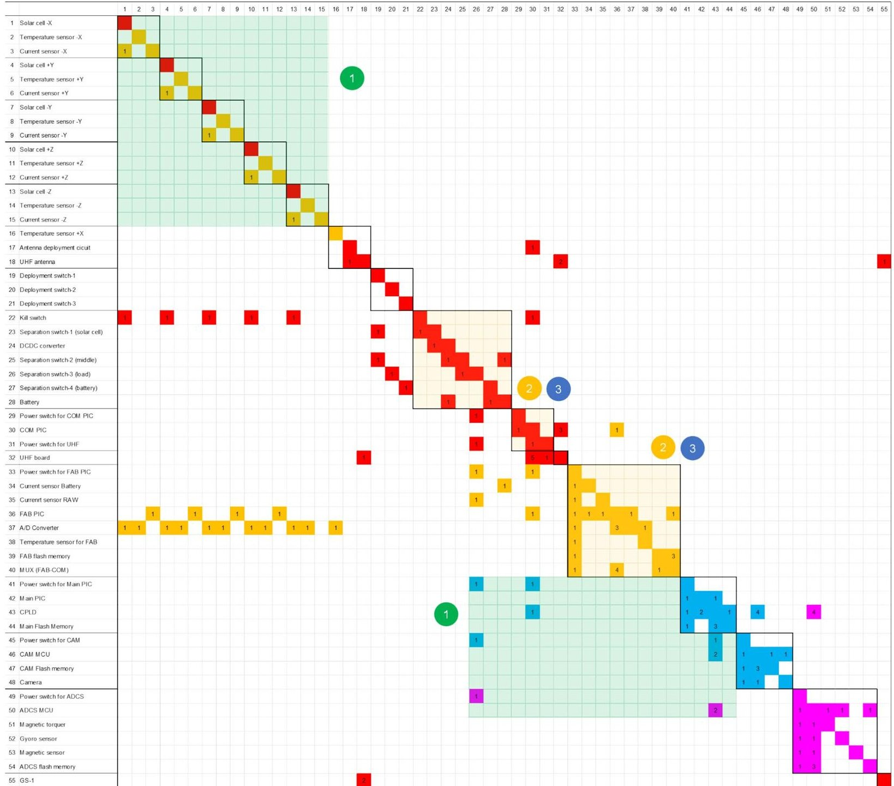

Fig.11 Revised DSM of the BIRDS bus system reflecting improved functional clustering.

level classifications, which helped streamline the architecture and enhance modularity.

## 5 Discussion

This study proposed a DSM-based mission assurance framework specifically designed for academic CubeSats and demonstrated its effectiveness through a case study involving the BIRDS bus system. Unlike traditional complexity evaluation methods that rely on manually analyzing system block diagrams, the proposed framework allows for faster and more consistent assessment by utilizing the DSM. In addition to enabling quantitative evaluation, the framework

facilitates architectural optimization through DSM reconfiguration. Design improvements can be achieved by modifying the DSM rows and columns through merging, deletion, and reassignment, all while preserving critical mission functionality. In the BIRDS CubeSat case study, the DSM effectively revealed and resolved structural inefficiencies, such as disorganized interface functions, oversized clusters, and overlapping functional dependencies, across different mission success levels.

A key feature of the framework is the integration of mission success criteria into DSM analysis. The components were color-coded on the basis of their contribution to specific mission levels, allowing users to visualize critical architectural patterns and prioritize design changes accordingly.

<!-- PDF_PAGE: 16 -->

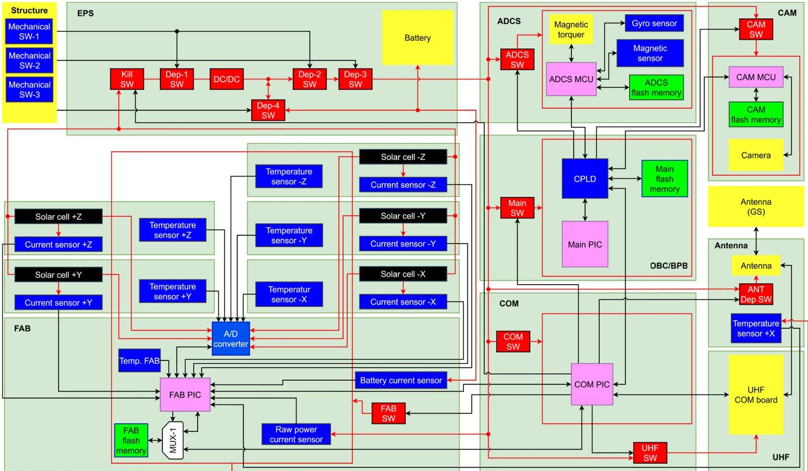

Fig.12 System block diagram for the satellite system using the revised BIRDS bus system

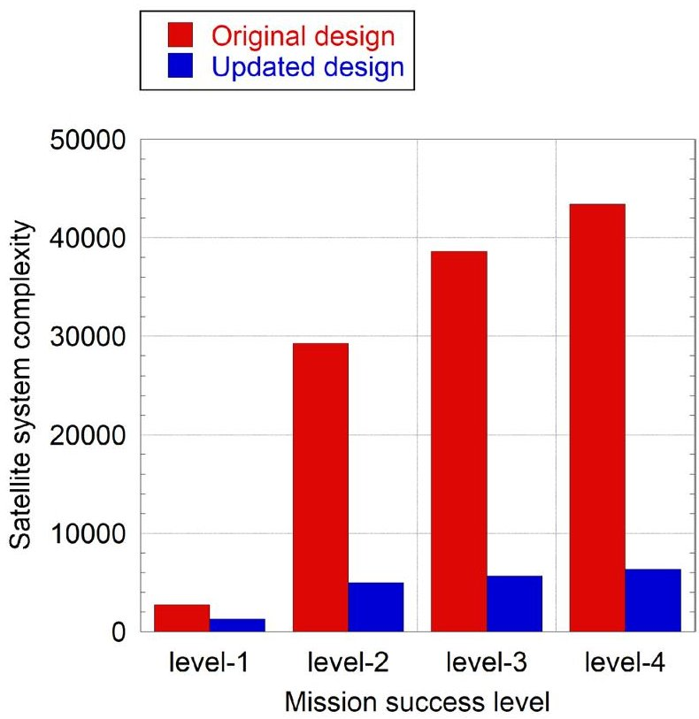

Fig.13 Comparison of satellite system complexity before and after design modification across mission success levels.

However, important limitations were identified. Minimizing cohesion can encourage splitting functions into smaller clusters, which increases the number of interface functions and therefore raises coupling between subsystems. In contrast, minimizing coupling generally drives the design toward fewer interfaces, which increases cohesion by forming larger and more tightly connected clusters. For this reason, these two objectives should be balanced in DSM-based reconfiguration.

As the number of components increases, the computational burden increases rapidly, making it impractical to evaluate all possible configurations in large systems. In addition, even if exhaustive enumeration were computationally feasible, minimizing the proposed complexity metric alone would not necessarily yield the overall best design. For example, removing redundancy solely to reduce the complexity score could introduce a single point of failure and thereby conflict with mission-assurance requirements. In addition, extensive redundancy schemes commonly used in larger satellites are often infeasible for CubeSats due to size and resource constraints, and introducing redundancy can increase the computed satellite system complexity.

On this trade-off between adding redundancy and performing more extensive testing, Bouwmeester compared full subsystem redundancy with allocating comparable project resources to testing, and reported that improved

<!-- PDF_PAGE: 17 -->

testing generally provides a greater reliability benefit for typical CubeSat mission durations, whereas redundancy may become advantageous primarily for very long missions [49]. This study contributes to improving testability and reliability by reducing system complexity.

In this study, the proposed complexity metric is used as a system-architecture-level indicator of the satellite's ability to achieve its intended mission functions as designed. This metric is complementary to conventional reliability and risk assessments based on component failure probabilities. Therefore, design decisions should consider both the complexity-based assessment and traditional risk measures, such as the risk priority number derived from failure probability, failure impact, and failure detectability. Although reducing the number of components and consolidating functions may lower the computed complexity, such changes can increase the consequences of malfunctions and potentially raise overall risk. For this reason, the DSM designer should examine changes in the risk matrix alongside changes in the complexity metrics. This study addressed this trade-off by calculating complexity separately for each mission success level.

Thus, the framework is most useful when applied to support design refinements and to serve as one guideline for determining system architecture. Following DSM-based reconfiguration, the system complexity was reduced across all mission success levels. The most notable improvement was observed at Level 4, where the complexity decreased by more than 80 percent. These findings indicate that the proposed framework can identify problematic areas and support concrete design actions to improve mission reliability.

## 6 Conclusion

Academic CubeSat missions have expanded rapidly in recent years. However, many of these projects continue to face low mission success rates. Owing to the rapid and cost-effective nature of CubeSat development, incorporating complex systems is often impractical, as they require considerable time and effort to analyze, detect, and test all potential failure modes. Therefore, satellite systems should be designed with simplicity as a guiding principle, and this simplicity should be quantitatively evaluated.

introduced the use of the DSM in the complexity evaluation process, developed a program to automate this process, visualized the importance of a component in the DSM by coloring, and optimized the satellite system through a case study based on the BIRDS bus system.

Although previous studies have proposed equations for assessing satellite system complexity, challenges remain. In particular, recalculating complexity after each design change is time-consuming because it depends heavily on system block diagrams. To overcome this limitation, this study

The program was validated by comparing its output with manual calculations. A case study using the BIRDS bus system demonstrated the practical application and effectiveness of the proposed approach. DSM analysis successfully identified and addressed structural complexity within the BIRDS platform, leading to an improved system design. A comparison between the original and updated systems confirmed a reduction in overall complexity. This case study highlights that DSM-based analysis can effectively detect structural inefficiencies and support meaningful design improvements while preserving mission functionality.

Several directions for future work are identified. First, the increasing adoption of artificial intelligence in system engineering provides an opportunity to enhance this framework. AI could be used to automate DSM-based optimization and generate innovative system architectures aligned with the complexity-reduction strategy presented in this research. Second, further validation through real-world implementation is needed. The Cucket Project at Kyutech, initiated in 2024, involves undergraduate students in the development of CubeSats and rockets [50]. This program could be used to demonstrate the effectiveness of the proposed framework in a practical academic environment. Such a demonstration would help assess the framework's effectiveness and explore its applicability beyond satellite systems. Moreover, explicitly representing redundancy in the criticality-level assignment is a promising direction for future work. For example, the failure of the solar cells on a single external panel may not affect mission success, and the minimum mission level can still be achieved. However, if two external panels fail simultaneously, the minimum mission level may no longer be satisfied. To extend the capability of the framework, k-out-of-n availability will be incorporated to identify the minimum required subset of redundant components for each mission success level. Lastly, the DSM model will be expanded to include mechanical and thermal information in addition to the electrical and communication connections considered in this case study. This expansion is expected to improve the adaptability of the framework to a wider range of systems and to better support discussions on more comprehensive mission assurance.

<!-- PDF_PAGE: 18 -->

## Appendix

## Appendix A: DSM operations for directed and undirected graphs in the coupling calculation

The degree of coupling is an index that indicates how susceptible a subsystem's modularity is to design changes in other subsystems. Previous research has suggested that the reciprocal of the number of interfaces represents the strength of the connections between subsystems as shown in Fig. 14. To evaluate this, the directed system diagram must first be converted into an undirected form.

To apply this concept to the DSM, the matrix is folded along its diagonal. This operation is equivalent to adding the transpose of the matrix to the original matrix, as shown in Fig. 14. The transpose represents directional relationships in the opposite direction. By combining the original and transposed matrices, a new matrix, denoted D, is created. This transformation enables a clearer and more accurate assessment of coupling relationships.

## Appendix B: Introduction of the ISM method in cohesion calculations

Warfield proposed a method to detect the reachability of each function using the DSM in 1974, known as the interpretive structural modeling (ISM) method [32]. Figure 15 illustrates the flow of the ISM process. As a first

step in this method, the values in the DSM are converted into binary form, either "1" or "0". These binary values indicate the presence or absence of a functional relationship. Specifically, "1" represents the existence of a function, corresponding to a "true" response to the question of whether a function exists, whereas "0" indicates its absence, or "false". If a numerical value is entered into a cell, it signifies that a function exists, and the cell is assigned a value of "1". Conversely, if no function is present, the cell is assigned a value of "0". In addition, all diagonal cells, denoted as $ a_{ii} $ , are also assigned a value of "1", indicating that each component has a function associated with itself. This plays an important role in connecting the input and output features to identify functional reachability. This step is equivalent to adding the identity matrix to the original binary matrix. It is represented by the matrix P in Fig. 15.

The next step involves calculating the inner product by repeatedly multiplying the matrix until the solution converges. Convergence occurs when the result of $ P^{n} $ is equal to $ P^{n-1} $ . These matrix operations use Boolean logic, meaning that they involve logical values of "true" and "false" instead of arithmetic operations. Repeating the inner product operation propagates functional connections throughout the system, making potential relationships between functions visible. In the matrix $ P^{2} $ , a value of "1" appears in the cells corresponding to the connections from Component E to A and from Component D to C. These values are derived from

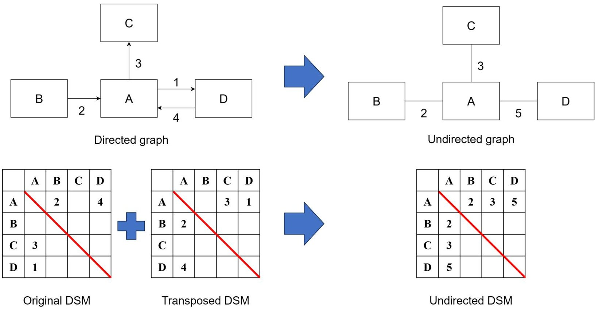

Fig.14 Flow and theory used to convert the directed graph to an undirected graph using the DSM.

<!-- PDF_PAGE: 19 -->

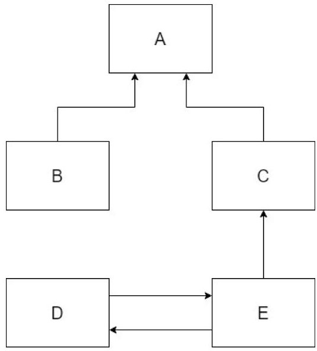

System block diagram

<table border="1"><tr><td></td><td>A</td><td>B</td><td>C</td><td>D</td><td>E</td></tr><tr><td>A</td><td></td><td>1</td><td>1</td><td></td><td></td></tr><tr><td>B</td><td></td><td></td><td></td><td></td><td></td></tr><tr><td>C</td><td></td><td></td><td></td><td></td><td>1</td></tr><tr><td>D</td><td></td><td></td><td></td><td></td><td>1</td></tr><tr><td>E</td><td></td><td></td><td></td><td>1</td><td></td></tr></table>

DSM

$$
P + I = \left( \begin{array}{c c c c c} 1 & 1 & 1 & 0 & 0 \\ 0 & 1 & 0 & 0 & 0 \\ 0 & 0 & 1 & 0 & 1 \\ 0 & 0 & 0 & 1 & 1 \\ 0 & 0 & 0 & 1 & 1 \end{array} \right)
$$

$$
\begin{array}{l} (P + I) ^ {2} = \left( \begin{array}{c c c c c} 1 & 1 & 1 & 0 & 0 \\ 0 & 1 & 0 & 0 & 0 \\ 0 & 0 & 1 & 0 & 1 \\ 0 & 0 & 0 & 1 & 1 \\ 0 & 0 & 0 & 1 & 1 \end{array} \right) \left( \begin{array}{c c c c c} 1 & 1 & 1 & 0 & 0 \\ 0 & 1 & 0 & 0 & 0 \\ 0 & 0 & 1 & 0 & 1 \\ 0 & 0 & 0 & 1 & 1 \\ 0 & 0 & 0 & 1 & 1 \end{array} \right) \\ = \left( \begin{array}{c c c c c} 1 & 1 & 1 & 0 & 1 \\ 0 & 1 & 0 & 0 & 0 \\ 0 & 0 & 1 & 1 & 1 \\ 0 & 0 & 0 & 1 & 1 \\ 0 & 0 & 0 & 1 & 1 \end{array} \right) \quad a _ {1 1} a _ {1 5} + a _ {1 2} a _ {2 5} + a _ {1 4} a _ {4 5} + a _ {1 5} a _ {5 5} \\ a _ {3 1} a _ {1 4} + a _ {3 2} a _ {2 4} + a _ {3 3} a _ {3 4} + a _ {3 4} a _ {4 4} + a _ {3 5} a _ {5 4} \\ \end{array}
$$

$$
\begin{array}{l} (P + I) ^ {3} = \left( \begin{array}{c c c c c} 1 & 1 & 1 & 0 & 1 \\ 0 & 1 & 0 & 0 & 0 \\ 0 & 0 & 1 & 1 & 1 \\ 0 & 0 & 0 & 1 & 1 \\ 0 & 0 & 0 & 1 & 1 \end{array} \right) \left( \begin{array}{c c c c c} 1 & 1 & 1 & 0 & 0 \\ 0 & 1 & 0 & 0 & 0 \\ 0 & 0 & 1 & 0 & 1 \\ 0 & 0 & 0 & 1 & 1 \\ 0 & 0 & 0 & 1 & 1 \end{array} \right) \\ = \left( \begin{array}{c c c c c} 1 & 1 & 1 & 1 & 1 \\ 0 & 1 & 0 & 0 & 0 \\ 0 & 0 & 1 & 1 & 1 \\ 0 & 0 & 0 & 1 & 1 \\ 0 & 0 & 0 & 1 & 1 \end{array} \right) \quad \begin{array}{l} \left(a _ {1 1} a _ {1 1} + a _ {1 2} a _ {2 1} + a _ {1 3} a _ {3 1} + a _ {1 4} a _ {4 1} + a _ {1 5} a _ {5 1}\right) a _ {1 4} \\ + \left(a _ {1 1} a _ {1 2} + a _ {1 2} a _ {2 2} + a _ {1 3} a _ {3 2} + a _ {1 4} a _ {4 2} + a _ {1 5} a _ {5 2}\right) a _ {2 4} \\ + \left(a _ {1 1} a _ {1 3} + a _ {1 2} a _ {2 3} + a _ {1 3} a _ {3 3} + a _ {1 4} a _ {4 3} + a _ {1 5} a _ {5 3}\right) a _ {3 4} \\ + \left(a _ {1 1} a _ {1 4} + a _ {1 2} a _ {2 4} + a _ {1 3} a _ {3 4} + a _ {1 4} a _ {4 4} + a _ {1 5} a _ {5 4}\right) a _ {4 4} \\ + \left(a _ {1 1} a _ {1 5} + a _ {1 2} a _ {2 5} + a _ {1 3} a _ {3 5} + a _ {1 4} a _ {4 5} + a _ {1 5} a _ {5 5}\right) a _ {5 4} \end{array}
$$

Fig.15 ISM method calculation flow and theory

<!-- PDF_PAGE: 20 -->

paths $ a_{1 3} a_{3 5} $ and $ a_{3 5} a_{5 4} $ , respectively. This indicates that the function from Components C to A is indirectly connected to the function from Components E to C, and the function from Components E to C is connected to the function from Components D to E. These results reveal the primary potential connections. In the matrix $ P^{3} $ , a secondary potential relationship between Component D and Component A is identified, resulting in a longer chain of functional dependency within the system.

Once the matrix converges, it indicates that functional reachability has been fully determined. By examining the rows in $ P^{n} $ , it becomes clear which input functions are associated with each component. These are represented by "1" values and can be identified at a glance.

Appendix C: Satellite system complexity calculation data before and after design modification

See Figs. 16,17.

<table border="1"><tr><td>Model</td><td>Subsystem</td><td>e</td><td>f</td><td>p</td><td>v</td><td>Coche</td><td>Coup</td><td>NIF</td><td>Np</td><td>Ssub</td><td>Csub</td><td>E</td><td>SS</td><td>V</td><td>Coup_sys</td><td>Says</td><td>Csys</td></tr><tr><td>level-1</td><td>SP_-X</td><td>2</td><td>1</td><td>1</td><td>2</td><td>1</td><td>1.043478</td><td>2</td><td>1</td><td>3.6</td><td>7.686957</td><td>-</td><td>-</td><td>-</td><td>-</td><td>-</td><td>-</td></tr><tr><td>level-1</td><td>SP_+Y</td><td>2</td><td>1</td><td>1</td><td>2</td><td>1</td><td>1.043478</td><td>2</td><td>1</td><td>3.6</td><td>7.686957</td><td>-</td><td>-</td><td>-</td><td>-</td><td>-</td><td>-</td></tr><tr><td>level-1</td><td>SP_-Y</td><td>2</td><td>1</td><td>1</td><td>2</td><td>1</td><td>1.043478</td><td>2</td><td>1</td><td>3.6</td><td>7.686957</td><td>-</td><td>-</td><td>-</td><td>-</td><td>-</td><td>-</td></tr><tr><td>level-1</td><td>SP_+Z</td><td>2</td><td>1</td><td>1</td><td>2</td><td>1</td><td>1.043478</td><td>2</td><td>1</td><td>3.6</td><td>7.686957</td><td>-</td><td>-</td><td>-</td><td>-</td><td>-</td><td>-</td></tr><tr><td>level-1</td><td>SP_-Z</td><td>2</td><td>1</td><td>1</td><td>2</td><td>1</td><td>1.043478</td><td>2</td><td>1</td><td>3.6</td><td>7.686957</td><td>-</td><td>-</td><td>-</td><td>-</td><td>-</td><td>-</td></tr><tr><td>level-1</td><td>ANT_P</td><td>6</td><td>2</td><td>1</td><td>5</td><td>1</td><td>1.077844</td><td>7</td><td>3</td><td>8.27</td><td>50.90473</td><td>-</td><td>-</td><td>-</td><td>-</td><td>-</td><td>-</td></tr><tr><td>level-1</td><td>STR</td><td>4</td><td>3</td><td>3</td><td>6</td><td>2</td><td>1.363636</td><td>4</td><td>1</td><td>13.45</td><td>126.9045</td><td>-</td><td>-</td><td>-</td><td>-</td><td>-</td><td>-</td></tr><tr><td>level-1</td><td>FAB</td><td>27</td><td>8</td><td>1</td><td>20</td><td>1</td><td>1.967213</td><td>18</td><td>7</td><td>43.65</td><td>1571.519</td><td>-</td><td>-</td><td>-</td><td>-</td><td>-</td><td>-</td></tr><tr><td>level-1</td><td>OBC/EPS</td><td>16</td><td>6</td><td>1</td><td>11</td><td>1.266667</td><td>1.565217</td><td>14</td><td>3</td><td>30.91</td><td>598.2491</td><td>-</td><td>-</td><td>-</td><td>-</td><td>-</td><td>-</td></tr><tr><td>level-1</td><td>UHF</td><td>5</td><td>1</td><td>1</td><td>5</td><td>1</td><td>1.565217</td><td>12</td><td>2</td><td>3.6</td><td>46.16522</td><td>-</td><td>-</td><td>-</td><td>-</td><td>-</td><td>-</td></tr><tr><td>level-1</td><td>GS</td><td>2</td><td>1</td><td>1</td><td>2</td><td>1</td><td>0.853081</td><td>3</td><td>1</td><td>3.6</td><td>8.159242</td><td>-</td><td>-</td><td>-</td><td>-</td><td>-</td><td>-</td></tr><tr><td>level-1</td><td>System</td><td>-

Fig.16 Complexity calculation data for a satellite based on the BIRDS bus system.

<!-- PDF_PAGE: 21 -->

<table border="1"><tr><td>Model</td><td>Subsystem</td><td>e</td><td>f</td><td>p</td><td>v</td><td>Cohe</td><td>Coup</td><td>NIF</td><td>Np</td><td>Ssub</td><td>Csub</td><td>E</td><td>SS</td><td>V</td><td>Coup_sys</td><td>Ssys</td><td>Csys</td></tr><tr><td>level-1</td><td>SP_-X</td><td>1</td><td>1</td><td>1</td><td>1</td><td>1</td><td>0.591133</td><td>1</td><td>1</td><td>3.6</td><td>5.191133</td><td>-</td><td>-</td><td>-</td><td>-</td><td>-</td><td>-</td></tr><tr><td>level-1</td><td>SP_+Y</td><td>1</td><td>1</td><td>1</td><td>1</td><td>1</td><td>0.591133</td><td>1</td><td>1</td><td>3.6</td><td>5.191133</td><td>-</td><td>-</td><td>-</td><td>-</td><td>-</td><td>-</td></tr><tr><td>level-1</td><td>SP_-Y</td><td>1</td><td>1</td><td>1</td><td>1</td><td>1</td><td>0.591133</td><td>1</td><td>1</td><td>3.6</td><td>5.191133</td><td>-</td><td>-</td><td>-</td><td>-</td><td>-</td><td>-</td></tr><tr><td>level-1</td><td>SP_+Z</td><td>1</td><td>1</td><td>1</td><td>1</td><td>1</td><td>0.591133</td><td>1</td><td>1</td><td>3.6</td><td>5.191133</td><td>-</td><td>-</td><td>-</td><td>-</td><td>-</td><td>-</td></tr><tr><td>level-1</td><td>SP_-Z</td><td>1</td><td>1</td><td>1</td><td>1</td><td>1</td><td>0.591133</td><td>1</td><td>1</td><td>3.6</td><td>5.191133</td><td>-</td><td>-</td><td>-</td><td>-</td><td>-</td><td>-</td></tr><tr><td>level-1</td><td>ANT_P</td><td>6</td><td>2</td><td>1</td><td>5</td><td>1</td><td>0.808989</td><td>7</td><td>3</td><td>8.27</td><td>45.25876</td><td>-</td><td>-</td><td>-</td><td>-</td><td>-</td><td>-</td></tr><tr><td>level-1</td><td>STR</td><td>4</td><td>3</td><td>3</td><td>6</td><td>2</td><td>0.983607</td><td>4</td><td>1</td><td>13.45</td><td>125.3844</td><td>-</td><td>-</td><td>-</td><td>-</td><td>-</td><td>-</td></tr><tr><td>level-1</td><td>EPS</td><td>19</td><td>7</td><td>1</td><td>13</td><td>1</td><td>1.263158</td><td>12</td><td>7</td><td>37.19</td><td>780.2953</td><td>-</td><td>-</td><td>-</td><td>-</td><td>-</td><td>-</td></tr><tr><td>level-1</td><td>COM</td><td>9</td><td>3</td><td>1</td><td>7</td><td>1.375</td><td>1.055718</td><td>13</td><td>3</td><td>13.45</td><td>141.248</td><td>-</td><td>-</td><td>-</td><td>-</td><td>-</td><td>-</td></tr><tr><td>level-1</td><td>UHF</td><td>5</td><td>1</td><td>1</td><td>5</td><td>1</td><td>1.055718</td><td>12</td><td>2</td><td>3.6</td><td>33.93724</td><td>-</td><td>-</td><td>-</td><td>-</td><td>-</td><td>-</td></tr><tr><td>level-1</td><td>GS</td><td>2</td><td>1</td><td>1</td><td>2</td><td>1</td><td>0.675422</td><td>3</td><td>1</td><td>3.6</td><td>7.626266</td><td>-</td><td>-</td><td>-</td><td>-</td><td>-</td><td>-</td></tr><tr><td>level-1</td><td>System</td><td>-</td><td>-</td><td>-</td><td>-</td><td>-</td><td>-</td><td>-</td><td>-</td><td>-</td><td>20</td><td>11</td><td>11</td><td>8.798277</td><td>63.97</td><td>1320.457</td></tr><tr><td>level-2</td><td>SP_-X</td><td>5</td><td>3</td><td>2</td><td>5</td><td>1.875</td><td>1.211009</td><td>4</td><td>2</td><td>13.45</td><td>107.5131</td><td>-</td><td>-</td><td>-</td><td>-</td><td>-</td><td>-</td></tr><tr><td>level-2</td><td>SP_+Y</td><td>5</td><td>3</td><td>2</td><td>5</td><td>1.875</td><td>1.211009</td><td>4</td><td>2</td><td>13.45</td><td>107.5131</td><td>-</td><td>-</td><td>-</td><td>-</td><td>-</td><td>-</td></tr><tr><td>level-2</td><td>SP_-Y</td><td>5</td><td>3</td><td>2</td><td>5</td><td>1.875</td><td>1.211009</td><td>4</td><td>2</td><td>13.45</td><td>107.5131</td><td>-</td><td>-</td><td>-</td><td>-</td><td>-</td><td>-</td></tr><tr><td>level-2</td><td>SP_+Z</td><td>5</td><td>3</td><td>2</td><td>5</td><td>1.875</td><td>1.211009</td><td>4</td><td>2</td><td>13.45</td><td>107.5131</td><td>-</td><td>-</td><td>-</td><td>-</td><td>-</td><td>-</td></tr><tr><td>level-2</td><td>SP_-Z</td><td>4</td><td>3</td><td>2</td><td>4</td><td>2</td><td>1.03937</td><td>3</td><td>2</td><td>13.45</td><td>91.68622</td><td>-</td><td>-</td><td>-</td><td>-</td><td>-</td><td>-</td></tr><tr><td>level-2</td><td>ANT_P</td><td>7</td><td>3</td><td>2</td><td>7</td><td>1.666667</td><td>1.079019</td><td>8</td><td>4</td><td>13.45</td><td>152.9786</td><td>-</td><td>-</td><td>-</td><td>-</td><td>-</td><td>-</td></tr><tr><td>level-2</td><td>STR</td><td>4</td><td>3</td><td>3</td><td>6</td><td>2</td><td>1.189189</td><td>4</td><td>1</td><td>13.45</td><td>126.2068</td><td>-</td><td>-</td><td>-</td><td>-</td><td>-</td><td>-</td></tr><tr><td>level-2</td><td>EPS</td><td>22</td><td>7</td><td>1</td><td>16</td><td>1.066667</td><td>1.333333</td><td>15</td><td>8</td><td>37.19</td><td>1033.457</td><td>-</td><td>-</td><td>-</td><td>-</td><td>-</td><td>-</td></tr><tr><td>level-2</td><td>COM</td><td>12</td><td>3</td><td>1</td><td>10</td><td>1.416667</td><td>1.656904</td><td>16</td><td>4</td><td>13.45</td><td>246.9918</td><td>-</td><td>-</td><td>-</td><td>-</td><td>-</td><td>-</td></tr><tr><td>level-2</td><td>UHF</td><td>5</td><td>1</td><td>1</td><td>5</td><td>1</td><td>1.62963</td><td>12</td><td>2</td><td>3.6</td><td>47.71111</td><td>-</td><td>-</td><td>-</td><td>-</td><td>-</td><td>-</td></tr><tr><td>level-2</td><td>FAB</td><td>37</td><td>8</td><td>1</td><td>30</td><td>1</td><td>1.950739</td><td>21</td><td>8</td><td>43.65</td><td>2291.374</td><td>-</td><td>-</td><td>-</td><td>-</td><td>-</td><td>-</td></tr><tr><td>level-2</td><td>GS</td><td>2</td><td>1</td><td>1</td><td>2</td><td>1</td><td>0.862745</td><td>3</td><td>1</td><td>3.6</td><td>8.188235</td><td>-</td><td>-</td><td>-</td><td>-</td><td>-</td><td>-</td></tr><tr><td>level-2</td><td>System</td><td>-</td><td>-</td><td>-</td><td>-</td><td>-</td><td>-</td><td>-</td><td>-</td><td>-</td><td>41</td><td>12</td><td>31</td><td>15.58497</td><td>71.01</td><td>4982.79</td></tr><tr><td>level-3</td><td>SP_-X</td><td>5</td><td>3</td><td>2</td><td>5</td><td>1.875</td><td>1.124614</td><td>4</td><td>2</td><td>13.45</td><td>106.8219</td><td>-</td><td>-</td><td>-</td><td>-</td><td>-</td><td>-</td></tr><tr><td>level-3</td><td>SP_+Y</td><td>5</td><td>3</td><td>2</td><td>5</td><td>1.875</td><td>1.124614</td><td>4</td><td>2</td><td>13.45</td><td>106.8219</td><td>-</td><td>-</td><td>-</td><td>-</td><td>-</td><td>-</td></tr><tr><td>level-3</td><td>SP_-Y</td><td>5</td><td>3</td><td>2</td><td>5</td><td>1.875</td><td>1.124614</td><td>4</td><td>2</td><td>13.45</td><td>106.8219</td><td>-</td><td>-</td><td>-</td><td>-</td><td>-</td><td>-</td></tr><tr><td>level-3</td><td>SP_+Z</td><td>5</td><td>3</td><td>2</td><td>4</td><td>2</td><td>0.970667</td><td>3</td><td>2</td><td>13.45</td><td>91.274</td><td>-</td><td>-</td><td>-</td><td>-</td><td>-</td><td>-</td></tr><tr><td>level-3</td><td>ANT_P</td><td>7</td><td>3</td><td>2</td><td>7</td><td>1.666667</td><td>1.063291</td><td>8</td><td>4</td><td>13.45</td><td>152.4753</td><td>-</td><td>-</td><td>-</td><td>-</td><td>-</td><td>-</td></tr><tr><td>level-3</td><td>STR</td><td>4</td><td>3</td><td>3</td><td>6</td><td>2</td><td>1.124614</td><td>4</td><td>1</td><td>13.45</td><td>125.9485</td><td>-</td><td>-</td><td>-</td><td>-</td><td>-</td><td>-</td></tr><tr><td>level-3</td><td>EPS</td><td>24</td><td>7</td><td>1</td><td>18</td><td>1.047619</td><td>1.268293</td><td>17</td><td>10</td><td>37.19</td><td>1176.8</td><td>-</td><td>-</td><td>-</td><td>-</td><td>-</td><td>-</td></tr><tr><td>level-3</td><td>COM</td><td>14</td><td>3</td><td>1</td><td>12</td><td>1.4375</td><td>1.670576</td><td>18</td><td>5</td><td>13.45</td><td>319.0519</td><td>-</td><td>-</td><td>-</td><td>-</td><td>-</td><td>-</td></tr><tr><td>level-3</td><td>UHF</td><td>5</td><td>1</td><td>1</td><td>5</td><td>1</td><td>1.601956</td><td>12</td><td>2</td><td>3.6</td><td>47.04694</td><td>-</td><td>-</td><td>-</td><td>-</td><td>-</td><td>-</td></tr><tr><td>level-3</td><td>FAB</td><td>37</td><td>8</td><td>1</td><td>30</td><td>1</td><td>1.745338</td><td>21</td><td>8</td><td>43.65</td><td>2256.867</td><td>-</td><td>-</td><td>-</td><td>-</td><td>-</td><td>-</td></tr><tr><td>level-3</td><td>OBC</td><td>13</td><td>4</td><td>1</td><td>10</td><td>1</td><td>1.048991</td><td>10</td><td>3</td><td>19</td><td>210.4697</td><td>-</td><td>-</td><td>-</td><td>-</td><td>-</td><td>-</td></tr><tr><td>level-3</td><td>CAM</td><td>11</td><td>4</td><td>1</td><td>8</td><td>1</td><td>0.930946</td><td>8</td><td>2</td><td>19</td><td>161.8951</td><td>-</td><td>-</td><td>-</td><td>-</td><td>-</td><td>-</td></tr><tr><td>level-3</td><td>GS</td><td>2</td><td>1</td><td>1</td><td>2</td><td>1</td><td>0.84151</td><td>3</td><td>1</td><td>3.6</td><td>8.124531</td><td>-</td><td>-</td><td>-</td><td>-</td><td>-</td><td>-</td></tr><tr><td>level-3</td><td>System</td><td>-</td><td>-</td><td>-</td><td>-</td><td>-</td><td>-</td><td>-</td><td>-</td><td>-</td><td>48</td><td>14</td><td>36</td><td>16.76464</td><td>85.44</td><td>5666.207</td></tr><tr><td>level-4</td><td>SP_-X</td><td>5</td><td>3</td><td>2</td><td>5</td><td>1.875</td><td>1.085873</td><td>4</td><td>2</td><td>13.45</td><td>106.512</td><td>-</td><td>-</td><td>-</td><td>-</td><td>-</td><td>-</td></tr><tr><td>level-4</td><td>SP_+Y</td><td>5</td><td>3</td><td>2</td><td>5</td><td>1.875</td><td>1.085873</td><td>4</td><td>2</td><td>13.45</td><td>106.512</td><td>-</td><td>-</td><td>-</td><td>-</td><td>-</td><td>-</td></tr><tr><td>level-4</td><td>SP_+Z</td><td>5</td><td>3</td><td>2</td><td>5</td><td>1.875</td><td>1.085873</td><td>4</td><td>2</td><td>13.45</td><td>106.512</td><td>-</td><td>-</td><td>-</td><td>-</td><td>-</td><td>-</td></tr><tr><td>level-4</td><td>SP_-Z</td><td>4</td><td>3</td><td>2</td><td>4</td><td>2</td><td>0.940048</td><td>3</td><td>2</td><td>13.45</td><td>91.09029</td><td>-</td><td>-</td><td>-</td><td>-</td><td>-</td><td>-</td></tr><tr><td>level-4</td><td>ANT_P</td><td>7</td><td>3</td><td>2</td><td>7</td><td>1.666667</td><td>1.049688</td><td>8</td><td>4</td><td>13.45</td><td>152.04</td><td>-</td><td>-</td><td>-</td><td>-</td><td>-</td><td>-</td></tr><tr><td>level-4</td><td>STR</td><td>4</td><td>3</td><td>3</td><td>6</td><td>2</td><td>1.092937</td><td>4</td><td>1</td><td>13.45</td><td>125.8217</td><td>-</td><td>-</td><td>-</td><td>-</td><td>-</td><td>-</td></tr><tr><td>level-4</td><td>EPS</td><td>25</td><td>7</td><td>1</td><td>19</td><td>1.041667</td><td>1.244444</td><td>18</td><td>11</td><td>37.19</td><td>1253.382</td><td>-</td><td>-</td><td>-</td><td>-</td><td>-</td><td>-</td></tr><tr><td>level-4</td><td>COM</td><td>14</td><td>3</td><td>1</td><td>12</td><td>1.4375</td><td>1.657116</td><td>18</td><td>5</td><td>13.45</td><td>317.8404</td><td>-</td><td>-</td><td>-</td><td>-</td><td>-</td><td>-</td></tr><tr><td>level-4</td><td>UHF</td><td>5</td><td>1</td><td>1</td><td>5</td><td>1</td><td>1.574297</td><td>12</td><td>2</td><td>3.6</td><td>46.38313</td><td>-</td><td>-</td><td>-</td><td>-</td><td>-</td><td>-</td></tr><tr><td>level-4</td><td>FAB</td><td>37</td><td>8</td><td>1</td><td>30</td><td>1</td><td>1.657116</td><td>21</td><td>8</td><td>43.65</td><td>2242.045</td><td>-</td><td>-</td><td>-</td><td>-</td><td>-</td><td>-</td></tr><tr><td>level-4</td><td>OBC</td><td>15</td><td>4</td><td>1</td><td>12</td><td>1</td><td>1.114692</td><td>16</td><td>4</td><td>19</td><td>282.3403</td><td>-</td><td>-</td><td>-</td><td>-</td><td>-</td><td>-</td></tr><tr><td>level-4</td><td>CAM</td><td>11</td><td>4</td><td>1</td><td>8</td><td>1</td><td>0.980817</td><td>8</td><td>2</td><td>19</td><td>162.6931</td><td>-</td><td>-</td><td>-</td><td>-</td><td>-</td><td>-</td></tr><tr><td>level-4</td><td>ADCS</td><td>15</td><td>6</td><td>1</td><td>10</td><td>1.2</td><td>0.96157</td><td>7</td><td>2</td><td>30.91</td><td>476.372</td><td>-</td><td>-</td><td>-</td><td>-</td><td>-</td><td>-</td></tr><tr><td>level-4</td><td>GS</td><td>2</td><td>1</td><td>1</td><td>2</td><td>1</td><td>0.828753</td><td>3</td><td>1</td><td>3.6</td><td>8.086258</td><td>-</td><td>-</td><td>-</td><td>-</td><td>-</td><td>-</td></tr><tr><td>level-4</td><td>System</td><td>-</td><td>-</td><td>-</td><td>-</td><td>-</td><td>-</td><td>-</td><td>-</td><td>-</td><td>51</td><td>15</td><td>38</td><td>17.44497</td><td>92.81</td><td>6339.861</td></tr></table>

Fig.17 Complexity calculation data for a revised satellite based on the BIRDS bus system.

Acknowledgements The authors would like to thank Mayank, Prof. Cordova Alarcon Jose Rodrigo, and Prof. Victor Hugo Schulz for their support in the improvement of this paper. This work was supported by the Japan Science and Technology Agency SPRING, Japan Grant Number JPMJSP2154. The presented work has been partly financed by the Finnish Centre of Excellence in Research of Sustainable Space (FORESAIL), which is a project under the Research Council of Finland Decision Numbers 336805 to 336809.

Author contributions All authors contributed to the study conception and design. Material preparation, data collection, and analysis were performed by Yukihisa Otani. The first draft of the manuscript was

written by Yukihisa Otani, and all authors commented on previous versions of the manuscript. All authors read and approved the final manuscript.

Funding The Japan Science and Technology Agency SPRING, Japan Grant Number JPMJSP2154. The Finnish Centre of Excellence in Research of Sustainable Space (FORESAIL), which is a project under the Research Council of Finland Decision Numbers 336805 to 336809.

Data availability Python software to calculate the satellite system complexity and the Excel data for simulation are uploaded to the https:// doi.org/10.5281/zenodo.18350999.

<!-- PDF_PAGE: 22 -->

Code availability Python software to calculate the satellite system complexity and the Excel data for simulation are uploaded to the https:// doi.org/10.5281/zenodo.18350999.

## Declarations

Conflict of interest The authors declare no competing interests.

Open Access This article is licensed under a Creative Commons Attribution 4.0 International License, which permits use, sharing, adaptation, distribution and reproduction in any medium or format, as long as you give appropriate credit to the original author(s) and the source, provide a link to the Creative Commons licence, and indicate if changes were made. The images or other third party material in this article are included in the article's Creative Commons licence, unless indicated otherwise in a credit line to the material. If material is not included in the article's Creative Commons licence and your intended use is not permitted by statutory regulation or exceeds the permitted use, you will need to obtain permission directly from the copyright holder. To view a copy of this licence, visit http://creativecommons.org/licenses/by/4.0/.

## References

1. CUBESAT. Cal poly SLO: CubeSat design specification (NEW RELEASE for 1U-12U: revision 14.1 - updated February 2022). https://www.cubesat.org/cubesatinfo (2022). Accessed 18 June 2025

2. Swartwout, M.: The first one hundred CubeSats, a statistical look. J. Small Satell. 2, 213-233 (2013)

3. Kulu, E.: Nanosatellite launches by types. Nanosats Database. https://www.nanosats.eu/#figures (2025). Accessed 20 June 2025

4. Swartwout, M.: University-class spacecraft in 2023: more missions, more problems? In: 37th Annual Small Satellite Conference, p. SSC23-WVIII-06, Logan, UT, USA (2023)

5. Venturini, C., Braun, B., Hinkley, D., Berg, G.: Improving mission success of CubeSats. In: 32nd Annual AIAA/USU Conference on Small Satellites, p. SSC18-IV-02, Logan, UT, USA (2018)

6. UNISEC: mission assurance handbook for the university-built lean satellite ver 4.0. https://ma.unisec.jp/ma-handbook/ (2025). Accessed 26 June 2025

7. NASA: NASA Systems Engineering Handbook (NASA SP-2016- 6105 Rev2). National Aeronautics and Space Administration. https://soma.larc.nasa.gov/stp/dynamic/pdf_files/nasa_systems_ engineering_handbook_Rev2.pdf (2016). Accessed 9 Jan 2026

8. ECSS: ECSS-E-ST-10C Rev.1 System engineering general requirements. European Cooperation for Space Standardization. https://ecss.nl/standard/ecss-e-st-10c-rev-1-system-engineering general-requirements-15-february-2017/ (2017). Accessed 9 Jan 2026

9. JAXA: JAXA-JERG-2-100 System Design Standard. Japan Aerospace Exploration Agency (JAXA). https://sma.jaxa.jp/ TechDoc/Docs/JAXA-JERG-2-100.pdf. Accessed 9 Jan 2026

10. ESA: Engineering Guidelines for ESA IOD CubeSat Projects released. European Space Agency (ESA). https://www.esa.int/Enabling_Support/Space_Engineering_Technology/Technology_CubeSats/Engineering_Guidelines_for_ESA_IOD_CubeSat_Projects_released. Accessed 9 Jan 2026.

11. ESA: Tailored ECSS for IOD CubeSats (Issue 1, Rev 3). Document describing applicability and tailoring of ECSS standards for IOD CubeSat projects. https://www.ntnu.no/wiki/download/

attachments/112275035/IOD_CubeSat_ECSS_Eng_Tailoring Iss1_Rev3.pdf (2016). Accessed 9 Jan 2026.

12. Cech, M., Januska, M.: Tailored continuous risk management in nanosatellite space project VZLUSAT-1 using FMECA. J. Space Saf. Eng. 11, 102-110 (2024). https://doi.org/10.1016/j.jsse.2023.11.008

13. Menchinelli, A., Ingiosi, F., Pamphili, L., Marzioli, P., Patriarca, R., Costantino, F., Piergentili, F.: A reliability engineering approach for managing risks in CubeSats. Aerospace 5, 121 (2018). https://doi.org/10.3390/aerospace5040121

14. Brumbaugh, K., Lightsey, E.G.: A risk management plan for CubeSats. In: AIAA SPACE 2012 Conference & Exposition. https://doi.org/10.2514/6.2012-5219 (2012)

15. Brumbaugh, K.M., Lightsey, E.G.: Application of risk management to university CubeSat missions. J. Small Satell. 2, 147-160 (2013)

16. Radu, S., Lahorgue, C., Cosson, F.: RAMS analyses interdependencies within space missions. CEAS Space J. 16, 143-168 (2024). https://doi.org/10.1007/s12567-023-00521-z

17. Nejad, H.S., Parhizkar, T., Mosleh, A.: Automatic generation of event sequence diagrams for guiding simulation-based dynamic probabilistic risk assessment (SIMPRA) of complex systems. Reliab. Eng. Syst. Saf. 222, 108416 (2022). https://doi.org/10. 1016/j.ress.2022.108416

18. Sahara, H.: A proposal for quantitative analysis of architecture on microsatellites. J. Reliab. Eng. Assoc. Jpn. 36(8), 476-483 (2014). https://doi.org/10.11348/reajshinrai.36.8_476

19. Sahara, H., Arai, Y.: A quantitative evaluation for a system with design complexity and its application to microsatellites. J. Jpn. Soc. Aeronaut. Space Sci. 64(3), 145-152 (2016). https://doi.org/ 10.2322/jjsass.64.145

20. Ishii, R., Hanada, Y., Sugiyama, T., Inomata, S., Sahara, H.: A method of quantitative evaluation of architecture and systematic resource allocation in definition phase of microsatellite development. UNISEC Space Takumi J. 2(3), 27-38 (2012)

21. Eppinger, S.D., Browning, T.R.: Design structure matrix methods and applications. The MIT Press, Cambridge (2016)

22. Sawai, K., Nomaguchi, Y., Fujita, K.: Case study of extended product architecture design for modularization reflecting customer needs of industrial robots. J. Adv. Mech. Des. Syst. Manuf. 11, JAMDSM0050 (2017). https://doi.org/10.1299/jamdsm.2017j amdsm0050

23. Luh, D.-B., Ko, Y.-T., Ma, C.-H.: A structural matrix-based modelling for designing product variety. J. Eng. Des. 22, 1-29 (2009). https://doi.org/10.1080/09544820902877591

24. AlGeddawy, T.: A DSM cladistics model for product family architecture design. Procedia CIRP 21, 87-92 (2014). https://doi.org/ 10.1016/j.procir.2014.03.122

25. Maaskant, E., Holtta-Otto, K., Etman, P.: A DSM approach to modularize for reusability. In: DS 134: Proceedings of the 26th International DSM Conference (DSM 2024), pp. 40-49. Stuttgart, Germany (2024)

26. Ibrahim, M. K., Miyazaki, Y.: Application of design structure matrix (DSM) to nano-satellite systems design and management. In: The 31st International Symposium on Space Technology and Science, p. 2017-f-069. Japan (2017)

27. Chitsaz, N., Efatmaneshnik, M.: Design structure matrix for design assurance and management: the case of CubeSats. In: 2023 IEEE International Systems Conference (SysCon), pp. 1-5. IEEE, Vancouver, BC, Canada (2023)

28. McCabe, T.J.: A complexity measure. IEEE Trans. Softw. Eng. SE-2, 308-320 (1976). https://doi.org/10.1109/TSE.1976.233837

29. Dijkstra, E.W.: A note on two problems in connexion with graphs. Numer. Math. 1, 269-271 (1959). https://doi.org/10.1007/BF01386390

<!-- PDF_PAGE: 23 -->

30. Hari, C., Prasad, R., Kumar, J.N.V.R.S., Sriramganesh, G.: Identifying the importance of software reuse in COCOMO81, COCO-MOII. Int. J. Comput. Sci. Eng. 1, 142-147 (2009)

31. Boehm, B.W.: Software engineering economics. Prentice Hall, Hoboken (1981)

32. Warfield, J.N.: Toward interpretation of complex structural models. IEEE Trans. Syst. Man Cybern. SMC-4, 405-417 (1974). https://doi.org/10.1109/TSMC.1974.4309336

33. Faure, P., Cho, M., Maeda, G.: Establishing space activities in non-space faring nations: an example of university-based strategic planning. Acta Astronaut. 148, 220-224 (2018). https://doi.org/ 10.1016/j.actaastro.2018.05.005

34. BIRDS project: BIRDS program digital textbook (english version). https://birds-project.com/mext/pdf/Digital_Textbook_G_ 2021JUL06.pdf (2021). Accessed 27 June 2025

35. Samsuzzaman, M., Islam, M.T., Kibria, S., Cho, M.: BIRDS-1 CubeSat constellation using compact UHF patch antenna. IEEE Access 6, 54282-54294 (2018). https://doi.org/10.1109/ACCESS. 2018.2871209

36. Azami, M., Maeda, G., Faure, P., Yamauchi, T., Kim, S., Masui, H., Cho, M.: BIRDS-2: a constellation of joint global multi-nation 1U CubeSats. J. Phys. Conf. Ser. 1152, 012008 (2019)

37. Maskey, A., Lepcha, P., Shrestha, H.R., Chamika, W.D., Malmadayalage, T.L.D., Kishimoto, M., Kakimoto, Y., Sasaki, Y., Tumenjargal, T., Maeda, G.: One year on-orbit results of improved bus, LoRa demonstration and novel backplane mission of a 1U CubeSat constellation. Trans. Jpn. Soc. Aeronaut. Space Sci. 65, 213-220 (2022)

38. Shrestha, H.R., Maeda, G., Kim, S., Masui, H., Takashi, Y., Cho, M.: BIRDS-4 1U CubeSat missions and on-orbit results. In: Micro/nano/pico Satellites: Innovations in Architecture, Technologies and Players, 11th Nano-Satellite Symposium, Suleyman Demirel Cultural Center, Turkey (2022)

39. Otani, Y., Chatar, K., Nyamukondiwa, R., Jeje, K., Mukungunugwa, V., Oshiro, T., Omara, B., Kuhamba, T., Edger, K., Kamitani, K., Moumni, F., Fukudome, S., Tebusweke, D., Takashi, Y., Teramoto, M., Mitani, T., Asamura, K., Masui, H., Shinohara, I., Cho, M.: Lessons learned and best practices from the BIRDS-5 project. In: 74th International Astronautical Congress, Baku, Azerbaijan (2023)

40. Kim, S., Yamauchi, T., Masui, H., Cho, M.: Birds bus: a standard cubesat bus for an annual educational satellite project. J. Small Satell. 10, 1015-1034 (2021)

41. Azami, M., Orger, N., Schulz, V., Oshiro, T., Cho, M.: Earth observation mission of a 6u CubeSat with a 5-meter resolution for wildfire image classification using convolution neural network approach. Remote Sens 14, 1874 (2022). https://doi.org/10.3390/ rs14081874

42. Cordova-Alarcon, J.R., Areda, E.E., Shrestha, H.R., Schultz, V.H., Orger, N.C., Masui, H., Cho, M., Koyama, N., Tomohiro, I., Mori, M.: In-orbit demonstration of technology for thermal management

and highly integrated electronics on a 3U CubeSat: CURTIS satellite. In: 37th Annual Small Satellite Conference, Logan, UT, USA (2023)

43. Sano, K., Cordova, R., Schulz, V.H., Lepcha, P., Orger, N.C., Nakayama, D., Ofosu, J., Rosales, R.J.G., Zangmo, P., Fielding, E., et al.: VERTECS: 6U CubeSat mission to study star-formation history by observation of visible extragalactic background light. In: 38th Annual Small Satellite Conference, p. SSC24-WIV-02, Logan, UT, USA (2024)

44. Khamsah, N.M.N., Moumni, F., Nobayashi, D., Ikenaga, T., Cho, M.: In-orbit performance of LoRa for internet of things communication on microorbiter-1 satellite. In: 2024 IEEE International Conference on Communication, Networks and Satellite (COMNETSAT), pp. 48-54. IEEE, Mataram, Indonesia (2024)

45. Otani, Y., Kitamura, K., Ito, A., Shinozaki, K., Shinnyo, T., Miyamoto, K., Nishinaga, K., Fukudome, S., Shrestha, H.R., Kobayashi, S., Tanaka, M., Yoshinaga, H., Nakayama, D., Yabumoto, S., Cho, M.: Space education for high school students through the development of SaganSat0 CubeSat. In: 75th International Astronautical Congress (IAC), p. 83416, Italy (2024). https://doi.org/10.52202/078378-0005

46. Kishi, H., Nogi, S., Kikukawa, Y., Takahashi, S., Mukumoto, H., Ado, G., Kiyota, T., Kuwabara, K., Hoshikawa, R., Noma, T., Fukuo, Y., Ikeda, K., Toritani, H., Onishi, T., Tsutsui, R., Toyonishi, G., Ito, S., Yamamoto, H., Hosotsuji, I., Endo, S., Nakamura, T., Kimura, H., Ishihara, M., Nakamura, M., Murata, K., Kariya, K., Tsuchiya, M., Miki, K., Doi, T.: Development of a wooden CubeSat-LignoSat. J. Evol. Space Act. (2024). https://doi.org/10.57350/jesa.218

47. Harada, T., Cho, M.: Evolution of advanced engineering for space industry program for 1U cubesat development. In: The 35th International Symposium on Space Technology and Science, p. 2025u-2-1. Japan (2025)

48. Japan aerospace exploration agency (JAXA): jem payload accommodation handbook - Vol. 8 -small satellite deployment interface control document. https://humans-in-space.jaxa.jp/kibouser/provide/j-ssod/ (2023). Accessed 24 July 2025

49. Bouwmeester, J., Menicucci, A., Gill, E.K.A.: Improving CubeSat reliability: subsystem redundancy or improved testing? Reliab. Eng. Syst. Saf. 220, 108288 (2022). https://doi.org/10.1016/j.ress.2021.108288

50. Teramoto, M., Kitagawa, K., Maeda, K., Matsui, K., Masui, H., Kitamura, K., Cho, M.: Continuing early education program using small-rocket and CubeSat program. In: 68th Symposium on Space Science and Technology, p. 3F17. Japan (2024)

Publisher's Note Springer Nature remains neutral with regard to jurisdictional claims in published maps and institutional affiliations.

