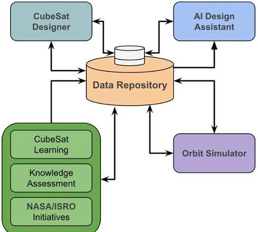
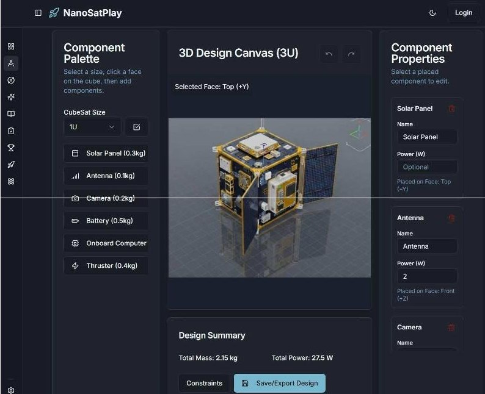
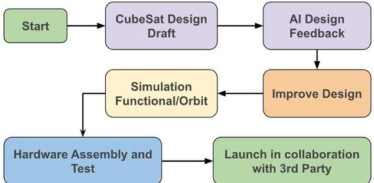

<!-- PDF_PAGE: 1 -->

# AI-Driven Digital Engineering Platform for Rapid CubeSat Mission Prototyping

$ 1^{\mathrm{st}} $ Vishal Kumar Research & Development Ocean2Sand, NJ, USA vishal.kumar@ieee.org

5th Sampathkumar Veeraraghavan President, Brahmam Innov. USA sampath@brahmaminnovations.org

$ 2^{\mathrm{nd}} $ Dr. Ajay Kumar Poddar Research & Development Synergy Microwave, NJ, USA akpoddar@ieee.org

6th Dr. Yahia.M Antar ECE., RMC Kingston, Canada antar-y@rmc.ca

3rd Dr. Anisha M Apte Research & Development Synergy Microwave, NJ, USA anisha_apte@ieee.org

$ 7^{\mathrm{th}} $ R. Muralidharan LSMIEEE , Fellow INAE r.muralidharan@ieee.org

4th Dr. Jawad Y. Siddiqui Dept. ECE. Queen's Univ. Kingston, Canada jys.rpe@gmail.com

$ 8^{\mathrm{th}} $ Dr. Bharti Kumari R&D - Ocean2Sand, India bhartik@ocean2sand.com

Abstract—The growing adoption of nanosatellites has significantly expanded access to space-based experimentation and education. However, early-stage CubeSat design and mission conceptualization remain challenging for students and first-time developers because of fragmented tools and steep learning curves. This paper presents NanoSatPlay, an AI-enabled, browser-based platform that unifies CubeSat design, configuration, orbit visualization, and intelligent design guidance within a single interactive environment. The system integrates a visual component-based satellite designer, a real-time three-dimensional orbit simulator, and a generative AI assistant that provides subsystem-level feedback and contextual learning support. By lowering technical barriers and emphasizing visual and experiential learning, NanoSatPlay enables rapid prototyping, systems-level understanding, and effective STEM education. The architecture, core features, and educational benefits of the platform are discussed, demonstrating its potential to democratize nanosatellite engineering.

Keywords—AI, CubeSat, NanoSat, Engineering Education, STEM, AI in Design, Orbit Simulation, Integrated Development Environment (IDE), Space Technology.

## I. INTRODUCTION

CubeSats have reduced the cost and complexity of space access through standardized form factors, enabling widespread academic and educational participation. Despite these advances, CubeSat education typically relies on multiple disconnected tools for design, simulation, and analysis, limiting systems-level learning $ ^{[10]} $ Mastery of software often outweighs understanding of engineering principles. Recent developments in generative artificial intelligence provide opportunities to simplify this workflow through adaptive guidance and integrated reasoning. NanoSatPlay addresses this need by offering a unified, web-based platform focused on accessibility, visual interaction, and AI-assisted learning.

## II. NANOSATPLAY PLATFORM ARCHITECTURE

NanoSatPlay is implemented as a platform-independent web application. The front end is built using React and Next.js, with Three.js enabling interactive 3D visualization $ ^{[10]} $ .

Fig. 1. High-level architecture of the NanoSatPlay platform, showing the interconnected core modules.

AI-driven analysis and recommendations are powered by a Genkitbased backend. The system integrates four core modules: a CubeSat Designer, an Orbit Simulator, AI Design Assistant and AI enabled learning/assessment. All modules share a common data model, allowing real-time propagation of design changes across visualization, simulation, and AI feedback layers.

## A. CubeSat Designer

The CubeSat Designer offers a component-driven 3D interface for satellite assembly. Users select a standard CubeSat form factor (e.g., 1U or 3U) and populate it using a predefined library of subsystems including solar panels, batteries, antennas, sensors, and onboard electronics $ ^{[5]} $ . The system continuously updates mass and power budgets and verifies compliance with platform constraints. This immediate feedback supports rapid experimentation while reinforcing key engineering trade-offs $ ^{[6]} $ .

## B. AI Design Assistant

The AI Design Assistant evaluates mission objectives and system configurations to assess feasibility and identify subsystem-level issues. Feedback is structured across major subsystems, including power, communication, and payload.

The assistant also recommends design improvements and connects users to relevant learning resources, enabling just-in-time, contextual instruction.

Fig. 2. The visual interface of the CubeSat Designer module developed.

## C. Orbit Simulation and Mission Visualization

The Orbit Simulator provides real-time visualization of CubeSat motion around Earth. Users define key orbital parameters such as altitude and inclination and observe their effects on satellite trajectories through an interactive 3D environment. An AI-assisted visualization layer supplements the simulation by generating concise mission descriptions and representative imagery, translating orbital mechanics concepts into intuitive visual form.

<!-- PDF_PAGE: 2 -->

## III. EDUCATIONAL IMPACT

By consolidating design, simulation, and guidance into a single browser-based tool, NanoSatPlay significantly lowers barriers to CubeSat education. The integrated workflow encourages systems thinking by making subsystem interactions immediately visible. Rapid iteration further accelerates experiential learning in classroom and remote settings.

## A. Comparative Analysis

The benefits of an integrated platform become clear when compared to the traditional, disjointed toolchain commonly used in CubeSat development. Table I provides a direct comparison of key features.

TABLE I. COMPARISON OF CUBESAT DEV. APPROACHES

<table border="1"><tr><td>Feature</td><td>Prior Work</td><td>This Work</td></tr><tr><td>Integration</td><td>Disjointed(SeparateCAD,Sim,AI tools)[6]</td><td>Fully Integrated(Single Web Interface)developed as a part of this research work.</td></tr><tr><td>Cost</td><td>Often requiresexpensive software licenses[6]</td><td>Free to use primary tools, browser-based developed as a part of research work.</td></tr><tr><td>Learning Curve</td><td>Steep;requireslearning multiple interfaces</td><td>Low;intuitive,visual,and guided developed as a part of this research work.</td></tr><tr><td>Prototyping Speed</td><td>Slow;manual data[7]transfer between tools</td><td>Rapid real-time feedback and iteration developed as a part of this research work.</td></tr><tr><td>AI Assistance</td><td>None or via separate,complex integrations</td><td>Built-in,contextual AI Design Assistant developed as a part of this research work.</td></tr><tr><td>Accessibility</td><td>Limited bysoftware/hardwarerequirements</td><td>High;accessible via anymodern web browser either on computer or Mobile devices.</td></tr></table>

## B. Accelerating Iterative Design

Table 1. Shows comparison data and figure of merit. NanoSat simulator developed as a part of research work and an AI-assisted basic version accessible at www.Ocean2sand.com.

The platform is built for rapid prototyping. Figure 6 shows the iterative CubeSat design improvement with the help of AI Design Assistant reduces time, cost and improves efficiency in launching to space. A student can conceptualize a mission, assemble a preliminary design, simulate its orbit, and get AI feedback in a single session. This ability to quickly iterate and test ideas is a powerful learning tool that encourages experimentation and reinforces concepts through trial and error.

Fig. 6. Iterative CubeSat design improvement with the help of AI Design Assistant reduces time, cost and improves efficiency in launching to space.

## C. Contextual and On-Demand Learning

The AI Assistant and integrated tutorials provide knowledge at the moment of need. Instead of requiring students to front-load vast amounts of theoretical knowledge, NanoSatPlay allows them to learn in context. The interactive Tutorials consist of Rich and Interactive Tutorials designed and developed by the Subject Matter Experts. It covers learning for Beginner, Intermediate and Advance topics. For example, if a user's design for an imaging mission lacks

a sufficiently high-data-rate antenna, the AI can explain the issue and suggest relevant components and tutorials on communication systems.

## IV. CORE SIMULATION PRINCIPLES

While the NanoSatPlay Orbit Simulator uses optimized trigonometric calculations for a fluid, real-time 3D visualization suitable for web browsers, its conceptual foundation is rooted in the core principles of astrodynamics. A high-fidelity simulation of a CubeSat's orbit is governed by the two-body problem, which is derived from Newton's Law of Universal Gravitation and his Second Law of Motion. The fundamental vector differential equation of motion is:

$$
\mathrm {d} ^ {2} \mathbf {r} / \mathrm {d t} ^ {2} = - \left(\mathrm {G} ^ {*} \mathrm {M} / \mathrm {r} ^ {3}\right) ^ {*} \mathbf {r}
$$

## Where:

r is the position vector of the CubeSat relative to the Earth's center of mass, r is the magnitude of the position vector r. -

G is the universal Grav, constant $ \approx 6. 6 7 4 \times1 0^{-1 1} \mathrm{N} \cdot \mathrm{m}^{2} / \mathrm{kg}^{2}。 $

M is the mass of the Earth $ (\approx 5.972\times 10^{24}\mathrm{kg}) $

This equation states that the satellite's acceleration (the second derivative of its position, $ \mathrm{d}^{2}\mathbf{r} / \mathrm{d}t^{2} $ ) is directly proportional to its position vector and inversely proportional to the cube of its distance from the Earth's center.

## V. CONCLUSION

NanoSatPlay demonstrates how AI-enabled web platforms can streamline nanosatellite education by unifying design, simulation, and intelligent assistance. The platform enables rapid conceptualization while promoting practical understanding of space systems engineering. Future work will expand subsystem fidelity and mission-level analysis capabilities.

## ACKNOWLEDGMENT

The authors extend their gratitude to the research team of the AI Lab at Ocean2Sand New Jersey, USA for their insightful contributions and support throughout this research, design and development for NanoSatPlay application.

## REFERENCES

[1] J. Puig-Suari, C. Turner, and W. Ahlgren, "Development of the standard CubeSat deployer and a CubeSat class deployer," in 2001 IEEE Aerospace Conference Proceedings, Big Sky, MT, USA, 2001, vol. 1, pp. 1/47-1/52.

[2] A. M. H. Al-Tamimi and M. F. Al-Kalbani, "A Review of CubeSat Technology," in 2020 2nd Int. Conference on Electrical, Control and Inst. Engg.(ICECIE), Kuala Lumpur, Malaysia, 2020, pp. 1-6.

[3] R. A. De Callafon, "AI in Engineering Education: A Paradigm Shift for Teaching and Learning," American Soc. for Engg. Education, 2023.

[4] T. L. Brown, et al., "Language Models are Few-Shot Learners," Advances in Neural Information Processing Sys., vol. 33, 2020.

[5] D. Miller, S. Oliveira, and E. F. Crawley, "The new space systems engineering curriculum at MIT," in 2002 IEEE Aerospace Conf. Proc., Big Sky, MT, USA, 2002, vol. 7, pp. 3519-3532.

[6] Kwonhue Choi; Huaping Liu, "Matlab and Simulink Basics," in Problem-Based Learning in Comm. Systems Using MATLAB and Simulink , IEEE, 2016, pp.1-15, doi: 10.1002/9781119060239.ch1.

[7] J. Rodriguez-Chong and D. Caceres-Hernandez, "LabSI-SAT: Lowcost CubeSat Nanosatellite Prototype Assembly Demonstration," 2024 9th International Engineering, Sciences and Technology Conference (IESTEC), Panama City, Panama, 2024, pp. 487-492, doi: 10.1109/IESTEC62784.2024.10820199.

[8] Konstantinos-Panagiotis Bouzoukis, Georgios Moraitis, "Vassilis Kostopoulos. And Vaios Lappas, "An Overview of CubeSat Missions and Applications", Aerospace 2025, 1, 550. https://doi.org/10.3390/aerospace12060550

[9] Martel et al, "Development of a Digital Engineering Testing Framework for CUBESAT Applications", The ITEA Journal of Test and Evaluation, Volume 45, Issue 3, Sept 2024

[10] T. Pelham and A. Austin, "Rapid Virtual Prototyping for Cubesat Scale Deployable Reflector Antennas," 2025 URSI International Symposium on Electromagnetic Theory (EMTS), Bologna, Italy, 2025, pp. 1-4, doi: 10.46620/URSIEMTS25/YXDS2743.